# The ships, one by one

What this covers: the 19 blueprints of Side A as a catalogue. Each is turned by the game's own code, with its
numbers, what brings it into a system, where the player meets it and how it differs from BBC Elite. The blueprint
format is in [7](07-objects.md) 7.3 and the spawning rules in 7.8; the drawing is in [the 3D engine](3d-engine.md),
and the full BBC comparison in [bbc-comparison.md](bbc-comparison.md) 1. Side B swaps the Krait for an Adder
([3](03-build-and-load.md) 3.12); this catalogue is Side A's.

## 1. How the pictures are made

Each picture is the game's 3D code run in skoolkit's Z80 simulator over the title's memory (`tools/shipsim.py`,
`d1` frame 250). ActionTitleShip `$BB75` places the ship as the title does. Each picture is then ClearView and
TurnTitleShip (MoveShip, Orthogonalise, TidyAxis, DrawShip), with the face test on: an edge is drawn when one of
its two faces turns towards the eye. The back buffer `$C000` is shown at 2x. The simulator draws the title's ships
pixel for pixel as the emulator does ([the 3D engine](3d-engine.md), the two proofs before 1).

The ship turns on two axes at once from the title's axes: pitch 10 a step (the nose towards the roof, `$8A` in A for
MoveShip) and roll 20 (the side towards the roof, `$94` in TurnRates), the title's own roll with a slightly slower
pitch than its `$8C`. MoveShip's small-angle steps drift on the first turns; after 300 steps the motion settles on a
loop whose pictures repeat exactly, in 35 steps for every blueprint, and the GIF shows that loop a step a picture,
so it plays without a jump. The loop is one fixed tumble, so a ship need not show every face in it (the Coriolis
shows 11 of 14 and keeps its slot face away; [1](01-game-design.md) has it rolling slot on). The ship sits at the
nearest z (in 256ths of a page, from half a page up) at which every picture is drawn and none touches the view's
frame, and that z is written under the picture. The title is the header: the name, the number and the address, the
counts, then the laser's chance to fire (`+$02`, of 255), the launches (`+$0A`) and the bounty (`+$08`), each only
when it is not 0.

```bash
python3 tools/fig_ships_anim.py one       # all 19 into docs/img/ships/one/; "one 13" draws the Asp alone
```

The numbers, from the headers (`python3 tools/fig_ships.py --list` prints them with the addresses). Speed is the top
speed; CreateShip starts a ship at half of it. The score is what a kill adds to the rating, half the `+$15` word, in
256ths of a BBC kill ([bbc-comparison](bbc-comparison.md) 6).

| # | Ship | Size | Speed | Energy | Laser | Launches | Bounty (Cr) | Score | Class |
| ---: | --- | ---: | ---: | ---: | ---: | --- | ---: | ---: | ---: |
| 0 | Coriolis | 160 | 0 | 240 | 0 | 6 missiles | 0 | 0 | 0 |
| 1 | Missile | 40 | 44 | 2 | 0 | - | 0 | 224 | 0 |
| 2 | Escape pod | 16 | 8 | 17 | 0 | - | 0 | 25 | 1 |
| 3 | Plate | 10 | 16 | 16 | 0 | - | 0 | 16 | 1 |
| 4 | Canister | 20 | 15 | 17 | 0 | - | 0 | 15 | 1 |
| 5 | Splinter | 16 | 10 | 20 | 0 | - | 0 | 15 | 1 |
| 6 | Asteroid | 80 | 30 | 60 | 0 | - | 0.5 | 12 | 1 |
| 7 | Rock hermit | 80 | 30 | 180 | 80 | 2 Sidewinders or Kraits | 0 | 128 | 2 |
| 8 | Viper | 75 | 32 | 140 | 120 | 2 missiles | 0 | 40 | 2 |
| 9 | Cobra Mk III (trader) | 95 | 28 | 150 | 140 | 4 missiles | 0 | 256 | 2 |
| 10 | Python (trader) | 80 | 20 | 250 | 130 | - | 0 | 256 | 2 |
| 11 | Python (pirate) | 80 | 20 | 250 | 150 | - | 20.0 | 448 | 3 |
| 12 | Cobra Mk III (pirate) | 95 | 28 | 150 | 160 | 2 missiles | 17.5 | 448 | 3 |
| 13 | Asp Mk II | 60 | 40 | 150 | 250 | 1 missile | 20.0 | 416 | 3 |
| 14 | Fer-de-Lance | 40 | 30 | 160 | 255 | 2 missiles | 0 | 384 | 3 |
| 15 | Thargoid | 99 | 39 | 240 | 255 | 6 Thargons | 50.0 | 1024 | 3 |
| 16 | Sidewinder | 65 | 37 | 70 | 130 | 1 missile | 5.0 | 128 | 4 |
| 17 | Krait | 60 | 30 | 80 | 110 | - | 10.0 | 128 | 4 |
| 18 | Thargon | 40 | 30 | 20 | 120 | 1 missile | 5.0 | 50 | 4 |

A ship launches only when weak (its energy below half the maximum), with launches left and no E.C.M. running:
missiles at the player when the `+$0A` high nibble is 0, else ships of that kind (Tactics, [7](07-objects.md) 7.6).
SpawnShip `$BBBA` (every 256 passes, outside the safe zone, fewer than four ships about) picks most of the ships
below. With danger = 2 x (slaves + narcotics) + firearms, a random byte below danger + 80 goes on to the danger
branch, the next 10 values bring an asteroid, the rest nothing. That branch makes:

- in the Thargoid mission, a Python trader while the MAYDAY is unanswered (state 1) and a Thargoid at the base
  (state 4);
- elsewhere, by the government: an anarchy always, a government g in (8 - g) / 8 of the calls. Then half of these
  are a lone pirate, the other half a trader (a Cobra, a Python, a Viper or a rock hermit) or a group of two or
  three Sidewinders and Kraits;
- a pirate or trader carries an E.C.M. 1 time in 5 (a random byte below `$33`).

## 2. The station and the debris

### 0 Coriolis

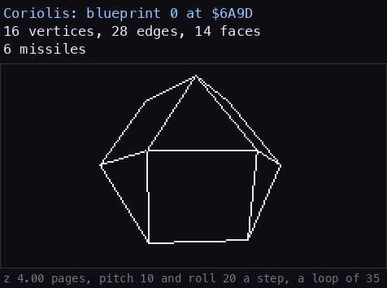

**How to read it.** Square and triangular faces of the cuboctahedron; the loop shows 11 of its 14 faces, and the
face test keeps the nose face with the slot hidden throughout. [1](01-game-design.md) rolls the station slot on
(station.gif). `python3 tools/fig_ships_anim.py one 0`.

Slot 0 (`$6048`) holds the station wherever there is one; in witch space the slot is empty. It never moves of its
own (speed 0), only by the player's flight. Calm, it launches a trader (a Cobra or a Python) on 2 random bytes in
256 a pass while fewer than four ships are about; angry, a police Viper on `$24` in 256, or in the Thargoid base
(mission state 4) a Thargoid on 136 of those. The docking test reads its nose and not its roof
([bbc-comparison](bbc-comparison.md) 5). Against the BBC: the same shape and header values.

### 1 Missile

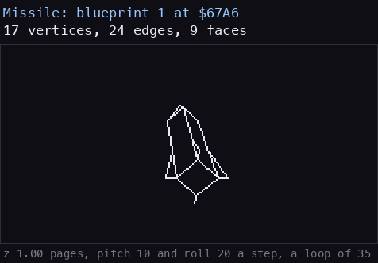

**How to read it.** The long body with its four fins, tumbling end over end: all nine faces show in the loop, the
fins hidden in turn behind the body. `python3 tools/fig_ships_anim.py one 1`.

ActionMissile `$B99F` makes one: the player's (in slot 7, at the target locked) or a weak ship's, aimed at the
player. It homes every pass (MissileHoming `$A4B5`) and an E.C.M. destroys it; `k2` lost its missile to a
Thargoid's E.C.M. at 2572 ([scenes](scenes.md) 3). Its kill adds 224 to the score. Against the BBC: the shape of the
BBC cassette and the sideways RAM disc build; the default disc build has other normals on faces 7 and 8.

### 2 Escape pod

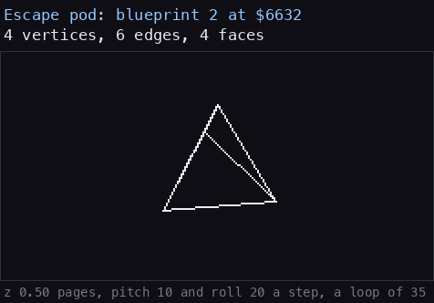

**How to read it.** A small pyramid: at most three of its four faces show at once, so one edge always hides behind
them. `python3 tools/fig_ships_anim.py one 2`.

A weak trader with its pod bails out through ActionPod `$BAFA` (action 7), the pod leaving the ship. The cargo
nibble 2 gives slaves when it is scooped (CollideScoopCargo adds the nibble + 1, commodity 3). The player's own
escape pod is not this blueprint: action 7 with C bit 0 puts blueprint 9, the Cobra Mk III, in slot 6 and flies it
off, the player's ship seen from the pod. Against the BBC: the same.

### 3 Plate

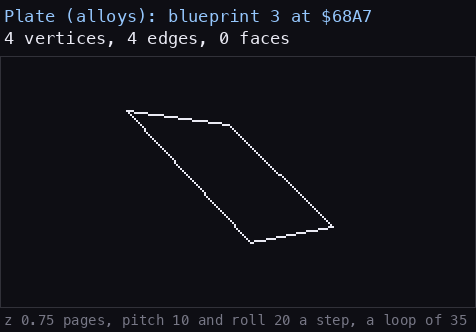

**How to read it.** Four edges, all of them always drawn: the plate's edges name face 15, which counts as seen,
so nothing is hidden at any angle. `python3 tools/fig_ships_anim.py one 3`.

ActionPlates `$BA94` throws two from a destroyed ship (from the ship, or near the player). Scooped, it gives alloys
(nibble 8, commodity 9): `cs` scooped one at 910 ([scenes](scenes.md) 7). Against the BBC: no face normal where the
BBC has one, and dot distance 12 against 5.

### 4 Canister

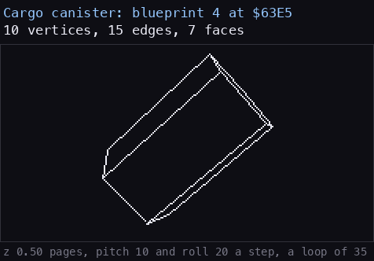

**How to read it.** Ten vertices: two pentagon ends and five sides. An end is drawn whole when it faces the eye
and a side shrinks to a line edge on; 6 of the 7 faces show in the loop. `python3 tools/fig_ships_anim.py one 4`.

ActionCanister `$BAF2` drops one from a destroyed ship or near the player. Its cargo nibble is 0, so the scoop picks
the cargo then: one of the first eight commodities at random, or the mission's item when MissionShip is 3
(CollideScoopMission). Against the BBC: the same.

### 5 Splinter

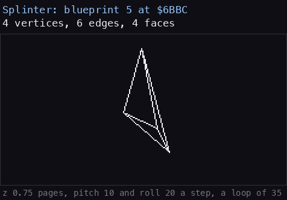

**How to read it.** The same four vertices and six edges as the pod but smaller and flatter, its normals its own.
`python3 tools/fig_ships_anim.py one 5`.

ActionSplinters `$BB4D` makes two when the laser breaks an asteroid. The cargo nibble 11 gives minerals (commodity
12). Against the BBC: the BBC takes the pod's six edges through its edges offset and the Spectrum stores the same
six in its own blueprint; the four face normals differ, and the dot distance is 10 against 8.

### 6 Asteroid

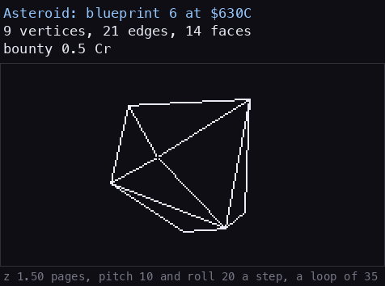

**How to read it.** A rough boulder of 14 faces: about half of its 21 edges are hidden at any moment.
`python3 tools/fig_ships_anim.py one 6`.

SpawnShip makes one on 10 of its random values (above danger + 80, below danger + 90), at any government, turning
(`+$1D` = `$C0`) and passive. The laser breaks it into splinters; its bounty is 5 tenths. Against the BBC: the same.

## 3. Traders and the station's police

### 7 Rock hermit

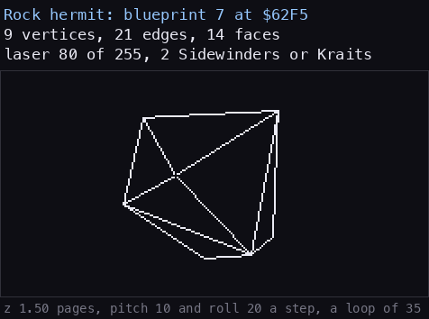

**How to read it.** The asteroid's picture exactly: both headers point at one set of vertices, edges and faces.
`python3 tools/fig_ships_anim.py one 7`.

A trader of SpawnShip (one of the two "other" traders with the Viper: the rotated random byte's low three bits below
2, bit 7 picking the hermit). Weak, it launches up to two Sidewinders or Kraits (ActionLaunch kind 5). Against the
BBC: the BBC disc has the asteroid's blueprint only, 60 energy and a bounty of 5 tenths; here it is a blueprint of
its own with 180 energy and no bounty.

### 8 Viper

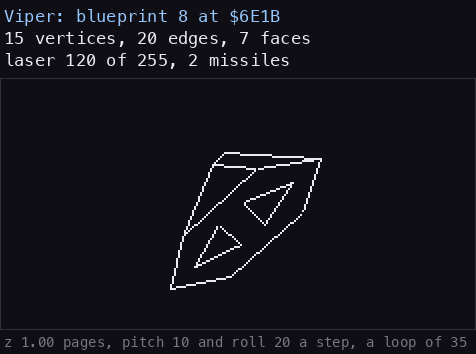

**How to read it.** The flat arrowhead seen from all round: as it tumbles its top and bottom faces show in turn,
all seven faces in the loop. `python3 tools/fig_ships_anim.py one 8`.

The angry station launches it (ActionLaunch kind 1), and SpawnShip makes one as a trader's other half with the rock
hermit. It carries two missiles and fires on 120 of 255. Its kill is worth only 40 (0.16 of a BBC kill). Against
the BBC: energy 140 against 100, the rest the same.

### 9 Cobra Mk III (trader)

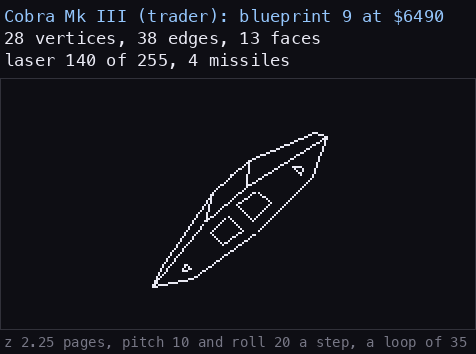

**How to read it.** The wide wedge with its gun: the short line at the front is the gun, an edge of the blueprint,
drawn from the laser vertex 21. `python3 tools/fig_ships_anim.py one 9`.

A SpawnShip trader (the rotated byte's low bits 2 to 4) and the calm station's traffic. It carries four missiles.
Blueprint 9 is also the player's own Cobra flying off when the escape pod is used (action 7). Against the BBC: the
same shape and values.

### 10 Python (trader)

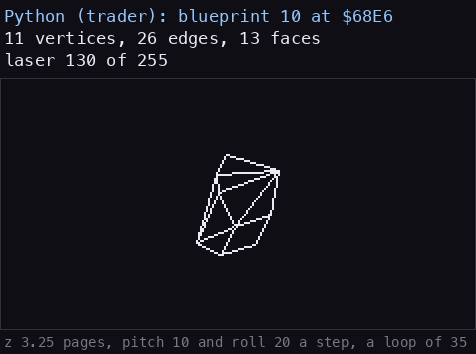

**How to read it.** The long faceted hull: 11 vertices only, but 26 edges and 13 faces.
`python3 tools/fig_ships_anim.py one 10`.

A SpawnShip trader (the rotated byte's low bits 5 to 7) and the calm station's traffic. While the Thargoid
mission's MAYDAY is unanswered (state 1) every danger-branch spawn is this ship. It has no missiles. Against the BBC:
edges 12-15 have visibility distance 9 where the BBC has 7, so they stay drawn a little farther out.

## 4. Pirates

### 11 Python (pirate)

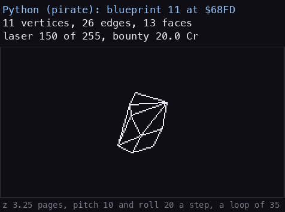

**How to read it.** The same picture as blueprint 10: the two headers share one shape.
`python3 tools/fig_ships_anim.py one 11`.

The commonest lone pirate after the Asp: 17 of the 64 values of SpawnPirate's random byte (`AND $3F`, 47-63). It
fires on 150 of 255 where the trader fires on 130, and its kill adds 448. Against the BBC: the edges as for the
trader.

### 12 Cobra Mk III (pirate)

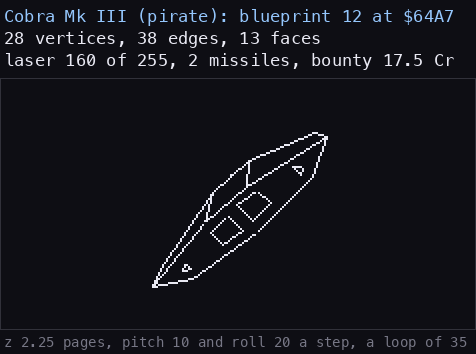

**How to read it.** The same picture as blueprint 9. `python3 tools/fig_ships_anim.py one 12`.

A lone pirate on 16 of the 64 values (31-46). Two missiles instead of the trader's four, laser 160. Against the BBC:
the same.

### 13 Asp Mk II

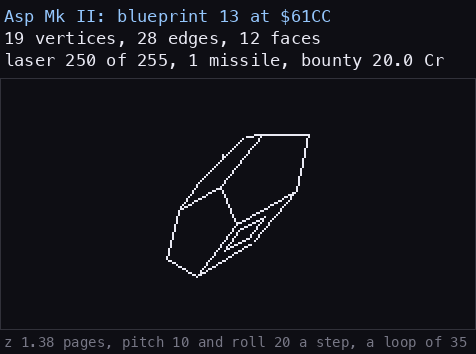

**How to read it.** The low twelve-faced hull, 11 of whose faces show in the loop; the face test redraws the
outline at every step. `python3 tools/fig_ships_anim.py one 13`.

The commonest lone pirate: 18 of the 64 values (13-30). The cloak ship of the Thargoid-mission chain is an Asp too:
SpawnShip makes it on a random byte below `$1E` when the mission flags allow, with an E.C.M. always and a group of
two or three Sidewinders and Kraits behind it (SpawnMissionDone `$BBF2`; `m2` frame 7922). Against the BBC: dot
distance 24 against 40.

### 14 Fer-de-Lance

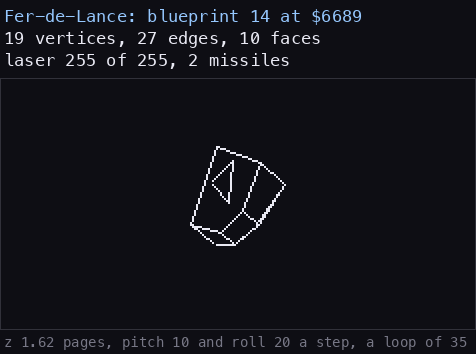

**How to read it.** The long flat dart of ten faces (nine show in the loop): it narrows to a line when it turns
edge on. `python3 tools/fig_ships_anim.py one 14`.

A lone pirate on 12 of the 64 values (1-12). It pays no bounty but its kill adds 384. Against the BBC: dot distance
30 against 40, and the kill 1.20 times the Master's where the others are 1.5.

## 5. Thargoids and fighters

### 15 Thargoid

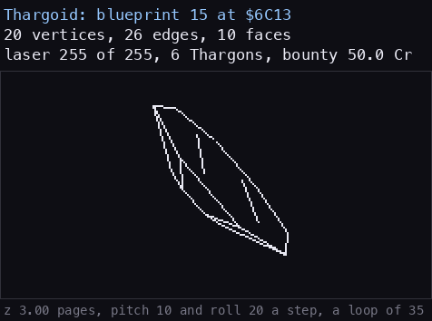

**How to read it.** The eight-sided saucer: as it tumbles its two octagons pass edge on, and the slanted rim
faces show between them (all ten faces in the loop). `python3 tools/fig_ships_anim.py one 15`.

Three ways in: a misjump puts three or four in witch space (ActionThargoids `$B96B`, `w1` 2100, `k2`); 1 lone pirate
in 64 is a Thargoid (value 0); and at the Thargoid base (mission state 4) SpawnShip makes them and the angry station
launches them. Each carries an E.C.M. always (SpawnECM for blueprint `$0F`). Weak, it launches up to six Thargons.
`k2` killed one at 3628 ([scenes](scenes.md) 3). Against the BBC: the same.

### 16 Sidewinder

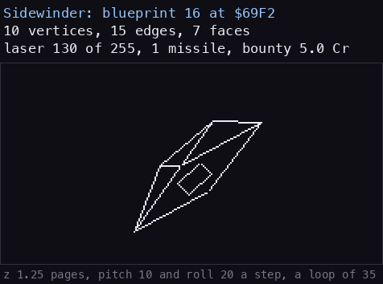

**How to read it.** A flat wedge of seven faces, all shown in the loop: face on it shows its full width, edge on a
thin line. `python3 tools/fig_ships_anim.py one 16`.

SpawnGroup makes two or three, each a Sidewinder or a Krait on a random bit; the rock hermit launches them and the
cloak ship brings them. Its kill adds 128, half a BBC kill. Against the BBC: the same.

### 17 Krait

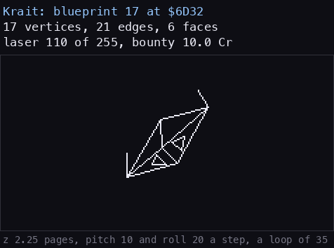

**How to read it.** The short lines off the front are the prongs, edges of the blueprint, not a fault: the title's
proof shows them in the emulator's picture too. `python3 tools/fig_ships_anim.py one 17`.

The Sidewinder's partner in a group, no missiles, laser 110. Side B's tape loads the Adder in its place. Against the
BBC: dot distance 20 against 25.

### 18 Thargon

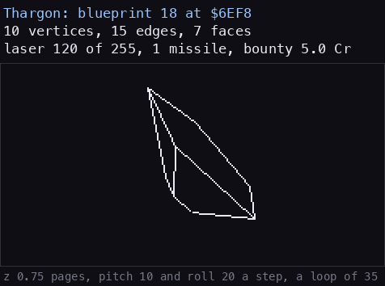

**How to read it.** The canister's ten-vertex drum with the Thargon's own header: the same edges, other proportions.
`python3 tools/fig_ships_anim.py one 18`.

A weak Thargoid launches it (ActionLaunch kind 3). `k2` saw Thargoid 3 launch one at energy 49 at 3448 and killed a
Thargon for 50 ([scenes](scenes.md) 3). Its cargo nibble 15 would give alien items, but nothing in the code makes a
Thargon scoopable (known from the code only). Against the BBC: the BBC takes the canister's 15 edges through its
edges offset, the same 15 as the Spectrum's own copy.
