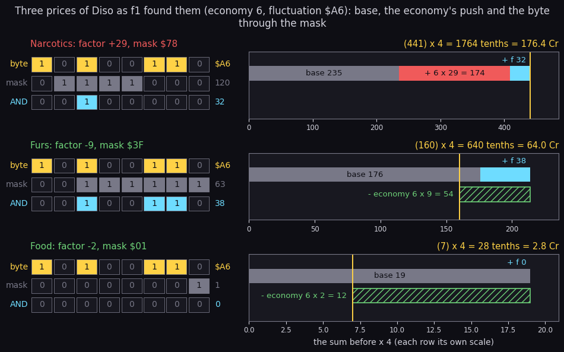
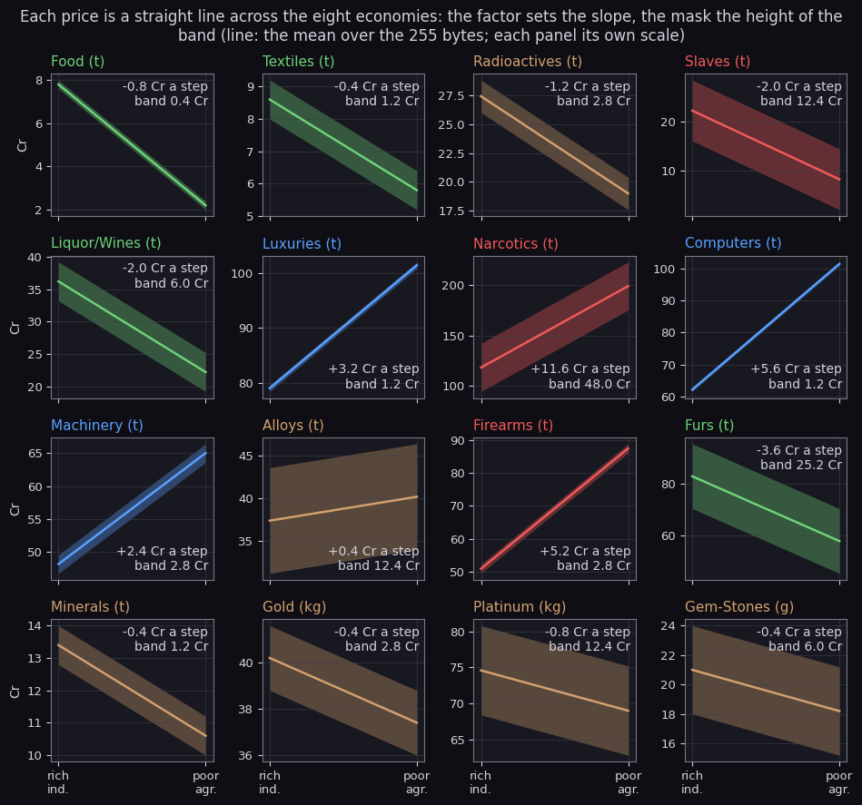
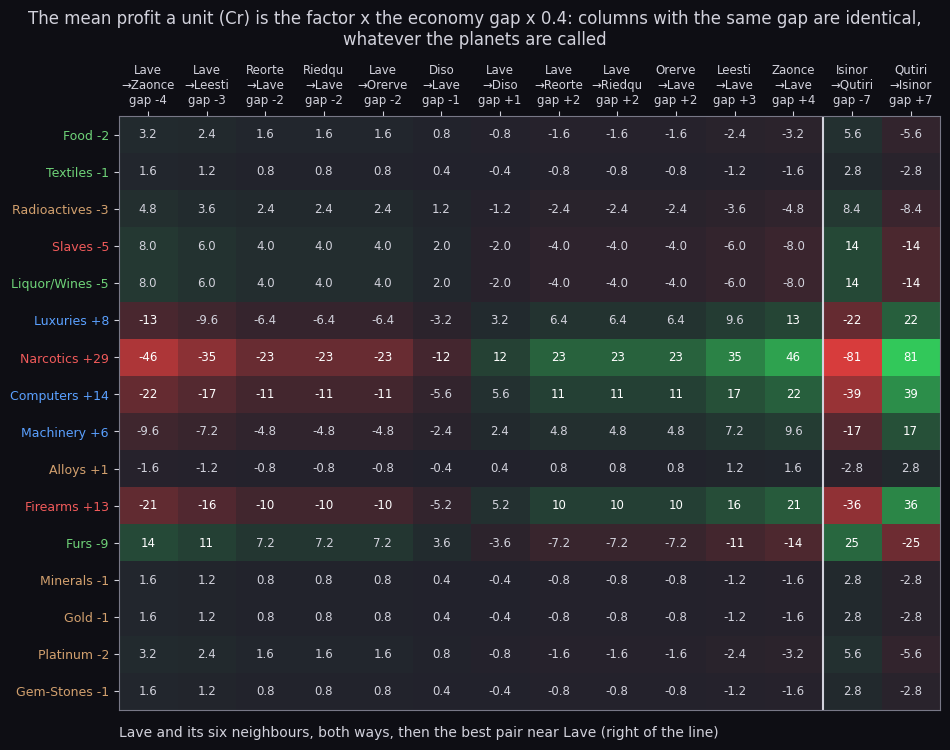
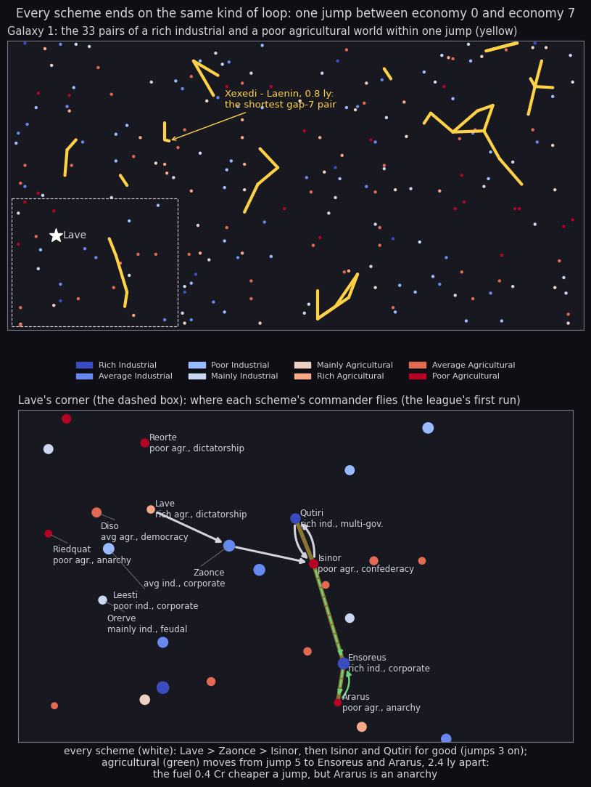
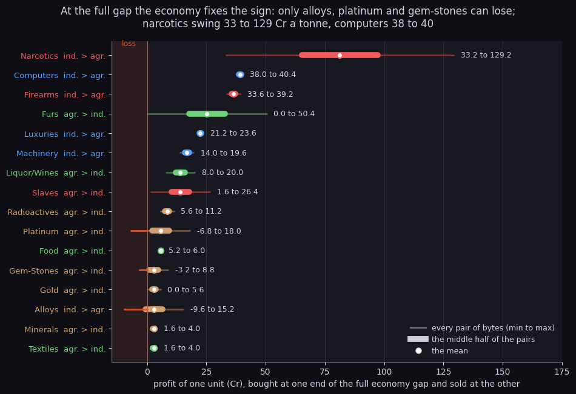
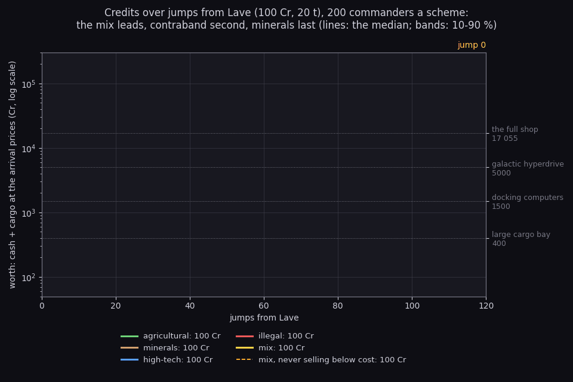
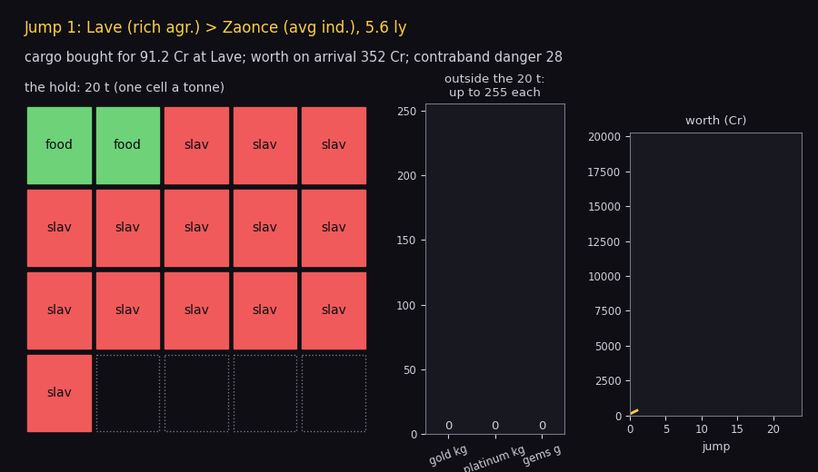
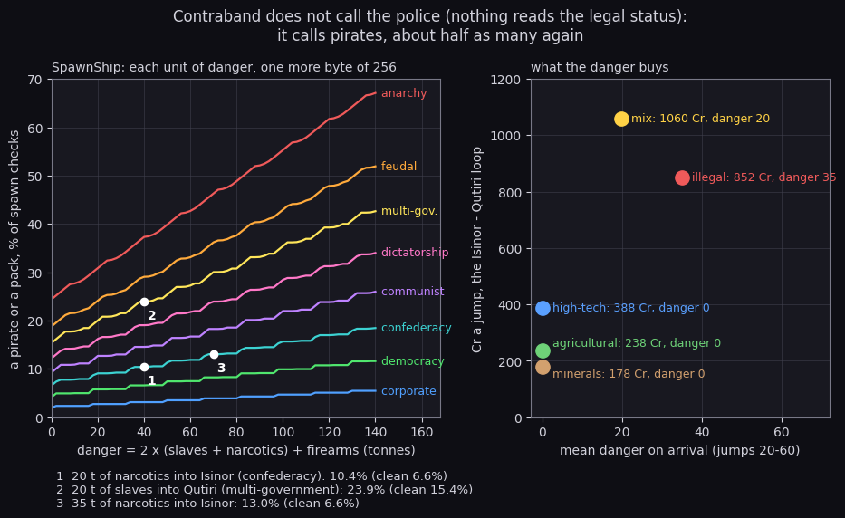
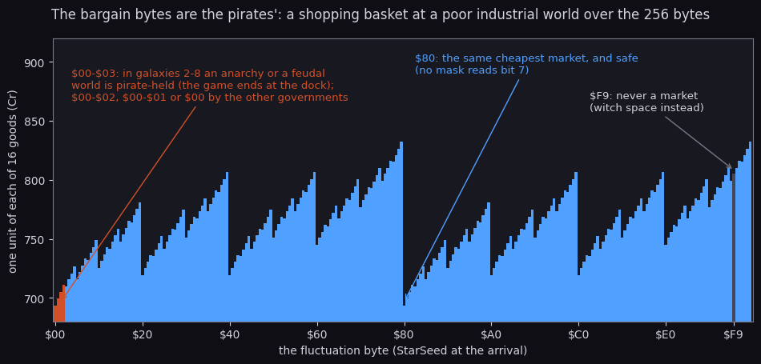

# Elite: the trading course

> **FROM 100 CREDITS TO 100 000 IN 120 JUMPS.**
> No combat. No luck. No experience needed.
> Five proven schemes. My students made 10 000 Cr in 14 jumps.*
>
> <sub>* the median of 200 simulated commanders on the "mix" scheme, galaxy 1, run by the game's own market code.
> Pirates not included. Past fluctuations are no guarantee of future fluctuations.</sub>

This is a get-rich-quick course with a twist: every number in it is real. Each "scheme" is pitched like a guru's
lesson and then checked in a box called **What the code says**, with the mechanism, the numbers and the addresses.
The numbers come from `tools/trade.py`, which runs the market of the 48K game rule for rule:

- prices and stocks: `galaxy.market()`, MakeMarket `$E148` step for step, checked against Diso's market in `f1` and
  Lave's in `d1` ([10](10-gameplay-logic.md) 10.3);
- buying and selling: BuyCheck `$E7DB`, SellCheck `$E935`, IsTonnes `$E34C`
  ([10](10-gameplay-logic.md) 10.4);
- the fuel: the price JumpHyperspace `$DC8E` writes ([10](10-gameplay-logic.md) 10.5);
- the danger: SpawnShip `$BBBA` ([7](07-objects.md) 7.8).

`python3 tools/trade.py --check` asserts the rules the numbers rest on (Lave's first market, the price step, the
0.4 Cr grid, the extremes, the wrapped stock, the shortest pair). The figures are drawn
by `tools/fig_trading.py`.

Contents:

1. [Lesson 0: the secret formula](#lesson-0-the-secret-formula)
2. [Lesson 1: forget the map, learn the economies](#lesson-1-forget-the-map-learn-the-economies)
3. [The five schemes](#the-five-schemes)
4. [The league table](#the-league-table)
5. [Lesson 2: the risk my competitors hide from you](#lesson-2-the-risk-my-competitors-hide-from-you)
6. [Bonus tips for premium students](#bonus-tips-for-premium-students)
7. [Small print: how the numbers were made](#small-print-how-the-numbers-were-made)

## Lesson 0: the secret formula

*"Other courses sell you tips. I sell you THE FORMULA. Once you see it, you will never pay full price again."*

Every station's 17 prices come from one table, Commodities `$701B`: four bytes a commodity (base price, factor,
base quantity, mask). The factor's bit 7 is its sign, bits 5-6 the unit. MakeMarket adds the system's economy
(0 rich industrial to 7 poor agricultural) and a fluctuation byte. This is its price half, the listing from
`src/game/galaxy.asm`:

```asm
MakeMarketLoop:
  PUSH BC
  LD E,(HL)               ; the base price
  INC HL
  LD A,(HL)
  LD D,A                  ; the factor
  PUSH DE
  AND $1F
  JR Z,MakeMarketQuantity
  LD B,A
  LD A,(Economy)
  LD C,A
  XOR A
MakeMarketLoop2:
  ADD A,C                 ; the product = economy x (factor AND $1F)
  DJNZ MakeMarketLoop2
```

and, after the stock, the price itself:

```asm
  LD A,(CommanderRest+$0007)
  AND C                   ; f = the fluctuation AND the mask
  ADD A,E                 ; + the base price
  LD E,$00
  RL E
  LD C,A
  LD A,B
  BIT 7,D
  JR Z,MakeMarketPositive
  LD D,A
  LD A,C
  SUB D                   ; a negative factor: less the product
  JR MakeMarketPrice
MakeMarketPositive:
  ADD A,C                 ; a positive factor: plus the product
  JR NC,MakeMarketPrice
  INC E
MakeMarketPrice:
  LD B,E
  ADD A,A                 ; x 4: the price in tenths of a credit
  RL B
  ADD A,A
  RL B
```

(In this guide's listings the instructions are the source's; the short comments are added, the source keeps them
in each routine's header.) In pseudocode:

```
product = economy * (factor & 0x1F)
f       = fluctuation & mask
price   = (base + f + product) * 4      tenths of a credit, factor positive
          (base + f - product) * 4      factor negative
stock   = base_quantity + f - product - 1   factor positive
          base_quantity + f + product       factor negative
          0 if bit 7 is set, then & 0x3F; alien items 0
```

Three constants make the whole economy:

- **the factor**: what one economy step does to the price, `0.4 Cr x factor` a unit (the base is counted in units
  of 0.4 Cr because of the `x 4`);
- **the mask**: which bits of the fluctuation byte reach the price, a band `0.4 Cr x mask` wide;
- **the sign**: positive goods (luxuries, narcotics, computers, machinery, alloys, firearms) are dear on farm
  worlds, negative ones (food, textiles, radioactives, slaves, liquor, furs, minerals, gold, platinum, gems) are
  dear on industrial worlds.

The fluctuation byte is the star field's random seed at the arrival (NewMarket `$E142` copies StarSeed into
`$D06A`). Here is the formula worked out for Diso, at the byte `f1` really arrived with:



*Three of Diso's 17 prices, built the way MakeMarket builds them: they match the snapshot to the tenth.*

**How to read it.** The top row is the fluctuation byte `$A6` in binary. Each commodity's mask is printed under
it, and the cyan bits are what survives the `AND`. Each bar adds up from the left: the base price (grey), the
product (red, added for a positive factor), then `f` (cyan). A negative factor's product is the hatched lane
under the bar, taken away. The yellow line is the sum; the price is the sum times 0.4 Cr. Narcotics: (235 + 174 + 32) x 4 = 1764 tenths, 176.4 Cr. Furs: (176 - 54 + 38) x 4, 64.0 Cr. Food:
(19 - 12 + 0) x 4, 2.8 Cr. Each row has its own scale. Drawn by `python3 tools/fig_trading.py recipe`.

The formula is linear in the economy. Run it for every economy and every byte, and each commodity becomes a
straight ramp with a band around it:



*The slope (0.4 Cr x factor) is the profit of one economy step; the band (0.4 Cr x mask) is the luck.*

**How to read it.** One panel a commodity. The x axis is the economy, 0 (rich industrial) to 7 (poor
agricultural). The line is the mean price over all fluctuation bytes, the shaded band the lowest to the highest.
The title says what one step adds and how wide the band is. Narcotics climbs 11.6 Cr a step inside a 48 Cr band;
computers climb 5.6 Cr a step inside 1.2 Cr; alloys climb 0.4 Cr a step inside 12.4 Cr, so the luck beats the
trade. Drawn by `python3 tools/fig_trading.py fan`.

> **What the code says.**
> - The mean price difference between two economies is exactly `0.4 Cr x factor x gap`: `trade.py --check`
>   asserts it for every commodity.
> - Every price is a multiple of 0.4 Cr (the `x 4`). The cheapest price in galaxy 1 is food at 2.0 Cr, the dearest
>   narcotics at 223.2 Cr.
> - No mask uses bit 7, so the bytes `n` and `n + $80` make the same market.
> - The arrival never brings the byte `$F9`: JumpHyperspace sends StarSeed `$F9` to witch space before NewMarket
>   reads it (the misjump, one jump in 256). The other 255 bytes are taken as equally likely.

## Lesson 1: forget the map, learn the economies

*"Beginners stare at the galactic chart. Professionals look at one digit."*

The formula has no system in it, only the economy. Two systems of the same economy have the same price list (up to
the fluctuation byte). So the mean profit of a route is fixed by the two economies alone:



*A route's mean profit is a function of the two economies only: equal gaps, equal columns.*

**How to read it.** Rows are the 16 goods, columns are routes (from > to, with the two economies). A cell is the
mean profit of one unit bought at the first system and sold at the second: green a gain, red a loss. A route and
its return are mirror images. The Isinor > Qutiri column (poor agricultural to rich industrial, a gap of 7) is the
largest that exists. Drawn by `python3 tools/fig_trading.py heatmap`.

The best route is any pair of economy 0 and economy 7 within one tank (7.0 ly). Galaxy 1 has 33 such pairs:



*The money is not at Lave: two jumps away, Isinor and Qutiri, 2.8 ly apart, are the best pair within reach.*

**How to read it.** Left: the whole galaxy, each system a dot coloured by its economy; a line joins each rich
industrial system to a poor agricultural one within 7.0 ly. The shortest pair, Xexedi and Laenin (0.8 ly), is
labelled. Right: Lave's corner. The arrows are the course the simulated commanders take (the same for every
scheme): Lave > Zaonce > Isinor, then back and forth to Qutiri. The agricultural scheme moves on at jump 5 to
Ensoreus and Ararus (2.4 ly). Drawn by `python3 tools/fig_trading.py map`.

The best loops (`python3 tools/trade.py --routes`), 20 t in the hold, per jump, the fuel paid:

| Scheme | Lave's area: Isinor (7) - Qutiri (0), 2.8 ly | anywhere: Laenin (7) - Xexedi (0), 0.8 ly | Lave (5) - Zaonce (1), 5.6 ly | 35 t, anywhere |
| --- | ---: | ---: | ---: | ---: |
| agricultural | 237.6 Cr | 239.6 Cr | 137.5 Cr | 409.8 Cr |
| minerals | 177.8 Cr | 179.8 Cr | 100.5 Cr | 224.8 Cr |
| high-tech | 388.5 Cr | 390.5 Cr | 217.8 Cr | 684.5 Cr |
| illegal | 851.9 Cr | 853.9 Cr | 344.8 Cr | 1332.3 Cr |
| mix | 1059.6 Cr | 1061.6 Cr | 509.2 Cr | 1699.3 Cr |

"Lave's area" is within two full tanks of Lave (14 ly). Flying across the galaxy to the "best" pair gains 2 Cr a
jump, the fuel of 2 ly saved.

> **What the code says.**
> - The fill-up price is written by every jump: `70 - fuel + 2 x economy` tenths, the economy the arrival's
>   (JumpHyperspace, `EquipmentPrices+1`). That is 0.1 Cr per 0.1 ly plus 0.2 Cr per economy step. Isinor
>   (economy 7) charges 4.2 Cr for 2.8 ly, Qutiri (economy 0) 2.8 Cr.
> - The fuel is the smallest cost in the game: 3.5 Cr a jump on the best loop against 238-1060 Cr of profit.
> - A loop is two jumps, so a one-way scheme earns half its load per jump: agricultural goods (482.3 Cr a load) go
>   only from farm to factory, high-tech goods (784.0 Cr) only back.

## The five schemes

*"Choose YOUR path to wealth. Every path works. Some work better."*

The groups: **agricultural** food, textiles, liquor, furs; **minerals** radioactives, alloys, minerals, gold,
platinum, gem-stones; **high-tech** luxuries, computers, machinery; **illegal** slaves, narcotics, firearms;
**mix** anything. Alien items are never in stock (MakeMarket forces 0). The profit of one unit at the full gap
(economy 7 against 0), over every pair of bytes at the two ends:



*Only alloys, platinum and gem-stones can lose money at the full gap; narcotics earns 33 to 129 Cr a tonne.*

**How to read it.** One row a commodity, coloured by scheme, sorted by the mean, with the direction that pays
(ind. > agr. or back). The thin line runs from the worst to the best profit of one unit over all 255 x 255 pairs of
the buying and the selling byte; the thick part holds the middle half of those pairs; the white dot is the mean. The
range is written at the right. A part left of the zero line, in the shaded loss zone, is drawn red. Drawn by `python3 tools/fig_trading.py swing`.

### Scheme 1: the honest farmer (agricultural)

*"Food! People will always need food! Buy low on the farm, sell high in the city!"*

- buy on a poor agricultural world, sell on a rich industrial one;
- the best near Lave: Isinor > Qutiri, 482.3 Cr a 20 t load, **237.6 Cr a jump** (nothing to carry back);
- 35 t: 409.8 Cr a jump.

> **What the code says.**
> - Profit a unit at gap 7, the mean (range): food 5.6 (5.2-6.0) Cr, textiles 2.8 (1.6-4.0), liquor 14.0
>   (8.0-20.0), furs 25.2 (0.0-50.4).
> - Furs carry the scheme, and furs are the lottery: mask 63, so the band is 25.2 Cr each side.
> - The stock limits the load: at a poor agricultural station food has 20-21 tonnes, furs 0-63 (31.5 on average),
>   liquor 37.5.
> - Median of 200 commanders: 26 897 Cr after 120 jumps, 10 000 Cr at jump 49.

### Scheme 2: precious metals, the safe haven (minerals)

*"Gold never loses value. Platinum is the new gold. Gem-stones are forever."*

- radioactives and minerals from farm to factory, gold, platinum and gems both ways when the byte is right;
- the best near Lave: Isinor - Qutiri, 297.8 Cr out, 64.8 Cr back, **177.8 Cr a jump**;
- 35 t: 224.8 Cr a jump (the metals do not need the space: see below).

> **What the code says.**
> - The factors are tiny: -1 for gold, gem-stones, minerals and alloys, -2 for platinum, -3 for radioactives. A
>   whole galaxy of economy gap earns 2.8 Cr a kilogram of gold.
> - The masks are large: alloys and platinum 31 (a 12.4 Cr band each side), gems 15 (6.0). These are the only
>   goods that can lose at the full gap: alloys -9.6 to +15.2, platinum -6.8 to +18.0, gems -3.2 to +8.8.
> - Gold, platinum and gem-stones do not use the free space (IsTonnes `$E34C`: items 0-12 and 16 are tonnes); only
>   the stock (gold 12.5 kg on average, platinum 20.5, gems 8.5 g) and the hold's byte (255) limit them.
> - Median: 20 856 Cr after 120 jumps, last in the league; 10 000 Cr at jump 63.

### Scheme 3: the tech investor (high-tech)

*"Computers. Luxuries. Machinery. Invest in the FUTURE."*

- buy on a rich industrial world, sell on a poor agricultural one;
- the best near Lave: Qutiri > Isinor, 784.0 Cr a load, **388.5 Cr a jump**;
- 35 t: 684.5 Cr a jump.

> **What the code says.**
> - Computers: factor +14, mask 3: 39.2 Cr a tonne at gap 7, never less than 38.0 or more than 40.4. The most
>   predictable trade in the game.
> - Luxuries 22.4 (21.2-23.6), machinery 16.8 (14.0-19.6): computers win every time, and a rich industrial
>   station stocks 56.5 tonnes of them on average.
> - A starting commander cannot afford it: 20 t of computers cost about 1240 Cr at a rich industrial station.
>   The 200 commanders took 10 jumps to save 400 Cr, then grew fastest of the legal schemes: 10 000 Cr at
>   jump 38, 42 529 Cr at 120.

### Scheme 4: the "alternative" pharmacist (illegal)

*"The authorities don't want you to know about this one."*

- slaves from farm to factory, narcotics and firearms back;
- the best near Lave: Isinor - Qutiri, 211.0 Cr out, 1499.7 Cr back, **851.9 Cr a jump**;
- 35 t: 1332.3 Cr a jump.

> **What the code says.**
> - Narcotics: factor +29, mask `$78`: 81.2 Cr a tonne at gap 7 on average, 33.2 at worst, 129.2 at best. Never a
>   loss.
> - Firearms 36.4 (33.6-39.2); slaves 14.0 (1.6-26.4).
> - The stock is the limit: a rich industrial station has 7 + (byte AND `$38`) tonnes of narcotics, 7 to 63, 34.9
>   on average, so a 35 t hold is often topped up with firearms.
> - Lave's opening market has 14 slaves at 6.0 Cr each (the patched first market, below): the first purchase of
>   this scheme is all 14, 84 Cr, worth 346 Cr at Zaonce.
> - Median: 99 265 Cr after 120 jumps; 10 000 Cr at jump 16. The cost is in [Lesson 2](#lesson-2-the-risk-my-competitors-hide-from-you).

### Scheme 5: the diversified portfolio (mix)

*"Why choose? My premium students buy EVERYTHING."*

- each leg the most profitable load the cash and the stock allow, any goods;
- the best near Lave: Isinor - Qutiri, 618.9 Cr out, 1507.4 Cr back, **1059.6 Cr a jump**;
- 35 t: 1699.3 Cr a jump.

> **What the code says.**
> - The mix wins because it fills both legs: furs, liquor and slaves to the factory, narcotics and computers back.
> - It also stacks the weightless goods on top: platinum, gold and gems do not take free space, so a 20 t hold
>   leaves with 20 t of tonnes goods and up to 255 kg or g of each metal.
> - Median: 123 543 Cr after 120 jumps; 10 000 Cr at jump 14.

## The league table

*"Results speak louder than words. Here are my students' REAL results."*

200 commanders a scheme start like JAMESON: Lave, 100.0 Cr, 20 t, 7.0 ly of fuel, the record's stock. Each draws
the same 120 fluctuation bytes as the other schemes (seeds 0-199). Each jump the commander sells what pays, buys
the best load the cash allows, and flies where the expected profit, the fuel paid, is highest
(`python3 tools/trade.py --league`). "Worth" is the cash plus the cargo at the arrival's prices.



*Stonks: every scheme makes money; the mix makes it fastest, the minerals slowest.*

**How to read it.** The x axis is the jump, the y axis the worth on a log scale. The line is the median
commander of each scheme, the band its 10 % to 90 % range. The dashed yellow line is the mix played "never sell
below cost". The ticks on the right are the prices of the large cargo bay, the docking computers, the galactic
hyperdrive and the whole equipment shop. The animation adds 2 jumps a picture. Drawn by
`python3 tools/fig_trading.py stonks` (one minute: 1200 commanders).

| Scheme | Worth at jump 120, median (10-90 %) | 400 Cr (bay) | 1500 Cr (docking computers) | 5000 Cr (hyperdrive) | 6000 Cr (military laser) | 10 000 Cr | 17 055 Cr (full shop) | danger a jump |
| --- | ---: | ---: | ---: | ---: | ---: | ---: | ---: | ---: |
| agricultural | 26 897 (24 805-28 940) | 5 | 13 | 27 | 31 | 49 | 77 | 0 |
| minerals | 20 857 (19 665-21 973) | 9 | 17 | 37 | 42 | 63 | 100 | 0 |
| high-tech | 42 529 (42 403-42 670) | 10 | 16 | 24 | 26 | 38 | 56 | 0 |
| illegal | 99 265 (95 168-102 978) | 2 | 6 | 10 | 12 | 16 | 24 | 34.5 |
| mix | 123 543 (119 570-128 172) | 2 | 5 | 8 | 10 | 14 | 20 | 19.7 |

The milestone columns are the median jump at which the worth first reached the price. Two variants
(`--bay`, `--diamond`):

| Scheme | the large cargo bay bought at 500 Cr: worth at 120 | 10 000 Cr at jump | never selling below cost: worth at 120 |
| --- | ---: | ---: | ---: |
| agricultural | 43 926 | 37 | 26 897 |
| minerals | 24 016 | 60 | 20 272 |
| high-tech | 67 894 | 36 | 42 529 |
| illegal | 150 589 | 16 | 99 265 |
| mix | 193 881 | 12 | 125 208 |

- The bay (400 Cr, +15 t) is the best buy in the shop: +63 % for the agricultural scheme, +57 % for the mix,
  +60 % for high-tech, only +15 % for the minerals (their metals never needed the space).
- The spread is narrow: the 10 % and 90 % commanders are within 8 % of the median. The fluctuation byte is luck
  per trade, not per career.
- High-tech's band is the narrowest (computers' mask 3); minerals' the widest relative to its median.

Here is one mix commander's hold, jump by jump:



*The hold of a mix commander: narcotics as far as the stock goes, computers for the rest, and platinum riding free
outside the 20 tonnes.*

**How to read it.** The header names the jump and the systems with their economies. The grid is the 20 t hold,
one cell a tonne, coloured by scheme. The bars in the middle are gold, platinum and gem-stones, which do not use
the grid (up to 255 each). The line at the right is the worth so far. At jump 24 the commander carries 7 t of
narcotics (all Qutiri had), 13 t of computers and 56 kg of platinum, bought for 5316.8 Cr. Drawn by
`python3 tools/fig_trading.py hold`.

> **What the code says.**
> - There is no "Elite-rating money". The rating comes from the combat score only (StatusRating `$EFFC`,
>   [10](10-gameplay-logic.md) 10.6): no amount of credits buys a single step of it.
> - "Never sell below cost" (diamond hands) changes nothing for agricultural, high-tech and illegal goods: they
>   never lose at their gap. For the mix it gains 1.3 %, because its losers are weightless metals that wait for
>   free. For the minerals it loses 2.8 %: there the losers are alloys that block tonnes.
> - The simulation ignores combat and the time spent flying; it counts only what the market code decides.

## Lesson 2: the risk my competitors hide from you

*"They say contraband brings the police. I say: show me the police."*

The legal status `$D05F` grows as you buy contraband: 4 a unit of slaves or narcotics, 2 a unit of firearms
(AddCargoContraband `$D1AD`). It halves with each jump. And then nothing reads it but the status page (StatusScreen
`$EF87`: clean, offender 1-49, fugitive 50 and up). The ships that turn on the player do so by another byte:

```asm
TacticsSteer:
  BIT 1,(IX+$21)
  JR Z,TacticsSteerNear
  LD A,(CombatScore)
  CP $28
  JR C,TacticsSteerNear
  SET 2,(IX+$21)
```

A legal-sensitive ship (a Viper, a Fer-de-Lance) turns hostile when the combat score's low byte is `$28` or
more, whatever the cargo. What the cargo does change is the spawn roll. SpawnShip adds up a danger from the hold:

```asm
SpawnShip:
  LD A,(CargoHold+$0003)  ; slaves
  LD C,A
  LD A,(CargoHold+$0006)  ; narcotics
  ADD A,C
  ADD A,A
  LD C,A
  LD A,(CargoHold+$000A)  ; firearms
  ADD A,C
  LD C,A
```

```asm
SpawnRandom:
  CALL Random
  SUB C                   ; a random byte less the danger
  JR C,SpawnDanger
  CP $5A
  RET NC                  ; 90 and up: nothing
  CP $50
  JR C,SpawnDanger        ; below 80: the danger branch
```

```
danger = 2 * (slaves + narcotics) + firearms
r = random byte - danger
r >= 90 (no borrow): nothing;   80-89: an asteroid;   below 80 or a borrow: SpawnDanger
SpawnDanger: an anarchy always, else when (r AND 7) + 1 > government:
             r bit 3 set: a lone pirate; clear: a second byte decides a pack of Sidewinders and Kraits or a trader
```

Enumerated over every random byte (`python3 tools/trade.py --risk`):



*Contraband does not call the police, it calls pirates: about half as many again as a clean hold.*

**How to read it.** Left: one line a government, the chance that one spawn check brings a lone pirate or a pack,
against the danger in the hold (0 to 140). The numbered points are real trips: 1, 20 t of narcotics into Isinor
(confederacy), 10.4 % against 6.6 % clean; 2, 20 t of slaves into Qutiri (multi-government), 23.9 % against
15.4 %; 3, 35 t of narcotics into Isinor, 13.0 %. Right: each scheme's profit a jump on Isinor - Qutiri against the
mean danger it carries. Drawn by `python3 tools/fig_trading.py risk`.

> **What the code says.**
> - A spawn check runs every 256 passes (about 25 s of flight), outside the station's safe zone, with fewer than
>   four ships about.
> - A clean hold: 24.4 % at an anarchy, 2.0 % at a corporate state. A danger of 40 (20 t of slaves or narcotics):
>   37.3 % and 3.1 %.
> - The illegal scheme carries a danger of 34.5 on the average jump, the mix 19.7. For about +50 % pirates the
>   illegal scheme earns 2.2 times the high-tech one a jump.
> - The game asks nobody about the legal status but the status page. Being a fugitive costs nothing on the
>   Spectrum. BBC Elite's MTT1 sends police by the FIST value; the Spectrum dropped that
>   ([Against the BBC](bbc-comparison.md)).
> - The danger is read from the hold at each check: it lasts exactly as long as the contraband is aboard, while
>   the legal status only halves per jump.

The fluctuation byte has one more use. Outside galaxy 1, PirateChance `$DE39` reads the same StarSeed:

```asm
PirateChance:
  LD HL,StarSeed
  LD A,(Seeds+$000F)
  XOR $FF
  AND $07
  RRA                     ; (7 - government) / 2
  CP (HL)
  JR C,JumpEnd
  LD HL,ShipSlots+$001D
  RES 7,(HL)              ; the station pirate-held
```



*The cheapest market of all, byte 0, is a pirate-held station in galaxies 2-8 at every government; byte `$80` is the
same market and safe.*

**How to read it.** The x axis is the fluctuation byte, the bar the price of a basket of one unit of each of the
16 goods at a poor industrial station. The sawtooth is the masks' bits counting up. The red bars `$00`-`$03` are
the bytes that make an anarchy's or a feudal world's station pirate-held (`$00`-`$02` for a multi-government or a
dictatorship, `$00`-`$01` a communist state or a confederacy, `$00` a democracy or a corporate state). Byte `$80`
starts the same sawtooth again, safe. The grey bar `$F9` never comes. Drawn by `python3 tools/fig_trading.py pirates`.

> **What the code says.**
> - Pirate-held when StarSeed is at most `(7 - government) / 2` ([10](10-gameplay-logic.md) 10.7). Docking there
>   is the end of the game: SHIP BOARDED BY PIRATES, THEY SHOW NO MERCY.
> - Byte 0 makes every `f` zero, the cheapest prices and the smallest stocks in the system. The bargain hunter's
>   dream market is the one station you must not dock with.
> - Galaxy 1 has none: MissionTriggers (and PirateChance with it) runs only outside galaxy 1. The simulation stays
>   in galaxy 1.

## Bonus tips for premium students

*"Exclusive secrets, for those who bought the gold package."*

1. **The free starter pack.** Lave's first market is not made by MakeMarket. NewGame `$D298` patches the stock's
   store to a `NOP`, so the stock is the commander record's: 17 food, 14 slaves, no narcotics. The formula would
   have given 16 food, 0 slaves and 54 narcotics. The prices are the formula's at byte 0 (narcotics 152.0 Cr).
2. **No slippage, no price impact.** Buying takes from the stock, but the price stays until the next arrival.
   Selling does not even give back to the stock: SellCheck `$E935` pays the price Quantity times and touches
   nothing else. Sell 50 t of anything anywhere, at the posted price.
3. **Sell anything anywhere.** SellCheck checks only the hold. A farm world buys its own food at the farm price.
4. **Re-docking does not reroll.** The market is made only at an arrival (JumpArrive `$DCE9`). Launching and
   docking again shows the same prices; a misjump brings no market.
5. **The quantity editor's tax.** One or two digits, at most 99 (QuantityKeys `$E776`). The check runs after each
   digit, and the second digit undoes the first trade (RestoreTrade) but not its legal cost. Typing "20" narcotics
   adds 8 + 80 = 88 to the legal status, not 80. Cosmetic, as Lesson 2 showed.
6. **The fuel you pay for twice.** Scooped fuel (MessageScooping `$DB6C`, SetFuel) does not lower the fill-up
   price written by the jump: a full tank still costs the jump's price. A galactic jump writes the number of the
   galaxy just left as the price (0.1-0.8 Cr) and spends no fuel, so a commander who arrives with a full tank
   can buy nothing for 0.1 Cr. Buying fuel sets the price to 0 (EquipFuel `$EA2C`).
7. **Where the shop is.** EQUIP SHIP lists the shown tech level + 3 items. Docking computers (item 11) need tech
   level 8, the galactic hyperdrive and the military laser 9. Lave (tech level 5) lists 8 items; Diso, Leesti and
   Zaonce sell docking computers, Qutiri everything. On the Spectrum docking computers cost 1500 Cr; on the BBC
   1000.
8. **The farm worlds' drug store.** The narcotics stock wraps: at a poor agricultural station 8 + 0 - 203 - 1 =
   -196 becomes 60 in a byte, and bit 7 (the only "negative" test) is clear, so the station stocks 60 tonnes at
   byte 0. At the dearest narcotics prices in the galaxy, which is why nobody buys them there.
9. **The misjump lottery.** One arrival in 256 is witch space instead of a market: 37 % of commanders meet it in
   120 jumps. The simulation leaves it out.
10. **The BBC is stingier and kinder.** BBC fuel is a flat 2 Cr a light year (the Spectrum: 1 Cr a light year plus
    0.2 Cr per economy step, a full tank 7.0-8.4 Cr). The BBC caps gold, platinum and gems at 200 each (`tnpr`);
    the Spectrum lets the hold's byte reach 255.

> **What the code says.**
> - Tips 2-4 are BuyCheck and SellCheck as listed below; the market is rebuilt only by NewMarket.
> - Tip 5: the legal cost is added once per check with B = the quantity (`SLA B` twice for slaves and narcotics,
>   once for firearms, clamped at 255).

The buy check, the whole of it:

```asm
BuyCheck:
  CALL SaveTrade
  LD A,(Quantity)
  LD B,A
  LD HL,(StockPointer)
  LD A,(HL)
  SUB B
  JR C,NoQuantity         ; QUANTITY?
  LD (HL),A
BuyCheckPay:
  LD HL,(PricePointer)
  LD E,(HL)
  INC HL
  LD D,(HL)
  CALL TakeCredits
  JR C,NoCash             ; CASH?
  DJNZ BuyCheckPay
  CALL IsTonnes
  LD A,(Quantity)
  LD B,A
  JR NC,BuyCheckHold
  LD HL,FreeSpace
  LD A,(HL)
  SUB B
  JR C,NoRoom             ; CARGO?
  LD (HL),A
BuyCheckHold:
  LD HL,(HoldPointer)
  LD A,(HL)
  ADD A,B
  JR C,NoRoom
  LD (HL),A
  LD A,(MarketItem)
  CALL AddCargoContraband
  AND A
  RET
```

The stock falls by the quantity, the cash by the price Quantity times, the free space only for tonnes, and the
hold byte refuses past 255. The price word is never written.

## Small print: how the numbers were made

- **The market**: `galaxy.market()` (checked against `f1`'s Diso and `d1`'s Lave), every one of the 255 bytes
  equally likely at each arrival, independent from jump to jump.
- **The trader** (`trade.Trader`): sells everything that pays (the "diamond" variant only what does not lose),
  buys greedily by profit a tonne, then the weightless metals; keeps 8.4 Cr for fuel; buys the fill-up when the
  cash allows; takes the large cargo bay at 500 Cr in the `--bay` variant.
- **The route**: a value iteration over galaxy 1 (the expected profit of each pair of economies, the fuel, a
  discount of 0.9 a jump), by cash in powers of two, so a poor commander does not plan for a load he cannot pay.
- **Left out**: combat, the time in flight, the misjump, missions and the other galaxies.
- **Commands**: `python3 tools/trade.py --check` (the rules asserted), `--factors`, `--routes [--hold 35]`,
  `--league [--bay] [--diamond]`, `--risk`; `python3 tools/fig_trading.py` draws all nine figures (about a minute
  and a half).

*This course is not financial advice. The author's commander is still docked at Lave, fuel 7.0, cash 100.0.*
