# Enduro Racer: walkthrough

How the reverse was done, step by step, and which unreal-ng call answered each question. Terms:
[docs/README.md](docs/README.md). Recipes: `../recipes/`.

Every recording is named with its load (ROM speed or the fast LD-BYTES trap) beside every frame number. All the
recordings here load the tape at signal speed (no LD-BYTES trap: SpeedLock 2 reads its blocks with its own edge
loop), or start from a state saved by one that did.

## 0. The medium

The case starts from ZXDB 1628 (Enduro Racer, Activision Inc, 1987; Alan Laird and Ian Morrison of Giga Games,
Focus Creative Enterprises; 48K/128K). The original is `orig/EnduroRacer.tzx.zip`, the World of Spectrum
`games/e/EnduroRacer.tzx.zip` (hashes in the [README](README.md)); its TZX is byte for byte TOSEC's
"Enduro Racer (1987)(Activision)(48K-128K).tzx". ZXDB denies the distribution of its own copy of the tape (another
zip size, so the TZX inside could not be compared), and of an RZX by Paul French.

The release check (`tools/media_compare.py`, `tools/tzxblocks.py list` on each copy): every tape the collection
index lists for the entry was copied unchanged into `work/candidates/<source>/` (`wos`, `tosec-2023`, `knobchez`,
`zxdb-nvg`). TOSEC's `[SpeedLock 2]` dump and the Proein re-release hold every data block of the original byte for
byte (only the two BASIC header names differ); The Hit Squad tape (WoS, TOSEC `[a]` and `[a2]`) is another protection
and another block layout; the Elite compilations (TOSEC `[SpeedLock 7]`, 6-Pak Vol 3, Fists 'n' Throttles) are a third;
the `[t]` copies are trainers in ROM blocks; the rest are snapshots, hacks and TR-DOS conversions. The full table is
in the [README](README.md#other-releases-and-copies). Only the original's layout is studied.

The tape ([doc 3, 3.1](docs/03-build-and-load.md#31-the-tape-block-by-block), `tools/tape_table.py`): two ROM-speed
BASIC programs, each with code hidden in its line, then 13 SpeedLock 2 pure-data blocks (the loading screen first)
joined by pulse marks into one 203 s stream. 232 s, 11 606 frames in all.

The case's unreal-ng binary (`$BIN` in `work/env.sh`, the `wt-nezs-stage1` build of 2026-11-05) predates unreal-ng
commit f13cee7da ("an ended tape holds the level of its last edge", 2026-11-13). The original TZX ends with its last
data block and no pause; on this binary that block fails and the machine resets to the ROM's copyright screen at the
tape's end (`work/stage1/probe1/`, the reset at frame 11 682 after power-on). The TOSEC `[SpeedLock 2]` dump has the
same data and a 2 ms pause at its end, and loads: every recording here loads it. A later binary (with f13cee7da)
should load the original itself; the case's binary was kept, as the brief asks.

Other sources: the ZXDB POKE file (`work/candidates/zxdb-nvg/`, seven POKEs: infinite time `43649,58` and six for
speed and immunity; the stage recordings use them on the recording's machine only), the WoS POK file (two more), the
NVG tape with an infinite-time option (not used). GitHub was searched once for a disassembly
(`work/stage1/github-search.txt`, `gh search code "Enduro Racer"`, `gh search repos "enduro racer spectrum"`): none
exists; the hits are the arcade game's MAME / FPGA files, the Master System's, emulator compatibility lists and
Wikipedia scrapes.

## 1. One recording from power-on

`c1` (`tests/inputs/c1.txt`, `work/stage1/rec/c1/`, 21 265 frames, 48K, signal speed, no POKE): power-on, `LOAD ""`
typed at frames 150-174, the tape (the TOSEC `[SpeedLock 2]` dump, section 0) played from frame 182 and ended at
11 682; the credits and the attract race; the menu at 13 418, KEYBOARD picked, START GAME, the countdown, GO at
14 075; stage 1 driven with the weave until the timer ran out at 19 265; the lap table, the credits and the attract
race again. Its replay (`kit/rs.py open`) diverged 0.

The load in stages (`kit/rs.py stages` on c1; doc 03 3.2 has the same for m128):

| Stage | Entry | First frame | What runs |
| --- | --- | ---: | --- |
| ROM BASIC `enduro` | `$5D15` (the `USR` of line 65280) | 648 | decodes the second BASIC's `REM` |
| decoder | `$FCA3` (written by `$62B8`) | 1 576 | |
| decoder 2 | `$FCD1` | 1 577 | |
| SpeedLock 2 edge loader | `$FF37` | 1 621 | its branches `$FE1D`-`$FE37` read the blocks in frames 1 851-11 632 |
| mover | `$5B09` | 11 646 | `LDDR` of 40 540 bytes `$5BC4-$FA1F` to `$61A4-$FFFF` (up by `$5E0`); the block moved is the same bytes (checked) |
| the game | `$8000` (from `$5B0E`) | 11 646, T 14 544 | `JP $80B8` |

The images: `work/stage1/images/loaded.cpu.bin` (frame 11 633 T 0, the last block in), `entry.cpu.bin` (11 646 /
14 544, the 64K at `$8000`'s first instruction; `case.json`'s image) and `play.cpu.bin` (frame 15 000, stage 1 in
play). Loaded to entry differs only by the mover's shift. Entry to play: doc 02 2.2.

### Interrupts and timing (first look)

The entry `$80B8` runs `DI`, fills the IM 2 table `$B200-$B300` with `$64`, sets `I` to `$B2`, copies 13 bytes
from `$8003` to `$5E00` and `$05B0` bytes from `$EB00` to `$5E80`, builds a bit-reverse table at `$5D00`, then sums
the ROM bytes `$3B00-$3BFF`: the sum `$FE` (the 48K ROM) sets `$7C2F` to `$FF` (beeper), any other sum leaves 0
(AY). Then `LD SP,$0000`, `IM 2` at `$8109`, `EI` at `$810B` and `CALL $8666`.

- **The handler.** The vector `$6464` holds `JR $643C`. `$643C` saves SP in `$6586`, takes its own stack
  (`LD SP,$6584`, written `$6574-$6583`), pushes the registers and reads the interrupted return address off the old
  stack into `$6524`, the operand of the `JP` at `$6523`: the handler returns by `EI` at `$6522` and that patched
  `JP`, never `RET`/`RETI`. Before it leaves it repairs the two bytes the interrupt's push wrote at the interrupted
  SP: the main code uses SP as a data pointer (PUSH drawing, `LD SP,HL` at `$90A6`), so H = `$FE` (or `$FF` with
  L below `$82`) restores the bytes from a copy (`$652E`, tables `$EB00` / `$A600`, `$6839`), any other H zeroes
  them (`$6526`). Between, it calls `$6588` (the sound channels, IX = `$6817` and `$6828`) and `$6851` (the
  engine: every second interrupt, its pitch from the speed `$7C34`). `$7C2F` picks the beeper (`OUT ($FE)` at
  `$687A` / `$687F`) or the AY (`$68E3`, `LD BC,$FFFD`, registers 5 and 4). Witness: `tools/l1_ports.py` on the
  L1 builds: on the 48K `$6851` writes only the ULA port; on m128 it writes `$FFFD` / `$BFFD`.
- **The rate.** `kit/rs.py interrupts` over c1's play window (frames 14 075-19 265): 1.00 entries a frame (5 190 in
  5 190). Its T-states per entry are wrong here, the handler leaves by `JP` (NOTES, for the lead).
- **The main loop.** `$A5FE`, its latch `$AA8D`; one pass calls `$931E`, `$9615`, `$99F0`, `$9CB7`, `$9FBE`,
  `$A21A`, `$A301`, `$ACA5`, `$ACDF`, `$AF2E` and `$B07D`; `$A45D` sets a stage up. No `HALT` runs: a pass takes as
  long as its drawing. The pass counter `$7C2E` (+1 a pass) read every frame by `time_travel memory_at`
  (`tools/pass_frames.py`) over c1 frames 14 075-19 265:

| Frames per pass | 5 | 6 | 7 | 8 | 9 | 10 | 11 | 12 | 17 | 70 |
| --- | ---: | ---: | ---: | ---: | ---: | ---: | ---: | ---: | ---: | ---: |
| Passes | 1 | 43 | 183 | 280 | 97 | 29 | 8 | 5 | 1 | 1 |

648 passes, a mean of 8.0 frames (about 6 passes a second, 50 Hz frames); the 17 is the first pass at 14 155, the
70 the pause (H) at 14 552. The heaviest normal passes take 12 frames, at frames 17 143, 18 151 and 18 911. The
engine sound comes from the interrupt, so it stays steady while the picture runs at about 6 frames a second.
- **The stack.** SP starts at `$0000`; the lowest byte a PUSH, CALL or the interrupt wrote in `$FF80-$FFFF` is
  `$FFE4` in c1's play and in stages (`kit/merge_l1.py --stack FF80-FFFF`, `work/stage1/merge-stack.txt`): the
  stack is `$FFE4-$FFFF`, 28 bytes. The handler's own stack is `$6574-$6583`. The other stack-flagged bytes
  (`$FE4C-$FF75` and the back buffer `$EB00-$FDFF`) are the interrupt's pushes while SP was a data pointer.

### The stage 3 reset (found while recording)

`stages-try1` (all seven POKEs, a 50-frame weave) reset in stage 3 at frame 6 714; `tools/replay.py` replays it
without recording to the same end (PC `$11DC` at frame 6 720). Its L1 over the crash window
(`work/stage1/crashseg/l1.json`) shows the handler's `JP` at `$6523` going to `$4645`: at frame 6 714 the saved SP
(`$6586`) was `$011C`, the interrupt came while SP was `$011A`, inside the ROM, with PC at `$8BB8` (in the
multiply `$8BAE`), so the return address it pushed was lost and it read `45 46` from ROM `$011A`. The code then ran
through the screen (`$4090`, `$4620`, `$464E`) into the ROM's reset. In the same window `$93B1`, `$93F5`, `$93F9`
and `$956A` wrote at ROM `$3CBD-$3EC1`: drawing addresses below `$4000`. `reset3` ran into a reset in stage 3 too
(frame 6 662 shows the bike high in the air at 199 km/h, 6 794 a black screen, 6 944 the ROM's copyright): a jump
drawn above the back buffer's top is the first suspect; the cause is for stage 2. The stages recording passed
stage 3 with another weave.

## 2. Static pass over the medium

## 3. The stages and the packers

## 4. The medium from source

## 5. Tool gaps found and fixed in unreal-ng

| Gap | Fix | unreal-ng commit |
| --- | --- | --- |

## 6. The game

### 6.0 The recordings

All on unreal-ng's TTD (`analysis start record=true`), each folder `work/stage1/rec/<name>/` with `session.ttd`,
`l1.json`, `record.json` (the moments, the POKEs, the frames) and `screens/`; the input script is
`tests/inputs/<name>.txt` (`tools/record.py <plan>` wrote both). 48K unless said; every replay diverged 0.

| Name | Start | Frames | How | What it reached |
| --- | --- | ---: | --- | --- |
| `c1` | power-on | 21 265 | section 1 | the load, the credits, the attract race, the menu tour (ONE / TWO PLAYERS, the methods popup, DEFINE KEYS), KEYBOARD, stage 1 with throttle, left, right, wheelie, brakes, pause and resume, the time out, the lap table, the credits |
| `m128` | power-on, 128K | 16 685 | the 128 menu's Tape Loader, the tape at signal speed, KEYBOARD, the weave | the 128K load (doc 03 3.2), the AY path (`$6851` writes `$FFFD` / `$BFFD`), stage 1 |
| `ctl` | `c1/loaded.szx` | 4 316 | each method picked in turn, its keys or the joystick held 200 frames each | all five methods (SINCLAIR LEFT, KEMPSTON, SINCLAIR RIGHT, CURSOR, KEYBOARD): throttle gives 25 km/h after 200 frames under each, brakes 17; DEFINE KEYS with THROTTLE redefined to W, then W drives |
| `stages` | `c1/menu-kb.szx` | 23 908 | all seven ZXDB POKEs (infinite time, immune, keep speed: below), a weave of throttle with short left and right taps; `stage-XX.szx` saved at each change | stage 2 at frame 3 422, 3 at 5 340, 4 at 7 806, 5 at 10 272, the race's end (`$5E23` = 5) at 13 012, the lap table, the hiscore table, the name END entered (its first row: 5220362 END 4'59"64), TOP updated, the credits |
| `twoplayer` | `c1/menu-kb.szx` | 21 272 | TWO PLAYERS, START GAME, the weave, no POKE | player 1 fell and lay with the timer stopped at 44 (frames 4 296-10 194); SPACE handed the turn to player 2 (2UP, from 52 s, 10 892), who fell too; then 1UP again with its own time and score (13 688 at 20 672): the turns alternate on a fall |
| `crash` | `c1/play.szx` | 4 580 | throttle and hard steering into the roadside, then wheelies, no POKE | the falls at speed, the bike down at 0 km/h (3 320), the rider getting up beside it (4 580) with the timer running |
| `reset3` | `c1/menu-kb.szx` | 9 298 | planned as a game over by the timer: the six POKEs without infinite time | stages 1-3; in stage 3 the reset of section 1 (frames 6 662-6 944); kept as the second witness of it |

The POKEs (ZXDB's `.pok` for Enduro Racer; each is written by the input script at frame 0 and lives only in the
recording, never in an image): Infinite Time `43649,58` (the `LD ($5E1F),A` at `$AA81` becomes `LD A,($5E1F)`),
Immune To Obstacles `42971,1`, Immune To Trucks `43151,1`, Keep Speed Off Road `41457,58`, Keep Speed By Obstacles
`43033,58`, Keep Speed By Turns `43622,58`, Keep Speed By Motorbike Collisions `43177,0`.

Kept out: `c1-try1`, `m128-try1` (the menu missed, NOTES) and `stages-try1` (the stage 3 reset at 6 714, analysed in
section 1; superseded by `stages`).

Not reached: a game over that puts a score on the table without POKEs (the timer ends stage 1 in c1 with 53 674,
below the table; the table and the name entry are in `stages`), and the event each sound routine serves (NOTES,
sounds: no audio is played in this case's capture).

### 6.1 The screens

From the recordings above, named `<recording>-<frame>-<moment>.png` in `docs/img/play/`.

**The load and the menu (c1, 48K, signal speed).**

| | |
| --- | --- |
| 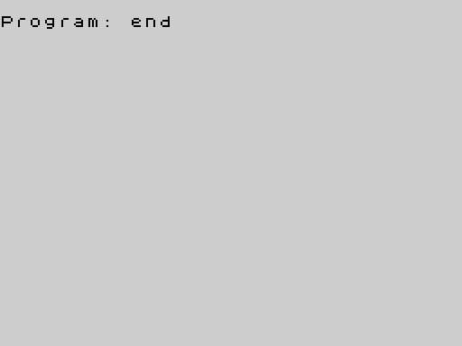 |  |
| `c1` 582: the first BASIC `enduro` loaded | 2 782: the loading screen coming in |
| 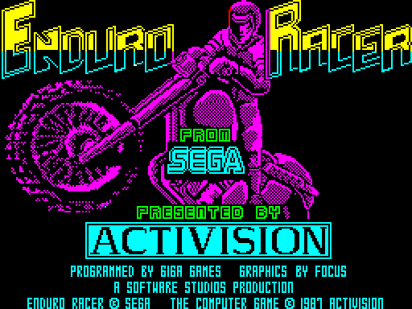 | 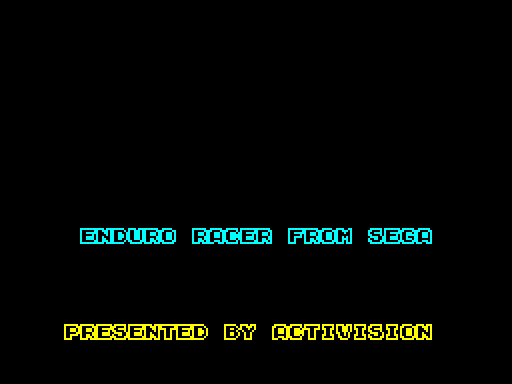 |
| 8 282: the screen whole, the code loading | 11 882: the credits after the load |
| 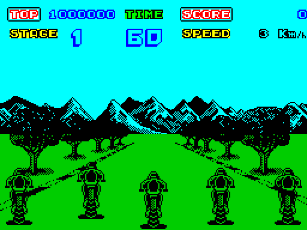 | 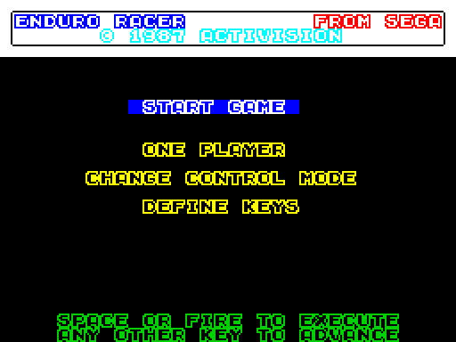 |
| 12 482: the attract race | 13 418: the menu |
| 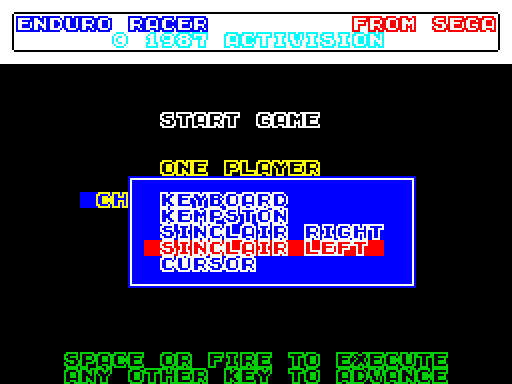 | 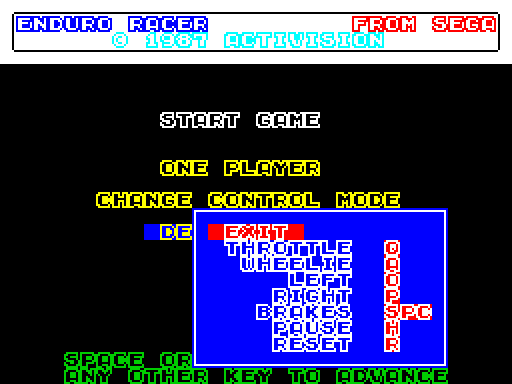 |
| 13 578: CHANGE CONTROL MODE, the five methods | 13 878: DEFINE KEYS |
| 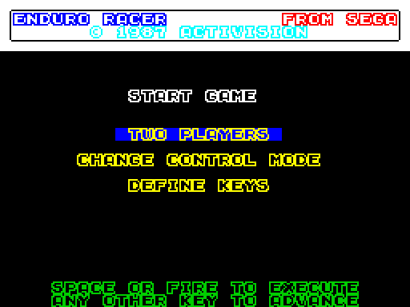 | 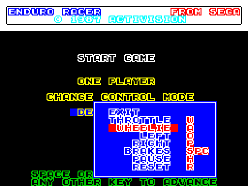 |
| `twoplayer` 63: TWO PLAYERS picked | `ctl` 3 629: THROTTLE redefined to W |

**Play (stage 1).**

| | |
| --- | --- |
| 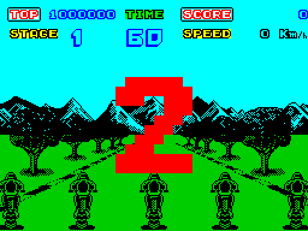 | 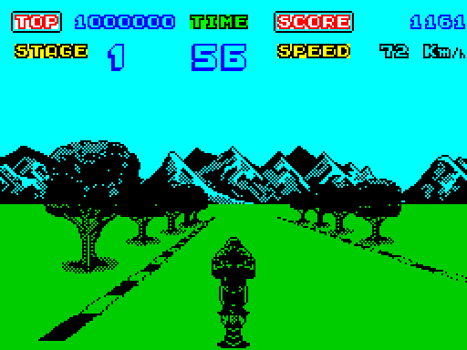 |
| `c1` 14 075: the countdown | 14 455: the wheelie key held |
| 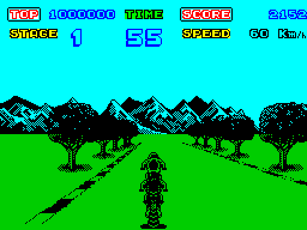 | 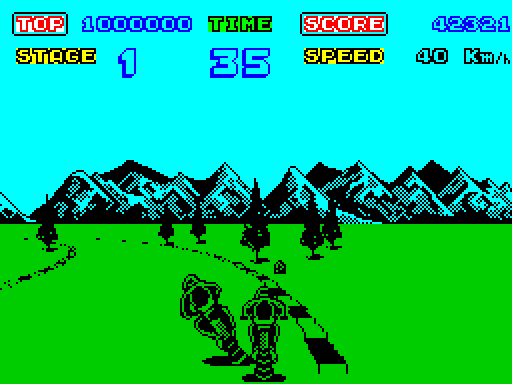 |
| 14 621: paused (H) | 16 281: 185 km/h, a log across the road ahead |
| 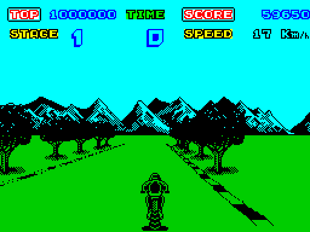 | 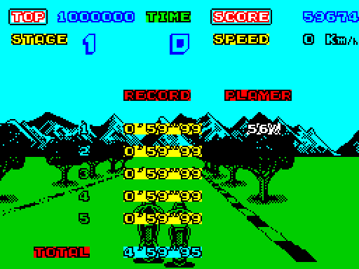 |
| 19 265: the timer at 0 | 19 465: the lap table (RECORD, PLAYER, TOTAL) |
| 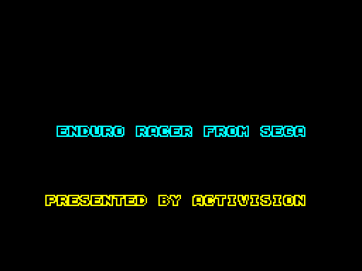 | 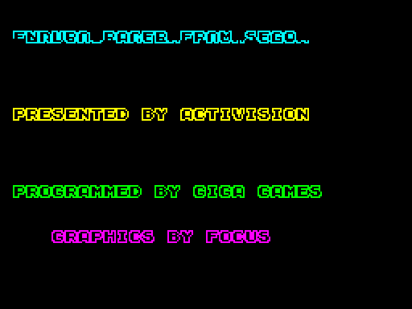 |
| 20 665: back to the credits | 21 065: the credits text |

**Falls and two players.**

| | |
| --- | --- |
| 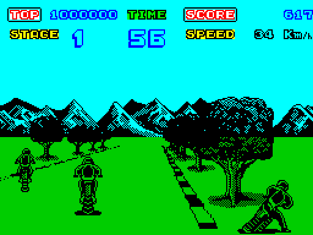 | 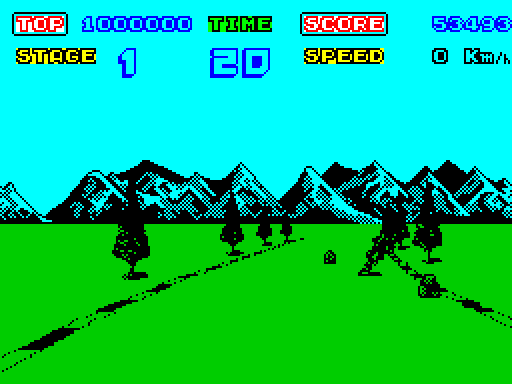 |
| `crash` 320: steering into the roadside | 3 320: the bike down, 0 km/h |
| 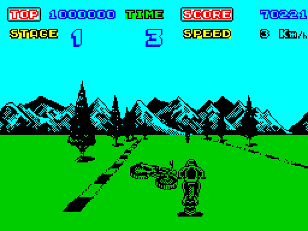 | 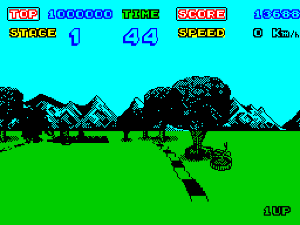 |
| 4 580: the rider beside the bike, the timer running | `twoplayer` 9 294: player 1 down, the timer stopped at 44 |
| 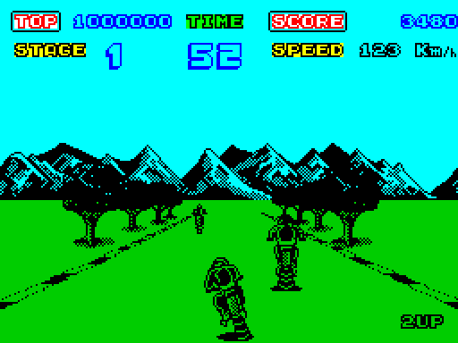 | 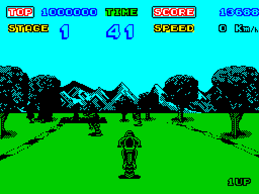 |
| 10 892: 2UP | 20 672: 1UP again with its own time |

**The stages and the end (stages, POKEs; reset3, POKEs).**

| | |
| --- | --- |
| 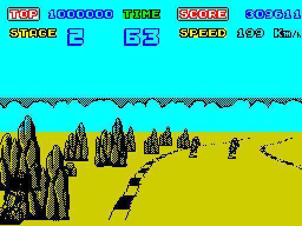 | 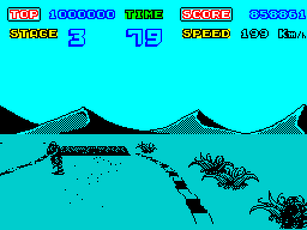 |
| `reset3` 3 692: stage 2, rock spires, the cloud horizon | 6 134: stage 3, dunes |
| 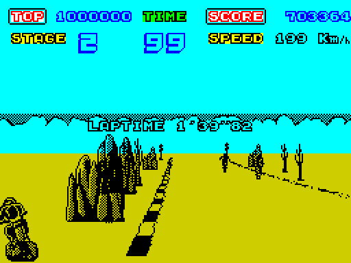 | 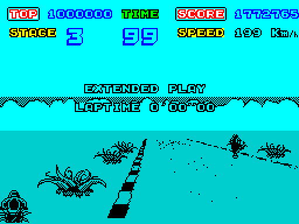 |
| `stages` 3 422: EXTENDED PLAY, the lap time, stage 2 | 5 340: stage 3 |
| 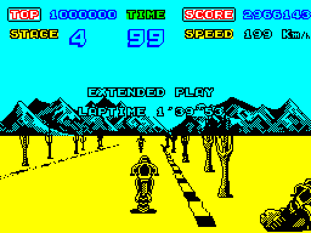 | 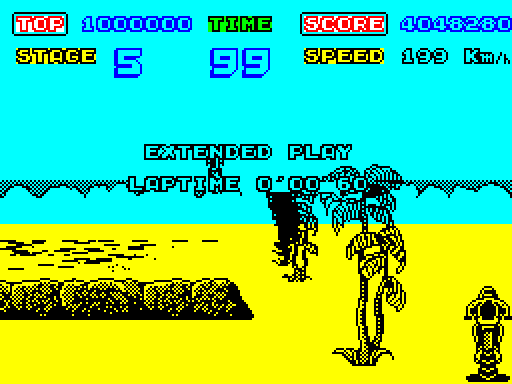 |
| 7 806: stage 4, cacti | 10 272: stage 5, palms |
| 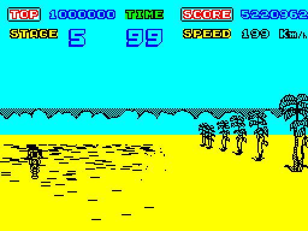 | 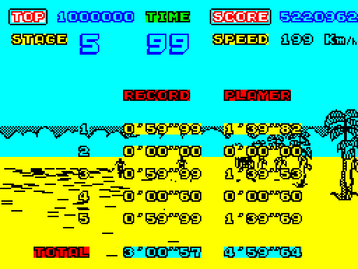 |
| 13 012: the race over (`$5E23` = 5) | 22 204: the lap table of the five stages |
| 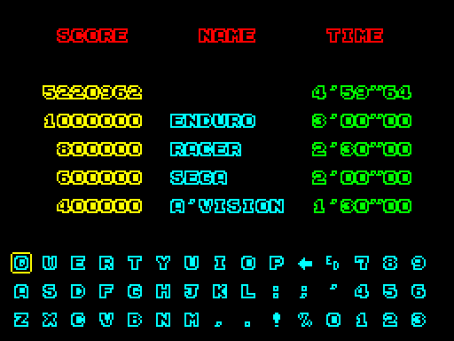 | 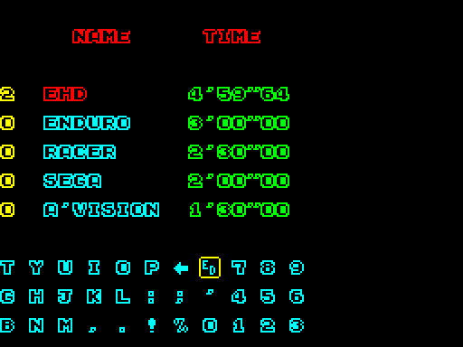 |
| 22 308: the hiscore table (SCORE, NAME, TIME) and the letter grid | 22 708: END entered first |

**128K and the stage 3 reset.**

| | |
| --- | --- |
| 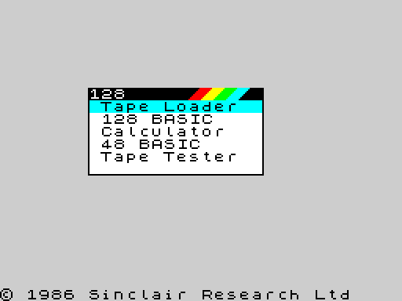 | 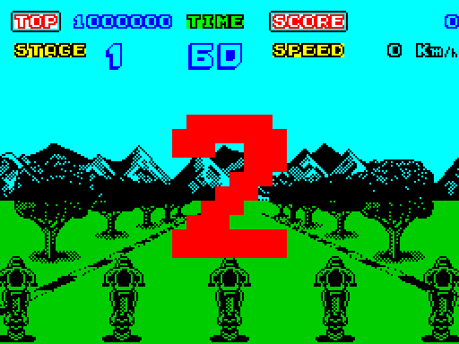 |
| `m128` 150: the 128K menu | 13 681: the countdown on the 128K |
| 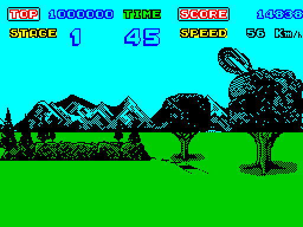 | 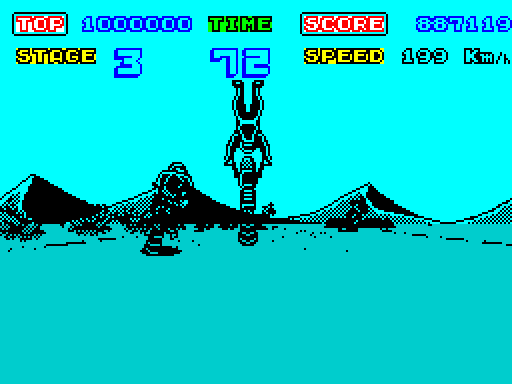 |
| 14 689: stage 1 on the 128K (AY) | `reset3` 6 662: the bike high in the air, stage 3 |
|  | 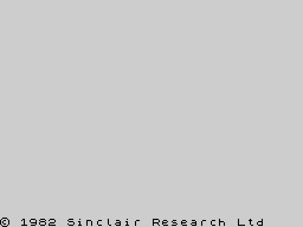 |
| 6 794: the reset | 6 944: the ROM's copyright |

## 7. Review
