# 1. Game design

What this covers: the game as a player meets it.

- the premise and the goal (1.1);
- the controls, in short (1.2; [doc 5](05-controls.md) has the detail);
- every screen: the loading screen, the credits, the demo, the menu, CHANGE CONTROL MODE, DEFINE KEYS, the
  countdown, play on each of the five stages, pause, a fall, the time-out, the lap table, the high scores and the
  name entry, two players (1.3);
- the HUD (1.4);
- the five courses, from the track data in `src/res/track` (1.5);
- the rules as the game plays them: the timer, the stages and EXTENDED PLAY, the score and the time bonus, crashes,
  ramps and jumps, the riders and the trucks, off the road (1.6);
- two players and the demo (1.7);
- game over: the lap table, the records, the high scores and the name entry (1.8);
- the cheat key (1.9);
- the key moments, with their frames (1.10), and what is known only from the code (1.11).

The recordings it rests on ([WALKTHROUGH](../WALKTHROUGH.md)):

- `c1`: power-on on the 48K, the TOSEC `[SpeedLock 2]` copy at signal speed, the credits, the demo, the menu, the
  control popup, DEFINE KEYS, stage 1 until the timer runs out, the lap table;
- `crash`: a race with falls and getting up, no POKE;
- `ctl`: all five control methods and a redefined key;
- `stages`: all five stages, the finish, the lap table, the high score table and the name entry, made with the seven
  ZXDB POKEs (infinite time and no falls, 3.10 of [doc 3](03-build-and-load.md));
- `twoplayer`: a two-player game;
- `m128`: the same tape on a 128K (the engine on the AY);
- `reset3`: the stage 3 reset, with six of the POKEs.

Frame numbers are those of each recording. A screenshot of frame N shows the screen at the end of that frame. A
`memory_at` sample of frame N is the state at its start.

## 1.1 The premise and the goal

Enduro Racer is Activision's 1987 Spectrum version of Sega's 1986 arcade game. Giga Games programmed it; Focus drew
the graphics. The player rides a trail bike seen from behind, along a road that bends and climbs, against a clock.

The race has five stages, one after another on one track. Each stage has its own ground, horizon and roadside
objects. Rival riders share the road. Ramps across the road throw the bike into the air.

The goal is to reach the end of each stage before the timer runs out. Reaching it adds time, shows EXTENDED PLAY and
starts the next stage. After stage 5 the race is won. Running out of time ends the game. There are no lives: falls
cost time, not the game.

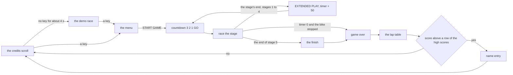

**Witness.** `c1` (credits, demo, menu, stage 1, time-out) and `stages` (EXTENDED PLAY, the finish, the name entry);
the frames are in 1.10.

**The point.** One rule decides everything: the clock. Speed, falls and jumps matter only through the time they
cost or gain.

## 1.2 The controls

The menu offers five control methods (CHANGE CONTROL MODE). DEFINE KEYS sets the keyboard's seven keys.

| Action | KEYBOARD (default) | What it does |
| --- | --- | --- |
| THROTTLE | Q | speed up, to at most 200 km/h |
| WHEELIE | A | lift the front wheel; held into a ramp, it keeps the speed |
| LEFT, RIGHT | O, P | lean; the bike drifts sideways by the lean and the speed |
| BRAKES | SPACE (fire) | slow down |
| PAUSE | H | stop until a key |
| RESET | R | end the race, back to the menu |

The other methods are KEMPSTON, SINCLAIR RIGHT, SINCLAIR LEFT and CURSOR. PAUSE and RESET are always keys. The menu
works with any method: SPACE or fire executes, any other key moves to the next item.

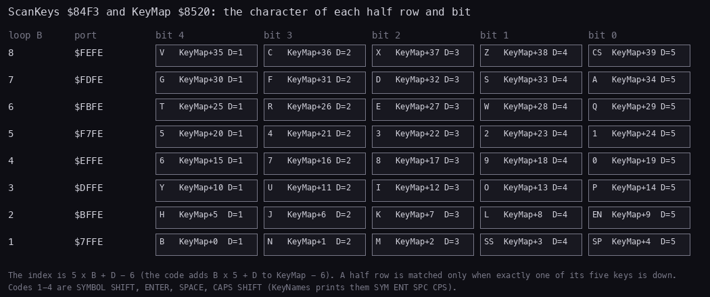

*The keys of the five methods; from [doc 5](05-controls.md), which has the ports, the masks and DEFINE KEYS.*

**Witness.** `ctl` (all five methods, a redefined key); `src/res/texts/keys.txt` (`QAOP`, SPACE, `H`, `R`);
`src/res/tables/controls.csv`.

**The point.** Five actions drive the bike; WHEELIE matters only at a ramp.

## 1.3 The screens

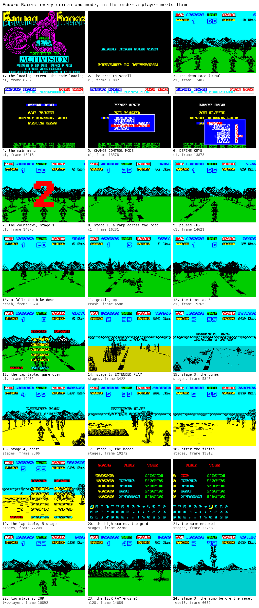

*`python3 tools/fig_screens.py` from the screenshots in `docs/img/play/`; each panel names its recording and frame.
How to read: the panels follow the order a player meets them. The point: one play screen serves the whole game; the
lap table, EXTENDED PLAY and the stage numbers are printed over the race itself.*

| # | Screen | Recording, frame | What it shows |
| ---: | --- | --- | --- |
| 1 | the loading screen | `c1` 8 282 | the bike and rider, FROM SEGA, PRESENTED BY ACTIVISION; loaded as tape block 6 |
| 2 | the credits | `c1` 11 882 | four lines scrolled up: ENDURO RACER FROM SEGA, PRESENTED BY ACTIVISION, PROGRAMMED BY GIGA GAMES, GRAPHICS BY FOCUS |
| 3 | the demo | `c1` 12 482 | a race the game drives, DEMO on the HUD |
| 4 | the menu | `c1` 13 418 | START GAME, ONE / TWO PLAYERS, CHANGE CONTROL MODE, DEFINE KEYS |
| 5 | CHANGE CONTROL MODE | `c1` 13 578 | the five methods in a popup |
| 6 | DEFINE KEYS | `c1` 13 878 | EXIT and the seven keys, each with its key |
| 7 | the countdown | `c1` 14 075 | 3, 2, 1, GO as big red blocks, the riders on the line |
| 8 | stage 1 | `c1` 16 281 | grass, mountains, trees; a ramp across the road |
| 9 | paused | `c1` 14 621 | the race frozen (H) |
| 10 | a fall | `crash` 3 320 | the bike down, SPEED 0 |
| 11 | getting up | `crash` 4 580 | the rider back on the bike |
| 12 | the timer at 0 | `c1` 19 265 | TIME 0, the bike rolling to a stop |
| 13 | the lap table | `c1` 19 465 | RECORD and PLAYER, 56 % of stage 1 |
| 14 | stage 2 | `stages` 3 422 | sand and rock spires, EXTENDED PLAY, the last stage's LAPTIME |
| 15 | stage 3 | `stages` 5 340 | cyan dunes and water |
| 16 | stage 4 | `stages` 7 806 | sand and cacti |
| 17 | stage 5 | `stages` 10 272 | the beach and palms |
| 18 | after the finish | `stages` 13 012 | the riders pass the stopped bike |
| 19 | the lap table, 5 stages | `stages` 22 204 | five records and five times |
| 20 | the high scores | `stages` 22 308 | five rows and the name grid |
| 21 | the name entered | `stages` 22 708 | the new row on top |
| 22 | two players | `twoplayer` 10 892 | 2UP in the corner |
| 23 | the 128K | `m128` 14 689 | the same play; the engine on the AY |
| 24 | stage 3, the reset | `reset3` 6 662 | the bike high above the road just before the machine resets |

The play screen has two parts. The HUD is the top 64 pixel lines (1.4). The race fills the rest: the horizon, the
ground, the road, the objects, the riders and the bike.

**The point.** The game never leaves the play screen between the countdown and the high scores. Everything else is
printed into it.

## 1.4 The HUD

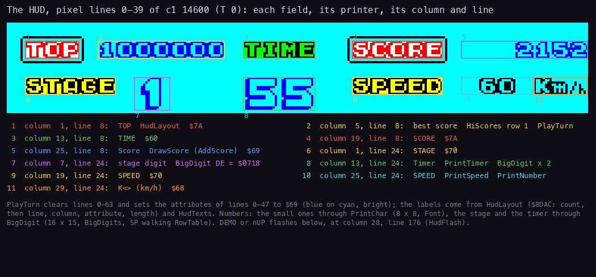

*From [doc 8](08-hud-and-text.md), which has the printing routines.*

| Field | Where | What it shows |
| --- | --- | --- |
| TOP | top left | the best score: the first row of the high score table, 1 000 000 at power-on |
| TIME | top middle | the timer in big digits, seconds counting down from 60 |
| SCORE | top right | the score, seven digits |
| STAGE | second row left | the stage, 1 to 5, in big digits |
| SPEED | second row right | SPEED in km/h, 0 to 200 |
| 2UP | bottom right of the race | the second player's turn (two players only) |

In a demo the HUD shows DEMO. EXTENDED PLAY and LAPTIME flash over the race at a stage's start (1.6).

**The point.** Two numbers drive a race: TIME and SPEED. The score follows the speed by itself.

## 1.5 The five courses

The track is one list of 140 segments of 128 distance units, cut into five stages. The data also places every
roadside object, every ramp and stage 3's gaps.

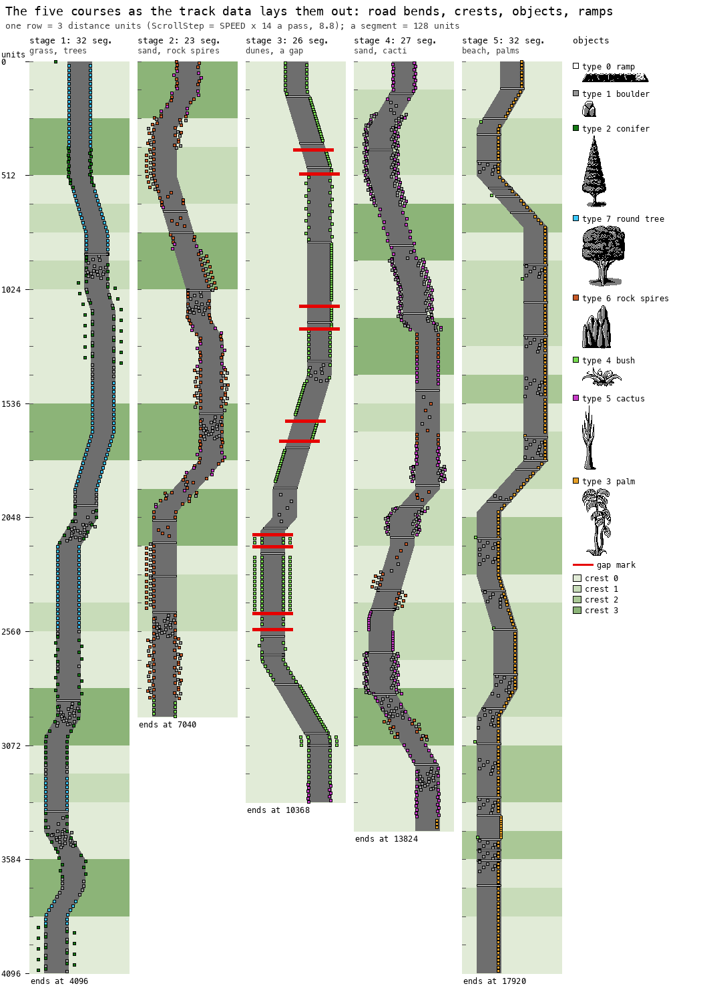

*`python3 tools/fig_courses.py`, from `src/res/track` and the sprites in `build/game.bin`. How to read: one column a
stage, start at the top, one pixel row every 3 distance units; the shade is the crest (0 level to 3); the grey band the
road bent by each segment's bend (bits 0-1, to the side bit 4 gives) (a sketch: the game keeps no map); the coloured squares the objects at their
lateral place, at the distances TrackStep counts (`tools/res_formats.py` `game_walk`); white bars the ramps; red
bars stage 3's gap marks. The point: each stage has its own mix of objects
and its own rhythm of bends and ramps; stage 3 alone has gaps.*

| Stage | Segments | Distance (units) | Horizon | Ground | Objects (course.py counts) |
| ---: | ---: | ---: | --- | --- | --- |
| 1 | 32 | 4 096 | mountains | grass | 4 ramps; 184 round trees, 144 boulders, 51 conifers, 101 of the stage's variable object |
| 2 | 23 | 2 944 | clouds | sand | 8 ramps; 152 rock spires, 141 boulders, 39 cacti, 88 variable |
| 3 | 26 | 3 328 | dunes | dunes and water | 18 ramps; 313 variable (bushes), 14 boulders, 2 bushes, 10 gap marks |
| 4 | 27 | 3 456 | mountains | sand | 13 ramps; 308 boulders, 221 variable (cacti), 54 rock spires, 3 palms |
| 5 | 32 | 4 096 | clouds | beach | 26 ramps; 234 palms, 130 boulders, 10 variable, 7 bushes |

The ground colour comes from StageParams (attribute `$20`, `$30`, `$28`, `$70`, `$30`); the horizon from StageTable.
Stage 5 draws its road with another routine (RoadNone) and has its own off-road rule ([doc
10](10-gameplay-logic.md)).

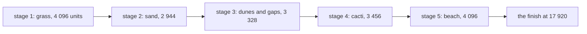

**Worked example.** At the top speed, 200 km/h, a pass moves the track by SPEED x 14 / 256 = 10.9 units. Stage 1 is
4 096 units: 375 passes. Ten passes are one timer second, so a perfect stage 1 takes 37.5 timer seconds of the 60.
Stage 2 is the shortest: 2 944 units, 27 timer seconds at full speed.

**Witness.** `python3 tools/course.py --out work/docs/erA/course` prints the counts above; `src/res/tables/stages.csv`
and `stageparams.csv`; the screenshots of `stages` (1.3).

**The point.** The time a stage allows is generous only at full speed. Every fall starts the bike again from 0, so a
few falls on stage 1 already eat the margin.

## 1.6 The rules

### The timer

The timer starts at 60 and counts down one every 10 passes of the race loop. A pass takes 8 frames on average
([doc 4](04-game-loop.md)), so a timer second is about 80 frames, 1.6 real seconds. The timer stops during the
countdown, while the rider gets up, and in the demo. At 0 the throttle no longer works. The bike rolls to a stop, and
when SPEED reaches 0 the turn is over.

```text
each pass (not in the demo):
    Tenths -= 1
    if Tenths == 0:
        Tenths = 10
        if Timer > 0: Timer -= 1 (BCD); PrintTimer
        if Timer == 0 and SPEED == 0: RaceOver        ; StageTime, the turn ends
```

```asm
TimerTick:                  ; $AA73
  LD A,(Tenths)           ; Tenths down; at 0: Timer - 1 (BCD), PrintTimer, Tenths 10
  AND A
  JR NZ,l_AA89
  LD A,(Timer)
  AND A
  JR Z,l_AA84
  DEC A
  DAA
  LD (Timer),A
l_AA84:
  CALL PrintTimer
  LD A,$0A
l_AA89:
  DEC A
  LD (Tenths),A
  JP NZ,RaceLoop
  LD A,(Timer)            ; Timer 0 and SPEED 0: the game is over
  AND A
  JP NZ,RaceLoop
  LD A,(Speed+$0001)
  AND A
  JP NZ,RaceLoop
RaceOver:                   ; $AA9E
  CALL StageTime
```

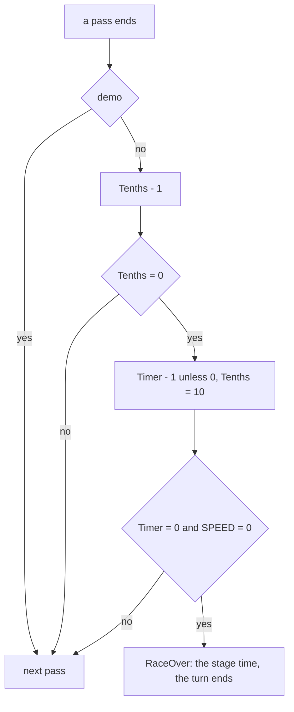

**Worked example.** In `c1` the timer went from 59 to 1 in 5 068 frames: 87 frames a timer second. The five falls
held it for 382 frames while the rider got up; without them it is 81 frames a timer second.

**Witness.** `c1` samples of Timer `$5E1F`, one a frame (`work/docs/erA/c1-samples.json`).

### The stages and EXTENDED PLAY

When the bike passes a stage's last segment, StageEnd `$AB0A` runs:

- the time bonus: the timer's two digits are added to the score as hundred-thousands and ten-thousands, so each
  second left is worth 10 000 points;
- the stage's time goes to the lap table (StageTime: the timer at the start less the timer now);
- stages 1-4: the next stage's number, EXTENDED PLAY and the last LAPTIME flash over the race, and the timer gets 50
  more seconds, at most 99;
- after stage 5: SPEED 0; the leading rider is placed at the bike and rides away; when it is far enough ahead, the
  timer is set to 0 and the game ends (the finish).

```text
StageEnd:
    score += Timer * 10000                           ; the time bonus
    StageTimes[stage] = TimerAtStart - Timer
    stage += 1
    if stage < 5: Timer = min(Timer + 50, 99); EXTENDED PLAY; StageStart
    else:         SPEED = 0; the leading rider rides away; Timer = 0 when it is ahead: the finish
```

```asm
StageEnd:                   ; $AB0A
  POP HL
  LD A,(Timer)            ; the timer's tens and units ...
  LD H,A
  RRA
  RRA
  RRA
  RRA
  AND $0F
  LD L,A
  LD A,H
  AND $0F
  LD H,A
  LD (ScoreDigits+$0001),HL ; ... as the 100 000s and 10 000s digits
  LD HL,ScoreDigits+$0006
  CALL AddScore
  ...
l_AB76:                     ; stages 1-4
  ...
  LD A,(Timer)
  ADD A,$50               ; + 50 seconds (BCD)
  DAA
  JR NC,l_AB8C
  LD A,$99                ; at most 99
l_AB8C:
  LD (Timer),A
```

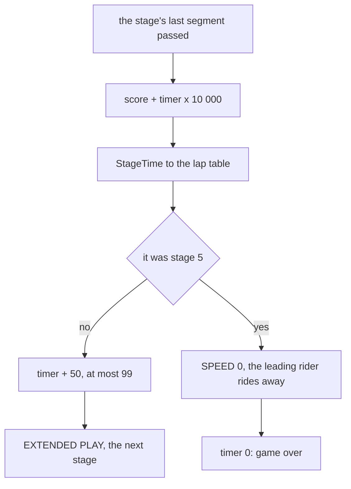

**Worked example.** In `stages` the infinite-time POKE keeps the timer where it is. Stage 1 ends with the timer at
60, so the bonus is 600 000. The score at stage 2 (`stages` frame 3 422) is 703 364. The timer becomes 60 + 50 = 110,
capped at 99. Stage 2 ends with 99: the bonus is 990 000. The score at stage 3 (frame 5 340) is 1 772 765: 990 000
plus 79 401 points of riding.

**Witness.** The HUD in the `stages` screenshots of 1.3 (panels 14 and 15).

### The score

Every pass that the bike is not falling, the score grows by SPEED. In the air it grows by SPEED x 10: the speed's
digits go one place higher.

```text
ScoreAdd (each pass, not falling):
    digits = [0] * 7
    place = 4 if on the ground else 3                ; hundreds' place, or one higher in the air
    digits[place..place+2] = hundreds, tens, units of SPEED
    AddScore(digits)                                 ; not in the demo
```

```asm
ScoreAdd:                   ; $A974
  LD A,(FallTime)         ; not falling
  AND A
  JR NZ,RaceControls
  LD (ScoreDigits+$0006),A
  LD HL,ScoreDigits+$0003
  LD (HL),A
  LD A,(JumpHeight+$0001) ; in the air: the digits one place higher
  AND A
  JR NZ,l_A988
  INC HL
l_A988:
  LD A,(Speed+$0001)
  LD (HL),$00
  CP $64                  ; hundreds
  JR C,l_A994
  SUB $64
  INC (HL)
  ...
  LD HL,ScoreDigits+$0006
  CALL AddScore
```

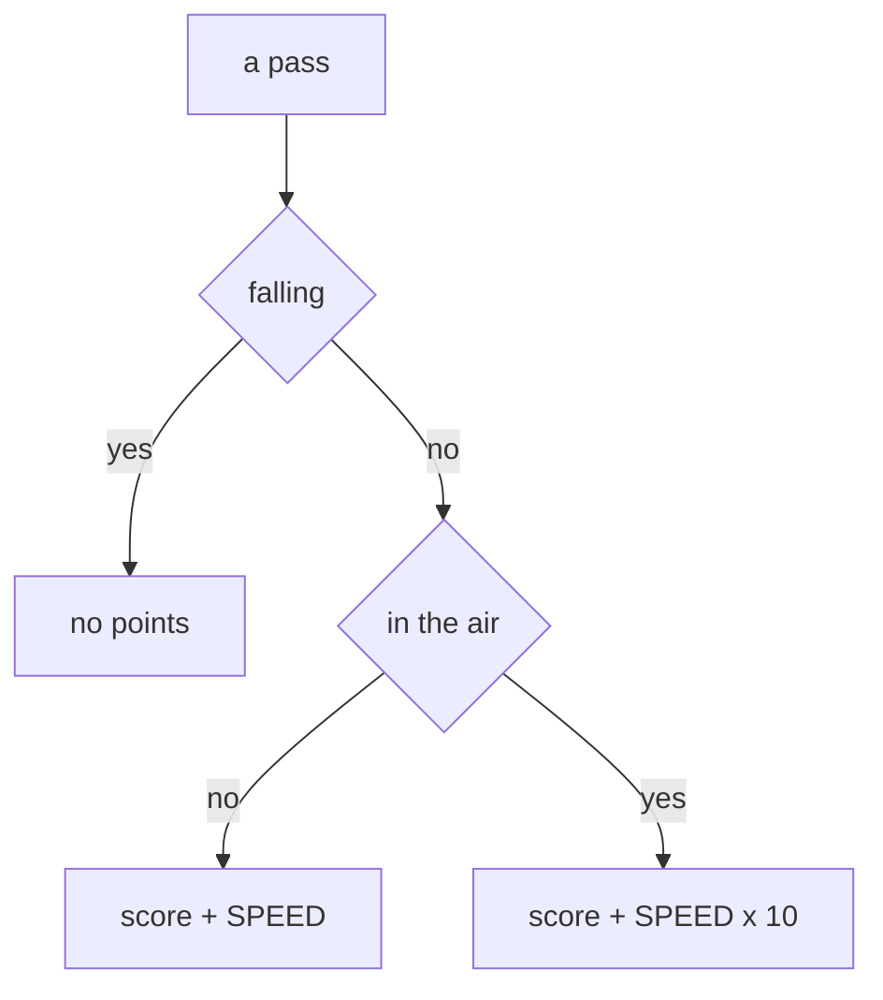

**Worked example.** `c1` frame 15 480: SPEED 187, the score 15 350, on the ground. The bike meets a ramp at about
frame 15 500. At frame 15 620 it is in the air (JumpHeight 18) at SPEED 141: each pass now adds 1 410. By then the
score is 36 687. One jump gave more than the whole race before it.

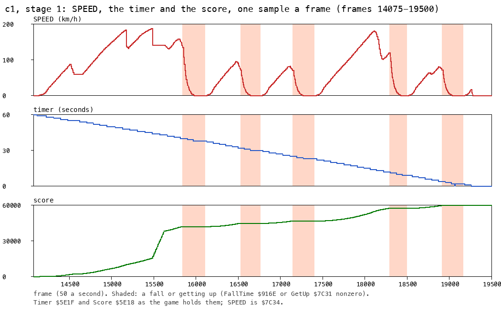

*`c1` frames 14 075-19 500, one `memory_at` sample a frame (the state at the frame's start). Command: `python3
tools/fig_race.py work/docs/erA/c1-samples.json`; the samples by `work/docs/erA/sample.py`. How to read: SPEED (red),
the timer (blue) and the score (green) share one frame axis; the shaded spans are falls and getting up. The point: the
score rises steeply only in the air (frames 15 500-15 650); each of the five falls is about 250 frames of standing
still and a restart from 0; the race ends with the timer at 0 at 56 % of stage 1.*

**Witness.** The same samples: Score `$5E18`, SPEED `$7C34`, JumpHeight `$5CEA`.

### Crashes, bounces, ramps and jumps

Each pass the objects near the bike are tested against it (CollisionSizes, [doc 7](07-objects.md)).

- A ramp throws the bike up. The jump's height comes from where the ramp is on the screen. The speed is kept in
  proportion to the wheelie held before it: 8 passes or more of WHEELIE keep all of it, none keeps 3/4.
- Any other object, hit head-on at 35 km/h or more, is a fall: the bike is thrown, lies for a while, and the rider
  gets up at SPEED 0.
- Slower, or side-on, it is a bounce: 3 passes of steering out of control and a little speed lost.
- A rival rider within 5 of the bike is a bounce, and SPEED drops by a quarter.
- A truck (a rider marked as one) within 9 of the bike is a fall.
- Off the road the speed is capped by how far off the bike is. Stage 3's water slows the bike hard.

The riders' tests do not run in the air, while getting up, or in the demo.

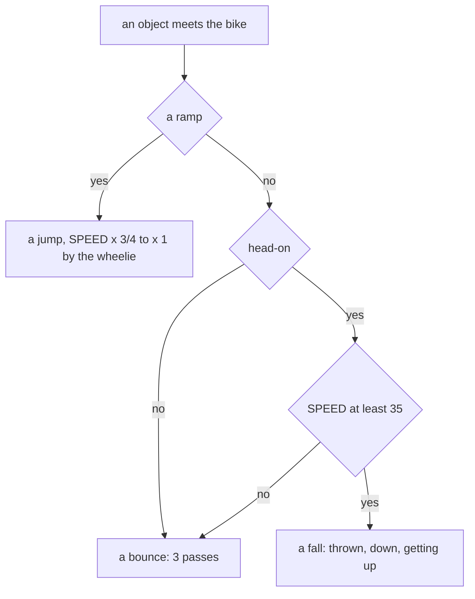

```asm
l_A7CF:                     ; an object head-on
  LD A,(Speed+$0001)      ; 35 km/h or more is a fall
  CP $23
  JR C,Bounce
  LD A,$01
  CALL PlayEffect
  CALL Crash
  JP ObjectNext
```

**Worked example.** A rider at SPEED 160 touches a rival: SPEED - 160 / 4 = 120. At SPEED 34 the same bike hits a
boulder head-on and only bounces; at 35 it falls. A ramp taken at 200 with no wheelie sends the bike off at 150.

**Witness.** `crash` (falls and getting up, no POKE); `c1` (5 falls, a jump); the code for the rest (1.11).

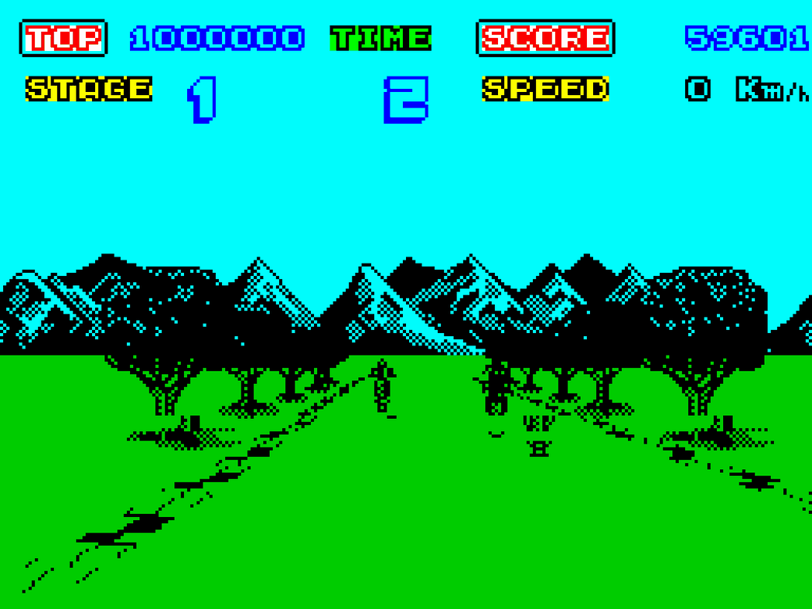

*`c1` frames 19 150-19 470, every eighth frame. Command: `python3 ../../kit/screen_anim.py --work work/docs/erA/c1
--from 19150 --to 19470 --step 8 --width 1050 --delay 100 --hold 3000 docs/img/play/c1-time-out.gif`. How to read:
TIME goes 2, 1, 0; the bike still moves and still scores (59 601 to 59 674) until SPEED is 0; then the lap table is
printed over the race. The point: the game is over only when the bike stops, so a fast bike gets a last few points
after the timer's 0.*

**The point.** Speed is both the reward and the risk. It scores every pass and covers the stage, but at 35 km/h or
more every head-on contact is a fall that costs seconds.

## 1.7 Two players and the demo

**Two players.** ONE / TWO PLAYERS in the menu toggles the mode. Each player has a block of state: the score, the
timer, the stage and the track position. The players take turns. A turn ends at a fall or at a stage's end; the
other player's block is swapped in, and a key is waited for. A player whose timer is 0 is skipped. The game ends when
both timers are 0. 2UP marks the second player's turns.

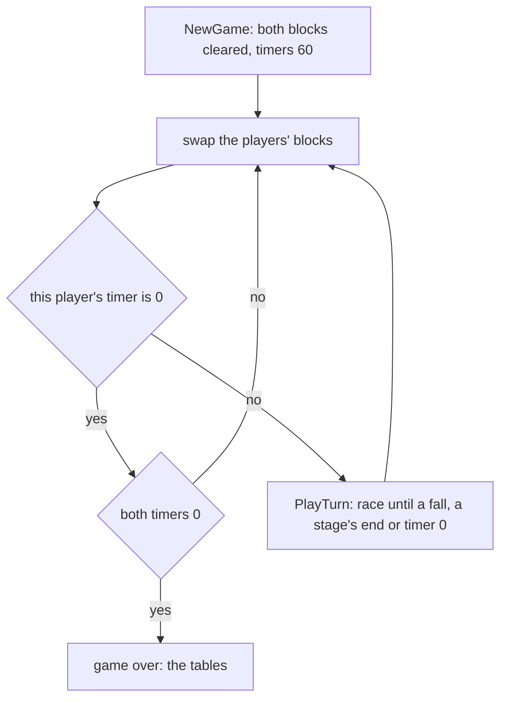

With one player the second block's timer stays 0, so every turn is the first player's.

**The demo.** Left alone for about 4 seconds after the credits, the game starts a race of its own. DEMO is on the
HUD and the game drives the bike. The demo scores nothing and its timer does not run. A key ends it and opens the
menu.

**Worked example.** In `twoplayer` player 1's timer reaches 0 at frame 9 294; from then on every turn is player 2's
(2UP at frame 10 892), and the game ends at frame 20 672 when player 2's timer is 0 too.

**Witness.** `twoplayer` (frames 63, 9 294, 10 892, 20 672); `c1` frames 12 400-13 418 (the demo);
`src/game/flow.asm` NewGame and PlayTurn.

**The point.** A fall passes the turn. In a two-player game the falls set the rhythm of the turns.

## 1.8 Game over: the lap table, the records, the high scores

**The lap table.** At game over the race stops and a table is printed over it. Its columns are RECORD and PLAYER, one
row a stage, then TOTAL. A finished stage shows the player's time. The stage being ridden shows the share of it
driven, in percent. The records start at 0'59"99 a stage and improve when a player beats them. They last until the
machine is reset.

**Times are timer seconds.** A stage's time is the timer at its start less the timer at its end. The hundredths are
the last digit of the pass counter, a filler ([doc 10](10-gameplay-logic.md)).

**The high scores.** Five rows: score, name and total time. At power-on they are ENDURO 1 000 000, RACER 800 000, SEGA
600 000, A'VISION 400 000 and GIGA1987 200 000. A score above a row takes its place. The name is chosen on a grid
of characters with the controls.

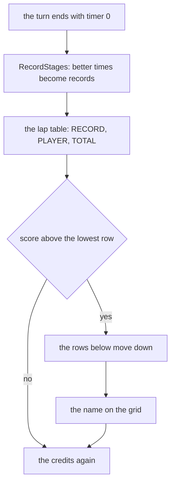

**Worked example.** `c1` ended stage 1 at 56 % with 59 674 points: below the lowest row, so no name entry. Only the
time bonus brings a score near 200 000: finishing stage 1 with 15 seconds left gives 150 000 at once. In `stages`
the infinite-time POKE gave stages 2 and 4 a time of 0'00"60 (the timer never moved), and those became the records.

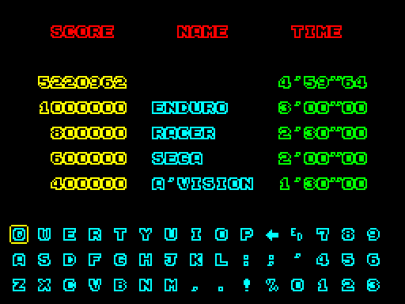

*`stages` frame 22 308. How to read: the score 5 220 362 on top, the old rows below, the name grid at the bottom.
The point: the table holds a total time beside each score; the score alone decides the place.*

**Witness.** `c1` 19 465; `stages` 22 204, 22 308, 22 708; `src/res/tables/hiscores.csv`, `records.csv`;
`src/res/texts/lap.txt`, `namegrid.txt`.

**The point.** The high scores reward finishing stages, not riding fast: the time bonus is worth more than a whole
stage of points.

## 1.9 The cheat key

CAPS SHIFT and Q together toggle a fixed track step of `$1000` on stages 1-3: SPEED 293 in effect, faster than the
throttle can give. The recording `tech-cheat` holds CAPS SHIFT + Q at c1's play: CheatKey `$A659` (in
`src/game/race.asm`) runs once at its frame 126 and CheatFixedStep `$A674` 51 times after it ([doc 10](10-gameplay-logic.md), 10.12).

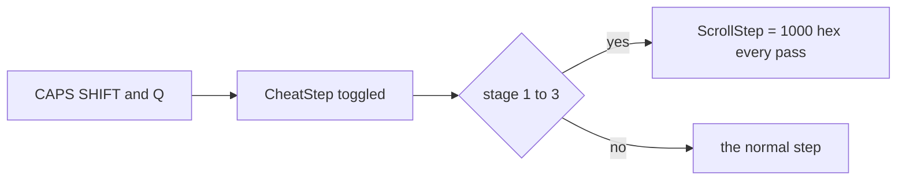

**Worked example.** ScrollStep is SPEED x 14; `$1000` = 4 096 = 14 x 292.6. At that step stage 1 takes 256 passes,
25.6 timer seconds instead of 37.5.

**The point.** The game has a developer's fast-forward, hidden on a key no instructions mention.

## 1.10 The key moments

| Moment | Recording, frame |
| --- | --- |
| the loading screen being loaded | `c1` 2 782-8 282 |
| the credits | `c1` 11 882 |
| the demo | `c1` 12 400-13 418 |
| the menu | `c1` 13 418 |
| stage 1 starts (countdown) | `c1` 14 075 |
| the first jump | `c1` about 15 500 |
| the first fall | `c1` about 15 850 |
| the timer at 0 | `c1` 19 265 |
| the lap table | `c1` 19 465 |
| stages 2, 3, 4, 5 | `stages` 3 422, 5 340, 7 806, 10 272 |
| the finish | `stages` 13 012 |
| the high scores and the name | `stages` 22 308, 22 708 |
| the stage 3 reset | `reset3` 6 760 ([doc 4](04-game-loop.md)) |

## 1.11 Known only from the code

Seven cheap recordings, made after the first draft (WALKTHROUGH 6.0), settle most of what was here:

- the cheat key (1.9): `tech-cheat`;
- the truck's fall: `truck` (WALKTHROUGH 6.0: from `stages`' stage 3 state with the Immune To Trucks byte put back, the other POKEs of that state still in place), TruckCrash `$A88F` once at its frame 1 240, a head-on truck in stage 3;
- the full wheelie into a ramp: `tech-ramp-wheelie`, RampCap `$A808` once at its frame 1 412;
- a fall on stage 5: `fall5` (from `stages`' stage 5 state, the obstacle and truck bytes put back), FallStage5
  `$AD36` 8 times at frames 235-280 and Crash `$AF02` once;
- the name entry: `names` (c1's play with the score POKEd to 300 000 and the timer to 1, a POKE said in its
  record), the name "ER" typed with a delete and both wraps.

Still known only from the code: the high score table reached by a clean run without any POKE (no clean run reached
200 000 points), and the stage 3 reset without POKEs (doc 10, 10.13).
