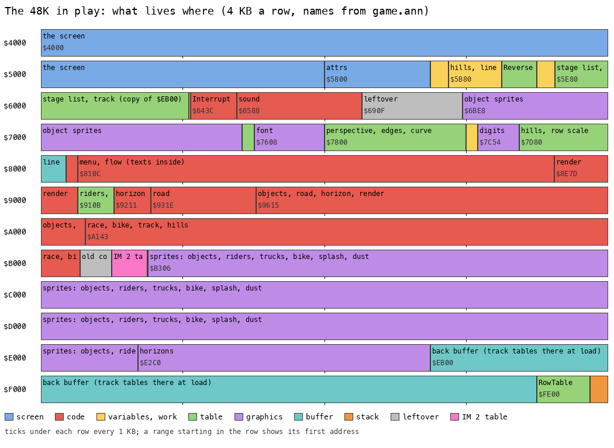
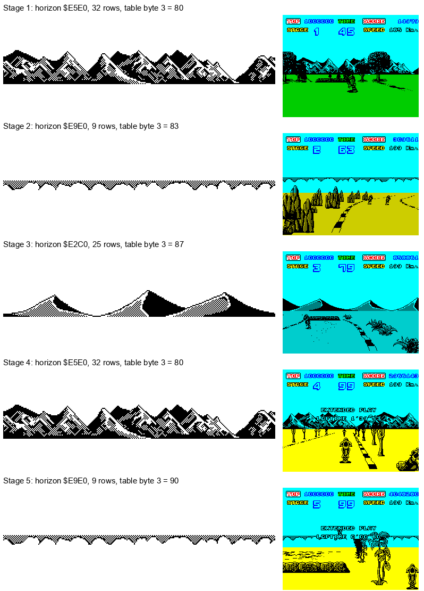
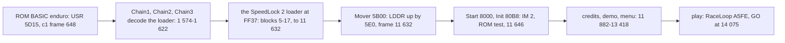
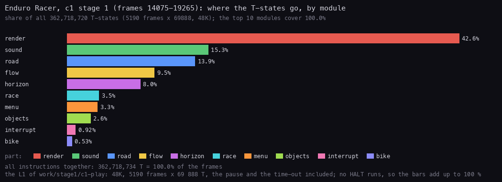
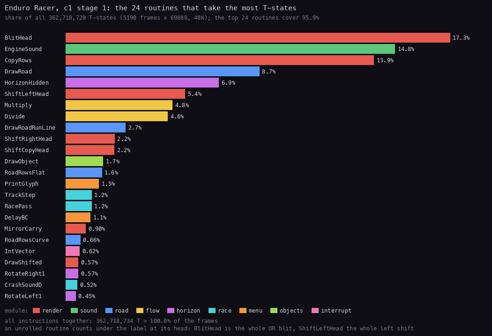
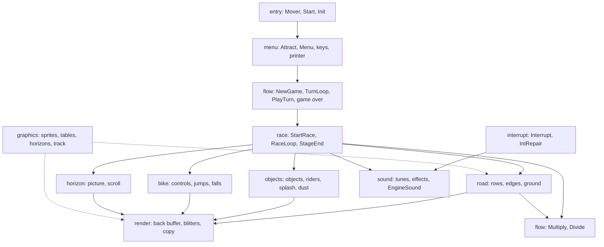
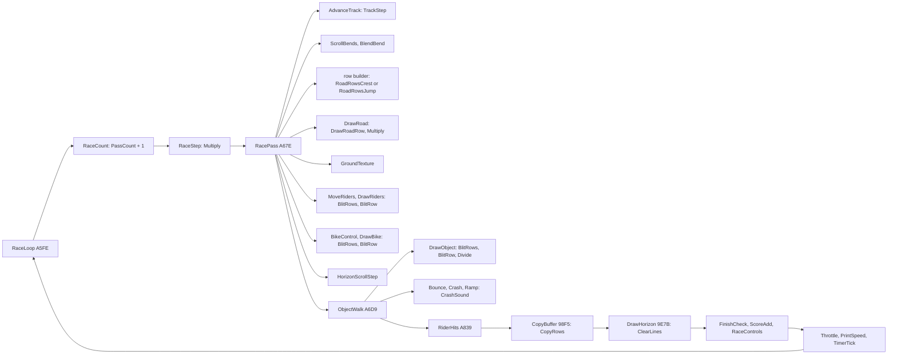

# 2. Architecture

What this covers:

- the machine budget: one 48K image, no paging, how the 42 240 bytes split into code and data (2.1);
- the memory map as a figure and a table, with the names of `src/game/game.ann` (2.2);
- the heatmap of play and the stack (2.3);
- the images from the load to play, and what changes between them (2.4);
- the state variables (2.5);
- the frame budget: where the T-states go (2.6);
- the leftovers: bytes the game loads and never uses (2.7);
- the module map and the call graph of a pass (2.8);
- the 48K and the 128K: the ports and the sound path (2.9).

The recordings it rests on ([WALKTHROUGH](../WALKTHROUGH.md)):

- `c1`: power-on on the 48K, the TOSEC `[SpeedLock 2]` copy at signal speed, the attract loop, the menu, stage 1 to the time-out;
- `stages` and `ctl`: from `c1`'s states, all five stages and every control method;
- `m128`: the same tape on the 128K.

The L1 builds of `c1`'s play window, `stages` and `ctl` merged by `kit/merge_l1.py` give
`work/stage1/merged-play.json`, 33 414 frames; the L1 of `c1`'s stage 1 alone is `work/stage1/c1-play/l1.json`,
5 190 frames.

## 2.1 The machine budget

Enduro Racer runs on a plain 48K Spectrum. It loads one image of `$5B00-$FFFF` and never pages: `$7FFD` is written
only by the 128K ROM and by the loader. The 128K adds the AY and nothing else (2.9).

The image is 42 240 bytes. The `.ann` splits it into twelve modules. Code is a quarter of it; graphics and tables
are the rest.

| Module | Code (bytes) | Data (bytes) | Routines | What |
| --- | ---: | ---: | ---: | --- |
| entry | 104 | 2 528 | 3 | Mover, Start, Init; the work area `$5B00-$5E7F`, the IM 2 table |
| interrupt | 293 | 39 | 2 | the IM 2 handler, its stack, the repair |
| sound | 526 | 377 | 11 | the AY tunes and effects, the engine |
| graphics | 0 | 26 068 | 0 | sprites, the font, the tables, the horizons, the track |
| menu | 1 467 | 142 | 40 | Attract, Menu, the control methods, the printer, the keys |
| flow | 1 119 | 713 | 16 | a game: turns, game over, records, scores, name entry; Multiply, Divide |
| render | 910 | 0 | 15 | the back buffer, RowTable, the blitters, the copy |
| objects | 802 | 584 | 10 | the roadside objects, the riders, splash, dust |
| bike | 1 002 | 91 | 9 | controls, lean, wheelies, jumps, falls |
| horizon | 606 | 46 | 13 | the horizons and their sideways scroll |
| road | 2 278 | 12 | 15 | the road rows, the edges, the ground |
| race | 2 439 | 94 | 30 | a stage: the pass loop, collisions, HUD, timer, stage end |
| all | 11 546 | 30 694 | 164 | `$5B00-$FFFF` |

*The bytes from each entry of `src/game/game.ann` to the next, by its kind (`c` code, any other kind data) and its
`@module`. The routine count is the `c` entries; a routine's other entry points are not counted. Command: the
script in [`work/docs/erA-NOTES.md`](../work/docs/erA-NOTES.md).*

**Worked example.** The image `$5B00-$FFFF` is 42 240 bytes: 11 546 of code and 30 694 of data. The race module
has 2 439 bytes of code in 30 routines, about 81 bytes a routine. The graphics module alone, 26 068 bytes, is more
than twice all the code.

**The point.** The game is small (11.5 KB of code) and its pictures are big (26 KB). The 48K is nearly full: about
4 KB of it is dead weight (2.7) that could have been freed, but the authors did not need the room.

## 2.2 The memory map

*How to read: each row is 4 KB of the address space, from `$4000` at the top to `$F000` at the bottom; each range is
coloured by its kind and named after the `.ann`. The point: the code sits in one block in the middle
(`$80B8-$B11C`), the interrupt and the sound below it, the graphics above, and the back buffer at the top shares its
space with the track tables of the load. Command: `python3 tools/fig_memmap.py`.*

| Range | Name | Kind | What |
| --- | --- | --- | --- |
| `$4000-$5AFF` | the screen | screen | the copied back buffer from line 40, the HUD on lines 0-39 |
| `$5B00-$5B7F` | RowList | work | the road's lines, top down: a RoadLines index each, `$FE` a gap, `$FF` the end |
| `$5B80-$5BFF` | BendRows | work | each road row's x centre (the bend's sideways shift) |
| `$5C00-$5C7F` | RoadLines | work | the road's line table |
| `$5C80-$5CFF` | Riders, JumpHeight, HorizonAddr | work | 6 riders of 15 bytes; the jump; the stage's horizon |
| `$5D00-$5DFF` | ReverseTable | table | each byte with its bits reversed (Init builds it) |
| `$5E00-$5E0C` | Records | work | the five stage records and their total |
| `$5E0D-$5E44` | Player | work | the current player's block, 56 bytes |
| `$5E45-$5E7C` | OtherPlayer | work | the other player's block |
| `$5E80-$642F` | StageList, TrackPatterns, Track | table | the track, copied from `$EB00` by Init |
| `$643C-$6587` | Interrupt, IntStack, IntSavedSp | code | the handler ([doc 04, 4.3](04-game-loop.md#43-the-interrupt-handler-643c)) |
| `$6588-$690E` | the sound | code | PlayChannel, ChannelA, ChannelB, EngineSound `$6851` |
| `$690F-$6BE7` | Leftover690F | leftover | 729 bytes never read (2.7) |
| `$6BE8-$7BFF` | sprites, the font, tables | graphics | objects, the font `$7608`, perspective and edge tables `$7800` |
| `$7C00-$7C53` | CountGlyphs, PassCount ... ExtendedTime | work | the countdown's glyphs, the race's variables |
| `$7C54-$7FFF` | digits, bends, row scale | tables | the big digits, the bend profiles |
| `$8000-$80B7` | Start, then the line buffer | code, work | `JP Init`; then the scaled drawer's line |
| `$80B8-$B11C` | Init to the last routine | code | menu, flow, render, road, objects, horizon, race, bike |
| `$B11D-$B1FF` | LeftoverCode | leftover | 227 bytes of an older build's code |
| `$B200-$B300` | Im2Table | IM 2 | 257 bytes of `$64` ([doc 04, 4.2](04-game-loop.md#42-the-im-2-vector-257-bytes-of-64)) |
| `$B306-$E2BF` | the sprites | graphics | objects, riders, trucks, the bike, splash, dust: plain bitmaps, no masks |
| `$E2C0-$EAFF` | the horizons | graphics | dunes `$E2C0`, mountains `$E5E0`, clouds `$E9E0`, 32 bytes a row |
| `$EB00-$FDFF` | BackBuffer (TrackTables at the load) | buffer | screen lines 40-191, 32 bytes a line |
| `$FE00-$FF7F` | RowTable | table | the address of each of the 192 lines |
| `$FF80-$FFFF` | StackArea | stack | the stack `$FFE6-$FFFF` (SP reaches `$FFE4`); the loader's leftovers below it |

The back buffer is split in two. Lines 40-63 lie plainly from `$EB00`, 32 bytes a line. Lines 64-191 lie at the
screen's own addresses plus `$A600`, so the copy to the screen is a fixed offset. RowTable holds each line's address
in the buffer during a race (SetRowTable `$8E7D` adds `$A600`) and on the screen in the menus.

The horizons are three pictures, each drawn by the stages that use it:

*`tools/stage_map.py`: the horizon each stage's table row names, drawn from `entry.cpu.bin` at 2x, beside a screen of
that stage (`c1` 802 frames into play; `reset3` 3 692 and 6 134; `stages` 7 806 and 10 272). How to read: one row a
stage. The point: two pictures serve four stages; the mountains on stages 1 and 4, the clouds on 2 and 5, the dunes
on 3 alone.*

The sprites are plain bitmaps, a sprite's rows one after another, with no mask beside them. The scaled drawer ORs
them into the back buffer:

*`tools/sprite_sheet.py` on `entry.cpu.bin`: the address, the width in bytes and the rows of each. How to read: one
sprite a tile, its address above. The point: the data is plain pixels, one bit a pixel, no mask and no header; the
sizes come from the sprite descriptors ([doc 07](07-objects.md)).*

**Worked example.** Screen line 100 lies at `$4C80` on the screen. In a race its RowTable entry, at `$FE00` + 2 x
100 = `$FEC8`, holds `$4C80` + `$A600` = `$F280`: a line inside the back buffer. The drawers write there, and the copy
moves it to `$4C80`.

**Witness.** The `.ann` entries and their witnesses (`src/game/game.ann`); `kit/heatmap.py` for the classes (2.3);
Init's copies in `src/game/entry.asm`.

**The point.** Everything has one fixed place. Nothing is allocated, nothing is paged: the map above is the map in
every frame of play.

## 2.3 The heatmap and the stack

*The merged play L1 (`c1`'s play window, `stages`, `ctl`: 33 414 frames). How to read: four panels, each a column of
256-byte rows from `$4000` (top) to `$FFFF`; the brightness is log2 of the count per byte; the labels at the side
are the regions of `tools/heat_regions.txt`. The point: code runs only in `$643C-$690E` and `$80B8-$B1FF`; the
graphics are read and never written; the writes go to the work area, the back buffer, RowTable and the screen.
Command: `python3 ../../kit/heatmap.py work/stage1/merged-play.json docs/img/arch/heatmap-play.png --cell 1 --columns
2 --panels composite,executed,read,written --regions tools/heat_regions.txt --from 4000 --to FFFF`, then scaled to
1 050 px wide.*

| Region | Executed | Read | Written |
| --- | --- | --- | --- |
| screen `$4000-$5AFF` | no | the HUD | the copy, the HUD |
| work, track copy `$5B00-$642F` | no | yes | the work area only |
| interrupt, sound `$643C-$690E` | yes | yes | IntStack, the channels |
| sprites, tables `$690F-$7FFF` | no | yes | the variables at `$7C2E-$7C53` |
| code `$8000-$B1FF` | yes | yes | self-modified operands, the line buffer |
| IM 2 table `$B200-$B300` | no | by the hardware only | at Init |
| sprites `$B306-$E2BF` | no | yes | no |
| horizons `$E2C0-$EAFF` | no | yes | rotated in place (the sideways scroll) |
| back buffer `$EB00-$FDFF` | no | the copy | every pass |
| RowTable, stack `$FE00-$FFFF` | no | DrawRoad's pops | the interrupt's repairs, the stack |

**The stack.** Init sets SP to 0, so the first push lands at `$FFFE-$FFFF`. In `c1`'s play and in `stages` SP goes down to
`$FFE4`, and the lowest byte a `PUSH`, `CALL` or the interrupt wrote in `$FF80-$FFFF` is `$FFE6`: the stack uses
`$FFE6-$FFFF`, 26 bytes (SP reaches 2 lower).
The handler has its own 32 bytes, IntStack, of which it uses `$6574-$6583`. Many other bytes have "stack" writes in
the L1: `$FE4C-$FF75` and the back buffer. Those are the interrupt's pushes while SP was a data pointer, repaired by
the handler ([doc 04, 4.4](04-game-loop.md#44-the-repair-of-the-pushed-word)).

**Worked example.** `work/stage1/merge-stack.txt`, from `kit/merge_l1.py --stack FF80-FFFF`:

| L1 | Frames | Lowest SP | Lowest write |
| --- | ---: | --- | --- |
| `c1-play` | 5 190 | `$FFE4` | `$FFE6` |
| `stages` | 23 908 | `$FFE4` | `$FFE6` |
| `ctl` | 4 316 | `$FFE6` | `$FFEA` |

**The point.** The game needs 26 bytes of stack. The 128 bytes of StackArea give it room, and the bytes below
`$FFE6` are the loader's leftovers, never touched.

## 2.4 From the tape to play: the images

*The stages of `c1` (48K, signal speed), from `kit/rs.py stages` and `c1-samples.json`; [doc 03](03-build-and-load.md)
tells the load in full.*

| Image | Frame (`c1`) | What |
| --- | --- | --- |
| `work/stage1/images/loaded.cpu.bin` | 11 633 T 0 | the last block in, before Mover |
| `work/stage1/images/entry.cpu.bin` | 11 646 T 14 544 | at `$8000`, after Mover; the build's image |
| `work/stage1/images/play.cpu.bin` | 15 000 | stage 1 in play |

From loaded to entry: the `LDDR` shift of `$5BC4-$FA1F` to `$61A4-$FFFF`, nothing else.

**Worked example.** Start's `JP Init` (`$C3 $B8 $80`) is at `$7A20` in `loaded.cpu.bin` and at `$8000` in
`entry.cpu.bin`: `$7A20` + `$5E0` = `$8000`.

From entry to play (a byte compare):

- `$5B00-$5B49` and `$5BC8-$643B`: the work area, the variables, the track copied from `$EB00`;
- `$6460-$6463`, `$6524-$6525` (the handler's `JP` operand), `$6574-$6587` (IntStack and IntSavedSp), `$6817-$6831`
  (the sound channels);
- `$7C2E-$7C52`: the race's variables;
- `$8000-$80FF`: the line buffer over Start and part of Init;
- many 1-2 byte self-modified operands in `$8xxx-$Axxx` (StartRace's per-stage calls, the drawers' counters);
- `$B200-$B300`: the IM 2 table over the old graphics;
- `$EB00-$FDD1`: the back buffer over the track tables; `$FE50-$FF7F`: RowTable; `$FFE6-$FFFF`: the stack.

From stage to stage (`stages-try1` at frames 2 222, 3 788 and 5 354) the same variables change, plus the horizon
area: no block loads. A stage is a row of StageParams `$A187` and a part of the track.

**The point.** After the tape there is no more loading. Every stage, the menu and the high score table come from the
one image.

## 2.5 The state variables

The variables a reader needs to follow a race, with the `.ann`'s names:

| Variable | Address | Values | Witness |
| --- | --- | --- | --- |
| Stage | `$5E23` | 0-4 the stages, 5 after the finish | `$AB31 LD ($5E23),A` in StageEnd |
| Timer | `$5E1F` | seconds, BCD | the infinite-time POKE at `$AA81` |
| Tenths | `$5E20` | 9 down to 0, one a pass; at 0 the timer's step and back to 10, stored 9 | TimerTick ([doc 04, 4.8](04-game-loop.md#48-the-timer-the-countdown-and-the-delays)) |
| Score | `$5E18-$5E1E` | 7 ASCII digits, spaces before | `"  59601"` at `c1` frame 19 183 |
| Countdown | `$5E24` | from 16 down to 0, one a pass: 3, 2, 1 shown at 15, 11, 7, GO at 3; the throttle from 7 | `c1-samples.json` |
| PassCount | `$7C2E` | + 1 a pass | RaceCount |
| Beeper | `$7C2F` | `$FF` the 48K ROM, else 0 | RomSum |
| DemoMode | `$7C30` | 0, or 8-15 in a demo | Attract |
| GetUp | `$7C31` | not 0 while the rider gets up | `c1-samples.json` |
| Players | `$7C32` | 1 or 2 | Menu |
| Speed | `$7C33-$7C34` | 8.8; `$7C34` is the km/h, 0-199 | PrintSpeed |
| ScrollStep | `$9136` | SPEED x 14, 8.8 | RaceStep |
| LateralX | `$913F` | the bike across the road | BikeControl |
| Pose, Lean | `$9175`, `$9176` | the bike's sprite and lean | DrawBike |
| RoadTopRow | `$9177` | the road's top row; `$FF` resets the machine | [doc 04, 4.9](04-game-loop.md#49-the-stage-3-reset) |
| JumpHeight | `$5CE9-$5CEA` | the jump, 8.8 | RampSpeed |

**Worked example.** At the start of `c1` frame 17 946: Stage 0, Timer `$16`, PassCount 79, Speed 138, Score
`"  51063"` (the screen shows TIME 16, SPEED 138 and 51063 at that moment, [doc 04's Interrupt
animation](04-game-loop.md#43-the-interrupt-handler-643c)).

**The point.** A race's whole state is in two blocks, the player block `$5E0D` and the variables `$7C2E-$7C53`,
plus a few bytes inside the code. Two players are two copies of the 56-byte block, swapped between turns.

## 2.6 The frame budget

*The L1 of `work/stage1/c1-play` (5 190 frames, GO to game over, the pause and the time-out included). How to read: one
bar a module, its share of all the T-states. The point: drawing (render, road, horizon) takes two thirds; the
interrupt's sound takes a sixth; there is no idle time at all. Command: `python3 ../../kit/fig_budget.py
work/stage1/c1-play/l1.json docs/img/arch/budget-modules.png --by module`.*

*The same L1 by routine. How to read: one bar a routine, its share. The point: three routines take nearly half the
time: the sprite row blitter (BlitRow and BlitNext, charged to the `c` entry BlitHead `$90B3`, 17.3 %), EngineSound (the beeper engine in the interrupt, 14.8 %) and CopyRows
(the back buffer to the screen, 13.9 %). A bar is a `c` entry of `game.ann` and holds every entry point inside its span: BlitHead is BlitRow and BlitNext
(the stub at `$90B3` itself never runs), ShiftLeftHead is ShiftLeft and BlitRows, HorizonHidden the rest of
DrawHorizon after its entry. Command:
`python3 ../../kit/fig_budget.py work/stage1/c1-play/l1.json docs/img/arch/budget-routines.png --by routine --top
24`.*

| Module | Share | The big routines in it |
| --- | ---: | --- |
| render | 42.6 % | BlitHead's span (BlitRow, BlitNext) 17.3 %, CopyRows 13.9 %, ShiftLeftHead's span (ShiftLeft, BlitRows) 5.4 % |
| sound | 15.3 % | EngineSound 14.8 % |
| road | 13.9 % | DrawRoad 8.7 % |
| flow | 9.5 % | Multiply 4.8 %, Divide 4.6 % (the maths lives in flow) |
| horizon | 8.0 % | HorizonHidden 6.9 % |
| race | 3.5 % | RacePass, ObjectWalk |
| menu | 3.3 % | PrintGlyph (the HUD's digits) |
| objects | 2.6 % | DrawObject |
| interrupt | 0.9 % | Interrupt, IntRepair |
| bike | 0.5 % | BikeControl |

**Worked example.** One pass of 8 frames at frames 17 945-17 952 is 559 091 T. EngineSound took 95 871 T of it,
four bursts of about 24 000 T; CopyRows 85 485 T, the one copy of the buffer; BlitRow and BlitNext (BlitHead's span) 120 537 T for the riders,
the trees and the bike ([doc 04, 4.6](04-game-loop.md#46-the-free-running-race-loop)).

**Witness.** `work/stage1/c1-play/l1.json`; `c1/traces/17945_0-17953_0.uatr` through `work/docs/erA/prof.py`.

**The point.** The game spends every T-state it has. A pass takes 8 frames because the drawing needs 8 frames; a
lighter screen gives a shorter pass, a crash noise a longer one.

## 2.7 The leftovers

The image holds bytes that nothing uses. They are leftovers of earlier builds and of the loader:

| Range | Name | Bytes | What it is |
| --- | --- | ---: | --- |
| `$5B11-$5B3F` | MoverTail | 47 | after Mover in tape block 15: the ROM font's letters F to K, never read |
| `$5BC4-$61A3` | the LDDR's source | 1 504 | the bytes Mover copied up stay behind; the work area and the track copy overwrite them |
| `$5E7D-$5E7F` | PlayerPad | 3 | after the player blocks, never used |
| `$690F-$6BE7` | Leftover690F | 729 | a repeated word pattern, an older table, never read |
| `$75B0-$75D6` | RoadRowsOldData | 39 | read only by RoadRowsOld |
| `$9316-$931D` | MaskTable | 8 | eight left-edge masks, never read |
| `$9A96` | RoadRowsOld | | a row builder no stage uses |
| `$A142` | GapRowsRet | 1 | a `RET` no branch reaches |
| `$B11D-$B1FF` | LeftoverCode | 227 | an older build's code, never run or read |
| `$B200-$B300` | Im2Table's old bytes | 257 | old graphics, overwritten by Init |
| `$B301-$B305` | Gap5 | 5 | never read |
| `$DE9A` | | 1 | a byte inside the sprites no descriptor covers |
| `$F0B0-$F5BF` | OldGraphics | 1 296 | older graphics under the back buffer, overwritten before any read |
| `$F0AB-$F0AF`, `$5F0C`, `$60C6-$60CF` | TrackTables' ends | | track bytes no walk reaches |
| `$FF80-$FFE3` | StackArea | 100 | the loader's leftovers below the stack |
| `$6586` | IntSavedSp | 2 | the image holds `$B0ED`, an old value; the first interrupt overwrites it |

**Worked example.** MoverTail: the 47 bytes `$5B11-$5B3F` equal the 48K ROM's bytes from `$3E31`, the second byte
of the glyph of F (the character set starts at `$3D00`, 8 bytes a character from the space, so F is at `$3E30`).
The loader's block 15 was cut from a memory where the printer buffer held a copy of those glyphs.

**Witness.** The L1 of play (2.3): none of these bytes is executed, and only the ones listed as overwritten are
written. The `.ann`'s entries name each one.

**The point.** About 4 KB of the image is dead weight. The game did not need the room, so nobody removed it.

## 2.8 The module map and the call graph

*The modules and who calls whom. The interrupt is called by the hardware every frame; the dotted lines are data
reads. From the `CALL` and `JP` targets in `build/game.lst` grouped by `@module`.*

The call graph of one pass, the routines RacePass and ObjectWalk call in order:

*The order of [doc 04, 4.6](04-game-loop.md#46-the-free-running-race-loop), with the routines each step spends its
time in (2.6).*

**Worked example.** In the pass of `c1` frames 17 945-17 952, the row blitter (BlitRow and BlitNext, BlitHead's
span, render) takes 21.6 % of the T-states. It is
called from three modules: DrawRiders (objects), DrawBike (bike) and DrawObject (objects). Render is the module
everything else ends in.

**Witness.** `src/game/race.asm` RacePass and ObjectWalk; the trace of `c1` frames 17 945-17 952.

**The point.** One module, race, drives everything in play; render does most of the work. The interrupt is a module
of its own and touches the main code only through the two bytes it repairs.

## 2.9 The 48K and the 128K: ports and sound

The game uses three kinds of port:

| Port | Who | What |
| --- | --- | --- |
| `$FE` out | EngineSound `$6851`, BeepTone `$AB95`, CrashSound `$AC88`, NameEntrySound `$8AF0`; the border | the beeper (48K only) and the border |
| `$FE` in | ReadControls, ScanKeys, TestPause, TestReset, RaceCount, CheatKey | the keyboard |
| `$1F` in | KempstonFire, WaitKey, WaitPress; ReadControls through the control table | the Kempston joystick |
| `$FFFD`, `$BFFD` | AyWrite, WriteMixer, PlayEffect and the sound module's `OUT (C),A` | the AY (both machines write it; the 48K has none) |

The choice between the two sound paths is made once, by the ROM test of Init: Beeper `$7C2F` = `$FF` on the 48K ROM
only ([doc 04, 4.5](04-game-loop.md#45-the-128k-test-a-checksum-of-the-rom)). On the 128K the tunes play on the AY in
the menus and the race, and the engine is an AY tone. On the 48K there are no tunes: the engine and the crash noises
are beeper edges, paid for in T-states (EngineSound in the interrupt, CrashSound inside the pass).

**Worked example.** Init sums the ROM's `$3B00-$3BFF`. The 48K ROM gives `$FE`; the 128K's ROM 1 gives `$92`. In
`c1` (48K) Beeper `$7C2F` reads 0 at frame 11 644 and `$FF` from frame 11 648: the beeper path is chosen for the
whole session.

**Witness.** `tools/l1_ports.py` over the L1s of `c1` and `m128`; `src/game/sound.asm`.

**The point.** The 128K is the same game with music. The 48K loses the music and gets a slower race on every bump.
