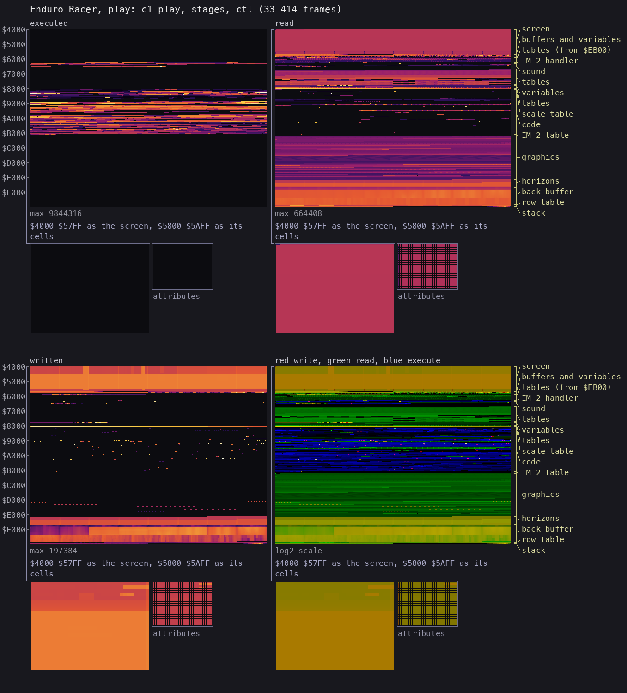
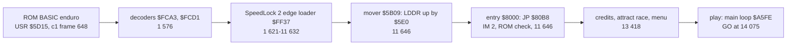
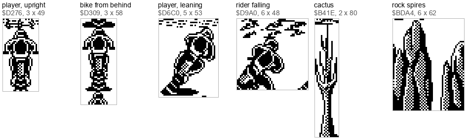
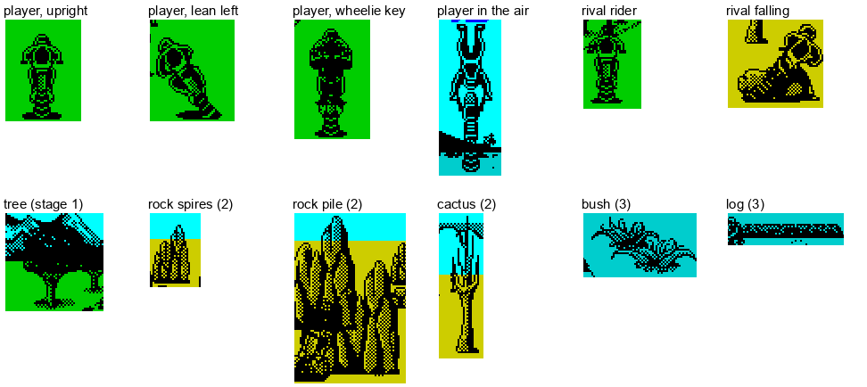

# 2. Architecture

What this covers: the memory map (a table and a heatmap), the images from the load to play and what changes between
them, the state variables, the stages' first map and the first sprites. The recordings it rests on: `c1` (48K,
power-on, the tape at signal speed), `stages` and `ctl` (from c1's states), `m128` (128K, power-on, signal speed);
WALKTHROUGH 6.0 lists them.

## 2.1 The memory map

One 48K image, loaded whole by SpeedLock 2 (doc 03) and moved up by `$5E0` at `$5B09`; the game starts at `$8000`.
The classes come from `tools/l1_regions.py` over the L1 builds of c1's play window, `stages` and `ctl` merged
(`kit/merge_l1.py`, 33 414 frames, `work/stage1/merged-play.json`); the names from the code that reads or writes
each range (WALKTHROUGH 1, the witnesses in the last column).

| Range | Class in play | What | Witness |
| --- | --- | --- | --- |
| `$4000-$5AFF` | written | the screen: the back buffer copied in, the HUD | `$8EE4`-`$8F22` read `$EB00-$FDDF`, write `$40A0-$5xxx`; `$A45D`, `$A5FE` write attributes |
| `$5B00-$5B4E` | written | a work buffer; the mover `$5B09` ran here at the load | `$A315 LD IX,$5B00` |
| `$5B80-$5E7F` | written | variables: `$5D00` the bit-reverse table (entry), `$5E00` 13 bytes from `$8003`, the score digits `$5E18-$5E1E`, TIME `$5E1F` (BCD), STAGE `$5E23` | `$80B8`; `$AA81 LD ($5E1F),A`; 22 reads of `$5E23` |
| `$5E80-$643B` | read-only | tables copied from `$EB00` at the entry (`$05B0` bytes) | `$80B8` |
| `$643C-$6587` | code, written | the IM 2 handler `$643C` (vector `$6464`: `JR $643C`), its saved SP `$6586`, its stack `$6574-$6583` | WALKTHROUGH 1 |
| `$6588-$6892` | code | sound: `$6588` the channels (IX `$6817`, `$6828`), `$6806`, `$6851` the engine, the beeper / AY branches | `tools/l1_ports.py` |
| `$6893-$6BE7` | untouched | | |
| `$6BE8-$7BFF` | read-only | tables: `$7800-$7FFF` read by the road (`$9CB7`, `$93C4`-`$95BB`), `$7680-$77AF` by `$839B` | the L1 reads |
| `$7C00-$7C53` | written | variables: the pass counter `$7C2E`, the beeper flag `$7C2F` (`$FF` 48K ROM), `$7C30`, `$7C32`, SPEED `$7C34`, the saved SP `$7C38` of the drawer | `$80B8`, `$90A2 LD ($7C38),SP` |
| `$7C54-$7FFF` | read-only | tables: `$7C54-$7D7F` read by `$8486` (which writes the screen), `$7D80-$7E7A` by `$A45D` (which writes the attributes) and `$B07D` | the L1 reads |
| `$8000-$80FF` | written | the entry code, then a 256-byte line buffer of the scaled drawer (`$8FA3 LD DE,$8000`) | entry vs play |
| `$810C-$B11C` | code | the game: main loop `$A5FE`, stage setup `$A45D`, multiply `$8BAE`, the scaled sprite drawer `$8F29`-`$910A`, the back buffer copy `$8EE4`, the horizon scrollers `$9211`-`$9294`; many 1-2 byte self-modified operands | the L1 |
| `$B11D-$B2FE` | untouched | holds the IM 2 table `$B200-$B300`, 257 bytes of `$64`, read by the hardware only | `$80B8` |
| `$B306-$E2BF` | read-only | graphics, bitmaps of 2 to 6 bytes a row, no masks (2.5) | `$8FDF`-`$8FE6` read `$C1BF-$E2BD` |
| `$E2C0-$EAFF` | written | the three horizons, 32 bytes a row: `$E2C0` dunes (25 rows), `$E5E0` mountains (32), `$E9E0` clouds (9); rotated in place by 1 bit (`$9211` right, `$923B` left) or 4 bits (`$9268`, `$9294`): the horizon's scroll | table `$9E67`; `$9211`, `$923B`, `$9268`, `$9294` |
| `$EB00-$FDFF` | written | the back buffer, 32 bytes a row (the entry's `$EB00` tables were copied out first) | `$90C7`-`$910A` write it, `$8EE4` copies it out |
| `$FE00-$FF7F` | written | row tables: `$8E7D` writes `$FE50-$FF7F`, `$9EF6` reads them | the L1 |
| `$FFE4-$FFFF` | written | the stack; low mark `$FFE4` (SP starts at `$0000`) | `kit/merge_l1.py --stack FF80-FFFF` |

*The merged play L1 (c1's play window, `stages`, `ctl`: 33 414 frames) by `kit/heatmap.py`, log2 of the counts per
byte, one row per 256 bytes. Code runs only in `$6400-$6900` and `$8100-$B100`; the graphics `$B306-$E2BF` are read
and written only in a few patched runs (2.2); the back buffer, the horizons and the screen take the writes.*

## 2.2 The images and what changes

*The stages of c1 (48K, signal speed), from `kit/rs.py stages` (WALKTHROUGH 1).*

| Image | Frame (c1) | What |
| --- | --- | --- |
| `work/stage1/images/loaded.cpu.bin` | 11 633 T 0 | the last block in, before the mover |
| `work/stage1/images/entry.cpu.bin` | 11 646 T 14 544 | at `$8000`, after the mover; `case.json`'s image |
| `work/stage1/images/play.cpu.bin` | 15 000 | stage 1 in play |

Loaded to entry: the `LDDR` shift of `$5BC4-$FA1F` to `$61A4-$FFFF` and nothing else. Entry to play (byte compare):
`$5B00-$5B49`; `$5BC8-$643B` (2 164 bytes, the variables and the tables copied from `$EB00`); `$6460-$6463`,
`$6524-$6525` (the handler's return), `$6574-$6587`, `$6817-$6831` (sound channels); `$7C2E-$7C52`; `$8000-$80FF`
(the line buffer over the entry code); `$85B3-$85DF`; many 1-2 byte self-modified operands in `$8xxx-$Axxx`;
`$B200-$B300` (the IM 2 table); `$D775-$D7B1` and `$DC75-$DC90` (graphics patched); `$EB00-$FDD1` (the back
buffer); `$FE50-$FF7F`; `$FFE6-$FFFF` (the stack).

From stage to stage (`stages-try1` at frames 2 222, 3 788, 5 354: stages 1, 2, 3) the same variables change plus the
horizon area (`$E5E4`, 1 308 bytes, then `$E9E0`, 288) and `$D51B-$D547`, `$DAA8-$DAFD` in the graphics: no level
block loads, a stage is a row of the stage tables.

**The state variables** (read through `time_travel memory_at` every 8 frames over c1 frames 14 600-19 200,
`work/stage1/varprobe.py`):

| Variable | Address | Witness |
| --- | --- | --- |
| STAGE | `$5E23`, 0-4, 5 after the last | `$AB31 LD ($5E23),A`; the stages recording |
| TIME | `$5E1F`, BCD | the Infinite Time POKE at `$AA81`; the screen |
| SCORE | `$5E18-$5E1E`, ASCII digits right aligned, spaces before | `"   2152"` at frame 14 600, `"  59601"` at 19 192 |
| SPEED | `$7C34`, raw (45 shows 25 km/h) | the Keep Speed POKEs NOP stores to it |
| the pass counter | `$7C2E` | +1 a pass (WALKTHROUGH 1) |
| beeper / AY | `$7C2F` | `$FF` on the 48K ROM |
| the horizon of the stage | `$5CEF` (address), `$5CF1`, `$5CF2` | set by `$9E3A` from the table `$9E67` |

There are no lives or energy: the timer ends the game. The player's position across the road and the distance
along it are not found yet (no monotonic counter in `$5B00-$7FFF`; stage 2).

## 2.3 The stages: a first map

The stage table at `$9E67`, 4 bytes a stage, indexed by STAGE (`$9E3A`: `LD A,($5E23)`, `CALL $8BAE` times 4): the
horizon's address, its rows, and a third byte that `$9E5F` turns into `$C0` minus rows minus it (stored at
`$9EE5`). A sixth row follows (`$6C3A`, 145, 111); STAGE reaches 5 after the last stage, whether that row is then used is to check.

| Stage | Horizon | Rows | Byte 3 | Ground (recorded) |
| --- | --- | ---: | ---: | --- |
| 1 | `$E5E0` mountains | 32 | 80 | green, trees |
| 2 | `$E9E0` clouds | 9 | 83 | yellow, rock spires |
| 3 | `$E2C0` dunes | 25 | 87 | cyan, bushes, logs |
| 4 | `$E5E0` mountains | 32 | 80 | yellow, cacti |
| 5 | `$E9E0` clouds | 9 | 90 | yellow, palms |

*`tools/stage_map.py`: the horizon each table row names, drawn from `entry.cpu.bin` at 2x, and a screen of that
stage (c1 802 frames into play; `reset3` 3 692 and 6 134; `stages` 7 806 and 10 272). The road's own layout (its
bends, the objects along it) is not decoded yet: stage 2.*

## 2.4 Ports

`tools/l1_ports.py`: on the 48K the beeper is `OUT ($FE)` in `$6851` (the engine), `$AB95` (a tone of D cycles at
period E), `$AC8A`, `$8AF0` (a falling sweep, its counter at `$8AF1`); `$8666` and `$8807` set the border. On the
128K `$6851` writes the AY (`$FFFD` / `$BFFD`) instead; `$6588`, `$6806`, `$A167` and `$ACA5` write the AY on both
machines (the 48K has no AY there). The keyboard is read in `$84F3` / `$85B0` and `$A5FE`. The game does not page:
`$7FFD` is written only by the 128K ROM and the loader `$FD47`.

## 2.5 The sprites: a first sheet

The graphics are plain bitmaps, a sprite's rows one after another, no mask, no header beside them; the drawer
`$8F29`-`$910A` scales a row through the line buffer `$8000` and ORs it into the back buffer (`$90B3`-`$90EF`
`LD A,(DE) / OR (HL) / LD (DE),A`). Leaning left is the leaning-right sprite drawn mirrored (the screen matches
`$D6C0` only mirrored; the bit-reverse table `$5D00` is the likely means, to check). Found by `tools/find_sprite.py`: each pixel row of
a sprite on a recorded screen searched in `$B306-$E2BF` at the 8 shifts, rows found in step W voting for the start.

*`tools/sprite_sheet.py` on `entry.cpu.bin`: the address, the width in bytes and the rows of each. The first and
last rows are read off by eye; the descriptor table that holds the exact sizes is not found yet.*

*`tools/crop_sheet.py`: the objects as they show on the recorded screens (`c1` 14 375-14 455 and 16 281, `reset3`
3 692, 4 682, 6 134, 6 662), for the ones not yet located in the data (the trees, the bushes, the log, the riders
at a distance).*
