# 3. Build and load

What this covers:

- the tape block by block, and the tape as a picture (3.1);
- the first BASIC and Stage0: the hidden `USR` number, the copy to `$FF98`, ERR_SP (3.2);
- the second BASIC: the decoy `POKE` digits that aim the error return at Chain1 (3.3);
- SpeedLock 2's three decoders, Chain1, Chain2 and Chain3, on real bytes (3.4);
- the loader: the signal, the store keys, the end mark, BlockTable, the tail that changes itself (3.5);
- Mover: the `LDDR` at `$5B09` that moves the game up by `$5E0` (3.6);
- the stages from power-on, with their frames (3.7);
- the build: from the sources to a byte-identical tape (3.8);
- the releases and re-issues, standard Spectrum only (3.9);
- the POKEs (3.10).

The recordings it rests on ([WALKTHROUGH](../WALKTHROUGH.md)):

- `c1`: the TOSEC `[SpeedLock 2]` copy of the tape on a 48K from power-on, played at signal speed: the ROM's own LOAD
  for the two BASIC blocks, SpeedLock 2's loader for the rest;
- `m128`: the same on a 128K.

The commands for the figures and the windows are in [`work/docs/erA-NOTES.md`](../work/docs/erA-NOTES.md).

## 3.1 The tape block by block

`orig/EnduroRacer.tzx.zip` holds one file, `Enduro Racer.tzx` (TZX 1.20, 51 505 bytes). Its 160 TZX blocks are
17 data blocks and the tone, pulse and pause blocks between them. The table gives each data block, the TZX blocks
from its first lead-in block to the block itself, and the times at signal speed.

| # | TZX blocks | Kind | Bytes | First byte | Bit 0 / 1 (T) | Lead-in (s) | Data (s) | Pause (ms) | Ends at (s) | Loads to |
| ---: | --- | --- | ---: | --- | --- | ---: | ---: | ---: | ---: | --- |
| 1 | 0 | ROM header, Program "enduro", LINE 0 | 19 | `00` | 855 / 1710 | 4.99 | 0.10 | 846 | 5.09 | |
| 2 | 1 | ROM data: the first BASIC | 207 | `FF` | 855 / 1710 | 2.00 | 1.17 | 1763 | 9.10 | PROG `$5CCB` |
| 3 | 2 | ROM header, Program "end2", LINE 0 | 19 | `00` | 855 / 1710 | 4.99 | 0.10 | 871 | 15.95 | |
| 4 | 3 | ROM data: the second BASIC, Chain1, the loader | 1772 | `FF` | 855 / 1710 | 2.00 | 9.99 | 3710 | 28.81 | PROG `$5CCB` |
| 5 | 5-69 | SpeedLock: a decoy | 18 | `CE` | 565 / 1130 | 4.45 | 0.07 | 1537 | 37.03 | `$A000` |
| 6 | 72-136 | SpeedLock: the loading screen | 6912 | `6C` | 565 / 1130 | 4.44 | 27.19 | 0 | 70.20 | `$4000` |
| 7 | 137-138 | SpeedLock: game | 4608 | `8B` | 565 / 1130 | 0.02 | 18.30 | 0 | 88.51 | `$70C8` |
| 8 | 139-140 | SpeedLock: game | 4096 | `39` | 565 / 1130 | 0.02 | 16.28 | 0 | 104.81 | `$A0C8` |
| 9 | 141-142 | SpeedLock: the new Store key | 2 | `AB` | 565 / 1130 | 0.02 | 0.01 | 0 | 104.83 | `$FE04` |
| 10 | 143-144 | SpeedLock: the new StoreLast keys | 4 | `34` | 565 / 1130 | 0.02 | 0.02 | 0 | 104.87 | `$FE3C` |
| 11 | 145-146 | SpeedLock: game | 5376 | `92` | 565 / 1130 | 0.02 | 21.30 | 0 | 126.18 | `$5BC8` |
| 12 | 147-148 | SpeedLock: the new tail | 23 | `28` | 565 / 1130 | 0.02 | 0.09 | 0 | 126.29 | `$FF63` |
| 13 | 149-150 | SpeedLock: game | 18 776 | `AD` | 565 / 1130 | 0.02 | 75.85 | 0 | 202.16 | `$B0C8` |
| 14 | 151-152 | SpeedLock: the new end | 13 | `C1` | 565 / 1130 | 0.02 | 0.05 | 0 | 202.23 | `$FF7A` |
| 15 | 153-154 | SpeedLock: Mover | 64 | `01` | 565 / 1130 | 0.02 | 0.25 | 0 | 202.49 | `$5B00` |
| 16 | 155-156 | SpeedLock: game | 4096 | `11` | 565 / 1130 | 0.02 | 15.71 | 0 | 218.21 | `$82C8` |
| 17 | 157-158 | SpeedLock: game and the check byte | 3585 | `FF` | 565 / 1130 | 0.02 | 13.89 | 0 | 232.12 | `$92C8` |

The tape plays 232.1 s, 11 606 frames at 50 Hz; TZX block 159 is a text block. Blocks 1-4 are the ROM's standard
blocks. Blocks 5-17 are SpeedLock 2's: no flag byte, no ROM checksum. The "first byte" of a SpeedLock block is just
its first data byte. Between blocks 6 and 17 each gap is one pulse block of 875 / 1 750 T pulses: the 21-bit end mark
that joins the blocks into one stream with no pause (3.5).

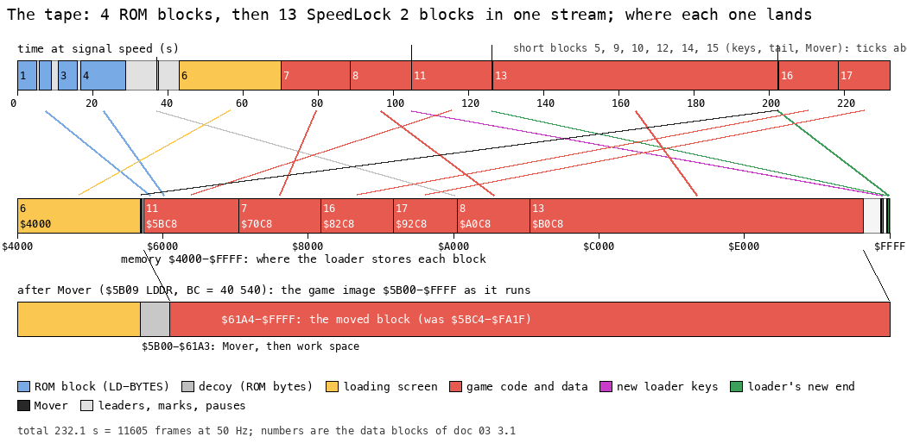

*How to read: the top band is the tape in time at signal speed, one box a data block, coloured by kind; the short
blocks 5, 9, 10, 12, 14 and 15 are ticks above it. The lines lead from each block to where the loader stores it in
`$4000-$FFFF`; the bottom band is the image after Mover's `LDDR`. The point: the game arrives in six slices out of
address order, with the loader's own keys and tail in between, and only Mover puts the slices at their final
addresses. Command: `python3 tools/fig_tape.py`.*

**Witness.** `tools/tape_table.py "work/media/Enduro Racer.tzx"` (the table's timings) and `tools/tzxblocks.py list`
for each TZX block; the destinations from BlockTable `$FF89` (3.5) and `src/tape/tape.txt`.

**The point.** Four blocks for the ROM, thirteen for SpeedLock. After the second BASIC the tape is one continuous
signal of 203 s that only SpeedLock's loader can read.

## 3.2 The first BASIC and Stage0

The first BASIC, `enduro`, is one line, number 0:

```text
0 PAPER 0: INK 0: BORDER 0: CLS: PRINT USR 6746931: LOAD ""
```

A number in a BASIC line is stored twice: its digits, which LIST shows, and a hidden 5-byte form after them, which
the interpreter uses. Here the digits say 6 746 931 and the 5-byte form holds about 23 829.1, which `USR` rounds to `$5D15`. `PRINT USR 23829`
calls Stage0, inside the program. The colours make the screen black first, so nothing of the program shows.

Stage0 is a `CALL Stage0Copy`. The `CALL` pushes `$5D18`, the address of the bytes after it; Stage0Copy pops that
address as the source of a copy. The copy is obfuscated with IXL and IXH moves and both register sets. Its real
steps:

- interrupts off; SP = `$FFF8`;
- `RES 4,(IY+1)`: FLAGS bit 4, the 128K ROM's mode flag, cleared;
- R = `$A6`, I = `$3F`;
- ERR_SP (`$5C3D`) = `$FFFA`: the ROM's error handler will now return through the word at `$FFFA`;
- the 105 bytes `$5D18-$5D80` go to `$FF98-$FFFF`.

The copy leaves `$1B76` (the ROM's STMT-RET) at `$FFF8`, which Stage0Copy's `RET` takes back to the interpreter. It
also leaves `$1303` (the ROM's MAIN-4, the normal error return) at `$FFFA`. So for now an error still behaves
normally. The interpreter goes on to `LOAD ""`, which loads the second BASIC.

**How it works.**

```text
PRINT USR 23829:                       ; the digits say 6746931
Stage0:      CALL Stage0Copy           ; pushes $5D18
Stage0Copy:  source = pop              ; $5D18
             DI; SP = $FFF8; FLAGS bit 4 = 0
             R = $A6; I = $3F
             ERR_SP = $FFFA
             copy 105 bytes source -> $FF98
             RET                       ; to $1B76, STMT-RET: the interpreter goes on
LOAD ""                                ; the second BASIC
```

```asm
Stage0:                     ; $5D15
  CALL Stage0Copy         ; pushes $5D18, the copy's source
  ...
Stage0Copy:
  LD IXL,$00              ; filler and real steps interleaved
  LD C,$FA
  ...
  POP BC                  ; BC' = $5D18
  ...
  LD R,A                  ; $A6
  ...
  LD I,A                  ; $3F
  ...
l_5D66:
  LD A,(BC)               ; the copy loop, 105 bytes to $FF98
  LD (IX+$00),A
  INC BC
  ...
```

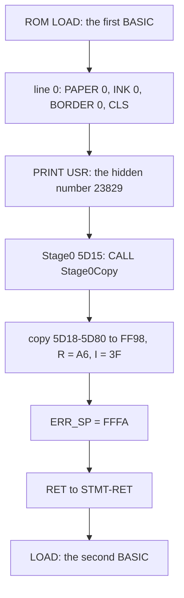

**Worked example.** The number in the line: the digits `6746931`, then `$0E` (the 5-byte marker) and 
`$8F $3A $2A $33 $33`. That is the floating-point form of about 23 829.1. `USR` rounds it to 23 829, `$5D15`. The ROM's LIST prints
the digits; `USR` reads the 5 bytes. In `c1` the copy is complete by frame 1 574: the dump has `$1B76` at `$FFF8` and
`$1303` at `$FFFA`.

**Witness.** `src/tape/basic1.asm` (assembled byte for byte by `tools/build.sh`); `tools/basic_list.py
work/media/b1.bin`; the `c1` memory at frame 1 574.

**The point.** Stage0 sets a trap for later. By moving ERR_SP onto its own copy at `$FFFA`, it makes the ROM's error
handler return into whatever word the next stage writes there.

## 3.3 The second BASIC: the error that starts Chain1

The second BASIC, `end2`, loads over the first. It has five lines numbered 0 and a sixth "line" that is not one:

| Line | What LIST shows | What it does |
| --- | --- | --- |
| 0 | `REM "Protected by SPEEDLOCK"` in colour codes | nothing |
| 0 | `BORDER 0: PAPER 0: INK 0: BRIGHT 1: CLS: POKE 23624,0` | black screen and border |
| 0 | `POKE (PEEK 23641+256*PEEK 23642),PEEK 23649` and the next byte | E_LINE's word = WORKSP |
| 0 | `POKE (PEEK 23633+256*PEEK 23634),PEEK 23647` and the next byte | uses 23613 and 23627: the word at ERR_SP = VARS |
| 0 | `POKE 23662,PEEK 23618: POKE 23663,PEEK 23619: POKE 23664,PEEK 23621` | OLDPPC = NEWPPC |
| 40 079 | no line: length 42 626 | its bytes are LoaderTape; the interpreter raises an error on them |

The fourth line is the trick. Its digits are decoys: LIST shows 23633, 23634, 23647 and 23648 (CURCHL and
X_PTR). The hidden 5-byte numbers are 23613, 23614, 23627 and 23628: ERR_SP and VARS. So the line reads "write
VARS into the word ERR_SP points at". ERR_SP is `$FFFA` (Stage0) and VARS is `$621A`, so the ROM's `POKE` writes `$1A`,
`$62` to `$FFFA-$FFFB` in `c1` frames 1 557-1 562.

The interpreter then reaches the sixth line, whose bytes make no sense as BASIC. It raises an error. The error handler
returns through ERR_SP, to the word at `$FFFA`, now `$621A`: Chain1, at the start of the variables area.

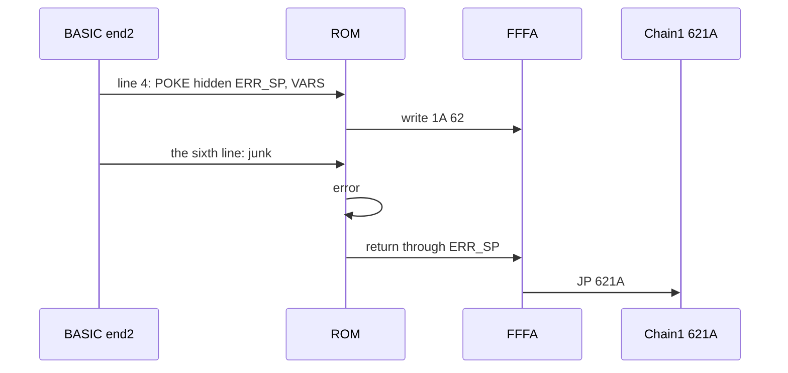

**How it works.**

```text
line 0 (4th): POKE word(ERR_SP), VARS          ; shown as CHANS, CH_ADD
               -> memory[$FFFA] = $621A
sixth line: junk -> error -> the ROM returns through ERR_SP -> $621A = Chain1
```

```text
; the fourth line, as the interpreter sees its hidden numbers
POKE (PEEK 23613+256*PEEK 23614),PEEK 23627: POKE (PEEK 23613+256*PEEK 23614)+1,PEEK 23628
; ERR_SP = $FFFA, VARS = $621A: $FFFA-$FFFB become $1A,$62
```

**Worked example.** The ROM's `POKE` writes the two bytes `$1A` and `$62` in `c1` frames 1 557-1 562. Before, the
word at `$FFFA` is `$1303`, the MAIN-4 that Stage0 left. After, it is `$621A`. Chain1's first instruction runs at frame
1 574, when the interpreter reaches the sixth line.

**Witness.** `src/tape/basic2-module.asm` (the fourth line's comment); the `c1` memory of `$FFFA` over frames
1 557-1 562.

**The point.** No `USR` starts the second stage. A BASIC error does, after a `POKE` that LIST shows as harmless
system-variable fiddling.

## 3.4 The three decoders

The loader travels in the second BASIC's variables, `$5EFD-$6219`, 797 bytes, enciphered three times. Three
decoders peel it at the top of memory.

**Chain1 `$621A`.** Obfuscated with filler instructions between the real ones. Its real steps:

- A = I (`$3F` from Stage0);
- `LDIR` clears `$63E0-$FF42`: the RAM the game will use, and any other loader left there;
- `IM 2`;
- HL = `$5EFD`, DE = `$FCA3`, BC = 797; `$FCA3` is pushed under the loop's own return address;
- R is set so that the first `LD A,R` reads `$CD`;
- Chain1Loop: each byte is XORed with R, stored back, and copied to `$FCA3` onwards by `LDI`.

Each turn of the loop takes 10 M1 cycles, so R goes up by 10 a byte (bit 7 stays). When BC reaches 0, `RET PO` takes
the pushed `$FCA3`: Chain2.

**Chain2 `$FCA3`.** The same loop again, over `$FCD1-$FFBF` (751 bytes) in place. R at its first byte is `$8D`:
Chain1's last R (`$E5`) plus 40 M1 cycles. Chain2 itself starts with nine bytes of filler that only serve as keys for Chain3.

**Chain3 `$FCD1`.** 137 rounds of a running XOR over `$FD2C-$FFBF` (660 bytes). Round n starts with A = key[n] - C,
where key[n] is the byte at `$FCA3` + n (the decoders' own bytes) and C is the last value of the round before. Each
byte becomes A = A XOR byte. After the rounds, the sum of the 137 bytes from `$FF37` must be `$36FE`. Then Chain3
wipes `$FCD1-$FD0D` with `$C9` (`RET`) and jumps to LoaderStart `$FF37`. A wrong sum falls into Crash `$FD1D`, which
clears the RAM until the machine resets.

**How it works.**

```text
Chain1:  r = $CD
         for i in 0..796:                      ; $5EFD-$6219 -> $FCA3-$FFBF
             b = tape[i] XOR r;  dest[i] = b;  r = (r & $80) | ((r + 10) & $7F)
         RET PO -> $FCA3
Chain2:  r = $8D
         for each byte of $FCD1-$FFBF: byte ^= r; r += 10 (7 bits)
Chain3:  c = memory[$FFBF]
         for n in 0..136:
             a = (memory[$FCA3 + n] - c) & 255
             for each byte of $FD2C-$FFBF: a ^= byte; byte = a
             c = a
         if sum(memory[$FF37..$FFBF]) != $36FE: Crash
         memory[$FCD1..$FD0D] = $C9
         JP $FF37                               ; LoaderStart
```

```asm
Chain1Loop:                 ; $62B4
  LD A,R                  ; A = R XOR byte, stored in place
  XOR (HL)
  LD (HL),A
  LDI                     ; on to $FCA3+
  RET PO                  ; BC = 0: into Chain2
  DEC SP
  DEC SP                  ; the return address back
  RET PE                  ; to Chain1Loop

Chain2Loop:                 ; $FCC7: the same five instructions
  LD A,R
  XOR (HL)
  LD (HL),A
  LDI
  RET PO
  ...
Chain3:                     ; $FCD1
  LD BC,(LoaderPad+$0001) ; C = the byte at $FFBF
  LD B,$89                ; 137 rounds
  LD DE,Chain2            ; the keys: $FCA3 onwards
l_FCDA:
  PUSH BC
  LD A,(DE)
  PUSH DE
  LD DE,$0394
  SUB C
  LD HL,Edge              ; $FD2C
l_FCE4:
  XOR (HL)
  LD (HL),A
  INC HL
  ...
```

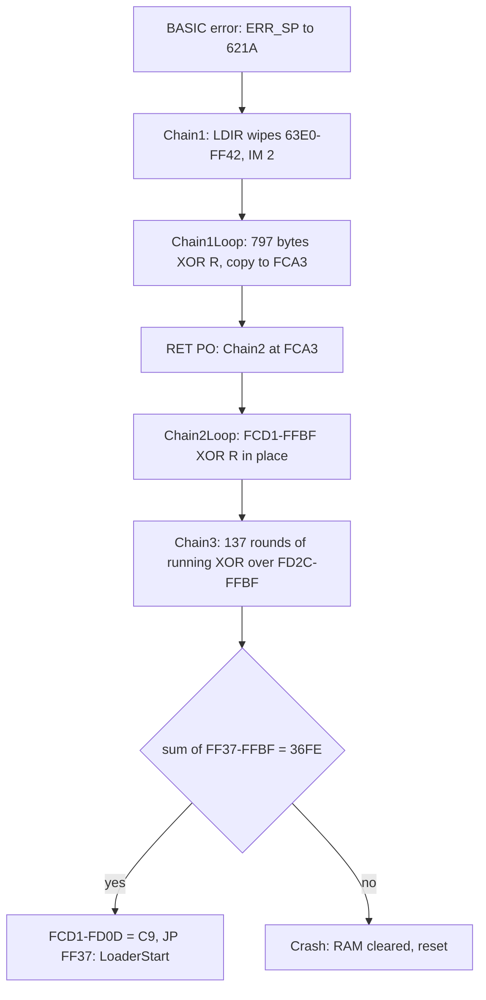

**Worked example.** The first bytes of each layer, computed by `tools/speedlock2.py` on the tape's bytes and the
same in the `c1` memory:

| Layer | Address | In | Key | Out |
| --- | --- | --- | --- | --- |
| Chain1 | `$5EFD`, to `$FCA3` | `$8F $82 $A6 $95 $BA $B9` | R = `$CD $D7 $E1 $EB $F5 $FF` | `$42 $55 $47 $7E $4F $46`, "BUG~OF" |
| Chain2 | `$FCD1` | `$60 $DC $1E $54` | R = `$8D $97 $A1 $AB` | `$ED $4B $BF $FF`: `LD BC,($FFBF)`, Chain3's first instruction |
| Chain3, round 0 | `$FD2C` | `$B5 $41 $EA $7F` | A = `$42` - `$BB` = `$87` | `$32 $73 $99 $E6` |
| Chain3, after 137 rounds | `$FD2C` | | | `$3D $20 $FD`: `DEC A`, `JR NZ,$FD2C`, the first instructions of Edge |

Chain1's first output bytes, the nine filler bytes at `$FCA3`, read as text: "BUG~OF" and three more. They are never
run: Chain2's real code starts at `$FCAC`. They exist to be Chain3's keys. The check sum of `$FF37-$FFBF` comes out
at `$36FE` (`tools/speedlock2.py check`).

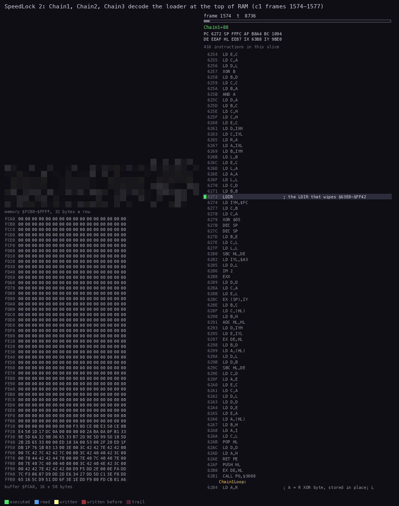

*`c1` frames 1 574-1 577, a quarter frame a picture. How to read: the map at the top is `$FC00-$FFFF`, 32 bytes a
row; the hex view under it is `$FCA0-$FF... ` as the bytes arrive; the code panel shows Chain1's filler, the `LDIR`
that wipes `$63E0-$FF42` (the whole map turns red), then Chain1Loop, Chain2Loop and the start of Chain3. The point:
the loader appears byte by byte at `$FCA3` already partly readable, and Chain2 rewrites it again in place. Command:
`python3 ../../kit/routine_anim.py --work work/docs/erA/c1 --window 1574:0-1578:0 --listing build/basic2.lst
--listing build/loader.lst --pc 5D00-62FF,FCA3-FFBF --range FC00-FFFF --row-bytes 32 --view buffer:FCA0:16x50:hex
--step 8736 --out docs/img/routines/Chain1.gif`.*

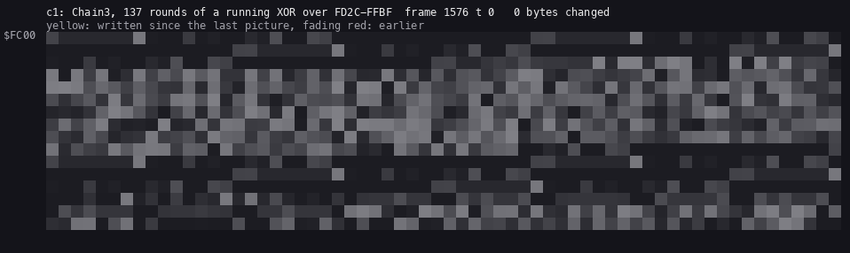

*`c1` frames 1 576-1 626, half a frame a picture. How to read: `$FC00-$FFFF`, 64 bytes a row; the bytes written
since the last picture are yellow, older writes fade through red; every round sweeps `$FD2C-$FFBF`. At the end the
wipe of `$FCD1-$FD0D` with `$C9` shows as one short stripe. The point: Chain3 runs from frame 1 576 to 1 622,
about 44 frames (137 x 660 bytes at 34 T), almost a second of loading. Each round depends on the one before, so the loader cannot be decoded piece by
piece. Command: `python3 ../../kit/memanim.py --work work/docs/erA/c1 --from 1576 --to 1626 --step 34944
--from-address FC00 --to-address FFFF --row-bytes 64 --cell 14 --width 1050 docs/img/load/chain3-c1.gif`.*

**Witness.** `tools/speedlock2.py check build/basic2.bin`: "the 797 bytes both ways: identical; R at layer 2 = `$8D`;
the checksum of `$FF37-$FFBF` (137 bytes, Chain3) = `$36FE`". `src/loader/loader.asm` is the plain view the build
enciphers back into the tape's bytes.

**The point.** Three cheap layers, each keyed on something a cracker's tools disturb: R (any breakpoint or extra
instruction changes it) and the decoders' own bytes (any patch to Chain2 changes Chain3's keys).

## 3.5 The loader

LoaderStart `$FF37` clears the attributes (the screen goes black), probes the tape, loads the screen and every other
block in one chain, and jumps to the tail.

**The probe.** ProbeTape loads block 5 (18 bytes, the ROM's own bytes of `$0032-$0042`, to `$A000`, a decoy) and
then samples the EAR bit 255 times into `$9000`. CheckSamples sums two windows of the samples and sets LoadFailed
`$FF36` if the tone after block 5 is missing: a copy made without that tone fails here.

**The signal.** Block 6 has a leader of 2 100 T tone pieces broken by 1 163 / 711 T pulse pairs, a long pair of
3 150 T, and the 6-bit mark %111010 = `$3A`. Then the bytes follow, a bit as two equal pulses: 565 T for 0 and
1 130 T for 1. After the last byte of a block comes a 21-bit end mark (875 T for 0, 1 750 T for 1): 5 zeros, 11 ones,
5 zeros. StoreLast reads it as three 7-bit groups; the middle one must be `$7F`. Then the next block's bytes follow
at once, with no leader.

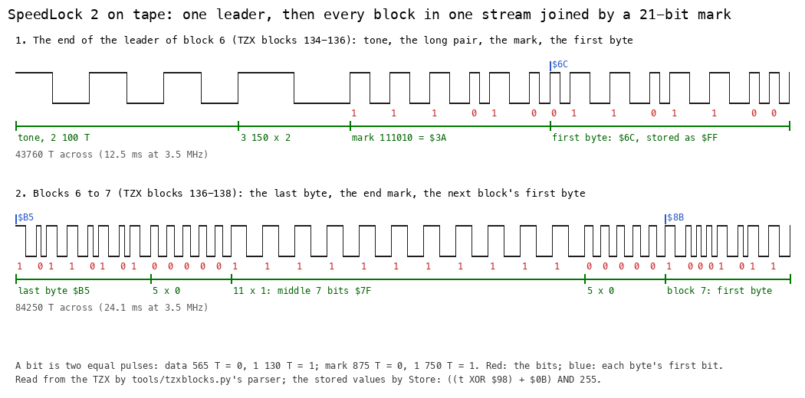

*How to read: the EAR level as the TZX's pulses toggle it, time across; red figures are the bits, two pulses each;
blue ticks mark each byte's first bit; the green spans name the parts. Panel 1 is the end of block 6's leader, panel
2 the join of blocks 6 and 7. The point: after one leader the blocks are one stream; the end mark is the only thing
between them. Command: `python3 tools/fig_speedlock.py`.*

**The store.** Every byte t read from the tape is stored as ((t XOR k) + a) AND 255. k and a are the operands of
Store `$FE04` for every byte but a block's last, and of StoreLast `$FE3C` for the last. They start as k = `$98`,
a = `$0B`. Block 9 loads `$3E $07` over Store's first instruction: `LD A,$07`, so k becomes 7. Block 10 loads 
`$3E $07 $AD $C6` over StoreLast's: k becomes 7 there too. From then on the keys are new.

**The running check.** H keeps the XOR of all tape bytes. The last block's last byte is chosen so that H ends at 0.

**BlockTable `$FF89`.** After the screen, each block's address, length and page come from a 5-byte row: the
address, the length less one, and the `$7FFD` value (`$10`, ROM 1 and bank 0 on a 128K; harmless on the 48K).

| Row | Address | Length - 1 | Block |
| ---: | --- | --- | ---: |
| 1 | `$70C8` | `$11FF` | 7 |
| 2 | `$A0C8` | `$0FFF` | 8 |
| 3 | `$FE04` | 1 | 9: Store's k and a |
| 4 | `$FE3C` | 3 | 10: StoreLast's keys |
| 5 | `$5BC8` | `$14FF` | 11 |
| 6 | `$FF63` | `$16` | 12: the new tail |
| 7 | `$B0C8` | `$4957` | 13 |
| 8 | `$FF7A` | `$0C` | 14: the new end |
| 9 | `$5B00` | `$3F` | 15: Mover |
| 10 | `$82C8` | `$0FFF` | 16 |
| 11 | page 0: the end row | | 17 follows at `$92C8`, 3 585 bytes, its last the check |

**The tail.** The loader rewrites its own end while it runs. The decoded loader ends with a tail that checks
LoadFailed, sets IY = `$5C3A`, IM 1, HL' = `$2758`, R = 0 and jumps to `$6000`. Block 12 writes the same tail over
`$FF63-$FF79` but with `JP $A000`, into the decoy area block 5 filled. Block 14 writes `$FF7A-$FF86`, the new LoadEnd:
border black, then `JP $5B00` when H = 0, else `JP 0`. In `c1` LoadEnd's `JP $5B00` comes first, so neither tail ever
runs. The code that runs at the end is not the code that was decoded.

**How it works.**

```text
LoaderStart:
    DI; SP = $FFFF; attributes = 0
    ProbeTape: block 5 to $A000; 255 EAR samples; CheckSamples
    IX = $4000; DE = $1AFF                      ; the screen first
    LoadBlock: leader, sync groups, mark $3A
    loop:
        t = read byte; H ^= t
        if not the block's last: memory[IX] = ((t ^ k) + a) & 255     ; Store
        else:                    memory[IX] = ((t ^ k2) + a2) & 255   ; StoreLast
             read the 21-bit mark; middle 7 bits != $7F: LoadFailed
             next row of BlockTable: IX, DE, OUT ($7FFD)
             the end row: the last block, then LoadEnd
LoadEnd (as block 14 rewrote it):
    border black
    if H == 0: JP $5B00 (Mover) else JP 0      ; a reset
```

```asm
Store:                      ; $FE04, the tape byte in L
  LD A,$98                ; k: block 9 loads $3E,$07 here, LD A,$07
  XOR L
  ADD A,$0B               ; a
  LD (IX+$00),A
  INC IX
  DEC DE
  ...
StoreLast:                  ; $FE3C
  LD A,$98                ; block 10 loads $3E,$07,$AD,$C6 here
  XOR L
  ADD A,$0B
  LD (IX+$00),A
  INC IX
  DEC DE
  ...
  CALL ReadMarkBits       ; the 21-bit end mark
  RET NC
  LD A,(IY+$04)           ; the next BlockTable row: its page
  OR A
  JR Z,l_FEAD             ; page 0: the end row
  LD L,C
  LD BC,$7FFD
  ...
```

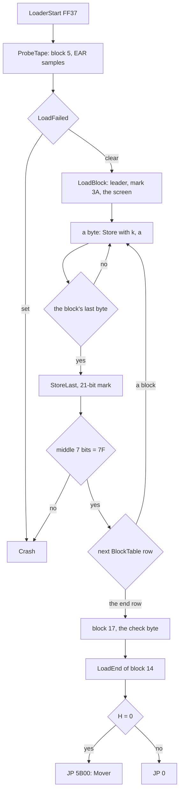

**Worked example.** The loading screen's first bytes on tape are `$6C $6C $20 $6C`. With k = `$98` and a = `$0B`:
`$6C` XOR `$98` = `$F4`, + `$0B` = `$FF`; `$20` XOR `$98` = `$B8`, + `$0B` = `$C3`. The stored bytes are 
`$FF $FF $C3 $FF`, the first bytes of `src/res/screens/loading.scr`. All 6 912 bytes of block 6 map this way to the screen
file.

**Witness.** `tools/tzxblocks.py "work/media/Enduro Racer.tzx" 136 scrblk.bin` against `loading.scr`;
`tools/mktape.py` (the inverse of the store, used by the build); `src/loader/loader.asm`, `src/loader/tail.asm`.

**The point.** Changing keys, a check that spans the whole tape, a self-rewriting end: a copy must reproduce the
signal exactly, and a cracker must follow the loader to its last block to learn where it really jumps.

## 3.6 Mover: the game moves up by `$5E0`

Block 15 is Mover, 64 bytes at `$5B00`, in the printer buffer. The loader stored the game's slices at addresses
`$5E0` lower than where the game runs. Mover puts them in place with one `LDDR`:

```text
Mover:
    HL = $FA1F; DE = $FFFF; BC = 40540     ; $5BC4-$FA1F -> $61A4-$FFFF, from the top down
    LDDR
    SP = $61A7
    JP $8000                               ; Start: JP Init
```

```asm
Mover:                      ; $5B00
  LD DE,StackArea+$007F   ; $FFFF
  LD HL,$FA1F
  LD BC,$9E5C             ; 40 540
  LDDR                    ; $5B09
  LD SP,$61A7
  JP Start                ; $8000
```

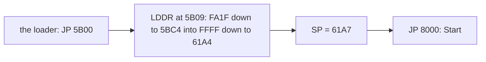

The copy runs from the top down because source and destination overlap: the destination is above the source, so a
copy upwards would overwrite bytes before reading them. Why the slices were stored low at all is not in the code; the
likely reason is the loader itself, which lives at `$FCA3-$FFBF` until the last block, right where the game's top
`$5E0` bytes go.

**Worked example.** The game's last byte, `$FFFF`, came from `$FA1F`; Start at `$8000` came from `$7A20`, inside the
slice of block 7 (`$70C8` + `$0958`). The `LDDR` copies 40 540 bytes at 21 T each, about 851 300 T: twelve
frames. In `c1` the jump to `$5B00` comes at frame 11 632 and Start runs at frame 11 646 T 14 544.

**Witness.** `work/stage1/images/loaded.cpu.bin` (frame 11 633 T 0) against `entry.cpu.bin` (11 646 T 14 544): the
only difference is the shift. `src/game/entry.asm` Mover.

**The point.** The game's real layout appears only twelve frames before it starts. A snapshot of memory during the
load shows every byte `$5E0` too low.

## 3.7 The stages from power-on

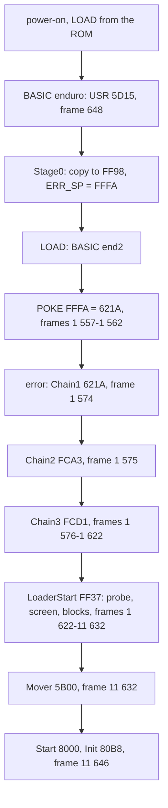

*The frames of `c1` (48K): the ROM's loads from `kit/rs.py stages`, the POKE from the memory of `$FFFA`, the
decoders from the traces of 3.4. `m128` runs the same stages at other frames (its ROM loads at frames 618 and later).*

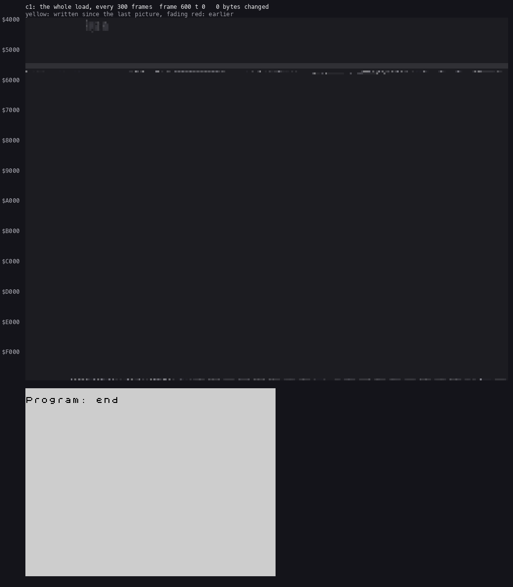

*`c1` frames 600-11 700, one picture every 300 frames. How to read: left, the memory `$4000-$FFFF`, 256 bytes a row,
the bytes written since the last picture in yellow; right, the screen. The point: the screen arrives first (block 6),
then the game in slices out of order (blocks 7, 8, 11, 13, 16, 17), and only at the very end does everything shift up
by `$5E0`. Command: `python3 ../../kit/memanim.py --work work/docs/erA/c1 --from 600 --to 11700 --step 20966400
--from-address 4000 --to-address FFFF --screen --cell fit docs/img/load/load-c1.gif`.*

**Worked example.** From the `USR` at frame 648 to Start at frame 11 646 are 10 998 frames, 220 s. The loader alone,
frames 1 622-11 632, is 10 010 of them. Everything before it takes 974 frames, mostly the ROM loading the second
BASIC; the three decoders take 48.

**The point.** Seven stages before the game: two in BASIC, one in Stage0, three decoders, the loader, Mover. Only the
loader takes time: the rest is under 50 frames.

## 3.8 The build

`tools/build.sh` builds the whole tape from the sources and compares it with the original, byte for byte. It prints
"build: Enduro Racer.tzx identical to orig/EnduroRacer.tzx.zip's Enduro Racer.tzx".

| Input | What | Made by |
| --- | --- | --- |
| `src/game/game.asm` (the modules, from `game.ann`) | `$5B00-$FFFF` at the entry | sjasmplus |
| `src/res/` | the loading screen, the sprites, the tables, the track | `tools/res_formats.py build` |
| `src/tape/basic1.asm` | the BASIC `enduro` and Stage0 | sjasmplus |
| `src/loader/loader.asm` | the loader's plain view `$FCA3-$FFBF` | sjasmplus |
| `src/loader/tail.asm` | `$FF63-$FF86` as blocks 12 and 14 load it | sjasmplus |
| `loader-tape.bin` | the loader enciphered three times | `tools/speedlock2.py tape` |
| `src/tape/basic2.asm` | the BASIC `end2`, Chain1, LoaderTape (`INCBIN loader-tape.bin`) | sjasmplus |
| `src/tape/tape.txt` | every TZX block: the ROM blocks, the tones, the SpeedLock blocks as slices of the image | `tools/mktape.py` |

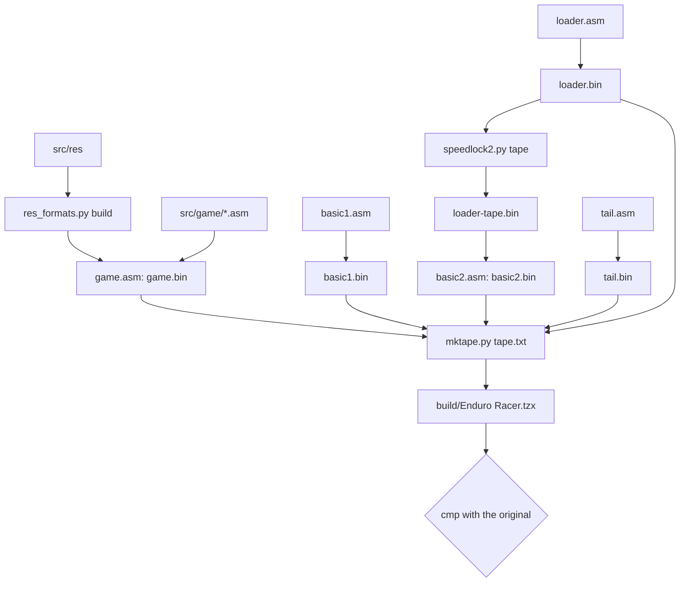

*`tools/build.sh`: the steps in the order it runs them. `tools/mktape.py` stores every SpeedLock byte with the
loader's own keys, the inverse of Store, and slices the game image as the loader will place it before Mover's
`LDDR`.*

**Worked example.** The loading screen's first byte is `$FF` in `src/res/screens/loading.scr`. `tools/mktape.py`
inverts the store: (`$FF` - `$0B`) XOR `$98` = `$F4` XOR `$98` = `$6C`, the byte on the tape (3.5).

**Witness.** `tools/build.sh` (prints identical); `src/tape/tape.txt`.

**The point.** Every byte of the tape comes from a source file or a tool's computation. The three ciphers and the
store keys are reversible, so the build writes the tape forward and the doc reads it backward with the same code.

## 3.9 Releases and re-issues

Only the standard Spectrum tapes are listed; the TR-DOS conversions, snapshots and hacks are in the
[README](../README.md#other-releases-and-copies).

| Release | Protection | Data blocks |
| --- | --- | --- |
| Activision 1987 (`orig/`, WoS, TOSEC `(48K-128K)`) | SpeedLock 2 | the 17 blocks of 3.1 |
| TOSEC `[SpeedLock 2]` copy | SpeedLock 2 | the same data blocks; the BASIC names `end` and `race`; the recording `c1` |
| Proein Soft Line (Spain) | SpeedLock 2 | the same data blocks byte for byte; the BASIC names `0` and `1` |
| The Hit Squad | SpeedLock 4 / 7 groups | one BASIC of 3 577 bytes, blocks of other sizes: another layout |
| Elite compilations (6-Pak Vol 3, Fists 'n' Throttles) | SpeedLock 5 / 7 | a 155-byte BASIC, an 8 071-byte code block, other blocks |

**Worked example.** The Proein tape's BASIC header names its programs `0` and `1`, where the original says `enduro`
and `end2`. Its SpeedLock data blocks are the original's byte for byte (`tools/media_compare.py`, README).

**The point.** The Activision and Proein tapes are the same SpeedLock 2 stream, so this document covers both. The
budget re-releases changed the protection and the block layout; their game image is a question for a comparison of
loaded images, not of tapes.

## 3.10 The POKEs

ZXDB lists seven POKEs (`Enduro Racer (1987)(Activision Inc).pok`). Each is one byte in the code:

| POKE | Address | Effect | What it changes |
| --- | --- | --- | --- |
| `43649,58` | `$AA81` | infinite time | TimerTick's `LD (Timer),A` becomes `LD A,(nn)` |
| `42971,1` | `$A7DB` | immune to obstacles | the head-on `CALL Crash` becomes `LD BC,nn` |
| `43151,1` | `$A88F` | immune to trucks | TruckCrash's `CALL` becomes `LD BC,nn` |
| `41457,58` | `$A1F1` | keep speed off road | the off-road slow-down's store becomes a load |
| `43033,58` | `$A819` | keep speed by obstacles | Bounce's store becomes a load |
| `43622,58` | `$AA66` | keep speed in turns | the lean's slow-down store becomes a load |
| `43177,0` | `$A8A9` | keep speed by motorbike collisions | the rider bounce's `LD (HL),A` becomes `NOP` |

The value 58 is `$3A`, the opcode of `LD A,(nn)`: it turns a `LD (nn),A` (`$32`) into a load from the same address,
so the store does nothing. The value 1 is `$01`, `LD BC,nn`: it turns a `CALL` (`$CD`) into a load that skips the
call. The value 0 is `NOP`. The stage 1 recording `stages` ran with the trucks' POKE among others, to reach the late stages.

**Worked example.** `POKE 43649,58` writes `$3A` to `$AA81`. TimerTick's `$32 $1F $5E`, `LD (Timer),A`, becomes
`$3A $1F $5E`, `LD A,(Timer)`. The timer is read back instead of written, so it never counts down.

**Witness.** The `.pok` file; `build/*.lst` at each address (`Timer`, `Speed+$0001`, `Crash`, `TruckCrash`).

**The point.** The game keeps each rule in one store. One byte per rule is enough to switch it off.
