# 4. Game loop

What this covers:

- the program as a state machine, from the mover to the race and back to the attract loop (4.1);
- the IM 2 vector: the table `$B200-$B300` full of `$64` (4.2);
- the interrupt handler `$643C`: its own stack, the `JP` at `$6523` it returns by, the sound it runs (4.3);
- the repair of the two bytes the interrupt's push wrote over the drawing data (4.4);
- the 128K test by a ROM checksum (4.5);
- the free-running race loop: the order of one pass, 8.0 frames on average, a pass against the beam (4.6);
- the heavy passes: the 48K crash noise inside the pass (4.7);
- the timer, the countdown and every delay (4.8);
- the stage 3 reset: a road row off the top of RowTable, SP in the ROM, a lost return (4.9).

The recordings it rests on ([WALKTHROUGH](../WALKTHROUGH.md)):

- `c1`: power-on on the 48K, the TOSEC `[SpeedLock 2]` copy at signal speed, the attract loop, the menu, stage 1 to the time-out;
- `reset3`: stage 3 played to the jump that resets the machine (frame 6759);
- `m128`: the same tape on the 128K, for the 128K test.

The windows built for this document are in `work/docs/erA/`. The commands are in
[`work/docs/erA-NOTES.md`](../work/docs/erA-NOTES.md).

| Window | From | Frames | What it gives |
| --- | --- | --- | --- |
| `c1-samples.json` | `c1` | 11 600-21 265, every frame | PassCount, the timer, SPEED, GetUp, the return address of the last interrupt |
| `c1/traces/17945_0-17953_0.uatr` | `c1` | 17 945-17 952 | a full trace of one 8-frame pass at 138 km/h and its 8 interrupts |
| `c1/traces/15169_0-15182_0.uatr` | `c1` | 15 169-15 181 | a full trace of a 13-frame window: a 12-frame pass with a bounce off a rider |
| `r3-samples.json` | `reset3` | 6 700-6 800, every frame | RoadTopRow, JumpHeight, IntSavedSp, the return address, up to the reset |
| `r3/traces/6758_60000-6759_30000.uatr` | `reset3` | 6 758-6 759 | a full trace of the reset |

A value read by `time_travel memory_at` at frame N is the state at the start of frame N (T 0), before that frame's
interrupt. On the 48K the interrupt comes at about T 1 812 of the recorder's frame and the paper starts at T 16 152.

## 4.1 The program as a state machine

Enduro Racer has one race loop and no frame lock. The loader's last block, Mover `$5B00`, jumps to Start `$8000`
once. Start jumps to Init `$80B8`. Init builds the IM 2 table, copies the records and the track tables down, builds
the bit-reverse table, tests the ROM, enables the interrupts and falls into Attract `$810C`. Attract is the hub: every
game ends back there.

Attract scrolls the credits up and waits for a key for 250 counts of WaitKey `$854A`. No key starts a demo race:
DemoMode becomes 8 plus the distance AND 7, and NewGame runs with the demo's moves. After the demo, AttractScores
shows the high score table and the loop starts again. A key goes to Menu `$8178`.

The menu has four items: START GAME, ONE or TWO PLAYERS, CHANGE CONTROL MODE, DEFINE KEYS. SPACE or fire executes
an item. Any other key moves to the next one. A time-out with no key goes back to Attract.

START GAME runs NewGame `$8755`. NewGame sets up both players' blocks and enters TurnLoop `$87BD`. Each turn swaps
the two 56-byte player blocks and calls PlayTurn `$87FC` for the player whose timer is not 0. PlayTurn draws the HUD
and calls GameEntry `$8E50`, a `JP StartRace`. StartRace `$A45D` sets the stage up and falls into RaceLoop `$A5FE`.

The race loop leaves in two ways:

1. the timer is 0 and SPEED is 0: TimerTick jumps to RaceOver `$AA9E`, and RaceEnd returns to PlayTurn;
2. the player presses RESET (R by default): RaceQuit `$A9C3` ends the turn the same way.

A stage's end does not leave the loop. StageEnd `$AB0A` adds the time bonus, sets the next stage up and jumps back
to RaceLoop. After stage 5 the stage number is 5 and the bike is no longer drawn: the finish rider runs instead.

Back in PlayTurn, a timer not 0 means the turn ended by a reset; PlayTurn returns and the next turn starts. A timer of
0 means game over: RecordStages, LapTable, ScoreCheck, NameEntry and ShowScores. When both players' timers are 0,
TurnLoop goes back to Attract.

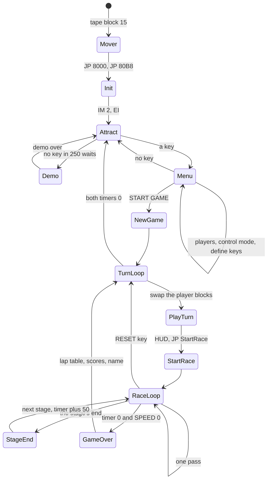

*The states, with the frames of `c1` where each was first seen: Mover at 11 632, Init 11 646, the credits 11 882,
the demo's timer at 12 408, the menu 13 418, GO at 14 075, timer 0 at 19 258, SPEED 0 at 19 300, the lap table
19 465, the next demo at 21 138. The frames come from `c1-samples.json` (Timer `$5E1F`, Speed `$7C34`) and the
screenshots in `docs/img/play`.*

**Witness.** In `c1-samples.json` the timer reads `$60` from frame 12 408 (the demo starts with 60), `$00` from
19 258, and `$60` again at 21 138 (the next demo). SPEED reads 17 at 19 265 and 0 at 19 300: the bike rolls to a stop
after the time-out, as Throttle's `$0940` a pass says (4.8).

**The point.** The program is one loop with a hub. Every way out of a race goes through PlayTurn and TurnLoop back
to Attract. Nothing restarts the machine on purpose; 4.9 is the exception, and it is a bug.

## 4.2 The IM 2 vector: 257 bytes of `$64`

The game runs in interrupt mode 2. In IM 2 the CPU makes an address from I (the high byte) and the byte on the data
bus (the low byte), reads a word there, and jumps to it. On a plain Spectrum nothing drives the bus during the
interrupt acknowledge, so the byte is usually `$FF`. It is not guaranteed: some interfaces put other values there.

Init sets I to `$B2` and fills `$B200-$B300`, 257 bytes, with `$64`. Every word the CPU can read there is `$6464`,
whatever the bus says. At `$6464` sits IntVector, a `JR Interrupt`, two bytes that jump back to `$643C`.

**How it works.**

```text
Init:
    disable interrupts
    I = $B2
    for each address from $B200 to $B300:    ; 257 bytes: the last word read can be $B2FF-$B300
        memory[address] = $64
    ...
    SP = 0
    interrupt mode 2
    enable interrupts

on each interrupt (the hardware):
    push PC
    PC = word at (I * 256 + bus byte)        ; always $6464
    $6464: JR $643C                          ; IntVector
```

```asm
Init:                       ; $80B8
  DI
  LD HL,Im2Table          ; $B200
  LD A,H
  LD I,A                  ; I = $B2
l_80BF:
  LD (HL),$64
  INC L
  JR NZ,l_80BF            ; $B200-$B2FF
  INC H
  LD (HL),$64             ; and $B300
  ...
  LD SP,$0000
  IM 2
  EI

IntVector:                  ; $6464
  JR Interrupt            ; $643C
```

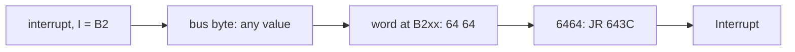

**Worked example.** At frame 17 950 of `c1` the interrupt came while the CPU was at `$9016` in ShiftRight (the `c` entry ShiftRightHead `$8FF8`). With `$FF`
on the bus the CPU read the word at `$B2FF`: `$64` from `$B2FF` and `$64` from `$B300`, so `$6464`. The trace shows
the read of `$B2FF` and the first instruction at `$6464` (the `JR`), then `$643C`. With `$00` on the bus it would
read `$B200-$B201`, also `$6464`.

The table's area holds old graphics in the tape image. Init writes over them, so they never show
([doc 02, 2.7](02-architecture.md#27-the-leftovers)).

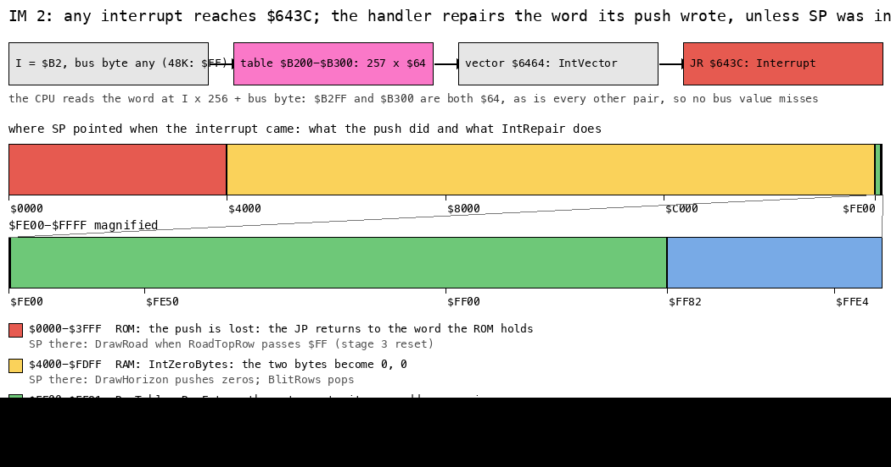

*How to read: the top row is the vector chain, from I and the bus byte through the table to `$6464` and `$643C`.
The band under it is the whole 64 KB; each colour is what IntRepair does with the return address the CPU pushed
there (4.4), and the magnified strip is `$FE00-$FFFF`. The point: the vector always lands, but the push it starts
writes wherever SP points. Drawn from the code by `python3 tools/fig_im2.py`; no recording.*

**Witness.** `c1/traces/17945_0-17953_0.uatr`: 8 interrupts in 8 frames, each starts at `$6464` at T 1 843-1 855
of its frame. The L1 of `c1` play counts 1.00 entries of Interrupt a frame. Init's code: `src/game/entry.asm`.

**The point.** A table of one repeated byte makes the vector independent of the bus. The handler then has to cope
with the stack the main code is using as a data pointer, which is the subject of 4.3 and 4.4.

## 4.3 The interrupt handler `$643C`

The main code uses SP as a fast data pointer:

- DrawRoad `$931E` pops row addresses from RowTable;
- ClearLines `$9EF1`, part of DrawHorizon, pushes zeros into the back buffer;
- BlitRows `$9069` pops rows;
- DrawRoadRunOff and BigDigit move SP too.

An interrupt in the middle of one of them pushes its return address into that data. A normal handler would then
push its registers there as well, and return with `RET`, which pops from the same place.

Interrupt does neither. It saves SP in IntSavedSp `$6586` and takes its own stack, IntStack (`$6566-$6585`, SP
starts at `$6584`). It pushes AF, BC, DE, HL, IX and IY there. Then it reads the return address from where the CPU
pushed it, the old SP, into the operand of the `JP` at IntReturn `$6523`. It adds 2 to IntSavedSp: that is the SP to
restore. Now HL points at the two bytes the push wrote, and IntRepair `$6466` decides what to do with them (4.4).

After the repair, IntSound `$6476` runs the sound: a change of tune at a tune's mark, the two AY channels
(PlayChannel on ChannelA and ChannelB), and EngineSound `$6851` when a tune is requested. On the 48K the AY writes go
nowhere, and EngineSound plays the engine on the beeper ([doc 09](09-sound.md)).

IntExit `$6516` pops the registers, loads SP from IntSavedSp, enables the interrupts, and jumps through IntReturn's
`JP nn`. No `RET` is executed. The return address is never popped from the data.

**How it works.**

```text
Interrupt:
    IntSavedSp = SP                     ; the interrupted SP, pointing at the pushed PC
    SP = $6584                          ; IntStack
    push AF, BC, DE, HL, IX, IY
    HL = IntSavedSp
    IntReturn.operand = word at HL      ; the interrupted PC, into JP nn at $6523
    IntSavedSp = HL + 2                 ; the SP the main code had before the push
    repair the word at HL               ; 4.4
    sound: tune change, channels, EngineSound
    pop IY, IX, HL, DE, BC, AF
    SP = IntSavedSp
    enable interrupts
    JP IntReturn.operand
```

```asm
Interrupt:                  ; $643C
  LD (IntSavedSp),SP      ; $6586
  LD SP,IntStack+$001E    ; $6584
  PUSH AF
  PUSH BC
  PUSH DE
  PUSH HL
  PUSH IX
  PUSH IY
  LD HL,(IntSavedSp)
  LD E,(HL)               ; the pushed PC
  INC HL
  LD D,(HL)
  INC HL
  LD (IntSavedSp),HL      ; old SP + 2
  DEC HL
  DEC HL                  ; HL = where the push wrote
  LD (IntReturn+$0001),DE ; the JP's operand
  LD A,H
  JP IntRepair
  ...
IntExit:                    ; $6516
  POP IY
  POP IX
  POP HL
  POP DE
  POP BC
  POP AF
  LD SP,(IntSavedSp)
  EI
IntReturn:                  ; $6523
  JP $0000                ; the operand is the interrupted PC
```

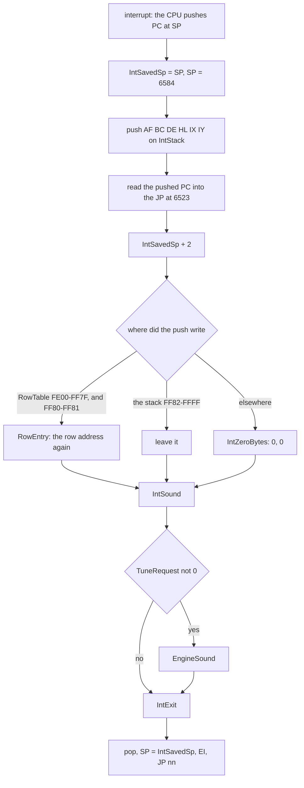

**Worked example.** Frame 17 950 of `c1`, the bike at 138 km/h on stage 1:

| Step | Bytes in the trace | Meaning |
| --- | --- | --- |
| `$643C` | writes `$F2`, `$FF` to `$6586` | the interrupted SP was `$FFF2` |
| `$6443`-`$6449` | writes `$6583` down to `$6578` | the six registers on IntStack |
| `$644E`, `$6450` | reads `$18` at `$FFF2`, `$90` at `$FFF3` | the pushed PC is `$9018` |
| `$6452` | writes `$F4`, `$FF` to `$6586` | IntSavedSp = `$FFF4` |
| `$6457` | writes `$18`, `$90` to `$6524` | IntReturn becomes `JP $9018` |
| `$6466` | A = `$FF`, L = `$F2` | the real stack: no repair |
| `$6523` | `JP $9018` at T 27 281 | back in ShiftRight (ShiftRightHead `$8FF8`), 25 457 T after the entry |

The instruction before the interrupt was at `$9016`, a 2-byte instruction, so `$9018` is right.

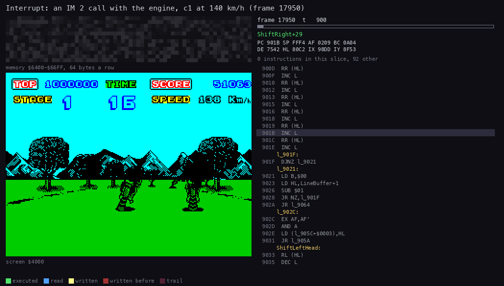

*`c1` frame 17 950, T 0 to 36 000, 900 T a picture. How to read: the memory map at the top is `$6400-$66FF`, 64
bytes a row; IntStack and IntSavedSp light up yellow at the start, the sound channels' bytes during IntSound; the
code panel follows the handler into EngineSound's beeper loop, which takes most of the time. The point: one
interrupt with the engine costs about 25 000 T, more than a third of the frame. Command:
`python3 ../../kit/routine_anim.py --work work/docs/erA/c1 --window 17950:0-17950:36000 --listing build/game.lst
--pc 643C-690E --range 6400-66FF --view screen --step 900 --out docs/img/routines/Interrupt.gif`.*

The cost alternates, because EngineSound plays its burst every second interrupt. In the pass of 17 945-17 952 the
eight interrupts took 737, 25 443, 862, 23 320, 953, 25 445, 722 and 25 445 T. That is about 12 900 T a frame on
average, 18 % of the 69 888 T frame. The frame budget of `c1` play gives EngineSound 14.8 % and the rest of the
handler under 1 % ([doc 02, 2.6](02-architecture.md#26-the-frame-budget)); stage 1 at lower speeds, the countdown
and the falls bring the average down.

**Witness.** `c1/traces/17945_0-17953_0.uatr` (the eight interrupts above). In `c1-samples.json` the bytes
`$6524-$6525` read `$8EF0` at the start of frame 17 900: the return of frame 17 899's interrupt. The handler:
`src/game/interrupt.asm`.

**The point.** The handler never trusts the interrupted stack. It saves and restores everything on its own stack and
returns by a patched `JP`. That leaves one job: the two bytes the CPU's push has already written into the data.

## 4.4 The repair of the pushed word

The CPU's push happens before the handler runs. Whatever was in those two bytes is gone. IntRepair `$6466` puts
back what the data should hold there. It looks only at the address, H and L:

| Where the push wrote | H, L | IntRepair does | Why it is right |
| --- | --- | --- | --- |
| RowTable `$FE00-$FF7F` (and `$FF80-$FF81`, which the L test lets through) | `$FE`, or `$FF` with L below `$82` | RowEntry recomputes the entry | RowTable holds a computable address for each line |
| the real stack `$FF82-$FFFF` | `$FF`, L `$82` or more | nothing | a normal push; IntExit skips it anyway |
| anywhere else in RAM | any other | IntZeroBytes writes 0, 0 | the only other SP user an interrupt meets there is ClearLines, which pushes zeros |
| the ROM `$0000-$3FFF` | `$00`-`$3F` | IntZeroBytes writes 0, 0 into the ROM | nothing: the push itself was lost (4.9) |

RowEntry turns the address into the entry number n = (address - `$FE00`) / 2, which is a screen line. It then
rebuilds the entry the way SetRowTable `$8E7D` built it:

- n below 40: the screen line's own address (the HUD lines, drawn straight on the screen);
- n from 40 to 63: `$EB00` + 32 x (n - 40), the back buffer's first 24 lines, laid out plainly;
- n 64 and more: the screen line's address + `$A600`, the back buffer's lines in the screen's own order.

**How it works.**

```text
IntRepair(HL):                          ; HL = where the push wrote
    if H == $FE or (H == $FF and L < $82):
        n = (HL - $FE00) / 2
        if n < 40:   entry = LineAddress(n)
        elif n < 64: entry = $EB00 + 32 * (n - 40)
        else:        entry = LineAddress(n) + $A600
        word at HL = entry
    elif H == $FF:
        pass                            ; the stack
    else:
        word at HL = 0                  ; the back buffer's cleared lines
```

```asm
IntRepair:                  ; $6466, A = H
  CP $FE
  JP Z,RowEntry
  CP $FF
  JP NZ,IntZeroBytes
  LD A,L
  CP $82
  JP C,RowEntry
IntSound:                   ; $6476
  ...
RowEntry:
  PUSH HL
  LD DE,$0200
  ADD HL,DE               ; HL - $FE00, in 16 bits
  AND A
  RR H
  RR L                    ; / 2: L = n
  LD A,L
  CP $28
  JR NC,l_6542
  CALL LineAddress        ; n < 40: the screen line
  JR l_655F
l_6542:
  CP $40
  JR NC,l_6557
  SUB $28                 ; 40-63: $EB00 + 32 (n - 40)
  ...
l_6557:
  CALL LineAddress        ; 64 and more: the line + $A600
  LD HL,$A600
  ADD HL,DE
  EX DE,HL
l_655F:
  POP HL
  LD (HL),E
  INC HL
  LD (HL),D
  JP IntSound
```

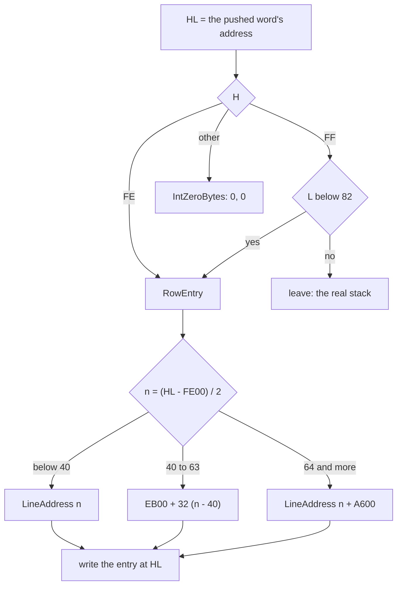

**Worked example.** The pass of `c1` frames 17 945-17 952 met two of the three cases:

- frame 17 949: SP was `$FE88` in DrawRoad, inside RowTable. n = (`$FE88` - `$FE00`) / 2 = `$44` = 68. Line 68 is
  in the screen's middle third, character row 0, pixel line 4: LineAddress gives `$4C00`. Plus `$A600` is `$F200`.
  The trace shows RowEntry writing `$00` to `$FE88` and `$F2` to `$FE89`. The entry `$F200` is back, and DrawRoad
  pops it after the return as if nothing had happened. The return went to `$9100` in BlitNext.
- frame 17 945: SP was `$F868` in the back buffer, ClearLines pushing zeros under the horizon. IntZeroBytes wrote 0
  to `$F868` and `$F869`, what ClearLines would have written there. The return went to `$9F0D`.
- the other six interrupts found SP in the real stack (`$FFF2`-`$FFF8`) and left it.

**Witness.** `c1/traces/17945_0-17953_0.uatr`, the writes of `$6526-$6565` in each interrupt. RowTable's builder
SetRowTable and its `$A600`: `src/game/render.asm`.

**The point.** The game draws with SP and still takes an interrupt every frame. It can, because every place SP
visits in normal play holds data the handler can recompute: an address from a formula, or a zero. The one place it
cannot repair is the ROM, and 4.9 shows a race that sends SP there.

## 4.5 The 128K test: a checksum of the ROM

Init decides between the beeper and the AY once, by summing the ROM bytes `$3B00-$3BFF` with `ADC`. A sum of `$FE`
sets Beeper `$7C2F` to `$FF`: the engine and the crash noises go to the beeper. Any other sum sets Beeper to 0: the
sound goes to the AY ([doc 09](09-sound.md)).

**How it works.**

```text
RomSum:
    a = 0; carry = 0
    for each byte b of ROM $3B00-$3BFF:
        a, carry = a + b + carry          ; ADC, 8 bits
    Beeper = $FF if a == $FE else 0
```

```asm
RomSum:                     ; $80EC
  LD HL,$3B00
  XOR A
l_80F0:
  ADC A,(HL)
  INC L
  JR NZ,l_80F0
  LD C,A
  LD B,$00
  CP $FE
  LD A,$FF
  JR Z,l_80FE
  XOR A
l_80FE:
  LD (Beeper),A
```

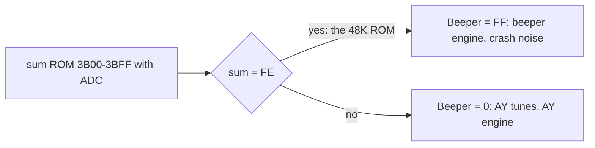

**Worked example.** The sums over the ROM files of `unreal-ng/data/rom`, computed by the same `ADC` loop in Python:

| ROM | Sum of `$3B00-$3BFF` | Beeper | Sound |
| --- | --- | --- | --- |
| `48.rom` | `$FE` | `$FF` | beeper |
| `128.rom` ROM 0 (the 128K editor) | `$29` | 0 | AY |
| `128.rom` ROM 1 (48 BASIC) | `$92` | 0 | AY |
| `pentagon128k.rom` ROM 0 | `$A4` | 0 | AY |

So the test does not ask "is there an AY". It asks "is this the exact 48K ROM". A 128K loading in 48 BASIC mode still
has its own ROM 1 paged in. Its bytes at `$3B00-$3BFF` differ from the 48K's, so the game uses the AY there too.

**Witness.** `c1` (48K): Beeper `$7C2F` reads 0 at frame 11 644 (Mover has just moved the image) and `$FF` from frame 11 648 on, after Init (`c1-samples.json`). `m128` (128K): Beeper
reads 0 (WALKTHROUGH, the 128K recording).

**The point.** One byte, set once, picks the sound path for the whole run. A 48K with another ROM would get the AY
path and no engine sound.

## 4.6 The free-running race loop

There is no `HALT` in the race. RaceLoop `$A5FE` runs one pass after another as fast as the work allows. Each pass
moves the bike by ScrollStep = SPEED x 14 track units (8.8 fixed point), draws the whole picture into the back
buffer and copies it to the screen. The passes are not tied to frames: in `c1`'s stage 1 a pass took from 5 to 12
frames, 8.0 on average.

**The order of one pass.**

1. Countdown: while Countdown is not 0, the pass counts it down and shows 3, 2, 1, GO in attribute blocks.
2. RaceCount `$A64E`: PassCount `$7C2E` + 1; CAPS SHIFT and Q toggle CheatStep ([doc 05, 5.11](05-controls.md#511-the-cheat-key)).
3. RaceStep: ScrollStep = SPEED x 14.
4. RacePass `$A67E`:
   - AyEffectTick, AdvanceTrack (the track moves on by ScrollStep), ScrollBends;
   - the stage's row builder and road routine, two `CALL nn` patched by StartRace from StageParams `$A187`: DrawRoad
     with RoadRowsCrest on stages 1, 2 and 4, DrawRoad with RoadRowsJump on stage 3, RoadNone on stage 5;
   - GroundTexture (the ground's dots), MoveRiders (not during the countdown), DrawRiders;
   - BikeControl and DrawBike (not after the finish), DrawDust, DrawSplash, HorizonScrollStep, BikeHitX.
5. ObjectWalk `$A6D9`: the track from the bike forward, each object drawn (DrawObject); the ones on the bike's row
   tested for a collision (Bounce, Crash, Ramp); then RiderHits `$A839`, the other riders and the trucks.
6. HudFlash `$A8BB` (DEMO, or 1UP / 2UP, every 8 passes), ExtendedPlay, CountdownBeeps.
7. CopyBuffer `$98F5` and DrawHorizon `$9E7B`: the back buffer to the screen, the horizon drawn into place.
8. FinishCheck `$A95A` (the stage's end), ScoreAdd `$A974` (the speed's digits to the score), RaceControls `$A9A8`
   (the keys, pause, reset).
9. Throttle `$A9DC` (SPEED from throttle and brakes), PrintSpeed, TimerTick `$AA73` (4.8); back to RaceLoop.

**How it works.**

```text
RaceLoop:
    if Countdown: count down, show the digit
    PassCount += 1
    ScrollStep = SPEED * 14
    move the track, the bends
    build the road rows; draw the road         ; per stage
    ground, riders, bike, dust, splash, horizon step
    walk the objects: draw, collide
    riders and trucks: collide
    HUD flashes, extended play, beeps
    copy the back buffer to the screen; draw the horizon
    stage end?  -> StageEnd, then RaceLoop
    score += speed digits
    keys: pause, reset
    SPEED from the controls
    print SPEED; tick the timer
    if timer == 0 and SPEED == 0: RaceOver
    goto RaceLoop
```

```asm
RaceLoop:                   ; $A5FE
  LD A,(Countdown)
  AND A
  JR Z,RaceCount
  ...
RaceCount:                  ; $A64E
  LD HL,PassCount
  INC (HL)
  ...
RaceStep:
  LD A,(Speed+$0001)
  LD L,$0E
  CALL Multiply           ; DE = SPEED * 14
  ...
RacePass:                   ; $A67E
  LD (ScrollStep),DE
  CALL AyEffectTick
  CALL AdvanceTrack
  CALL ScrollBends
RowBuilderCall:
  CALL RoadRowsJump       ; patched per stage
RoadCall:
  CALL DrawRoad           ; patched per stage
  CALL GroundTexture
  ...
```

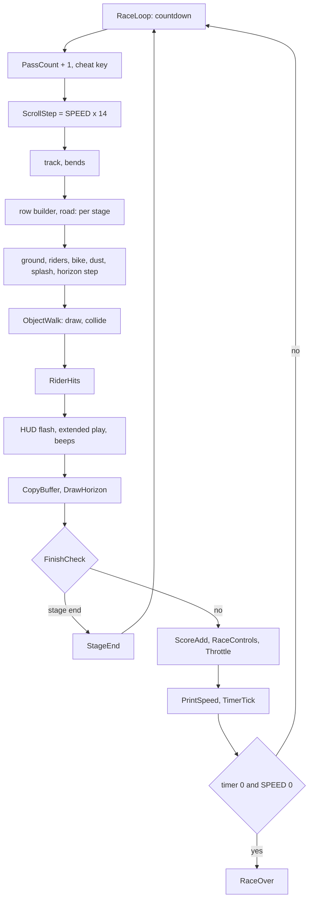

**Worked example.** One pass of `c1`, frames 17 945-17 952, SPEED 138:

- PassCount reads 78 at the start of frame 17 946 and 79 at the start of 17 954. The pass's `INC` came in frames
  17 945 and 17 953, 8 frames apart.
- ScrollStep = 138 x 14 = 1 932 = `$078C` in 8.8, 7.5 track units: a segment of 128 units takes 17 passes.
- The trace of the 8 frames is 559 091 T. BlitRow and BlitNext (the `c` entry BlitHead's span, [doc 02,
  2.6](02-architecture.md#26-the-frame-budget)) take 21.6 %, EngineSound 17.1 %, CopyRows 15.3 %, Multiply
  8.6 %, ShiftLeftHead 7.9 %, DrawRoad 3.5 %, HorizonHidden 3.4 %, RoadRowsCrest 3.1 %.

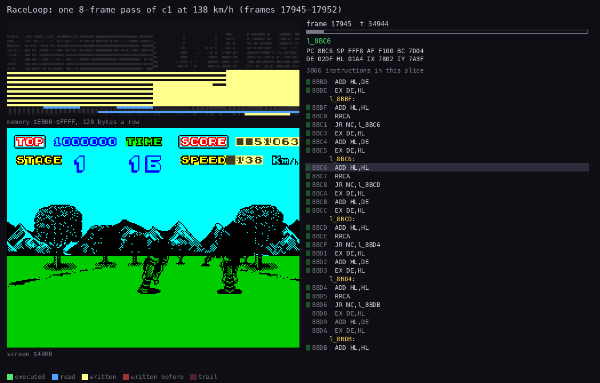

*`c1` frames 17 945-17 952, half a frame a picture. How to read: the map at the top is `$EB00-$FFFF`, the back buffer
and RowTable; yellow marks the bytes written in that half frame. The first six frames fill the back buffer (the
objects, the riders, the bike); the last two copy it to the screen (CopyRows). The code panel names the routine
running. The point: the screen changes only in the last quarter of the pass; most of the pass draws into a buffer
the player does not see. Command: `python3 ../../kit/routine_anim.py --work work/docs/erA/c1 --window
17945:0-17953:0 --listing build/game.lst --pc 8000-B1FF,643C-690E --range EB00-FFFF --view screen --step 34944 --out
docs/img/routines/RaceLoop.gif`.*

**The pass against the beam.** CopyRows copies the back buffer line by line while the beam is drawing the screen.

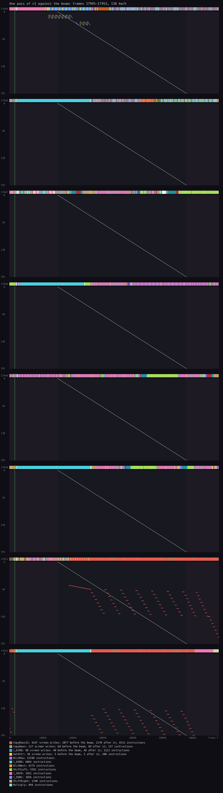

*`c1` frames 17 945-17 952. How to read: one panel a frame; the coloured strip at the top of each is the routine
running at each T; the dots are the screen writes, by line (down) and T (across); the white diagonal is the beam.
Frames 17 945-17 950 write almost nothing to the screen. In 17 951-17 952 CopyRows writes 4 247 bytes in runs of 8
lines; 2 077 land before the beam reaches their line, 2 170 after. The point: the copy is not synchronised, so a
frame can show the upper part of the new picture and the lower part of the old one. At 8 frames a pass that tear
shows in about one frame in eight. Command: `python3 ../../kit/beam_timeline.py --work work/docs/erA/c1 --window
17945:0-17953:0 --listing build/game.lst --machine 48k --frames 8 --out docs/img/loop/beam-pass-c1.png`.*

**The length of a pass.** `c1`'s stage 1 had 648 passes from GO (frame 14 075) to the time-out (19 265).

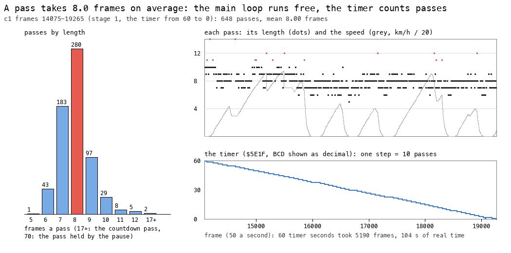

*`c1-samples.json`, frames 14 075-19 265. How to read: left, the passes by their length in frames (red: the
commonest, 8); top right, each pass's length as a dot at its end frame, the speed in grey; bottom right, the timer.
The point: the pass length barely follows the speed; it follows what is on screen. The red dots, 11 frames and more,
are the passes with a crash noise (4.7). Command: `python3 tools/fig_passes.py work/docs/erA/c1-samples.json`.*

| Frames a pass | 5 | 6 | 7 | 8 | 9 | 10 | 11 | 12 | 17 | 70 |
| --- | ---: | ---: | ---: | ---: | ---: | ---: | ---: | ---: | ---: | ---: |
| Passes | 1 | 43 | 183 | 280 | 97 | 29 | 8 | 5 | 1 | 1 |

The 17-frame pass ends at frame 14 172, in the countdown's last passes: probably GO's beep (BeepTone `$AB95`
busy-waits, 256 edges for GO against 64 for 3, 2, 1), not traced. The 70-frame pass is the pause at frame 14 552-14 621 (H
held, then a key). The demo race of `c1` (frames 12 400-13 418) took 8.24 frames a pass on average.

**Witness.** `c1-samples.json` (PassCount `$7C2E` per frame); the WALKTHROUGH's pass histogram (the same 648
passes); `c1/traces/17945_0-17953_0.uatr` with `work/docs/erA/prof.py` for the T-states per routine.

**The point.** The race runs at about 6 passes a second. Every rule that counts passes (the timer, the flashes, the
riders' moves) runs at that rate, not at the 50 Hz of the frame.

## 4.7 The heavy passes

The 13 passes of 11 and 12 frames are not caused by more drawing. The trace of the 12-frame pass that ends at frame
15 182 shows where the time went:

| Routine | T | Share |
| --- | ---: | ---: |
| CrashSoundD | 213 532 | 23.5 % |
| EngineSound | 119 216 | 13.1 % |
| BlitRow, BlitNext (BlitHead's span) | 109 666 | 12.1 % |
| CopyRows | 90 360 | 9.9 % |
| HorizonHidden | 69 640 | 7.7 % |
| Multiply | 64 566 | 7.1 % |
| the whole window | 908 533 | 13.0 frames |

CrashSoundD `$AC8A` is the 48K's crash noise: D beeper edges at spacings read from the ROM, played inside the pass.
In this pass the bike hit a rider. SPEED fell from 183 (frame 15 170) to 136 (15 182): SPEED minus a quarter, the
rider bounce of RiderHits. The noise alone took 213 532 T, three frames.

**How it works.**

```text
on a bounce off an object or a rider, a ramp, a crash:
    PlayEffect(n)            ; the AY sweep: no sound on the 48K
    CrashSound / CrashSoundD ; 48K only: the noise, in the pass
```

```asm
  CALL PlayEffect           ; race.asm: Bounce, RampSpeed, RiderHits, Crash
  CALL CrashSound           ; $AC88: 248 edges; CrashSoundD $AC8A: D edges
```

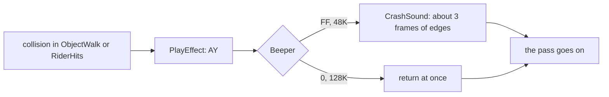

**Worked example.** The pass from frame 15 170 to 15 182: 12 frames instead of the usual 8. Take away the noise's 3
frames and the rest is 9 frames, within the normal range for a screen with a rider close up.

**Witness.** `c1/traces/15169_0-15182_0.uatr` through `work/docs/erA/prof.py`; SPEED at 15 170 and 15 182 in
`c1-samples.json`. On the 128K the noise is the AY's (Beeper 0) and CrashSound returns at once.

**The point.** On the 48K the sound is paid for in game time: each bump holds the race for about three frames.

## 4.8 The timer, the countdown and the delays

**The timer.** Timer `$5E1F` holds the seconds in BCD; Tenths `$5E20` counts passes, 9 down to 0. TimerTick looks
at Tenths first: at 0 it takes one off the Timer (`DEC A`, `DAA`), prints it, and reloads 10. Then it takes one off
Tenths and stores it (9 after a reload). So a timer second is 10 passes, about 80 frames, 1.6 s of real time, and the
timer's step comes on the pass after Tenths was stored as 0.

Throttle skips TimerTick in three cases: during the countdown (Countdown 8 or more), while the rider gets up (GetUp
`$7C31` not 0) and in a demo. So the timer stops while the rider is down.

**How it works.**

```text
Throttle ... TimerTick, at the end of a pass:
    if Countdown >= 8 or GetUp: goto RaceLoop      ; no tick
    ...
    if DemoMode: goto RaceLoop
    if Tenths == 0:                                ; Tenths holds 9..0
        if Timer: Timer -= 1 (BCD)
        PrintTimer; Tenths = 10
    Tenths -= 1
    if Tenths == 0 and Timer == 0 and SPEED == 0: RaceOver
```

```asm
TimerTick:                  ; $AA73
  LD A,(Tenths)
  AND A
  JR NZ,l_AA89
  LD A,(Timer)
  AND A
  JR Z,l_AA84
  DEC A
  DAA
  LD (Timer),A
l_AA84:
  CALL PrintTimer
  LD A,$0A
l_AA89:
  DEC A
  LD (Tenths),A
  JP NZ,RaceLoop
  LD A,(Timer)
  AND A
  JP NZ,RaceLoop
  LD A,(Speed+$0001)
  AND A
  JP NZ,RaceLoop
RaceOver:
```

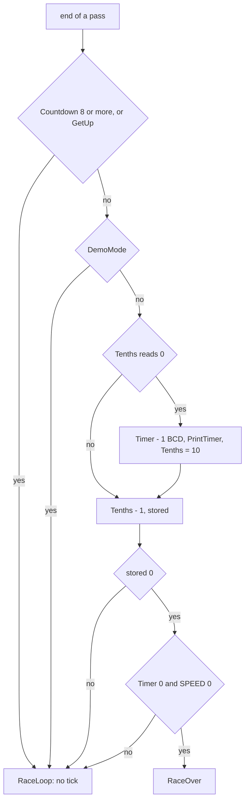

**Worked example.** `c1-samples.json` around frame 16 000:

- Tenths reads 5, 4, 3, 2 at frames 16 000, 16 002, 16 009, 16 015, one step a pass;
- the bike crashes; GetUp is set from frame 16 022 to 16 106;
- Tenths stays at 2 for 13 passes, from 16 015 to 16 104, while the rider gets up;
- then Tenths goes 1, 0 (frames 16 112, 16 119) and the timer drops from 38 to 37 at 16 127: one pass after
  Tenths was stored as 0, the pass that reads the 0, takes the second off and stores 9.

Over the whole stage 1 race the rider spent 382 frames getting up, in 5 falls. The 58 timer seconds from 59 to 1
took 5 068 frames: 87 frames a second with the falls, 81 without them.

**The countdown.** NewGame sets Countdown to 16 (not in a demo; a fall's end sets `$80`, which StartRace turns
into 0 or 1: no countdown after a fall). RaceLoop counts it down by one a pass and shows 3, 2, 1 at 15, 11 and 7 and
GO at 3; the display clears at 0. MoveRiders
waits until Countdown is under 8, and Throttle ignores the keys while it is 8 or more. In `c1` Countdown read 11 at
frame 14 075, 8 at 14 100 and 2 at 14 155.

**The other delays.** The menus and tables wait in loops of their own:

| Where | Delay | How |
| --- | --- | --- |
| Attract | 250 WaitKey counts for a key | WaitKey `$854A` loops on the keyboard |
| Pause (H) | until a key | Pause `$A9CC` loops inside the pass: the 70-frame pass of `c1` |
| between two players' turns | Delay, then a key | TurnLoop |
| the lap table, the scores | Delay | PlayTurn's game-over path |
| Throttle at timer 0 | SPEED - `$0940` a pass | the bike rolls to a stop |

Delay `$85A2` is 5 x 53 846 turns of a 26 T loop, about 7.0 million T: 100 frames, 2 s with the interrupts.

**Witness.** `c1-samples.json` (Timer, Tenths, GetUp, Countdown `$5E24`); `src/game/race.asm` TimerTick and
Throttle; `src/game/menu.asm` Delay.

**The point.** The game's clock is the pass counter, not the frame. A slower pass (more on screen, a crash noise)
is a slower clock too, so the player loses no time to a heavy frame or a fall. The ZXDB POKE for infinite time,
`43649,58`, turns the `LD (Timer),A` at `$AA81` into `LD A,(nn)`.

## 4.9 The stage 3 reset

In `reset3` the machine resets in the middle of stage 3. The cause is the interrupt's one blind spot (4.4).

Stage 3 has jumps. A jump lifts the bike: JumpHeight `$5CE9` grows, and the road is drawn lower, its top row
RoadTopRow `$9177` falling toward 0. DrawRoad points SP at RowTable + `$E0` + 2 x RoadTopRow, the line of the road's
top. At a high enough jump RoadTopRow goes below 0 and becomes `$FF`. Then SP is `$FEE0` + `$1FE` = `$100DE`, which
wraps to `$00DE`: in the ROM.

DrawRoad pops ROM words as row addresses for a few rows, which only draws rubbish. But an interrupt in that window
pushes its return address into the ROM. The write does nothing. The handler then reads the return address from the
ROM, gets the word the ROM holds there, and jumps to it.

**How it works.**

```text
DrawRoad:
    SP = $FEE0 + 2 * RoadTopRow             ; RoadTopRow = $FF: $00DE (wraps)
    for each row: pop the row's line address
interrupt with SP in the ROM:
    push PC at SP - 2                        ; ROM: lost
    Interrupt reads the word at SP - 2       ; a ROM word, not PC
    JP that word                             ; the ROM runs from a wrong place
```

```asm
DrawRoad:                   ; $931E
  ...
  LD A,(RoadTopRow)
  LD E,A
  LD D,$00
  LD HL,RowTable+$00E0    ; $FEE0
  ADD HL,DE
  ADD HL,DE               ; $FF: $FEE0 + $1FE = $00DE
  LD SP,HL
```

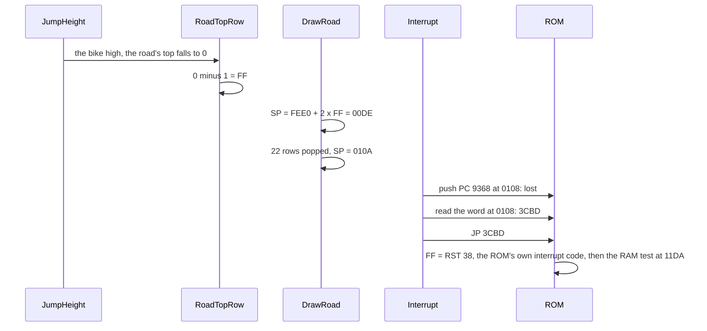

**Worked example.** `r3-samples.json`, read at the start of each frame, SPEED 199 throughout:

| Frame | JumpHeight (whole part) | RoadTopRow | IntSavedSp | Last return |
| ---: | ---: | ---: | --- | --- |
| 6 731 | `$43` | 4 | `$FEBA` | `$90EC` |
| 6 743 | `$63` | 1 | `$FFFA` | `$A3D9` |
| 6 747 | `$63` | 0 | `$FFF8` | `$8BC0` |
| 6 756 | `$76` | 0 | `$FFF8` | `$8B9F` |
| 6 759 | `$76` | `$FF` | `$FFF8` | `$8BB8` |
| 6 760 | `$76` | `$FF` | `$010A` | `$3CBD` |

The trace of frame 6 759 gives the moment:

- DrawRoad had set SP to `$00DE` and popped 22 rows; SP was `$010A`;
- the interrupt came at T 1 808, in DrawRoad's loop at `$9366`; the CPU pushed `$9368` to `$0108-$0109`, ROM;
- Interrupt saved SP `$0108` and read the word at `$0108`: the ROM's bytes `$BD`, `$3C`;
- IntReturn became `JP $3CBD` and ran at T 2 314;
- `$3CBD` holds `$FF`, `RST $38`: the ROM's own interrupt code ran with SP in the ROM, its `RET` took more ROM
  words, and by T 29 992 the CPU was at `$11E0`, in the ROM's RAM test after a reset.

The screen goes black at frame 6 794 and the ROM's copyright message shows at 6 944.

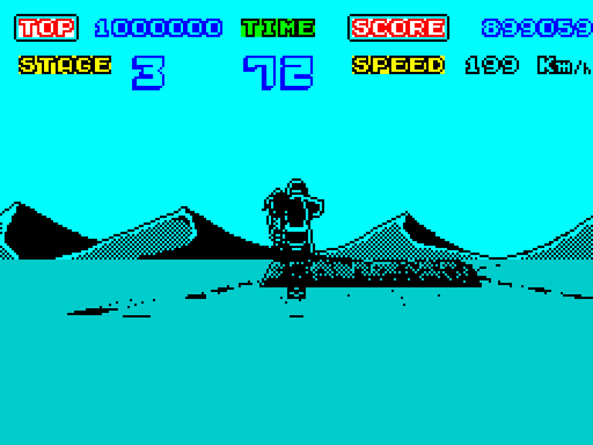

*`reset3` frames 6 700-6 800, sampled every second frame. How to read: the screen as the player saw it; the bike
rises off a ramp and hangs at the top, the road sinks to the bottom, then the screen fills with the stripes of the
ROM's RAM test. The point: the reset is a jump high enough to push the
road's top row past 0. Command: `python3 ../../kit/screen_anim.py --work work/docs/erA/r3 --from 6700 --to 6800
--step 2 --width 1050 --delay 80 --hold 2000 docs/img/play/reset3-jump-to-reset.gif`.*

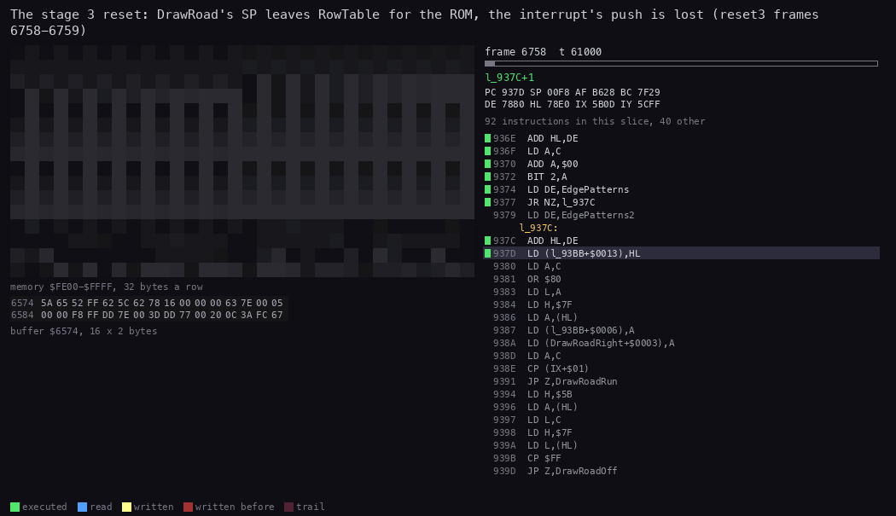

*`reset3` frame 6 758 T 60 000 to frame 6 759 T 30 000, 1 000 T a picture. How to read: the map is `$FE00-$FFFF`,
RowTable and the stack, 32 bytes a row; the hex view under it is `$6574-$6593`, IntStack and IntSavedSp
(`$6586`). In frame 6 759 DrawRoad pops nothing from the map: its SP is in the ROM. The interrupt fills IntStack as
usual, IntSavedSp becomes `0A 01` (`$010A`), IntZeroBytes writes its zeros into the ROM, and the code panel then
shows the `JP` into the ROM. The point: the handler works exactly as designed; its input, the pushed word, was never written.
Command: `python3 ../../kit/routine_anim.py --work work/docs/erA/r3 --window 6758:60000-6759:30000 --listing
build/game.lst --pc 643C-690E,931E-9614 --range FE00-FFFF --row-bytes 32 --view buffer:6574:16x2:hex --step 1000
--out docs/img/routines/Interrupt-reset.gif`.*

**Witness.** `r3-samples.json` and `r3/traces/6758_60000-6759_30000.uatr`; the ROM bytes from `48.rom`: `$BD3C` at
`$0108`, `$FF` from `$386E` to `$3CFF`. Stage 1's `stages-try1` recording reset the same way at frame 6 714 (saved
SP `$011C`, the `JP` to `$4645`). Its interrupt came in Multiply, called from DrawRoad with SP in the ROM.

**The point.** The repair covers every place SP visits in normal play, and RoadTopRow is a byte with no floor. One
jump high enough on stage 3 wraps it, and SP lands in the one region the handler cannot repair. The time window is
short: a frame or two at the top of the jump. That is why the reset is rare: an interrupt has to fall inside
DrawRoad while SP is below `$4000`.
