# 5. Controls

What this covers:

- the five control methods and the controls byte D (5.1);
- ReadControls `$85B0`: seven tests whose bytes are patched (5.2);
- PatchControls and the CHANGE CONTROL MODE window (5.3);
- what an emulator must decode: the keyboard's half rows and the Kempston port (5.4);
- the menu and MenuSelect (5.5);
- DEFINE KEYS: ScanKeys, KeyMap and GetKey (5.6);
- the lean and the steering, with numbers (5.7);
- the throttle and the brakes, checked against a recording (5.8);
- the wheelie (5.9);
- pause, reset and the demo's key: one byte shared by two instructions (5.10);
- the cheat key, CAPS SHIFT and Q, and what it does to the steering (5.11);
- two players: the turn loop and the swap of the player blocks (5.12).

The recordings it rests on ([WALKTHROUGH](../WALKTHROUGH.md)):

| Recording | Load | Used for |
| --- | --- | --- |
| `c1` | power-on on the 48K, `LOAD ""`, the TOSEC `[SpeedLock 2]` copy at signal speed, `tests/inputs/c1.txt` | the menu toured (13 282-13 945), KEYBOARD picked, stage 1 with Q, O, P, A, SPACE, H (14 075 on) |
| `ctl` | `work/stage1/rec/c1/loaded.szx`, `tests/inputs/ctl.txt` | every method picked and driven, Kempston included; DEFINE KEYS with THROTTLE set to W (3 629) |
| `twoplayer` | `work/stage1/rec/c1/menu-kb.szx`, `tests/inputs/twoplayer.txt` | TWO PLAYERS: the turns |

The instance for this document ran in `work/docs/erB/c1`. The commands are in
[`work/docs/erB-NOTES.md`](../work/docs/erB-NOTES.md).

Conventions:

- A value read with `time_travel memory_at` at frame N is the memory at T 0 of frame N.
- A **pass** is one turn of the race loop, about 8 frames on stage 1 ([4.6](04-game-loop.md#46-the-free-running-race-loop)).
  Every number "a pass" below is per pass, not per frame.
- SPEED `$7C33-$7C34` is 8.8 fixed point in km/h: `$7C34` is the whole part.

## 5.1 The five methods and the controls byte

The game reads the controls into one byte, D. Bits 0-4 are the driving controls, bits 5-6 the two fixed keys:

| Bit | Control | Source of the bit |
| --- | --- | --- |
| 0 | THROTTLE | the method |
| 1 | WHEELIE | the method |
| 2 | LEFT | the method |
| 3 | RIGHT | the method |
| 4 | BRAKES | the method |
| 5 | PAUSE | H, or the key DEFINE KEYS gave |
| 6 | RESET | R, or the key DEFINE KEYS gave |

ControlTable `$8323` holds five methods, 10 bytes each: the half-row byte of each of the five controls, then their
five masks (`src/res/tables/controls.csv`):

| Method | Half rows | Masks | Keys (throttle, wheelie, left, right, brakes) |
| --- | --- | --- | --- |
| 0 KEYBOARD | `FB FD DF DF 7F` | `01 01 02 01 01` | Q, A, O, P, SPACE (DEFINE KEYS rewrites this row) |
| 1 KEMPSTON | `00 00 00 00 00` | `08 04 02 01 10` | up, down, left, right, fire |
| 2 SINCLAIR RIGHT | `EF EF EF EF EF` | `02 04 10 08 01` | 9, 8, 6, 7, 0 |
| 3 SINCLAIR LEFT | `F7 F7 F7 F7 F7` | `08 04 01 02 10` | 4, 3, 1, 2, 5 |
| 4 CURSOR | `EF EF F7 EF EF` | `08 10 10 04 01` | 7, 6, 5, 8, 0 |

ControlMethod `$831B` is 3 in the image: the game starts on SINCLAIR LEFT.

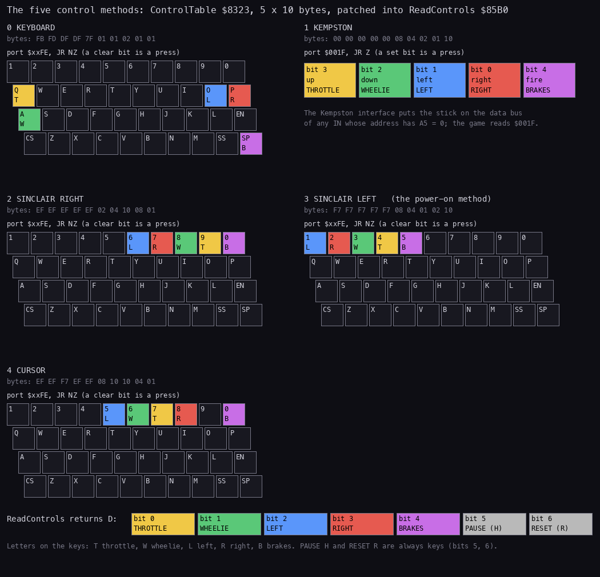

*Figure 5.1: ControlTable from `build/game.bin`, one keyboard or joystick per method, each control's key coloured.
Command: `python3 tools/fig_controls.py methods --out docs/img/controls/methods.png`.*

How to read:

- Each block is one method, with its 10 bytes and the port and jump it is patched with.
- The letter on a key is its control: T throttle, W wheelie, L left, R right, B brakes.
- The bottom row is D as ReadControls returns it.

The point: a method is 10 bytes of data. Changing the method changes no code path; the bytes are written into the
reader (5.3).

## 5.2 ReadControls: seven patched tests

ReadControls `$85B0` is seven tests of 10 bytes, one per bit of D. Each test loads a half-row byte, reads a port,
masks one bit and sets D's bit when the control is down:

```asm
ReadControls:                   ; $85B0, as in the image (method 3, SINCLAIR LEFT)
        LD D,$00
        LD A,$F7                ; the half row (patched)
        IN A,($FE)              ; the port's low byte (patched: $FE or $1F)
        AND $08                 ; the mask (patched)
        JR NZ,l_85BC            ; the jump (patched: JR NZ keyboard, JR Z Kempston)
        SET 0,D                 ; THROTTLE
l_85BC: LD A,$F7
        IN A,($FE)
        AND $04
        JR NZ,l_85C6
        SET 1,D                 ; WHEELIE
        ...                     ; LEFT, RIGHT, BRAKES the same way
TestPause:
        LD A,$BF                ; H
        IN A,($FE)
        AND $10
        JR NZ,TestReset
        SET 5,D
TestReset:
        LD A,$FB                ; R
        IN A,($FE)
        AND $08
        JR NZ,l_85F8
        SET 6,D
l_85F8: RET
```

```text
ReadControls:
    D = 0
    for n in 0..6:
        value = IN(port: row[n] * 256 + low[n]) AND mask[n]
        if keyboard: pressed = (value == 0)          # active low
        if Kempston: pressed = (value != 0)          # active high
        if pressed: D |= 1 << n
    return D
```

The whole read is 7 port reads and about 300 T. It runs twice a pass: in BikeControl (the steering) and in
RaceControls (throttle, brakes, pause, reset).

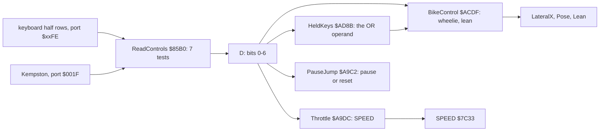

The source's header of ReadControls says the image holds "method 0's Q A O P SPACE". The bytes are `$F7` rows with
masks `08 04 01 02 10`: method 3, SINCLAIR LEFT, as ControlMethod says. The source's header now says so.

The point: the reader has no loop and no table lookup at run time. The method's choice is paid once, in the menu.

## 5.3 PatchControls and the method window

CHANGE CONTROL MODE (MenuControl `$8206`) opens a window, lets MenuSelect pick one of five methods and patches the
reader:

```asm
MenuControl:
        ...
        CALL MenuSelect         ; A = the method picked
        JP C,MenuDraw           ; timeout
        LD (ControlMethod),A
        LD DE,$FE20             ; D = port $FE, E = $20 (JR NZ)
        CP $01
        JR NZ,l_8237
        LD DE,$1F28             ; Kempston: port $1F, $28 = JR Z
l_8237: ...                     ; IX = ControlTable + 10 x A
        CALL PatchControls
PatchControls:                  ; $82F8
        LD HL,ReadControls+$0003
        LD B,$05
l_82FD: PUSH BC
        LD C,(IX+$00)           ; the half row
        LD B,(IX+$05)           ; the mask
        CALL PatchTest
        POP BC
        DJNZ l_82FD
        RET
PatchTest:                      ; $830B
        LD (HL),C               ; LD A,n
        INC HL
        INC HL
        LD (HL),D               ; IN A,(n)
        INC HL
        INC HL
        LD (HL),B               ; AND n
        INC HL
        LD (HL),E               ; JR NZ or JR Z
        LD BC,$0005
        ADD HL,BC               ; the next test
        INC IX
        RET
```

The keyboard's DE, `$FE20` (here and at `$82CD`), is a port and an opcode, not an address: D is the port and E
the `JR NZ`. It happens to equal RowTable + `$20`; the source writes it as the plain constant.

Worked example, KEMPSTON picked: IX = ControlTable + 10, DE = `$1F28`. The first PatchTest writes C = 0, D = `$1F`,
B = `$08`, E = `$28`, so the first test becomes `3E 00 DB 1F E6 08 28 02`: `LD A,0 / IN A,($1F) / AND 8 / JR Z`. Up on
the stick is THROTTLE.

Witness: `ctl` picks every method in turn and drives with each; under each one 200 frames of throttle give 25 km/h
and the brakes 17 (WALKTHROUGH's `ctl` row).

The point: the jump's opcode is data too. Turning `JR NZ` into `JR Z` is all it takes to read an active-high
joystick with the keyboard's code.

## 5.4 What an emulator must decode

The game makes three port reads:

| Read | Address on the bus | What must answer |
| --- | --- | --- |
| `LD A,row / IN A,($FE)` | `row × 256 + $FE` | the ULA: bits 0-4 of the half rows whose address bit is 0, low when a key is down |
| `LD A,0 / IN A,($1F)` | `$001F` | the Kempston interface: bits 0-4 right, left, down, up, fire, high when pressed |
| `IN A,($1F)` in WaitKey, WaitPress and KeyOrFire | `$001F` (A = ControlMethod - 1 = 0 there too) | the Kempston again, any of bits 0-4 |

- The Kempston is decoded by A5 = 0 alone. The game never reads `$1F` with A5 = 1.
- ScanKeys (5.6) reads one half row at a time and needs exactly one key of that half row down (`CP E`). An emulator
  that ORs ghost keys into a half row breaks DEFINE KEYS, not the race.
- The race reads D twice a pass. A key shorter than a pass can be missed: at 8 frames a pass, a tap of under 160 ms.

Witness: `ctl`'s Kempston run drives the bike with the joystick alone; c1's keyboard run.

The point: an emulator needs the ULA's half rows and an A5-decoded Kempston. Nothing reads the joystick through
the ROM.

## 5.5 The menu and MenuSelect

The main menu (Menu `$8178`) has four items: START GAME, ONE/TWO PLAYERS, CHANGE CONTROL MODE, DEFINE KEYS. The
bottom lines say "SPACE OR FIRE TO EXECUTE" and "ANY OTHER KEY TO ADVANCE".

MenuSelect `$85F9` highlights an item and waits:

```text
MenuSelect(item, list HL, colour E):
    loop:
        paint the item's bar: attribute (attr AND $47) OR E
        A = WaitKey($04E2)                    # all keys up first, then a key; about 22 s
        if timeout: return C                  # the menu goes back to the attract
        if A == 3 (SPACE): return item
        D = ReadControls()
        if D == $10 (BRAKES alone): return item   # fire on a joystick
        RestoreBar
        if D bit 0 (THROTTLE): item -= 1, wrapping   # MenuUp
        else: item += 1, wrapping                    # MenuDown
```

```asm
        LD BC,$04E2
        CALL WaitKey
        RET C                   ; timeout
        CP $03
        JR Z,l_863C             ; SPACE picks
        CALL ReadControls
        LD A,D
        XOR $10                 ; brakes alone: Z
l_863C: LD A,(KeyItem)
        RET Z
        BIT 0,D
        JR Z,MenuDown
MenuUp: SUB $01                 ; the item before, wrapping
        ...
```

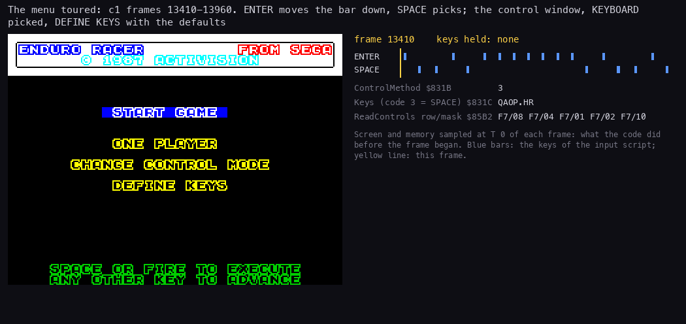

*Animation 5.1: `c1` frames 13 410-13 960, every 4th frame, with ControlMethod, Keys and ReadControls' 50 patched
bytes at T 0. Command: `python3 tools/fig_controls.py play --work work/docs/erB/c1 --from 13410 --to 13960 --step 4
--delay 120 --keys tests/inputs/c1.txt --var 'ControlMethod=831B:1:dec' --var 'Keys (code 3 = SPACE)=831C:7:text'
--var 'ReadControls row/mask=85B2:50:tests' --title "..." --out docs/img/play/menu-tour.gif`.*

What to watch:

- ENTER moving the bar down item by item; SPACE picking;
- the method window, the bar walking KEMPSTON to CURSOR, then KEYBOARD picked;
- ReadControls' bytes switching from `$F7` rows to `FB FD DF DF 7F` at the pick;
- DEFINE KEYS opening with the defaults Q A O P SPC H R.

Witness: c1's script (ENTER and SPACE from 13 282) and the frames above; the stills
[menu](img/play/c1-013418-menu.png), [method window](img/play/c1-013578-control-popup.png) and
[DEFINE KEYS](img/play/c1-013878-define-keys.png).

The point: the menu is driven by any key: SPACE or fire picks, THROTTLE goes up, everything else goes down. A
player on a joystick never needs the keyboard.

## 5.6 DEFINE KEYS: ScanKeys, KeyMap and GetKey

DEFINE KEYS (`$824B`) lists EXIT and the seven controls with their keys. Picking a control blanks its key's name and
calls GetKey. The key's character goes to Keys `$831C`; its half-row byte and its mask XOR `$1F` go into method 0's
row; the method is set to 0 and PatchControls runs. A key already used is refused (DefineTaken). PAUSE and RESET are
patched straight into TestPause and TestReset (DefinePauseKey).

**ScanKeys `$84F3`** finds the first half row with exactly one key down:

```asm
ScanKeys:
        LD BC,$08FE             ; B = 8 half rows, C = $FE first
l_84F6: LD DE,$051E             ; D = 5 bits, E = the pattern of bit 0 down
l_84F9: LD A,C
        IN A,($FE)
        AND $1F
        CP E                    ; exactly this one key down?
        JR Z,ScanFound
        SLL E                   ; the next bit's pattern
        RES 5,E
        DEC D
        JR NZ,l_84F9
        RLC C                   ; the next half row
        DJNZ l_84F6
        LD A,$FF                ; none
        RET
ScanFound:
        LD A,B
        ADD A,A
        ADD A,A
        ADD A,B
        ADD A,D                 ; 5 x B + D
        ...                     ; A = KeyMap[5 x B + D - 6]
```

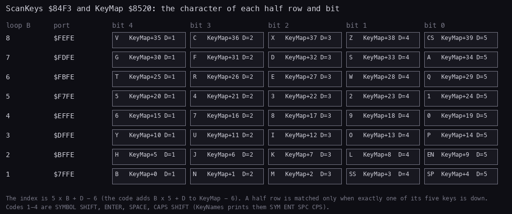

*Figure 5.2: the character ScanKeys returns for each half row and bit, from KeyMap `$8520`. Command: `python3
tools/fig_controls.py keymap --out docs/img/controls/keymap.png`.*

How to read:

- A row of the figure is one turn of ScanKeys' loop, B from 8 (`$FEFE`) to 1 (`$7FFE`).
- Each cell gives the key, its KeyMap index and the D at the match.
- Codes 1-4 are SYMBOL SHIFT, ENTER, SPACE and CAPS SHIFT; KeyNames prints them SYM, ENT, SPC, CPS.

**GetKey `$8548` and WaitKey `$854A`.** WaitKey first waits until every key is up, then for a key, each step a
delay of `$9A13` and a scan. On the KEMPSTON method any stick bit, a direction or fire (`IN A,($1F)` / `AND $1F`), also
counts as a key: the release wait waits for the stick to be centred, and a push returns `$40`. KeyOrFire
(KempstonFire `$84EC`), which ends the demo, reads it the same way, so any direction ends the demo too. In the
menus MenuSelect then reads ReadControls: up (THROTTLE) moves the bar up, fire alone (BRAKES) picks, any other
direction moves it down. GetKey is WaitKey with no timeout.

```text
WaitKey(timeout BC):          # B = $FF: no timeout
    repeat: delay; if no key (and, on method 1, the stick centred): break; count down -> timeout: C
    repeat: delay; A = ScanKeys(); if A != $FF: return NC, A
            if method 1 and IN($001F) AND $1F: return NC, $40     # any direction or fire
            count down -> timeout: C
```

Worked example, ctl at 3 629: THROTTLE picked, W pressed. W is half row `$FB`, bit 1. ScanKeys matches it at B = 6,
D = 4: KeyMap index `5 × 6 + 4 − 6 = 28`, "W". ScanKeys leaves C = `$FB` and E = `$1D`, the half row's pattern with
bit 1 low. DEFINE KEYS stores `$FB` at ControlTable + 0 and `$1D XOR $1F = $02` at ControlTable + 5, sets method 0
and runs PatchControls: the first test becomes `LD A,$FB / IN A,($FE) / AND $02 / JR NZ`.

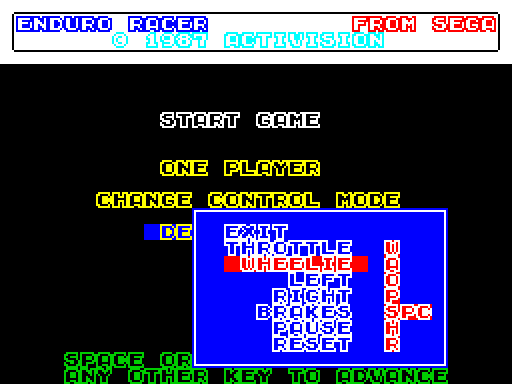

*Figure 5.3: `ctl` frame 3 629, THROTTLE redefined to W, from the recording's stills.*

Witness: ctl after 3 629 drives stage 1 with W as the throttle.

The point: the keyboard reader of the race and the key finder of the menu are separate. ScanKeys needs exactly one
key per half row; ReadControls tests single bits and does not care.

## 5.7 The lean and the steering

BikeControl `$ACDF` turns D into the bike's pose, lean and sideways speed each pass. The D it uses is its own
ReadControls ORed with the one RaceControls read at the end of the last pass (HeldKeys, the `OR n` at `$AD8A`):
a key held during either read counts.

```text
BikeControl:
    falling or getting up: their own paths (doc 10)
    in the air: BikeLateral only
    D = ReadControls() OR HeldKeys          # the demo makes its own D
    bounce: random LEFT/RIGHT for BounceTime passes
    if WHEELIE: Wheelies += 1; Pose = 0; BikeLateral         # 5.9
    Wheelies = 0; Pose = 3
    if Countdown >= 4: BikeLateral
    if LEFT or RIGHT:
        LEFT: Lean += 1; RIGHT: Lean -= 1   # both: no change
        Lean kept in -3..3
    else every second pass: Lean one step toward 0
    side = SteerTable[2 * (ScrollStep >> 8)] * LeanTable[Lean + 3] / 8
    the high byte of side capped at 5 (the low byte kept); negative for Lean < 0
    BikeLateral: LateralX += side + the bend's push, kept within $A4..$5C
```

```asm
l_ADF7: LD A,(Lean)
        BIT 3,D                 ; RIGHT
        JR NZ,l_ADFF
        INC A                   ; not RIGHT: +1
l_ADFF: BIT 2,D                 ; LEFT
        JR NZ,l_AE04
        DEC A                   ; not LEFT: -1 (LEFT alone: +1 in all)
l_AE04: ...                     ; keep -3..3
l_AE15: LD A,(ScrollStep+$0001)
        ADD A,A
        LD E,A
        LD D,$00
        LD HL,SteerTable
        ADD HL,DE
        LD E,(HL)               ; by speed
        ...
        LD HL,LeanTable
        ADD HL,BC
        LD A,(HL)               ; by lean
        LD L,E
        CALL Multiply
        SRL D
        RR E                    ; / 8, three times
        ...
        LD A,D
        CP $05
        JR C,l_AE50
        LD D,$05                ; the cap keeps E
```

The tables:

| Table | Address | Values |
| --- | --- | --- |
| LeanTable | `$8E56` | lean −3..3: `AD 50 28 00 28 50 AD` |
| SteerTable (even entries) | `$8E5D` | `FF FF AF 7D 61 50 43 3A 33 2E 2A`: one entry per 18.3 km/h |

ScrollStep is SPEED × 14, so its high byte steps every 256 / 14 = 18.3 km/h.

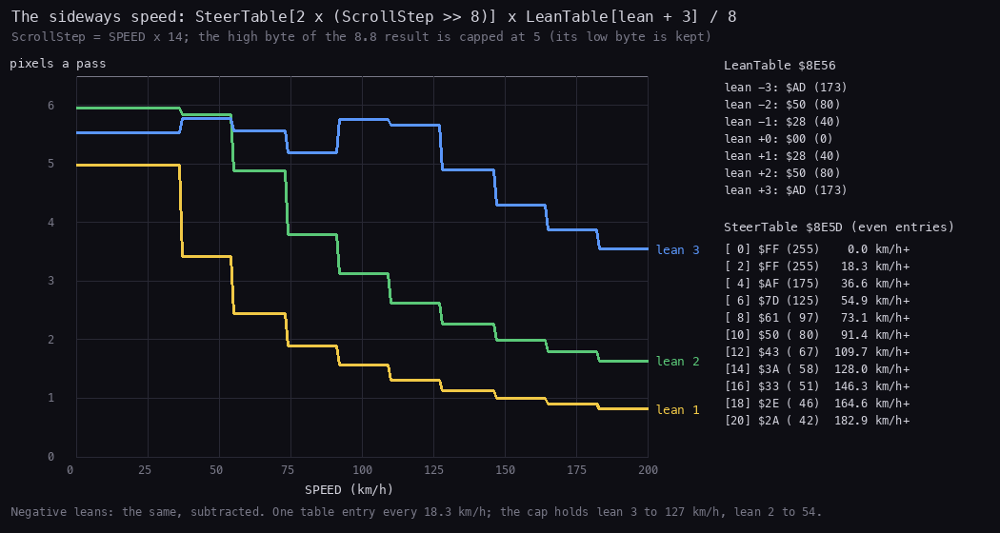

*Figure 5.4: the sideways speed in pixels a pass against SPEED, for leans 1, 2 and 3, from the two tables. Command:
`python3 tools/fig_controls.py steer --out docs/img/controls/steer.png`.*

How to read:

- One curve per lean. Negative leans are the same, subtracted.
- The flat tops are the cap: the high byte held at 5 with the low byte kept, so a capped value lies anywhere in
  `$0500-$05FF`, 5.0 to 6.0 pixels; lean 3 gives 5.2-5.8 below 128 km/h.
- Below 55 km/h lean 2 even beats lean 3: below 37 km/h 255 x 80 / 8 = `$09F6` is capped to `$05F6`, 5.96, while
  255 x 173 / 8 = `$158A` becomes `$058A`, 5.54; at 37-54 km/h 5.84 against 5.78.
- Above 127 km/h even full lean steers less: at 199 km/h lean 3 gives 3.55 pixels a pass.

Worked example, 100 km/h at lean 3:

1. ScrollStep = 100 × 14 = 1 400 = `$0578`; the high byte is 5.
2. SteerTable[10] = `$50` = 80; LeanTable[6] = `$AD` = 173.
3. 80 × 173 = 13 840; / 8 = 1 730 = `$06C2`.
4. The high byte 6 is capped to 5: the result is `$05C2`, 5.76 pixels a pass.

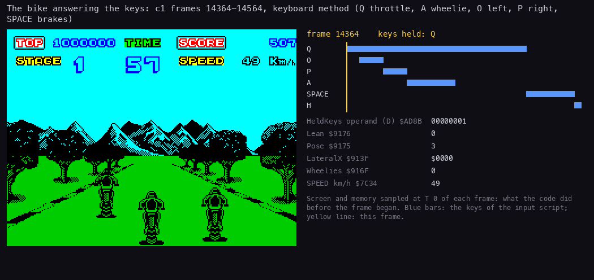

*Animation 5.2: `c1` frames 14 364-14 564, every 2nd frame: the screen, the keys from the script, and HeldKeys, Lean,
Pose, LateralX, Wheelies and SPEED at T 0. Command: `python3 tools/fig_controls.py play --work work/docs/erB/c1 --from
14364 --to 14564 --step 2 --keys tests/inputs/c1.txt --var 'HeldKeys operand (D)=AD8B:1:bits' --var
'Lean=9176:1:sdec' --var 'Pose=9175:1:dec' --var 'LateralX=913F:2:word' --var 'Wheelies=916F:1:dec' --var 'SPEED
km/h=7C34:1:dec' --title "..." --out docs/img/play/bike-keys.gif`.*

What to watch:

- Q O from 14 375: HeldKeys `05`, Lean climbing 0, 1, 2 one step a pass;
- Q P from 14 395: HeldKeys `09`, Lean coming back down;
- Q A from 14 415: Pose 0 and Wheelies counting (5.9);
- LateralX moving by the sideways speed each pass.

Witness, `memory_at` (Lean, HeldKeys) every 4 frames: 14 375 `00 01`, 14 383 `01 05`, 14 391 `02 05`, 14 403 `02 09`,
14 407 `01 09`, 14 415 `00 09`.

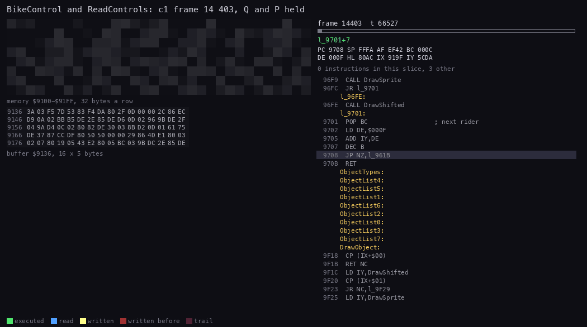

*Animation 5.3: BikeControl and ReadControls in `c1` frame 14 403 (Q and P held), window 14403:66500-14403:68100;
the first pictures are still in DrawRiders (`$9708`, T 66 527) and the last in DrawBike (`$9FC1`, T 68 093):
BikeControl and ReadControls fill the middle (TestReset at T 66 932, `l_AE50` at T 67 742). The
view is the bike's variables from ScrollStep `$9136` on, as hex. Command: `python3 ../../kit/routine_anim.py --work
work/docs/erB/c1 --window 14403:66500-14403:68100 --listing build/game.lst --view buffer:9136:16x5:hex --range
9100-91FF --row-bytes 32 --pc 85B0-85F8,ACDF-AEFF --pictures 60 --delay 120 --title "..." --out
docs/img/routines/BikeControl.gif`.*

What to watch: the seven `IN`s; D built bit by bit; Lean (`$9176`) changing by one; BounceSpeed's operand written;
LateralX (`$913F`) moved.

The point: steering is a speed, not a position. The lean picks how fast the bike drifts, the speed table makes it
weaker at high speed, and the cap holds every lean of 2 or 3 near 5 and a fraction pixels a pass at low speed, so
below 55 km/h lean 2 steers as hard as full lean, a little harder even.

## 5.8 Throttle and brakes

Throttle `$A9DC` runs at the end of each pass, after RaceControls' ReadControls:

```text
Throttle:
    if in the air: no throttle, no brakes, no drag; on to PrintSpeed and TimerTick
    if Countdown >= 8 or GetUp: back to RaceLoop (no throttle, no timer)
    if Timer == 0: SPEED -= $0940 (9.25 km/h), floored at 0
    elif THROTTLE:
        if SPEED < 20:    SPEED += (SPEED + 1) / 4          # 8.8: (HL + 256) / 4
        elif SPEED < 160: SPEED += $0220 (2.125 km/h)
        else:             SPEED += ($C800 - SPEED) >> 4     # toward 200, never reaching it: 199 at most
    elif BRAKES: SPEED -= $0580 (5.5 km/h), floored at 0
    drag: full lean (Pose 3, Lean ±3): SPEED = SPEED * $FF / 256
          a bounce: SPEED = SPEED * $FA / 256
```

```asm
Throttle:                       ; $A9DC
        LD HL,(Speed)
        ...
        BIT 0,D                 ; THROTTLE
        JR Z,l_AA2E
        LD A,H
        CP $14
        JR C,l_AA20             ; below 20 km/h
        CP $A0
        JR C,l_AA1B             ; below 160
        EX DE,HL
        LD HL,$C800
        SBC HL,DE               ; 200 - SPEED
        EX DE,HL
        LD B,$04                ; / 16
        JR l_AA25
l_AA1B: LD DE,$0220
        JR l_AA2B
l_AA20: LD E,L
        LD D,H
        INC D                   ; SPEED + 1
        LD B,$02                ; / 4
l_AA25: SRL D
        RR E
        DJNZ l_AA25
l_AA2B: ADD HL,DE
        JR l_AA3C
l_AA2E: BIT 4,D                 ; BRAKES
        JR Z,l_AA3C
        LD DE,$0580
        SBC HL,DE
        JR NC,l_AA3C
        LD HL,$0000
l_AA3C: LD (Speed),HL
```

THROTTLE wins over BRAKES: with both held the brakes are not tested.

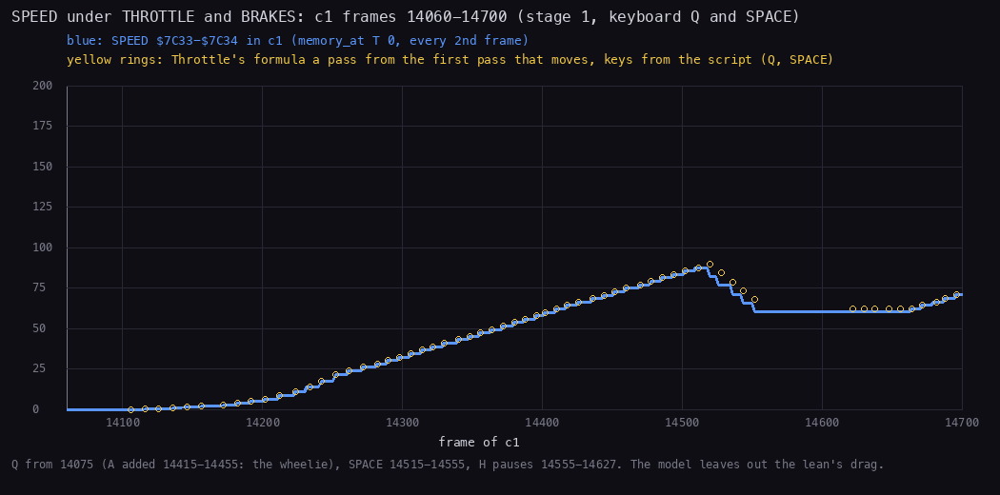

*Figure 5.5: SPEED in `c1` frames 14 060-14 700 (blue, `memory_at` every 2nd frame) and Throttle's formula applied
once a pass from the first pass that moves, with the keys of the script (yellow rings). Command: `python3
tools/fig_controls.py speed --work work/docs/erB/c1 --from 14060 --to 14700 --keys tests/inputs/c1.txt --title "..."
--note "..." --out docs/img/controls/speed.png`.*

How to read:

- Each step of the blue line is one pass.
- The slow start is the `(SPEED + 1) / 4` branch; the straight climb is `$0220` a pass.
- SPACE at 14 515-14 555 brings it down in 5 steps; H pauses from 14 555 to 14 627, and SPEED holds.
- The rings sit on the steps; the model leaves out the lean's drag, which is why they drift a little high.

Worked example, from `memory_at`:

| Frame | SPEED bytes | km/h | PassCount | What happened |
| --- | --- | ---: | --- | --- |
| 14 100 | `00 00` | 0 | `$76` | Countdown 8: no throttle yet |
| 14 120 | `40 00` | 0.25 | `$78` | the first pass that moves: (0 + 256) / 4 = `$40` |
| 14 300 | `55 20` | 32.33 | `$8A` | |
| 14 400 | `D5 39` | 57.83 | `$96` | 12 passes × `$0220` = 25.5 km/h more |
| 14 515 | `95 57` | 87.58 | `$A4` | SPACE pressed |
| 14 555 | `15 3C` | 60.08 | `$A9` | 5 passes × 5.5 = 27.5 km/h less |

The arithmetic is exact: `$2055 + 12 × $0220 = $39D5`, and `$5795 − 5 × $0580 = $3C15`.

From standstill the climb takes about 14 passes to 20 km/h, 66 passes from 20 to 160, and then halves the gap to 200
every 11 passes. The step is the gap >> 4, always smaller than the gap and 0 once the gap is under 16 (`$0010`), so
SPEED stops at `$C7F1-$C7FF`: 199 km/h is the top (`stages` frame 22 204 shows SPEED 199), and full lean's drag
takes it to 198. At 8 frames a pass that is about 13 s to 160 km/h.

The point: SPEED is a three-part curve with a soft top at 199, just under 200. Because it changes once a pass, the bike accelerates
more slowly in real time where the passes are slow.

## 5.9 The wheelie

WHEELIE (D bit 1) sets Pose 0 and counts the passes it is held in Wheelies `$916F`. It does not change the lean.
Released, Wheelies goes back to 0.

At a ramp the count matters ([doc 10](10-gameplay-logic.md)): SPEED is kept in proportion,
`SPEED × (8 × Wheelies − $40 + 256) / 256`, all of it with 8 passes or more, three quarters with none. Landing
without WHEELIE held gives a 6-pass bounce.

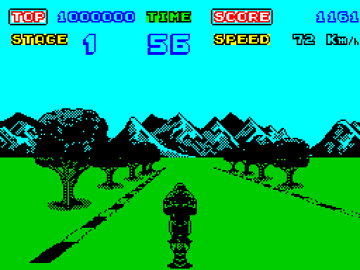

*Figure 5.6: `c1` frame 14 455, after 40 frames of Q A: the front wheel up (pose 0). From the recording's stills.*

Worked example: c1 holds Q A from 14 415 to 14 455. `memory_at` (Wheelies, Pose, HeldKeys) every 4 frames: 14 419
`00 03 03`, 14 423 `01 00 03`, 14 431 `02 00 03`, 14 439 `03`, 14 447 `04`, 14 455 `05 00 03`, 14 463 `00 03 01`.
Five passes of wheelie; the first pass after the release sets Pose back to 3 and Wheelies to 0.

The point: a wheelie is held, not triggered. Its only effect on the road is the ramp's speed.

## 5.10 Pause, reset and the demo's key

RaceControls `$A9A8` reads D into HeldKeys, then tests RESET with one byte that is two instructions:

```asm
l_A9B9: CALL ReadControls
        LD A,D
        LD (HeldKeys+$0001),A
        AND $40                 ; RESET
PauseJump:                      ; $A9C2
        DEFB $28                ; JR Z,Pause: $28 $08, the offset is the next byte
RaceQuit:                       ; $A9C3
        EX AF,AF'               ; $08: the jump's offset, and an instruction
        POP HL
        POP HL
        CALL RaceEnd
        JP Menu
Pause:                          ; $A9CC
        BIT 5,D                 ; PAUSE
        JR Z,Throttle
        XOR A
        LD (TuneRequest),A
        CALL GetKey
        CALL SetTune
        LD D,$00
```

- No RESET: `JR Z,+8` lands on Pause.
- RESET held: the jump is not taken, and the CPU runs `$A9C3` as `EX AF,AF'`, then RaceQuit: two `POP HL` drop the
  race's returns, RaceEnd, the menu.
- In the demo a key jumps straight to `$A9C3` (KeyOrFire, NZ): the same exit.

**Pause.** TuneRequest 0 silences the music, GetKey waits for every key up and then any key, SetTune restarts the
tune. D is cleared, so the pass ends with no throttle. The timer stops with the race.

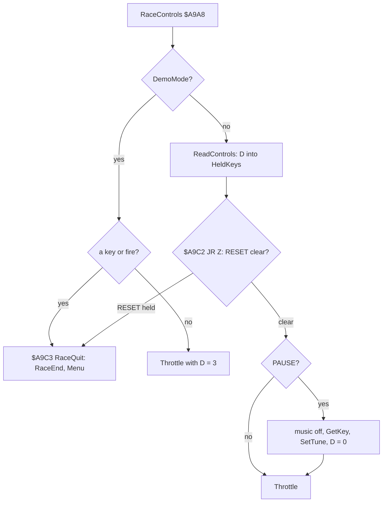

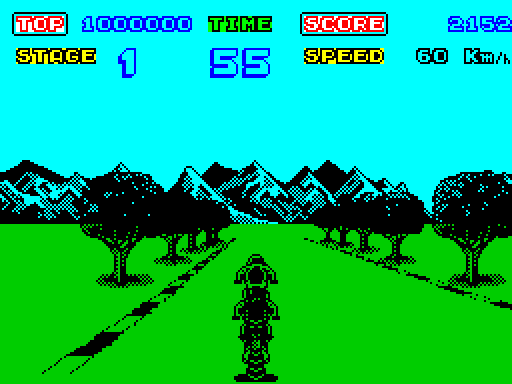

*Figure 5.7: `c1` frame 14 621, paused since 14 555; H again at 14 621 resumes. From the recording's stills.*

Worked example: c1 presses H at 14 555 and releases it at 14 561. GetKey waits for the release, then for a key: H
again at 14 621. SPEED is `$3C15` at both 14 555 and 14 621, PassCount `$A9` at both: no pass ran.

Witness: the `memory_at` values above; ctl's RESET (R) back to the menu after each method.

The point: RESET costs one byte. The jump's offset `$08` is also `EX AF,AF'`, the first instruction of the exit
both RESET and the demo use.

## 5.11 The cheat key

RaceCount `$A64E` reads CAPS SHIFT and Q every pass:

```asm
RaceCount:
        LD HL,PassCount
        INC (HL)
        LD A,$FE
        IN A,($FE)
        RRA                     ; CAPS SHIFT
        JR C,RaceStep
CheatKey:
        LD A,$FB
        IN A,($FE)
        RRA                     ; Q
        JR C,RaceStep
        LD A,(CheatStep+$0001)
        CPL
        LD (CheatStep+$0001),A  ; toggle
RaceStep:
        ...                     ; DE = SPEED x 14
CheatStep:
        LD A,$00                ; 0 or $FF
        AND A
        JR Z,RacePass
        LD A,(Stage)
        CP $03
        JR NC,RacePass          ; stages 1-3 only
        LD DE,$1000             ; a fixed ScrollStep
```

With CheatStep on, stages 1-3 run with ScrollStep `$1000`: the track moves as at SPEED 293, faster than the throttle
can give. SPEED itself and the score do not change, but the steering does, a game bug known from the code:

- BikeControl reads SteerTable `$8E5D` at 2 x ScrollStep's high byte. With `$1000` the index is 32: `$8E7D`, past
  SteerTable and SteerTail (`$8E5D-$8E7C`), the first byte of `render.asm`, the opcode `$06` of `LD B,$80`.
- Full lean then gives 6 x 173 / 8 = 129 = `$0081`, 0.5 pixel a pass, against 3.55 at 199 km/h without the cheat.
- BikeLateralPush multiplies the bend's factor by the same high byte: `$10` instead of at most `$0A`, so the bends
  push 1.6 times harder. With the cheat on, the bike can hardly hold the road in a bend.

The toggle flips on every pass the two keys read down (it is not edge-triggered), so a press must last about one
pass; an even number of passes turns it back off.

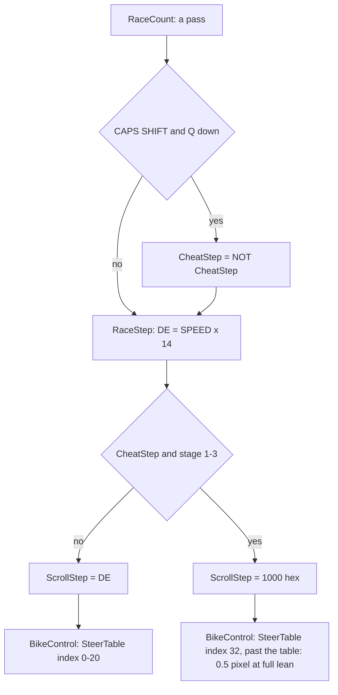

Witness: the recording `tech-cheat` (WALKTHROUGH 6.0) holds CAPS SHIFT + Q at c1's play: CheatKey `$A659`
once at its frame 126, CheatFixedStep `$A674` 51 times.

The point: the cheat is a track speed, not a bike speed. The HUD still shows the real SPEED, but the steering
reads its table past the end.

## 5.12 Two players

ONE/TWO PLAYERS flips Players `$7C32` between 1 and 2 (`XOR 3`). The two players share the controls and take turns:
a turn ends when the player falls and lies, or the time runs out. Player `$5E0D` and OtherPlayer `$5E45` keep each
player's state between turns; the HUD shows 1UP or 2UP ([doc 8](08-hud-and-text.md)). [Doc 10](10-gameplay-logic.md)
has the rules around the turns; the loop itself is here.

```text
NewGame:
    clear Player $5E0D and OtherPlayer $5E45 (56 bytes each); Countdown 16 in both (not in a demo)
    OtherPlayer.Timer = $60; with two players Player.Timer = $60 too
TurnLoop:                                   # $87BD
    swap Player and OtherPlayer, 56 bytes
    if Timer == 0: goto TurnLoop            # this player's game is over: skip him
    PlayTurn()                              # $87FC: the HUD, the race until a fall's end or Timer 0
    if Timer == 0 and OtherPlayer.Timer == 0: Attract     # both games over
    if Timer != 0 and Players == 2: Delay; GetKey         # the key that hands the turn over
    goto TurnLoop
```

```asm
TurnLoop:                       ; $87BD
        LD B,$38                ; swap the blocks (56 bytes)
        LD IX,Player
l_87C3: LD A,(IX+$00)
        LD C,(IX+$38)
        LD (IX+$38),A
        LD (IX+$00),C
        INC IX
        DJNZ l_87C3
        LD A,(Timer)
        AND A
        JR Z,TurnLoop           ; a player with Timer 0 is skipped
        CALL PlayTurn           ; the turn
        LD A,(Timer)
        AND A
        LD A,(OtherPlayer+$0012) ; the other's Timer
        JR NZ,TurnNext
        AND A
        JP Z,Attract            ; both 0: the game is over
TurnSkip:
        JR TurnLoop
TurnNext:
        AND A                   ; one player: on; two: Delay and GetKey first
        JR Z,TurnLoop
        LD A,(Players)
        DEC A
        JR Z,TurnLoop
        CALL Delay
        CALL GetKey
        JR TurnLoop
```

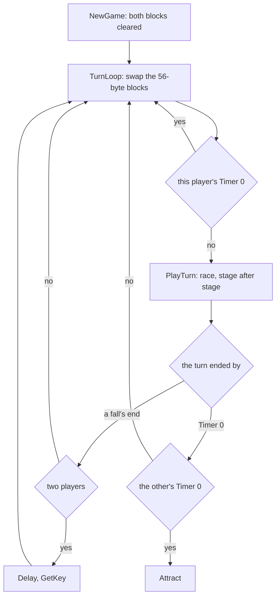

A stage's end does not end a turn: StageEnd jumps straight to StageStart for the same player. With one player
OtherPlayer's Timer stays 0, so the swap after a fall brings player 1 back at once.

| Frame of `twoplayer` | What happens |
| --- | --- |
| 63 | TWO PLAYERS on the menu |
| 4 296-10 194 | player 1 falls and lies, the timer stopped at 44 |
| 10 892 | player 2's turn (2UP), from 52 s |
| 20 672 | player 1 again, with his own time and score |

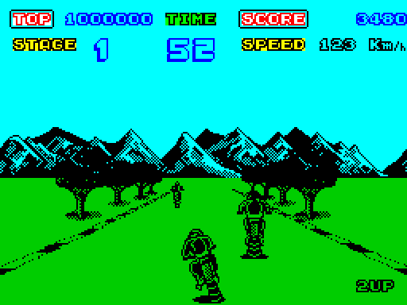

*Figure 5.8: `twoplayer` frame 10 892, player 2's turn. From the recording's stills.*

The point: two players are two saved states of one player, swapped at the turn.

## 5.13 Summary

- The controls are one byte D: five driving bits from the method, PAUSE and RESET as keys.
- A method is 10 bytes of ControlTable; PatchControls writes them, with the port and the jump's opcode, into
  ReadControls' seven tests. The game starts on SINCLAIR LEFT.
- The Kempston is read at `$001F` with `JR Z`; the keyboard at `$xxFE` with `JR NZ`.
- MenuSelect: SPACE or fire picks, THROTTLE goes up, any other key down; on the Kempston any stick bit counts as a
  key.
- DEFINE KEYS uses ScanKeys, which needs exactly one key per half row.
- The lean moves one step a pass; the sideways speed is SteerTable × LeanTable / 8, its high byte capped at 5 (up
  to 6.0 pixels a pass); below 55 km/h lean 2 beats lean 3.
- SPEED rises by `(SPEED + 1) / 4` below 20, 2.125 a pass to 160, then toward 200, stopping at 199; brakes take 5.5
  a pass.
- RESET and the demo's exit share the byte `$08`: the offset of PauseJump's `JR Z` and RaceQuit's `EX AF,AF'`.
- CAPS SHIFT + Q toggles a fixed track speed on stages 1-3, on every pass they are held; it breaks the steering.

Known only from the code in this document:

- MenuUp: no recording moves up the menu (5.5);
- DefineTaken and DefinePauseKey: ctl gave five different keys and left PAUSE and RESET (5.6);
- WaitKeyTimeout: every wait saw the keys released in time (5.6).
