# 6. Rendering

What this covers:

- the screen layout and the back buffer `$EB00-$FDFF` (6.1);
- RowTable `$FE00` and SetRowTable `$8E7D`: one table of line addresses that every drawing routine uses; the sprite,
  road and copy loops pop it with SP, the printer and ClearLines read it with HL or DE (6.2);
- the road model: Perspective `$7800`, RoadLines `$5C00`, the row builders, RowList `$5B00`, RoadTopRow (6.3);
- the bend and the crest: BendRows `$5B80` shifts the rows sideways, CrestTable `$7A00` moves RoadLines up or down (6.4);
- DrawRoad `$931E`: the pre-shifted edges, SP walking RowTable, Multiply's patched return, the runs (6.5);
- the ground's dots and dashes of stages 3 and 5, GroundTexture `$A301` (6.6);
- the horizons and their rotation on a bend, HorizonScrollStep `$99F0` (6.7);
- the sprites: DrawSprite, DrawShifted, DrawMirrored and the one blitter BlitRows (6.8);
- the riders, the objects, the bike, the splash and the dust: size by picking a pre-drawn sprite (6.9);
- one picture built: the draw order, CopyBuffer `$98F5`, DrawHorizon `$9E7B` as the erase, the copy against the
  beam (6.10);
- the code against the screen of one real pass (6.11).

The recordings it rests on ([WALKTHROUGH](../WALKTHROUGH.md)):

| Recording | Load | Used for |
| --- | --- | --- |
| `c1` | power-on on the 48K, `LOAD ""`, the original tape at signal speed, `tests/inputs/c1.txt` | stage 1: the road over a crest (frame 15 100) and a bend (15 300), the riders, one traced pass 15 199-15 206 |
| `stages` | `work/stage1/rec/c1/menu-kb.szx`, the infinite-time and immunity POKEs, `tests/inputs/stages.txt` | the five stages; one traced pass of stage 3 (5 400-5 409): the ground's dots and the dust |

The instances for this document ran in `work/docs/erB/c1` and `work/docs/erB/stages`. The full trace of c1's pass is
`work/docs/erB/c1/traces/15199_0-15207_0.uatr`; the stage 3 pass is `work/docs/erB/stages/traces/5400_0-5410_0.uatr`.
The commands are in [`work/docs/erB-NOTES.md`](../work/docs/erB-NOTES.md).

Conventions:

- **A frame** is 1/50 s of the 48K, 69 888 T. "15199:23135" is frame 15 199, T 23 135.
- A value read with `time_travel memory_at` at frame N is the memory at T 0 of frame N.
- **A pass** is one turn of RaceLoop `$A5FE` ([4.6](04-game-loop.md#46-the-free-running-race-loop)). In c1's stage 1
  a pass takes about 8 frames. The pass of the worked examples runs from 15199:0 to 15206:58685.
- **Line** is a pixel line of the screen, 0-191 from the top. **Row** is a road row, 0-127, 0 the nearest.
- **Stage 1-5** is the number the HUD shows. The variable Stage `$5E23` holds it minus 1.
- A **bend** shifts the road's rows sideways, a **crest** moves their lines up or down (6.4). The source's names
  say the same (Bend, Crest; the stage 2 source had them the other way round as Hill and Curve).

## 6.1 The screen and the back buffer

The race screen has three bands:

| Lines | Content | Drawn where |
| --- | --- | --- |
| 0-39 | the HUD: TOP, TIME, SCORE, STAGE, SPEED ([doc 8](08-hud-and-text.md)) | straight on the screen |
| 40-111 | the sky and the horizon picture | the back buffer |
| 112-191 | the road, the ground, the riders, the objects, the bike | the back buffer |

Everything below line 40 is drawn into a back buffer and copied to the screen once a pass. The buffer has no
attributes. The colours are fixed per band: StartRace writes the attribute rows 5-13 (`$58A0`, 288 bytes) as `$68`,
the sky's cyan, and rows 14-23 with byte 6 of the stage's StageParams entry, the ground's colour, on stages 1-4; stage 5 does not
write it and keeps stage 4's `$70` ([7.2](07-objects.md#72-stagetable-and-stageparams)).

The buffer is not one block in screen order:

- Lines 40-63 are linear: line n at `$EB00 + 32 × (n − 40)`.
- Lines 64-191 keep the screen's own interleaved order, moved by `$A600`: line 64 at `$EE00`, line 65 at `$EF00`,
  line 72 at `$EE20`, line 191 at `$FDE0`.

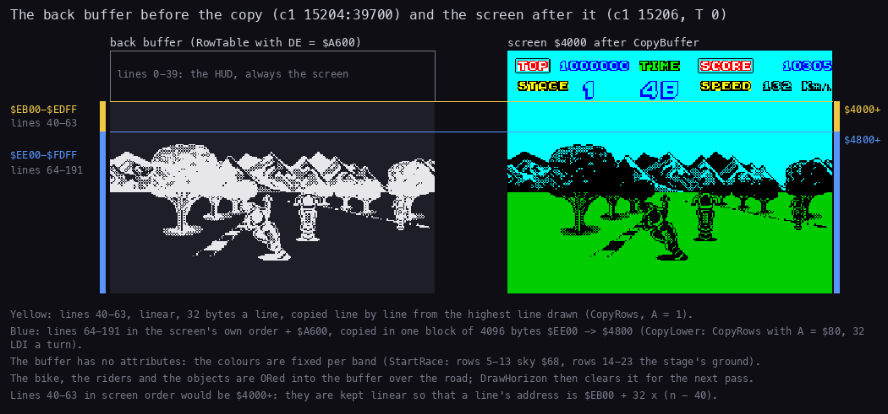

*Figure 6.1: the back buffer of `c1` at 15204:39700, just before CopyBuffer, drawn line by line through the
addresses RowTable gives, beside the screen at T 0 of frame 15 206, after the copy. Command: `python3
tools/fig_render.py layout --work work/docs/erB/c1 --built 15204:39700 --shown 15206 --out
docs/img/render/layout.png`.*

How to read:

- Left: the buffer, lines 40-191. Right: the screen.
- The yellow band marks lines 40-63 (linear), the blue band lines 64-191 (screen order).
- The buffer is monochrome. The screen adds the fixed attribute bands.

Why two layouts? Lines 64-191 are the screen's lower two thirds, `$4800-$57FF`. Kept in screen order, they copy as
one block of 4 096 bytes. Lines 40-63 share the top third with the HUD. That third cannot be copied as one block
without the HUD, so these lines are copied one at a time, and a linear layout makes their addresses simple.

The point: the back buffer is shaped for the copy. The lower two thirds go out as one block; only 24 lines take the
slow path.

## 6.2 RowTable: one table for every drawing routine

RowTable `$FE00-$FF7F` holds the address of each of the 192 lines, two bytes each. The printer, the road, the
sprites, the big digits and the erase all find a line there. None of them computes a screen address.

SetRowTable `$8E7D` points the table at the buffer or back at the screen. StartRace calls it with DE = `$A600`;
RaceEnd calls it with DE = `$5A00`. Since `$A600 + $5A00 = $10000`, the same addition undoes the first.

```text
SetRowTable(DE):
    for n in 64..191: RowTable[n] += DE           # to the buffer and back
    for n in 40..63:
        if DE == $A600: RowTable[n] = $EB00 + 32 * (n - 40)
        else:           RowTable[n] = the screen's address of line n
    # lines 0-39 are never touched: the HUD stays on the screen
```

c1's table at T 0 of frame 15 200, in the race:

| Line | RowTable entry | Where |
| --- | --- | --- |
| 0 | `$4000` | the screen (HUD) |
| 39 | `$4780` | the screen (HUD) |
| 40 | `$EB00` | the buffer, linear |
| 63 | `$EDE0` | the buffer, linear |
| 64 | `$EE00` | the buffer, screen order |
| 65 | `$EF00` | the buffer, screen order |
| 72 | `$EE20` | the buffer, screen order |
| 191 | `$FDE0` | the buffer, screen order |

The sprite, road, horizon and big-digit loops read the table with SP. Each one sets SP to `$FE00 + 2 × line` and
pops one address a line. BigDigit `$8498`:

```asm
        LD H,$7F                ; L = the first line
        ADD HL,HL               ; HL = $FE00 + 2 x line
        LD (SavedSp),SP
        LD SP,HL
l_84A0: POP HL                  ; HL = this line's address, SP on the next line's
        LD A,L
        OR C                    ; plus the column
        ...                     ; write the line
```

PrintGlyph (`$8395-$83A3`) reads its entry with `LD A,(HL)` / `INC L` / `LD H,(HL)`, and ClearLines reads it
through DE.

A `POP` takes 10 T and gives the address and the step to the next line at once. The cost is the stack: an
interrupt in the middle pushes its return address into RowTable. The handler writes the two bytes back from a copy
([4.4](04-game-loop.md#44-the-repair-of-the-pushed-word)).

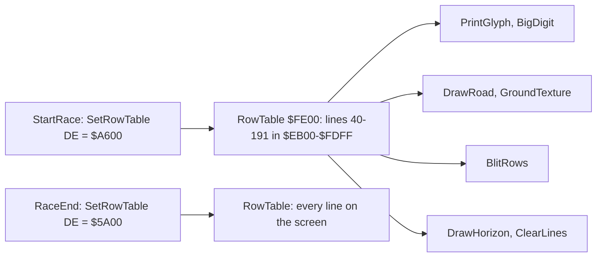

Worked example: the score's first digit at column 25, line 8, in frame 15 206. PrintGlyph sets HL =
`$FE00 + 2 × 8 = $FE10` and reads `$4020` there. Plus column 25 that gives `$4039`. Figure 6.7 lists PrintGlyph's write routine
`l_8398` reading `$FE10-$FE1F`: lines 8-15, one entry a line.

Witness: the `memory_at` values above; the writers map of Figure 6.7.

The point: one table decides whether a routine draws on the screen or into the buffer. The same printer writes the
HUD on the screen and a menu into the buffer.

## 6.3 The road model: rows, lines and RowList

The road is 128 rows deep. Each pass the game decides, for each row, which screen line it lands on (RoadLines), and
then, for each line, which row is drawn there (RowList).

| Table | Address | Size | Content |
| --- | --- | --- | --- |
| Perspective | `$7800` | 128 | the depth of each row on the flat: `$9F` for row 0, falling toward 0 |
| RowScale | `$7F00` | 128 | the scale of each row for the x multiply: `$FF` near, every 8th entry `ff a6 7b 62 51 46 3d 36 ...` |
| half widths | `$7F80` | 128 | half the road's width at each row: `a7 6d 51 41 35 ...` |
| CrestTable | `$7A00` | | the crest's profiles (6.4) |
| RoadLines | `$5C00` | 128 | this pass: the screen line of each row |
| BendRows | `$5B80` | 128 | this pass: the sideways shift of each row (6.4) |
| RowList | `$5B00` | up to 80 | this pass: the row to draw on each line from the top, `$FF` the end |

On the flat, RoadRowsFlat `$9DDF` gives each row the line `$70 + Perspective[row] / 2`:

```asm
RoadRowsFlat:                   ; $9DDF
        LD HL,RoadLines+$007F
        LD DE,Perspective+$007F
        LD B,$80
l_9DE7: LD A,(DE)
        SRL A
        ADD A,$70               ; line = $70 + depth / 2
        LD (HL),A
        DEC E
        DEC L
        DJNZ l_9DE7
                                ; falls into RoadRowsMake
```

Row 0 lands on `$70 + $9F / 2 = $BF`, line 191, the bottom. The far rows crowd toward line `$70`, 112. The road
takes the 80 lines 112-191.

**RowList.** RoadRowsMake `$9DF1` walks RoadLines from row 127 down to row 1. Each time a row lands below the line
reached so far, it writes that row once for each new line. Rows that land on a line already taken are skipped. A
near row that spans several lines is written several times in a row: a **run**.

```text
RoadRowsMake:
    C = RoadLines[127]                       # the top line
    RoadTopRow = C - $71
    for row in 127 down to 1:
        if RoadLines[row] > C:
            repeat (RoadLines[row] - C) times: RowList.append(row)
            C = RoadLines[row]
    if row 1 added lines:                    # else the RET at $9E08: no new terminator
        if stage 5 and CrestPrev == 0: five more entries of row 1
        RowList.append($FF)
```

```asm
RoadRowsMake:                   ; $9DF1
        LD IX,RowList
        LD HL,RoadLines+$007F
        LD A,(HL)
        LD C,A
        SUB $71
        LD (RoadTopRow),A
l_9DFF: LD A,(HL)
        CP C
        JR Z,l_9E05
        JR NC,l_9E09            ; below the line reached: new lines
l_9E05: DEC L
        JR NZ,l_9DFF
        ...
l_9E09: SUB C
l_9E0A: LD (IX+$00),L           ; the row, once for each new line
        INC IXL
        DEC A
        JR NZ,l_9E0A
        LD C,(HL)
        DEC L
        JR NZ,l_9DFF
        LD (IX+$00),$FF
```

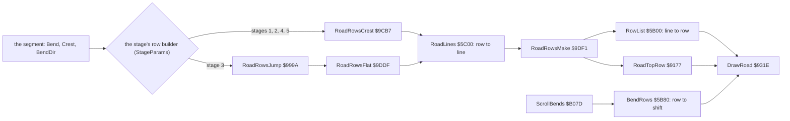

Worked example, c1 at T 0 of frame 15 300:

1. RoadLines starts `bf bc b7 b3 b0` and ends `77 77 77`.
2. RoadTopRow = `$77 − $71 = 6`.
3. RowList starts `7c 74 6a 62 58 50 49 43`: the top lines show rows 124, 116, 106, 98, far apart.
4. It ends `... 02 02 02 02 01 01 01 01 01 ff`: rows 2 and 1 cover four and five lines each.

Witness: in the traced pass RoadRowsCrest ran 15199:15-15419 and RoadRowsMake 15199:15431-23107, 933 instructions
(`work/docs/erB/agg.py` over the trace).

The point: the road is never scaled. A row's line comes from a table, and the list of lines to draw comes from one
walk of that table.

## 6.4 The bend and the crest

A segment of the stage gives two numbers 0-3 and a direction ([7.3](07-objects.md#73-the-segment-byte-and-stagelist)).
The source names them after what they do on the screen:

| Field | Variables | Tables | What it changes | On the screen |
| --- | --- | --- | --- | --- |
| Bend | Bend `$5E2F`, BendPrev `$5E2E` | the bend profiles (BendProfiles) into BendRows `$5B80` | each row's x | a **bend** |
| Crest | Crest `$5E31`, CrestPrev `$5E30` | CrestTable `$7A00` into RoadLines `$5C00` | each row's line | a **crest** |
| BendDir | `$5E2D` | | the sign of the bend | left or right |

**The bend.** ScrollBends `$B07D` moves BendRows on by one row each time the bike passes a row
and fills the far end from the profile; BlendBend brings it back to 0 after the bend. DrawRoad adds BendRows[row]
to the row's centre before the scale (6.5). The far rows move sideways a lot, the near ones hardly: the road turns.
Three more facts tie Bend to a bend:

- BikeLateralPush pushes the bike sideways by ScrollStep's high byte (doubled on stages 2 and 4) × `$52`, `$8F` or
  `$A4` / 256 for BendPrev 1, 2, 3, signed by BendDir: the pull of a bend ([5.7](05-controls.md#57-the-lean-and-the-steering)).
- The horizon rotates only while that push is not 0 (6.7).
- RowList does not change: a bend moves no row up or down.

**The crest.** RoadRowsCrest `$9CB7` gives the rows over the segment's progress the line
`$70 + Perspective × CrestTable / 512`, and the others the flat line. The near rows rise up the screen. Rows farther
than the crest land above the top line and RoadRowsMake skips them: the road ends at the crest.

```text
RoadRowsCrest:
    if CrestPrev == 0:                                    # entering a crest, or none
        if Crest == 0 or SegmentLeft.high == $80: RoadRowsMake   # RoadLines left as it is
        for row in SegmentLeft.high .. 127:               # only the far rows the segment has reached
            RoadLines[row] = $70 + Perspective[row] * CrestTable[Crest][..] / 512
    else:                                                 # inside or leaving a crest
        for each row: RoadLines[row] = $70 + Perspective[row] * CrestTable[CrestPrev, phase][..] / 512
    RoadRowsMake
```

Three cases, then: RoadLines untouched (no crest coming, or the segment not yet begun: SegmentLeft's high byte
`$80`), a partial crest (the far rows from SegmentLeft's high byte up), and a full crest (every row). The flat lines
come from RoadRowsFlat, which SegmentDecode calls when the crest was 0.

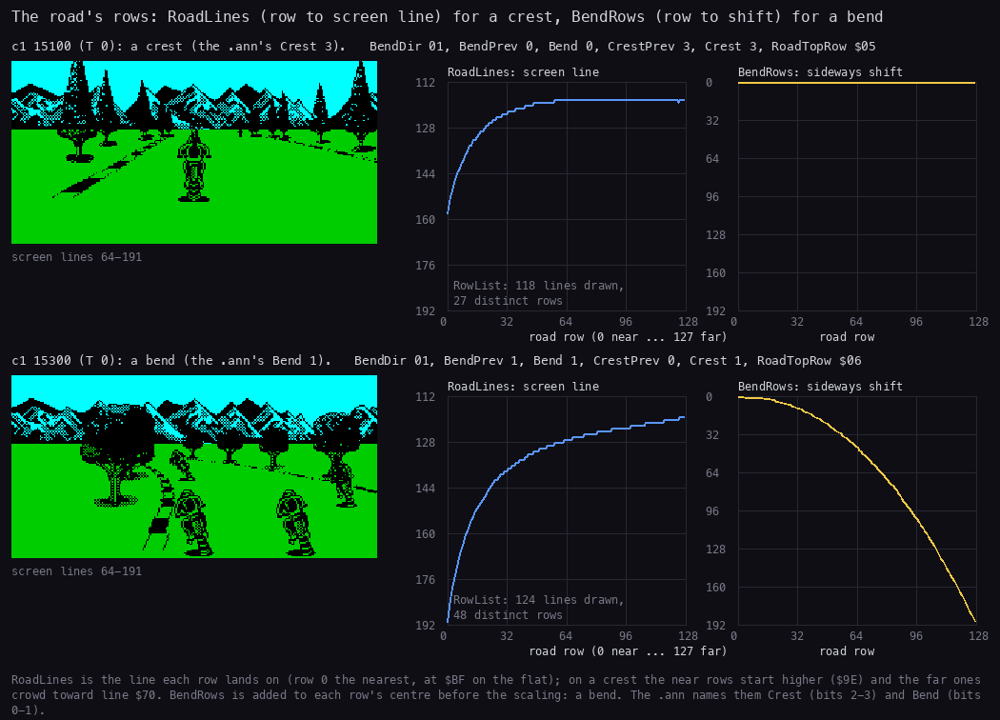

*Figure 6.2: `c1` at T 0 of frames 15 100 (Crest 3) and 15 300 (Bend 1). For each frame: the screen's lines 64-191,
RoadLines (row to line) and BendRows (row to shift). Command: `python3 tools/fig_render.py rows --work
work/docs/integrate/c1 --frame 15100 --label "a crest (the .ann's Crest 3)" --frame 15300 --label "a bend (the .ann's
Bend 1)" --out docs/img/render/rows.png`.*

How to read:

- RoadLines is drawn with line 112 at the top, as on the screen. The flat curve reaches line 191 at row 0.
- At 15 100 row 0 lands on `$9E`, line 158, and the far rows stay near line `$76`. The lines below 158 are ground.
- At 15 300 a crest begins: CrestPrev 0, Crest 1, SegmentLeft's high byte `$6B`. Only rows `$6B-$7F` have the
  crest's lines (RoadLines ends `77 77 77`, RoadTopRow 6); at 15 400 the high byte is `$06` and RoadLines ends `$78`,
  RoadTopRow 7. BendRows rises from 0 at row 0 to `$BD` at row 127. RowList holds 69 lines.

Worked example, frame 15 100: RowList is `7c 2e 29 24 20 1d ... 01 01 01 01 ff`, 38 lines. After row 124 at the top
it jumps to row 46: rows 47 to 123 land on lines already taken and are skipped. RoadTopRow is 5.

Witness: c1 `memory_at` at 15 100 (BendDir, BendPrev, Bend, CrestPrev, Crest = `01 00 00 03 03`) and at 15 300
(Bend 1, BendPrev 1, Crest 1). The animation below shows the switch from one to the other.

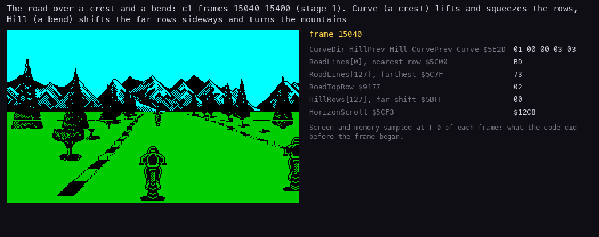

*Animation 6.1: `c1` frames 15 040-15 400, every 4th frame, lines 40-191, with the segment's five bytes,
RoadLines[0], RoadLines[127], RoadTopRow, BendRows[127] and HorizonScroll at T 0. Command: `python3
tools/fig_controls.py play --work work/docs/integrate/c1 --from 15040 --to 15400 --step 4 --crop 0,40,256,192 --var
'BendDir BendPrev Bend CrestPrev Crest=5E2D:5:hex' --var 'RoadLines[0], nearest row=5C00:1:hex' --var
'RoadLines[127], farthest=5C7F:1:hex' --var 'RoadTopRow=9177:1:hex' --var 'BendRows[127], far shift=5BFF:1:hex'
--var 'HorizonScroll=5CF3:2:word' --title "..." --out docs/img/play/road-crest-bend.gif`.*

What to watch:

- RoadLines[0] at `$9E` while Crest is 3: the near road is cut short, the road drops away behind a crest.
- RoadLines[0] back at `$BF` and BendRows[127] climbing when Bend turns 1: the far road swings sideways.
- HorizonScroll moving only during the bend, the mountains turning with it.

The point: a bend moves rows sideways; a crest moves them up and hides some. Both are table lookups. The source names them
so: Bend for bits 0-1, Crest for bits 2-3 (the stage 2 source had them swapped, as Hill and Curve).

## 6.5 DrawRoad: the edges

DrawRoad `$931E` draws only the two edges of each line. The road's surface is the paper between them. Stage 5 has
no edges: its road routine is RoadNone `$9A91`, which only sets IX = RowList for GroundTexture.

**Setting up.** DrawRoad patches Multiply's last byte from `RET` to `JP DrawRoadRow`. It saves SP and sets SP to
`$FEE0 + 2 × RoadTopRow`: RowTable's entry for line `$70 + RoadTopRow`. Then it walks RowList, one entry and one
`POP` per line, for at most 80 lines.

The start line and RowList do not meet exactly. With RoadTopRow = RoadLines[127] − `$71`, the first `POP` takes line
RoadLines[127] − 1, while RoadRowsMake writes its first entry for line RoadLines[127] + 1 (6.3): every entry is drawn
two lines above the line RoadLines gives it. On the flat road (`$70` + Perspective / 2, read from the image's table
at `$7800`) RoadLines[127] is 120, RoadTopRow 7 and SP starts at line 119; the first entry is row 124 (line 121 in
RoadLines), and the 68 entries fill lines 119-186 for RoadLines' 121-188. `c1` frame 14 075 (the GO picture, flat
stage start) shows it: the right edge's first pixels are on line 119, none on 118. Whether the objects, placed by
RoadLines, sit two lines low against the edges by that was not measured.

```asm
DrawRoad:                       ; $931E
        CALL GapRowsJump        ; stage 3: the gap's rows become $FE
        LD IX,RowList
        ...                     ; MultiplyEnd = JP DrawRoadRow
        LD (SavedSp),SP
        LD A,(SegmentLeft+$0001)
        CPL
        LD (l_9366+$000B),A     ; the stripes' phase
        LD A,(RoadTopRow)
        LD E,A
        LD D,$00
        LD HL,RowTable+$00E0
        ADD HL,DE
        ADD HL,DE
        LD SP,HL                ; SP = RowTable's entry of line $70 + RoadTopRow
DrawRoadLoop:
        ...
        LD A,(IX+$00)
        CP $FF
        JP Z,DrawRoadEnd
        CP $FE
        JR NZ,l_935A
        POP HL                  ; $FE: a gap line, nothing drawn
        JP DrawRoadNext
```

**One line.**

```text
for each line, row = RowList[i]:
    if row == $FF: stop
    if row == $FE: POP; next line                              # stage 3's water
    class = min(RowScale[row] / 2, $70) AND $F8                # 15 widths, 24 bytes each
    set = EdgePatterns if bit 2 of (row + phase) else EdgePatterns2   # the stripes
    half = RowScale[$80 + row]                                 # half the road's width
    if RowList[i + 1] == row: DrawRoadRun; continue
    if BendRows[row] == $FF or BendRows[row] + the bike's offset leaves the byte's range:
        DrawRoadOff: POP; next line                            # $9443: the row is off the road
    centre = $80 +/- (BendRows[row] + the bike's offset) * RowScale[row] / 64   # Multiply
    POP DE                                                     # this line's address
    write set[class][(centre - half) AND 7], 3 bytes, at DE + (centre - half) / 8
    write set[class][(centre + half) AND 7], 3 bytes, at DE + (centre + half) / 8
```

The edges are pre-shifted: each width class has its pattern in all 8 bit positions, 3 bytes each. No bit is
shifted in the loop; the x's low 3 bits pick the copy and three `LDI` write it. Near the screen's sides the copy is
cut: `LDDR` on the left, `LDIR` with a shorter count on the right.

The phase is the complement of SegmentLeft's high byte. As the segment counts down, bit 2 of row + phase flips every
4 rows, and the two sets alternate along the road. The bands move toward the bike: that is the speed you see.

**Multiply's return.** Multiply `$8BAE` ends in `RET`. With SP inside RowTable a `RET` would pop a line address and
jump there. So DrawRoad enters Multiply by `JP`, and Multiply's last byte jumps on to DrawRoadRow. DrawRoadEnd writes
`RET` (`$C9`) back and restores SP.

```asm
l_93AE: JP Multiply             ; no CALL: SP is in RowTable
DrawRoadRow:                    ; $93B1, reached by MultiplyEnd's JP
        EX DE,HL
        POP DE                  ; the line's address
        ADD HL,HL
        ADD HL,HL
        LD A,H                  ; the shift, scaled by the row
        DEC C
        JR NZ,l_93BB
        NEG                     ; the other side of the centre
l_93BB: ADD A,$80               ; x of the centre
        ...
l_93EC: AND $F8
        RRA
        RRA
        RRA
        OR E
        LD E,A                  ; DE = the line + x / 8
        LDI
        LDI
        LDI                     ; the left edge, 3 bytes
DrawRoadRight:
        ...                     ; the right edge the same way
DrawRoadNext:
        LD A,$00                ; the line count
        INC IX
        INC A
        CP $50
        JP C,DrawRoadLoop       ; at most 80 lines
DrawRoadEnd:
        LD A,$C9
        LD (MultiplyEnd),A      ; RET again
        LD SP,(SavedSp)
        RET
```

**The runs.** When the next entry is the same row, DrawRoadRun `$9446` counts the run. It works out each edge's slope
with Divide (this row's x and the next row's, over the run's lines) and draws each line with DrawRoadRunLine, adding
the slopes. The near rows, stretched over 4 or 5 lines, get straight sloping edges instead of steps.

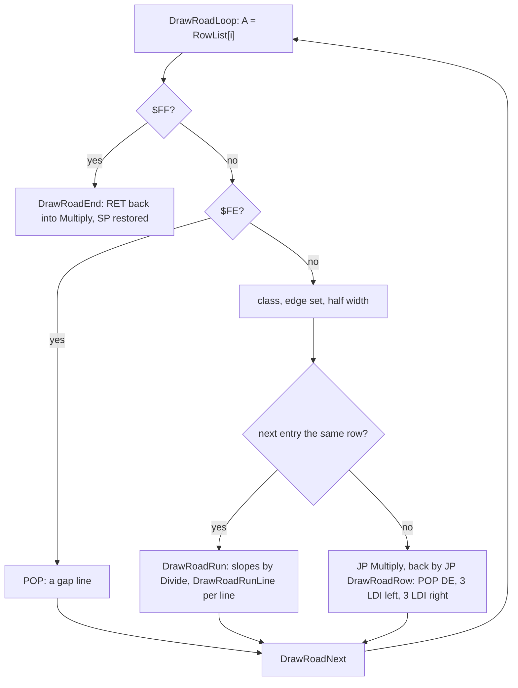

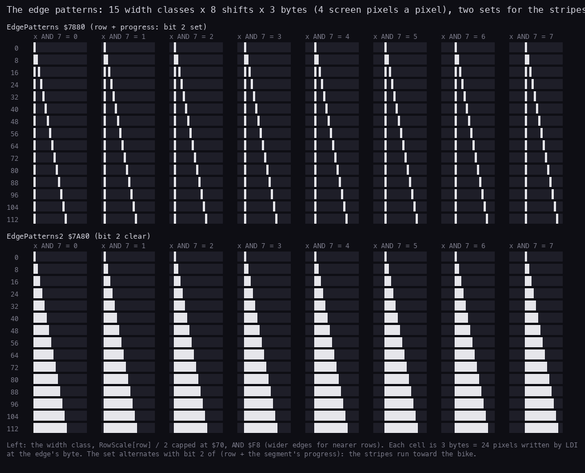

*Figure 6.3: EdgePatterns `$7880` and EdgePatterns2 `$7A80` from `build/game.bin`: 15 width classes by 8 shifts, 3
bytes each, 4 screen pixels a pixel. Command: `python3 tools/fig_render.py edges --out docs/img/render/edges.png`.*

How to read:

- A row of the figure is one width class.
- A cell is the 3 bytes the `LDI`s write. Along a row the pattern moves one pixel to the right per shift.
- EdgePatterns draws the edge as thin lines, EdgePatterns2 as a solid bar. The two alternate as the stripes.

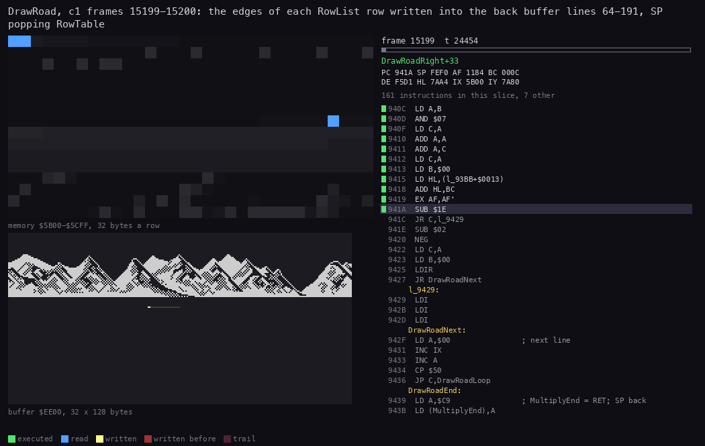

*Animation 6.2: DrawRoad in `c1` frames 15 199-15 200, window 15199:23100-15200:47950. The view is the back buffer's
lines 64-191 (`$EE00`, screen order); the memory map is RowList and BendRows `$5B00-$5CFF`. Command: `python3
../../kit/routine_anim.py --work work/docs/erB/c1 --window 15199:23100-15200:47950 --listing build/game.lst --view
buffer:EE00:32x128:screen --range 5B00-5CFF --pc 931E-9614,8BAE-8BEC,8B98-8BAD --pictures 70 --title "..." --out
docs/img/routines/DrawRoad.gif`.*

What to watch:

- the edges appearing from the top line down, one line per entry of RowList;
- the interrupt in frame 15 200 with the 48K engine sound: the drawing stops from T 1 850 to T 28 600;
- the near lines at the bottom drawn as runs, with straight slopes.

Worked example, the traced pass:

1. DrawRoad starts at 15199:23135.
2. The far lines take about 1 200 T each: DrawRoadLoop begins at T 23 370, 24 559, 25 743, ...
3. The first run begins at 15199:55519. DrawRoadRun's setup with Divide takes about 4 000 T, then DrawRoadRunLine
   about 380 T a line.
4. DrawRoadEnd runs at 15200:47877. With the interrupt the whole road took 94 630 T, 1.35 frames.

Witness: the trace `15199_0-15207_0.uatr`. In the writers map (Figure 6.11) the edges were last written by `l_93EC`
(the left edge's `LDI`s, 93 writes), `l_9429` (the right edge's, 57) and `l_958D` (the runs, 39).

The point: the road is two pre-shifted 3-byte edges per line. SP supplies the line addresses, and Multiply returns
by a patched jump because a `RET` would pop one of them.

## 6.6 The ground's dots: stages 3 and 5

Stages 3 and 5 add a texture to the ground. GroundTexture `$A301` returns at once on the other stages.

```text
GroundTexture:
    if stage not 3 and not 5: return
    RandomPtr += 4 * (ScrollStep >> 8), kept in $0000-$1FFF       # the ROM as random numbers
    for each road row of RowList, from the nearest up:
        tries = from the row's spacing (Divide)                    # more tries for near rows
        centre = $80 + (BendRows[row] + the bike's offset) scaled by RowScale[row]   # as DrawRoad
        left, right = centre -/+ ($7F80 + row) / 2                 # the band, clamped to 0..$FF
        for each try:
            x = (ROM[RandomPtr++] XOR its low address byte) + centre
            if x < left:
                stage 3: nothing
                stage 5: if x > left - (right - left) / 2: one dot  # within half a band of the edge
                         else: an 8-pixel dash, $FF shifted by x AND 7 over two bytes
            else if x < right:
                stage 3: one dot (DotMasks $9CAF + (x AND 7), plus 1)
                stage 5: nothing
            else: nothing                                          # right of the band
```

```asm
l_A3CF: LD HL,$0000             ; the ROM pointer, kept in the operand
        INC HL
        RES 5,H                 ; stay in $0000-$1FFF
        LD A,(HL)
        XOR L                   ; the random x
        ADD A,$00               ; patched per row
        LD (l_A3CF+$0001),HL
        CP $00                  ; the left edge, patched per row
        JR NC,l_A418            ; x >= left: the band's test
        LD C,A
        LD A,(Stage)
        CP $04
        JR C,l_A43B             ; stage 3: nothing left of the band
        ...                     ; stage 5: a dot near the edge (JR C,l_A424), else a dash
l_A418: CP $00                  ; the right edge, patched per row
        JR NC,l_A43B            ; x >= right: nothing on either stage
        LD C,A
        LD A,(Stage)
        CP $02
        JR NZ,l_A43B            ; stage 5: nothing inside the band
l_A424: ...                     ; one dot: (DotMasks + (x AND 7)) + 1 ORed in
```

The dot's byte is the DotMasks entry plus one: `$7F` + 1 = `$80`, `$3F` + 1 = `$40`, one pixel at bit 7 - (x AND 7).
For x AND 7 = 0 the entry `$FF` + 1 is 0, so an eighth of the tries draw nothing.

The band comes from the row (`$A380-$A3CB`). Its centre is DrawRoad's: `$80` plus the row's BendRows shift (`$5B80`
+ row) and the bike's offset (the operand GroundTexture copies from `$93A0`), scaled by RowScale (`$7F00` + row).
Left and right are that centre minus and plus half the byte at `$7F80` + row, clamped to 0 and `$FF`. DrawRoad puts
the edges at the centre minus and plus the whole byte (6.5), so the band is the middle half of the road. On stage 3
the dots fall there, on the road's surface; the animation's last picture has them all between the chequered left
edge and the right one, and the sand beside the road stays clear. Stage 5 has no edges (RoadNone): its ground is the
dashes and dots left of the band; the band and everything right of it stay plain yellow.

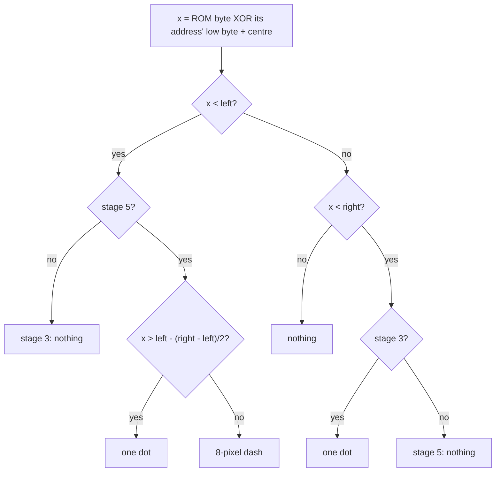

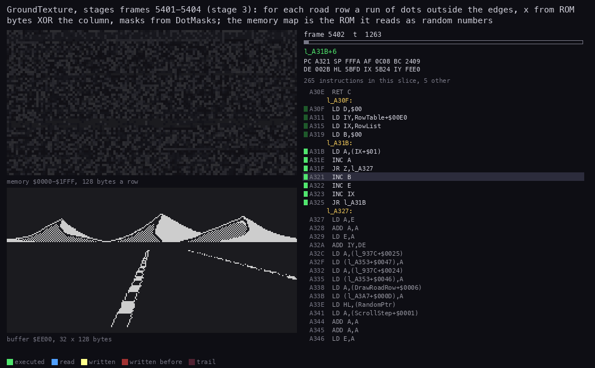

*Animation 6.3: GroundTexture in `stages` frames 5 401-5 404 (stage 3). The view is the back buffer's lines 64-191;
the memory map is the ROM `$0000-$1FFF` that it reads as random numbers. Command: `python3 ../../kit/routine_anim.py
--work work/docs/erB/stages --window 5401:68800-5404:200 --listing build/game.lst --view buffer:EE00:32x128:screen
--range 0000-1FFF --row-bytes 128 --pc A301-A45A,8B98-8BEC --pictures 60 --title "..." --out
docs/img/routines/GroundTexture.gif`.*

What to watch: the dots appearing between the road's edges from the bottom up; the ROM reads (blue) moving along in one run.

Worked example, the stage 3 pass at 5 400: DrawRoad ran from 5400:33783 to 5401:68840, GroundTexture from 5401:68867
to 5404:131, 9 035 instructions of its own: about 140 000 T, two frames. The ground costs more than the road.

Witness: the trace `work/docs/erB/stages/traces/5400_0-5410_0.uatr`. The stage shots
[stage 3](img/play/stages-005340-stage-02.png) and [stage 5](img/play/stages-013012-stage-05.png) show the dots and
the dashes (the files are named after the stage that just ended).

The point: the ground's texture is free on stages 1, 2 and 4 and costs two frames a pass on stage 3. The random
numbers are the ROM's bytes.

## 6.7 The horizons and their rotation

StageTable `$9E67` gives each stage its picture, 32 bytes a line, and the line where the picture starts
([7.2](07-objects.md#72-stagetable-and-stageparams)):

| Stage | Picture | Address | Lines | Top line |
| --- | --- | --- | --- | --- |
| 1 | Mountains | `$E5E0` | 32 | 80 (`$50`) |
| 2 | Clouds | `$E9E0` | 9 | 83 (`$53`) |
| 3 | Dunes | `$E2C0` | 25 | 87 (`$57`) |
| 4 | Mountains | `$E5E0` | 32 | 80 (`$50`) |
| 5 | Clouds | `$E9E0` | 9 | 90 (`$5A`) |


*Figure 6.4: the Mountains picture `$E5E0`, 256 × 32, as extracted into `src/res/horizons/mountains.png`. The clouds
and the dunes are in the same folder.*

SetHorizon `$9E3A` copies the stage's entry into HorizonAddr, HorizonRows and HorizonTop, and writes
`$C0 − rows − top` into the count of DrawHorizon's last clear (6.10): the number of lines below the picture.

**The rotation.** The picture lives in RAM and is turned in place. HorizonScrollStep `$99F0` adds HorizonSpeed / 2
to HorizonScroll `$5CF3` each pass. HorizonSpeed is the operand at `$99F1`, written by BikeLateral with the bend's
push. For each whole pixel gained, the picture is rotated by one pixel. RotateTable `$9A7F` lists the routines by
step:

| Step | Right | Left | How |
| --- | --- | --- | --- |
| 8 pixels | RotateBytesRight `$92C0` | RotateBytesLeft `$92ED` | a byte along each line; never runs |
| 4 pixels | RotateRight4 | RotateLeft4 | `RRD` / `RLD` |
| 1 pixel | RotateRight1 `$9211` | RotateLeft1 | `RR (HL)` / `RL (HL)` along each line |

```text
HorizonScrollStep:
    HorizonScroll += HorizonSpeed / 2            # 8.8
    pixels = the whole pixels gained this pass
    while pixels >= 8: rotate by a byte          # not met
    while pixels >= 4: rotate by 4
    while pixels >= 1: rotate by 1
```

```asm
RotateRight1:                   ; $9211, C lines from HL
        ...
        RR (HL)                 ; one byte; the carry moves on to the next
        INC L
        RR (HL)
        ...                     ; 32 bytes a line
        JR NC,l_9236
        LD A,(DE)
        OR $80                  ; the bit that fell off the line's end goes back to its start
        LD (DE),A
l_9236: DEC C
        JP NZ,RotateRight1
        RET
```

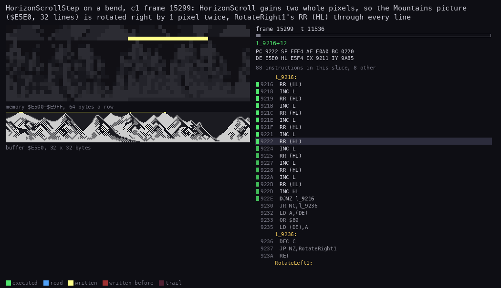

*Animation 6.4: HorizonScrollStep and RotateRight1 in `c1` frame 15 299, window 15299:10600-15299:57400: two
1-pixel rotations of the Mountains picture. The view is the picture `$E5E0`, 32 × 32 bytes. Command: `python3
../../kit/routine_anim.py --work work/docs/erB/c1 --window 15299:10600-15299:57400 --listing build/game.lst --view
buffer:E5E0:32x32:rows --range E500-E9FF --row-bytes 64 --pc 99F0-9A8F,9211-931D --pictures 50 --title "..." --out
docs/img/routines/HorizonScrollStep.gif`.*

What to watch: the `RR` moving down the picture line by line, then a second sweep right after the first.

Worked example, the pass at frame 15 299 (HorizonSpeed `$FD70` at T 0):

1. HorizonScrollStep runs at 15299:10690, 144 T.
2. RotateRight1 runs at 15299:11102-34078: 22 976 T.
3. RotateRight1 runs again at 15299:34287-57279: 22 992 T.

Each pixel of rotation costs about 718 T a line: a third of a frame for the 32-line mountains (stages 1 and 4),
about 18 000 T for the 25-line dunes (stage 3) and 6 500 T for the 9-line clouds (stages 2 and 5).

Witness: the trace `work/docs/erB/c1/traces/15299_10600-15299_57400.uatr`.

The point: the horizon turns by rotating its own bytes, not by drawing at an offset. A sharp bend costs the pass up to a
third of a frame per pixel (the mountains), less on the other stages.

## 6.8 The sprites: one blitter

Every sprite goes through one core, BlitRows `$9069`. It ORs the sprite's rows into the lines with no mask: what is
under the sprite stays, and the sprite's 1 bits are added. Three entries lead to it:

| Entry | Address | When | What it does first |
| --- | --- | --- | --- |
| DrawSprite | `$8F29` | the descriptor is marked aligned (near objects, some rider poses) | the first column, the left clip |
| DrawShifted | `$8F53` | any other x | copies each row into the line buffer `$8000`, shifted by x AND 7 |
| DrawMirrored | `$970C` | the bike at Lean 1 to 3 (LEFT held), mirrored rider poses | copies the rows reversed through ReverseTable `$5D00` |

**DrawShifted.** The sprite's rows go into the line buffer `$8000-$80B7`. ShiftCopy enters an unrolled `LDI` chain at
the width's place. Then ShiftRight runs a chain of `RR (HL)` for x AND 7 below 4, or ShiftLeft a chain of `RL (HL)`
by 8 − n into the byte before. So no row is shifted more than 4 times. The shifted copy lives for one draw only: no
shifted sets are stored.

**BlitRows.** The core sets SP = RowTable + 2 × the top line and pops each line's address. It works out the right
clip (the sprite past column 31) and patches the entry into the unrolled OR and the skip of the cut bytes:

```asm
BlitHead:                       ; $90B3, the unrolled OR of one row
        LD A,(DE)
        OR (HL)
        LD (DE),A
        INC E
        INC HL
BlitRow:
        LD A,(DE)               ; entered at the width's place
        OR (HL)
        LD (DE),A
        INC E
        INC HL
        ...
BlitNext:
        LD A,$00                ; the first column (patched)
        POP DE                  ; the next line
        OR E
        LD E,A
        ...                     ; skip the cut bytes, the next row
```

```text
BlitRows(sprite HL, rows, width, column, top line):
    cut the width at column 32; cut the rows above line 40
    SP = RowTable + 2 * top line
    for each row:
        DE = POP + column
        for each byte: (DE) = (DE) OR (HL)       # no mask
        HL += the cut bytes
    restore SP
```

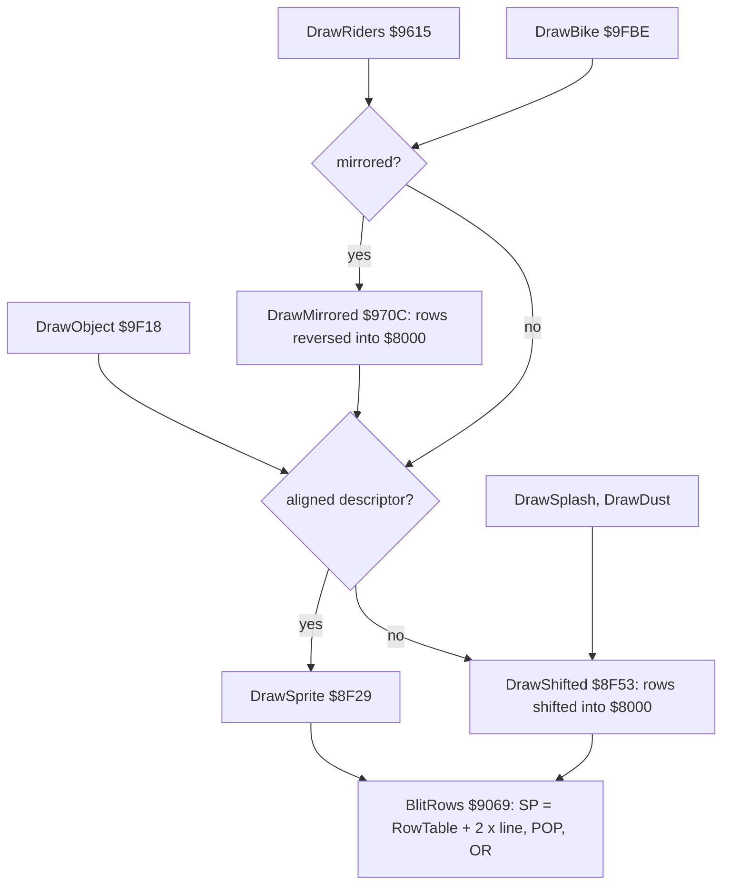

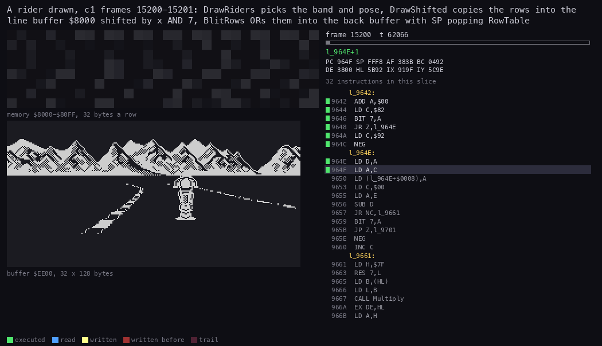

*Animation 6.5: DrawRiders, DrawShifted and BlitRows for one rider in `c1`, window 15200:61790-15201:8430. The view is
the back buffer's lines 64-191; the memory map is the line buffer `$8000-$80FF`. Command: `python3
../../kit/routine_anim.py --work work/docs/erB/c1 --window 15200:61790-15201:8430 --listing build/game.lst --view
buffer:EE00:32x128:screen --range 8000-80FF --row-bytes 32 --pc 8F29-90B2,90B3-917D,9615-970B --pictures 60 --title
"..." --out docs/img/routines/DrawShifted.gif`.*

What to watch: the line buffer filled row by row (writes), then read (reads) while the rider appears in the back
buffer; the rider ORed over the road's edge without erasing it.

Worked example, this rider:

| Step | Window | T |
| --- | --- | ---: |
| DrawRiders picks the band and the pose | 15200:61799-63493 | 1 694 |
| ShiftCopy, the rows into `$8000` | 15200:63873-65495 | 1 622 |
| ShiftLeft, `RL (HL)` chains | 15200:65543-15201:1661 | 6 006 |
| BlitRows and BlitRow, into the buffer | 15201:1671-8419 | 6 748 (with an interrupt) |

The shift costs about as much as the blit.

Witness: the trace `15200_61790-15201_8430.uatr`. In the writers map of the pass (Figure 6.11) BlitRow is the last
writer of 1 206 buffer bytes (1 634 writes) and `l_90F9`, a row's last byte, of 242.

The point: there is no mask and no saved background. A sprite only adds ink. That works because the whole buffer is
rebuilt each pass (6.10), so nothing needs to be restored.

## 6.9 The riders, the objects, the bike, the splash and the dust

Nothing is scaled at run time. Each kind of sprite has pre-drawn sizes, and the row it stands on picks one. The
object lists and the rider bands are in [7.6](07-objects.md#76-the-object-types-and-drawobject) and
[7.8](07-objects.md#78-the-riders-and-the-trucks); this section shows them on the screen.

**The riders.** DrawRiders `$9615` draws each rider of Riders `$5C80` (15 bytes each; byte 4, the distance's high
byte, is the row). RiderSprites `$917E` has seven bands. A band is the row threshold and five poses (rows with bit 7:
never mirrored, otherwise mirrored when BendDir is 1; width with bit 7 for aligned; address). The first three poses (`src/res/tables/riders.csv`):

| Band | Rows below | Pose 0 | Pose 1 (mirrored on BendDir 1) | Pose 2 (mirrored on BendDir 1) |
| --- | --- | --- | --- | --- |
| 0 | 5 | 60 × 3 bytes, never mirrored | 46 × 5, aligned | 47 × 4 |
| 1 | 11 | 54 × 3, never mirrored | 41 × 5 | 42 × 3 |
| 2 | 18 | 44 × 3, never mirrored | 34 × 4 | 34 × 3 |
| 3 | 26 | 36 × 3, never mirrored | 27 × 3 | 28 × 2 |
| 4 | 36 | 28 × 2, never mirrored | 22 × 3 | 22 × 2 |
| 5 | 55 | 21 × 2, never mirrored | 18 × 2 | 18 × 2 |
| 6 | 80 | 17 × 2, never mirrored | 14 × 2 | 14 × 2 |

A rider at row 80 or beyond is not drawn.

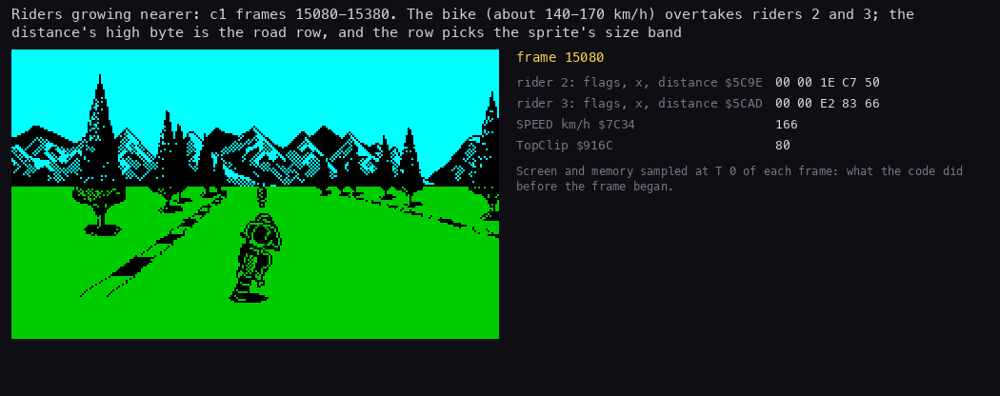

*Animation 6.6: `c1` frames 15 080-15 380, every 3rd frame, lines 40-191, with riders 2 and 3 (flags, x, distance;
the last byte is the row) and SPEED and TopClip at T 0. Command: `python3 tools/fig_controls.py play --work
work/docs/erB/c1 --from 15080 --to 15380 --step 3 --crop 0,40,256,192 --var 'rider 2: flags, x, distance=5C9E:5:hex'
--var 'rider 3: flags, x, distance=5CAD:5:hex' --var 'SPEED km/h=7C34:1:dec' --var 'TopClip=916C:1:dec' --title "..."
--out docs/img/play/rider-nearer.gif`.*

What to watch:

- rider 2's row (the last byte) falling from `$4C` to `$05`, then wrapping to `$FC` when the bike passes him;
- the sprite jumping to the next size each time the row crosses a threshold;
- rider 3 appearing only when his row falls below 80 (`$50`).

Worked example, rider 2's row at T 0:

| Frame | Row | Band | Rows of pose 0 |
| --- | --- | --- | --- |
| 15 084 | `$4C` = 76 | 6 | 17 |
| 15 132 | `$32` = 50 | 5 | 21 |
| 15 180 | `$19` = 25 | 3 | 36 |
| 15 252 | `$05` = 5 | 1 | 54 |
| 15 276 | `$FC` | passed | not drawn |

Four sizes in 170 frames. Rider 3 starts at row `$62` = 98 at 15 084, not drawn, and reaches row 5 at 15 372.

Witness: `work/docs/erB/mem.py work/docs/erB/c1 15084 15380 24 5C9E:5 5CAD:5 916C:1`.

**The objects.** DrawObject `$9F18` gets the object's row and its type's descriptor list. It takes the first entry
whose threshold is above the row. The line is the row's RoadLines entry; x is the row's centre plus the object's
side times RowScale. The part above line 40 is cut and TopClip is raised to the sprite's top. Near objects are drawn
by DrawSprite, byte-aligned; far ones by DrawShifted.

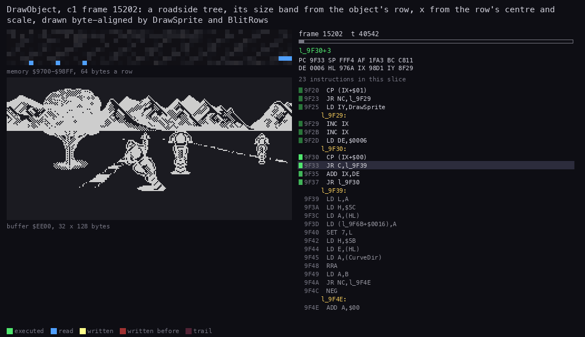

*Animation 6.7: DrawObject, DrawSprite and BlitRows in `c1` frame 15 202, window 15202:40250-15202:54830: one roadside
tree, drawn byte-aligned. The memory map is the object lists `$9700-$98FF`. Command: `python3
../../kit/routine_anim.py --work work/docs/erB/c1 --window 15202:40250-15202:54830 --listing build/game.lst --view
buffer:EE00:32x128:screen --range 9700-98FF --row-bytes 64 --pc 9F18-9FBD,8F29-917D --pictures 50 --title "..." --out
docs/img/routines/DrawObject.gif`.*

Worked example: this tree took 14 570 T: DrawObject 1 070 T (with a Multiply), then BlitRow 1 392 instructions over
13 000 T. A big tree near the bike costs a fifth of a frame. The whole object walk of the pass ran from 15201:54166
to 15204:38878, 2.8 frames: the largest part of the pass.

**The bike.** DrawBike `$9FBE` reads BikePoses `$9127`, 9 bytes an entry. Pose 3 (riding) picks the entry by the
lean:

```text
DrawBike:
    if the countdown's first part or GetUp: return
    if Pose == 3:
        entry = Lean + 6                      # lean -3..0: entries 3-6
        if entry >= 7: entry = 12 - entry; mirrored     # lean 1..3 (LEFT): entries 5-3, mirrored
    else: entry = Pose
    wheels: XOR the entry's patch into the sprite
            every pass above 64 km/h, every 2nd above 32, every 4th below, never stopped
    if mirrored: DrawMirrored                 # rows reversed into $8000
    y = (RoadLines[0], or $C0 in the air) - JumpHeight - rows + SkidLevel, not above line 40
    DrawSprite or DrawShifted at BikeX
```

The wheel animation XORs bytes into the sprite in place, so the next XOR undoes it.

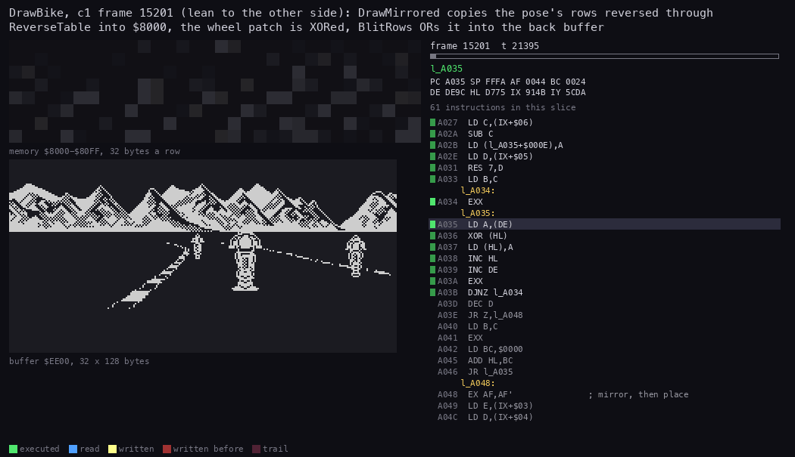

*Animation 6.8: DrawBike, DrawMirrored and BlitRows in `c1` frame 15 201, window 15201:20850-15201:53560: the bike
at Lean 1, mirrored. The memory map is the line buffer `$8000`. Command: `python3 ../../kit/routine_anim.py --work
work/docs/erB/c1 --window 15201:20850-15201:53560 --listing build/game.lst --view buffer:EE00:32x128:screen --range
8000-80FF --row-bytes 32 --pc 9FBE-A099,970C-977F,8F29-917D --pictures 60 --title "..." --out
docs/img/routines/DrawBike.gif`.*

Worked example: the mirror costs more than the draw. DrawMirrored's copy loop (`$9723-$9750`) ran 15201:23439-40682, 17 243 T, 2 585
instructions; BlitRow then took about 12 000 T (15201:41384-53448).

**The splash and the dust.** DrawSplash `$A09A` (the stages with SplashOn) draws one of two frames under the bike:
`$DED3` (20 lines × 5 bytes) and `$DF37` (15 × 3), by PassCount's bit 0. DrawDust `$A0AE` draws the dust beside the
bike while SkidLevel is up: `$DF64` (12 × 4) and `$DF94` (14 × 4). Neither draws in the air or when stopped. Both go
through DrawShifted, at an x from DustOffsets `$A0F3` by the pose. DustCarry `$A0DC` is an `INC H` for an index that
crosses a page; DustOffsets is 10 bytes at `$A0F3`, so the index never leaves the page and the `INC H` never runs.

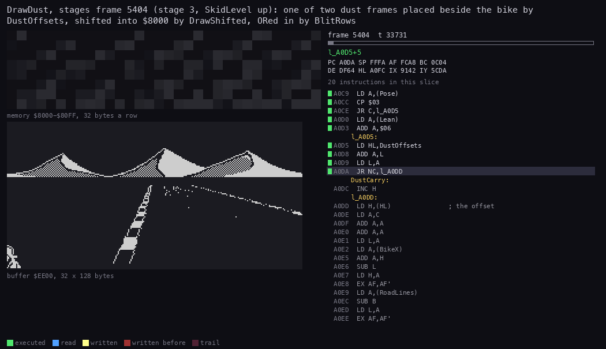

*Animation 6.9: DrawDust, DrawShifted and BlitRows in `stages` frame 5 404 (stage 3, SkidLevel `$14`), window
5404:33570-5404:41600. Command: `python3 ../../kit/routine_anim.py --work work/docs/erB/stages --window
5404:33570-5404:41600 --listing build/game.lst --view buffer:EE00:32x128:screen --range 8000-80FF --row-bytes 32 --pc
A09A-A100,8F29-917D --pictures 50 --title "..." --out docs/img/routines/DrawDust.gif`.*

Worked example: DrawDust ran at 5404:33582, DrawShifted from 5404:33845, BlitRows to about 5404:41580: 8 000 T for a
12 × 4 sprite.

The point: size comes from choosing a sprite by the row, never from scaling. A rider has seven sizes, and the
thresholds 5-80 put most of them near the bike, where a size step would show.

## 6.10 One picture built: the order, the copy and the erase

**The order.** One pass draws from the back to the front. The trace of c1's pass (the full order of a pass is in
[4.6](04-game-loop.md#46-the-free-running-race-loop)):

| Step | Routine | From | T |
| --- | --- | --- | ---: |
| 1 | RoadRowsCrest, RoadRowsMake | 15199:15 | 23 100 |
| 2 | DrawRoad with DrawRoadRun | 15199:23135 | 94 630 with an interrupt |
| 3 | GroundTexture (returns), MoveRiders | 15200:47944 | 2 900 |
| 4 | DrawRiders: three riders | 15200:50853 | 38 350 |
| 5 | BikeControl, BikeLateralPush | 15201:19379 | 1 480 |
| 6 | DrawBike, mirrored | 15201:20863 | 32 680 |
| 7 | HorizonScrollStep (no bend) | 15201:53635 | 134 |
| 8 | ObjectWalk: DrawObject for each object | 15201:54166 | about 194 000 |
| 9 | CopyBuffer | 15204:39739 | 77 934 |
| 10 | DrawHorizon, the erase | 15205:47812 | 65 400 with an interrupt |
| 11 | AddScore, DrawScore, Throttle, PrintSpeed, TimerTick | 15206:43394 | 15 300 |
| 12 | the next pass | 15206:58685 | |

Every second interrupt of the 48K runs the engine's sound for about 26 700 T (EngineEdges): 38 % of that frame
([4.3](04-game-loop.md#43-the-interrupt-handler-643c)).

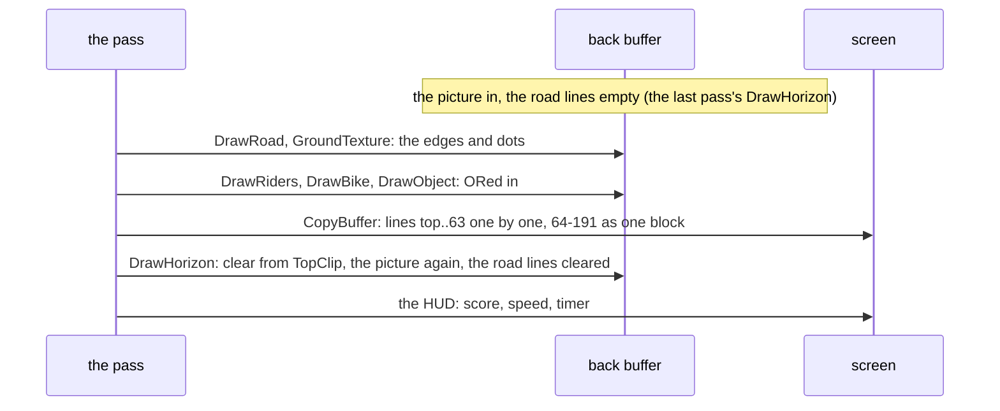

**CopyBuffer `$98F5`.** It starts at the highest line drawn in this pass or the last: the smaller of TopClip `$916C`
and DrawnTop `$916D`. Lines from there to 63 go one at a time, CopyRows with A = 1 (32 `LDI`). Then CopyLower copies
`$EE00-$FDFF` to `$4800-$57FF` in one CopyRows with A = `$80`: 128 turns of 32 `LDI`, 4 096 bytes.

```asm
CopyBuffer:                     ; $98F5
        LD A,(TopClip)
        LD (SavedSp),SP
        LD B,A
        LD A,(DrawnTop)
        CP B
        JR C,l_9904
        LD A,B                  ; A = the higher of the two lines
l_9904: CP $40
        JR NC,BlitMode          ; nothing above line 64
        ...                     ; DE = the screen's line, HL = $EE00 - (64 - top) x 32
l_992A: LD A,$01
        PUSH DE
        CALL CopyRows           ; one line
        POP DE
        ...
BlitMode:
        JR BlitCopyPop          ; the offset is StageParams byte 7, 0 on every stage
CopyLower:
        LD A,$80                ; lines 64-191 in one block
        LD DE,$4800
        LD HL,TrackTables+$0300 ; $EE00, the buffer's line 64
        JP CopyRows
```

BlitCopyPop, a copy through RowTable with `POP`, would run if the offset were not 0. StartRace writes the offset from
StageParams, and it is 0 for all five stages, so the `JR` falls on CopyLower.

**DrawHorizon `$9E7B`: the erase.** Right after the copy, DrawHorizon prepares the buffer for the next pass:

```text
DrawHorizon:
    ClearLines(TopClip .. the picture's top)          # sky lines drawn on this pass
    copy the picture: HorizonRows lines, POP DE + 32 LDI each
    ClearLines(the $C0 - rows - top lines below it)   # 80 on stages 1, 3, 4; 100 on 2; 93 on 5
```

```asm
l_9E9F: POP DE                  ; the line's address from RowTable
        LDI
        ...                     ; 32 LDI: one line of the picture
        DEC A
        JP NZ,l_9E9F
        LD B,$01                ; the count SetHorizon writes: $C0 - rows - top
        ...
        JR ClearLines
ClearLines:
        ...
l_9EF6: LD A,(DE)
        ADD A,$20
        LD L,A
        INC E
        LD A,(DE)
        INC DE
        ADC A,C
        LD H,A                  ; HL = the line's end
        LD SP,HL
        LD L,C
        LD H,C
        PUSH HL                 ; 16 PUSH of 0: 32 bytes cleared backwards
        ...
```

The buffer is never erased sprite by sprite. Every line from TopClip down is rewritten each pass: the sky lines
drawn on, the picture, the 80 lines of the road.

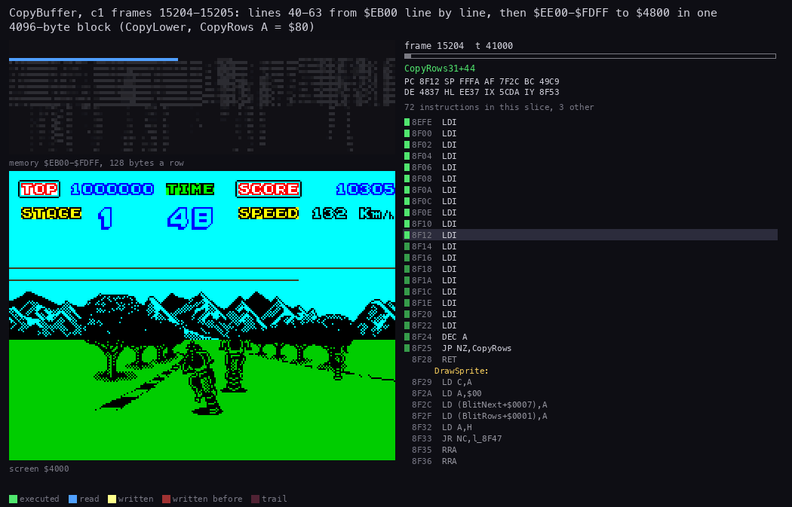

*Animation 6.10: CopyBuffer and CopyRows in `c1`, window 15204:39700-15205:47800. The view is the screen; the memory
map is the buffer `$EB00-$FDFF`. Command: `python3 ../../kit/routine_anim.py --work work/docs/erB/c1 --window
15204:39700-15205:47800 --listing build/game.lst --view screen --range EB00-FDFF --pc 98F5-9950,8EE4-8F28 --pictures 60
--title "..." --out docs/img/routines/CopyBuffer.gif`.*

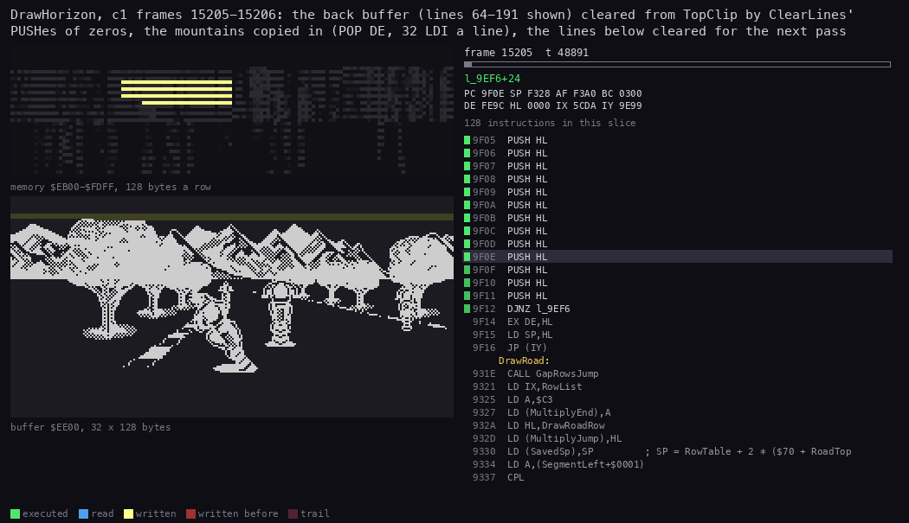

*Animation 6.11: DrawHorizon and ClearLines in `c1`, window 15205:47800-15206:43340. The view is the buffer's lines
64-191. Command: `python3 ../../kit/routine_anim.py --work work/docs/erB/c1 --window 15205:47800-15206:43340 --listing
build/game.lst --view buffer:EE00:32x128:screen --range EB00-FDFF --pc 9E7B-9F17 --pictures 60 --title "..." --out
docs/img/routines/DrawHorizon.gif`.*

What to watch:

- in CopyBuffer, the screen changing in its own order: line 64, 72, 80, ..., then 65, 73, ...;
- in DrawHorizon, the riders and the bike vanishing from the buffer while the mountains come back.

**Against the beam.** CopyLower takes 4 096 × about 19 T, more than a frame. The beam must meet it.

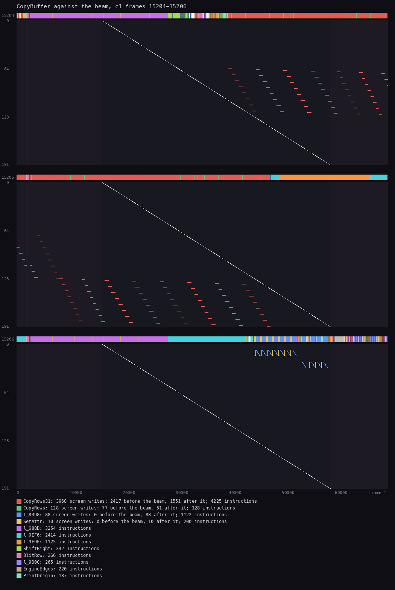

*Figure 6.5: `c1` frames 15 204-15 206 against the 48K beam: each screen write as a dash at its line and T. Command:
`python3 ../../kit/beam_timeline.py --work work/docs/erB/c1 --window 15204:0-15207:0 --listing build/game.lst
--machine 48k --title "..." --out docs/img/render/beam-copy.png`.*

How to read:

- Each band is one frame; the white diagonal is the beam from line 0 to 191.
- The strip on top of each band is the running routine; red is CopyRows31.
- Red dashes are CopyRows31's writes. The saw pattern is the screen's interleave.
- A dash right of the diagonal is written after the beam passed that line: it shows a frame later.

Worked example:

1. The copy starts at 15204:39739, with the beam near line 113.
2. All of frame 15 204's writes (lines 64-127) land after the beam passed: frame 15 204 shows the old picture.
3. Frame 15 205's writes run from T 0 to 47 785, all ahead of the beam: frame 15 205 shows the new picture.
4. The tool counts 3 968 CopyRows31 writes, 2 417 before the beam and 1 551 after.

In this pass the copy and the beam missed each other. The pass is not tied to the frame
([4.6](04-game-loop.md#46-the-free-running-race-loop)), so the copy starts at any T. When it starts in the visible
part, the beam overtakes it, and one frame shows the new road above the old (a tear).

Witness: `beam_timeline.py` over the trace `work/docs/erB/c1/traces/15204_0-15207_0.uatr`; the strip shows `l_9EF6`
(ClearLines) and `l_9E9F` (the picture copy) right after the copy in frame 15 205.

The point: the erase is the next pass's background, drawn whole. There is no dirty list, no mask and no saved
background. The price is the lines below the picture (80 on stages 1, 3 and 4, 100 on stage 2, 93 on stage 5) written twice a
pass and a copy that can tear.

## 6.11 The code against the screen

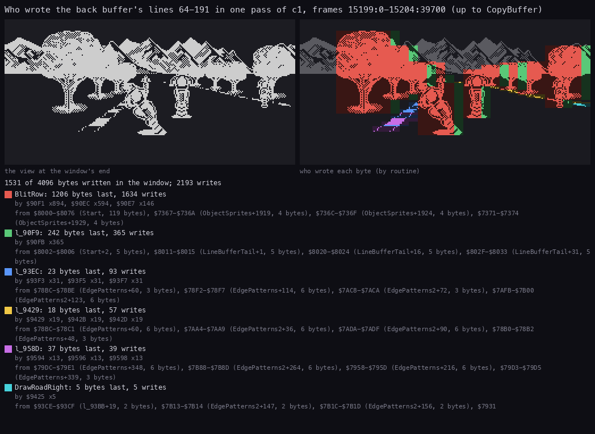

*Figure 6.6: the routine that last wrote each byte of the buffer's lines 64-191 in c1's pass, window
15199:0-15204:39700 (up to CopyBuffer). Command: `python3 ../../kit/writers_map.py --work work/docs/erB/c1 --window
15199:0-15204:39700 --listing build/game.lst --view buffer:EE00:32x128:screen --sources --title "..." --out
docs/img/render/writers-buffer.png`.*

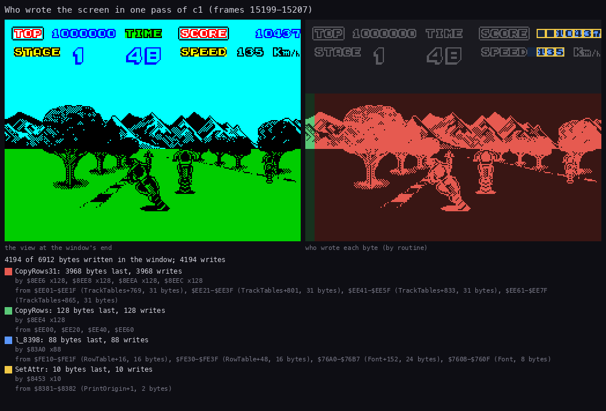

*Figure 6.7: the routine that last wrote each byte of the screen in the whole pass, window 15199:0-15207:0. Command:
`python3 ../../kit/writers_map.py --trace work/docs/erB/c1/traces/15199_0-15207_0.uatr --listing build/game.lst --view
screen --sources --title "..." --out docs/img/render/writers-screen.png`.*

How to read:

- Each colour is a routine. The list gives its writes and the data it read ("from").
- In the buffer: BlitRow (red) drew the trees, the riders and the bike; `l_90F9` (green) the rows' last bytes. The
  road's edges (`l_93EC`, `l_9429`, `l_958D`) show only where nothing covered them.
- The mountains are grey in the buffer map: they were written by the last pass's DrawHorizon, before the window.
- On the screen: CopyRows31 and CopyRows wrote lines 64-191. The HUD's score and speed digits are `l_8398`'s
  (PrintGlyph) and SetAttr's.

Worked example, the screen map's counts:

| Writer | Bytes | What |
| --- | ---: | --- |
| CopyRows31 | 3 968 | 31 `LDI` of each line's 32 |
| CopyRows | 128 | the first byte of each of the 128 lines |
| `l_8398` | 88 | 11 characters of 8 lines: the score and the speed |
| SetAttr | 10 | their attributes |
| total | 4 194 | |

Lines 40-63 were not copied: in this pass no sprite reached above line 64.

The point: below the HUD the screen has one writer, the copy. Everything else happens in the buffer.

## 6.12 Summary

- The race draws lines 40-191 into a back buffer `$EB00-$FDFF`. Lines 64-191 keep the screen's order and go out as
  one 4 096-byte block; lines 40-63 are linear and go one by one.
- RowTable `$FE00` holds every line's address; SetRowTable points it at the buffer or the screen. The sprite, road
  and copy loops pop line addresses from it with SP; the printer and ClearLines read it with HL or DE.
- The road is 128 rows. RoadLines maps rows to lines, RowList lines to rows; RoadTopRow places the list in RowTable.
- Bend is a sideways shift (BendRows); Crest moves RoadLines (the far rows hidden behind the crest).
- DrawRoad writes two pre-shifted 3-byte edges a line; Multiply returns by a patched `JP` because SP is in RowTable.
- GroundTexture adds dots (stage 3) or dashes (stage 5) from the ROM's bytes, at two frames a pass.
- The horizon rotates its own bytes, 1 or 4 pixels at a time, on a bend.
- Sprites are ORed with no mask through one blitter. DrawShifted and DrawMirrored prepare the rows in `$8000`.
- Size is a choice among pre-drawn sprites by row: seven for a rider.
- DrawHorizon rebuilds the buffer from TopClip down after each copy. The copy takes more than a frame and can tear.

Known only from the code in this document:

- stage 5's five extra RowList entries (6.3);
- the 8-pixel shift paths RotateBytesRight and RotateBytesLeft (6.7);
- BlitCopyPop, which no stage selects (6.10);
- DustCarry, the page crossing of DustOffsets (6.9).
