# 7. Objects

What this covers:

- the data that makes a stage: StageTable `$9E67`, StageParams `$A187`, the segment list StageList `$5E80`;
- the track: its commands byte by byte, the pattern calls, and one stretch decoded from the bytes to the objects on
  the road;
- AdvanceTrack and TrackStep, which walk the track as the bike drives;
- the eight object types, their descriptor lists and DrawObject;
- the collision box of each type, and what a hit is;
- the six riders: the record, the start table, the ring they run on, MoveRiders, the jump, the poses, the trucks;
- the game variables, with their addresses and owners.

What each hit does to the bike (the fall, the bounce, the ramp's jump) is the subject of
[doc 10](10-gameplay-logic.md). The drawing itself (DrawSprite, DrawShifted, the back buffer) is
[doc 6](06-rendering.md).

The recordings it rests on ([WALKTHROUGH 6.0](../WALKTHROUGH.md#60-the-recordings)):

- `c1`: power-on on the 48K, the load, the menu, stage 1 to the time-out. It was opened on an own instance, after
  `. work/env.sh`, by
  `python3 ../../kit/rs.py open --work work/docs/erC/c1 --ttd work/stage1/rec/c1/session.ttd --model 48K --port-base 37790`.
  The game state (`$5C80-$5E7F`, `$7C2E-$7C53`, `$9136-$9178`, `$A1C9-$A1CB`) was sampled every second TTD frame from
  14 075 to 19 465 by `python3 work/docs/erC/sample.py work/docs/erC/c1 14075 19465 2
  work/docs/erC/c1-vars.jsonl`. Frames 15 011 to 15 016 were traced (the routine animations of this document).
- `stages`: the five stages with the ZXDB POKEs (immunity to objects and trucks among them), opened the same way at
  port base 37795. The same ranges were sampled every second frame over the whole recording into
  `work/docs/erC/st-vars.jsonl`.
- The build: `build/game.bin` (at `$5B00`) and `build/game.lst`. The track is read from `src/res/track/tables.bin`
  through `tools/res_formats.py`.

A sample of frame N is the memory at the start of frame N. A trace shows an instruction in the frame in which it ran.
A pass is one turn of the main loop: 6 to 12 frames, 8.0 on average ([doc 4](04-game-loop.md)). A "unit" of
distance is one step of the high byte of TrackDistance `$5E29`: ScrollStep `$9136` (SPEED × 14) is added to it each
pass, so a unit is 256 of ScrollStep. A segment is 128 units.

## 7.1 The data map

A stage is built from five tables and two walks.

- StageTable `$9E67` gives each stage its horizon picture.
- StageParams `$A187` gives each stage its road routine, its row builder, its off-road routine and its ground colour.
- StageList `$5E80` gives each stage its segments: one byte a segment, a bend and a rise or dip.
- The track `$60D0` places the roadside objects by distance. Its patterns `$5F0C-$60CF` are called from it.
- ObjectTypes `$975B` gives each object type its sizes by distance. CollisionSizes `$A1B9` gives each its box.
- RiderStarts `$9111` and RiderSprites `$917E` give the six riders their start values and sprites.

Two walks read the track each pass. AdvanceTrack `$AF2E` moves the bike's place along it. ObjectWalk `$A6D9` walks
it again from the bike's place for the drawing and the collisions. The riders are not on the track. They live in
their own records, Riders `$5C80`, and MoveRiders `$A21A` moves them.

The track, its patterns and StageList are not where the loader puts them. Init copies `$EB00-$F0AF` down to `$5E80`
before the first game, so the back buffer can take `$EB00` ([doc 2](02-architecture.md)). All the addresses in this
document are the copy's.

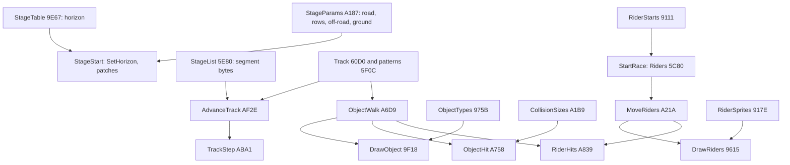

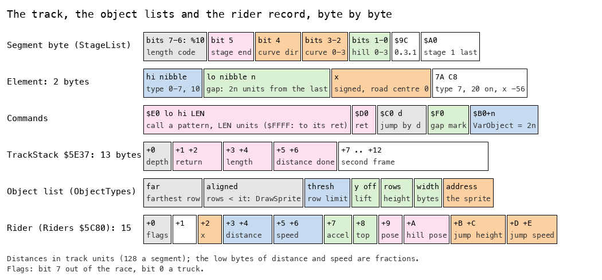

*The data sheets of this document: the segment byte, the track's element and commands, the pattern frame of
TrackStack, an ObjectTypes list entry and a Riders record. Drawn by `python3 tools/fig_objects.py fig-formats
docs/img/objects/formats.png` from the build.*

The point: the game keeps the stage's shape (StageList) and its scenery (the track) apart. A stage can bend where the
scenery repeats, and one pattern of trees serves many stretches.

## 7.2 StageTable and StageParams

### In short

Stage `$5E23` (0-4) picks a 4-byte StageTable entry and a 10-byte StageParams entry. SetHorizon `$9E3A` copies the
horizon's address, its lines and the line under it. StageStart `$A4DA` writes the StageParams routines into three
instructions of the race loop. It also colours the HUD row and the ground.

| Stage | StageTable: horizon, lines, bottom | StageParams: road, rows, off-road | ground attribute | what it gives |
| --- | --- | --- | --- | --- |
| 1 | `$E5E0`, 32, `$50` | DrawRoad `$931E`, RoadRowsCrest `$9CB7`, OffRoad `$A1D9` | `$20` | mountains, green |
| 2 | `$E9E0`, 9, `$53` | the same | `$30` | clouds, yellow sand |
| 3 | `$E2C0`, 25, `$57` | DrawRoad, RoadRowsJump `$999A`, OffRoadSand `$A1F6` | `$28` | dunes, cyan; the ramps and gaps |
| 4 | `$E5E0`, 32, `$50` | as stage 1 | `$70` | mountains, bright yellow |
| 5 | `$E9E0`, 9, `$5A` | RoadNone `$9A91`, RoadRowsCrest, OffRoadStage5 `$A1F5` | not written | clouds, no road drawn |

Bytes 7-9 of each StageParams entry are 0. Byte 7 is BlitMode's JR offset ([doc 6](06-rendering.md)).

### Pseudocode

```text
SetHorizon:
    e = StageTable + 4 * Stage
    HorizonAddr = word(e + 0); HorizonRows = e[2]; HorizonBottom = e[3]
    clear count = $C0 - HorizonRows - HorizonBottom          (patched into the clear loop)

StageStart (each stage, after StageEnd too):
    TimerAtStart = Timer
    SetHorizon; SetTune
    p = StageParams + 10 * Stage
    BlitMode JR = p[7]
    RoadCall CALL = word(p + 0); RowBuilderCall CALL = word(p + 2); OffRoadJump JP = word(p + 4)
    attributes $58A0-$59BF = $68                              (the HUD rows)
    if Stage != 4: attributes $59C0-$5AFF = p[6]               (the ground)
    SplashOn = BendOp = $87 if Stage is odd (stages 2 and 4) else 0
```

### Assembly

```asm
SetHorizon:              ; $9E3A
  LD L,$04
  LD A,(Stage)
  CALL Multiply           ; DE = Stage * 4
  LD IX,StageTable
  ADD IX,DE
  LD L,(IX+$00)
  LD H,(IX+$01)
  LD (HorizonAddr),HL
  LD A,(IX+$02)
  LD (HorizonRows),A
  ...
  LD IX,StageParams       ; in StageStart, $A4E6
  LD A,(Stage)
  LD L,$0A
  CALL Multiply
  ADD IX,DE
  LD A,(IX+$07)
  LD (BlitMode+$0001),A
  LD L,(IX+$00)
  LD H,(IX+$01)
  LD (RoadCall+$0001),HL  ; the CALL nn of the race loop
```

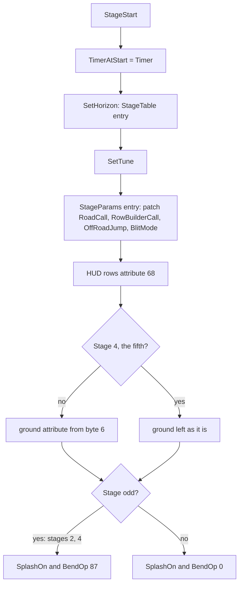

### Worked example and witness

Stage 3 has Stage = 2. Its StageTable entry is at `$9E67 + 8 = $9E6F`: `C0 E2 19 57`. So HorizonAddr is `$E2C0`, the
picture has 25 lines, and the line under it is `$57`. The clear count is `$C0 - 25 - $57 = $50`. Its StageParams
entry is at `$A187 + 20 = $A19B`. Its rows word is `$999A`, RoadRowsJump: the builder that draws the ramps' rows.

The `stages` samples show the values arrive at each stage's first sampled frame:

| Frame | Stage | HorizonAddr `$5CEF` | lines | bottom | StageListPtr |
| --- | --- | --- | --- | --- | --- |
| 0 | 0 | `$E5E0` | 32 | `$50` | `$5E84` |
| 3 346 | 1 | `$E9E0` | 9 | `$53` | `$5EA0` |
| 5 326 | 2 | `$E2C0` | 25 | `$57` | `$5EB7` |
| 7 750 | 3 | `$E5E0` | 32 | `$50` | `$5ED1` |
| 10 130 | 4 | `$E9E0` | 9 | `$5A` | `$5EEC` |
| 12 958 | 5 | `$E9E0` | 9 | `$5A` | `$5F0C` |

At frame 0 the recording is already in stage 1's fifth segment, so StageListPtr is `$5E84`. Stage 5 (Stage = 5) is the
state after the finish: the table is not read again.

The point: the five stages differ only in these two entries, the segments and the track. The race loop is one piece of
code whose three CALL and JP operands are rewritten at each stage.

## 7.3 The segment byte and StageList

### In short

Each segment is one byte of StageList. A stage ends at the byte with bit 5 set. The 140 bytes for the five stages
run from `$5E80` to `$5F0B`. Each segment is 128 units long.

- bits 0-1: stored in Bend `$5E2F`. 0 is straight; 1-3 pick one of three bend profiles (BendProfiles). The value
  shifts each row's centre sideways (BendRows, `$5B80` + row), pushes the bike outward (BikeLateralPush) and scrolls
  the horizon. On screen it is a bend.
- bits 2-3: stored in Crest `$5E31`. 0 is level; 1-3 pick a column of CrestTable that moves the rows' screen lines
  (RoadLines) up or down. On screen it is a rise or a dip: the road stays straight.
- bit 4: BendDir `$5E2D`, the bend's direction (it signs the push and the rows' shift).
- bit 5: the stage's last segment.
- bits 6-7: the length, `$80` on every byte. SegmentDecode stores `b AND $C0` as the operand of the ADD at `$AF80`, so
  the length is that many units.

The source names the two fields after what they do: Bend the bend, Crest the vertical profile (the stage 2 source had
them the other way round, as Hill and Curve).

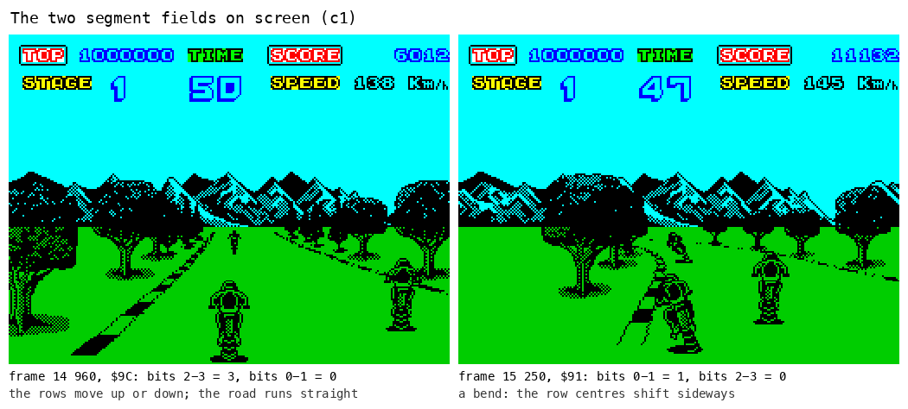

*Two `c1` screens. Left, frame 14 960, segment `$9C` (bits 2-3 = 3, bits 0-1 = 0): the road runs straight. Right,
frame 15 250, segment `$91` (bits 0-1 = 1, bits 2-3 = 0): the road bends. The screens are `python3
../../kit/screen_shot.py --work work/docs/erC/c1 --out-dir work/docs/erC/shots --scale 2 crest=14960 bend=15250`; the
figure is `python3 tools/fig_objects.py fig-fields docs/img/objects/fields.png work/docs/erC/shots/crest.png
work/docs/erC/shots/bend.png`.*

| Stage | Segments | Units | Bits 2-3 (Crest) 0/1/2/3 | Bits 0-1 (Bend: bends) 0/1/2/3 |
| --- | --- | --- | --- | --- |
| 1 | 32 | 4 096 | 20 / 4 / 0 / 8 | 19 / 7 / 6 / 0 |
| 2 | 23 | 2 944 | 11 / 4 / 0 / 8 | 8 / 8 / 5 / 2 |
| 3 | 26 | 3 328 | 26 / 0 / 0 / 0 | 10 / 7 / 7 / 2 |
| 4 | 27 | 3 456 | 13 / 8 / 0 / 6 | 11 / 7 / 5 / 4 |
| 5 | 32 | 4 096 | 13 / 12 / 7 / 0 | 12 / 2 / 13 / 5 |

Stage 3's bits 2-3 are always 0: its rows are built by RoadRowsJump, the stage of the ramps. Value 2 of bits 2-3 is
used only on stage 5. Each stage's course, drawn from these bytes and the track by `tools/course.py`, is in
`src/res/track/` ([course1.png](../src/res/track/course1.png) ... [course5.png](../src/res/track/course5.png)).

### Pseudocode

```text
AdvanceTrack, after the track (each pass):
    SegmentLeft -= ScrollStep
    RowsScrolled = old SegmentLeft.high - new SegmentLeft.high
    if SegmentLeft did not go below 0 and SegmentLeft.high != 0: return
    SegmentLeft.high += length of the segment ($80)
    in a demo: DemoMode -= 1; at 0 the demo ends
NextSegment:
    Segments += 1
    b = *StageListPtr; StageListPtr += 1
    if b bit 5: StageEnd
SegmentDecode:
    CrestPrev = Crest; if CrestPrev == 0: RoadRowsFlat
    Crest = (b >> 2) AND 3
    BendPrev = Bend; if BendPrev == 0: ClearBendRows
    Bend = b AND 3
    the length operand = b AND $C0
    if bit 4 changed: BendDir = bit 4; SetBendDir patches 8 branch opcodes
```

### Assembly

```asm
NextSegment:             ; $AF97
  LD HL,Segments
  INC (HL)
  LD HL,(StageListPtr)
  BIT 5,(HL)              ; the segment just passed was the last
  INC HL
  LD (StageListPtr),HL
  JP NZ,StageEnd
SegmentDecode:           ; $AFA7
  LD A,(Crest)
  LD (CrestPrev),A
  AND A
  CALL Z,RoadRowsFlat
  LD HL,(StageListPtr)
  LD A,(HL)
  PUSH AF
  RRA
  RRA
  AND $03
  LD (Crest),A
  ...
  LD A,B
  AND $C0
  LD (l_AF80+$0001),A     ; the next segment's length
```

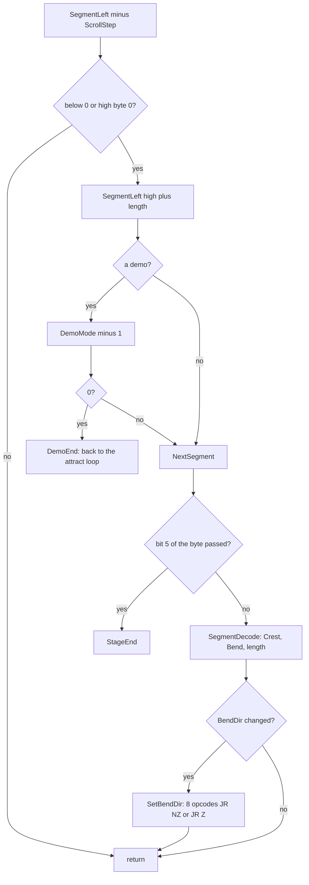

### Worked example and witness

Stage 1 starts `80 80 9C 9C 91 95 90 94`. The third byte `$9C` is `%1001 1100`: Bend 0, Crest 3, BendDir 1, length
`$80`. The text form in `src/res/track/stage1.txt` writes it `0.3.1`. The fifth, `$91`, is Bend 1 and Crest 0: a bend
to the BendDir 1 side on level ground. The samples show the decode: Crest 3 from 14 861 and Bend 1 from 15 139.

In `c1`, SegmentLeft starts at `$8000` with StageListPtr `$5E80`. At frame 14 631 (pass 171) it is `$03C0` and
ScrollStep is `$0348` (60 km/h). The next pass leaves `$03C0 - $0348 = $0078`: its high byte is 0, so the segment
ends. SegmentLeft becomes `$0078 + $8000 = $8078` and StageListPtr `$5E81`: the sample of 14 639 shows both. The
second byte is `$80` again, so nothing else changes. StageListPtr then steps every 128 units: `$5E82` at 14 867,
`$5E83` at 15 013, `$5E84` at 15 139.

The point: one byte a segment keeps a 4 096-unit stage in 32 bytes. The road builder needs only the bend and the
vertical profile; everything else on the road comes from the track.

## 7.4 The track: commands byte by byte

### In short

The track is a byte stream at `$60D0`, with patterns in front of it at `$5F0C-$60CF`. The high nibble of a byte is the
command. An element (an object on the roadside) is two bytes. A pattern call is five. The walk places each element a
distance after the previous one: the low nibble × 2 units.

| Bytes | Command | Meaning |
| --- | --- | --- |
| `TL XX` (T 0-7 or `$A`) | element | an object of type T (`$A`: the type in VarObject), at x = XX (signed, 0 the road's centre), L × 2 units after the previous element |
| `E0 lo hi LL HH` | call | run the pattern at `hi lo` until LLHH units are driven; `$FFFF` until its `D0` |
| `D0` | ret | back to the caller |
| `C0 d` | jump | to the address after it plus d (signed) |
| `F0` | mark | a gap's end on stage 3: the element's row goes to GapMarks `$5E33` |
| `B0+n` | var | VarObject `$5E36` = 2n (the type × 2 that element `$A` uses) |

The pattern frame lives in TrackStack `$5E37`. Byte 0 is the depth. Each open call has six bytes: the return address,
the length, the distance done.

The track as text, with every pattern, is `src/res/track/patterns.txt` and `stage1.txt` ... `stage5.txt`
(`tools/res_formats.py` writes and reads them).

### Pseudocode

```text
TrackStep(HL = the element passed, IX = a track stack), returns HL = the next element:
    HL += 2
    loop:
        c = *HL AND $F0
        if c == $F0: the gap mark: GapMarks gets the element's row; HL += 1
        elif c == $E0: push frame(return = HL + 5, length = word(HL + 3), done = 0); HL = word(HL + 1)
        elif c == $D0: HL = the frame's return; depth -= 1
        elif c == $C0: HL += 2 + signed(HL[1])
        elif c == $B0: VarObject = 2 * (*HL AND 15); HL += 1
        else:                                         an element
            gap = 2 * (*HL AND 15)
            for each open frame, innermost first:
                done += gap
                if done >= length: HL = the frame's return; close it; continue the loop
            return HL
```

The element whose gap brings a call's count to its length is not placed. The walk returns to the caller from it, and
the caller's next element takes its place.

### Assembly

```asm
TrackStep:               ; $ABA1
  INC HL
l_ABA2:
  INC HL
l_ABA3:
  LD A,(HL)
  AND $F0
  CP $F0                  ; the gap mark
  JR NZ,l_ABC8
  ...
l_ABC8:
  CP $E0                  ; call: a frame of return, length, done
  JR NZ,l_ABFE
  ...
l_AC3D:
  LD A,(HL)               ; an element: the distance into the open patterns
  AND $0F
  ADD A,A
  LD D,A
  LD A,(IX+$00)
  LD B,A
  AND A
  RET Z                   ; no pattern open
  ...
l_AC52:
  LD A,(IX+$05)
  ADD A,D                 ; done += gap
  LD (IX+$05),A
  JR NC,l_AC5E
  INC (IX+$06)
l_AC5E:
  LD A,(IX+$04)
  CP (IX+$06)
  JR C,l_AC70             ; done above the length: return to the caller
  JR NZ,l_AC7F
  LD A,(IX+$05)
  CP (IX+$03)
  JR C,l_AC7F
l_AC70:
  LD L,(IX+$01)
  LD H,(IX+$02)
  ...
  JP l_ABA3               ; read the caller's next command
```

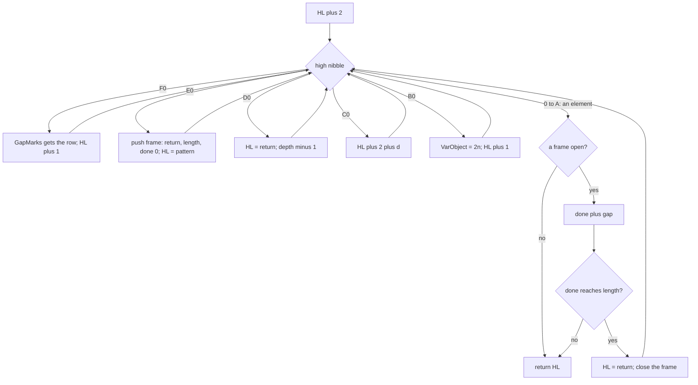

### Worked example: stage 1's first 1 024 units

The track starts at `$60D0`:

| Address | Bytes | Command | Where the walk places it |
| --- | --- | --- | --- |
| `$60D0` | `20 80` | element: type 2 (a fir) at x = −128, gap 0 | 0 |
| `$60D2` | `B2` | VarObject = 4: element `$A` is a fir (type 2) | |
| `$60D3` | `E0 BA 60 80 01` | call `$60BA` for `$0180` = 384 units | counts from 0 |
| `$60D8` | `E0 5F 5F C0 00` | call `$5F5F` for 192 units | counts from 380 |
| `$60DD` | `E0 BA 60 40 01` | call `$60BA` for 320 units | counts from 564 |
| `$60E2` | `E0 10 5F FF FF` | call `$5F10` until its `D0` | counts from 864 |
| `$60E7` | `E0 51 5F 80 01` | call `$5F51` for 384 units | counts from 976 |

The pattern `$60BA` is three commands:

| Address | Bytes | Command |
| --- | --- | --- |
| `$60BA` | `7A C8` | type 7 (a tree) at x = −56, 20 units after the previous element |
| `$60BC` | `70 3A` | type 7 at x = +58, beside it (gap 0) |
| `$60BE` | `C0 FA` | jump −6: to `$60BA` |

So the call at `$60D3` lines the road with pairs of trees, 20 units apart: at 20, 40, ... 380. Its count takes 20 at
each left tree, so at the 19th pair it is 380. The 20th left tree would be at 400 and make the count 400, at least
384: the walk returns to `$60D8` from it. That tree is not placed, and the next call counts from the last pair, 380,
not 384. The pattern `$5F5F` is four elements of type `$A` (`A4 C4`, `A4 3E`, `A4 CA`, `A4 38`) and a jump back. With
VarObject 4 they are firs at x = −60, +62, −54, +56, 8 units apart: the first at 388.

Each call is cut the same way. The text's distances add the calls' lengths: 384, 576, 896, 1 008. The walk's are 380,
564, 864, 976. The difference grows by up to one gap at each call.

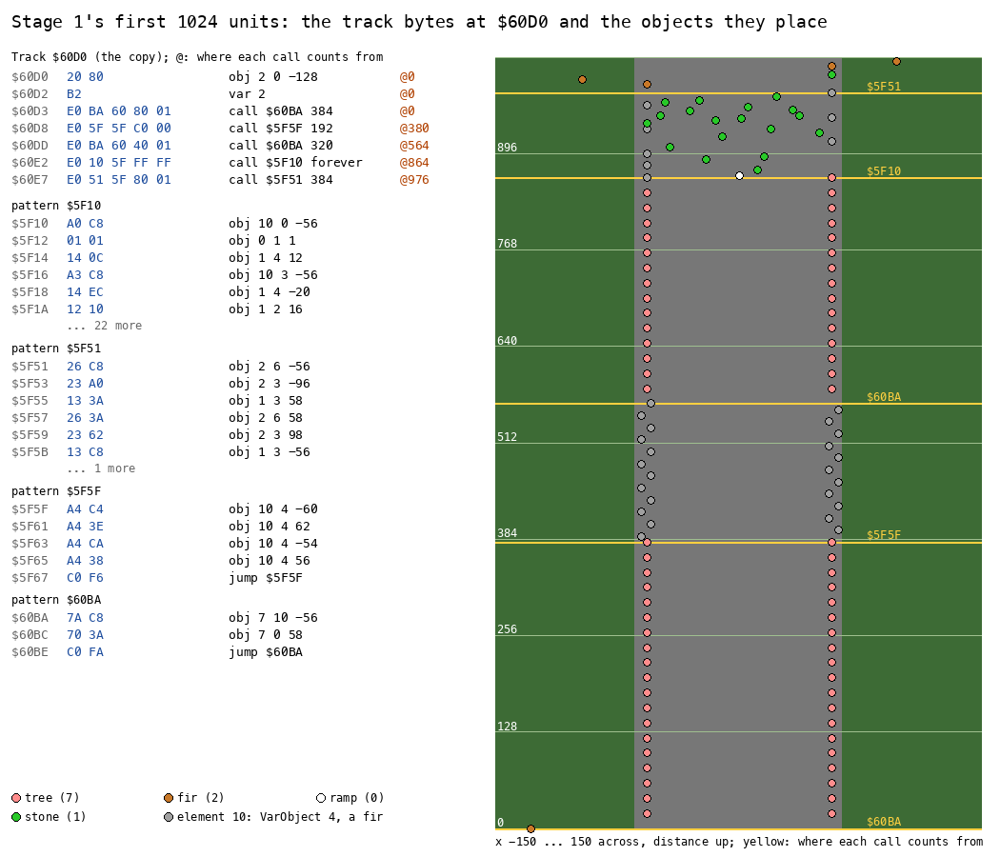

*Left: the track at `$60D0` and the four patterns it calls, as bytes and as commands; "@" is the distance at which
the walk starts each call. Right: every element of the stretch, placed as TrackStep places them (distance up, x
across). Drawn by `python3 tools/fig_objects.py fig-stretch docs/img/objects/stretch.png`, which walks the track by
TrackStep's rules (`game_walk`).*

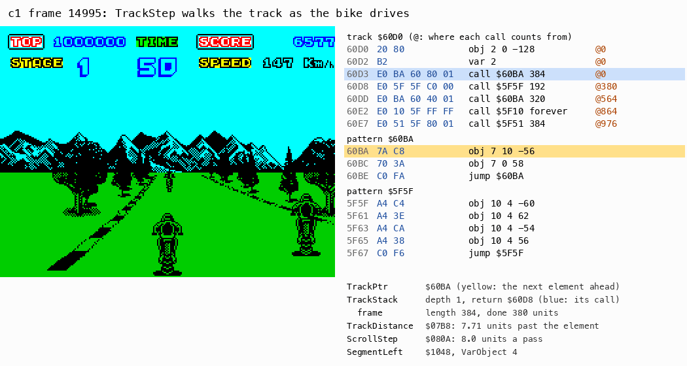

*The stretch decoded as `c1` drives it. Left: the screen. Right: the bytes, with TrackPtr's element in yellow and the
open call in blue; under them TrackStack's frame, TrackDistance, ScrollStep and SegmentLeft. Recording `c1`, frames
14 995 to 15 195, every fourth frame. The screens are `python3 ../../kit/screen_anim.py --work work/docs/erC/c1 --from
14995 --to 15195 --step 4 --width 512 work/docs/erC/stretch-screen.gif`; the panel is `python3 tools/fig_objects.py
anim-stretch work/docs/erC/stretch-screen.gif 14995 4 work/docs/erC/c1-vars.jsonl docs/img/play/stretch-decode.gif`.*

### Witness

The `c1` samples of TrackPtr and TrackStack (`$5E37`, 13 bytes) at the switch:

| Frame | TrackPtr | TrackStack | Reading |
| --- | --- | --- | --- |
| 14 213 | `$60BA` | `01 D8 60 80 01 14 00` | depth 1, return `$60D8`, length 384, done 20 |
| 15 002 | `$60BA` | `01 D8 60 80 01 7C 01` | done 380: the 19th pair is next |
| 15 012 | `$5F5F` | `01 DD 60 C0 00 08 00` | the next call: return `$60DD`, length 192, done 8 |

The bike's own distance confirms the 380. At 15 013, StageListPtr `$5E83` and SegmentLeft `$7FE0` put the bike at
`3 × 128 + (128 − $7F.E0) = 384.12` units. TrackDistance is `$0420`: 4.12 units past the last element reached. So that
element, the 19th right tree, is at 380.00, and the fir at TrackPtr `$5F5F` is 8 units on, at 388. The same sum at
15 617 puts the element before `$5F51` at 976.00.

The point: the track is a tiny program. Twelve bytes of the main stream and three patterns describe a kilometre of
scenery. A call's length is a budget, not a measure, and the text's distances are the budget's sum.

## 7.5 AdvanceTrack: the bike's place on the track

### In short

AdvanceTrack `$AF2E` runs once a pass. It adds ScrollStep to TrackDistance. TrackPtr points at the next element
ahead. TrackDistance's high byte is how far the bike is past the element before it. While that is more than the next
element's gap, the bike has passed it: TrackStep moves TrackPtr on. The gaps passed are taken off TrackDistance. Then
the segment counts down (7.3).

### Pseudocode

```text
AdvanceTrack:
    BikeRoadPlace
    TrackDistance += ScrollStep
    b = TrackDistance.high
    gap = 2 * (*TrackPtr AND 15)
    if gap < b:
        c = 0
        repeat:
            c += gap
            HL = TrackStep(HL, TrackStack)
            gap = 2 * (*HL AND 15)
        until c + gap >= b
        TrackPtr = HL
        TrackDistance.high = b - c
    the segment (7.3)
```

### Assembly

```asm
AdvanceTrack:            ; $AF2E
  CALL BikeRoadPlace
  LD DE,(ScrollStep)
  LD HL,(TrackDistance)
  ADD HL,DE
  LD (TrackDistance),HL
  LD B,H                  ; units past the element
  LD HL,(TrackPtr)
  LD A,(HL)
  AND $0F
  ADD A,A                 ; its gap
  CP B
  JR NC,l_AF6B            ; not past the next one
  PUSH DE
  LD IY,(GapMarks)
l_AF4C:
  LD C,A
  PUSH BC
  LD IX,TrackStack
  CALL TrackStep
  POP BC
  LD A,(HL)
  AND $0F
  ADD A,A
  ADD A,C
  CP B
  JR C,l_AF4C
  LD (TrackPtr),HL
  LD A,B
  SUB C
  LD (TrackDistance+$0001),A
```

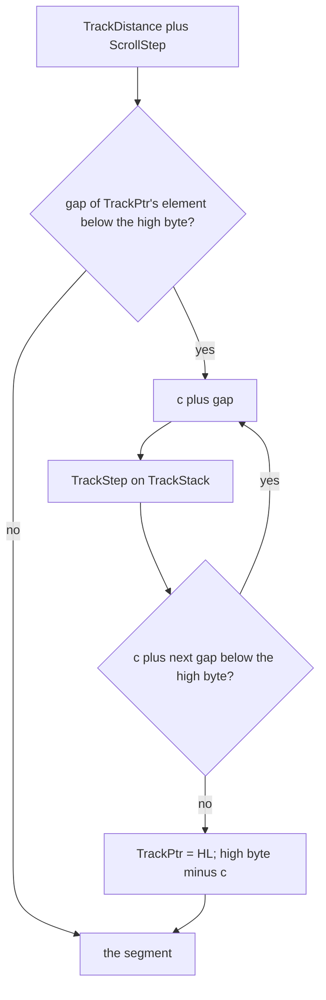

### Worked example and witness

At 199 km/h ScrollStep is `199 × 14 = 2786 = $0AE2`: 10.9 units a pass. In the fir pattern the gaps are 8, so a pass
passes one or two elements. In `c1` at frame 15 011 the trace shows AdvanceTrack at T 14 775 and two TrackSteps, at
T 15 448 and 15 938. The first moves from the 19th left tree to the right tree beside it. The second meets the 20th
left tree, returns from the tree call and calls `$5F5F`.

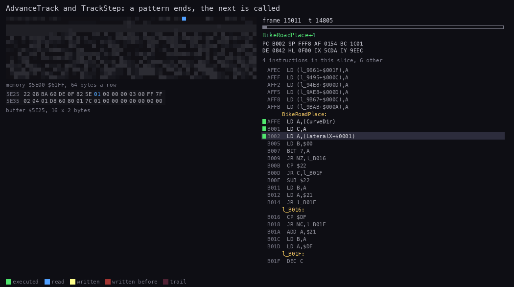

*AdvanceTrack and TrackStep in frame 15 011 of `c1`, with the bytes `$5E25-$5E44` (SegmentLeft to TrackStack) under
the memory map: the frame's return changes from `$60D8` to `$60DD`. Command: `python3 ../../kit/routine_anim.py --work
work/docs/erC/c1 --window 15011:14700-15011:20950 --listing build/game.lst --pc AF2E-B07C,ABA1-AC87 --view
buffer:5E25:16x2:hex --range 5E00-61FF --pictures 60 --out docs/img/routines/TrackStep.gif`.*

The point: the bike never sees the track as distances. It sees one pointer and a remainder, and the track's gaps are
spent from the remainder.

## 7.6 The object types and DrawObject

### In short

There are eight object types. ObjectTypes `$975B` holds a pointer to each type's descriptor list. A list starts with
two bytes: the farthest row drawn and the row below which the sprite is drawn byte-aligned. Then come 6-byte entries,
nearest first: the row threshold, the y offset, the rows, the width in bytes, the sprite's address. The entry is the
first whose threshold is above the element's row.

The element's row is its distance from the bike in units (0 at the bike). ObjectWalk `$A6D9` walks the track again
from TrackPtr, on a copy of TrackStack (DrawStack `$5CDA`). Each element's row is the previous one's plus its gap; the
first starts from −TrackDistance's high byte. The walk stops at the first element at row `$80` or more. Each
element is handed to DrawObject `$9F18` with its row and x. A type 0 element (a ramp) also leaves its row in
JumpRows `$5CF5` for the riders.

| Type | Looks like | Sizes | Rows drawn | Byte-aligned at rows below | Collision box (half width × height) |
| --- | --- | --- | --- | --- | --- |
| 0 | a ramp | 8 | 0-105 | 32 | 32 × 1 |
| 1 | a stone | 7 | 0-49 | 1 | 5 × 6 |
| 2 | a fir | 9 | 0-127 | 36 | 10 × 32 |
| 3 | a palm | 8 | 0-110 | 36 | 8 × 32 |
| 4 | a shrub | 6 | 0-64 | 12 | 14 × 8 |
| 5 | a cactus | 9 | 0-127 | 9 | 8 × 24 |
| 6 | a rock spire | 7 | 0-85 | 26 | 11 × 12 |
| 7 | a broad tree | 8 | 0-109 | 50 | 11 × 30 |

The names are the pictures' look; the code has only numbers. The lists lie in memory in the order 4, 5, 1, 6, 2, 0,
3, 7 (`$976B` to `$98BD`). The table is `src/res/tables/objects.csv`.

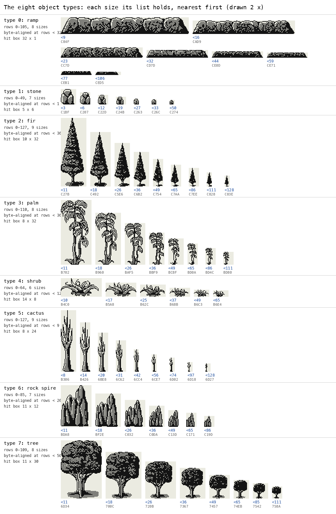

*Every sprite of every list, drawn from the build at twice the size, with its row threshold ("<11": rows below 11)
and its address. Drawn by `python3 tools/fig_objects.py fig-types docs/img/objects/types.png`.*

### Pseudocode

```text
ObjectWalk (each pass):
    JumpRows = $FF $FF $FF $FF; GapMarks = $7F $7F
    DrawStack = TrackStack
    c = (ScrollStep + TrackDistance).high + 1        the rows the bike covers this pass
    b = -TrackDistance.high                           the row of the element passed last
    HL = TrackPtr
    loop:
        b += 2 * (*HL AND 15)                         this element's row
        if b >= $80: RiderHits; leave
        t = (*HL >> 4) * 2; if t == $14: t = VarObject
        if t == 0: append b to JumpRows
        DrawObject(row b, x HL[1], list ObjectTypes[t])
        ObjectHit (7.7)
        HL = TrackStep(HL, DrawStack)

DrawObject(row A, x B, list IX):
    if A >= list.far: return
    draw = DrawSprite if A < list.aligned else DrawShifted
    entry = the first with A < threshold
    line = RoadLines[A]; x = the row's centre +/- B * RowScale[A] + the bend's shift (BendRows)
    the part above line 40 cut; TopClip raised
    draw(entry)
```

### Assembly

```asm
DrawObject:              ; $9F18
  CP (IX+$00)             ; the farthest row
  RET NC
  LD IY,DrawShifted
  CP (IX+$01)             ; the aligned row
  JR NC,l_9F29
  LD IY,DrawSprite        ; nearer: byte-aligned
l_9F29:
  INC IX
  INC IX
  LD DE,$0006
l_9F30:
  CP (IX+$00)             ; the entry's threshold
  JR C,l_9F39
  ADD IX,DE
  JR l_9F30
l_9F39:
  LD L,A
  LD H,$5C
  LD A,(HL)               ; the row's screen line
  ...
  JP (IY)
```

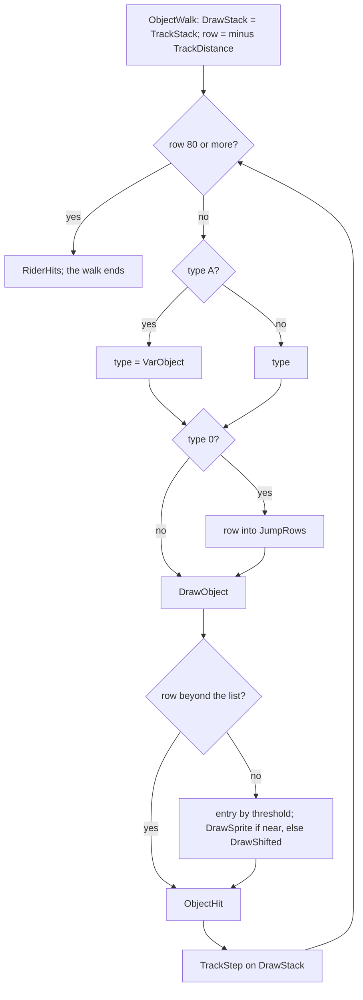

### Worked example and witness

A broad tree (type 7) on row 30 at x = −56. Its list is at `$98BD`: far 110, aligned 50. Row 30 is below 110, so it
is drawn, and below 50, so DrawSprite draws it byte-aligned. The thresholds run 11, 18, 26, 36: the fourth entry is the
first above 30. It is `$7367`: 48 rows, 5 bytes wide, lifted 19 lines. On row 40 the same tree takes the fifth entry,
`$7457`: 37 rows, 4 bytes.

In `c1` frame 15 015 the walk starts at T 42 691 and DrawObject runs three times (T 43 602, 67 727, 69 258). The first
reaches its JP (IY) at T 44 525 and goes to DrawSprite `$8F29`.

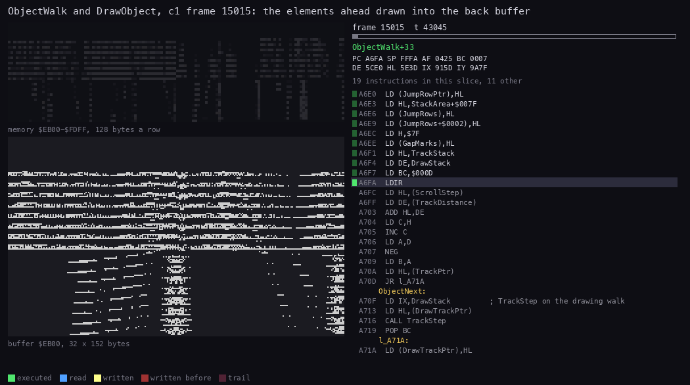

*ObjectWalk and DrawObject in frame 15 015 of `c1`, with the back buffer `$EB00` as 32 × 152 bytes under the memory
map; the sprite routines show as "other". Command: `python3 ../../kit/routine_anim.py --work work/docs/integrate/c1 --window
15015:42600-15015:69300 --listing build/game.lst --pc 9F18-A0AF,A6D9-A839 --view buffer:EB00:32x152:rows --range
EB00-FDFF --pictures 60 --title "..." --out docs/img/routines/ObjectWalk.gif`.*

The point: the near sprites, the big ones, are drawn byte-aligned. They move many pixels a pass, so the lost 0-7 pixels
do not show, and the shift is saved where it costs most.

## 7.7 Collisions with objects

### In short

ObjectHit `$A758` tests each element the walk draws. The element must be on the bike's rows this pass: its row plus
TrackDistance's high byte below C, the rows the bike covers. The bike must be moving and not getting up. Then two
tests use the type's CollisionSizes entry (half width, height).

- Height: on the ground the test passes. In the air the jump height minus the road's line must be below the height.
- Width: d = |BikeHitX − (x + `$80`)| must be below the half width.

A ramp (type 0) then makes the jump ([doc 10](10-gameplay-logic.md)). Any other type is a bounce or a fall. It is
head-on when 2d is below the half width: then a fall at SPEED 35 or more, else a bounce. A side-on hit is always a
bounce. The bounce's direction E is 8 when the bike is right of the object and 4 when left.

BikeHitX `$A1CB` is the bike's x in the same scale: `$82` minus LateralX × `$C0` / 256.

### Pseudocode

```text
ObjectHit(element HL, row b):
    if TrackDistance.high + b >= c: return           not on the bike's rows
    if SPEED == 0: return
    t = the type; box = CollisionSizes[t]
    h = JumpHeight.high; if h: h -= RoadLines[0]
    if h >= box.height: return                       over it
    if GetUp: return
    d = BikeHitX - (x + $80); E = 8; if d < 0: d = -d; E = 4
    if d >= box.half_width: return                   beside it
    if t == 0: Ramp; return
    if DemoMode: return
    if 2 * d < box.half_width and SPEED >= 35: PlayEffect 1; Crash
    else: BounceTime = 3, BounceDir = E; PlayEffect 2; CrashSound
```

### Assembly

```asm
ObjectHit:               ; $A758
  PUSH BC
  LD A,(TrackDistance+$0001)
  ADD A,B
  CP C                    ; on the bike's rows this pass?
  JR NC,ObjectNext
  ...
  LD A,(BikeHitX)
  SUB E                   ; E = x + $80
  LD E,$08
  JR NC,l_A7A7
  LD E,$04
  NEG
l_A7A7:
  CP (IX+$00)             ; the half width
  JP NC,ObjectNext
  EX AF,AF'
  JR Z,Ramp               ; type 0
  ...
  ADD A,A
  CP (IX+$00)
  JR C,l_A7CF             ; head-on
Bounce:
  LD L,$03
  LD H,E
  LD (BounceTime),HL
```

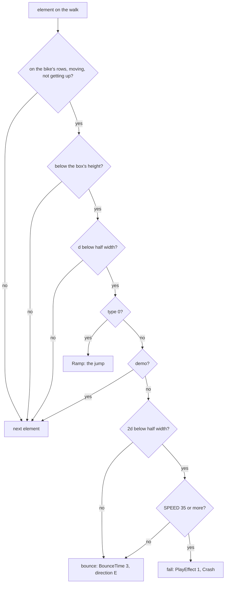

### Worked example

A fir (type 2: half width 10, height 32) at x = −56 is at `$48` in the hit scale. With the bike on the ground at
BikeHitX `$4C`, d = 4. 4 is below 10, so it is a hit. 2 × 4 = 8 is below 10, so it is head-on. At SPEED 120 that is
a fall. With BikeHitX `$52`, d = 10 and the fir is missed. With BikeHitX `$50`, d = 8: a hit, 16 is not below 10, so
a side-on bounce, E = 8 (the bike is to the right).

A stone (type 1) has a half width of 5: only a bike within 4 of its x hits it, and within 2 head-on.

### Witness

The c1 run falls at frame 15 843 and bounces off objects; [doc 10](10-gameplay-logic.md) shows each. The `stages`
recording runs with the ZXDB immunity POKE 42971,1, which turns ObjectHit's `CALL Crash` into `LD BC,nn`: there every
head-on hit plays PlayEffect 1 and the bike rides on.

The point: one box test, with two outcomes chosen by how central the hit is and by the speed. A slow rider never
falls.

## 7.8 The riders and the trucks

### In short

Riders `$5C80` holds six 15-byte records. Riders 0-3 are bikes. Riders 4 and 5 are the second kind (flags bit 0): they
are drawn with pose 4, a truck. StartRace fills the records from RiderStarts `$9111` at a new turn.

| Offset | Field |
| --- | --- |
| +0 | flags: bit 7 out of the race, bit 0 a truck |
| +2 | x, signed, the road's centre 0 |
| +3, +4 | distance: +4 is the row (0 at the bike, drawn below `$50`) |
| +5, +6 | speed, units a pass (8.8) |
| +7 | acceleration, added to the speed's low byte each pass |
| +8 | top speed (the speed's high byte) |
| +9 | pose: 3 on the straight, 2 and 1 in a bend, 0 in the air |
| +`$A` | the lowest pose in a bend |
| +`$B`, +`$C` | jump height (8.8) |
| +`$D`, +`$E` | jump speed (8.8) |

| Rider | x | Acceleration | Top speed | As SPEED | Lowest bend pose | In the race |
| --- | --- | --- | --- | --- | --- | --- |
| 0 | +15 | 20 | 10 | 183 km/h | 2 | always |
| 1 | −15 | 24 | 7 | 128 km/h | 2 | always |
| 2 | +30 | 12 | 5 | 91 km/h | 1 | always |
| 3 | −30 | 13 | 6 | 110 km/h | 1 | always |
| 4, truck | +20 | 20 | 7 | 128 km/h | 0 | from stage 2 |
| 5, truck | −20 | 20 | 6 | 110 km/h | `$3A` | from stage 4 |

"As SPEED" is the top speed in the bike's terms: units × 256 / 14. Rider 5's last two bytes are past RiderStarts'
22 bytes: they are BikePoses' first entry, 6 and `$3A`. A lowest pose of `$3A` means the truck never leans.

StartRace sets the flags by the stage. Both trucks are out (`$81`) on stage 1. Rider 4 is in (`$01`) from stage 2,
rider 5 from stage 4. In a demo both are in. The trucks start at row `$C0`, the others at row 0, beside the bike.

### The ring

The row is one byte. A rider the bike overtakes goes below 0 and wraps to 255. A rider that runs away goes past 255
and wraps to 0. So the six records are a ring of 256 rows around the bike. The same four bikes are met again and
again: a rider the bike laps comes back from the horizon. A truck slower than the bike passes it every 256 / (bike −
truck) passes.

### Pseudocode

```text
MoveRiders (each pass), for each rider not out:
    if in the air:
        height += jump speed; jump speed -= $02F0
        if height.high >= $F0: pose = 3; height = 0           landed
    elif row < $50:
        for each ramp row r in JumpRows (up to 4, $FF ends):
            if r >= row:
                if (distance + speed).high > r:                passes the ramp this pass
                    height = jump speed = $0C00 ($0900 a truck); pose = 0
                break
    speed += acceleration; if speed.high >= top: speed = top.00
    distance += speed - ScrollStep
    if on the ground:
        if row >= $80: next rider
        bend = BendPrev if row < SegmentLeft.high else Bend      the bend at the rider's row
        if bend: if pose > lowest: pose -= 1
        elif 0 < pose < 3: pose += 1
```

### Assembly

```asm
MoveRidersLoop:          ; $A220
  LD HL,Riders
  EXX
  BIT 7,(IX+$00)          ; out of the race
  JP NZ,l_A2F9
  LD A,(IX+$0C)           ; in the air?
  AND A
  JR Z,l_A259
  ...
  LD HL,BackBuffer+$0750  ; $FD10: minus $02F0
  ADD HL,DE
  LD (IX+$0D),L           ; jump speed
  LD (IX+$0E),H
  ...
l_A294:
  LD L,(IX+$05)
  LD H,(IX+$06)
  LD C,(IX+$07)
  LD B,$00
  ADD HL,BC               ; speed + acceleration
  LD A,H
  CP (IX+$08)             ; top speed
  JR C,l_A2AB
  LD H,(IX+$08)
  LD L,$00
l_A2AB:
  ...
  ADD HL,DE               ; + distance
  LD DE,(ScrollStep)
  SBC HL,DE               ; - the bike's step
```

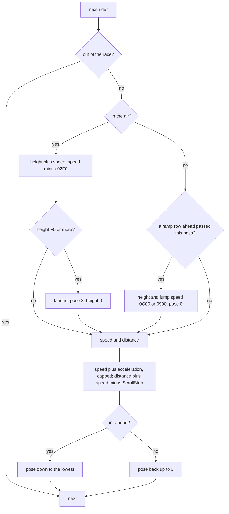

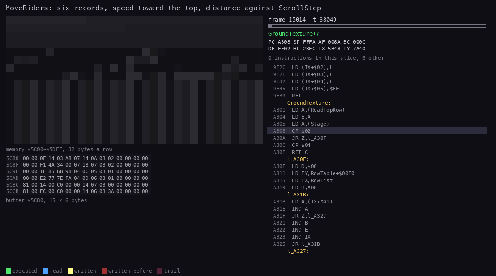

*MoveRiders in frame 15 014 of `c1`, with the six records as a 15 × 6 hex view: rider 0 at the top, the trucks
(`$81`) out. Command: `python3 ../../kit/routine_anim.py --work work/docs/erC/c1 --window 15014:38000-15014:40900
--listing build/game.lst --pc A21A-A2FF --view buffer:5C80:15x6:hex --range 5C00-5DFF --pictures 60 --out
docs/img/routines/MoveRiders.gif`.*

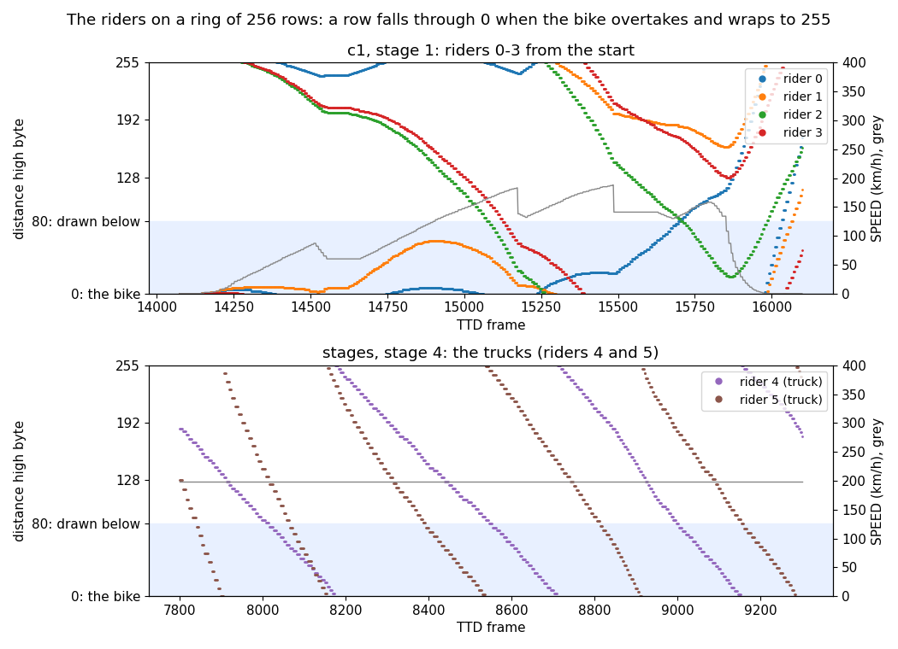

*Top: the four bikes in `c1` from the countdown, with SPEED in grey. All start at row 0 beside the bike. Rider 0 (top
speed 10) stays near; riders 2 and 3 fall behind and wrap to 255 at once. Bottom: stage 4 in `stages`, the bike at
199 km/h: both trucks fall through row 0 and come back from 255, rider 5 (top 6) faster than rider 4 (top 7). Drawn by
`python3 tools/fig_objects.py fig-ring docs/img/objects/ring.png work/docs/erC/c1-vars.jsonl
work/docs/erC/st-vars.jsonl`.*

### Worked example: rider 0's jump in c1

At frame 15 475 rider 0 is on row 22 at speed `$0A00`, and JumpRows holds `$19`: a ramp on row 25. The rider's
distance plus speed is row 32, past 25, so it jumps. Height and jump speed are `$0C00`, pose 0. Each pass then adds
the speed to the height and takes `$02F0` from the speed:

| Pass | Height | Jump speed |
| --- | --- | --- |
| 14 | `$0C00` | `$0C00` |
| 15 | `$1800` | `$0910` |
| 16 | `$2110` | `$0620` |
| 17 | `$2730` | `$0330` |
| 18 | `$2A60` | `$0040` |
| 19 | `$2AA0` | `$FD50` |
| 20 | `$27F0` | `$FA60` |
| 21 | `$2250` | `$F770` |
| 22 | `$19C0` | `$F480` |
| 23 | `$0E40` | `$F190` |

The next pass makes the height `$FFD0`: its high byte is `$FF`, at least `$F0`, so the rider lands with pose 3. The
jump is 10 passes, about 80 frames, and its top is 42 lines. A truck's jump starts at `$0900`: 8 passes, 27 lines.
The table is the `c1` samples (pass = PassCount `$7C2E` − 1 at those frames); the simulation of the formula gives the
same heights.

### The poses and the sprites

DrawRiders `$9615` picks the band by row: the first of the seven thresholds 5, 11, 18, 26, 36, 55, 80 above the row.
The pose picks one of the band's five descriptors (4 for a truck). A descriptor is rows, width, address. Bit 7 of the
width: drawn byte-aligned (DrawSprite). Bit 7 of the rows: never mirrored. A descriptor without it is mirrored
(DrawMirrored) when BendDir is 1, so the rider leans into the bend.

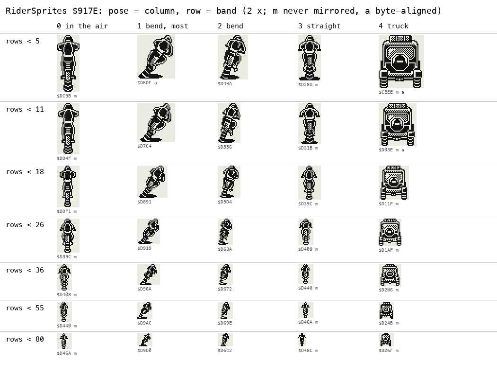

*Every rider sprite, at twice the size, with its address and flags. The in-air pose (0) uses the straight pose's sprite
one band nearer: a jumping rider looks bigger. Drawn by `python3 tools/fig_objects.py fig-riders
docs/img/objects/riders.png`.*

### Hitting a rider

RiderHits `$A839` runs when the walk ends. It skips everything while the bike is in the air, getting up or in a demo.
A rider is hit when its row is not above ScrollStep's high byte, the bike's step is at least the rider's speed (the
bike runs into it from behind), and the rider is on the ground. Then the x test:

- a truck within 9 of BikeHitX: PlayEffect 1 and Crash, a fall at any speed;
- a bike within 5: a bounce (BounceTime 3) and SPEED − SPEED / 4.

[Doc 10](10-gameplay-logic.md) shows an overtake and its bounce.

The point: four bikes and two trucks fill a race. The ring makes six records look like a field of riders, and the
speeds make some fall behind and one keep pace.

## 7.9 The game variables

The race state lives in four places. The player block `$5E0D-$5E44` is the current player's: TurnLoop swaps it with
OtherPlayer `$5E45` in a two-player game, so each player keeps a place on the track.

| Address | Name | Size | Meaning | Section |
| --- | --- | --- | --- | --- |
| `$5C80` | Riders | 90 | six rider records | 7.8 |
| `$5CDA` | DrawStack | 13 | ObjectWalk's copy of TrackStack | 7.6 |
| `$5CE9` | JumpHeight | 2 | the bike's height in the air, 8.8 | [10](10-gameplay-logic.md) |
| `$5CEF` | HorizonAddr | 2 | from StageTable | 7.2 |
| `$5CF1` | HorizonRows, HorizonBottom | 1, 1 | from StageTable | 7.2 |
| `$5CF5` | JumpRows | 4 | the ramp rows of this pass, `$FF` the end | 7.6, 7.8 |
| `$5CF9` | JumpRowPtr | 2 | the next free JumpRows byte | 7.6 |
| `$5CFB` | DrawTrackPtr | 2 | ObjectWalk's track pointer | 7.6 |
| `$5CFD` | JumpSpeed | 2 | the bike's climb a pass, 8.8 | [10](10-gameplay-logic.md) |
| `$5CFF` | SplashOn | 1 | `$87` on stages 2 and 4 | 7.2 |
| `$5E00` | Records | 13 | the lap table's best times | [8](08-hud-and-text.md) |
| `$5E0D` | PlayerChar | 1 | '1' or '2' | [8](08-hud-and-text.md) |
| `$5E0E` | StageTimes | 10 | five stage times, BCD | [10](10-gameplay-logic.md) |
| `$5E18` | Score | 7 | seven characters | [10](10-gameplay-logic.md) |
| `$5E1F` | Timer, Tenths | 1, 1 | seconds left (BCD), passes to the next second | [10](10-gameplay-logic.md) |
| `$5E21` | TimerAtStart | 2 | Timer at the stage's start | [10](10-gameplay-logic.md) |
| `$5E23` | Stage | 1 | 0-4, 5 after the finish | 7.2 |
| `$5E24` | Countdown | 1 | 16 down; bit 7 a restart after a fall | [10](10-gameplay-logic.md) |
| `$5E25` | SegmentLeft | 2 | the segment's distance left, 8.8 units | 7.3 |
| `$5E27` | TrackPtr | 2 | the element at the bike | 7.5 |
| `$5E29` | TrackDistance | 2 | units past it, 8.8 | 7.5 |
| `$5E2B` | StageListPtr | 2 | the next segment byte | 7.3 |
| `$5E2D` | BendDir, BendPrev, Bend, CrestPrev, Crest | 5 | the segment, decoded: BendDir the bend's side, Bend the bend, Crest the rise or dip | 7.3 |
| `$5E32` | FallX | 1 | x at a fall, the restart's x | [10](10-gameplay-logic.md) |
| `$5E33` | GapMarks | 2 | the rows of the two `F0` marks, `$7F` none | 7.4 |
| `$5E35` | Segments | 1 | segments passed | 7.3 |
| `$5E36` | VarObject | 1 | the type × 2 of element `$A` | 7.4 |
| `$5E37` | TrackStack | 13 | depth and two call frames | 7.4 |
| `$7C2E` | PassCount | 1 | passes of the main loop | [4](04-game-loop.md) |
| `$7C30` | DemoMode | 1 | segments left in the demo, 0 in a game | 7.3 |
| `$7C31` | GetUp | 1 | the getting-up count after a fall | [10](10-gameplay-logic.md) |
| `$7C33` | Speed | 2 | SPEED: `$7C34` km/h, `$7C33` the fraction | [10](10-gameplay-logic.md) |
| `$7C3A` | InGap | 1 | the bike over a gap (stage 3) | [10](10-gameplay-logic.md) |
| `$9136` | ScrollStep | 2 | SPEED × 14: the step a pass | 7.5 |
| `$913F` | LateralX | 2 | the bike's place across the road | [10](10-gameplay-logic.md) |
| `$916E` | FallTime, Wheelies | 1, 1 | a fall's count, wheelie passes | [10](10-gameplay-logic.md) |
| `$9175` | Pose, Lean | 1, 1 | the bike's pose and lean | [5](05-controls.md) |
| `$9177` | RoadTopRow | 1 | the road's top row | [6](06-rendering.md) |
| `$A1C9` | BounceTime, BounceDir | 1, 1 | a bounce's count and side | [10](10-gameplay-logic.md) |
| `$A1CB` | BikeHitX | 1 | the bike's x in the hit scale | 7.7 |

## 7.10 Notes, quirks and what is known only from the code

- A call ends at the first element that would bring its count to its length, and that element is skipped. So the
  sum of the calls' lengths runs ahead of the game's distance: 384 against 380 at stage 1's first call, 1 008
  against 976 four calls on. `src/res/track/stage*.txt` writes each command's distance as the game counts it (# 380,
  # 976), and `tools/course.py` and `tools/fig_courses.py` place the elements by the same walk
  (`tools/res_formats.py` `game_walk`), the skipped element left out. The `c1` samples confirm the game's figures
  (7.4).
- The track nests one level. TrackStep's code for a return with two frames open (`$AC0D`) is never met.
- Element type 8 appears once, in the pattern at `$5F0C`, which no call or jump reaches. It would index past
  ObjectTypes.
- The `F0` marks and GapMarks matter only on stage 3: GapRows `$A0FD` returns at once on the other stages.
- Rider 5's lowest pose `$3A` is a byte of the next table, so the second truck never leans in a bend.
- Riders 0-3 start on row 0, beside the bike; the trucks start on row `$C0`, behind it.
- A truck is a rider: it accelerates, jumps the ramps and is drawn by DrawRiders. Only its pose (4) and its hit (a
  fall at any speed, within 9) differ.
- DrawObject's `JP Z,$0000` (`$9F86`) would reset the machine for a sprite whose y offset equals its screen line. No
  entry has such a pair (known only from the code).
- RiderNoRamp `$A271`: JumpRows always held an end mark within four, so the fall-through is never needed (known only
  from the code).
