# 8. HUD and text

What this covers:

- the print routine: PrintChar `$8379`, PrintGlyph, SetAttr, PrintString, PrintList, PrintOrigin (8.1);
- the font `$7608` and the big digits `$7C54` (8.2);
- every string and where it is printed (8.3);
- the HUD's fields and who writes them (8.4);
- the score: ScoreAdd and AddScore, a pass at a time (8.5);
- the timer: Tenths, TimerTick, PrintTimer and BigDigit (8.6);
- the speed: PrintSpeed and PrintNumber (8.7);
- the countdown in attribute blocks (8.8);
- the words printed into the road: DEMO, 1UP/2UP, EXTENDED PLAY, LAPTIME (8.9);
- the lap table (8.10);
- the high scores and the name entry (8.11);
- the menus' windows and frames, and the credits (8.12).

The recordings it rests on ([WALKTHROUGH](../WALKTHROUGH.md)):

| Recording | Load | Used for |
| --- | --- | --- |
| `c1` | power-on on the 48K, `LOAD ""`, the original tape at signal speed, `tests/inputs/c1.txt` | the HUD of stage 1 (14 000-19 265), the countdown, the score, the timer, the lap table after the time-out, the credits |
| `stages` | `work/stage1/rec/c1/menu-kb.szx`, the infinite-time and immunity POKEs, `tests/inputs/stages.txt` | EXTENDED PLAY and LAPTIME at each stage's end, the high-score table and the name entry (22 204-22 720) |
| `twoplayer` | `work/stage1/rec/c1/menu-kb.szx`, `tests/inputs/twoplayer.txt` | 1UP and 2UP |

The instances for this document ran in `work/docs/erB/c1` and `work/docs/erB/stages`. The commands are in
[`work/docs/erB-NOTES.md`](../work/docs/erB-NOTES.md).

Conventions:

- A value read with `time_travel memory_at` at frame N is the memory at T 0 of frame N.
- A **pass** is one turn of the race loop, about 8 frames on stage 1 ([4.6](04-game-loop.md#46-the-free-running-race-loop)).
- **Column** is a character column 0-31. **Line** is a pixel line 0-191: the printer places text by pixel line,
  not by character row.

## 8.1 The printer

Every small character goes through PrintChar `$8379`: character A at column B, pixel line C, attribute E. B moves
on by one; everything else is kept.

```text
PrintChar(A, column B, line C, attribute E):
    SetAttr: attribute cell (B + origin column, (C + origin line) / 8) = E
    PrintGlyph:
        B, C += PrintOrigin                         # a window's corner, or 0
        glyph = Font - $100 + 8 * A                 # = Font + 8 * (A - $20)
        for n in 0..7:
            address = RowTable[C + n] OR B          # the line's address plus the column
            (address) = glyph[n]
    B += 1
```

```asm
PrintChar:                      ; $8379
        CALL SetAttr
PrintGlyph:                     ; $837C, the glyph without the attribute
        PUSH AF
        PUSH BC
        PUSH DE
        PUSH HL
PrintOrigin:
        LD HL,$0000             ; the origin (column, line), set by DrawWindow
        ADD HL,BC
        ...
        ADD A,A
        LD H,$00
        LD L,A
        ADD HL,HL
        ADD HL,HL               ; 8 x A
        LD DE,Font-$100
        ADD HL,DE
        EX DE,HL                ; DE = the glyph
        LD L,C
        LD C,B
        LD B,$08
        LD H,$7F
        ADD HL,HL               ; HL = RowTable + 2 x line
l_8398: LD A,(HL)
        INC L
        PUSH HL
        LD H,(HL)
        OR C
        LD L,A                  ; HL = the line's address + the column
        LD A,(DE)
        INC E
        LD (HL),A               ; one row of the glyph
        POP HL
        INC HL
        DJNZ l_8398
        ...
        INC B
        RET
```

Above it sit three helpers:

| Routine | Address | What it does |
| --- | --- | --- |
| PrintString | `$836C` | D characters from HL through PrintChar |
| PrintList | `$86AB` | a layout at IX (count, then line, column, attribute, length each) over the texts at HL |
| PrintNumber | `$83AB` | A in decimal, no leading zeros, ending at column B (it recurses for the high digits) |

Because the printer finds each line in RowTable ([6.2](06-rendering.md#62-rowtable-one-table-for-every-drawing-routine)),
a character prints on the screen or into the back buffer depending on the line: lines 0-39 are always the screen;
during the race lines 40-191 are the buffer.

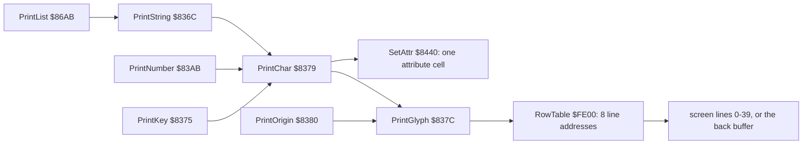

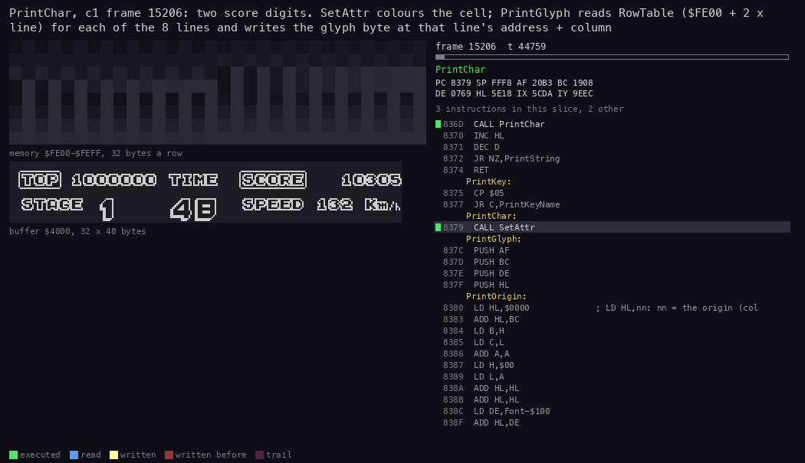

*Animation 8.1: PrintChar, SetAttr and PrintGlyph printing two digits of the score in `c1` frame 15 206, window
15206:44700-15206:47045. The view is the screen's lines 0-39; the memory map is RowTable `$FE00-$FEFF`. Command:
`python3 ../../kit/routine_anim.py --work work/docs/erB/c1 --window 15206:44700-15206:47045 --listing build/game.lst
--view buffer:4000:32x40:screen --range FE00-FEFF --row-bytes 32 --pc 8379-83AA,8440-8457,836C-8378 --pictures 40
--delay 150 --title "..." --out docs/img/routines/PrintChar.gif`.*

What to watch: SetAttr's single write into the attributes; then 8 reads of RowTable (`$FE10-$FE1F`, lines 8-15) and
8 writes, one per pixel line, down the character cell.

Worked example: the score's first digit at column 25, line 8. RowTable[8] at `$FE10` is `$4020`. OR 25 gives `$4039`.
The next lines are `$4139`, `$4239`, ... `$4739`. One character costs about 1 000 T: in the traced pass PrintOrigin's
loop ran from 15206:44984, and 11 characters took 1 309 of its instructions.

The point: one printer for everything, with the screen layout hidden in RowTable. The cost is a table read per
pixel line, 8 per character.

## 8.2 The font and the big digits

**Font `$7608`** holds 63 characters, `$20` to `$5E`, 8 bytes each. Some codes draw the game's own shapes:

| Code | Prints | Used by |
| --- | --- | --- |
| `<` `>` | "m" and "/h" | `K<>` is "Km/h" on the HUD |
| `'` `"` | minutes and seconds marks | times: `3'00"00` |
| `@` | "%" | the lap table's percentage |
| `[ % \ + / ] ) ^` | frame corners and edges | FrameChars `$8AB3`: the HUD's frames, the name cursor |
| `( ) * / + & % $` | another frame set | FrameChars2 `$8ABB`: DrawWindow |
| `?` `=` | END and delete | the name grid |

**BigDigits `$7C54`** holds ten digits, 16 × 15 pixels, 30 bytes each: digit n at BigDigits + 30 n. BigDigit `$8486`
prints one at column D, line E, with SP walking RowTable, like the sprites:

```asm
BigDigit:                       ; $8486, digit A at column D, line E
        LD B,A
        INC B
        LD A,$F1
l_848A: ADD A,$0F
        DJNZ l_848A             ; A = 15 x digit
        LD C,A
        LD HL,BigDigits
        ADD HL,BC
        ADD HL,BC               ; + 30 x digit
        LD C,D
        LD B,$0F
        EX DE,HL
        LD H,$7F
        ADD HL,HL
        LD (SavedSp),SP
        LD SP,HL                ; SP = RowTable + 2 x line
l_84A0: POP HL                  ; the line's address
        LD A,L
        OR C
        LD L,A
        LD A,(DE)
        INC E
        LD (HL),A
        INC L
        LD A,(DE)
        INC DE
        LD (HL),A               ; two bytes a line
        DJNZ l_84A0
        LD SP,(SavedSp)
        RET
```

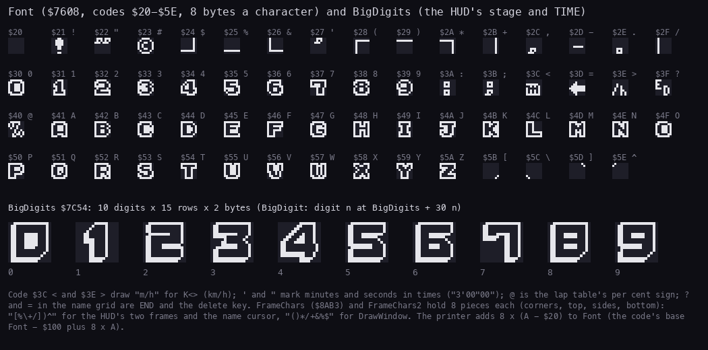

*Figure 8.1: Font `$7608` and BigDigits `$7C54` from `build/game.bin`, with their codes. Command: `python3
tools/fig_hud.py font --out docs/img/hud/font.png`.*

How to read:

- The top grid is the font, 16 characters a row from `$20`, each with its code.
- The bottom row is the ten big digits, at 4 screen pixels a pixel.
- The note under it lists the special glyphs above.

The extracted sheets are also in [`src/res/font/font.png`](../src/res/font/font.png) and
[`src/res/font/bigdigits.png`](../src/res/font/bigdigits.png).

The point: the font is ASCII from space to `^`, with the unused punctuation redrawn as frame pieces and units. The
big digits are the only other text graphics.

## 8.3 The strings

All the texts are plain ASCII in the image, extracted into `src/res/texts/`:

| File | Address | Content | Printed by |
| --- | --- | --- | --- |
| `menu.txt` | MenuTexts `$8C56` | ENDURO RACER, FROM SEGA, START GAME, ONE/TWO PLAYERS, CHANGE CONTROL MODE, DEFINE KEYS, SPACE OR FIRE..., the methods, EXIT and the seven controls | Menu, PrintList |
| `keys.txt` | Keys `$831C` | `QAOP` SPACE `HR`: the seven keys | DEFINE KEYS, PrintKey |
| `keynames.txt` | KeyNames `$8355` | SYM ENT SPC CPS | PrintKeyName |
| `keymap.txt` | KeyMap `$8520` | the 40 keys in ScanKeys' order | ScanKeys ([5.6](05-controls.md#56-define-keys-scankeys-keymap-and-getkey)) |
| `hud.txt` | HudTexts `$8DC5` | TOP STAGE SPEED K<> SCORE TIME NAME | PlayTurn, PrintList |
| `demo.txt` | DemoText `$A8D6` | DEMO | HudFlash |
| `extended.txt` | ExtendedText `$A1CC` | EXTENDED PLAY | ExtendedPlay |
| `lap.txt` | LapTexts `$8735` | TOTAL RECORD PLAYER LAPTIME, `0'00"00` | LapTable, ExtendedPlay |
| `namegrid.txt` | NameGrid `$8AC3` | `QWERTYUIOP=?789ASDFGHJKL:;'456ZXCVBNM,.!@0123` | NameEntry |
| `credits.txt` | | ENDURO RACER FROM SEGA, PRESENTED BY ACTIVISION, PROGRAMMED BY GIGA GAMES, GRAPHICS BY FOCUS | the credits' scroll |

The high-score names and times are data, not texts: HiScores `$8DE2` (8.11).

The point: there is no string compression and no terminator; every print gives its length.

## 8.4 The HUD's fields

PlayTurn `$87FC` builds the HUD at the start of each turn:

1. Clears the screen's top third (`$4000-$47FF`) and sets the 192 attributes of lines 0-47 to `$69`.
2. PrintList over HudLayout `$8DAC` and HudTexts: the six labels.
3. Two DrawFrames with FrameChars round TOP and SCORE.
4. DrawScore; the best score (HiScores' first row) at column 5, line 8.
5. The stage in a big digit at column 7, line 24; PrintTimer; SPEED 0.

HudLayout is a count (6) and four bytes per label: line, column, attribute, length.

| Label | Line | Column | Attribute |
| --- | --- | --- | --- |
| TOP | 8 | 1 | `$7A` |
| STAGE | 24 | 1 | `$70` |
| SPEED | 24 | 19 | `$70` |
| K<> | 24 | 29 | `$68` |
| SCORE | 8 | 19 | `$7A` |
| TIME | 8 | 13 | `$60` |

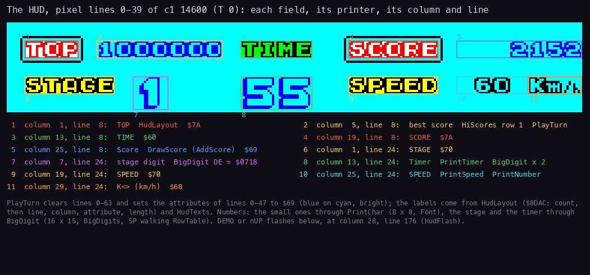

*Figure 8.2: the HUD of `c1` at T 0 of frame 14 600, every field boxed with its printer, column, line and
attribute. Command: `python3 tools/fig_hud.py hud --work work/docs/erB/c1 --frame 14600 --out
docs/img/hud/fields.png`.*

How to read:

- Fields 1, 3, 4, 6, 9, 11 are labels, printed once a turn.
- Fields 5 and 10 (score, speed) are printed every pass; field 8 (the timer) every tenth pass.
- Field 7, the stage, is a big digit printed once a turn.

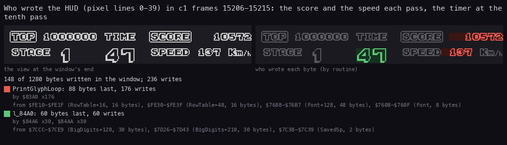

*Figure 8.3: the routine that last wrote each byte of the HUD in `c1` frames 15 206-15 215, two passes. Command:
`python3 ../../kit/writers_map.py --work work/docs/erB/c1 --window 15206:43000-15216:0 --listing build/game.lst --view
buffer:4000:32x40:screen --sources --label 8398=PrintGlyphLoop --title "..." --out docs/img/hud/writers-hud.png`.*

How to read:

- Red: PrintGlyph's loop `l_8398` (named PrintGlyphLoop here) wrote the score and the speed, twice each, reading
  RowTable `$FE10-$FE1F` and `$FE30-$FE3F` and the font.
- Green: BigDigit's loop `l_84A0` wrote the timer's two digits once, reading BigDigits + 120 (a 4) and + 210 (a 7).
- Grey bytes were not written in the window: the labels, the frames, the best score, the stage.

Worked example: 148 bytes of the 1 280 were written in two passes. 88 bytes are 11 characters of 8 lines (7 of the
score, a blank and 3 digits of the speed) a pass, written 176 times; 60 bytes are 2 big digits of 15 lines × 2 bytes.

The point: the HUD is printed straight on the screen, and only the score, the speed and the timer are ever
reprinted.

## 8.5 The score

Each pass, ScoreAdd `$A974` turns the speed into digits and AddScore `$86C9` adds them to the score:

```text
ScoreAdd:                                   # each pass, not while falling
    ScoreDigits[0..6] = 0
    whole = SPEED's whole km/h
    on the ground: ScoreDigits[4], [5], [6] = hundreds, tens, units of whole
    in the air:    ScoreDigits[3], [4], [5] = the same, one place left (x 10)
    AddScore(ScoreDigits)
AddScore:                                   # not in a demo
    for the 7 places from the right:
        c = Score[i] (a blank counts as "0") + ScoreDigits[i] + carry
        Score[i] = c, less 10 with a carry when above "9"
    up to six leading "0"s become blanks
    DrawScore: Score's 7 characters at column 25, line 8, attribute $69
```

```asm
AddScore:                       ; $86C9
        LD A,(DemoMode)
        AND A
        RET NZ
        LD BC,$0700             ; 7 places, no carry
        LD DE,Score+$0006
l_86D4: LD A,(DE)
        CP $20
        JR NZ,l_86DB
        LD A,$30                ; a blank is "0"
l_86DB: ADD A,(HL)
        ADD A,C                 ; + the carry
        LD C,$00
        CP $3A
        JR C,l_86E6
        INC C
        SUB $0A
l_86E6: LD (DE),A
        DEC HL
        DEC DE
        DJNZ l_86D4
        ...                     ; leading "0"s to blanks
DrawScore:
        LD HL,Score
        LD BC,$1908             ; column 25, line 8
        LD DE,$0769             ; 7 characters, attribute $69
        JP PrintString
```

The score is kept as text: Score `$5E18` is 7 ASCII characters, added digit by digit, never converted. The time
bonus at a stage's end goes through the same AddScore.

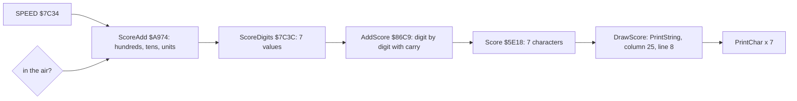

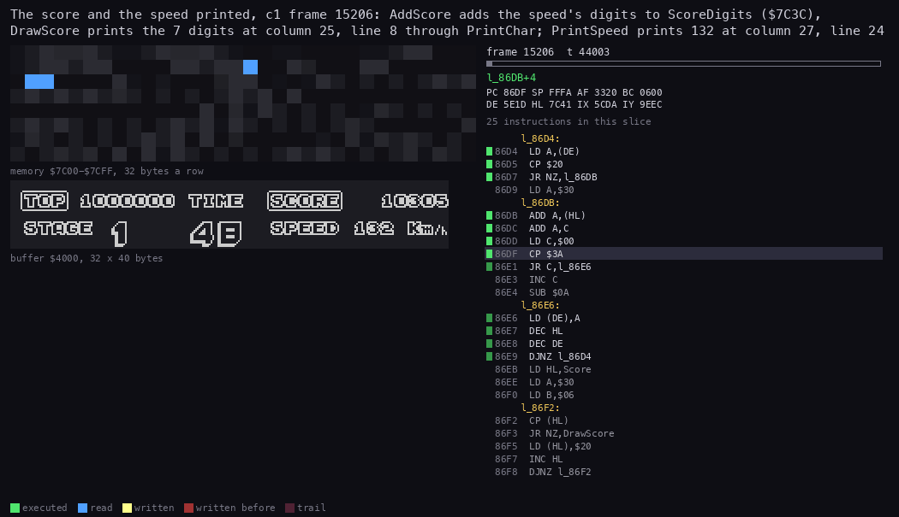

*Animation 8.2: ScoreAdd, AddScore, DrawScore, PrintSpeed and PrintNumber in `c1` frame 15 206, window
15206:43790-15206:58680. The view is the screen's lines 0-39; the memory map is `$7C00-$7CFF` (ScoreDigits). Command:
`python3 ../../kit/routine_anim.py --work work/docs/erB/c1 --window 15206:43790-15206:58680 --listing build/game.lst
--view buffer:4000:32x40:screen --range 7C00-7CFF --row-bytes 32 --pc
86C9-8754,8379-845F,836C-8378,83AB-83C4,A974-A9A7,AAAB-AAD0 --pictures 70 --title "..." --out
docs/img/routines/AddScore.gif`.*

What to watch: ScoreDigits written (1, 3, 5: the speed), Score's characters changed from the right, then all 7
reprinted; then the speed reprinted at columns 24-27.

Worked example: the HUD showed 10 437 after the pass at 15 206, at 135 km/h. The next pass's ScoreAdd ran at
15215:28016 with SPEED still 135, before that pass's throttle step: Score became 10 572 = 10 437 + 135. The speed
then printed was 137.

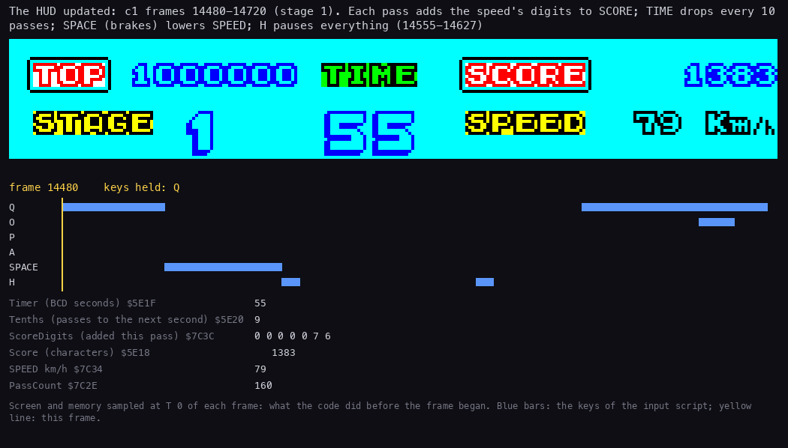

*Animation 8.3: the HUD of `c1` frames 14 480-14 720, every 3rd frame, at 4 screen pixels a pixel, with Timer,
Tenths, ScoreDigits, Score, SPEED and PassCount at T 0. Command: `python3 tools/fig_controls.py play --work
work/docs/erB/c1 --from 14480 --to 14720 --step 3 --scale 4 --crop 0,0,256,40 --keys tests/inputs/c1.txt --var 'Timer
(BCD seconds)=5E1F:1:hex' --var 'Tenths (passes to the next second)=5E20:1:dec' --var 'ScoreDigits (added this
pass)=7C3C:7:dec' --var 'Score (characters)=5E18:7:text' --var 'SPEED km/h=7C34:1:dec' --var 'PassCount=7C2E:1:dec'
--title "..." --out docs/img/play/hud-update.gif`.*

What to watch:

- SCORE growing by the speed each pass, PassCount by one;
- TIME dropping when Tenths wraps;
- SPACE (14 515-14 555) lowering SPEED, so the score grows more slowly;
- everything frozen during the pause, 14 555-14 627.

The point: the score is the distance: each pass adds the speed. Jumps score ten times as much while they last.

## 8.6 The timer

Timer `$5E1F` is BCD seconds; Tenths `$5E20` counts the passes to the next second. TimerTick `$AA73` runs at the end of
every pass that reached the throttle (not during the countdown's first half or getting up):

```asm
TimerTick:                      ; $AA73
        LD A,(Tenths)
        AND A
        JR NZ,l_AA89
        LD A,(Timer)
        AND A
        JR Z,l_AA84
        DEC A
        DAA                     ; BCD
        LD (Timer),A
l_AA84: CALL PrintTimer
        LD A,$0A
l_AA89: DEC A
        LD (Tenths),A
        JP NZ,RaceLoop
        ...                     ; Timer 0 and SPEED 0: the game is over (RaceOver)
```

PrintTimer `$8458` prints the tens (blank when 0) and the units in big digits at columns 13 and 15, line 24.

```text
each pass (after the countdown's first half):
    if Tenths == 0: Timer -= 1 (BCD, not below 0); PrintTimer; Tenths = 10
    Tenths -= 1
    if Tenths == 0 and Timer == 0 and SPEED == 0: the game is over
```

A TIME second is 10 passes, not a real second. Its length depends on the pass.

Worked example, `c1`: Timer turns from `$60` to `$59` between frames 14 112 and 14 116 and reaches 0 near 19 255.
Sixty TIME seconds took about 5 140 frames, 103 s: 1.7 s per TIME second on average. In the traced pass the tick ran
at 15215:42813, and the two big digits took 1 516 and 1 577 T.

Witness: `work/docs/erB/mem.py work/docs/erB/c1 14100 14140 4 5E1F:2 5E24:1` and the same at 19 000-19 300; the
trace `15206_43000-15216_0.uatr`.

The point: the race's clock is the pass count. A busy screen makes every TIME second longer in real time, so the
48K's slow passes give the player more real time, not more road.

## 8.7 The speed

PrintSpeed `$AAAB` runs every pass after the throttle. It prints a blank before the number (at column 24, 25 or 26,
by the number of digits) and then PrintNumber ending at column 27, attribute `$68`:

```asm
PrintSpeed:
        LD A,(Speed+$0001)      ; whole km/h
        LD H,A
        LD BC,$1818             ; column 24, line 24
        CP $64
        JR NC,l_AABC
        INC B                   ; two digits: the blank at 25
        CP $0A
        JR NC,l_AABC
        INC B                   ; one digit: at 26
l_AABC: LD A,$20
        CALL PrintGlyph         ; the blank
        LD A,H
        LD B,$1B                ; ends at column 27
        LD E,$68
        JP PrintNumber
```

PrintNumber divides by 10 by repeated subtraction and recurses for the higher digits, so the digits come out left
to right.

The point: the blank in front wipes the digit a longer number left behind; the number itself is never cleared.

## 8.8 The countdown

StartRace sets Countdown `$5E24`; each pass takes one off ([4.8](04-game-loop.md#48-the-timer-the-countdown-and-the-delays)).
When the new value is 15, 11, 7 or 3 the pass clears the attribute rows 8-17 and draws the next glyph as attribute
blocks: each set bit of an 8-pixel row of CountGlyphs `$7C00` becomes an attribute cell `$52` (red), an 8 × 8
block on the screen.

| Countdown | Shows | Glyph |
| --- | --- | --- |
| 15-12 | 3 | 8 × 10 cells at column 12, row 8 |
| 11-8 | 2 | |
| 7-4 | 1 | |
| 3-1 | GO | two 8 × 8 glyphs at columns 7 and 17 |
| 0 | cleared | |

```asm
CountGlyphC:                    ; $A145, C rows of glyph HL at attribute address DE
        LD A,$52
        LD B,$08
l_A149: RLC (HL)                ; the bit, and the glyph rotated back after 8
        JR NC,l_A14E
        LD (DE),A               ; a red cell
l_A14E: INC E
        DJNZ l_A149
        ...                     ; DE to the next attribute row
```

CountdownBeeps sounds a beep when Countdown AND 3 is 2: a short high one for 3, 2, 1 and a long low one for GO.
The throttle and the timer start when Countdown drops below 8, while "1" shows.

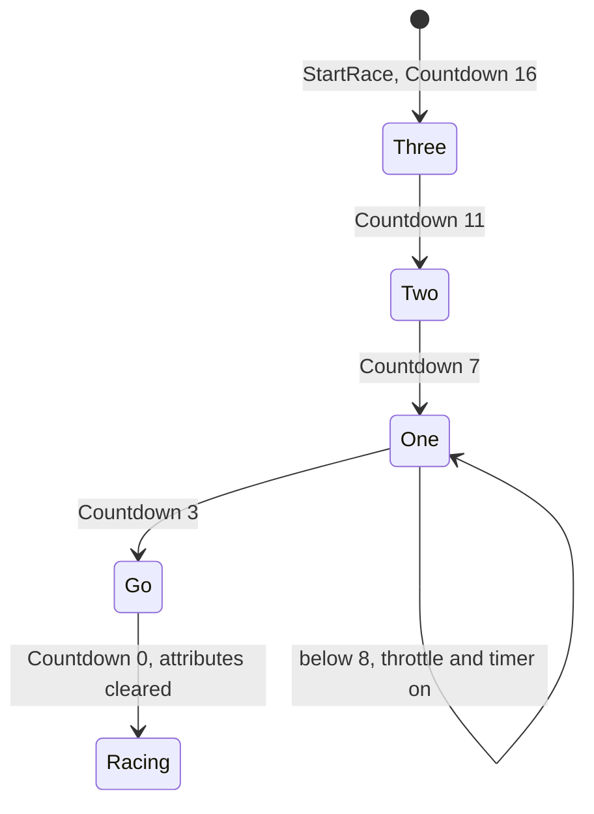

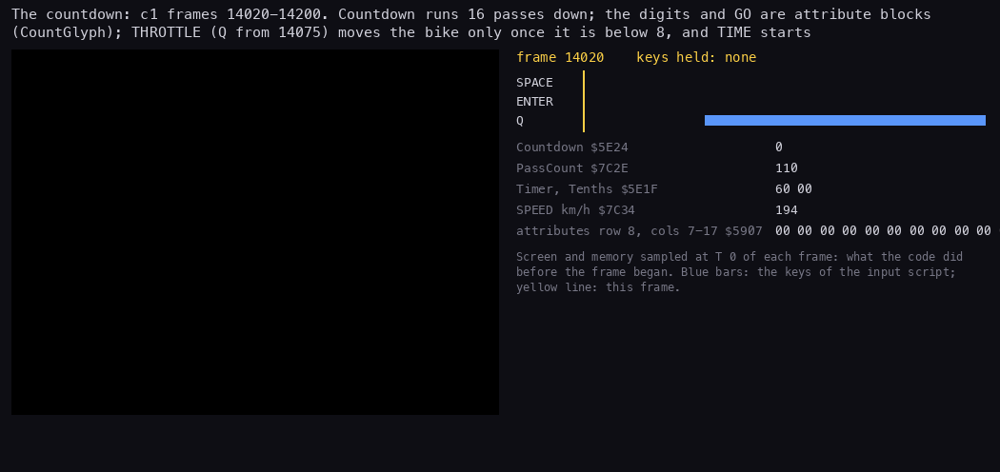

*Animation 8.4: `c1` frames 14 020-14 200, every 2nd frame, with Countdown, PassCount, Timer and Tenths, SPEED and the
attributes of row 8 at T 0. Command: `python3 tools/fig_controls.py play --work work/docs/erB/c1 --from 14020 --to
14200 --step 2 --keys tests/inputs/c1.txt --var 'Countdown=5E24:1:dec' --var 'PassCount=7C2E:1:dec' --var 'Timer,
Tenths=5E1F:2:hex' --var 'SPEED km/h=7C34:1:dec' --var 'attributes row 8, cols 7-17=5907:11:hex' --title "..." --out
docs/img/play/countdown.gif`.*

What to watch: the red 3, 2, 1 and GO over the road; Countdown falling by one a pass; SPEED leaving 0 and Timer
leaving `$60` only after Countdown passes 8.

Witness: `memory_at` at 14 100-14 140: Countdown 8, 7, 6, ... with Timer `60 00`, then `59 09` from 14 116.

The point: the countdown's digits are drawn in the attributes, 64 × 80 pixels each, so the race picture keeps
running under them with no extra drawing.

## 8.9 The words printed into the road

Three words are printed into the back buffer each pass, so the next DrawHorizon erases them, and printing them on
some passes only makes them flash:

| Word | Routine | Where | When |
| --- | --- | --- | --- |
| DEMO | HudFlash `$A8BB` | column 28, line 176 | the attract race, while PassCount bit 2 is clear (4 passes on, 4 off) |
| 1UP / 2UP | HudPlayer `$A8DA` | column 28, line 176 | two players, the same rhythm |
| EXTENDED PLAY | ExtendedPlay `$A8F0` | column 9, line 72, attribute `$68` | ExtendedTime passes after a stage's end, while its bit 1 is set |
| LAPTIME m'ss"hh | ExtendedPlay | column 8, line 88 | every pass of ExtendedTime |

ExtendedPlay also lowers TopClip to line 72, so that CopyBuffer copies the lines the words are on
([6.10](06-rendering.md#610-one-picture-built-the-order-the-copy-and-the-erase)), and beeps while the count is above
`$14`.

HudPlayer prints PlayerChar (`1` or `2`) and then the codes `$55` and `$50`, U and P, with PrintGlyph only: the
attribute is the road's.

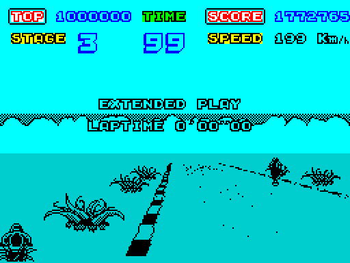

*Figure 8.4: `stages` frame 5 340, stage 3 just begun: EXTENDED PLAY and LAPTIME 0'00"00 printed over the horizon, below line 72. From the
recording's stills.*

The point: text in the race area costs no erase; it rides on the buffer's rebuild, and flashing is just not
printing.

## 8.10 The lap table

At game over PlayTurn shows the lap table (LapTable `$88A8`) over the last race picture: RECORD and PLAYER over five
rows, one per stage, and TOTAL.

- RECORD is the stage's record from Records `$5E00`: `0'59"99` for each stage at power-on (`src/res/tables/records.csv`).
- PLAYER is the player's time for a finished stage, or LapPercent: the share of the stage driven and `@`, printed
  as "%".
- A better time replaces the record (RecordStages).
- Times are kept as BCD seconds, with `$60` a minute, and BCD hundredths; FormatTime `$8706` turns them into
  `m'ss"hh`.

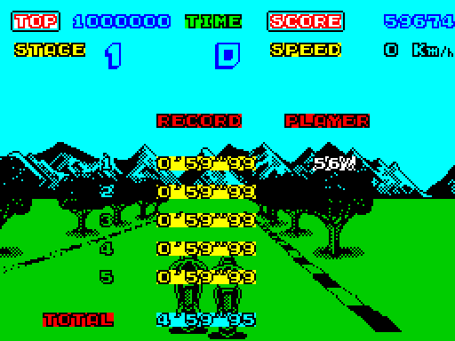

*Figure 8.5: `c1` frame 19 465, after the time-out on stage 1: the records, 56 % of stage 1 driven, TOTAL. From the
recording's stills.*

Known only from the code: RecordTie, two times with the same seconds.

The point: the table compares the player with records that live in RAM and improve within a session.

## 8.11 The high scores and the name entry

HiScores `$8DE2` holds five rows of 22 characters: the score (7), the name (8), the time (7):

| Score | Name | Time |
| ---: | --- | --- |
| 1000000 | ENDURO | 3'00"00 |
| 800000 | RACER | 2'30"00 |
| 600000 | SEGA | 2'00"00 |
| 400000 | A'VISION | 1'30"00 |
| 200000 | GIGA1987 | 1'00"00 |

ScoreCheck `$895C` finds the first row the score beats, moves the rows below it down and calls NameEntry:

```text
NameEntry:
    print NameGrid: 3 rows of 15 characters at lines 144, 160, 176, every second column
    cursor at the grid's first character (DrawCursor: a 1 x 1 frame of FrameChars, attribute $46)
    loop:
        wait for BRAKES up, then for any control
        if not BRAKES: move the cursor (LEFT/RIGHT 2 columns, wrapping at the ends; UP/DOWN 16 lines)
        else take the character under the cursor:
            "?": done
            "=": one character back, blanked (not before the first)
            else: write it into the row's name and print it at column B, line 48
        after 8 characters (column 20): done
```

The state lives in three operands: the name pointer (the `LD HL` at `$8A16`, operand `$8A17`), the name's column B
and line C (the `LD BC` at `$8A19`, operand `$8A1A`: C = `$30`, B from 12), and the cursor (DrawCursor's `LD BC`,
operand `$83EB`).

```asm
l_8A07: CALL NameEntrySound
        CALL ReadControls
        LD A,D
        AND $1F
        JR Z,l_8A07             ; wait for a control
        BIT 4,D                 ; BRAKES (fire) picks
        JR Z,NameMove
        LD HL,$0000             ; the name pointer
        LD BC,$0000             ; the name's column and line
        ...
        LD A,(IY+$00)           ; the character under the cursor
        CP $3F
        JR Z,NameDone           ; ?: END
        CP $3D
        JR NZ,l_8A38            ; not =: write it
NameDelete:
        ...
l_8A38: LD (HL),A
        INC HL
l_8A3A: LD (l_8A07+$0010),HL
        LD E,$42
        CALL PrintChar
        CP $20
        JR NZ,l_8A47
NameSpace:
        DEC B                   ; after a delete's blank: the column steps back
l_8A47: LD A,B
        LD (l_8A07+$0014),A
        CP $14
        JR C,l_89F6             ; fewer than 8: on
```

The grid holds no blank, so NameSpace runs only after NameDelete: it is the delete's step back, not "a blank
picked" as the source's comment says.

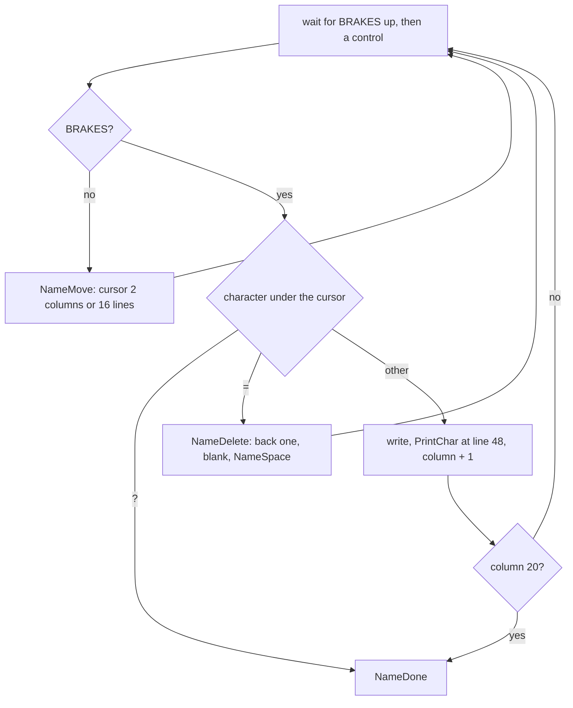

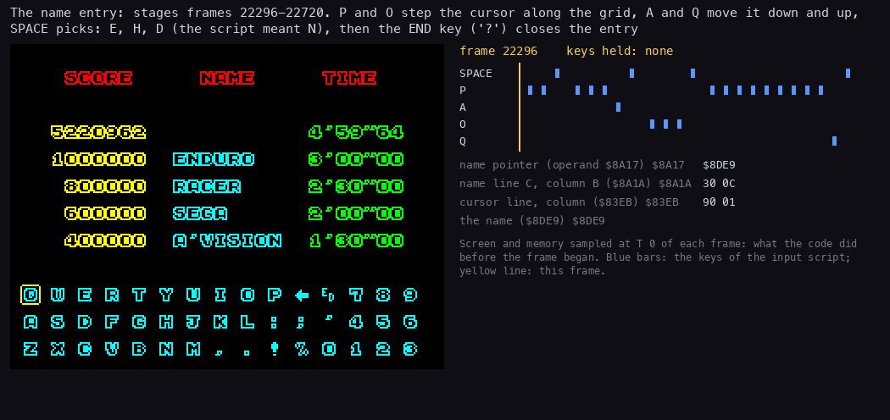

*Animation 8.5: `stages` frames 22 296-22 720, every 4th frame, with the name pointer, the name's column and line, the
cursor and the 8 characters of the name at T 0. Command (one line):
`python3 tools/fig_controls.py play --work work/docs/erB/stages --from 22296 --to 22720 --step 4`
`--keys tests/inputs/stages.txt --var 'name pointer (operand $8A17)=8A17:2:word'`
`--var 'name line C, column B ($8A1A)=8A1A:2:hex' --var 'cursor line, column ($83EB)=83EB:2:hex'`
`--var 'the name ($8DE9)=8DE9:8:text' --title "..." --out docs/img/play/name-entry.gif`.*

What to watch:

- P and O stepping the cursor along the grid, A and Q moving it down and up;
- SPACE (BRAKES) picking: the letter appears at line 48 and the column operand grows by one;
- the third letter: the script meant N but the cursor sat on H, so the name is "EHD";
- `?` closing the entry.

Witness: [the table](img/play/stages-022308-hiscore.png) at 22 308 and
[the name entered](img/play/stages-022708-name-entered.png) at 22 708: 5220362, EHD, 4'53"64 in the first row.

Known only from the code: NameDelete, NameLeftWrap and NameRightWrap.

The point: the name entry is driven by the race controls, so joystick players can enter names; the grid is printed
text and the cursor a frame of font characters.

## 8.12 Menus, windows, frames and the credits

- **DrawFrame `$83F7`** draws a frame of eight characters (corners, top, sides, bottom) from IX round an H × L area.
  The HUD uses it twice with FrameChars; the menu once round the whole screen.
- **DrawWindow `$83C5`** clears an H × L character area with attribute `$4F`, sets PrintOrigin to its corner and
  frames it with FrameChars2. The texts inside are then placed relative to the window. Menu clears PrintOrigin.
- **MenuSelect** paints the selected item's attribute bar ([5.5](05-controls.md#55-the-menu-and-menuselect)).
- **The credits** print the four lines of `credits.txt` and scroll the whole screen up a pixel line at a time
  (ScrollUp `$84B2`, through RowTable), and the attributes every 8 calls.

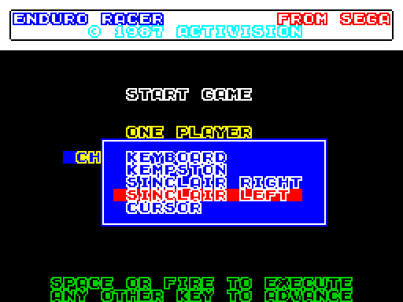

*Figure 8.6: `c1` frame 13 578, the CHANGE CONTROL MODE window: DrawWindow, FrameChars2, MenuSelect's bar. From the
recording's stills.*

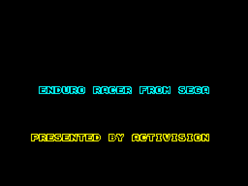

*Figure 8.7: `c1` frame 20 665, the credits scrolling after the game. From the recording's stills.*

The point: windows are the printer with an origin. One `LD HL,nn` operand moves all text into a box.

## 8.13 Summary

- PrintChar prints an 8 × 8 character at a column and a pixel line, with its attribute, through RowTable; it draws on
  the screen or into the back buffer depending on the line.
- The font is ASCII `$20-$5E` with unused punctuation redrawn as frame pieces, "m/h", "%" and time marks; the timer
  and the stage use ten 16 × 15 big digits drawn with SP walking RowTable.
- The HUD is printed once a turn; only the score and the speed (every pass) and the timer (every tenth pass) are
  reprinted.
- The score is 7 ASCII characters; each pass adds the whole km/h, ten times that in the air.
- A TIME second is 10 passes: about 1.7 real seconds on c1's 48K.
- The countdown is drawn in attributes; DEMO, 1UP/2UP, EXTENDED PLAY and LAPTIME are printed into the back buffer
  and flash by not being printed.
- The lap table and the high scores live in RAM; the name entry uses the race controls on a printed grid.

Known only from the code in this document:

- RecordTie (8.10);
- NameDelete, NameLeftWrap, NameRightWrap (8.11).
