# 9. Sound

What this covers:

- the sound map: every sound, what plays it, on which machine, and where in the program it runs;
- the tune stream and the channel record, byte by byte, and the player PlayChannel;
- the two tunes, decoded and rendered, the tune change at a mark, and when each plays;
- the engine on both machines: a beeper buzz on the 48K, an AY tone on the 128K, both folded into three "gears";
- the AY effect of falls and bounces, and the skid noise;
- the main loop's beeper sounds: the crash noise, the countdown and EXTENDED PLAY beeps, the name entry;
- the cost of each, and 48K against 128K;
- the quirks, and what is known only from the code.

The recordings it rests on ([WALKTHROUGH 6.0](../WALKTHROUGH.md#60-the-recordings)):

- `c1`: power-on on the 48K, the load, the menu, stage 1 to the time-out. It was opened on an own instance, after
  `. work/env.sh`: `python3 ../../kit/rs.py open --work work/docs/erC/c1 --ttd work/stage1/rec/c1/session.ttd --model
  48K --port-base 37790`. The game state was sampled every second TTD frame from 14 075 to 19 465 by
  `python3 work/docs/erC/sample.py work/docs/erC/c1 14075 19465 2 work/docs/erC/c1-vars.jsonl`. The two channel
  records were sampled at every frame 15 000-15 040 into `work/docs/erC/c1-chan.jsonl`. Frame 15 034 was traced (the
  GIF of 9.2).
- `stages`: the five stages with the ZXDB POKEs, opened the same way at port base 37795. The game state and the sound
  variables `$643A-$6463` were sampled every second frame over the whole recording into
  `work/docs/erC/st-vars.jsonl`.
- `m128`: the 128K load and stage 1 on the AY. Its witness is the `.ann`'s execution counts (EngineTone runs in it
  only).
- `tools/fig_sound.py`: the game's own sound code run in SkoolKit's Z80 simulator from the case's build
  (`build/game.bin` at `$5B00`, the 48K ROM under it for the ROM bytes the engine and the crash read). The interrupt's
  sound part is called once a frame, as the handler calls it. The main loop's sounds are called once a pass, as the
  loop calls them. A pass is taken as 8 frames, the mean of `c1`'s play. It writes the audio, the charts and the
  numbers of this document into `docs/audio`, `docs/img/sound` and `work/docs/erC/sound/sound.json`. The audio is
  written to files, never played.

A sample of frame N is the memory at the start of frame N. A trace shows an instruction in the frame in which it ran.
A pass is one turn of the main loop: 6 to 12 frames, 8.0 on average ([doc 4](04-game-loop.md)).

## 9.1 The sound map

Enduro Racer makes sound in two places. The interrupt plays the tune and the engine. The main loop plays the effects
and the beeps. The machine is told apart once, at the start: Beeper `$7C2F` is `$FF` on a 48K and 0 on a 128K (the
ROM test of [doc 4](04-game-loop.md)).

The game writes the AY ports on both machines. On a 48K those writes reach nothing. So the 48K runs the tune player
all the time, in silence, and hears only the beeper. The 128K hears the AY, and the beeper too for the beeps.

| Sound | Plays it | When | Where it runs | 48K | 128K | Audio |
| --- | --- | --- | --- | --- | --- | --- |
| tune 1 | IntSound `$6476`, PlayChannel `$6588` | stages 1, 3, 5 | interrupt, each frame | silent | AY A and B | [tune-1.mp3](audio/tune-1.mp3) |
| tune 2 | the same | stages 2, 4 | interrupt, each frame | silent | AY A and B | [tune-2.mp3](audio/tune-2.mp3) |
| the engine | EngineSound `$6851` | while a tune is asked for (TuneRequest `$6461` nonzero) | interrupt, every second frame | a buzz of 11 edges | AY C tone (EngineTone `$68D1`) | [engine-48k.mp3](audio/engine-48k.mp3), [engine-128k.mp3](audio/engine-128k.mp3) |
| the skid noise | EngineSkid `$689E` | sliding on sand (SkidLevel `$645F`) | interrupt, every second frame | none | AY C noise | [ay-skid.wav](audio/ay-skid.wav) |
| the fall | PlayEffect `$A179` (1), AyEffectTick `$ACA5` | a head-on hit at 35 km/h or more, a truck | main loop, once a pass | CrashSound `$AC88` | AY noise on A, B, C, 14 steps | [crash-48k.wav](audio/crash-48k.wav), [ay-fall.wav](audio/ay-fall.wav) |
| the bounce, the landing | PlayEffect (2), AyEffectTick | a side-on or slow hit, a rider, a ramp | main loop, once a pass | CrashSound (a ramp: 192 edges) | AY noise, 2 steps | [ay-bounce.wav](audio/ay-bounce.wav) |
| 3, 2, 1, GO | BeepTone `$AB95` from CountdownBeeps `$A92B` | the countdown | main loop, blocking | beeper | beeper | [countdown.wav](audio/countdown.wav) |
| EXTENDED PLAY | BeepTone from ExtendedPlay `$A8F0` | a stage's end | main loop, blocking | beeper | beeper | [extended-play.wav](audio/extended-play.wav) |
| the name entry | NameEntrySound `$8AF0` | the high score table | the entry loop, blocking | beeper | beeper | [name-entry.wav](audio/name-entry.wav) |

[race-128k.mp3](audio/race-128k.mp3) is tune 1 and the engine together, as a 128K plays them over the first 110
passes of a race with THROTTLE held.

```text
Interrupt (each frame, after the repair of the two pushed bytes):
    IntSound:
        if TuneRequest != TunePlaying and TuneMark:      # a change waits for the tune's mark
            TunePlaying = TuneRequest
            if 0: AY R7 = $3F                              # AySilence: everything off
            else: start the tune's two streams; R7 = $38, R8 = 13, R9 = 14, R10 = 15
        if TunePlaying:
            if Beeper == 0 and EffectTime: TuneHeld = EffectTime          # 128K: the effect owns the AY
            else:
                if TuneHeld: TuneHeld = 0; write the tune's volumes and mixer again
                PlayChannel(ChannelA); PlayChannel(ChannelB)
        if TuneRequest: EngineSound()                     # every second call plays
Main loop (each pass):
    AyEffectTick()                                         # the AY effect's volume step
    ... a hit: PlayEffect(1 or 2); CrashSound()           # CrashSound returns at once on a 128K
    ... CountdownBeeps, ExtendedPlay: BeepTone(D edges, E turns)
```

```asm
IntSound:
  LD HL,TunePlaying       ; the tune change, the channels, the engine
  LD A,(TuneRequest)
  CP (HL)
  JR Z,l_64D5
  LD D,A
  LD A,(TuneMark)
  AND A
  JR Z,l_64D5             ; no mark yet: the old tune plays on
  ...
l_64D5:
  LD A,(TunePlaying)
  AND A
  JR Z,l_650F
  LD A,(Beeper)
  AND A
  JR NZ,l_6501            ; 48K: the channels step, the writes reach nothing
  LD A,(EffectTime)
  AND A
  JR Z,l_64EC
  LD (TuneHeld),A         ; 128K: an effect holds the tune
  JR l_650F
  ...
l_6501:
  LD IX,ChannelA
  CALL PlayChannel
  LD IX,ChannelB
  CALL PlayChannel
l_650F:
  LD A,(TuneRequest)
  AND A
  CALL NZ,EngineSound
```

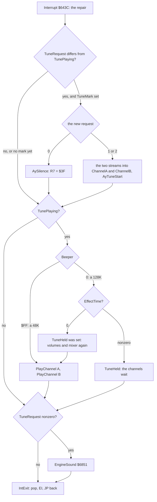

Worked example: `c1` is a 48K. At every sample of its play TunePlaying is 1 and the channels step: ChannelA's count
falls by one a frame at 15 000-15 006 (`$06` to `$00`). The AY writes go nowhere, so the race is heard as the engine
buzz only. EngineSound's `OUT ($FE)` at `$687F` runs 11 times in the traced frame 15 034. When the player paused at
14 555 (H), TuneRequest was 0 at the sample of 14 561 and 1 again at 14 623. The engine was silent in between.

The interrupt's sound part costs very different amounts on the two machines (9.7). On the 48K the engine burst is
CPU time. On the 128K the AY does the work.

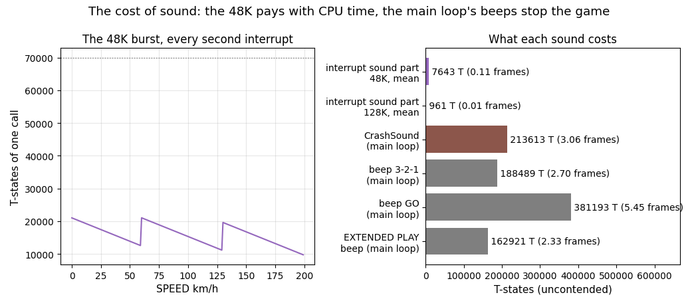

How to read it: left, the T-states of one EngineSound call on the 48K against SPEED: it falls as the speed rises,
then jumps up at each fold (9.4). Right, the mean T-states of the interrupt's sound part over tune 1 at 120 km/h on
each machine, and the main loop's blocking beeper sounds. A 48K frame is 69 888 T. Recording: none, the simulator runs
the build's code (uncontended). Made by `python3 tools/fig_sound.py fig-cost docs/img/sound/cost.png`, after `python3
tools/fig_sound.py audio docs/audio`.

**The point**: the tune player never asks which machine it is on. It steps both channels on a 48K too and writes an
AY that is not there. Only the engine, the effect and CrashSound branch on Beeper.

Witness: IntSound L1 68 919, PlayChannel L1 51 862, EngineSound L1 23 083, all in `c1`, `crash`, `ctl`, `m128`,
`stages` and `twoplayer` (`src/game/interrupt.asm`, `src/game/sound.asm`); EngineTone L1 1768 in `m128` only;
TuneRequest at `$6461` in `work/docs/erC/c1-vars.jsonl`.

## 9.2 The tune stream, the channel record and PlayChannel

A tune is two byte streams, one a channel. A stream is a list of notes and commands. A note is two bytes: a length,
then a pitch. A length below `$C8` is a note. A byte from `$C8` up is a command.

The note byte splits in two. The low nibble picks a word of NoteTable `$66AA`: 1-11 is a semitone, 0 is a rest. The
high nibble plus the channel's transpose gives how many times the period is halved: the octave. NoteTable holds one
octave of AY periods, `$0EEE` down to `$07E9`. Word 0 (`$0EEE`) is never read, because a low nibble of 0 is a rest.

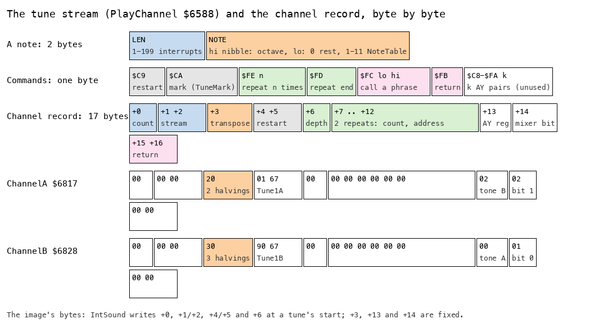

How to read it: the first two rows are the stream's byte kinds. The third is the 17-byte channel record. The last two
are the two records as the image holds them. ChannelA's transpose is `$20` (two halvings more), ChannelB's `$30`.
ChannelA writes AY tone register 2 (channel B) and mixer bit 1. ChannelB writes tone register 0 (channel A) and mixer
bit 0. Recording: none, the bytes of `build/game.bin`. Made by `python3 tools/fig_sound.py fig-format
docs/img/sound/format.png`.

So the stream called A plays on AY channel B, and the stream called B on AY channel A. Channel C stays free for
the engine.

| Byte | Meaning | Used by the tunes |
| --- | --- | --- |
| `$00-$C7` LEN, NOTE | a note: LEN interrupts, NOTE as above | 110 note lines in `src/res/sound/tunes.txt` |
| `$C9` | restart: back to the channel's start (+4/+5), TuneMark = 0 | once a stream |
| `$CA` | mark: TuneMark = 1, the tune may change now | once a stream |
| `$FE` n | repeat: open a repeat record (count n, the address after it) | yes |
| `$FD` | repeat end: count - 1, back to the address until 0 | yes |
| `$FC` lo hi | call the phrase at the address, the return in +`$0F`/+`$10` | yes, one level |
| `$FB` | return from the phrase | yes |
| any other | ChannelAyPairs: the next byte is a count of AY pairs (register, value) | never |

PlayChannel runs for each channel every interrupt. It counts the note down. When the count reaches 0 it sets the
channel's mixer bit: the note stops for one interrupt. When it passes 0 it clears the bit again and reads the
stream. So a note of length LEN sounds for LEN - 1 interrupts and is silent for one. That gap separates repeated
notes.

```text
PlayChannel(IX):
    IX.count -= 1
    if IX.count == 0: mixer |= IX.mixerbit; write R7; return     # the gap before the next note
    if IX.count != $FF: return                                     # the note sounds on
    mixer ^= IX.mixerbit; write R7                                 # tone on again
    HL = IX.stream
read:
    A = (HL)
    if A >= $C8: command(A); goto read                             # restart, mark, repeat, call, return
    IX.count = A - 1; NOTE = (HL + 1); IX.stream = HL + 2
    if NOTE & $0F == 0: mixer |= IX.mixerbit; write R7; return     # a rest
    period = NoteTable[NOTE & $0F]
    repeat ((NOTE + IX.transpose) >> 4) times: period >>= 1        # never 0 times: the transposes are $20, $30
    AY[IX.register] = period low; AY[IX.register + 1] = period high
```

```asm
PlayChannel:
  LD A,(IX+$00)
  DEC A
  LD (IX+$00),A
  JR NZ,l_659D
  LD A,(AyMixer+$0001)
  OR (IX+$0E)             ; count 0: the gap
  LD (AyMixer+$0001),A
  JP WriteMixer
l_659D:
  INC A
  RET NZ                  ; still sounding
  LD A,(AyMixer+$0001)
  XOR (IX+$0E)            ; tone on again
  LD (AyMixer+$0001),A
  CALL WriteMixer
  LD L,(IX+$01)
  LD H,(IX+$02)
ChannelRead:
  LD A,(HL)
  CP $C8
  JR NC,ChannelCommands
  DEC A
  LD (IX+$00),A
  ...
ChannelPeriod:
  LD E,(HL)
  INC HL
  LD D,(HL)
  EX DE,HL
  LD A,C
  ADD A,(IX+$03)          ; the note's octave plus the transpose
  AND $F0
  RRA
  RRA
  RRA
  RRA
l_65EB:
  AND A
  RR H
  RR L                    ; halve the period
  DEC A
  JR NZ,l_65EB
```

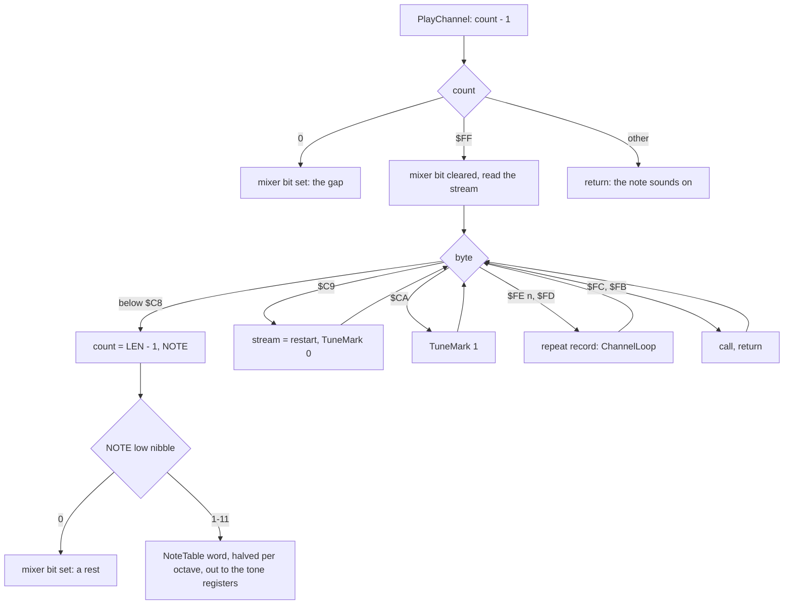

Worked example: `c1`, frame 15 034, a 48K. The samples of 15 034 hold count 0 in both records: the gap. The stream
pointers are `$6717` (ChannelA) and `$67EE` (ChannelB). In that frame's interrupt both channels read:

| Channel | Bytes read | Meaning | Result |
| --- | --- | --- | --- |
| ChannelA | `$6717`: `FD` | the end of `repeat 10`, its last turn | the repeat closed |
| | `$6718`: `FE 06` | `repeat 6` | a repeat record: count 6, address `$671A` |
| | `$671A`: `04 02` | a note of 4 interrupts, note 2, octave 0 | count 3; word 2 `$0D4D` halved 0 + 2 times = 851: 130.2 Hz, C3 |
| ChannelB | `$67EE`: `FE 06` | `repeat 6` | a repeat record |
| | `$67F0`: `04 12` | 4 interrupts, note 2, octave 1 | count 3; `$0D4D` halved 1 + 3 times = 212: 522.8 Hz, C5 |

The sample of 15 035 holds count `$03` and the pointers `$671C` and `$67F2` in the two records. The AY writes of
that frame went to AY tone registers 2 and 0. They are the six closing C notes of tune 1 before its last rests.

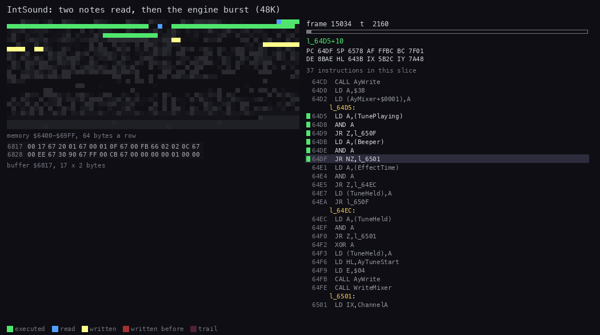

How to read it: the memory map `$6400-$69FF` (the sound code and the records); under it ChannelA and ChannelB as hex,
17 bytes a line; right, the code as it runs. PlayChannel reads `FD FE 06 04 02` for A, then `FE 06 04 12` for B,
then EngineSound makes its 11 edges. Recording `c1`, frame 15 034, T 1800 to 23 400 (the interrupt runs from
T 1844 to its JP back at 23 305), 60 pictures of 360 T. Made by `python3 ../../kit/routine_anim.py --work
work/docs/erC/c1 --window 15034:1800-15034:23400 --listing build/game.lst --pc 643C-690E --view buffer:6817:17x2:hex
--range 6400-69FF --pictures 60 --title '...' --out docs/img/routines/PlayChannel.gif`.

**The point**: a note's length includes its own silent gap, so a run of equal notes is heard as separate notes with
no rest byte between them. That keeps the streams small: 305 bytes for both tunes.

Witness: PlayChannel L1 51 862, ChannelPeriod L1 5104, ChannelLoop L1 2347 (`src/game/sound.asm`); the records in
`work/docs/erC/c1-chan.jsonl`; the trace `work/docs/erC/c1/traces/15034_1800-15034_23400.uatr`.

## 9.3 The two tunes and when each plays

SetTune `$AAC9` asks for a tune: TuneRequest = (Stage AND 1) + 1. Stage counts from 0, so tune 1 plays on stages 1,
3 and 5 and tune 2 on stages 2 and 4. Both are two-voice tunes: a bass line on AY channel B (the stream A) and a
melody on AY channel A (the stream B).

| Tune | Stages | Streams | Length of a loop | The mark | Audio |
| --- | --- | --- | ---: | ---: | --- |
| 1 | 1, 3, 5 | Tune1A `$6701` (36 bytes), Tune1B `$6790` (107 bytes) | 1434 interrupts, 28.7 s, both streams | interrupt 1235 | [tune-1.mp3](audio/tune-1.mp3) |
| 2 | 2, 4 | Tune2A `$66CA` (55 bytes), Tune2B `$6725` (107 bytes) | stream A 1142, stream B 1148 interrupts: 23.0 s | 943 (A), 949 (B) | [tune-2.mp3](audio/tune-2.mp3) |

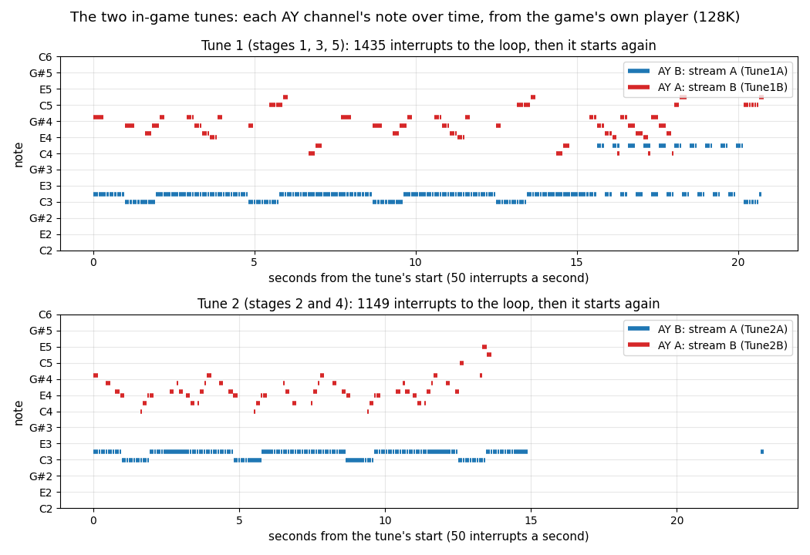

How to read it: one row a tune, time across in seconds, the note up. Blue is the bass (stream A on AY channel B),
red the melody (stream B on AY channel A). Each mark is one note, as long as it sounds. Both tunes end with two rests
of 199 interrupts (8 s), the mark between them. Recording: none, the simulator runs the build's player from a
tune's start until both streams have read their `$C9` once. Made by `python3 tools/fig_sound.py fig-tunes
docs/img/sound/tunes.png`, after `python3 tools/fig_sound.py audio docs/audio`.

The renders are MP3 at `lame -V 4`, from the AY registers the simulator wrote each frame: AY clock 1 773 400 Hz,
44 100 samples a second, the AY's volume table. The tunes use no envelope and no noise.

A tune changes only at its mark. The streams end with `199 00`, `$CA`, `199 00`, `$C9`: a rest, the mark, a rest,
the restart. `$CA` sets TuneMark, `$C9` clears it. IntSound starts a new tune only while TuneMark is set. So a tune
asked for mid-phrase waits for the old one's closing rest, and starts in silence.

```text
SetTune:        TuneRequest = (Stage & 1) + 1            # StageStart (each stage, each turn), the pause's end
RaceEnd:        TuneRequest = 0                          # the time-out, the race's end, a quit
Pause:          TuneRequest = 0; GetKey(); SetTune()
AyEffectTick:   a fall's noise ended: TuneRequest = 0, TuneMark = 1    # silence at once
IntSound:       if TuneRequest != TunePlaying and TuneMark: switch     # else the old tune plays on
```

```asm
SetTune:
  LD A,(Stage)
  AND $01
  INC A
  LD (TuneRequest),A
  RET
```

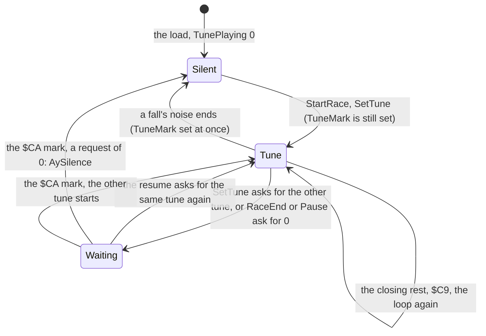

Four consequences follow from the code:

- A pause stops the engine at once but not the tune: TuneRequest is 0, but the tune plays on to its mark. In `c1`
  the player paused at 14 555. TunePlaying stayed 1, TuneMark 0, and ChannelA's stream pointer moved on from
  `$66FF` to `$66ED` (a repeat) through the pause, at the samples 14 561-14 621
  (`work/docs/erC/c1-pause.jsonl`). This is a 48K, so the tune was not heard; on a 128K it is.
- After a fall the tune starts again from its beginning. AyEffectTick sets TuneMark itself at the end of the fall's
  noise, so the silence comes at once, and the next SetTune starts the tune at once. In `c1` TuneRequest fell to 0 at
  15 957, 114 frames after the fall at 15 843, and was 1 again at 16 021, when the rider was back on the bike. TuneMark
  was 0 at 16 023: the tune had restarted.
- A new stage keeps the old tune until its mark, up to 25 s into the new stage on a 128K.
- Tune 2's streams are 6 interrupts apart in length. They drift apart by 6 interrupts a loop, 0.12 s.

Worked example: `stages`, the change from stage 1 to stage 2 (`work/docs/erC/st-vars.jsonl`). Tune 1 started at
frame 86 (TunePlaying 1, TuneMark 0). TuneMark rose at 1322, interrupt 1236 of the tune: the mark at 1235, read at
the next interrupt. At 1432 TuneRequest and TunePlaying fell to 0 together. That was the end of a fall's noise
(EffectStep had counted down from 1380), though the bike never fell: the POKEs of `stages` remove the CALL Crash but
not the PlayEffect before it (9.8). So the mark was set, and stage 2 began at 3346 with TunePlaying 2 at once.

**The point**: the mark makes every tune change fall in the tunes' 4-second closing rest. The cost is a stage's first
seconds played to the previous stage's tune.

Witness: SetTune L1 28 (`c1`, `crash`, `ctl`, `m128`, `stages`, `twoplayer`); ChannelCommands' `$C9` and `$CA`
branches at `$6612` and `$661E`; `c1-vars.jsonl`, `c1-pause.jsonl` and `st-vars.jsonl` in `work/docs/erC`; the
lengths from the streams in `src/res/sound/tunes.txt` and from the simulator (`work/docs/erC/sound/sound.json`).

## 9.4 The engine on both machines

EngineSound `$6851` runs at the end of every interrupt while TuneRequest is nonzero. Its first instruction is
`LD A,n` with n flipped each call, so only every second call plays: 25 a second.

It turns SPEED into a note. SPEED's high byte `$7C34` is the speed in km/h, 0-199. In the air 9 is added: the engine
revs up when the wheel leaves the ground. Then the speed is folded: below 60 as it is, 60-129 minus 60, 130 and up
minus 120. C = `$63` - the folded value. A small C is a short gap and a high note.

- **48K**: 11 edges on port `$FE` (bit 4, the speaker). Between two edges the DJNZ waits `$14` + C + (a ROM byte at
  `$02xx` AND `$3F`) turns of 13 T. The ROM byte is the jitter: the burst is a rough buzz, not a pure tone. The pointer
  into the ROM is L as the interrupt left it.
- **128K**: an effect playing (EffectTime nonzero): nothing. SkidLevel nonzero: EngineSkid (9.5). Otherwise
  EngineTone `$68D1`: the period of AY channel C = (`$7F` - folded) x 32, plus 16 when bit 7 of -SPEED's low byte
  is set, volume 15, tone C on.

```text
EngineSound:
    toggle = ~toggle; if toggle == 0: return              # every second interrupt
    A = Speed.high + (9 if JumpHeight.high else 0)
    if A >= 60: A -= 60; if A >= 70: A -= 60              # three "gears": 0-59, 60-129, 130-199
    C = 99 - A
    if Beeper:                                             # 48K
        for 11 edges: OUT ($FE), bit4 ^= 1; wait $14 + C + (ROM[$0200 + L++] & $3F) DJNZ turns
    elif EffectTime: return                                # the AY effect owns the channels
    elif SkidLevel and Speed.high: EngineSkid()
    else: period = ((C + $1C) << 1 | bit7(-Speed.low)) << 4; AY R4/R5 = period; R10 = 15; tone C on
```

```asm
EngineSound:
  LD A,$00                ; the toggle
  XOR $FF
  LD (EngineSound+$0001),A
  RET NZ
  LD A,(JumpHeight+$0001)
  AND A
  LD A,(Speed+$0001)
  JR Z,l_6864
  ADD A,$09               ; in the air: 9 more
l_6864:
  CP $3C
  JR C,l_6870
  SUB $3C
  CP $46
  JR C,l_6870
  SUB $3C
l_6870:
  CPL
  ADD A,$64               ; C = 99 - A
  LD C,A
  LD A,(Beeper)
  AND A
  JR Z,l_6893
  LD D,$0B
  LD H,$02
  XOR A
EngineEdges:
  OUT ($FE),A             ; 48K: the burst
  LD E,A
  LD A,(HL)
  INC L
  AND $3F
  ADD A,$14
  ADD A,C
  LD B,A
  LD A,E
  XOR $10
l_688D:
  DJNZ l_688D
  DEC D
  JR NZ,EngineEdges
  RET
```

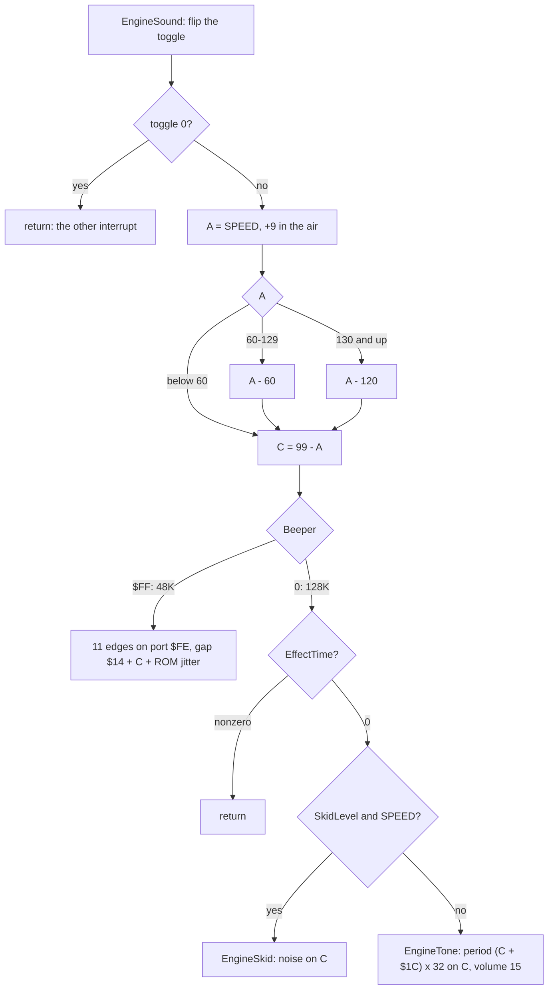

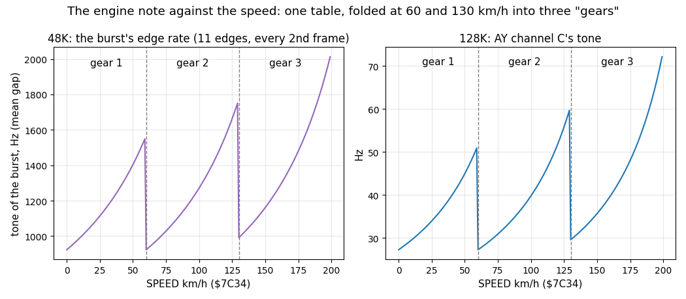

How to read it: left, the 48K burst's mean edge rate at each speed (half the edges a second); right, AY channel C's
tone on the 128K. Both fall back twice, at 60 and 130 km/h: the folds, heard as gear changes. The 128K engine is a low
rumble of 27-72 Hz. The 48K burst is 920-2010 Hz, 25 bursts a second. Recording: none, the simulator calls
EngineSound at each speed 0-199 on the ground. Made by `python3 tools/fig_sound.py fig-engine
docs/img/sound/engine.png`, after `python3 tools/fig_sound.py audio docs/audio`.

| SPEED | Folded | C | 48K: T a call | 48K: mean gap | 128K: period | 128K: tone |
| ---: | ---: | ---: | ---: | ---: | ---: | ---: |
| 0 | 0 | 99 | 20 997 | 1896 T | 4064 | 27.3 Hz |
| 59 | 59 | 40 | 12 560 | 1130 T | 2176 | 50.9 Hz |
| 60 | 0 | 99 | 21 018 | 1896 T | 4064 | 27.3 Hz |
| 129 | 69 | 30 | 11 151 | 1000 T | 1856 | 59.7 Hz |
| 130 | 10 | 89 | 19 590 | 1766 T | 3744 | 29.6 Hz |
| 199 | 79 | 20 | 9 723 | 870 T | 1536 | 72.2 Hz |

The audio: [engine-48k.mp3](audio/engine-48k.mp3) and [engine-128k.mp3](audio/engine-128k.mp3) are 110 passes from a
standing start with THROTTLE held (17.6 s), the speed of each pass from Throttle's own rule ([doc 10](10-gameplay-logic.md)).
They pass both folds.

Worked example: `c1`, frame 15 034, the bike at about 157 km/h (the samples of 15 027 and 15 043: 153 and 157). The
fold gives 157 - 120 = 37, C = 62. The gaps are 20 + 62 + 0-63 = 82-145 turns of 13 T. The trace has the 11 OUTs at
`$687F` at T 4936, 6280, 7481, 8838, 10 208, 11 695, 12 883, 14 149, 15 636, 18 226 and 21 028. The first eight gaps
are 1188-1487 T, as computed. The last two are 2590 and 2802 T. The beam reached the picture at T 14 336, and from
there each fetch of the DJNZ at `$688D` waits for the ULA (the code is in contended memory). So on a real 48K the burst
drops in pitch halfway through: the second half of the buzz is slower than the first.

**The point**: one 70-step note table serves three gears. The 48K pays for its engine with CPU time: about 21 500 T of
the interrupt in frame 15 034, a third of the frame, every second frame.

Witness: EngineSound L1 23 083, the OUT at `$687F` in `c1` (`src/game/sound.asm`); EngineTone L1 1768 in `m128`;
`work/docs/erC/c1/traces/15034_0-15034_40000.uatr` (the interrupt from T 1844 to its JP back at T 23 305).

## 9.5 The AY effect and the skid noise

PlayEffect `$A179` is called with 1 for a fall and 2 for a bounce or a landing. It sets EffectTime `$6462` and writes
five AY pairs (AyEffect `$A15D`): R7 = `$07` (tones off, noise on A, B and C), R6 = `$1F` (the slowest noise), and
volume 15 on all three channels. While EffectTime is nonzero a 128K's tune is held (TuneHeld) and the engine is
silent: the noise owns the AY.

AyEffectTick `$ACA5` runs once a pass, at the head of RacePass. It counts EffectStep `$6463` down and writes the old
step into the three volumes.

- A fall (EffectTime 1): the volumes go 15, 14, ... 2, a step a pass: 14 passes, about 2.2 s. At step 0 it sets
  TuneRequest 0 and TuneMark 1: tune and engine stop until the next SetTune.
- A bounce (EffectTime 2): the step after 14 would be 13, and there it stops: EffectTime 0, EffectStep 15. Two
  steps, two passes. On the next interrupt IntSound sees EffectTime 0 and writes the tune's volumes and mixer back.

```text
PlayEffect(A):  EffectTime = A; AY R7 = $07, R6 = $1F, R8 = R9 = R10 = 15
AyEffectTick:   (once a pass)
    if EffectTime == 0: return
    step = EffectStep - 1; EffectStep = step
    if step == 0: TuneRequest = 0; TuneMark = 1; EffectTime, EffectStep = 0, 15; return    # a fall's end
    if EffectTime == 2 and step == 13: EffectTime, EffectStep = 0, 15; return              # a bounce's end
    AY R10, R9, R8 = step + 1                                                              # the old step
```

```asm
AyEffectTick:
  LD HL,(EffectTime)      ; L = EffectTime, H = EffectStep
  LD A,L
  AND A
  RET Z
  LD A,H
  DEC A
  LD (EffectStep),A
  JR NZ,l_ACBC
  XOR A
  LD (TuneRequest),A      ; the fall's noise has died: silence
  INC A
  LD (TuneMark),A
  JR l_ACC3
l_ACBC:
  DEC L
  JR Z,l_ACCA             ; a fall: write the volumes
  CP $0D
  JR NZ,l_ACCA
l_ACC3:
  LD HL,$0F00             ; a bounce at 13: done
  LD (EffectTime),HL
  RET
l_ACCA:
  LD L,H
  LD H,$0A                ; registers 10, 9, 8
```

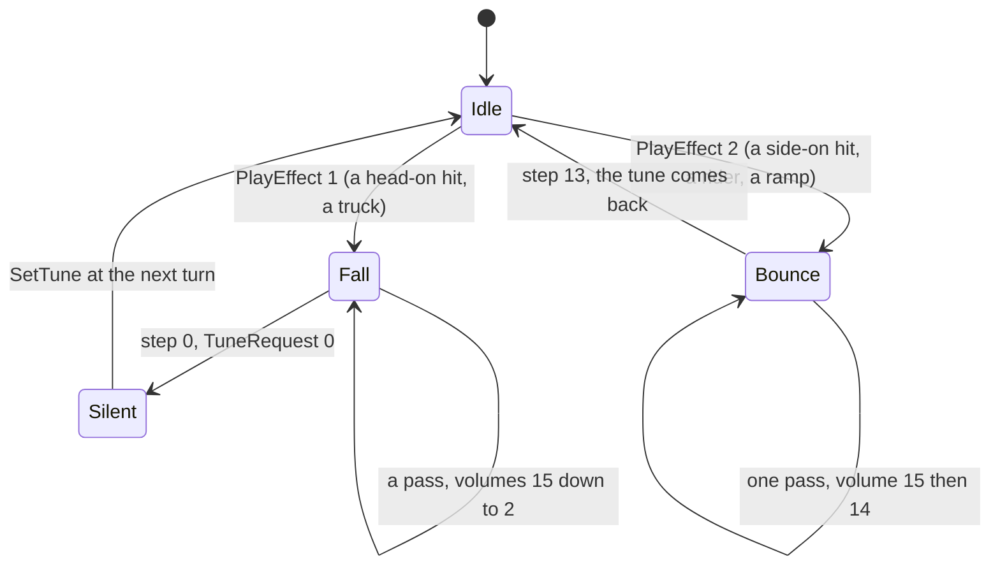

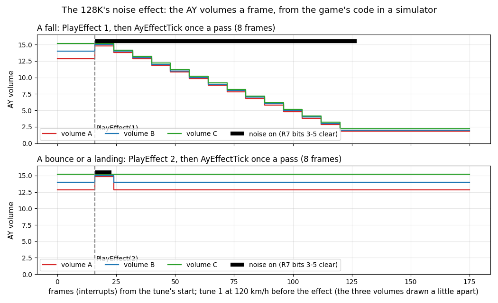

How to read it: the AY volumes A, B and C each frame (drawn a little apart), and a black bar while noise is on. Tune
1 plays at 120 km/h for 16 frames, then PlayEffect. Top, a fall: 14 volume steps of 8 frames, then R7 = `$3F`,
silence. Bottom, a bounce: 8 frames of noise at 15, then the tune's volumes 13, 14, 15 again. Recording: none, the
simulator runs PlayEffect, AyEffectTick once a pass and the interrupt each frame. Made by `python3 tools/fig_sound.py
fig-ay docs/img/sound/ay.png`, after `python3 tools/fig_sound.py audio docs/audio`. The audio: [ay-fall.wav](audio/ay-fall.wav),
[ay-bounce.wav](audio/ay-bounce.wav).

Worked example: `c1`'s first fall. The sample of 15 843 holds EffectTime 1, EffectStep 15. EffectStep then reads 14,
13, ... 1 at the samples 15 851-15 949, one value a pass (6-8 frames). At 15 957 EffectTime is 0, EffectStep 15,
TuneRequest 0 and TuneMark 1. A bounce: 15 175 holds EffectTime 2, step 15; 15 183 step 14; 15 191 EffectTime 0,
step 15. The machine is a 48K, so none of this was heard, but the tune state followed it.

The skid noise. On stage 3 the sand beside the road sets SkidLevel `$645F` (OffRoadSand: (distance off the road -
`$24`) / 4, or 3 in a gap of the road), and a fall on the sand of stages 3 and 5 adds 3 a pass (FallSand). On the
128K, EngineSkid `$689E` then replaces the engine tone with noise on channel C: volume ((SkidLevel / 4) AND 3) + 11, at
most 15; the noise period SPEED / 16. [ay-skid.wav](audio/ay-skid.wav) is SkidLevel 8 at 120 km/h: R6 = 7, R10 = 13,
R7 = `$1C` (tone C off, noise C on), under tune 1. On the 48K SkidLevel is never read.

**The point**: one noise and one counter make both the crash and the knock. The fall's end doubles as the game's way
to stop the tune and the engine while the rider lies on the ground.

Witness: PlayEffect L1 266, AyEffectTick L1 4383 (`src/game/race.asm`); `work/docs/erC/c1-vars.jsonl` (`$645F-$6463`).
EngineSkid is known only from the code: no 128K recording left the road on stage 3.

## 9.6 The main loop's beeper sounds

Four sounds stop the game while they play. They run in the main loop, not in the interrupt, and they toggle the
speaker in a busy loop. The interrupt still comes, so the engine burst sounds over them on a 48K.

| Sound | Routine | Edges | Gap | T-states | Frames | Trigger |
| --- | --- | ---: | --- | ---: | ---: | --- |
| the crash noise | CrashSound `$AC88` (48K only) | 248 | ROM byte AND `$1F` + `$30` turns | 213 613 | 3.1 | a fall, a bounce, a rider |
| the ramp's knock | CrashSoundD `$AC8A`, D = `$C0` (48K only) | 192 | the same | 165 464 | 2.4 | a ramp |
| 3, 2, 1 | BeepTone `$AB95`, DE = `$40E0` | 64 | 224 turns | 188 489 | 2.7 | Countdown 14, 10, 6 |
| GO | BeepTone, DE = `$0070` | 256 | 112 turns | 381 193 | 5.5 | Countdown 2 |
| EXTENDED PLAY | BeepTone, DE = `$6080` | 96 | 128 turns | 162 921 | 2.3 | ExtendedTime 30, 26, 22 |
| the name entry | NameEntrySound `$8AF0` | 191, then a wait | NameSound + 8 turns | 150 791 | 2.2 | each step of the entry |

CrashSound plays the ROM's bytes at `$0300` up as noise: bit 4 of one byte is the speaker, the low five bits of the
next the gap. It starts where L stands. On the 128K it returns at once with carry clear; the AY effect is the crash
there.

The countdown beeps at Countdown values whose low two bits are 2: 14, 10 and 6 give the short 3, 2 and 1, and 2 gives
the long GO, one octave lower (gap 112 against 224 turns, and 256 edges against 64). EXTENDED PLAY beeps three times
as it flashes after a stage's end. Its DE is loaded as `LD DE,TrackPatterns+$0174` in the listing: the constant
`$6080` happens to equal that address (9.8).

NameEntrySound makes 191 edges at NameSound + 8 turns, then waits 191 x (50 - NameSound) turns. A pick sets NameSound
to `$28`, and each call counts it down by one. So each step's blip is higher than the last, and every call takes the
same 150 791 T: the pitch rises while the pace of the entry stays fixed.

```text
BeepTone(D edges, E turns):     repeat D: OUT ($FE), bit4; bit4 ^= $10; wait E DJNZ turns
CrashSoundD(D):                 if Beeper == 0: return NC
                                repeat D: OUT ($FE), ROM[$0300 + L++] & $10; wait (ROM[$0300 + L++] & $1F) + $30
                                return C
NameEntrySound:                 if NameSound: NameSound -= 1; 191 edges of NameSound + 8 turns
                                wait 191 x (50 - NameSound) turns
```

```asm
BeepTone:
  XOR A
l_AB96:
  OUT ($FE),A
  XOR $10
  LD B,E
l_AB9B:
  DJNZ l_AB9B
  DEC D
  JR NZ,l_AB96
  RET
CrashSoundD:
  LD A,(Beeper)
  AND A
  RET Z                   ; 128K: carry clear, the caller ticks the AY effect
  LD H,$03
l_AC91:
  LD A,(HL)
  INC L
  AND $10
  OUT ($FE),A             ; a ROM bit as the speaker
  LD A,(HL)
  INC L
  AND $1F
  ADD A,$30
  LD B,A
l_AC9E:
  DJNZ l_AC9E
  DEC D
  JR NZ,l_AC91
  SCF
  RET
```

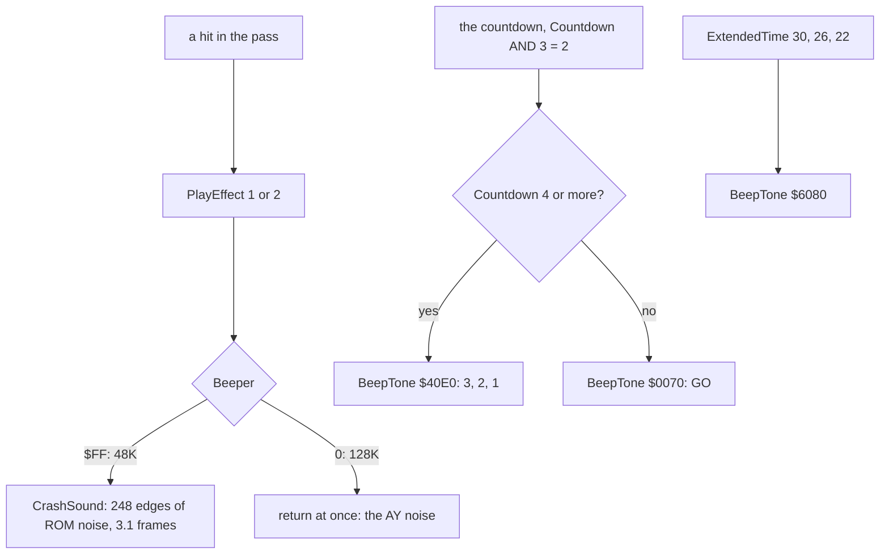

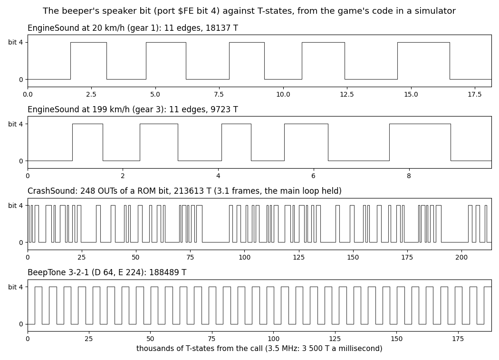

How to read it: the speaker bit (port `$FE` bit 4) against T-states from the call, one row a sound. The engine bursts
at 20 and 199 km/h show 11 edges with uneven gaps (the ROM jitter). The crash noise is 248 irregular edges, 3.1
frames long. The countdown beep is a square wave. Recording: none, the simulator. Made by `python3 tools/fig_sound.py
fig-beeper docs/img/sound/beeper.png`.

Worked example: `c1`, the countdown. Countdown was `$0A` at the sample of 14 077. That pass played the 2, 64 edges of
224 turns, and took 10 frames (to 14 087), against 8 for the passes without a beep. Countdown was 2 at the sample of
14 155. That pass played GO and took 18 frames (to 14 173): GO alone holds the loop for 5.5 frames. The audio: [countdown.wav](audio/countdown.wav) is the four beeps a pass apart,
[extended-play.wav](audio/extended-play.wav) the three of a stage's end, [name-entry.wav](audio/name-entry.wav) twelve
steps of an entry, [crash-48k.wav](audio/crash-48k.wav) one CrashSound.

**The point**: the effects that would cost the most are allowed to stop the game, because nothing on the road moves
during the countdown or a stage's end. The crash noise is the exception: on a 48K a hit freezes the race for three
frames.

Witness: BeepTone L1 55 (`c1`, `crash`, `ctl`, `m128`, `stages`, `twoplayer`), CrashSound L1 194, CrashSoundD L1 209
(`src/game/race.asm`); NameEntrySound L1 194 (`stages`, `src/game/flow.asm`); Countdown `$5E24` in
`work/docs/erC/c1-vars.jsonl`.

## 9.7 The cost, and 48K against 128K

| Part | 48K | 128K |
| --- | --- | --- |
| the tune | stepped, not heard (about 470 T a frame) | two AY channels (about 520 T a frame) |
| the engine | 9 700-21 000 T every second frame (uncontended), the burst on the beeper | a few AY writes, about 900 T every second frame |
| the crash, a bounce | CrashSound: 213 613 T in the main loop, the game stops 3 frames | the AY noise, a few hundred T a pass |
| the ramp | 192 edges, 165 464 T | the AY noise |
| the skid | none | AY noise on channel C |
| beeps, name entry | the beeper, blocking | the same beeper, blocking |

The numbers come from the simulator over one loop of tune 1 at 120 km/h. The interrupt's sound part: 48K mean 7643 T
a frame, at most 15 888; 128K mean 961 T, at most 4279. Without the engine both are about 500 T. The trace of `c1`
frame 15 034 (9.4) gives a real 48K interrupt with an engine call and two notes read: 21 461 T, 31 % of the frame.

The 48K pays a third of every second frame for its engine. That is one reason the main loop's pass takes 6-12 frames
([doc 4](04-game-loop.md)). The 128K loses less than 2 % of the frame to sound.

**The point**: the two machines hear different games. The 48K hears a buzzing engine and a crash, and no music. The
128K hears two-voice music over a low engine rumble, with noise effects that never stop the race.

Witness: `work/docs/erC/sound/sound.json` (`cost48K`, `cost128K`); the trace of 9.4.

## 9.8 Notes, quirks and what is known only from the code

- **ChannelA plays on AY channel B.** The records' register and mixer bytes are crossed with their names: ChannelA
  (`$6817`) writes tone register 2 and mixer bit 1, ChannelB (`$6828`) tone register 0 and mixer bit 0. The `.ann`'s
  comments now say so (they had it the other way round).
- **The immunity POKEs leave the fall's noise.** The ZXDB POKEs 42971,1 and 43151,1 turn `CALL Crash` into
  `LD BC,nn`, but the `PlayEffect 1` before each call still runs. Its noise ends with TuneRequest 0, and with no fall
  there is no new turn to call SetTune. So in `stages` the engine stops for the rest of the stage after the first
  head-on hit: TuneRequest is 0 from 1432 to 3346 and again from 3746 (`st-vars.jsonl`).
- **A bounce during a fall's noise runs it out.** The bounce's stop test is "the step is 13". PlayEffect 2 during a
  fall's decay, below 13, never meets it, so the step runs on to 0 and the tune stops as after a fall. `stages` shows
  it at 3700-3746: EffectTime 2 with EffectStep 6 down to 1, then TuneRequest 0.
- **The pause keeps the tune** (9.3).
- **EXTENDED PLAY's constant** at `$A905` (`LD DE,$6080`) is the beep's D = `$60` edges and E = `$80` turns. As a
  word it falls inside TrackPatterns, a coincidence: the source writes it as a number.
- **The name entry's pitch rises**, as NameSound counts down (the period is NameSound + 8).
- **NoteCarry** `$65DC` (`INC H` for a table crossing a page) and **ChannelAyPairs** `$668B` (inline AY pairs) are
  never reached: the note table ends at `$66C1`, and no stream holds such a byte. Known only from the code.
- **A halving count of 0** would make ChannelPeriod's loop run 256 times. The transposes `$20` and `$30` keep it at 2
  or more. Known only from the code.
- **EngineSkid** is known only from the code: no 128K recording slid on sand. **FallStage5** ran in the 48K
  recording `fall5` (WALKTHROUGH 6.0): 8 times at frames 235-280, the fall at the end.
- **The engine's jitter** reads the ROM at `$0200-$02FF` (the keyboard tables), the crash at `$0300-$03FF`. The game
  has no random-number generator; the ROM is its noise.
