# 10. Gameplay logic

What this covers:

- the race as rules: the pass as the game's clock, and the bike's states;
- SPEED `$7C34` and its three "gears", the brakes, the time-out's roll;
- steering against a bend's push, and the cost of leaving the road;
- the wheelie, the ramps and the jumps, the landing and the bounce;
- collisions with objects, riders and trucks;
- the crash, lying on the ground, the end of a turn and getting up;
- the timer, the score, the checkpoints and the stage end;
- the time-out, game over, the finish and the lap table;
- two players;
- the opponents' AI;
- the expected techniques, each shown by a run;
- the cheat key;
- the bugs, the stage 3 reset among them;
- the notable features of the code.

Doc 5 holds the controls byte and the keys. Doc 7 holds the track, the objects and the rider records. Doc 8 holds how the
HUD prints the numbers. This document holds the rules that connect them.

The recordings it rests on ([WALKTHROUGH 6.0](../WALKTHROUGH.md#60-the-recordings)):

- `c1`: power-on on the 48K, stage 1 from frame 14 075 to the time-out at 19 265. It was opened on an own instance
  after `. work/env.sh`: `python3 ../../kit/rs.py open --work work/docs/erC/c1 --ttd work/stage1/rec/c1/session.ttd
  --model 48K --port-base 37790`. Its game state was sampled every second frame by `python3 work/docs/erC/sample.py
  work/docs/erC/c1 14075 19465 2 work/docs/erC/c1-vars.jsonl`.
- `stages`: the five stages with all seven ZXDB POKEs, opened the same way at port base 37795 and sampled every
  second frame into `work/docs/erC/st-vars.jsonl`.
- `reset3`: stages 1-3 with six POKEs, the stage 3 reset. It was opened at port base 37795 (`work/docs/erC/r3`) and
  sampled every second frame from 6 600 to 6 770 into `work/docs/erC/r3-vars.jsonl`.
- `twoplayer` and `crash`: their frames are taken from WALKTHROUGH 6.0 and from doc 5 (5.12).
- The technique runs of `tools/play_techniques.py`: c1's play start (`work/stage1/rec/c1/play.szx`, c1 frame 14 075)
  replayed with c1's own input script `tests/inputs/c1.txt`, with one change to the keys. Each run samples the
  bike's variables every frame into `work/docs/erC/tech/<run>.jsonl`. The run `ramp-plain` changes nothing. It
  reproduces c1's SPEED, JumpHeight and BounceTime frame for frame (10.4), so a run is c1 with one change and
  nothing else. No POKE. The four runs with a change are also TTD recordings with the same keys
  (`tools/record.py tech-<run>`, `work/stage1/rec/tech-<run>/session.ttd`, WALKTHROUGH 6.0); a recording's
  frame F is c1's frame 14 075 + F. Their L1s witness the routines: RampCap `$A808` runs once in
  `tech-ramp-wheelie` (frame 1 412, c1 15 487: with the wheelie the ramp comes two frames later than in c1) and is skipped at the same ramp in `tech-land-wheelie`; CheatKey
  `$A659` runs once in `tech-cheat` (frame 126, c1 14 201) and CheatFixedStep `$A674` 51 times after it.

A sample of frame N is the memory at the start of frame N. An event is named by the frame its code runs in, so its
result shows first in the next frame's sample: c1 takes the ramp in frame 15 485 and JumpHeight is set in the sample
of 15 486. A pass is one turn of the race loop: 6 to 12 frames, 8.0
on average in `c1`'s play ([doc 4](04-game-loop.md)). SPEED is the high byte, `$7C34`, of the 8.8 word Speed `$7C33`. It is shown
as km/h. The figures' scripts are `tools/fig_gameplay.py` and `tools/play_techniques.py`.

## 10.1 The race as rules

### In short

Everything in a race is counted in passes, not in frames. The bike moves ScrollStep = SPEED × 14 / 256 track units a
pass. A rider moves its own speed a pass. The timer counts a second every ten passes. The score adds SPEED every pass.
So a heavy picture, which makes a pass longer, slows the whole race down together, and the rules stay fair.

The bike is always in one of seven states. BikeControl `$ACDF` picks the state each pass from six variables:

| Variable | Address | Meaning |
| --- | --- | --- |
| Countdown | `$5E24` | 16 to 0 at the start; `$80` to resume after a fall |
| FallTime | `$916E` | 0, or a fall's count 9 down to 1 (bit 7: the side) |
| GetUp | `$7C31` | 0, or the rider walking back to the bike |
| JumpHeight | `$5CE9` | 8.8; its high byte nonzero means in the air |
| BounceTime | `$A1C9` | passes left of a bounce |
| Wheelies | `$916F` | passes the WHEELIE key has been held |

### The states

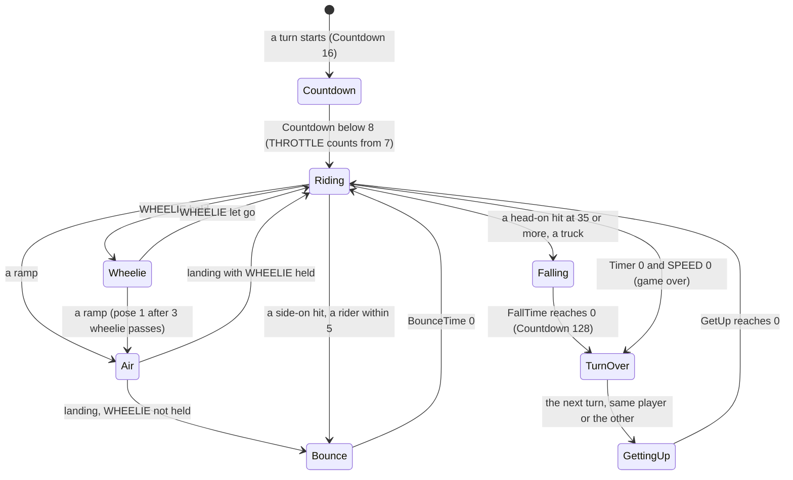

### Pseudocode

```text
one pass (RaceLoop $A5FE, RacePass $A67E):
    PassCount += 1; CheatKey
    ScrollStep = SPEED * 14 (or $1000 with the cheat, stages 1-3)
    AdvanceTrack; the road; MoveRiders (Countdown below 8); DrawRiders
    BikeControl; DrawBike                               the state machine above
    ObjectWalk: draw the objects, ObjectHit; RiderHits
    FinishCheck (after stage 5)
    ScoreAdd; ReadControls; Pause; Throttle; PrintSpeed; TimerTick
```

### Assembly

```asm
RaceCount:
  LD HL,PassCount         ; PassCount + 1; CAPS SHIFT held: CheatKey
  INC (HL)
  ...
RaceStep:
  LD A,(Speed+$0001)
  LD L,$0E
  CALL Multiply           ; DE = SPEED * 14: ScrollStep
  ...
RacePass:
  LD (ScrollStep),DE
  CALL AyEffectTick
  CALL AdvanceTrack
  ...
  LD A,(Countdown)
  CP $08
  CALL C,MoveRiders       ; the riders wait for the countdown's 8
  CALL DrawRiders
  LD A,(Stage)
  CP $05
  JR Z,l_A6AC             ; after the finish: no bike
  CALL BikeControl
  CALL DrawBike
```

### The course of a game

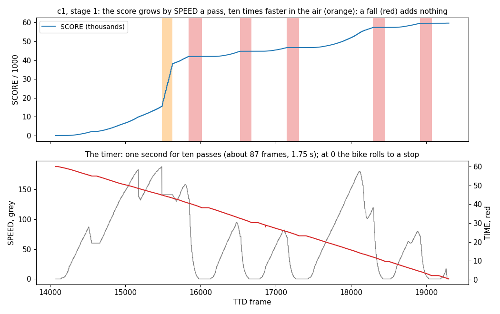

*How to read it: the top panel is the score of `c1` in thousands. Orange marks the frames in the air, red the
frames of a fall. The bottom panel is SPEED in grey and TIME in red, both against the TTD frame. Made by `python3
tools/fig_gameplay.py score docs/img/gameplay/score.png work/docs/erC/c1-vars.jsonl`.*

The figure is the course of one whole game: `c1`'s only turn, the timer from 60 to 0 in stage 1. Five falls cut the
speed to 0. Each fall is followed by flat TIME: the timer stands still while the rider gets up (10.6). One ramp, taken in
frame 15 485, adds 25 380 points in 140 frames, two fifths of the final score (10.7).

Worked example: the timer second of `c1`. Timer turns from `$60` to `$59` between frames 14 112 and 14 116 and
reaches 0 near 19 255: about 5 140 frames, 1.7 real seconds a timer second ([8.6](08-hud-and-text.md#86-the-timer)). That span
holds the five falls' 382 frames, in which the timer stands still while the rider gets up (TimerTick does not run:
Throttle returns to RaceLoop at `$A9ED-$A9F1`); without them a timer second is about 80 frames, ten passes of 8.0. The
TIME on the screen is slower than a clock by that much.

**The point**: the pass is the game's only clock. No frame counter, no interrupt timer enters the rules.

Witness: RaceStep L1 4382, BikeControl L1 4343 (`src/game/race.asm`, `src/game/bike.asm`); `c1-vars.jsonl`.

The animation of a whole pass is in [doc 4](04-game-loop.md) (`img/routines/RaceLoop.gif`).

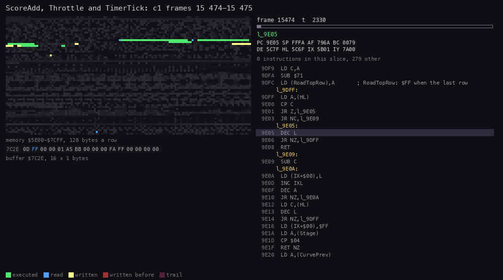

*ScoreAdd, the controls, Throttle and TimerTick in frames 15 474-15 475 of `c1`, with the bytes `$7C2E-$7C3D`
(PassCount, SPEED and the getting-up counter) under the memory map. Command: `python3 ../../kit/routine_anim.py
--work work/docs/erC/c1 --window 15474:0-15476:0 --listing build/game.lst --pc A974-AA9D --view
buffer:7C2E:16x1:hex --range 5E00-7CFF --pictures 60 --title "ScoreAdd, Throttle and TimerTick: c1 frames 15
474-15 475" --out docs/img/routines/Throttle.gif`.*

## 10.2 SPEED and the gears

### In short

Throttle `$A9DC` changes Speed `$7C33` (8.8; SPEED is its high byte `$7C34`) once a pass. It does nothing in the air, during the countdown (8 or
more) or while the rider gets up. THROTTLE (bit 0 of the controls) adds one of three amounts, by the speed's band:

| SPEED | Added a pass | In km/h a pass | The feel |
| --- | --- | --- | --- |
| 0-19 | (SPEED + 1.0) / 4 | 0.25 to 5 | first gear: the speed doubles about every 3 passes |
| 20-159 | `$0220` | 2.125 | second gear: a straight line |
| 160-199 | (`$C800` − SPEED) / 16 | 2.5 down to 0.06 | top gear: 1/16 of the way to 200 |

The top band never reaches 200. SPEED 199 is reached after 137 passes from a standing start, 160 after 80, 100 after
51. BRAKES (bit 4, only when THROTTLE is not held) takes `$0580` (5.5) a pass. At Timer 0 the bike loses `$0940` (9.25)
a pass whatever is held.

Two more factors are applied after that, on the ground:

- a bounce: SPEED's high byte × `$FA` / 256 a pass, truncated (−2.3 %, at least 1 km/h);
- full lean: with Pose 3 and Lean ±3, SPEED's high byte × `$FF` / 256, truncated: one whole km/h less a pass (with
  THROTTLE held, +1.125 instead of +2.125). Only the high byte is multiplied (`$AA61-$AA66`): the bounce's × `$FA`
  is truncated the same way.

The "gears" are only the three bands. The engine note of doc 9 has its own three steps at 60 and 130.

### Pseudocode

```text
Throttle:
    if in the air: goto factors
    if Countdown >= 8 or GetUp: return
    if Timer == 0: SPEED = max(SPEED - $0940, 0)
    elif THROTTLE:
        if SPEED.high < $14:   SPEED += (SPEED + $0100) / 4
        elif SPEED.high < $A0: SPEED += $0220
        else:                  SPEED += ($C800 - SPEED) / 16
    elif BRAKES: SPEED = max(SPEED - $0580, 0)
factors:
    if in the air: return
    if BounceTime: SPEED.high = SPEED.high * $FA / 256
    elif Pose == 3 and Lean is +3 or -3: SPEED.high = SPEED.high * $FF / 256
```

### Assembly

```asm
Throttle:
  LD HL,(Speed)
  LD A,(JumpHeight+$0001)
  AND A
  JR NZ,l_AA3F            ; in the air: no change
  LD A,(Countdown)
  CP $08
  JP NC,RaceLoop
  LD A,(GetUp)
  AND A
  JP NZ,RaceLoop          ; getting up: no change, no TimerTick
  LD A,(Timer)
  AND A
  JR NZ,l_AA03
  LD DE,$0940             ; Timer 0: roll to a stop
  SBC HL,DE
  JR NC,l_AA3C
  JR l_AA39
l_AA03:
  BIT 0,D                 ; THROTTLE
  JR Z,l_AA2E
  LD A,H
  CP $14
  JR C,l_AA20             ; below 20
  CP $A0
  JR C,l_AA1B             ; below 160
  EX DE,HL
  LD HL,$C800             ; ($C800 - SPEED) / 16
  SBC HL,DE
  EX DE,HL
  LD B,$04
  JR l_AA25
l_AA1B:
  LD DE,$0220
  JR l_AA2B
l_AA20:
  LD E,L                  ; (SPEED + $0100) / 4
  LD D,H
  INC D
  LD B,$02
l_AA25:
  SRL D
  RR E
  DJNZ l_AA25
l_AA2B:
  ADD HL,DE
  JR l_AA3C
l_AA2E:
  BIT 4,D                 ; BRAKES
  JR Z,l_AA3C
  LD DE,$0580
  SBC HL,DE
  JR NC,l_AA3C
l_AA39:
  LD HL,$0000
l_AA3C:
  LD (Speed),HL
```

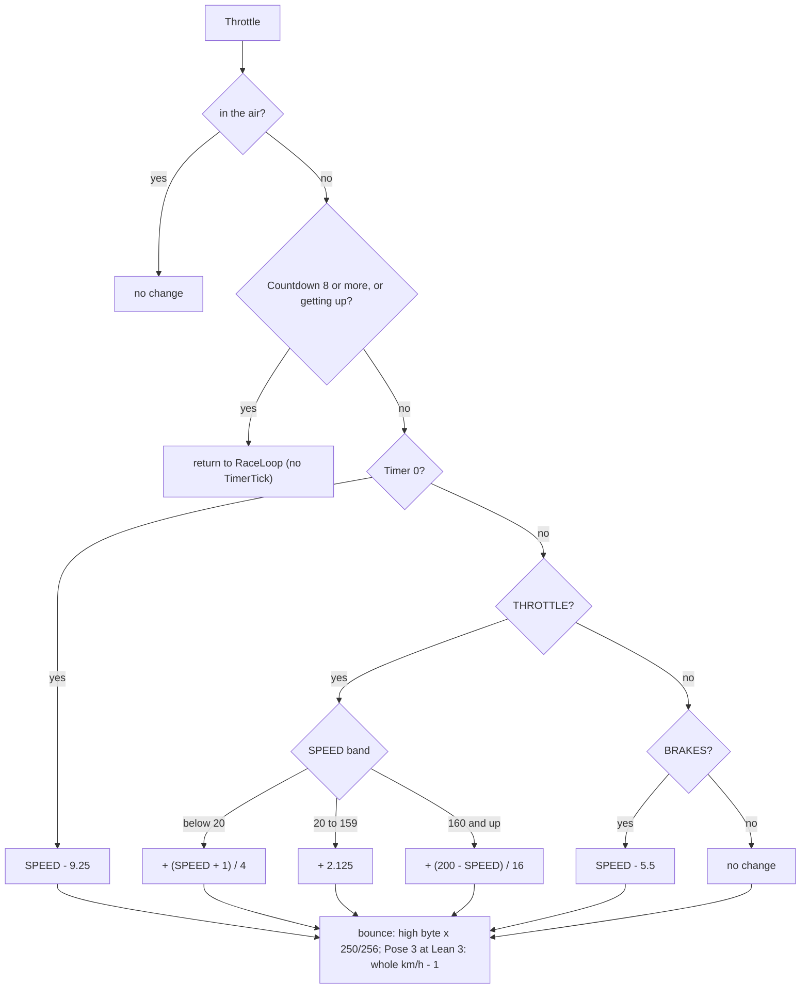

### The model against c1

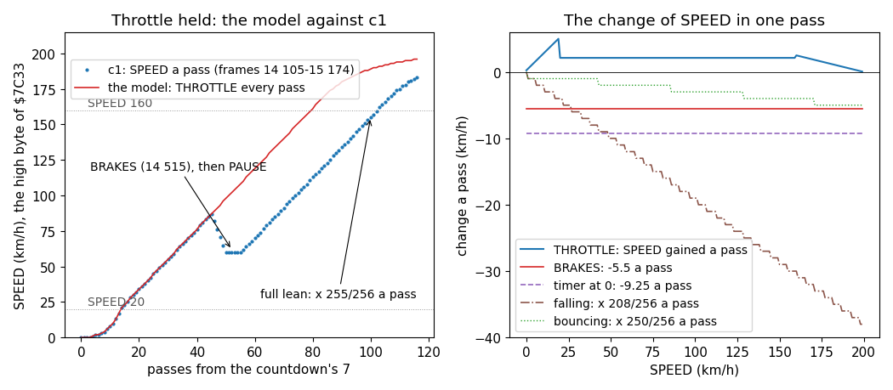

*How to read it: left, `c1`'s SPEED at each pass from the countdown's 7 (dots) and the model run with THROTTLE every
pass (red). Right, the change of SPEED in one pass against SPEED, one line for each cause. Made by `python3
tools/fig_gameplay.py speed docs/img/gameplay/speed.png work/docs/erC/c1-vars.jsonl`.*

The dots lie on the model for the first 45 passes. Then `c1` brakes at 14 515 and pauses. After that its slope is a
little below the model's, from the weave: c1 keeps O or P held at full lean, and each such pass loses one whole km/h.

Worked example: the first passes of `c1`. Countdown reads 7 at 14 105, so the pass that follows is the first that
counts THROTTLE. SPEED is then `$0000`, `$0040`, `$0090`, `$00F4`, `$0171`, `$020D` ... The high byte, shown on
the HUD, reads 1 at 14 145 (the fourth pass), 2 at 14 155 and 3 at 14 183. The model gives `$0171`, `$020D` and
`$03C4` for those passes. At 20 km/h the band changes: from there `c1` gains 2 km/h most passes and 3 on every
eighth (`$0220` is 2 and 1/8).

The time-out: at 19 259 `c1` has Timer 0 and SPEED 17. The next passes take 9.25 each: SPEED reads 7, then 0. TimerTick
then sees Timer 0 and SPEED 0 and ends the race (10.8).

**The point**: three lines of arithmetic give a bike that pulls hard from rest, then steadily, then never quite reaches
its top speed. A brake is weaker than the time-out's roll.

Witness: Throttle runs in every pass of `c1` (PrintSpeed after it: L1 4162, `src/game/race.asm`); `c1-vars.jsonl`,
frames 14 105-15 175.

## 10.3 Steering, bends and the road's edge

### In short

Steering is a sideways speed, not a position. LEFT and RIGHT move Lean `$9176` one step a pass between −3 and 3.
With neither held, the lean steps back toward 0 every second pass. The sideways speed is:

```text
sideways = SteerTable[2 * ScrollStep.high] * LeanTable[lean + 3] / 8  (8.8, the high byte at most 5)
```

LeanTable `$8E56` is `$AD $50 $28 $00 $28 $50 $AD`. SteerTable `$8E5D`, read at 2 × ScrollStep's high byte
(`$AE15-$AE20`), falls with the speed: 255 up to 36 km/h, 125 at 55-73 km/h, 42 at 199. So a full lean is capped at
5 below 128 km/h, and weak at full speed (3.55). Doc 5 (5.7)
traces the lean itself.

A bend pushes the bike outward. The push is BikeLateralPush `$AE64`:

```text
push = ScrollStep.high * factor / 256        factor $52, $8F, $A4 for bend 1, 2, 3 (BendPrev)
push is doubled on stages 2 and 4 (BendOp: ADD A,A), signed by BendDir
LateralX += sideways + push (+ the bounce's push again during a bounce); clamped to -91 .. +92
```

The segment's bits 0-1 hold the bend. The source calls the field Bend ([doc 7](07-objects.md), 7.3).

The road's edge. BikeRoadPlace `$AFFE` turns LateralX into the bike's distance d from the road's middle on the screen.
Beyond d = `$24` the stage's off-road routine (StageParams) caps SPEED each pass:

| Stage | Routine | Off the road |
| --- | --- | --- |
| 1, 2, 4 | OffRoad `$A1D9` | SPEED × (256 − ((d − 36) / 2 + 1)) / 256 + 1, a pass |
| 3 | OffRoadSand `$A1F6` | the same, and SkidLevel = (d − 36) / 4 (dust); on the road a gap (InGap) sets SkidLevel 3 and caps SPEED as at d = 48 (A = `$0C` into OffRoad's `l_A1E0`) |
| 5 | OffRoadStage5 `$A1F5` | only one side counts; then as stage 3 |

At the clamp (LateralX ±92, d = 116) the cap is × 215/256 a pass: 16 % a pass, about half the speed in four passes.
In the air or falling there is no off-road test.

### Pseudocode

```text
BikeControl, riding on the ground:
    pose = 3; Wheelies = 0
    if Countdown >= 4: skip the steering
    if LEFT or RIGHT: lean += RIGHT ? -1 : +1 ... kept within -3 .. 3
    elif PassCount odd: lean steps toward 0
    if lean == 0: BounceSpeed = 0
    else: BounceSpeed = min(SteerTable[2 * ScrollStep.high] * LeanTable[lean + 3] / 8, 5.xx), signed by lean
BikeLateral (every pass):
    push = (ScrollStep.high, doubled on stages 2 and 4) * factor[BendPrev] / 256, negated if BendDir == 1
    HorizonScrollStep = push
    LateralX += BounceSpeed (twice in a bounce) + push; clamp the high byte to -91 .. +92 ($A5 .. $5C)
```

### Assembly

```asm
l_AE15:
  LD A,(ScrollStep+$0001) ; the sideways speed: SteerTable * LeanTable / 8
  ADD A,A
  LD E,A
  LD D,$00
  LD HL,SteerTable
  ADD HL,DE
  LD E,(HL)
  ...
  CALL Multiply
  SRL D                   ; / 8
  RR E
  SRL D
  RR E
  SRL D
  RR E
  LD A,D
  CP $05
  JR C,l_AE50
  LD D,$05                ; at most 5
  ...
BikeLateral:
  LD A,(ScrollStep+$0001)
BendOp:
  DEFB $87                ; ADD A,A on stages 2 and 4, NOP elsewhere
BikeLateralPush:
  LD L,A
  LD A,(BendPrev)         ; the bend, bits 0-1 of the segment
  AND A
  JR NZ,l_AE70
  LD DE,$0000
  JR l_AE8B
l_AE70:
  CP $02
  LD A,$52
  JR C,l_AE7C
  LD A,$8F
  JR Z,l_AE7C
  LD A,$A4
l_AE7C:
  CALL Multiply
  LD A,(BendDir)
  DEC A
  JR NZ,l_AE8B
  LD HL,$0000             ; BendDir 1: the other way
  SBC HL,DE
  EX DE,HL
l_AE8B:
  LD HL,(LateralX)
  LD (HorizonScrollStep+$0001),DE
```

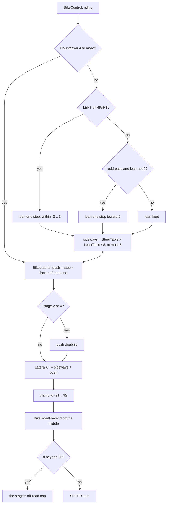

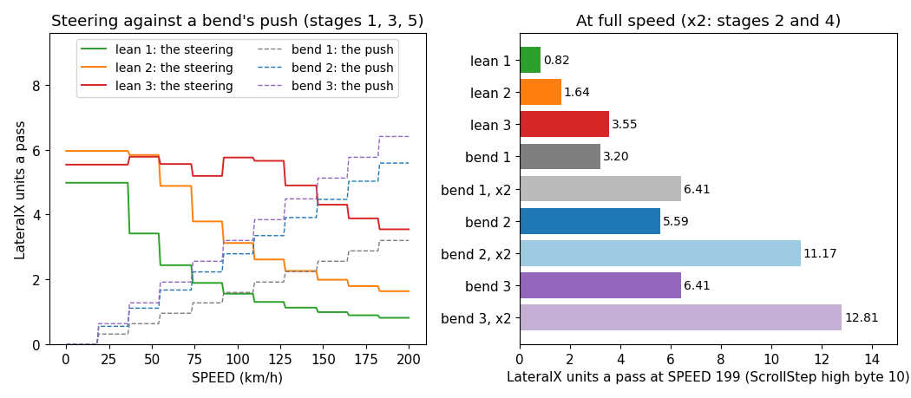

*How to read it: left, the sideways speed of leans 1, 2 and 3 (solid) and the push of bends 1, 2 and 3 (dashed),
both in LateralX units a pass, against SPEED. Right, the same at SPEED 199, with the pushes doubled for stages 2
and 4. Made from the image's SteerTable and LeanTable by `python3 tools/fig_gameplay.py steer
docs/img/gameplay/steer.png`.*

The cap at 5 keeps the sideways speed's low byte, so below about 55 km/h lean 2 steers a little harder than lean 3
(5.96 against 5.54 at rest; below 55 km/h). The figure shows the game's main rule. Below about 146 km/h a full lean
beats every bend. Above it bend
3 pushes harder than a full lean can steer, and on stages 2 and 4 even bend 1 does at full speed (6.4 against 3.55).
A rider who keeps the throttle open in a hard bend drifts off the road, and the off-road cap then takes the speed.

Worked example: `c1` at frame 15 250. The segment is `$91`: bend 1, BendDir 1. SPEED is 145, so ScrollStep is
`$07EE` and its high byte 7. The push is 7 × `$52` = 574 = `$023E`: 2.24 units a pass, negated by BendDir. c1's
LateralX high byte goes 34, 35, 35, 35, 33, 32 over 15 245-15 291: c1's taps of O and P hold the line against it.

**The point**: the speed table makes the bike steer like a heavier machine as it goes faster, and the bend's push
grows with speed. The two lines cross, and that crossing is where a player must lift off.

Witness: BikeControl L1 4343, BikeLateralPush L1 4150, OffRoad L1 3371 (`src/game/bike.asm`); `c1-vars.jsonl`.
OffRoadStage5 L1 352 (stages only).

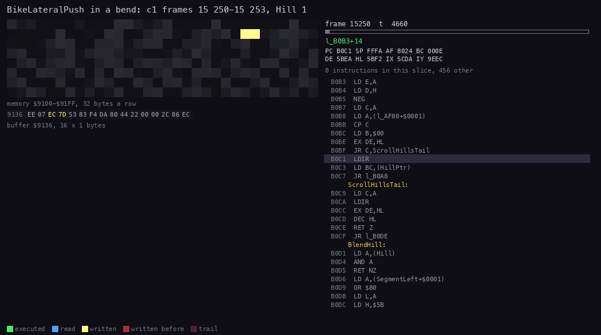

*BikeLateral and BikeLateralPush in frames 15 250-15 253 of `c1` (bend 1), with ScrollStep and LateralX
(`$9136-$9145`) under the memory map. Command: `python3 ../../kit/routine_anim.py --work work/docs/integrate/c1 --window
15250:0-15254:0 --listing build/game.lst --pc AE60-AF01 --view buffer:9136:16x1:hex --range 9100-91FF --row-bytes 32
--pictures 60 --title "BikeLateralPush in a bend: c1 frames 15 250-15 253, Bend 1" --out
docs/img/routines/BikeLateralPush.gif`.*

## 10.4 The wheelie, ramps and jumps

### In short

WHEELIE (bit 1) puts the bike on its back wheel: Pose 0 and Wheelies `$916F` + 1 a pass. While it is held the lean
does not change and LEFT and RIGHT are ignored. Letting go sets Pose 3 and Wheelies 0.

A ramp is object type 0. ObjectHit `$A758` sends the bike to Ramp `$A7E1` when it is on the ramp's row and within the
ramp's width ([doc 7](07-objects.md), 7.7):

- JumpHeight = the road line of row 0 + `$C2` (CPL, so the height of the ground under the bike);
- Pose = 1 if Wheelies ≥ 3, else 2 (the sprite with the front wheel up or down);
- SPEED × (8 × W − 64 + 256) / 256, W = Wheelies capped at 8 (and 0 during a bounce): no wheelie keeps 3/4 of the
  speed, 4 passes 7/8, 8 passes or more all of it;
- JumpSpeed = SPEED / 32 + `$10` (high byte), 16-23;
- PlayEffect 2 and the crash's beeper noise (doc 9).

In the air, each pass of BikeLateral adds JumpSpeed to JumpHeight and takes `$02F0` from JumpSpeed (gravity, 2.9 a
pass). SPEED does not change in the air, and the score counts ten times faster (10.7). The bike lands when the height
falls below the ground line plus 1. The landing sets Pose 3, Lean 0, Wheelies 0. If WHEELIE is not held at that
moment, a 6-pass bounce follows (10.5).

Stage 3, the stage of the ramps, has its rows built by RoadRowsJump `$999A` ([doc 6](06-rendering.md)). The rider
records jump over the ramps too ([doc 7](07-objects.md), 7.8).

### Pseudocode

```text
Ramp (from ObjectHit, the element is type 0):
    JumpHeight.high = ~RoadLines[0] + $C2
    W = DemoMode in a demo, else Wheelies
    Pose = 1 if W >= 3 else 2
    if BounceTime: W = 0
    W = min(W, 8)
    if W < 8: SPEED.high = SPEED.high * (8 * W - $40) / 256    (an 8-bit multiplier: 256 - 64 + 8W)
    JumpSpeed.high = SPEED.high / 32 + $10
    PrintSpeed; PlayEffect 2; the beeper noise
BikeLateral, in the air:
    JumpHeight += JumpSpeed
    if JumpHeight.high is below the ground line + 1 (or wrapped): land
        Pose = 3; Lean = 0; Wheelies = 0
        if WHEELIE not held: BounceTime = 6
        JumpHeight = 6 (the ground)
    JumpSpeed += $FD10 (= -$02F0)
    falling and pose 2: pose 1 (the nose drops)
```

### Assembly

```asm
Ramp:
  LD A,D                  ; D = RoadLines[0]
  CPL
  ADD A,$C2
  LD (JumpHeight+$0001),A
  LD A,(DemoMode)
  AND A
  JR NZ,l_A7F1
  LD A,(Wheelies)
l_A7F1:
  LD C,A
  CP $03
  LD A,$01                ; 3 or more wheelie passes: pose 1
  JR NC,l_A7F9
  INC A
l_A7F9:
  LD (Pose),A
  LD A,(BounceTime)
  AND A
  LD A,C
  JR Z,l_A804
  XOR A                   ; in a bounce the wheelie does not count
l_A804:
  CP $08
  JR C,RampSpeed
RampCap:
  LD A,$08
RampSpeed:
  ADD A,A
  ADD A,A
  ADD A,A
  SUB $40                 ; 8 * W - $40: 0 for W = 8
  LD L,A
  LD A,(Speed+$0001)
  JR Z,l_A81C             ; W = 8: SPEED kept
  CALL Multiply
  LD A,D
  LD (Speed+$0001),A
l_A81C:
  RLCA
  RLCA
  RLCA
  AND $07
  ADD A,$10
  LD (JumpSpeed+$0001),A  ; SPEED / 32 + $10
```

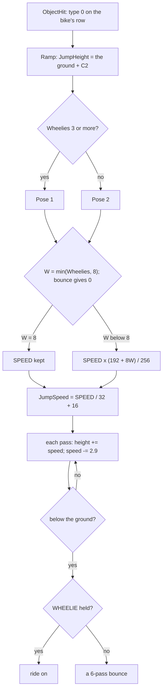

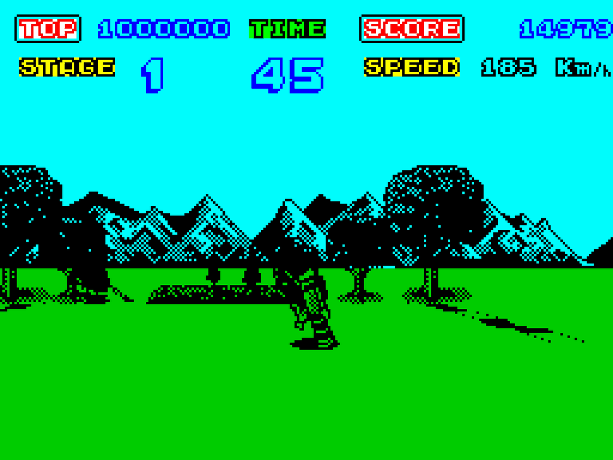

*`c1` frames 15 460-15 690, a picture every 5 frames: the ramp taken in frame 15 485 at 188 km/h with no wheelie, the
flight in pose 2 then 1, the landing at 15 629 and the 6-pass bounce. Command: `python3 ../../kit/screen_anim.py
--work work/docs/erC/c1 --from 15460 --to 15690 --step 5 --width 1050 --delay 120 --hold 1500
docs/img/play/race-jump.gif`.*

Worked example: `c1`'s ramp. The sample of 15 482 holds SPEED 188, Wheelies 0. At 15 486 (the run `ramp-plain`,
sampled every frame) SPEED is 141 = 188 × 192 / 256, Pose 2, JumpHeight `$1B3A`, JumpSpeed `$1400`. JumpSpeed is
taken from the new SPEED: 141 / 32 = 4, + 16 = `$14`. The height then reads 27, 47, 64, 78, 89,
97, 103, 105, 104 ... one value a pass, the rise shrinking by 2.9 each time. Pose turns 1 at 15 556 as the bike starts
down. It lands at 15 627: Pose 3, BounceTime 6, and SPEED falls 141, 139, 137, 135, 133, 132, 130 in the bounce.

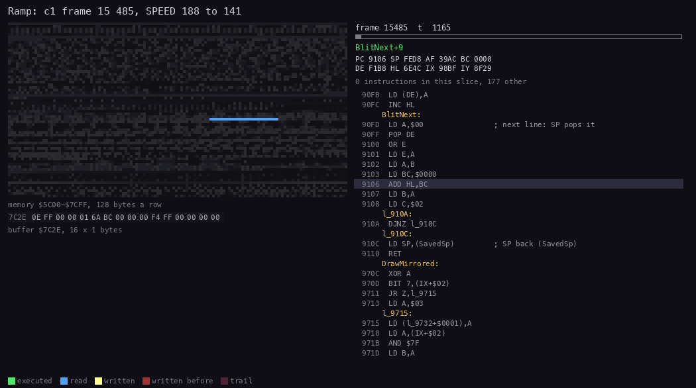

*ObjectHit and Ramp in frame 15 485 of `c1`, with `$7C2E-$7C3D` under the memory map (the word Speed is `$7C33-$7C34`: `6A
BC` before, `6A 8D` after). The frame ends in the beeper noise. Command: `python3 ../../kit/routine_anim.py --work
work/docs/erC/c1 --window 15485:0-15486:0 --listing build/game.lst --pc A758-A838 --view buffer:7C2E:16x1:hex
--range 5C00-7CFF --pictures 60 --title "Ramp: c1 frame 15 485, SPEED 188 to 141" --out
docs/img/routines/Ramp.gif`.*

**The point**: the ramp is a tax, and the wheelie is how a player avoids it. The rule rewards a skill the player sees
on screen: the front wheel goes up before the ramp.

Witness: Ramp and RampSpeed L1 15 (c1, crash, m128, stages), BikeLateralPush L1 4150; `c1-vars.jsonl`;
`work/docs/erC/tech/ramp-plain.jsonl`. RampCap (8 wheelie passes) is reached by the run `ramp-wheelie` (10.11); no
recording holds it.

## 10.5 Collisions: objects, riders and trucks

### In short

ObjectHit `$A758` runs for every element the drawing walk meets on the bike's row (the element less than ScrollStep's
high byte ahead). A hit needs all of: SPEED not 0, the bike low enough (JumpHeight − the ground below the type's
height), not getting up, and |BikeHitX − (x + `$80`)| below the type's width. BikeHitX is `$82` − LateralX × `$C0` /
256: the bike's x in the objects' units. CollisionSizes `$A1B9` gives the width and height of each type ([doc
7](07-objects.md), 7.7). Then:

| What was hit | Rule | Result |
| --- | --- | --- |
| a ramp (type 0) | always | Ramp (10.4) |
| any other object, in a demo | always | nothing |
| any other object, side-on | 2 × \|dx\| ≥ width | a bounce: BounceTime 3, BounceDir the side, PlayEffect 2 |
| any other object, head-on | 2 × \|dx\| below width, SPEED below 35 | a bounce |
| any other object, head-on | SPEED 35 or more | a fall: PlayEffect 1, Crash |

RiderHits `$A839` then tests the six riders, not in the air, not getting up, not in a demo. A rider can be hit only
in the pass the bike catches it: its row must be at most ScrollStep's high byte, and the bike's step must be at least
the rider's speed. It must not be in the air itself. Then:

| Rider | Lateral distance | Result |
| --- | --- | --- |
| a bike (0-3) | below 5 | a bounce, and SPEED − SPEED / 4 |
| a truck (4, 5) | below 9 | PlayEffect 1, Crash |

A bounce lasts BounceTime passes, and each of them forces a steering key. After an object or a rider it is the side
in BounceDir (the side the bike was on). After a landing BounceDir is 0 and the key is random (`LD A,R / AND $0C`).
A landing's 6-pass bounce shows pose 2 for its first three passes. SPEED loses 2.3 % a pass, and the sideways speed
is added twice.

### Pseudocode

```text
ObjectHit (each element on the bike's row):
    if SPEED == 0 or too high above it or GetUp: next
    dx = BikeHitX - (x + $80); side = dx >= 0 ? RIGHT : LEFT
    if |dx| >= width: next
    if type == 0: Ramp; next
    if demo: next
    if 2 * |dx| >= width or SPEED < 35: Bounce(side)        BounceTime 3, PlayEffect 2
    else: PlayEffect 1; Crash
RiderHits (not in the air, not getting up, not a demo), each rider in the race:
    if row > ScrollStep.high or ScrollStep.high < rider speed or the rider is in the air: next
    dx = |BikeHitX - (x + $80)|
    if truck: if dx < 9: PlayEffect 1; Crash; stop
    elif dx < 5: BounceTime 3; SPEED -= SPEED / 4; PlayEffect 2; stop
```

### Assembly

```asm
l_A7A7:
  CP (IX+$00)             ; |dx| against the type's width
  JP NC,ObjectNext
  EX AF,AF'
  JR Z,Ramp               ; type 0
  LD A,(DemoMode)
  AND A
  JP NZ,ObjectNext
  EX AF,AF'
  ADD A,A                 ; 2 * |dx|
  CP (IX+$00)
  JR C,l_A7CF             ; head-on
Bounce:
  LD L,$03
  LD H,E                  ; BounceDir: the side
  LD (BounceTime),HL
  LD A,$02
  CALL PlayEffect
  CALL CrashSound
  JP ObjectNext
l_A7CF:
  LD A,(Speed+$0001)      ; head-on: 35 km/h or more is a fall
  CP $23
  JR C,Bounce
  LD A,$01
  CALL PlayEffect
  CALL Crash
  ...
l_A894:
  CP $05                  ; a rider within 5
  JR NC,l_A8B4
  LD L,$03
  LD H,E
  LD (BounceTime),HL
  LD HL,Speed+$0001
  LD A,(HL)
  RRA
  RRA
  AND $3F                 ; SPEED / 4
  NEG
  ADD A,(HL)
  LD (HL),A
```

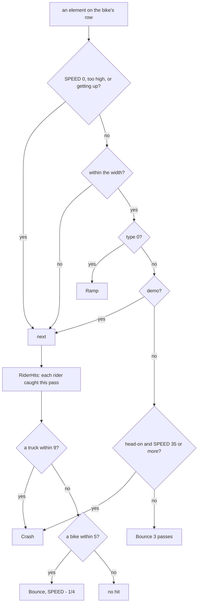

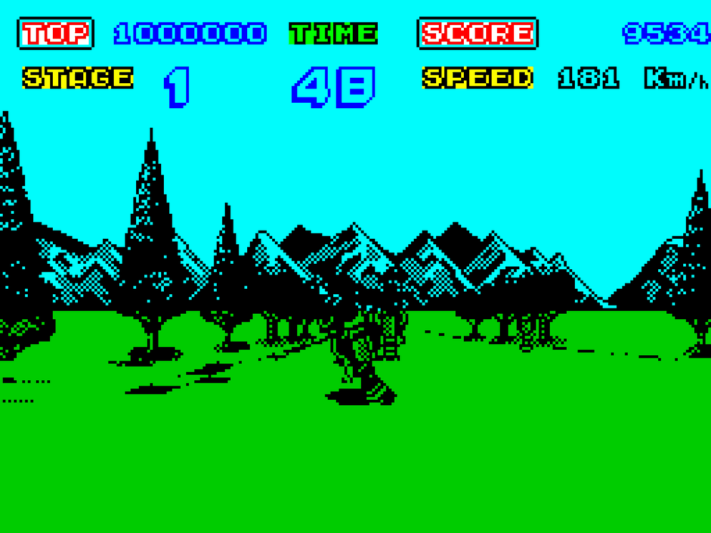

*`c1` frames 15 160-15 320, a picture every 4 frames. Command: `python3 ../../kit/screen_anim.py --work
work/docs/erC/c1 --from 15160 --to 15320 --step 4 --width 1050 --delay 120 --hold 1500
docs/img/play/race-overtake.gif`.*

Worked example: the rider hit at 15 175. At 15 173 SPEED is 183, so ScrollStep's high byte is 183 × 14 / 256 = 10.
Rider 1 is at row 9, x −15, speed 7: caught this pass. LateralX's high byte is 24, so BikeHitX = `$82` − 24 × 192 /
256 = `$82` − 18 = `$70`. The rider's x + `$80` is `$71`: dx = 1, below 5. At 15 175 SPEED is 138 = 183 − 45 and
BounceTime 3. The bounce then takes 2.3 % a pass: 136, 134, 132. Riders 2 and 1 are then overtaken without a touch:
rider 2's row goes 2 → 255 at 15 263 with dx 5 or more, rider 1's 0 → 254 at 15 299. Rider 0, faster (top 10),
passes the bike the other way: 255 → 1 at 15 237.

**The point**: a rider is a soft obstacle, a truck a hard one. Both are tested only in the pass the bike reaches
them, so a rider never runs into the bike from behind.

Witness: RiderHits L1 15 (c1, crash, m128, stages), TruckCrash L1 4 (stages, under the Immune To Trucks POKE) and
the fall itself in `truck` (WALKTHROUGH 6.0: from `stages`' stage 3 state with the Immune To Trucks byte put back, the other POKEs of that state still in place): TruckCrash `$A88F` once at frame 1 240,
[the truck ahead](img/play/truck-001241-truck-crash.png); ObjectHit's bounce and fall in `c1` (15 175, 15 843); `c1-vars.jsonl`
15 151-15 339.

## 10.6 The crash, lying and getting up

### In short

Crash `$AF02` throws the bike: JumpHeight from the ground under the bike, JumpSpeed = SPEED / 32 + `$12`, Pose 7, and
FallTime 9 with bit 7 the side of the road. Each pass of the fall:

- SPEED × `$D0` / 256 (−19 %), so 134 km/h is gone in about 20 passes;
- in the air: pose 7 (Crash's) while rising, pose 8 once falling, the arc as a jump;
- on the ground: pose 9 and FallTime − 1 a pass;
- on stages 3 and 5, on the sand, the skid noise (FallSand).

When FallTime's count reaches 0 the turn ends. FallX `$5E32` keeps LateralX, Countdown is set to `$80` (resume), and
RaceOver runs StageTime and RaceEnd. Back in the turn loop (PlayTurn, [doc 4](04-game-loop.md)), the next turn
starts: the same player with one player, the other with two. With `$80` in Countdown, StartRace keeps the riders
where they are and restarts the bike from FallX.

The new turn then runs GetUp `$7C31`. It starts from FallX, cut to about 36 off the middle, so the rider walks
back from the side he fell to. Each pass GetUpSlide moves LateralX toward 0 by 3. While GetUp is not 0 the throttle, the timer and the
collisions are off. So getting up costs no TIME.

### Pseudocode

```text
Crash:
    JumpHeight.high = ~RoadLines[0] + $C2
    JumpSpeed.high = SPEED / 32 + $12
    Pose = 7; FallTime = (LateralX AND $80) + 9; SkidLevel = 0; CrashSound
BikeControl, FallTime != 0:
    count = (FallTime - 1) AND $7F
    if count == 0: FallX = LateralX; Countdown = $80; RaceOver (the turn ends)
    SPEED = SPEED * $D0 / 256
    if in the air and rising: BikeLateral (the arc; Pose stays 7)
    Pose = 8                                          # falling
    if above the ground line (RoadLines[$0C]): BikeLateral
    else: Pose = 9; FallTime -= 1; FallSand
GetUpSlide (GetUp != 0):
    GetUp -= 3 (or += 3 on the other side), stop at 0; LateralX.high = GetUp
```

### Assembly

```asm
Crash:
  LD A,(RoadLines)
  CPL
  ADD A,$C2
  LD (JumpHeight+$0001),A
  LD A,(Speed+$0001)
  RLCA
  RLCA
  RLCA
  AND $07
  ADD A,$12
  LD (JumpSpeed+$0001),A  ; SPEED / 32 + $12
  LD A,$07
  LD (Pose),A
  LD A,(LateralX+$0001)
  AND $80
  ADD A,$09
  LD (FallTime),A         ; 9, bit 7 the side
  XOR A
  LD (SkidLevel),A
  JP CrashSound
BikeControl:
  LD A,(FallTime)
  AND A
  JR Z,GetUpSlide
  DEC A
  LD B,A
  AND $7F
  JR NZ,l_ACFA
  LD A,(LateralX+$0001)
  LD (FallX),A
  LD A,$80
  LD (Countdown),A
  POP HL
RaceEndFall:
  JP RaceOver             ; the fall ends this turn
l_ACFA:
  LD A,(Speed+$0001)
  LD L,$D0                ; SPEED * $D0 / 256
  CALL Multiply
  LD (Speed),DE
```

```mermaid
stateDiagram-v2
    [*] --> Thrown: Crash (pose 7, FallTime 9)
    Thrown --> Thrown: rising pose 7, falling pose 8, SPEED x 208/256
    Thrown --> Lying: below the ground line
    Lying --> Lying: pose 9, FallTime - 1, SPEED x 208/256
    Lying --> TurnEnds: count 0 (FallX, Countdown 128, RaceOver)
    TurnEnds --> GettingUp: the next turn (GetUp from FallX)
    GettingUp --> GettingUp: LateralX 3 nearer the middle; no timer
    GettingUp --> [*]: GetUp 0, riding
```

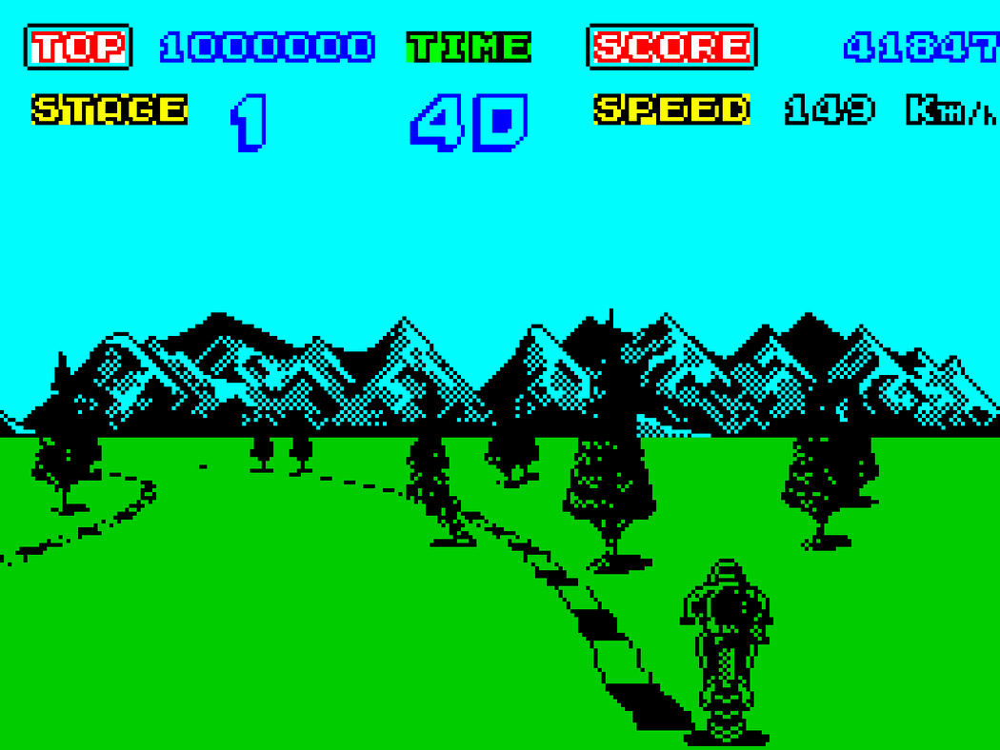

*`c1` frames 15 830-16 115, a picture every 6 frames. Command: `python3 ../../kit/screen_anim.py --work
work/docs/erC/c1 --from 15830 --to 16115 --step 6 --width 1050 --delay 120 --hold 1500
docs/img/play/race-crash.gif`.*

Worked example: `c1`'s first fall. At 15 843 the bike hits an object head-on at 134 km/h on the left side: Pose 7,
FallTime 137 (`$80` + 9), JumpSpeed `$1600` (134 / 32 = 4, + 18 = 22). SPEED then falls 108, 87, ... 2, 1, 0 by
15 977. Pose turns 9 at 15 965 and FallTime counts 136, 135, ... 129. At 16 019 Countdown is `$80`: the turn has
ended with FallX = `$B2`. At 16 021 the new turn has begun: LateralX `$0037` (the bike stands at the middle), and at
16 023 GetUp is 220 (−36) and LateralX `$DC37`. GetUp then goes 223, 226, ... 253, 0 by 16 107: 12 passes. TIME
reads 38.2 from 16 021 to 16 107: the timer stood still.

Every fall of `c1` costs the same. The bike stops in about 20 passes and lies 8 more. The walk back takes up to 12
passes, by how far off the middle it fell. The fall at 18 293 is the shortest: LateralX `$10`, GetUp 16, 6 passes.

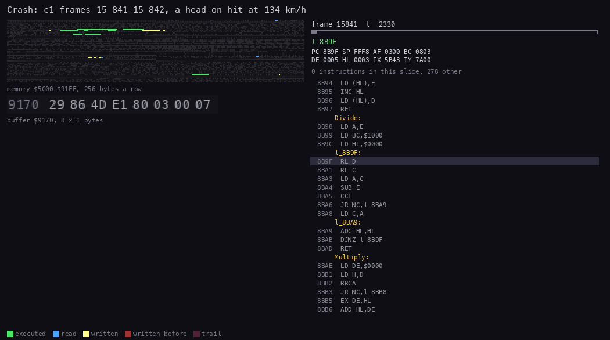

*ObjectHit, the head-on test and Crash in frames 15 841-15 842 of `c1`, with `$9170-$9177` (Wheelies, Pose, Lean)
under the memory map. Command: `python3 ../../kit/routine_anim.py --work work/docs/erC/c1 --window 15841:0-15843:0
--listing build/game.lst --pc A758-A838,AF02-AF2D --view buffer:9170:8x1:hex --range 5C00-91FF --pictures 60
--title "Crash: c1 frames 15 841-15 842, a head-on hit at 134 km/h" --out docs/img/routines/Crash.gif`.*

**The point**: there are no lives. A fall costs about 30 passes of riding time and the speed that was built up. The
walk back is free.

Witness: Crash L1 11 (c1, crash, m128, twoplayer), BikeControl L1 4343, GetUpSlide L1 4094; `c1-vars.jsonl` 15 843-16
107, 16 529-16 763, 17 147-17 401, 18 293-18 499, 18 915-19 163.

## 10.7 The timer, the score and the checkpoints

### In short

**The timer.** Timer `$5E1F` is BCD seconds, 60 at the start of a game. TimerTick `$AA73` counts Tenths `$5E20` from
10 down. At 0 it takes a second off the timer and prints it. It runs after Throttle in every pass, but not during the
countdown, not while getting up, and not in a demo.

**The score.** ScoreAdd `$A974` runs each pass when the bike is not falling. It splits SPEED into hundreds, tens and
units and adds them to Score `$5E18` (7 ASCII digits) through AddScore ([doc 8](08-hud-and-text.md), 8.5). In the air
the digits go one place higher: the pass adds SPEED × 10.

**The checkpoint.** A stage ends at its last segment (bit 5 of the segment byte, doc 7). NextSegment jumps to
StageEnd `$AB0A`, which:

- adds the timer's two digits to the score at the 100 000s and 10 000s, with ScoreDigits+3..+6 still holding the last
  pass's speed: Timer × 10 000 plus that pass's points again;
- writes the stage's time into StageTimes (StageTime: TimerAtStart − Timer, in timer seconds);
- Stage + 1;
- stages 1-4: draws the next stage's big digit, sets ExtendedTime 32 (EXTENDED PLAY and the lap time printed into the
  road, doc 8), and adds 50 to the timer (BCD, at most 99). Then StageStart: the new stage's tables, horizon and tune.
  The bike keeps its speed and place, the riders keep theirs.

### Pseudocode

```text
ScoreAdd (each pass):
    if FallTime: skip
    place = 4 (or 3 in the air)              digits ScoreDigits+place .. +place+2
    ScoreDigits = 0; ScoreDigits[place .. place+2] = the decimal digits of SPEED
    AddScore(ScoreDigits)
TimerTick (each pass, after Throttle):
    if Tenths == 0: Timer = max(Timer - 1, 0) (BCD); PrintTimer; Tenths = 10
    Tenths -= 1
    if Tenths == 0 and Timer == 0 and SPEED == 0: RaceOver
StageEnd (the stage's last segment passed):
    Score += Timer * 10 000 + the last pass's digits; StageTime; FormatTime; Segments = 0; Stage += 1
    if Stage < 5: BigDigit; ExtendedTime = 32; Timer = min(Timer + $50, $99); StageStart
    else: the finish (10.8)
```

### Assembly

```asm
TimerTick:
  LD A,(Tenths)
  AND A
  JR NZ,l_AA89
  LD A,(Timer)
  AND A
  JR Z,l_AA84
  DEC A
  DAA
  LD (Timer),A            ; Infinite Time POKE: LD A,(nn) here ($AA81)
l_AA84:
  CALL PrintTimer
  LD A,$0A
l_AA89:
  DEC A
  LD (Tenths),A
  JP NZ,RaceLoop
  LD A,(Timer)            ; Timer 0 and SPEED 0: the game is over
  AND A
  JP NZ,RaceLoop
  LD A,(Speed+$0001)
  AND A
  JP NZ,RaceLoop
RaceOver:
  CALL StageTime
StageEnd:
  POP HL
  LD A,(Timer)            ; the timer's digits to the score
  LD H,A
  RRA
  RRA
  RRA
  RRA
  AND $0F
  LD L,A
  LD A,H
  AND $0F
  LD H,A
  LD (ScoreDigits+$0001),HL
  LD HL,ScoreDigits+$0006
  CALL AddScore
  ...
l_AB76:
  INC A                   ; stages 1-4
  LD DE,$0718
  CALL BigDigit
  LD A,$20
  LD (ExtendedTime),A
  LD A,(Timer)
  ADD A,$50               ; 50 more seconds
  DAA
  JR NC,l_AB8C
  LD A,$99
l_AB8C:
  LD (Timer),A
  CALL PrintTimer
  JP StageStart
```

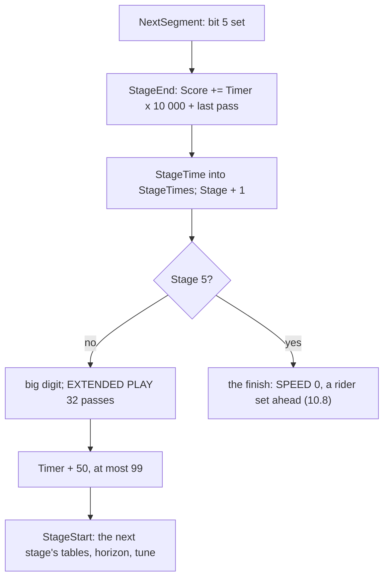

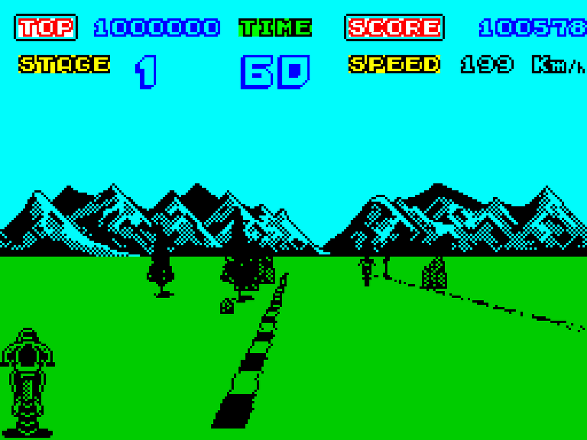

*`stages` frames 3 310-3 440, a picture every 3 frames: stage 1's last segment, the score's jump, the stage digit
2, EXTENDED PLAY and the lap time in the road, the sand of stage 2. Command: `python3 ../../kit/screen_anim.py --work
work/docs/erC/st --from 3310 --to 3440 --step 3 --width 1050 --delay 120 --hold 1500
docs/img/play/race-checkpoint.gif`.*

Worked example: the end of stage 1 in `stages`. At 3 342 Stage is 0, Timer 60 (the Infinite Time POKE keeps it), SPEED
199, Score 101 374, StageListPtr `$5E9F`. At 3 344 the score is 701 772. That is 101 374 + 199 (the one pass
between) + 600 199 (the bonus, Timer 60 × 10 000, with that pass's digits added again). At 3 346 Stage is 1 and Timer 99: 60 + 50 = 110, kept at 99. The lap time printed is
1'39"82. With the POKE the timer never moved, and StageTime's subtraction borrowed: 99 seconds (10.13).

The score of `c1` (figure in 10.1): it grows by SPEED a pass on the ground. The pass from 15 475 adds 187. The ramp's
pass, from 15 483, adds 1 410 (141 in the air, ×10). The 18 passes of that flight add 25 380, more than the whole race
before it (15 537 at 15 483).

**The point**: time is the resource. Distance only buys time at the checkpoints, and the score pays for leftover time
at 10 000 a second: one second at a checkpoint is worth 50 passes at full speed.

Witness: StageEnd L1 5 (stages), StageTime L1 16; TimerTick and ScoreAdd run every pass of `c1`; `st-vars.jsonl` 3
300-3 380, `c1-vars.jsonl`. Recorded checkpoints: `stages` 3 346 (stage 2), 5 326 (3), 7 750 (4), 10 130 (5), the finish
12 958.

## 10.8 The time-out, game over, the finish and the lap table

### In short

**The time-out.** At Timer 0 Throttle takes 9.25 a pass whatever is held. The game is over at the first TimerTick
that sees Timer 0 and SPEED 0: RaceOver (StageTime, RaceEnd). A bike already falling at Timer 0 lies, and the end of
its fall also ends the turn.

**The finish.** After stage 5, StageEnd sets SPEED 0 and picks the rider of 0-3 with the largest row byte. That rider
is put at row 0 beside the bike's mirror place (x = −LateralX) with speed 2 and top 2, and its record's address is
written into FinishRider's `LD IX,nn`. From then on Stage is 5: RacePass draws no bike, and FinishCheck runs each pass.
When that rider's row reaches `$40`, FinishCheck sets Timer 0 and runs RaceEnd. The game is over as at a time-out.

**Game over.** PlayTurn ([doc 8](08-hud-and-text.md), 8.10-8.11) takes over: RecordStages keeps any stage time
shorter than its record, the lap table shows the records and the player's times, a stage not finished as the share
driven in %, and the total. A score above a row of HiScores `$8DE2` takes its place with the name entered.

### Pseudocode

```text
StageEnd, Stage reaches 5:
    SPEED = 0
    best = rider 0; for riders 0-3: if row > best.row (unsigned): best = this rider
    FinishRider = best; best.row = 0; best.jump = 0; best.x = -LateralX; best.speed = best.top = 2
FinishCheck (each pass, Stage == 5):
    if FinishRider.row >= $40: Timer = 0; RaceEnd
```

### Assembly

```asm
  LD IX,Riders
  LD IY,Riders
  LD DE,$000F
  LD B,$04
  XOR A
  LD (Speed+$0001),A
l_AB49:
  CP (IX+$04)             ; the largest row byte, unsigned
  JR NC,l_AB55
  LD A,(IX+$04)
  PUSH IX
  POP IY
l_AB55:
  ADD IX,DE
  DJNZ l_AB49
  LD (FinishRider+$0002),IY
  LD (IY+$04),B           ; row 0
  LD (IY+$0C),B
  LD A,(LateralX+$0001)
  NEG
  LD (IY+$02),A
  LD A,$02
  LD (IY+$06),A           ; speed 2
  LD (IY+$08),A           ; top 2
  JP RaceLoop
FinishCheck:
  LD A,(Stage)
  CP $05
  JR NZ,ScoreAdd
FinishRider:
  LD IX,$0000             ; the rider StageEnd picked
  LD A,(IX+$04)
  CP $40
  JP C,RaceLoop
  XOR A
  LD (Timer),A
  JP RaceEnd
```

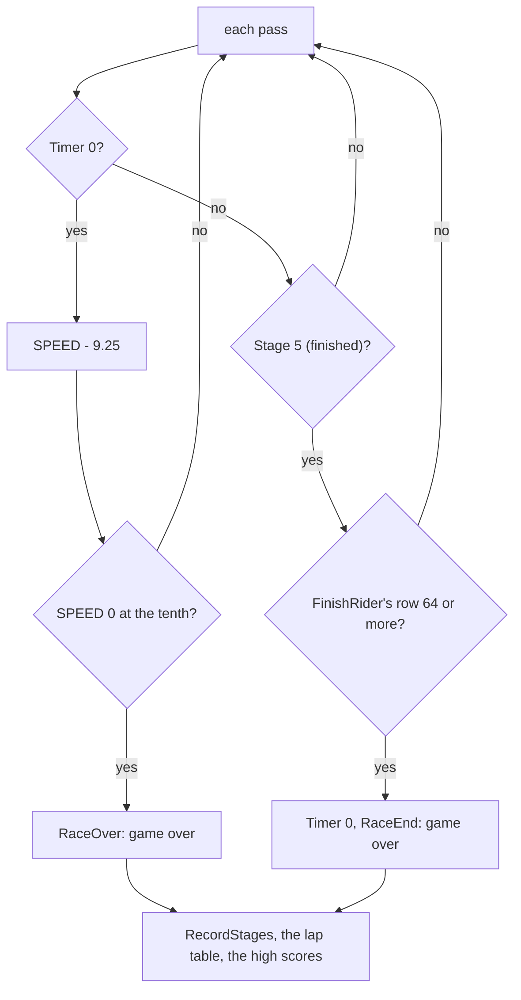

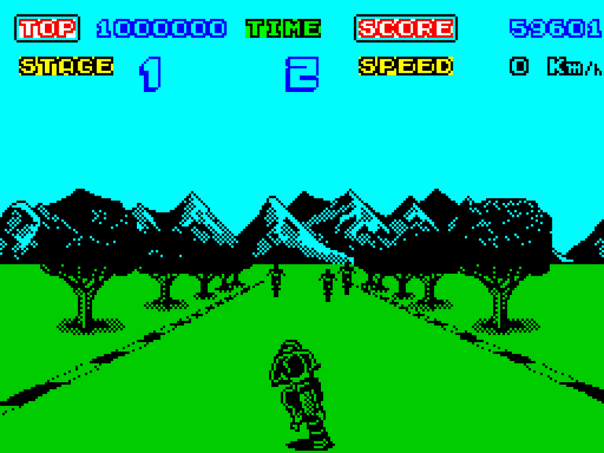

*`c1` frames 19 180-19 480, a picture every 10 frames. Command: `python3 ../../kit/screen_anim.py --work
work/docs/erC/c1 --from 19180 --to 19480 --step 10 --width 1050 --delay 150 --hold 2000
docs/img/play/race-timeout.gif`.*

Worked example, the time-out: `c1`'s TIME reads 00.9 at 19 259 with SPEED 17 and THROTTLE held. Timer reaches 0 at
the next second. SPEED goes 17, 7, 0 in two passes, and at the next tenth TimerTick ends the race. The lap table
follows at 19 465. The score is 59 674 (the samples' last value), below the high score table's last row.

Worked example, the finish: `stages` at 12 954 has Stage 4, SPEED 199 and the riders' rows 232, 132, 64, 136. At
12 958 Stage is 5 and SPEED 0. Rider 0 is the one picked: row 232, unsigned the largest, though it was 24 rows
*behind* the bike. It is now at row 0 with speed 2. Its row then reads 2, 4, 6 ... 44 at 13 092: 2 a pass. At row 64,
32 passes after the finish, the game ends.

**The point**: the race has only one end, the clock. Even the finish is turned into a time-out, after a short scene
of a rider riding away.

Witness: RaceEnd L1 20 (c1, crash, ctl, m128, stages, twoplayer), StageEnd L1 5, FinishRider (stages);
`c1-vars.jsonl` 19 259-19 271; `st-vars.jsonl` 12 942-13 098.

## 10.9 Two players and turns

### In short

ONE / TWO PLAYERS sets Players `$7C32`. NewGame clears both player blocks: Player `$5E0D` (the current one) and
OtherPlayer `$5E45`, 56 bytes each. They hold everything of a player's game: the timer, the score, the stage, the
stage times, the track pointers, the countdown. OtherPlayer's Timer is 60, and with two players Player's too. The
turn loop swaps the blocks before each turn and skips a player whose timer is 0.

A turn ends:

- at a fall's end (Countdown `$80`): the next turn resumes from FallX;
- at game over (Timer 0).

A stage's end does not end the turn: StageEnd goes straight on to StageStart. With one player the other block's timer
stays 0, so each turn is player 1's again, and a fall only costs the time on the ground. With two players a fall
hands the controls over, and a key is waited for between turns. The game ends when both timers are 0.

### Pseudocode

```text
NewGame:
    clear $5E0D-$5E7C; both scores "      0"; both Countdown 16
    OtherPlayer.Timer = $60; if two players: Player.Timer = $60
TurnLoop:
    swap Player and OtherPlayer
    if Player.Timer == 0: swap back; if that one's Timer is 0 too: game over for both
    (two players: wait for a key)
    PlayTurn: the HUD, StartRace, the race until RaceOver
    if Timer == 0: the records, the lap table, the high scores
```

### Assembly

The turn loop is in `src/game/flow.asm` (NewGame `$8755`, TurnLoop `$87BD`, PlayTurn `$87FC`). Its header gives the
blocks:

```asm
; NewGame clears both player blocks (Player, the current one at $5E0D, and OtherPlayer at $5E45, 56 bytes each), and
; the turn loop swaps them before each turn, skipping a player whose Timer is 0. With one player the second block's
; timer stays 0, so every turn is player 1's.
```

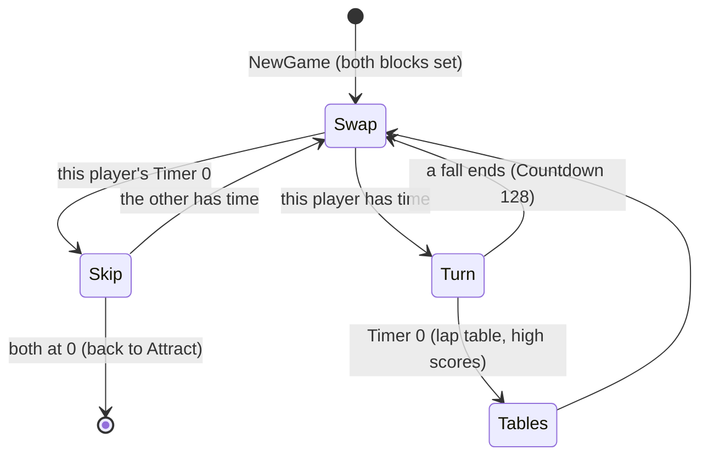

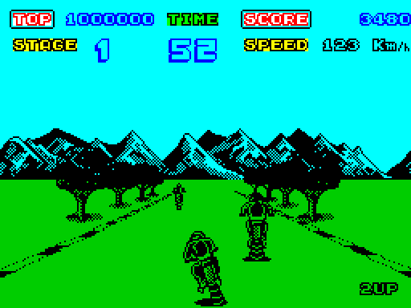

*`twoplayer` frame 10 892: player 2's turn (2UP) from 52 s. From the recording's stills (WALKTHROUGH 6.1).*

Worked example: `twoplayer` (doc 5, 5.12). Player 1 falls; the fall's end gives the turn over, and the game waits
for a key with player 1's timer stopped at 44 (frames 4 296-10 194). SPACE starts player 2's turn at 10 892 from
52 s. Player 2 falls too; then 1UP plays again with its own time
and score at 20 672.

In `c1`, with one player, the swap itself can be seen. The sample of 19 069 holds Timer 0, Countdown 16 and a score
of 0: the other block, swapped in for a moment at the fall's end and swapped out because its timer is 0. At 19 071
player 1's block is back (Timer 2.2, Countdown `$80`).

The animation of a turn's end is the fall of 10.6: its last pictures are the new turn.

**The point**: two players are two copies of one player's state. The race code knows only one bike.

Witness: NewGame L1 13, PlayTurn L1 23 (`src/game/flow.asm`); `twoplayer` frames from WALKTHROUGH 6.0; `c1-vars.jsonl`
19 069-19 073.

## 10.10 The opponents' AI

### In short

There is no AI in the sense of decisions. Each rider record ([doc 7](07-objects.md), 7.8) has an acceleration and a
top speed from RiderStarts `$9111`. MoveRiders `$A21A` runs each pass after the countdown's 8:

- speed += acceleration (the low byte), up to the top speed;
- the row += speed − ScrollStep's high byte (the bike's step);
- a ramp row (JumpRows, filled by the drawing walk) crossed this pass starts a jump: height and jump speed `$0C00`
  (`$0900` a truck), the same gravity as the bike;
- in a bend the pose leans down to the record's lowest pose, and back up on the straight.

A rider never steers: its x is fixed for the whole race. It never reacts to the bike. It does not fall or bounce. The
bike's hits change only the bike.

| Rider | x | Accel. | Top | As SPEED | In the race |
| --- | --- | --- | --- | --- | --- |
| 0 | +15 | 20 | 10 | 183 km/h | always |
| 1 | −15 | 24 | 7 | 128 km/h | always |
| 2 | +30 | 12 | 5 | 91 km/h | always |
| 3 | −30 | 13 | 6 | 110 km/h | always |
| 4, truck | +20 | 20 | 7 | 128 km/h | from stage 2 |
| 5, truck | −20 | 20 | 6 | 110 km/h | from stage 4 |

The rows are one byte, so the six riders sit on a ring of 256 rows around the bike. A rider the bike overtakes goes
below 0 to 255 and comes back from the horizon later. Riders 1-3 are slower than the bike at full speed, so the bike
laps them again and again: rider 2 every 256 / (10 − 5) = 51 passes at full speed. Rider 0 is faster than the bike
below 183 km/h. StartRace places the riders only at a turn's first start (Countdown 16) and in a demo. A fall's turn
(Countdown `$80`) and a new stage keep them where they are; a stage only sets which trucks are in.

### Pseudocode

```text
MoveRiders (each pass, Countdown below 8), each rider in the race:
    if in the air: height += jump speed; jump speed -= $02F0; land at height.high >= $F0 (pose 3)
    elif row < $50: for each ramp row r of JumpRows: if r >= row: jump if (distance + speed).high > r; break
    speed += acceleration; speed = min(speed, top.00)
    distance += speed - ScrollStep
    on the ground and row < $80: bend at the row: pose down to lowest, else back toward 3
```

### Assembly

```asm
MoveRidersLoop:          ; $A220
  BIT 7,(IX+$00)          ; out of the race
  JP NZ,l_A2F9
  LD A,(IX+$0C)           ; in the air?
  AND A
  JR Z,l_A259
  ...
  LD HL,-$02F0            ; $A24D: the gravity
  ADD HL,DE
  LD (IX+$0D),L           ; jump speed
  LD (IX+$0E),H
```

The full routine is in doc 7 (7.8).

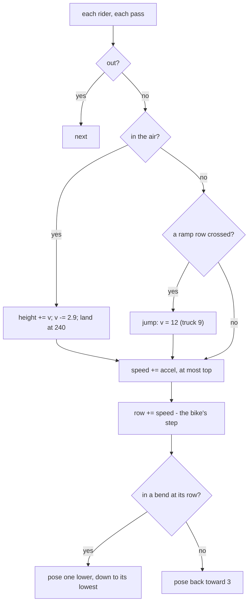

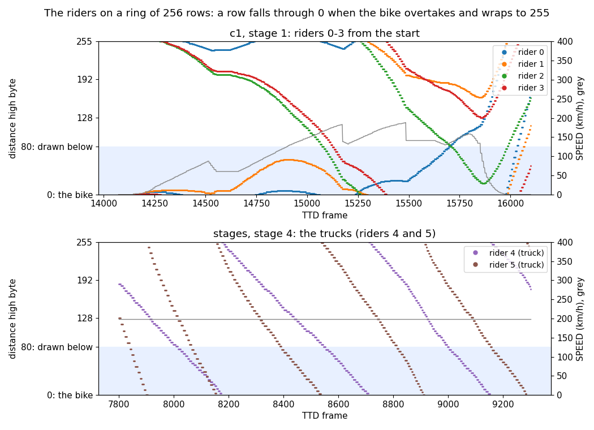

*The riders' rows in `c1` (riders 0-3) and in `stages` (the trucks), from doc 7. Made by `python3
tools/fig_objects.py fig-ring docs/img/objects/ring.png work/docs/erC/c1-vars.jsonl work/docs/erC/st-vars.jsonl`.*

Worked example: the overtakes of 10.5. Between 15 245 and 15 263 the bike runs at 143-147 km/h, ScrollStep's high
byte 7-8. Rider 2 (top 5) loses 2-3 rows a pass: rows 5, 2, 255, 252. Rider 0 (top 10) gains 2 a pass: rows 1, 3, 5,
7. The animation of 10.5 shows both.

**The point**: six numbers per rider make a field that the player overtakes and is overtaken by. The ring makes four
riders look like a long race.

Witness: MoveRiders L1 4292 (`src/game/objects.asm`); `c1-vars.jsonl`, `st-vars.jsonl`.

## 10.11 The expected techniques

### In short

The rules above leave a player six things to learn. Each was run on c1's play (`tools/play_techniques.py`, the
introduction), with c1's own keys and one change.

| Technique | Rule (section) | The run | Result |
| --- | --- | --- | --- |
| the flying start | THROTTLE counts from Countdown 7 (10.2) | `c1` itself | SPEED 1 at 14 145, while the countdown shows 3 |
| a wheelie into each ramp | 8 wheelie passes keep all the speed (10.4) | `ramp-wheelie` | 188 kept against 141; pose 1; 112 rows high against 105 |
| a wheelie at the landing | WHEELIE held at the landing: no bounce (10.4) | `land-wheelie` | no bounce; 158 km/h at 15 692 against 130 |
| brake behind a rider | a hit costs 1/4 and a bounce (10.5) | `brake-bend` | BRAKES 40 frames: 184 km/h at 15 300 against 156 |
| lift in a hard bend | the push beats the lean above about 150 km/h (10.3) | `c1` | the line held with taps at 145 km/h |
| keep to the middle in a fall's zone | GetUp walks 3 a pass from the side (10.6) | `c1` | 6 passes at LateralX 16, 12 at 36 |

The racing line is the middle of the road: a rider is met at x ±15 and ±30, an object at the sides, and the
off-road cap starts at d = 36. The objects that make the bike fall are met head-on only when the bike is far from the
middle. The cheat key (10.12) is the seventh technique the code allows.

### Pseudocode

The runs, as `tools/play_techniques.py` plays them:

```text
ramp-wheelie:  c1's keys; frames 15 380-15 499: THROTTLE + WHEELIE (Q A)
land-wheelie:  c1's keys; frames 15 600-15 639: THROTTLE + WHEELIE
brake-bend:    c1's keys; frames 15 130-15 169: BRAKES (SPACE) only
cheat:         c1's keys; from 14 200: CAPS SHIFT + Q until CheatStep reads $FF
```

### Assembly

The two instructions behind the first two techniques:

```asm
  SUB $40                 ; RampSpeed: 8 * Wheelies - $40, 0 at 8 wheelie passes
  ...
  CALL ReadControls       ; the landing: WHEELIE held?
  BIT 1,D
l_AEE2:
  LD HL,$0006
  JR NZ,l_AEEA            ; held: no bounce
  LD (BounceTime),HL
```

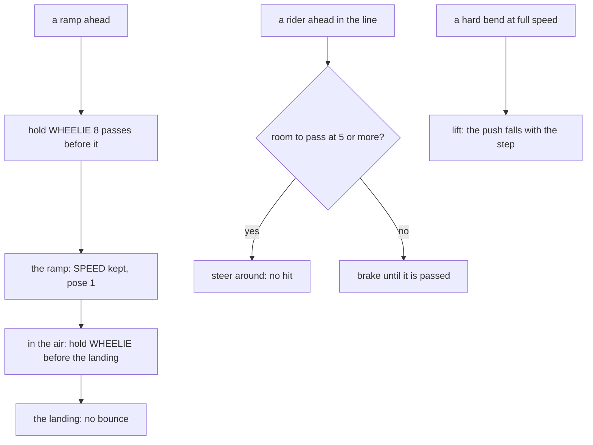

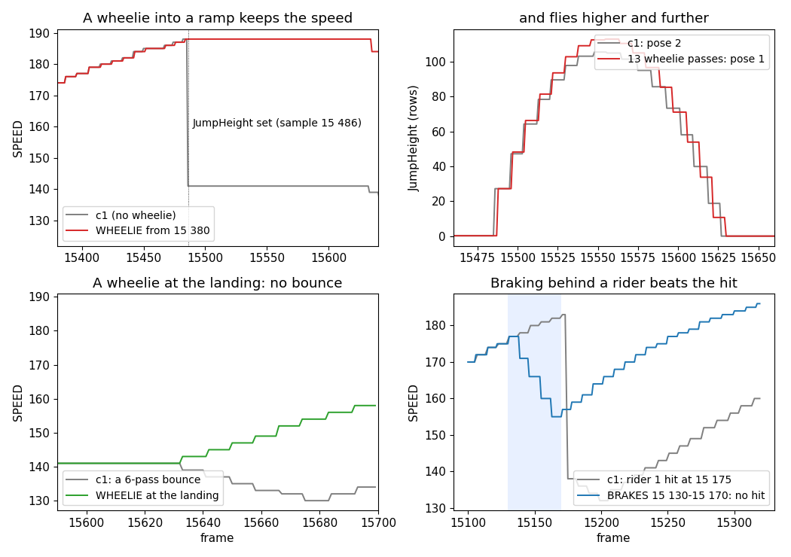

*How to read it: each panel is a run of `tools/play_techniques.py` (colour) against `c1` (grey). Top: SPEED and
JumpHeight around the ramp (taken in frame 15 485, JumpHeight set in the sample of 15 486), with no wheelie and with 13 wheelie passes. Bottom left: SPEED after the
landing with and without WHEELIE. Bottom right: SPEED with BRAKES in the blue band against c1's hit of rider 1. Made
by `python3 tools/fig_gameplay.py techniques docs/img/gameplay/techniques.png work/docs/erC/tech
work/docs/erC/c1-vars.jsonl`, after the runs of `tools/play_techniques.py` named below (ramp-plain, ramp-wheelie, land-wheelie, brake-bend,
cheat), each with `--gif` into `docs/img/play/race-<run>.gif`.*

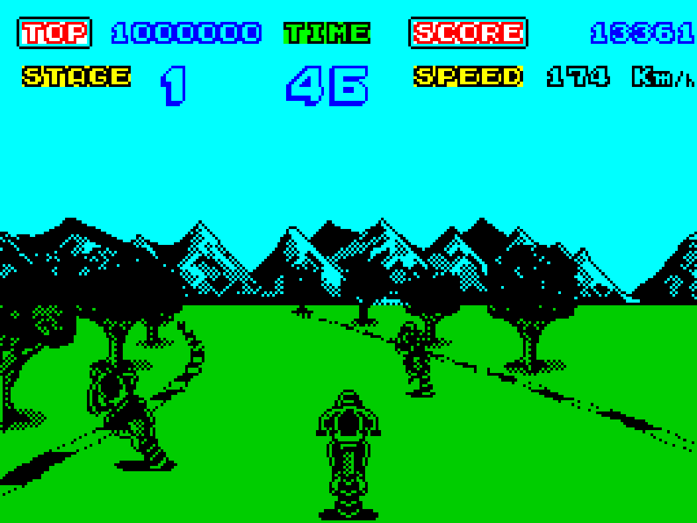

*The run `ramp-wheelie`, frames 15 380-15 699, a picture every 4 frames: the front wheel up from 15 381, the ramp
taken in frame 15 487 (JumpHeight set in the sample of 15 488) at 188 km/h in pose 1. Command: `python3 tools/play_techniques.py ramp-wheelie --gif
docs/img/play/race-ramp-wheelie.gif`.*

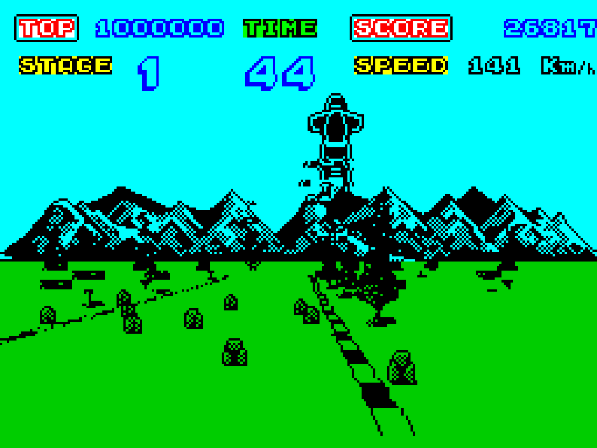

*The run `land-wheelie`, frames 15 560-15 699, a picture every 4 frames. Command: `python3 tools/play_techniques.py
land-wheelie --gif docs/img/play/race-land-wheelie.gif`.*

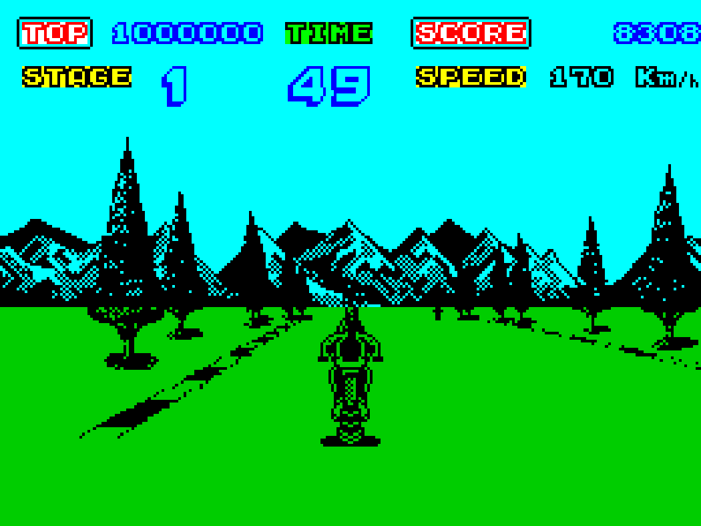

*The run `brake-bend`, frames 15 100-15 319, a picture every 4 frames. Command: `python3 tools/play_techniques.py
brake-bend --gif docs/img/play/race-brake-bend.gif`.*


*The control run `ramp-plain`, frames 15 380-15 699, a picture every 4 frames: c1's own ramp, the same as the
recording. Command: `python3 tools/play_techniques.py ramp-plain --gif docs/img/play/race-ramp-plain.gif`.*

Worked example: `ramp-wheelie`. Wheelies counts 1 at 15 381, 2 at 15 390 ... 8 at 15 446 and 13 at 15 486. At 15 488
JumpHeight is `$1B3A` with Pose 1 and SPEED still 188. JumpSpeed is 188 / 32 + 16 = 21 (`$15`), against c1's `$14`.
The flight peaks at 112 rows against 105 and lands at 15 630, 3 frames later than c1. WHEELIE was let go at 15 500,
so the landing bounces. Bouncing at 188 km/h, the bike drifts to the road's edge and loses speed there: 188 to 125 by
15 699. The two techniques belong together: a wheelie into the ramp and a wheelie at the landing.

**The point**: every technique is one comparison in the code: `SUB $40` at 8, `BIT 1,D` at the landing, `CP $05` for
a rider, the steering table against the bend's factor. A player who learns them is reading the code through the
screen.

Witness: `work/docs/erC/tech/*.jsonl` (each first line names the start, the script and the change);
`c1-vars.jsonl` for the flying start (Countdown 3 at 14 145 with SPEED 1).

## 10.12 The cheat key

### In short

RaceCount reads CAPS SHIFT every pass. With it held, CheatKey `$A659` reads Q. With both held it flips the operand
of CheatStep `$A66F` (`LD A,n`: 0 or `$FF`). With CheatStep on, on stages 1-3, ScrollStep is `$1000` whatever SPEED
is: the track moves as at SPEED 293. SPEED, the score and the collisions keep using SPEED; the steering does not.
BikeControl reads SteerTable `$8E5D` at 2 × ScrollStep's high byte: with `$1000` that is `$8E7D`, past the table's
end, SetRowTable's first byte (`$06`), so a full lean moves the bike 0.5 pixel a pass. BikeLateralPush multiplies the bend by the
same high byte: `$10` against at most `$0A` without the cheat, a push 1.6 times harder. StartRace clears CheatStep at
each turn. Doc 5 (5.11) has the key test.

The toggle flips every pass the keys are held. So the cheat stays on only if the keys are let go after an odd number
of passes.

### Pseudocode

```text
RaceCount: if CAPS SHIFT and Q: CheatStep = ~CheatStep
RaceStep:  DE = SPEED * 14
           if CheatStep and Stage < 3: DE = $1000
RacePass:  ScrollStep = DE
BikeControl:     sideways = SteerTable[2 * ScrollStep.high] ...  # cheat: $8E7D, the code byte $06
BikeLateralPush: push = bend * ScrollStep.high                  # cheat: $10, at most $0A otherwise
```

### Assembly

```asm
CheatKey:
  LD A,$FB
  IN A,($FE)
  RRA                     ; Q
  JR C,RaceStep
  LD A,(CheatStep+$0001)
  CPL
  LD (CheatStep+$0001),A
RaceStep:
  LD A,(Speed+$0001)
  LD L,$0E
  CALL Multiply
CheatStep:
  LD A,$00                ; 0 or $FF
  AND A
  JR Z,RacePass
CheatFixedStep:
  LD A,(Stage)
  CP $03
  JR NC,RacePass
  LD DE,$1000
```

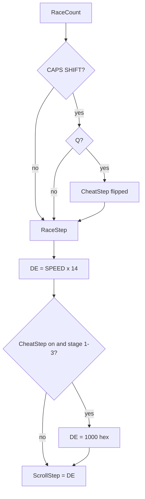

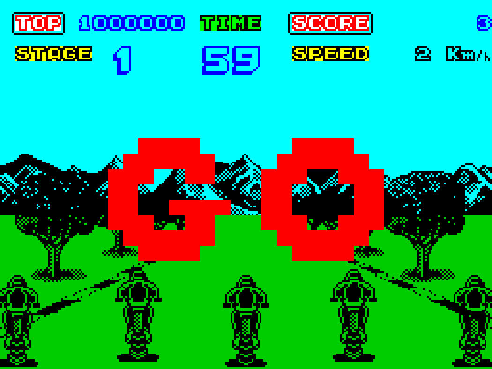

*The run `cheat`, frames 14 180-14 699, a picture every 4 frames: the road rushes at full pace while the HUD shows
6 km/h, then c1's speeds. Command: `python3 tools/play_techniques.py cheat --gif docs/img/play/race-cheat.gif`.*

Worked example: the run `cheat` holds CAPS SHIFT + Q from 14 200. At 14 202 CheatStep reads `$FF` and the keys are let
go. ScrollStep is `$1000` from then on, while SPEED goes 6, 8, 10, ... 89 by 14 508 as in c1. In 500 frames the bike
covers about as much track as c1 does at full speed.

**The point**: the cheat is a track speed, not a bike speed, and it breaks the steering: the bends push harder while
a full lean nearly stops working. It is also the only way to see stage 1 faster than SPEED 199 allows.

Witness: the CAPS SHIFT test at `$A657` in every race recording, CheatKey L1 1 (tech-cheat); the run `cheat` (`work/docs/erC/tech/cheat.jsonl`) and its recording
`tech-cheat`: CheatKey once at frame 126, CheatFixedStep `$A674` 51 times.

## 10.13 The bugs

### In short

| Bug | Cause | Seen in |
| --- | --- | --- |
| the stage 3 reset | a jump chained into a second ramp goes so high that RoadTopRow passes 0 and DrawRoad's stack falls into the ROM ([doc 4](04-game-loop.md), 4.9) | `reset3` 6 760, `stages-try1` 6 714 |
| the finish rider | StageEnd picks the largest *unsigned* row: a rider just behind the bike (row 232) beats one ahead (10.8) | `stages` 12 958 |
| the lap time under Infinite Time | StageTime subtracts with a borrow from the tenths: 0 seconds becomes `$99` (1'39") | `stages` 3 422 |
| the hundredths | StageTime's hundredths digit is PassCount's units: a filler, not a time | every lap time |
| the ramp's JumpSpeed | Ramp writes only the high byte (`$A824`), and JumpSpeed keeps its last value after a landing: every ramp after the first inherits a low byte, on the ground too (`$16F0`) | `reset3` 6 600, 6 714 |
| the cheat's toggle | it flips every pass both keys are held (10.12) | the run `cheat` |
| the steering cap | the cap sets the high byte to 5 and keeps the low byte: at rest lean 2 gives 5.96, lean 3 only 5.54 (10.3) | the figure of 10.3, from the tables |

### The stage 3 reset

In `reset3` two ramps of stage 3 came 114 frames apart. At full speed (the Keep Speed By Obstacles POKE) the bike
leaves the first ramp and lands in the very pass that meets the second: the landing (BikeLateral) and Ramp fall in
one pass. Ramp takes the ground from RoadLines[0], and on stage 3 that pass's RoadLines was built earlier in the same
pass by RoadRowsJump, which lifts the rows while the bike is in the air (JumpHeight `$25A6` the pass before). So
RoadLines[0] reads 168, not 191, and the second arc starts 23 rows higher, at 25, with the same JumpSpeed `$16`.

```text
reset3:   6 600  JumpHeight $0206, JumpSpeed $16F0   the first ramp
          6 660  $6746 at the top
          6 710  $25A6, RoadLines[0] 168              in the air, the rows lifted
          6 714  $1906, JumpSpeed $16F0, BounceTime 6 landed and met the second ramp in one pass
          6 756  $7696, JumpSpeed $0550              still rising: $76 = 118 rows, the last sample before the reset
          6 760  RoadTopRow $FF                      the road's top row below 0: the reset follows
```

```asm
Ramp:
  LD A,D                  ; D = RoadLines[0]: the ground under the bike
  CPL
  ADD A,$C2
  LD (JumpHeight+$0001),A ; from RoadLines[0]: on stage 3 the lifted view of the jump
```

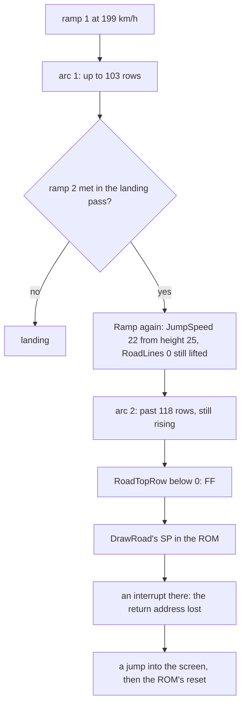

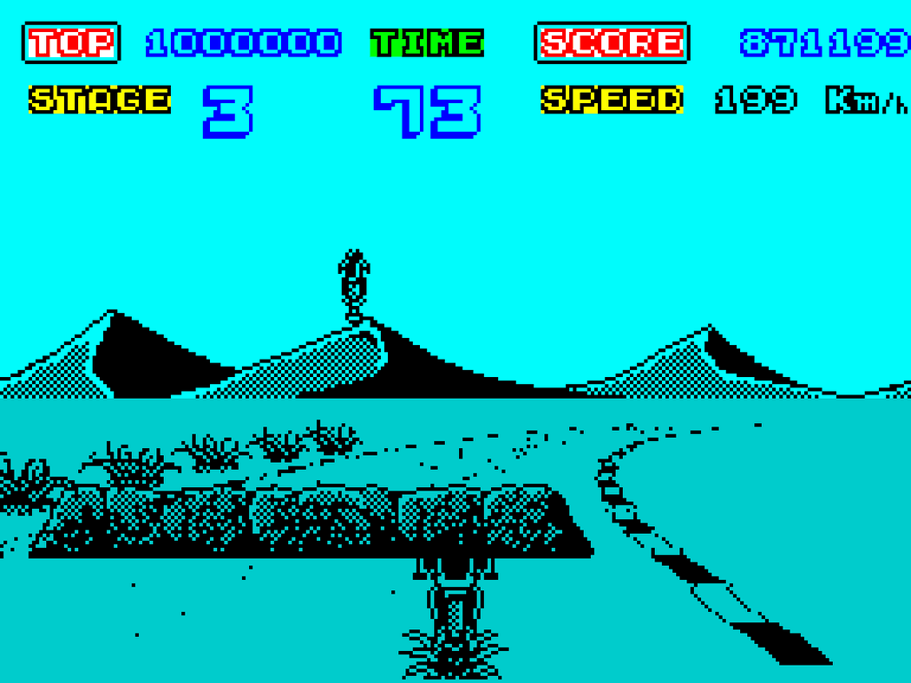

*`reset3` frames 6 600-6 800, a picture every 5 frames: the two arcs, the second higher, then the black screen of
the reset. Command: `python3 ../../kit/screen_anim.py --work work/docs/erC/r3 --from 6600 --to 6800 --step 5 --width
1050 --delay 120 --hold 2000 docs/img/play/race-reset3.gif`, after `python3 ../../kit/rs.py open --work
work/docs/erC/r3 --ttd work/stage1/rec/reset3/session.ttd --port-base 37795`.*

Worked example: the samples above, from `work/docs/erC/r3-vars.jsonl`. The first arc starts at height 2 with
JumpSpeed `$16`: its top is 103 rows (`$67`). The second starts at 25 with the same speed, and is at 118 (`$76`) at
6 756, still rising (JumpSpeed `$0550`: with the gravity of `$02F0` a pass it would go on to about 123 and 126
rows); the reset cuts the arc off before its top.
RoadTopRow goes 5, 4, 3, 1, 0 during the rise, and `$FF` at 6 760. The samples at 6 710 and 6 714 (RoadLines[0]
168, BounceTime 6, Wheelies 0) were read from `reset3` with `memory_at`.

Without the POKE the second ramp always costs a quarter of the speed: the landing clears Wheelies (`$AED5`) and Ramp
counts 0 in a bounce (`$A7FC-$A802`), so 8 wheelie passes help only the first ramp. 199 km/h becomes 149 and JumpSpeed
`$14` instead of `$16`: the chain starts a slower arc, and whether it still reaches the reset is not known.

**The point**: the game trusts the jump's height never to exceed the screen. Two ramps close together break that, and
the road routine's stack trick turns a drawing error into a crash of the whole machine.

Witness: `reset3` (WALKTHROUGH 1, "The stage 3 reset"); `r3-vars.jsonl`; `work/stage2/NOTES.md`.

## 10.14 The notable features

### In short

What makes Enduro Racer's code worth reading:

1. **The pass is the clock** (10.1). Nothing in the rules counts frames. A slower picture slows the race, the timer
   and the riders alike.
2. **Self-modifying operands as variables.** The game keeps state in instruction operands: HeldKeys is the operand
   of `OR n` at `$AD8A`, CheatStep of `LD A,n` at `$A66F`, BounceSpeed of `LD BC,nn` at `$AE92`, FinishRider of
   `LD IX,nn` at `$A961`, BendOp is an `ADD A,A` or a NOP, OffRoadJump a `JP nn` set per stage, the row builder and
   the road routine `CALL nn` set per stage. A stage is selected by patching code, not by testing a stage number.
3. **One multiply for everything.** Multiply `$8BAE` (A × L into DE) gives ScrollStep, the steering, the bend's
   push, the ramp's cost, the falls, the off-road cap and the stage's parameter address. The rules are written as
   factors over 256.
4. **The ring of riders** ([10.10](#1010-the-opponents-ai), [7.8](07-objects.md#78-the-riders-and-the-trucks)): a
   one-byte distance makes four riders a never-ending field. Witness: MoveRiders `$A21A` L1 4292; in `c1` 777
   calls (`work/stage1/rec/c1/l1.json`).
5. **Randomness from the R register and the ROM** ([9.4](09-sound.md#94-the-engine-on-both-machines)). A bounce steers by `LD A,R / AND $0C`
   (`$ADA6`, in the asm below). The engine's and the crash's noise read ROM bytes. There is no random-number
   generator. Witness: `$ADA6` runs 6 times in `c1` (`work/stage1/rec/c1/l1.json`).
6. **Steering is a speed** ([10.3](#103-steering-bends-and-the-roads-edge)), the table falling with speed, against
   a bend whose push grows with speed: BikeControl reads SteerTable `$8E5D` at 2 × ScrollStep's high
   byte. Witness: BikeControl `$ACDF` L1 4343, BikeLateralPush L1 4150.
7. **Two players are two copies of a block** ([10.9](#109-two-players-and-turns)): TurnLoop `$87BD` swaps the 56
   bytes of Player `$5E0D` and OtherPlayer `$5E45` before each turn. Witness: TurnLoop runs 3 times in `twoplayer`
   (`work/stage1/rec/twoplayer/l1.json`); PlayTurn L1 23.
8. **One byte, two instructions.** MoveRidersIx `$A21F` is a lone `DEFB $DD`: entered there, `DD 21 80 5C` reads
   `LD IX,Riders`; the loop re-enters one byte later, where `21 80 5C` is `LD HL,Riders`, harmless before the `EXX`
   ([7.8](07-objects.md#78-the-riders-and-the-trucks)). Witness: in `c1` `$A21F` is entered 777 times (once a call)
   and `$A220` 3 885 times, five a call.

### Pseudocode

```text
a stage's behaviour = the code the stage patched:
    RowBuilderCall: CALL RoadRowsFlat / RoadRowsCrest / RoadRowsJump
    RoadCall:       CALL DrawRoad ...
    OffRoadJump:    JP OffRoad / OffRoadSand / OffRoadStage5
    BendOp:        ADD A,A (stages 2, 4) or NOP
```

### Assembly

```asm
HeldKeys:
  OR $00                  ; OR n: n = RaceLoop's ReadControls
CheatStep:
  LD A,$00                ; LD A,n: n = 0 or $FF (CheatKey)
BounceSpeed:
  LD BC,$0000             ; LD BC,nn: the sideways speed (BikeControl)
FinishRider:
  LD IX,$0000             ; LD IX,nn: the rider StageEnd picked
OffRoadJump:
  JP OffRoad              ; JP nn: StageParams' off-road routine
l_ADA6:
  LD A,R                  ; a bounce: random LEFT or RIGHT
  AND $0C
```

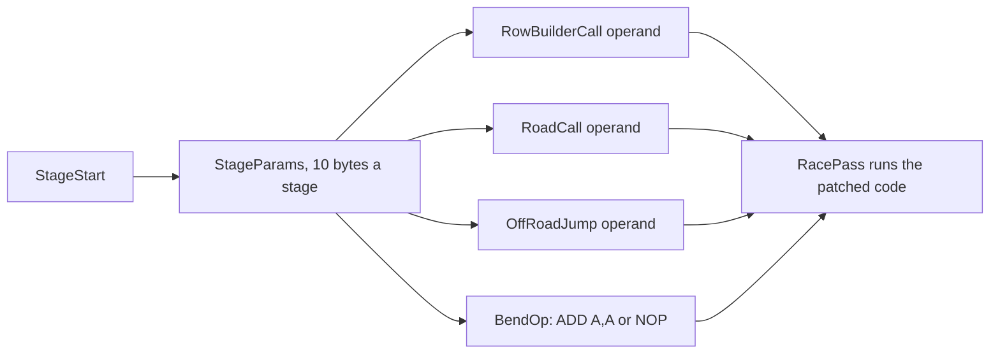

The figure of this section is the steering figure of 10.3, and its animation BikeLateralPush.gif: the multiply, the
patched `ADD A,A` and the operand BounceSpeed at work in one routine.

Worked example: stage 2 against stage 1. StartRace writes `$87` (ADD A,A) into BendOp on stages 2 and 4 and 0 (NOP)
elsewhere. At SPEED 199 a bend 1 then pushes 6.4 units a pass instead of 3.2. The same code, one byte different, makes
stage 2's bends twice as hard.

**The point**: the program has one race loop for five stages. Patched operands and calls, not branches, make the
stages differ.

Witness: StartRace L1 23; `src/game/race.asm` (StageParams `$A187`); doc 7 (7.2).

### What the authors left

No build date, name or message was found in the race code. The credits are on the title screen ([doc 1](01-game-design.md)).
The unused code the recordings never reached is listed in 10.15.

## 10.15 Known only from the code

The first draft listed TruckCrash, RampCap, CheatFixedStep, FallStage5 and the landing without a bounce here. The
recordings `truck`, `tech-ramp-wheelie`, `tech-cheat`, `fall5` and `tech-land-wheelie` (WALKTHROUGH 6.0) now run each
of them. `fall5` keeps the Keep Speed POKEs of the `stages` state it starts from; OffRoadStage5's `RET NC` side ran
24 times there, its other side never. What is left:

- OffRoadStage5's test on the other side, and a stage 5 fall without any POKE.
- The stage 3 reset without POKEs: the second ramp always takes the quarter tax (the landing clears Wheelies), so the
  second arc is slower; whether it still reaches the reset is not known; not run.
- A tie in RecordStages (equal seconds, compare the hundredths): no recorded stage time had a record's seconds.
