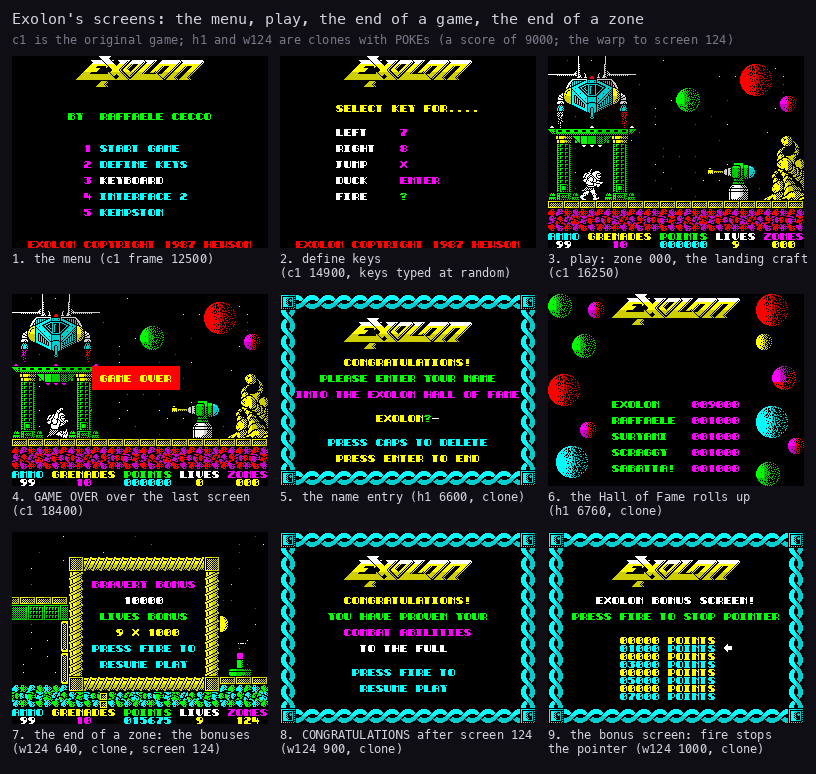
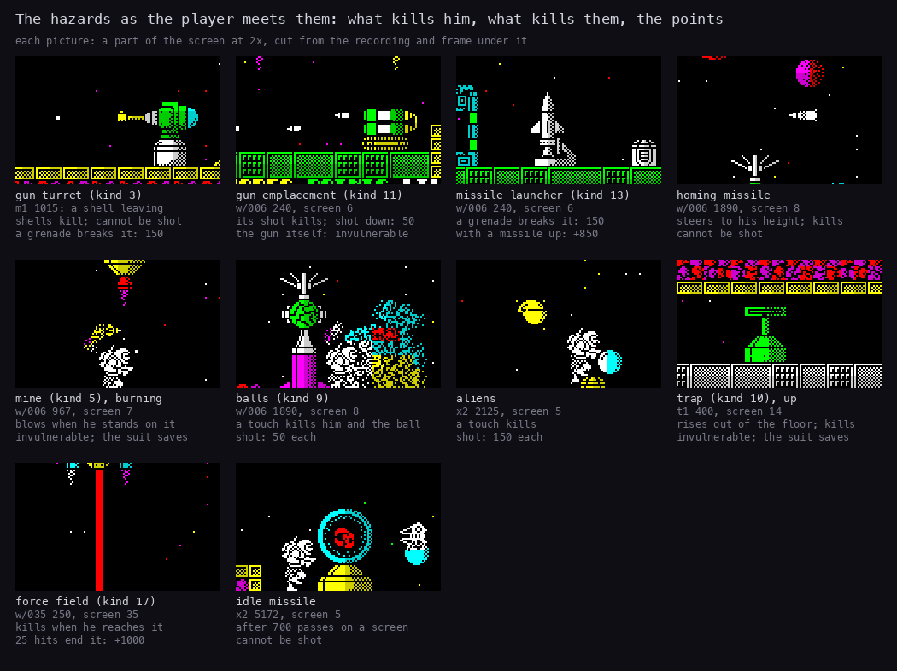
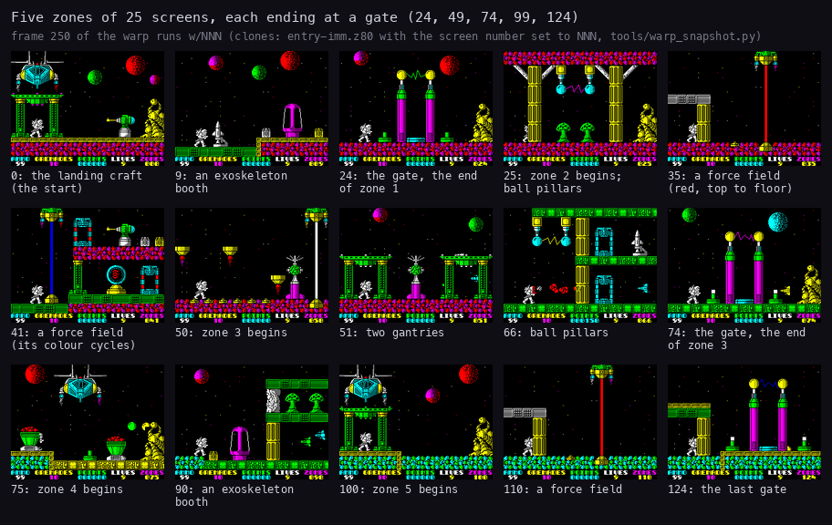
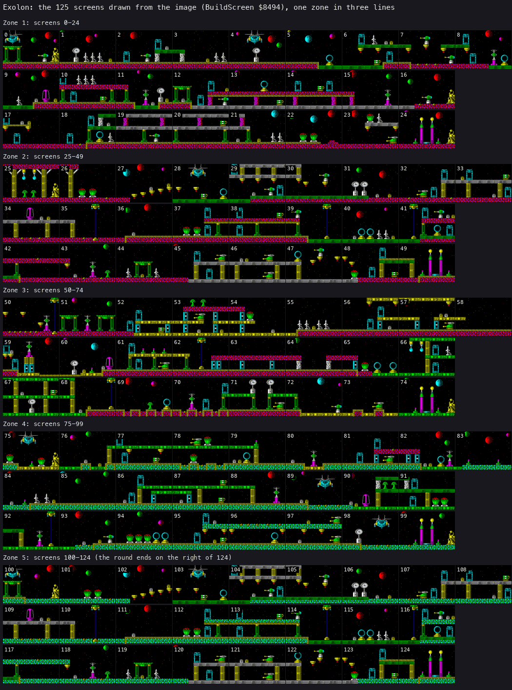
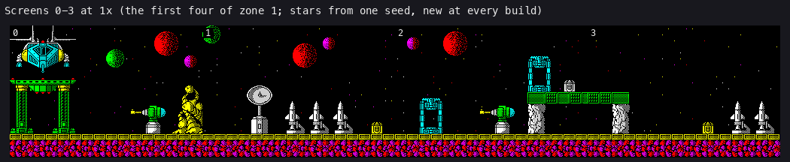
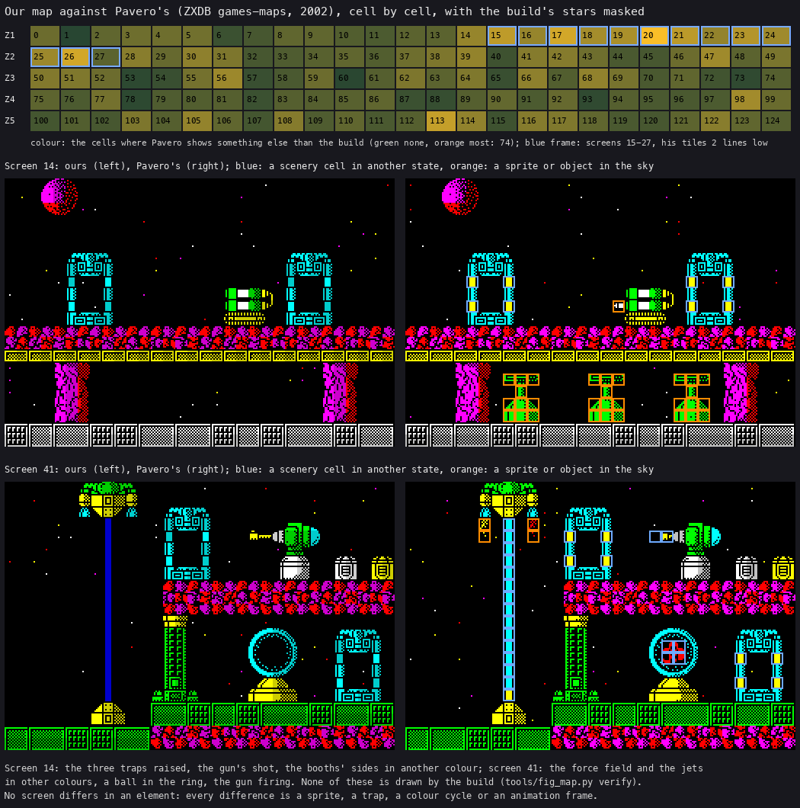
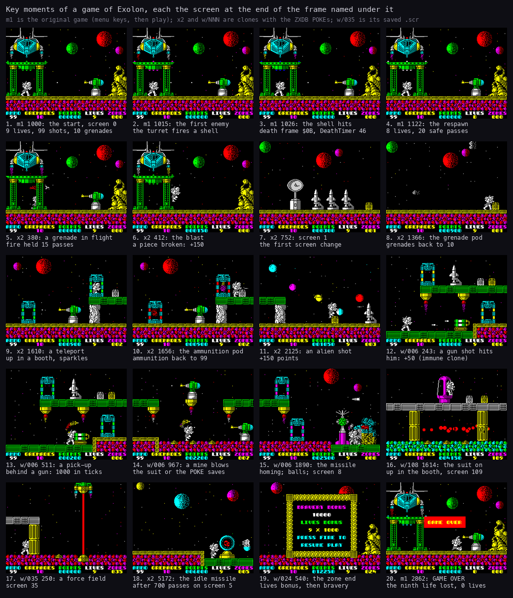
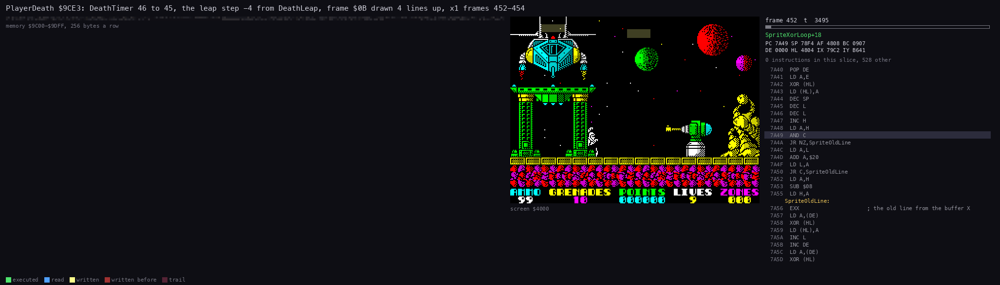
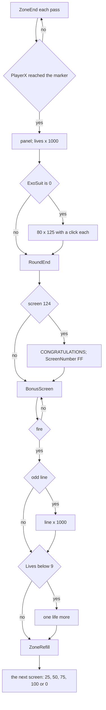
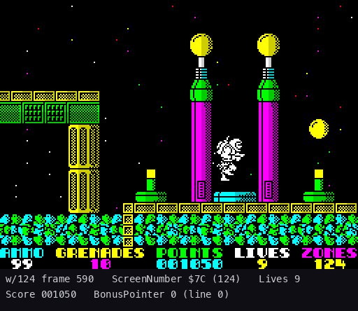

# 1. Game design

What this covers:

- the game in a few lines (1.1);
- its screens: the menu, play, the end of a game, the end of a zone (1.2);
- the play screen and the HUD (1.3);
- the controls as the player uses them (1.4);
- the player: moves, shots, grenades, pods, teleports, the exoskeleton (1.5);
- the hazards: a picture of each, what kills him, what kills them, the points (1.6);
- 125 screens in five zones, and the full map (1.7);
- the key moments of a game, each with its screenshot and frame (1.8);
- a death and the respawn (1.9);
- the score, the lives, the bonuses, a zone's end step by step, the Hall of Fame (1.10);
- 48K and 128K, the cheat, and the difficulty settled from the code (1.11);
- design notes (1.12);
- what no recording reached (1.13).

It describes the game as a player meets it. Every rule has its routine; the rules as code are in
[doc 10](10-gameplay-logic.md), the objects in [doc 7](07-objects.md), the keys and ports in
[doc 5](05-controls.md). The names are those of `src/game/game.ann` ([Terms](README.md#terms)). The recordings it
rests on:

- `c1`: power-on with `Exolon.tzx`, 48K, the load, then 16 000 frames of seeded random play (WALKTHROUGH 1). Read
  through `memory_at` only. Four games, all on screen 0.
- `m1` (`tests/inputs/m1-menus.txt`, no POKE): the original game from its entry. Define keys, the control types,
  nine deaths on screen 0, GAME OVER. Opened as `work/docs/fillP/m1` on an own instance (port base 31350).
- `h1`: a clone (`entry-score.z80`, the score set to 009000): GAME OVER, the name entry, the Hall of Fame.
- `w/NNN`: 97 warp clones (`entry-imm.z80` with the screen number set to NNN and the ZXDB POKEs for lives,
  ammunition, grenades, immunity, mines and traps), every screen 0-124 reached (WALKTHROUGH 6.0). The ones used here
  were opened again as `work/docs/fillP/w006`, `w024`, `w036`, `w108`, `w124`.
- `x2`: a clone with the same POKEs from screen 0: five screen changes in 3000 frames (`work/docs/fillP/x2`).
- `t1`: annotation agent C's clone on screen 14, with only the lives and immunity POKEs, so the traps run.

The clones are exploration only: each statement below also cites the code. A frame is 1/50 s. A pass is one turn
of the main loop, about 2 frames ([doc 4](04-game-loop.md)).

## 1.1 The game

- Exolon (Hewson Consultants, 1987, by Raffaele Cecco) is a flip-screen run-and-gun game.
- The player walks right through 125 screens, one at a time. The left edge is a wall: there is no way back
  (`TestLeft $8122` blocks X = 0).
- Each screen is a fixed scene of scenery and hazards. He shoots, throws grenades, jumps and ducks to get through.
- Every 25 screens a zone ends with a bonus. After screen 124 the game starts again at screen 0 with the score kept.
- Nine lives, 99 shots and 10 grenades at the start (Start `$6D60`, StartGame `$758A`).

## 1.2 The screens



How to read the figure:

- **Nine screens**, each the Spectrum screen at the end of the frame named under it, read with TTD `memory_at`.
- **1-4** come from `c1`, the original game: the menu (frame 12500), define keys (14900, with keys typed at random by
  the seeded play), play on the first screen (16250), GAME OVER over the last screen (18400).
- **5-6** come from `h1` (clone): the name entry (6600) and the Hall of Fame rolling up (6760).
- **7-9** come from `w/124` (warp clone on screen 124): the zone-end bonuses (640), CONGRATULATIONS after the last
  screen (900), the bonus screen (1000).
- **The point**: the game has one play screen and six full-screen panels; all of them are printed by the one string
  interpreter ([doc 6](06-rendering.md), 6.3).

```bash
python3 tools/fig_sheet.py --columns 3 --title "Exolon's screens: the menu, play, the end of a game, the end of a zone" \
    --subtitle 'c1 is the original game; h1 and w124 are clones with POKEs (a score of 9000; the warp to screen 124)' \
    --out docs/img/design/modes.png work/docs/docA/c1@12500='1. the menu (c1 frame 12500)' ...
```

(the full command, with the nine captions, is in `work/docs/docA-NOTES.md`.)

The panels and their routines:

| Screen | Routine | When |
| --- | --- | --- |
| the menu | MainMenu `$6DA1` | after the load, GAME OVER, the abort; keys 1-5 ([doc 5](05-controls.md)) |
| define keys | DefineKeys `$6FAB` | menu key 2 |
| GAME OVER | GameOver `$A02A` | the last life lost; a red band over the last screen |
| the name entry | HallOfFameInsert `$A073` | the score beats an entry of the Hall of Fame |
| the Hall of Fame | HallOfFameRoll `$7149`, ShowHallOfFameFirst `$7145` | after a name entry, or the menu left alone for 2500 passes |
| the zone-end bonuses | ZoneEnd `$A817` | the end marker of screens 24, 49, 74, 99, 124 |
| CONGRATULATIONS | RoundEnd `$A867` | after screen 124 |
| the bonus screen | BonusScreen `$A8DB` | after each zone end |

The menu's text (MenuText `$6E17`), row by row:

| Row | Text | Colour |
| ---: | --- | --- |
| 0 | the EXOLON logo (LogoText) | yellow |
| 7 | BY  RAFFAELE CECCO | attribute `$44`, bright green |
| 11 | 1 START GAME | the digit bright magenta, the text bright cyan |
| 13 | 2 DEFINE KEYS | the same |
| 15 | 3 KEYBOARD | the same; chosen: bright white |
| 17 | 4 INTERFACE 2 | the same; chosen: bright white |
| 19 | 5 KEMPSTON | the same; chosen: bright white |
| 23 | EXOLON COPYRIGHT 1987 HEWSON | bright red |

The chosen control type's line is painted bright white by HighlightControl `$6F90` ([doc 5](05-controls.md)).

## 1.3 The play screen

The play screen is screen 3 of the figure above, and picture 1 of the key moments (1.8):

- **Rows 0-21**: the scene, printed once when the player enters ([doc 6](06-rendering.md), 6.4). The scene does not
  scroll.
- **Row 22**: the labels AMMO, GRENADES, POINTS, LIVES, ZONES, each in its colour (HudText `$76A2`).
- **Row 23**: the counters under them.
- **The player** is a 24x32 sprite, 3 cells wide and 4 high. He is the only sprite of that size; every enemy is
  16x16 or smaller ([doc 6](06-rendering.md), 6.5).

The HUD's counters:

| Label | Byte | Range | Printed by | At the start |
| --- | --- | --- | --- | --- |
| AMMO | Ammo `$8E5A` | 0-99 | PrintAmmo | 99 |
| GRENADES | Grenades `$8E66` | 0-10 | the grenade count | 10 |
| POINTS | Score `$AD8A` | six ASCII digits | AddScore `$AD53` | 000000 |
| LIVES | Lives `$8E7A` | 0-9 | the lives digit | 9 |
| ZONES | ScreenNumber `$8523` | 0-124 | PrintZone `$8E7B` | 000 |

ZONES is the screen number, not the zone: screen 24 reads 024 (key moment 19).
The HUD is described as code in [doc 8](08-hud-and-text.md).

## 1.4 The controls

The player has five controls: left, right, up, down and fire. They come from the keyboard (Q, A, O, P, M by default,
or the keys he defines), a Sinclair Interface 2 joystick, or a Kempston joystick: menu keys 3, 4 and 5 choose
([doc 5](05-controls.md)).

| What he does | What happens | Code |
| --- | --- | --- |
| right or left | walks 2 pixels a pass; the first press the other way only turns him (one pass) | Walk `$8295` |
| left and right together | stands still: the two bytes are XORed, so both is the same as neither | Walk |
| up, on the ground | jumps; the direction held at take-off carries him | MovePlayer `$81A4` |
| up, standing in a teleport or the exoskeleton booth | uses it, and does not jump: the booth's roof stops the jump | Teleports `$98BA`, ExoSuitBooth `$9F2D` |
| down, on the ground | crouches; his shots leave 5 pixels lower (SpawnShot `$83AB`), his grenades 6 (ThrowFromCrouch `$9233`); he cannot walk | MovePlayer |
| fire, tapped | one shot, one round of ammunition | FireControl `$8338` |
| fire, held 15 passes | a grenade as well, when one is left and none is flying | ThrowGrenade `$9208` |
| fire, held longer | no more shots (no autofire); another grenade each time the one in flight ends, while grenades last | FireHeld `$83DC` |
| 3 alone | pause; any key or fire goes on | PauseKey `$AD21` |
| 7, 8, 9 and 0 together | abort the game, back to the menu | AbortKeys `$9A19` |
| fire on the bonus screen | stops the pointer | BonusScreen `$A8DB` |
| define the keys as Z, O, R, B, A | the cheat: lives never run out | ZorbaCheat `$7046` |

A tap and a hold, measured in `x2` (Kempston fire held from frame 312):

- frame 312: the press fires one shot (FireHeld 1);
- frame 341: FireHeld reaches 15 and a grenade leaves (GrenadeTimer `$20`);
- frame 351: fire released, FireHeld 0 at frame 352.

So with ammunition a grenade comes after a shot: the press already fired one. FirePress `$835D` counts FireHeld
before its `Ammo == 0` test (`$8365`), so with no ammunition a held button still throws a grenade, with no shot. FireHeld stays at 15 or more while fire is held (it stops at 255), so a held button throws
again as soon as the grenade in flight ends: known only from the code (`x2` released fire before its grenade landed). The mechanism, with its asm and a chart, is in [doc 5](05-controls.md).

During a death nothing answers: MovePlayer, FireControl and ThrowGrenade start with AbortIfDying `$9D78`.

## 1.5 The player

Moves (MovePlayer `$81A4`, once a pass):

| Move | Control | Rule |
| --- | --- | --- |
| walk | left, right | 2 pixels a pass; a change of direction costs one pass |
| crouch | down, on the ground | no movement; his shots leave lower |
| jump | up, on the ground | 22 passes, up 18 pixels and down; the take-off direction keeps moving him; no steering |
| fall | nothing below | 4 pixels a pass, no steering |

The movement states as code, the jump table and its arc against the recordings are in
[doc 10](10-gameplay-logic.md#103-three-arcs-from-three-tables); the player's frames are drawn in
[doc 6](06-rendering.md#65-the-sprites).

Weapons and equipment:

- **Shots** (FireControl `$8338`): one shot a press, one round of ammunition each. A shot is a short line that flies
  10 pixels a pass for about 100 pixels. No shot when he stands at the right edge (X from `$76`).
- **Grenades** (ThrowGrenade `$9208`): fire held for 15 passes throws a grenade in an arc
  ([doc 10](10-gameplay-logic.md#107-grenades)). Where it lands, GrenadeBlast `$93E2` breaks the first destructible
  scenery piece whose box holds the cell: the elements `$05`, `$0D`, `$0F`, `$10`, `$12`, `$15`, `$1F`, `$28`,
  `$2C`, `$2E` (DestructibleKinds `$94C6`). Among them are both turret elements (5 and 44), the missile launcher
  (31), the pods' element (18) and the ball ring (21). A grenade that lands on nothing breakable ends silently.
- **Pods** (Pods `$9942`): walking into the ammunition pod gives 99 rounds, into the grenade pod 10 grenades
  (key moments 8 and 10).
- **Teleports** (Teleports `$98BA`): up in one booth moves him to the other pad of the screen (key moment 9; `w/036`
  frame 1762 to 1763: X, Y from `$0C`, `$20` to `$11`, `$70` on screen 38).
- **The exoskeleton** (ExoSuitBooth `$9F2D`): up in an exoskeleton booth (screens 9, 34, 60, 90, 109) puts it on or
  takes it off (key moment 16; `w/108` frame 1610 up, ExoSuit `$9ED8` from 0 to `$0C` at 1613). Worn, mines and
  traps cannot kill him (ShieldedKill `$9CAA`) and he fires a second shot 6 pixels lower. It costs the bravery bonus
  at the zone's end.
- **Pick-ups** (PickupsVsPlayer `$A30B`): the two cells behind a gun's barrel pay 1000 points when he touches them
  (key moment 13; [doc 7](07-objects.md#77-the-pickup-cells-behind-the-guns)).

Witnesses: `c1` (walks, jumps, shots on screen 0; frames 17494-17542 one jump, JumpStep `$82F7` from 21 down to 0
and Y from `$70` to `$5E` and back), `x2` (fire held: grenades; pods; a teleport), `w/036` (a teleport), `w/108`
(the booth).

## 1.6 The hazards



How to read the figure:

- **Ten pictures**, each a part of the screen (120 x 75 pixels) at 2x, at the end of the frame named under it.
- **Under each**: the hazard and its object kind ([doc 7](07-objects.md#72-what-each-kind-does)), the recording and
  frame, what it does to the player, and what it takes to destroy it, with the points.
- **The turret** shows its shell leaving the barrel (m1 1015, the first shot of the original game). The gun shows its
  shot in flight to the left. The mine is the burning one after its blast (w/006 967). The trap is up, out of the
  floor (t1 400).
- **The point**: only four hazards can be shot (balls, aliens, the guns' shots, and the force field after 25 hits);
  turrets and launchers need a grenade; mines, traps, guns and both missiles cannot be destroyed at all, only
  avoided, and the exoskeleton protects against two of them.

```bash
python3 tools/fig_controls.py hazards --spec work/docs/fillP/hazards.json \
    --title 'The hazards as the player meets them: what kills him, what kills them, the points' --out hazards.png
```

(the spec lists each recording, frame, crop and caption; every screen is cached in `work/docs/fillP/*/screens-at`.)

| Hazard | Routine | How it kills | What destroys it | Points | Witness |
| --- | --- | --- | --- | ---: | --- |
| gun turret | AnimateTurrets `$8F95`, MoveShells `$90A2`, ShellsHitPlayer `$90EA` | shells to the left, at random (6 in 256 passes when idle) | a grenade (elements 5 and 44 are destructible); its shells cannot be shot | 150 | `m1` 1015 (shell), 1026 (death) |
| gun emplacement | Guns `$9D7F`, MoveGunShots `$9DD6` | a shot to the left (9 in 256 passes) while he is more than 64 pixels to its left | nothing (elements 26 and 45 are not destructible); its shots can be shot | 50 a shot | `w/006` 240, 243 |
| missile launcher | HomingMissileStart `$A23A` | launches the homing missile | a grenade (element 31) | 150, and 850 more while its missile flies | `w/006` 240; `w/013` ran the 850 |
| homing missile | HomingMissileStep `$A26B` | flies left, faster on the left part, one pixel a pass towards his height | nothing; it ends off the left edge, at a hit, or when its launcher is gone | 0 | `w/006` 1890 |
| mine | Mines `$9152`, ShieldedKill `$9CAA` | blows when he stands on it, then burns | nothing (element 12 is not destructible); the exoskeleton makes him immune | 0 | `w/006` 966 (blast, POKE: no death) |
| ball | SpawnBalls `$9B07`, MoveBalls `$9A23`, BallsTouchPlayer `$9BB4` | eight from a spawner, wandering at random; a touch kills him and the ball | a shot | 50 each | `w/006` 1899-1900 (002500 to 002550) |
| alien | AliensStep `$A360` | flies a fixed path; a touch kills | a shot (KillAlien `$A62D`) | 150 each | `x2` 2125 |
| trap | Traps `$9C15`, TrapTouch `$9C9B` | a probe rises out of the floor and sinks again | nothing; the exoskeleton makes him immune | 0 | `t1` 400 ([doc 7](07-objects.md#73-traps)) |
| force field | ForceFieldStep `$ABCF` | a column from the drop pod; death when his X + 12 reaches it | 25 shots that reach it (ForceFieldVsShots `$AC04`) | 1000 | `w/035` 250; the 25 hits never ran |
| idle missile | IdleMissileStart `$AC59`, IdleMissileStep `$AC7D` | sent at his height after 700 passes (about 28 s) on one screen | nothing | 0 | `x2` 5170-5180 ([doc 10](10-gameplay-logic.md#108-the-idle-missile)) |

Every killer ends in KillPlayer `$9CAF`; mines and traps go through ShieldedKill, which returns when ExoSuit is not
0. The full list of killers, with their callers, is in [doc 10](10-gameplay-logic.md#104-deaths-and-lives).

## 1.7 125 screens, five zones



How to read the figure:

- **15 of the 125 screens**, each at frame 250 of the warp clone started on it (`w/NNN`). The caption gives the
  screen number and what is new there.
- **Rows** run through the five zones: each zone starts on screen 0, 25, 50, 75 or 100 and ends at a gate on screen
  24, 49, 74, 99 or 124.
- **The colours**: the ground mixes red-magenta and green in zones 1-3; in zones 4 and 5 it is mostly cyan and green.
- **The point**: the screens are built from a set of 62 scenery elements ([doc 6](06-rendering.md), 6.4), so the
  zones look alike; the hazards make each screen. The full map (1.7.1) measures how alike: 121 different layouts
  for 125 screens, and zone 5 follows zone 2.

```bash
python3 tools/fig_sheet.py --columns 5 --scale 0.66 \
    --title 'Five zones of 25 screens, each ending at a gate (24, 49, 74, 99, 124)' \
    --subtitle 'frame 250 of the warp runs w/NNN (clones: entry-imm.z80 with the screen number set to NNN, tools/warp_snapshot.py)' \
    --out docs/img/design/zones.png work/w/000/screens/000250.scr='0: the landing craft|(the start)' ...
```

(the full command is in `work/docs/docA-NOTES.md`.)

- The screen number (`$8523`) rises by one when he walks off the right edge (NextScreen `$8253`). He enters the new
  screen on the left at the height he left the last.
- After screen 124 the screen number becomes `$FF` and the next screen is 0 (RoundEnd `$A867`). The game has no end
  but this loop.
- No plain recording got past screen 0. `x2` (clone, the ZXDB POKEs) changed screen at frames 751, 1481, 1771,
  2421 and 2951. The warp runs reached every screen.

### 1.7.1 The full map

The map is drawn from the game image alone, with no recording. `tools/fig_map.py` runs a model of the screen
builder BuildScreen `$8494` on every entry of ScreenTable `$C7F4`. The model covers:

- ClearPlayArea `$B061`;
- the elements of ElementTable `$852E`, printed through PrintString `$AF2B` in plot mode 0, with the glyph, the
  attribute, the cell type map `$6100` and the open-cell map `$5B00`;
- SaveAttributes `$8E11`;
- the star field DrawStars `$A2D5`;
- IndexObjectCells `$8E86`;
- the force field ForceFieldDraw `$AB97`.

The result is kept as a resource: `src/res/maps/exolon-map.png`, 6400 x 880 at 1x, one row a zone of 25 screens,
the play area only (rows 0-21).



How to read the figure:

- **Five zones**, each in three lines of 9, 8 and 8 screens, scaled to 0.45. The number is the screen number
  (`$8523`, the HUD's ZONES).
- **What is drawn**: what the build leaves on the screen before the first pass of the main loop. That is the scenery,
  the stars and the force fields (screens 35, 39, 41, 50, 62, 68, 92, 110, 114 and 116).
- **What is not drawn**: the player, the aliens, the balls, the missiles, the raised traps and the HUD. The
  colour cycles and the turrets' frames appear as the build leaves them.
- **The stars** are new at every build: DrawStars makes three tries a row with Random `$AD36`. The map draws them
  with one seed, RandomSeed `$AD51` as loaded (0), carried through the screens in order. It is one possible sky.
- **The point**:
  - each screen has its own list (125 lists at 125 addresses), but the pixels give 121 layouts;
  - four pairs are the same screen stored twice (byte-identical lists at two ScreenTable addresses): 28 and 103,
    40 and 115, 46 and 121, 47 and 122; only the stars differ, and in play the alien delay of 28 / 103 (`$10`
    against `$0A` in AlienScreens);
  - zone 5 follows zone 2: 90.5 % of the play area's pixel bytes (no stars) are equal screen for screen, against
    60.9-66.1 % between the other pairs of zones (`python3 tools/fig_map.py stats`).



The first four screens at 1x, as they are in the resource.

```bash
python3 tools/fig_map.py map        # src/res/maps/exolon-map.png from work/mkgame/original.bin
python3 tools/fig_map.py check      # regenerated, compared pixel for pixel (tools/res_formats.py check runs it)
python3 tools/fig_map.py figures    # docs/img/design/map.png, map-start.png, map-compare.png
```

**The model against the game.** `tools/fig_map.py verify` starts an instance of its own (muted, port base 29700) and
runs every screen 0-124:

1. It loads the warp clone of the screen (`tools/warp_snapshot.py`) and plays the menu as `w/NNN` does (5, then 1).
2. It runs the game to three moments of the game start's `CALL BuildScreen` (`$75BB`) and reads the 64 K at each:
   - `$8511`: the elements printed, before the stars;
   - `$8514`: the stars drawn;
   - `$75BE`: the build returned, with ForceFieldDraw and the objects' set-up done.
3. It compares the model at the same three points. The stars use the game's own RandomSeed and the A' it found
   there, because Random XORs the A that EX AF,AF' brings back into its result.

All 125 screens are identical at all three points: the pixels, the attributes, the 704 cells of `$6100` and of
`$5B00`. The glyph set the build found on entry took 21 different values, and none of them mattered: every element
sets its own set (`$E6`) before its first glyph. The objects' set-up (SpawnBalls `$9B07`, AliensSetUp `$A645`,
HomingMissileStart `$A23A`) draws nothing in the play area.

**The maps on the web.** Four maps were found, in two groups.

Pixel maps, compared below:

- **Pavero (Pavel Plíva), 2002**: `games-maps/e/Exolon.png` on ZXDB
  (<https://spectrumcomputing.co.uk/entry/1686/ZX-Spectrum/Exolon>, the files from
  <https://worldofspectrum.net/pub/sinclair/games-maps/e/>). It is 6400 x 910 pixels: 25 screens of 256 x 176 a
  row, five rows, and a credit line.
- **The same map on maps.speccy.cz** (<https://maps.speccy.cz/map.php?id=Exolon>, dated 07.09.2002): 6976 x 882
  pixels, equal pixel for pixel over the 6400 x 880 of the screens. It adds a panel of 576 pixels: the logo among
  planets, the credit, and the CONGRATULATIONS panel of the zone end.

Partial maps, coverage only:

- **Sinclair User**:
  - `Exolon_4.jpg`: issue 66, Map Chat;
  - `Exolon_3.jpg`: issue 67, October 1987, a strip of screenshots of the middle zones.

  Both were scanned by Mort and edited by Gerard Sweeney for World of Spectrum and The Tipshop. Their text names
  screens as "Zone 56", "Zone 72": the HUD's count, which is the screen number.
- **`Exolon_2.jpg`**: a hand-drawn map of the first 24 screens with a key of the hazards, by James Mowl and Paul
  Birdseye ("The Mad Mappers"). The scan does not show the magazine's name.



How to read the figure:

- **The strip**: one box a screen, five rows for the zones. The colour counts the 8 x 8 cells where Pavero's map
  shows something other than the build: green for none, orange for the most (74). The stars are left out (a
  cell holding exactly the star glyph, glyph 3 of TileSetE840 at `$E858`, counts as sky).
- **Blue frames**: screens 15-27. Pavero's tiles of these screens sit two pixel lines lower than his others (an
  offset in his assembly), so their bottom line of cells is cut. The comparison uses the shifted position for them.
- **The pairs**: screens 14 and 41, ours on the left at 2x and his on the right. Blue boxes are scenery cells in
  another state; orange boxes are a sprite or an object in the sky.
- **The point**: the two maps have the same elements in the same places on all 125 screens. Every difference is
  a moment of play:
  - 116 screens have sprites or objects in the sky (1788 cells): aliens, balls, missiles, the guns' shots, the
    player on screen 0, and the traps raised from the floor (screens 2, 14 and 17, among others; the traps' cells
    are kind 10 of IndexObjectCells);
  - 92 screens have scenery cells in another state (1048 cells): the teleport booths' and rings' colour cycles,
    the force field mid-cycle, the jets, the turrets' frames;
  - all but 8 of those cells lie within three cells of an object cell of the screen. The 8 are on screens 12, 48
    and 113, and looking at them shows a booth's colour cycle and blast debris.

What each map shows that the other does not:

- **Ours**:
  - the screen exactly as the build leaves it: every cell checked against the game;
  - the force field in the colour it is drawn in (attribute 1);
  - no sprites over the scenery;
  - regenerated from the image by one command.
- **Pavero's**:
  - the screens as they look in play: the hazards at work, the aliens of each screen, the traps up;
  - the logo and the end panel (speccy.cz).
- **Neither**: the HUD rows. Pavero's map has no HUD; ours draws the play area only.

```bash
python3 tools/fig_map.py verify     # the 125 screens against the game (work/maps/verify/verify.json)
python3 tools/fig_map.py compare    # work/maps/compare/pavero.json: per screen, the cells that differ
```

## 1.8 Key moments



How to read the figure:

- **Twenty screens** in the order a player meets them, each at the end of the frame under it.
- **1-4 and 20** come from `m1`, the original game with no POKE: the start, the first turret shell, the death it
  causes, the respawn, and GAME OVER.
- **5-11 and 18** come from `x2` (clone, the ZXDB POKEs) on screens 0-5: the first grenade and its blast, the first
  screen change, the grenade pod, a teleport, the ammunition pod, the first alien shot, the idle missile.
- **12-15** come from `w/006` (screens 6-8): a gun's shot hitting the player, a pick-up behind a gun, a mine's blast,
  the homing missile next to a ball spawner.
- **16, 17, 19** come from `w/108`, `w/035` and `w/024`: the exoskeleton booth, a force field, a zone end.
- **The HUD** of each picture shows the counters at that frame: the score rising (6, 11, 12, 13), the lives (9, then 8
  after the respawn, 0 at GAME OVER), ZONES as the screen number.
- **The point**: each new mechanic of the game is on screen within the first 9 screens, except the exoskeleton
  (first booth on screen 9) and the force field (first on screen 35). The original game shows none of them in
  `m1` or `c1`: neither got past screen 0.

```bash
sh work/docs/fillP/key-moments.sh   # tools/fig_sheet.py over the cached screens, 4 columns at 0.96
```

The moments and what the code does at each:

| # | Moment | Recording, frame | Code | Measured |
| ---: | --- | --- | --- | --- |
| 1 | the start | `m1` 1000 | StartGame `$758A`, BuildScreen `$8494` | StartGame at frame 941 after menu key 1 at 940 |
| 2 | the first enemy | `m1` 1015 | AnimateTurrets `$8F95` | the turret on screen 0 fires |
| 3 | the first death | `m1` 1026 | KillPlayer `$9CAF` | DeathTimer `$9CE2` = 46, ImmunityCount `$768D` = 66 |
| 4 | the respawn | `m1` 1122 | PlayerDeath `$9CE3` (the respawn at `$9D3B`) | lives 9 to 8 at frame 1121; the score unchanged |
| 5 | a grenade | `x2` 380 | ThrowGrenade `$9208` | thrown at frame 341, FireHeld 15 |
| 6 | its blast | `x2` 412 | GrenadeBlast `$93E2` | timer at 1 from 388 to 410, blast at 411; score 000000 to 000150 at 412 |
| 7 | a screen change | `x2` 752 | NextScreen `$8253` | ScreenNumber 0 to 1 at frame 751 |
| 8 | the grenade pod | `x2` 1366 | Pods `$9942` | the pod's code at `$99DF` ran |
| 9 | a teleport | `x2` 1610 | Teleports `$98BA` | StartSparkle at frame 1609 |
| 10 | the ammunition pod | `x2` 1656 | Pods | the code at `$9989` ran |
| 11 | an alien shot | `x2` 2125 | KillAlien `$A62D` | +150 |
| 12 | a gun's shot hits | `w/006` 243 | GunShotsVsPlayer, DestroyGunShot `$9E4F` | +50 at frame 244 (an oddity, 1.10) |
| 13 | a pick-up | `w/006` 511 | PickupsVsPlayer `$A30B` | two pick-ups at 510 and 513: 80 ticks |
| 14 | a mine | `w/006` 967 | Mines `$9152`, MineBlast `$91CF` | the blast at frame 966, screen 7 |
| 15 | the homing missile | `w/006` 1890 | HomingMissileStep `$A26B` | screen 8 |
| 16 | the exoskeleton | `w/108` 1613 | ExoSuitBooth `$9F2D` | up at 1610, ExoSuit 0 to `$0C` at 1613 |
| 17 | a force field | `w/035` 250 | ForceFieldDraw `$AB97` | screen 35, the first with one |
| 18 | the idle missile | `x2` 5172 | IdleMissileStart `$AC59` | launched at frame 5170 |
| 19 | a zone end | `w/024` 540 | ZoneEnd `$A817` | the panel at frame 515; step by step in 1.10 |
| 20 | GAME OVER | `m1` 2862 | GameOver `$A02A` | entered at frame 2861, after eight respawns |

The end of a round, CONGRATULATIONS and the return to screen 0, is the animation in 1.10.

## 1.9 A death and the respawn

A death is a leap, a fall, and a return to where he entered the screen.

- KillPlayer `$9CAF` starts it: DeathTimer = 46 passes, ImmunityCount = 66, the jump and the fire hold cleared, the
  idle timer cleared, frame `$0B` drawn.
- PlayerDeath `$9CE3` runs the leap from a table, one step a pass, until DeathTimer reaches 0
  ([doc 10](10-gameplay-logic.md#104-deaths-and-lives)).
- Then a life is taken, 99 rounds and 10 grenades are given, and he reappears at the restart point (RestartX `$82F3`).
- ImmunityCount keeps counting: 66 - 46 = 20 passes in which KillPlayer returns at once.

```text
KillPlayer:
    if DeathTimer != 0 or ImmunityCount != 0: return
    IdleTime = 0; JumpStep = 0; FireHeld = 0
    DeathTimer = 46; ImmunityCount = 66; draw frame $0B
each pass:
    ImmunityCount -= 1 (if not 0)
    if DeathTimer != 0: PlayerDeath step; DeathTimer -= 1
        when it reaches 0: Lives -= 1; Ammo = 99; Grenades = 10; back to the restart point
                            Lives == 0: GAME OVER
```

```asm
KillPlayer:               ; $9CAF
  LD A,(DeathTimer)
  OR A
  RET NZ
  LD A,(ImmunityCount)    ; the guard after a death
  OR A
  RET NZ                  ; the immunity POKE (ZXDB 40120)
  PUSH AF
  PUSH DE
  LD HL,$0000             ; the screen timer from 0
  LD (IdleTime),HL
  XOR A
  LD (JumpStep),A
  LD (FireHeld),A
  LD A,$2E                ; 46 passes of death
  LD (DeathTimer),A
```

The worked example, `m1`, the original game:

| Frame | What | DeathTimer | ImmunityCount | Lives |
| ---: | --- | ---: | ---: | ---: |
| 1015 | the turret's shell leaves (key moment 2) | 0 | 0 | 9 |
| 1026 | the shell hits; KillPlayer | 46 | 66 | 9 |
| 1121 | the respawn at the restart point | 0 | 20 | 8 |
| 2861 | the ninth death ends: GameOver | 0 | | 0 |

- 46 passes took 95 frames (1026 to 1121): about two frames a pass.
- The turret's shell gives no points: the score stayed 000000.
- `m1` died nine times on screen 0; eight respawns, then GAME OVER.



The animation is doc 10's; it shows one pass of PlayerDeath against the screen and memory.

**The point**: a death costs a life and the progress inside the screen, never the screen itself. The 20 safe passes
are short: about 40 frames.

## 1.10 Score, lives, bonuses, the Hall of Fame

The score is six ASCII digits at Score `$AD8A`, added to by AddScore `$AD53`
([doc 10](10-gameplay-logic.md#105-scoring)). Every scoring site:

| Event | Points | Site | Witness |
| --- | ---: | --- | --- |
| a ball shot | 50 | `$9B7C` (ShotsHitBalls `$9B52`) | `w/006` frame 1899 to 1900: 002500 to 002550 |
| a gun's shot destroyed | 50 | DestroyGunShot `$9E4F` | `w/006` frame 243 to 244: 000000 to 000050 (the shot hit the player, see below) |
| an alien shot | 150 | KillAlien `$A62D` | `x2` 2125 |
| a destructible piece blown up by a grenade | 150 | GrenadeBlast `$942A` | `x2` frame 411 to 412: 000000 to 000150 |
| a missile launcher destroyed while its missile flies | 850 (34 ticks) | HomingMissileStep `$A2AE` | `w/013` frame 1886: BonusTicks 0 to 34 (7.6) |
| a pick-up | 1000 (40 ticks) | PickupsVsPlayer `$A330` | `w/006` 510 and 513: 2000 points in ticks |
| the force field destroyed | 1000 (40 ticks) | ForceFieldDestroy `$AC2B` (`$AC54`) | never ran |
| the zone's end: LIVES BONUS | 1000 a life | ZoneEnd `$A83D` | `w/024` frame 521 to 522: 000000 to 009000 |
| the zone's end without the exoskeleton: BRAVERY BONUS | 10 000 (80 x 125) | ZoneEndBravery `$A855` | `w/024`: 019000 by frame 577 |
| the bonus screen: the pointer stopped on an odd line | 1000 x (BonusPointer AND 7) | BonusScreen `$A95A` | `w/124` frame 1017: +1000 (line 1) |

- **Ticks**: the launcher, the pick-ups and the force field add bonus ticks (AddBonusTicks `$9EAF`). PayBonusTick
  `$9EC1` pays one tick, 25 points and a click, a pass. So 1000 points take 40 passes, about 80 frames, to reach the
  HUD: in `w/006`, the two pick-ups at frames 510 and 513 took the score from 2000 to 4000 by about frame 600.
- **The oddity**: DestroyGunShot is called both by GunShotsVsShots (a player's shot hits a gun's shot) and by
  GunShotsVsPlayer (a gun's shot hits the player). Both pay 50. In `w/006` the immune clone took a gun's shot at frame
  243 and scored 50 at 244. Without the immunity POKE the player also dies, and the 50 points are paid anyway.
- **Lives**: 9 at the start, one more at a zone's end when below nine (ZoneAddLife `$A8A1`), never more than 9.
- **The bonus screen** (screen 9 of the figure in 1.2): an arrow steps down eight lines, 00000 01000 00000 03000
  00000 05000 00000 07000; fire stops it. The pointer is never reset: it goes on from where it last stopped.

### A zone's end, step by step

```text
ZoneEnd (each pass, on screens 24, 49, 74, 99, 124):
    if PlayerX < the end marker's X: return
    print the panel BRAVERY BONUS 00000 / LIVES BONUS n X 1000
    repeat Lives times: score += 1000
    if ExoSuit == 0:
        print "1" over the bravery figure (10000)
        repeat 80 times: score += 125; a click
RoundEnd:
    if ScreenNumber == 124: CONGRATULATIONS; ScreenNumber = $FF
    BonusScreen: the pointer steps until fire; odd line n pays n x 1000
    if Lives < 9: Lives += 1
    ZoneRefill: suit off, 99 rounds, 10 grenades, NextScreen, the zone's start
```



The asm of the two bonuses (`zones.asm`):

```asm
  LD A,(Lives)            ; $A82C
  LD B,A
  ; ... the lives digit printed at row 12 column 13
  LD DE,Points1000+$0005
ZoneEndLives:             ; $A83D
  CALL AddScore           ; lives x Points1000
  DJNZ ZoneEndLives
  LD A,(ExoSuit)
  OR A
  JR NZ,RoundEnd          ; worn: no bravery bonus
  ; ... "1" at row 8 column 14: the figure reads 10000
  LD BC,$0050
ZoneEndBravery:           ; $A855
  PUSH BC                 ; 80 x 125 = 10 000
  LD DE,Points125+$0005
  CALL AddScore
  LD B,$3C
  CALL BeeperNoise
  POP BC
  DEC BC
  LD A,B
  OR C
  JR NZ,ZoneEndBravery
```

The worked example, `w/024` (the clone has nine lives and no exoskeleton):

| Frame | What | Score |
| ---: | --- | --- |
| 515 | he reaches the marker of screen 24; the panel | 000000 |
| 522 | 9 lives x 1000 | 009000 |
| 577 | 80 x 125 = 10 000 paid, a click each (about 55 frames); RoundEnd, BonusScreen | 019000 |
| (fire) | the pointer stops on line 6: even, nothing | 019000 |
| 805 | screen 25 built: zone 2 begins | 019000 |

And the round's end, `w/124`:

| Frame | What | Score |
| ---: | --- | --- |
| 608 | the marker of screen 124; 9 x 1000 | 001050 to 010050 |
| 664 | the bravery paid; RoundEnd | 020050 |
| 708-714 | two Delays after RoundEnd: the screen cleared, CONGRATULATIONS printed, ScreenNumber `$FF` | 020050 |
| 797 | four Delays later: BonusScreen entered (`find_event` exec `$A8DB`) | 020050 |
| 923-932 | six more Delays: the bonus screen cleared and printed | 020050 |
| 1016 | the pointer stopped on line 1: +1000; ZoneRefill | 021050 |
| 1017 | screen 0 again, the score kept | 021050 |



How to read the animation:

- **91 pictures**, one every 5 frames of `w/124` from 590 to 1040, each the screen at 2x.
- **Under each**: the frame, ScreenNumber (124, then 255 for `$FF`, then 0), Lives, Score and BonusPointer `$A960`
  with its line (BonusPointer AND 7).
- **The point**: play stops for about 410 frames (8 s): the panel, the tally, CONGRATULATIONS, the bonus screen.
  Then the round loops to screen 0 with the score kept and nothing else carried over.

```bash
python3 tools/fig_controls.py zoneend --work work/docs/fillP/w124 --lo 590 --hi 1040 --step 5
```

**The Hall of Fame** (HallOfFame `$71F1`): 50 entries of a name and a six-digit score. The image's table starts with
RAFFAELE, SURYANI, SCRAGGY, SABATTA!, PADDY, LOFTY, JIMBO, LEO, GLEN, MORANGE, all at 001000 (`x1`, `h1`). A score
that beats an entry asks for an 8-letter name and then shows the table. The name entry's keys are in
[doc 5](05-controls.md); the table and its scroll in [doc 8](08-hud-and-text.md#86-the-text-screens) and
[doc 10](10-gameplay-logic.md#109-the-hall-of-fame).

## 1.11 Machines, the cheat, the difficulty

- **48K and 128K run the same image.** The 128K differs only in sound: the AY plays the title music and the effects
  instead of the beeper ([doc 9](09-sound.md); the machine test in [doc 2](02-architecture.md), 2.1).
- **The ZORBA cheat**: define the keys as Z, O, R, B, A and the lives never run out (ZorbaCheat `$7046`); a jingle
  says it is on. The same again turns it off ([doc 5](05-controls.md);
  [doc 10](10-gameplay-logic.md#1010-the-zorba-cheat)).
- **The speed** is not fixed: a pass takes about 2 frames when quiet and up to 4 when the player turns or a beeper
  effect plays, and 6 when both come in one pass ([doc 4](04-game-loop.md), 4.5). The game slows down when much
  happens.

### No difficulty curve

The game has no difficulty setting and no round counter. The second round is the first round again.

The evidence is the list of every instruction that touches ScreenNumber `$8523`, the only number that says where
the player is:

| Address | Routine | What it does with the screen number |
| --- | --- | --- |
| `$6D75` | Start | sets it to 0 |
| `$825C`, `$8260` | NextScreen `$8253` | adds 1 |
| `$84D7` | BuildScreen `$8494` | picks the screen's layout from ScreenTable `$C7F4` |
| `$8E7B` | PrintZone | prints it as ZONES |
| `$A64C` | AliensSetUp `$A645` | looks it up in AlienScreens: which aliens fly here |
| `$A867` | RoundEnd | compares it with 124 (CONGRATULATIONS) |
| `$A882` | RoundEnd | writes `$FF`, so NextScreen makes it 0 |
| `$A8C5` | ZoneRefill `$A8A5` | looks it up in ZoneStarts: where the zone's first screen puts him |

```asm
RoundEnd:                 ; $A867
  LD A,(ScreenNumber)
  CP $7C                  ; screen 124?
  JR NZ,ZoneEndBonusScreen
  ; ... CONGRATULATIONS
  LD A,$FF
  LD (ScreenNumber),A     ; the only round-end write: no counter goes up
```

What this proves:

- Every reader uses the number as an index or a comparison against a fixed screen. None scales a rate, a speed or a
  chance.
- RoundEnd writes only `$FF`; nothing counts rounds. After screen 124 the game cannot tell round 2 from round 1.
- The hazards' rates are constants in the code: the turret's 6 in 256 and the gun's 9 in 256 passes
  ([doc 7](07-objects.md#72-what-each-kind-does)), the idle missile's 700 passes. Their randomness is one generator,
  Random `$AD36`.
- The round end changes only the screen number, the ammunition, the grenades, the exoskeleton and one life
  (RoundEnd, ZoneRefill `$A8A5`).

So the difficulty rises only with the screens themselves: later screens have more hazards on them. Known only from
the code for the second round: no recording played one (1.13).

## 1.12 Design notes

- **No way back.** TestLeft blocks X = 0, so a screen once left is gone. A death restarts the screen, not the zone:
  the cost of a death is small, the cost of a mistake is the screen's hazards again.
- **The fire button does two jobs.** One button gives a shot and, held, a grenade. There is no grenade key, so with
  ammunition every grenade costs a round as well (1.4).
- **Booths and teleports use up.** Up is the jump key, and the booth's roof stops the jump, so the same key works the
  booth without a jump. The player never needs a sixth control.
- **The exoskeleton is a trade.** Worn, it saves him from mines and traps and doubles his shots, but it costs the
  10 000-point bravery bonus at the zone's end.
- **The loop.** After screen 124 the game starts again, the score kept, with nothing harder. The challenge is the
  score and the Hall of Fame, not an ending.
- **Few layouts, many screens.** 121 layouts serve 125 screens, and zone 5 repeats zone 2 closely (1.7.1): the
  hazards, the aliens and the colours make the screens different.

## 1.13 What no recording reached

- A screen change in a plain recording: `c1`'s seeded play and `m1` never left screen 0. Everything past screen 0
  comes from clones (`x2`, the warp runs) and the code.
- A second round in play: `w/124` reached screen 0 again and stopped there. That the second round equals the first is
  known only from the code (1.11).
- ZoneAddLife `$A8A1` (an extra life at a zone's end): the warp runs had nine lives.
- The force field destroyed by 25 shots (ForceFieldDestroy `$AC2B`, the 1000 points at `$AC54`).
- ReadKeyboard `$7AE9` in play: no case recording played with the keyboard type ([doc 5](05-controls.md)).
- The pause, the abort keys and the ZORBA cheat: only the annotation agents' clone runs (`d1`, `t1`, `exA1`;
  [doc 5](05-controls.md)).
- The menu's timeout to the Hall of Fame (HallOfFameRoll `$7149` from the menu): `c1` and `m1` always pressed a key in
  time.
- Traps in a case recording: every warp run had the trap POKE; exC's clone runs `t1` / `t2` ran them.
- A mine's kill: the warp runs carried the mine POKE, so the kill itself is known only from the code.
