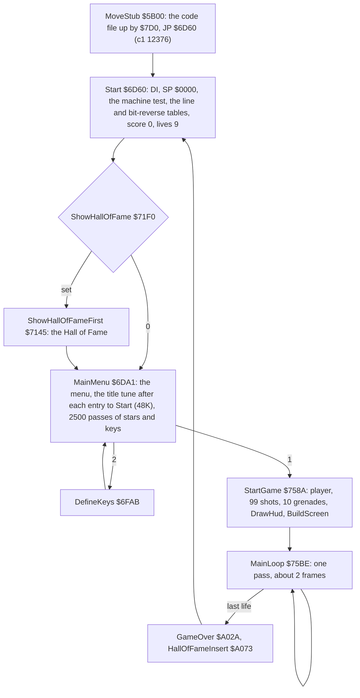
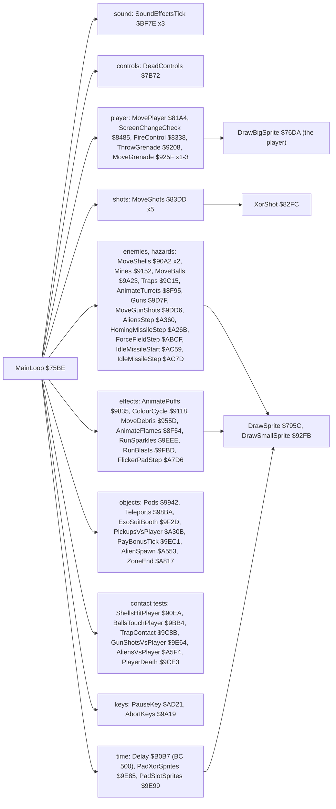
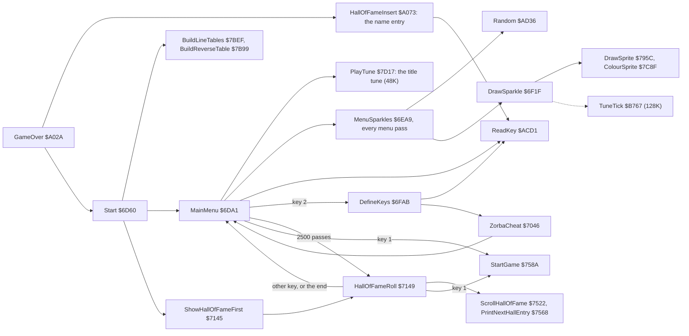
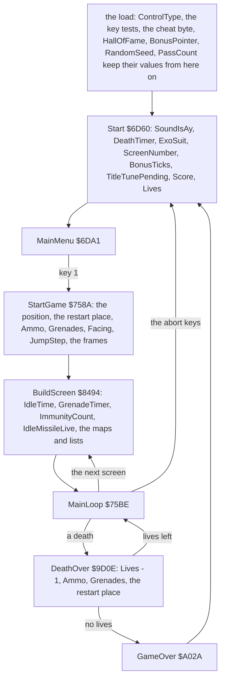

# 2. Architecture

What this covers:

- the machine budget: 48K and 128K, no interrupt, no paging (2.1);
- the memory map at three stages (2.2);
- the stages from the tape to play (2.3);
- the main loop's call graph (2.4);
- where the CPU time goes, in play and in the menu (2.5);
- the memory heatmap of a game (2.6);
- the 34 modules (2.7);
- the state and its lifetime: what the load, Start, a game, a screen and a life reset (2.8);
- the 48K and the 128K: the machine test and its five readers (2.9);
- Start's tables (2.10);
- the self-modifying code (2.11);
- the foreign code: the CPC keyboard scan and the serial downloader (2.12).

Every name is the one in `src/game/game.ann`; [11](11-data-reference.md) and [12](12-routine-reference.md) list every
entry. The recordings it rests on ([Terms](README.md#terms)):

- `c1`: power-on with `Exolon.tzx`, 48K, the load, then 16 000 frames of seeded random play (`work/c1`). Opened
  read-only on an own instance as `work/docs/docA/c1` (port base 27000). Two L1 builds of windows of it:
  - `work/docs/docA/c1-play`: frames 16125-18275, the first game from StartGame to GAME OVER
    (`re_session.py build --work work/docs/docA/c1 --from-frame 16125 --to-frame 18275 --into work/docs/docA/c1-play`);
  - `work/docs/docA/c1-menu`: frames 12378-16125, the menu and the define keys screen (the same with 12378, 16125).
- `c128`: the same capture on the 128K (WALKTHROUGH 1), for the machine test and the paging.
- The 97 warp runs `w/NNN` (clones, WALKTHROUGH 6.0) only through the code coverage they gave the annotation.

## 2.1 The machine budget

One image for two machines:

- **The 48K is the reference.** The tape says "48K / 128K", and both run the same bytes.
- **The machine test** at Start `$6D60`: `LD A,($386E)`, `SUB $FF`, into SoundIsAy `$6E16`. The 48K ROM holds `$FF`
  at `$386E` (flag 0); the 128K's 48 BASIC ROM holds `$DD` (flag `$DE`). Witness: `c1` and `c128` (WALKTHROUGH 1).
  The asm, the ROM dumps and all five readers: 2.9.
- **The flag picks the sound only**:
  - 48K: the beeper (BeeperNoise `$7C26`, BeeperSweep `$7C3C`, the tunes of `tunes.asm`);
  - 128K: the AY title music (`music.asm`) and the AY effects (`sound.asm`); BeeperNoise and BeeperSweep return
    at once, but the jingle (GAME OVER, the ZORBA cheat) still plays on the beeper (PlayTune `$7D17` has no test).
  - The AY code runs on the 48K too (SoundEffectsTick `$BF7E`, three calls a pass). Its `OUT ($FFFD)` and
    `OUT ($BFFD)` go nowhere there. Witness: AyWrite `$BF6D`, 17 of 17 bytes executed in `c1`.
- **No paging**: no write to `$7FFD` anywhere in the image (`c128`, WALKTHROUGH 1). The 128K's extra RAM is unused.

The CPU:

- **No interrupt**: Start runs `DI` and the game never runs `EI`. There is no frame sync. A pass of the main loop
  takes as long as its work, about two frames ([doc 4](04-game-loop.md), 4.3).
- Two pieces of an interrupt set-up are in the image and never ran: SetupIm2 `$7BDB` (an IM 2 table of `$81` at
  `$8000-$8100`) and StrayReti `$768E`, a lone `RETI`.
- **The stack**: Start sets SP to `$0000`, so the stack grows down from `$FFFF`. In play it reaches `$FFDC`: `c1`
  frame 16200 differs from the image in `$FFDC-$FFFF` only, over LeftoverCode (`memory_at`). 36 bytes.
- **The game never returns to BASIC**: it uses the printer buffer `$5B00`, the system variables and the BASIC area up to `$687F` as
  its cell maps and tables (2.2).

Two pieces of foreign code are in the image:

- CpcReadKeyboard `$C7B5`: a keyboard scan through ports `$F4xx` / `$F6xx`, the Amstrad CPC's PPI and PSG. It is
  not executed in any recording, and nothing calls it.
- SerialDownloader `$FF78`: a download routine over the ZX Interface 1 RS-232 port, with the development machine's
  BASIC stack (LeftoverStack `$FF18`) and UDGs before it. It is not executed in any recording.
- The asm and the protocols of both: 2.12.

## 2.2 The memory map


How to read the figure:

- **Three bars**, each the address space `$4000-$FFFF` from the top down, at three stages of `c1`:
  - frames 1808-12364: the code file loading at `$6590`, under the loading screen, with the loader at `$FC00`;
  - frame 12376: the image as MoveStub leaves it, at the game's first instruction;
  - frames 16125-18275: play.
- **A colour** is the kind of the region (the legend).
- **A label** gives the region's first address and what it holds at that stage.
- **The point**: the game is one image of 37 536 bytes, moved up by `$7D0` to `$6D60-$FFFF`. Below it, play reuses
  the dead system area for seven tables built at run time. Above `$6D60` the code area and the graphics stay as
  loaded, except the variables, two buffers and the player's frames.

```bash
python3 tools/fig_memmap.py --png docs/img/arch/memory-map.png --regions-out work/docs/docA/regions-play.txt
```

The tables below the image, built by Start and by the screen builder:

| Address | Name | Size | What |
| --- | --- | ---: | --- |
| `$5B00` | OpenCells | 768 | per character cell: `$FF` open, 0 scenery in front (sprites masked out) |
| `$5E00` | AttrCopy | 768 | the attributes as the screen builder left them; sprites colour only cells that are 0 |
| `$6100` | CellTypes | 768 | per cell: 0 empty, 1 solid, 2-17 an object cell while the screen is built |
| `$6400` | BitReverse | 256 | each byte bit-reversed (BuildReverseTable `$7B99`), for the mirrored player |
| `$6500` | LineAddrHigh | 192 | the high byte of each pixel line's address (BuildLineTables `$7BEF`) |
| `$6600` | LineAddrLow | 192 | the low byte |
| `$6700` | LineCol8Addr | 384 | the address of column 8 of each line (the Hall of Fame scroll) |

What play writes above `$6D60` (`c1-play`'s L1 byte counts, runs of 16 bytes or more):

- `$78DA-$795B`: SpriteSavedSP and ShiftBuffer of the sprite drawers;
- the object lists inside the code area: ShotList `$845F`, ShellList `$90CB`, DebrisList `$95B6`, the puffs `$9870`,
  BallList `$9A99`, GunShots `$9E18`, the aliens `$A508`, and the single variables between them;
- WorkArea `$B181-$B6D0`: the sprite save buffers;
- PlayerFrames `$EF80-$F87F`: the 24 frames, mirrored in place at every turn (FlipPlayerFrames `$7BAA`).

`$6880-$6D5F` is neither read nor written in play: the tail of the code file's first `$7D0` bytes, left behind by the move (Start's tables cover the rest).

## 2.3 The stages from the tape to play

The load is [03](03-build-and-load.md). From the game's entry:



How to read the diagram:

- **A box** is a routine that holds the machine for a while; the arrow labels are keys or flags.
- **The point**: the whole game runs from one entry, `$6D60`. GAME OVER, the name entry and the abort keys all go
  back to it, and it resets the score and the lives each time. [Doc 4](04-game-loop.md) (4.1) has every transition.

The timings in `c1`: the game entered at frame 12376, the menu at 12378, StartGame at 16125, the first pass at 16139,
the first GAME OVER at 18275.

## 2.4 The main loop's call graph

MainLoop `$75BE` makes 54 calls of 45 routines in a fixed order every pass ([doc 4](04-game-loop.md),
4.2). Grouped by what they do:



How to read the diagram:

- **A box on the left** is a group of MainLoop's calls, with their addresses; `x3` means the call is in the list three
  times.
- **A box on the right** is a drawing routine the group reaches. Every moving thing is drawn by the routine that
  moves it, at the moment it moves: there is no separate draw phase and no back buffer ([doc 6](06-rendering.md)).
- **The point**: the time pads reach the same sprite drawers as the enemies, with blank sprites.

The other side of the program, outside play (the calls of `build/game.lst`; the 128K's AY tick in dashes):



- **A box** is a routine; an arrow with a label is a jump on that key or count, one without a label a call.
- MenuSparkles and the DrawSprite it reaches are half of the menu's CPU time (2.5): the twelve stars are 16x16
  sprites, masked like any enemy.
- The menu, the Hall of Fame and the name entry are in [doc 4](04-game-loop.md) (4.1, 4.8) and
  [doc 8](08-hud-and-text.md).

## 2.5 Where the CPU time goes


How to read the figure:

- **Two panels**: play (`c1` frames 16125-18275, the first game) and the menu (frames 12378-16125).
- **A bar** is one routine's own time (its callees not included), as a share of all T-states of the window. The top
  16 routines are shown; the colour is the routine's module (the legend).
- **The point**:
  - SpriteMask `$79CA`, the masking step of the 16x16 drawer, is the biggest single cost: 24.4 % of play and 50.3 %
    of the menu, where the twelve twinkling stars are 16x16 sprites;
  - in play DrawSmallSprite `$92FB` (11.2 %) and SpriteMask are mostly the time pads' blank draws ([doc 4](04-game-loop.md),
    4.4);
  - Delay `$B0B7`, a wait that does nothing, is the third cost of play (7.1 %);
- The CPU never halts: `HALT` is 0 % in both windows.

```bash
python3 ../../kit/fig_budget.py work/docs/docA/c1-play/l1.json docs/img/arch/budget.png --ann src/game/game.ann \
    --state "menu=work/docs/docA/c1-menu/l1.json" --label play --top 16 \
    --title 'Sprite masking takes a quarter of play and half of the menu; the fixed Delay 7 %'
```

## 2.6 The memory heatmap of a game


How to read the figure:

- **The large grid** is `$4000-$FFFF`, one row of 256 bytes per two pixel rows, `$4000` at the top left. A byte's
  colour mixes red (written), green (read) and blue (executed), each the log2 of its count over the window.
- **The brackets on the right** name the regions of the play stage of 2.2.
- **The three small grids** are the counts alone, executed, read and written.
- **The point**:
  - the executed code (blue) is `$6D60-$B100` and the AY code at `$BF6D-$C7B4`; the music player `$B6D1-$BF6C` is
    dark in play on the 48K;
  - the reads (green) are the graphics `$D8E0-$FE7F` (the font, the scenery glyphs, the sprites) and the cell maps
    at `$5B00-$63FF`;
  - the writes (red, yellow where also read) are the screen, the cell maps, the object lists inside the code area,
    WorkArea `$B181`, and the player frames `$EF80-$F87F` (each turn mirrors them);
  - the screen's own inset (under each small grid) shows the writes in the top lines (the time pads), the player's
    place and the HUD.

```bash
python3 tools/fig_heatmap.py work/docs/docA/c1-play/l1.json docs/img/arch/heatmap.png --regions work/docs/docA/regions-play.txt
```

`tools/fig_heatmap.py` is Zynaps' layout of `kit/heatmap.py`'s panels at 900 px, copied into this case.

## 2.7 The modules

`src/game/` holds 34 modules, cut by address. Routines / data entries per module:

| From | To | Module | Routines / data | What |
| --- | --- | --- | ---: | --- |
| `$6D60` | `$7144` | menu | 10 / 11 | the entry, the machine test, the menu with its stars, the define keys and the ZORBA cheat |
| `$7145` | `$7589` | hiscore | 4 / 4 | the Hall of Fame: the table of 50 and its rolling display |
| `$758A` | `$76D9` | mainloop | 3 / 2 | the start of a game, the main loop and the HUD frame |
| `$76DA` | `$7AE8` | sprites | 20 / 4 | the sprite drawers: 24x32 and 16x16, shifted, masked by the open cells |
| `$7AE9` | `$7C23` | input | 10 / 2 | the controls (keyboard, Interface 2, Kempston) and the tables built at the start |
| `$7C24` | `$7C5E` | beeper | 3 / 0 | the beeper noise and sweep effects |
| `$7C5F` | `$7D16` | colour | 5 / 0 | the sprites' colour cells, and the wait for a key or fire |
| `$7D17` | `$8096` | tunes | 8 / 5 | the beeper tunes and the two-voice tone player |
| `$8097` | `$8484` | player | 18 / 16 | the cell map helpers, the player's walk, jump and fall, the shots |
| `$8485` | `$8DF4` | screens | 3 / 66 | the screen change, the screen builder and its 62 scenery elements |
| `$8DF5` | `$8E85` | hud | 9 / 3 | the cell maps cleared and saved, the HUD numbers |
| `$8E86` | `$9151` | objects | 12 / 7 | the object cells indexed into lists: flames, turrets and their shells, the colour cycle |
| `$9152` | `$9207` | mines | 3 / 3 | the mines |
| `$9208` | `$92FA` | grenade | 6 / 2 | the grenade: the throw, the arc, the walls |
| `$92FB` | `$98B9` | effects | 14 / 6 | the small XOR sprites and their wall probes, the grenade blast, the debris, the puffs |
| `$98BA` | `$9A22` | pickups | 6 / 3 | the teleports, the ammunition and grenade pods, the printers, the abort keys |
| `$9A23` | `$9BD5` | balls | 9 / 2 | the balls and their spawners |
| `$9BD6` | `$9D7E` | death | 10 / 3 | the player's contacts, the traps, the death |
| `$9D7F` | `$9E84` | guns | 8 / 2 | the guns and their shots, the shells against the shots and the player |
| `$9E85` | `$9F70` | passtime | 8 / 7 | the pass time pads, the bonus ticks, the teleport sparkles, the exoskeleton booth |
| `$9F71` | `$A029` | blasts | 4 / 2 | the aliens hit, the blasts |
| `$A02A` | `$A239` | gameover | 7 / 5 | GAME OVER and the Hall of Fame name entry |
| `$A23A` | `$A816` | aliens | 13 / 10 | the homing missile, the stars, the bonus pick-ups, the aliens on paths, the flickering pad |
| `$A817` | `$AB96` | zoneend | 5 / 6 | the end of a zone: the bonuses, the bonus screen, CONGRATULATIONS |
| `$AB97` | `$ACD0` | forcefield | 6 / 6 | the force field and the idle missile |
| `$ACD1` | `$ADE0` | utils | 7 / 4 | the keyboard, the pause, the random numbers, the score |
| `$ADE1` | `$B100` | text | 16 / 0 | the character printers, the string interpreter, the screen helpers |
| `$B101` | `$B6D0` | workarea | 0 / 1 | the sprite save buffers |
| `$B6D1` | `$BF6C` | music | 18 / 3 | the 128K title tune on the AY |
| `$BF6D` | `$C7B4` | sound | 28 / 2 | the AY sound effects (silent on a 48K) |
| `$C7B5` | `$C7F3` | cpc | 2 / 0 | the Amstrad CPC keyboard scan (never run) and SfxNoChannel, the sound effects' empty channel |
| `$C7F4` | `$D8DF` | layouts | 0 / 2 | the screen table and the 125 screen layouts |
| `$D8E0` | `$FF17` | graphics | 0 / 6 | the font, the scenery glyphs, the sprites |
| `$FF18` | `$FFFF` | leftover | 1 / 2 | what the development machine left: the BASIC stack, the UDGs, a serial downloader |

The counts are the entry lines of `game.ann` (`c` routines, `b w t s` data) in each module's range, 473 in all.
The code is one contiguous block, `$6D60-$B100`, plus the AY code `$B6D1-$C7B4` and the `RET` at `$C7F3`.

## 2.8 The state and its lifetime

The game keeps its state in single bytes and words spread through the code area. Nothing groups them: what a
variable means is set by the routine that resets it. There are five reset points, from the load down to a life.

Start `$6D60`, the entry of the image and of every return from a game (`build/game.lst`):

```asm
Start:
6D60  F3            DI
6D61  31 00 00      LD SP,$0000             ; the stack from $FFFF down
6D64  3A 6E 38      LD A,($386E)            ; the machine test (2.9)
6D67  D6 FF         SUB $FF
6D69  32 16 6E      LD (SoundIsAy),A
6D6C  AF            XOR A
6D6D  D3 FE         OUT ($FE),A             ; border 0, speaker and MIC off
6D6F  32 E2 9C      LD (DeathTimer),A
6D72  32 D8 9E      LD (ExoSuit),A
6D75  32 23 85      LD (ScreenNumber),A     ; back to screen 0
6D78  21 00 00      LD HL,$0000
6D7B  22 D6 9E      LD (BonusTicks),HL
6D7E  3C            INC A
6D7F  32 67 7D      LD (TitleTunePending),A ; 1: the title tune is still to play
6D82  CD EF 7B      CALL BuildLineTables    ; $6500 / $6600 / $6700 (2.10)
6D85  CD 99 7B      CALL BuildReverseTable  ; $6400 (2.10)
6D88  21 8A AD      LD HL,Score             ; "000000"
6D8B  11 8B AD      LD DE,Score+1
6D8E  36 30         LD (HL),$30
6D90  01 05 00      LD BC,5
6D93  ED B0         LDIR
6D95  3E 09         LD A,9                  ; nine lives
6D97  32 7A 8E      LD (Lives),A
6D9A  3A F0 71      LD A,(ShowHallOfFame)
6D9D  B7            OR A
6D9E  C2 45 71      JP NZ,ShowHallOfFameFirst
                                            ; else on into MainMenu $6DA1
```

```text
Start:
    interrupts off; SP = 0
    SoundIsAy = ROM[$386E] - $FF
    border = 0; DeathTimer = ExoSuit = ScreenNumber = 0; BonusTicks = 0; TitleTunePending = 1
    build the line tables and the bit-reverse table
    Score = "000000"; Lives = 9
    if ShowHallOfFame: the Hall of Fame first, then the menu
    else: the menu
```

The variables by lifetime:

| Lifetime | Variable | Address | Set by | What |
| --- | --- | --- | --- | --- |
| the load | ControlType | `$7B97` | the menu keys 3-5, DefineKeys (0) | 0 keyboard, 1 Interface 2, 2 Kempston ([doc 5](05-controls.md)) |
| the load | the five key tests | `$7AF0-$7B21` | DefineKeys (2.11) | each defined key's half-row and bit |
| the load | the cheat byte | `$9D1D` | ZorbaCheat | `$3D` (`DEC A`) or `$00` (`NOP`): infinite lives |
| the load | HallOfFame | `$71F1` | HallOfFameInsert | the table of 50 names and scores |
| the load | ShowHallOfFame | `$71F0` | the name entry `$A13C`, cleared at `$7146` | the Hall of Fame before the next menu |
| the load | BonusPointer | `$A960` | BonusScreen `$A90C` | the bonus screen's pointer, + 1 a step (its line is the value AND 7) |
| the load | RandomSeed | `$AD51` | Random `$AD36`, every call | 0 on the tape, never seeded again |
| the load | PassCount | `$768C` | MainLoop's end | 8 bits, counts on through every game |
| Start | SoundIsAy | `$6E16` | Start | 0 on a 48K, `$DE` on a 128K (2.9) |
| Start | DeathTimer, ExoSuit | `$9CE2`, `$9ED8` | Start | 0 |
| Start | ScreenNumber | `$8523` | Start, NextScreen | 0: a game always starts on screen 0 |
| Start | BonusTicks | `$9ED6` | Start | 0 |
| Start | TitleTunePending | `$7D67` | Start, MainMenu | 1, cleared when the menu plays the tune |
| Start | Score, Lives | `$AD8A`, `$8E7A` | Start | "000000", 9 |
| a game | PlayerX, PlayerY | `$82F5`, `$82F6` | StartGame | `$10`, `$70` |
| a game | RestartX, RestartY | `$82F3`, `$82F4` | StartGame | `$10`, `$70` |
| a game | Ammo, Grenades | `$8E5A`, `$8E66` | StartGame | 99, 10 |
| a game | Facing, JumpStep | `$82FA`, `$82F7` | StartGame | 1 (right), 0 |
| a game | PlayerFrames | `$EF80-$F87F` | StartGame | turned back to facing right if PlayerFlipped `$7BDA` |
| a screen | IdleTime, GrenadeTimer, ImmunityCount, IdleMissileLive | `$AC7B`, `$925A`, `$768D`, `$AC78` | BuildScreen | 0 |
| a screen | the cell maps, every object list | `$5B00-$63FF`, the lists of 2.2 | BuildScreen | built for the screen ([4.7](04-game-loop.md#47-the-screen-change)) |
| a life | Ammo, Grenades | `$8E5A`, `$8E66` | DeathOver `$9D0E` | 99, 10 |
| a life | Facing, PlayerFrames | `$82FA` | DeathOver | facing right |
| a life | Lives | `$8E7A` | DeathOver (`$9D1D`) | - 1; 0 is GAME OVER |
| a life | PlayerX, PlayerY | `$82F5` | DeathOver | RestartX, RestartY, dropped to the floor |



- **A box** is a reset point and the variables it sets.
- **The point**: only Start and the routines below it reset anything. What the load sets, nothing resets: the
  controls, the keys, the cheat, the Hall of Fame and the random seed survive every GAME OVER and every abort.

A worked example, `c1` around its first GAME OVER at frame 18275 (`memory_at`):

| Variable | 18270 (the last life) | 18450 (after Start) | Reset? |
| --- | --- | --- | --- |
| Lives `$8E7A` | 1 | 9 | yes, Start |
| ControlType `$7B97` | 2 | 2 | no |
| the cheat byte `$9D1D` | `$3D` | `$3D` | no |
| RandomSeed `$AD51` | `$BFCC` | `$680A` | no: it runs on ([doc 7](07-objects.md)) |
| PassCount `$768C` | `$F1` | `$F4` | no |
| ShowHallOfFame `$71F0`, HallOfFame's first byte `$71F1` | `$00`, `$52` | `$00`, `$52` | no |

The seed's bytes are shown as a word (low byte first in memory: `CC BF` at 18270). The score stays "000000" in
`c1`: the random play scored nothing. With the cheat on (`exA1`, [doc 5](05-controls.md#57-readkey-define-keys-and-the-zorba-cheat)),
`$9D1D` stays `$00` across games in the same way.

**The random generator's role.** Random `$AD36` is the one machine-wide service with state of its own. Its seed is
0 on the tape and is never seeded again. MenuSparkles calls it every menu pass, so what play gets depends on how
long the menu ran. The algorithm, its users and worked values are in [doc 7](07-objects.md).

## 2.9 The 48K and the 128K

The machine test at Start reads one byte of the ROM:

```asm
6D64  3A 6E 38      LD A,($386E)
6D67  D6 FF         SUB $FF
6D69  32 16 6E      LD (SoundIsAy),A        ; 0: the beeper; non-zero: the AY
```

- On a 48K ROM `$386E` is `$FF`: `$FF - $FF = 0`, the beeper.
- On a 128K the 48 BASIC ROM is paged in when the game runs. Its `$386E` is `$DD`: `$DD - $FF = $DE` (with a
  borrow), the AY.

`$386E` in the ROM dumps (unreal-ng `data/rom`, read byte by byte):

| ROM | `$386E` | SoundIsAy |
| --- | --- | --- |
| `48.rom` | `$FF` | 0 |
| the 48 BASIC bank of `48for128.rom`, `128.rom`, `plus2.rom` | `$DD` | `$DE` |
| the 48 BASIC bank of `plus2a.rom`, `plus3.rom`, `plus341.rom` | `$DD` | `$DE` |
| the 48 BASIC bank of `pentagon128k.rom` | `$DD` | `$DE` |

So every 128K model tested gets the AY. Machines were not run for the +2A, the +3 and the Pentagon; the claim rests
on their ROM dumps. `c1` (48K) and `c128` (128K) confirm the two values in memory.

The five readers of SoundIsAy, with their executions in the L1 of each recording:

| Reader | Routine | 48K branch | 128K branch | `c1` (48K) | `c128` (128K) | `x2` (48K) |
| --- | --- | --- | --- | --- | --- | --- |
| `$6DC5` | MainMenu | the title tune on the beeper (`$6DCB`) | none: the AY tune plays from DrawSparkle | 4, tune 4 | 2, tune 0 | 1, tune 1 |
| `$6F23` | DrawSparkle | none | the AY music tick (`$6F29`) | 42 144, AY 0 | 42 219, AY 42 219 | 460, AY 0 |
| `$7C26` | BeeperNoise | the noise (`$7C2B`) | `RET` at once | 644, noise loop 22 140 | 199, 0 | 6070, 114 685 |
| `$7C40` | BeeperSweep | the sweep (`$7C46`) | to the end at once | 0 | 0 | 15, 15 |
| `$9597` | MoveDebris | X x 8 to port `$FE`, a crackle (`$959D`) | skipped | 0 | 1134, crackle 0 | 5104, 5104 |

```bash
python3 - <<'PY'   # executions per address from an L1
import json
for w in ('c1', 'c128', 'x2'):
    d = json.load(open(f'work/{w}/l1.json'))
    e = {int(x[0][1:], 16): x[4] for x in d['instructions'] if x[1] in (2, 5)}
    print(w, [e.get(a, 0) for a in (0x6DC5, 0x6DCB, 0x6F23, 0x6F29, 0x7C26, 0x7C2B, 0x7C40, 0x7C46, 0x9597, 0x959D)])
PY
```

What differs, and what does not:

- **The sound**: the 48K plays everything on the beeper, the 128K on the AY ([doc 9](09-sound.md)). The jingle
  (GAME OVER, the cheat) is on the beeper on both: PlayTune `$7D17` has no test.
- **The time**: on a 48K the beeper effects hold the CPU. A pass that calls BeeperNoise has a median of 260 929 T,
  against 166 660 T on a 128K, where the call returns at once ([4.5](04-game-loop.md#45-pass-lengths)).
- **The memory**: the same. No write to `$7FFD`, so the 128K's extra RAM and the second screen stay unused.
- **The AY writes on a 48K**: SoundEffectsTick runs on both. Its `OUT ($FFFD)` and `OUT ($BFFD)` reach no chip on
  a 48K.
- **The point**: one byte of the ROM picks the sound. Everything else, the play and its timing, is the same code.

## 2.10 Start's tables

Start builds four tables below the image every time it runs (2.2).

**BuildLineTables `$7BEF`** walks the 192 pixel lines with NextPixelLine `$B099`:

```asm
BuildLineTables:
7BEF  06 C0         LD B,192
7BF1  DD 21 00 65   LD IX,LineAddrHigh
7BF5  FD 21 00 66   LD IY,LineAddrLow
7BF9  21 00 40      LD HL,$4000
LineTableLoop:
7BFC  DD 74 00      LD (IX+0),H
7BFF  FD 75 00      LD (IY+0),L
7C02  DD 23         INC IX
7C04  FD 23         INC IY
7C06  CD 99 B0      CALL NextPixelLine
7C09  10 F1         DJNZ LineTableLoop
7C0B  06 C0         LD B,192                ; then the same from $4008 into LineCol8Addr, a word a line
...
NextPixelLine:
B099  24            INC H                   ; the next line inside the character row
B09A  7C            LD A,H
B09B  E6 07         AND 7
B09D  C0            RET NZ
B09E  7D            LD A,L
B09F  C6 20         ADD A,$20               ; the next character row
B0A1  6F            LD L,A
B0A2  D8            RET C                   ; a carry: the next third, H is right already
B0A3  7C            LD A,H
B0A4  D6 08         SUB 8                   ; else back to the same third
B0A6  67            LD H,A
B0A7  C9            RET
```

```text
for y = 0 to 191:
    address = $4000 + (y AND $C0) x 32 + (y AND 7) x 256 + (y AND $38) x 4
    LineAddrHigh[y] = high byte; LineAddrLow[y] = low byte
    LineCol8Addr[y] = address + 8
```

**BuildReverseTable `$7B99`** reverses the bits of every byte:

```asm
BuildReverseTable:
7B99  21 00 64      LD HL,BitReverse
ReverseByte:
7B9C  55            LD D,L                  ; the byte = its own index
7B9D  06 08         LD B,8
ReverseBit:
7B9F  CB 3A         SRL D                   ; the lowest bit out
7BA1  CB 11         RL C                    ; into C from the right
7BA3  10 FA         DJNZ ReverseBit
7BA5  71            LD (HL),C
7BA6  2C            INC L
7BA7  20 F3         JR NZ,ReverseByte
7BA9  C9            RET
```

Worked values, checked by `memory_at` in `c1` after Start:

| Table | Index | Formula | In memory |
| --- | --- | --- | --- |
| LineAddrHigh / Low | line 0 | `$4000` | `$40` / `$00` |
| LineAddrHigh / Low | line 8 | third 0, row 1, line 0: `$4000 + $20` | `$40` / `$20` |
| LineAddrHigh / Low | line 65 = `%01 000 001` | third 1, row 0, line 1: `$4000 + $800 + $100` | `$49` / `$00` |
| LineAddrHigh / Low | line 191 = `%10 111 111` | `$4000 + $1000 + $700 + $E0` | `$57` / `$E0` |
| LineCol8Addr | line 0, line 65 | the above + 8 | `$4008`, `$4908` |
| BitReverse | `$C1` = `%11000001` | `%10000011` | `$83` |
| BitReverse | `$01` | `%10000000` | `$80` |

- The line tables serve the sprite drawers and the Hall of Fame scroll ([doc 6](06-rendering.md)).
- BitReverse mirrors the player's frames at every turn (FlipPlayerFrames `$7BAA`, [6.7](06-rendering.md#67-the-mirror)).
- **The point**: Start rebuilds the tables on every entry, though they never change. The tables lie in the dead
  BASIC area, which the move left, so the image does not carry them.

## 2.11 Self-modifying code

The game writes into its own instructions in many places. Each site is an operand a setter writes and a loop reads
(`build/game.lst`: every `LD (nn),r` whose target is inside an instruction, plus DefineKeys' indexed writes):

| Patched | Instruction | Written by | Read when | What the value means |
| --- | --- | --- | --- | --- |
| `$7AF2`, `$7AF6` + 10 n (n = 0-4) | `LD B,n` / `AND n` of KeyLeftTest ... KeyFireTest `$7AF0-$7B21` | DefineKeys `$6FEE` (`IX` + 2, + 6) | ReadKeyboard, every pass | the key's half-row port and bit ([doc 5](05-controls.md)) |
| `$9D1D` | `DEC A` of DeathOver | ZorbaCheat `$704F` (`XOR $3D`) | a death | `$3D` a life lost, `$00` (`NOP`) none |
| `$ADEF` | `LD BC,nn` of PrintChar | 15 sites: HallOfFameRoll `$7160`, Mines `$9155`, AnimateFlames, AnimateTurrets, DrawStars, ForceFieldDraw, the HUD printers, PrintString's glyph-set codes | every character printed | GlyphBase: which font or glyph set |
| `$AE1B` | `LD (HL),n` of PrintCharLine | BuildScreenNext `$84FA`, ForceFieldDraw, PrintString's cell-type code | every character printed | the CellTypes value written for the cell |
| `$AE21` | `LD (HL),n` of PrintCharLine | BuildScreenNext `$84FE`, AddScoreDigit, ForceFieldDraw, PrintString | every character printed | the OpenCells value: 0 scenery, `$FF` open |
| `$AF33`, `$AFC0`, `$AFD2`, `$AFFE` | `CALL nn` in PrintString | SetPrinter `$9A00-$9A09` | every string | the plot mode's routine ([8.3](08-hud-and-text.md#83-printchar-and-the-five-plot-modes)) |
| `$7553` | `LD DE,nn` (ScrollDest) | ScrollLine `$752F` | each Hall of Fame scroll step | the line above |
| `$77F7`, `$7808`, `$78B2`, `$78B7`, `$78BC` | DrawBigSprite's masking | BigMaskTest, BigSpriteMask, BigMaskRows | each player draw | the last row's line count, the screen address, three cells of the open map |
| `$7A1A`, `$7A2B`, `$7AC6`, `$7ACB` | DrawSprite's masking | SpriteMapRow, SpriteMask, MaskRows | each 16x16 draw | the same for two cells |
| `$7CB6`, `$7CB9`, `$7CC8`, `$7CD0`, `$7CDC` | ColourCells | ColourBigSprite, ColourCell, ColourSprite, ColourAligned | each coloured sprite | 32 - the width, the width, the height, the cells of a row, the row step |
| `$A3DC`, `$A5A5`, `$A5C4` | AlienFrame, AlienPathStart, AlienDelaySet | AliensSetUpFound `$A667-$A672` | each alien step and spawn | the screen's alien frame, path and delay ([7.4](07-objects.md#74-aliens)) |
| `$B7E8`, `$B7EE`, `$B7F4`, `$B86E`, `$B874`, `$B87A` | `LD A,(IX+d)` | TunePitchSegment, TuneVolumeSegment | each 128K tune tick | the displacement of the channel's field |
| `$B967`, `$B96A`, `$B98B`, `$B98E` | `LD (IX+d),r`, `LD r,(IX+d)` | TuneCall, TuneReturn | each tune call and return | the channel's return slot |

- **The point**: the operands are the game's parameters. A drawer is set up once per sprite and then runs with no
  index register and no memory reads for its constants. The keys, the cheat and the font are global switches of the
  same kind.

## 2.12 The foreign code

Two routines in the image belong to other machines. Neither is called by any code of the game, and both are not
executed in any recording (the 104 L1 files: 0 of their bytes ran).

**CpcReadKeyboard `$C7B5`**, the Amstrad CPC's keyboard scan:

```asm
CpcReadKeyboard:
C7B5  F3            DI
C7B6  21 AA C7      LD HL,CpcKeyMatrix-1
C7B9  01 0E F4      LD BC,$F40E           ; PPI port A: 14, the PSG register number
C7BC  ED 49         OUT (C),C
C7BE  06 F6         LD B,$F6              ; PPI port C
C7C0  ED 78         IN A,(C)
C7C2  E6 30         AND $30
C7C4  4F            LD C,A
C7C5  F6 C0         OR $C0                ; PSG: select the register
C7C7  ED 79         OUT (C),A
C7C9  ED 49         OUT (C),C             ; PSG inactive
C7CB  04            INC B                 ; $F7xx: the PPI control
C7CC  3E 92         LD A,$92              ; port A to input
C7CE  ED 79         OUT (C),A
C7D0  C5            PUSH BC
C7D1  CB F1         SET 6,C               ; PSG: read
CpcReadKeyboardRow:
C7D3  06 F6         LD B,$F6
C7D5  ED 49         OUT (C),C             ; the keyboard line in bits 0-3
C7D7  06 F4         LD B,$F4
C7D9  ED 78         IN A,(C)              ; the line's 8 keys through PSG register 14
C7DB  23            INC HL
C7DC  77            LD (HL),A             ; into CpcKeyMatrix $C7AB-$C7B4
C7DD  0C            INC C
C7DE  79            LD A,C
C7DF  E6 0F         AND $0F
C7E1  FE 0A         CP 10                 ; lines 0-9
C7E3  20 EE         JR NZ,CpcReadKeyboardRow
C7E5  C1            POP BC
C7E6  3E 82         LD A,$82              ; port A back to output
C7E8  ED 79         OUT (C),A
C7EA  05            DEC B
C7EB  ED 49         OUT (C),C
C7ED  7E            LD A,(HL)
C7EE  F6 60         OR $60                ; line 9's bits 5-6 forced to 1
C7F0  77            LD (HL),A
C7F1  FB            EI
C7F2  C9            RET
```

- The protocol: the CPC reads its keyboard through the AY's I/O port A (register 14). The 8255 PPI drives the AY's
  bus: port A (`$F4xx`) carries the data, port C (`$F6xx`) the AY's control bits 6-7 and the keyboard line in bits
  0-3, and `$F7xx` sets the PPI's port directions.
- On a Spectrum every `OUT` here has an even low byte (C), so each would reach the ULA: the border and the speaker.
  No call exists.
- It suggests the Spectrum and CPC versions shared source; that is not proven.

**SerialDownloader `$FF78`**, a download over the ZX Interface 1 RS-232 port:

```asm
SerialDownloader:
FF78  F3            DI
FF79  AF            XOR A
FF7A  32 DB FF      LD (SerialSum),A
SerialDownloaderBlock:
FF7D  CD A7 FF      CALL SerialReadByte     ; the block's count, 0 the end
FF80  B7            OR A
FF81  28 17         JR Z,SerialDownloaderCheck
FF83  57            LD D,A
FF84  CD A7 FF      CALL SerialReadByte     ; the address, high
FF87  67            LD H,A
FF88  CD A7 FF      CALL SerialReadByte     ; low
FF8B  6F            LD L,A
SerialDownloaderByte:
FF8C  CD A7 FF      CALL SerialReadByte
FF8F  77            LD (HL),A               ; the byte into memory
FF90  23            INC HL
FF91  E6 07         AND 7
FF93  D3 FE         OUT ($FE),A             ; the border shows it
FF95  15            DEC D
FF96  20 F4         JR NZ,SerialDownloaderByte
FF98  18 E3         JR SerialDownloaderBlock
SerialDownloaderCheck:
FF9A  3A DB FF      LD A,(SerialSum)
FF9D  67            LD H,A
FF9E  CD A7 FF      CALL SerialReadByte     ; the sender's checksum
FFA1  BC            CP H
FFA2  C2 00 00      JP NZ,$0000             ; wrong: a reset
FFA5  FB            EI
FFA6  C9            RET
SerialReadByte:
FFA7  3E FE         LD A,$FE
FFA9  D3 EF         OUT ($EF),A             ; CTS on
FFAB  DB F7         IN A,($F7)              ; bit 7: the RS-232 line
FFAD  07            RLCA
FFAE  30 F7         JR NC,SerialReadByte    ; three reads: wait for the start bit
...
FFBA  06 23         LD B,$23
FFBC  10 FE         DJNZ $FFBC              ; half a bit
FFBE  0E 80         LD C,$80
FFC0  DB F7         IN A,($F7)              ; a data bit
FFC2  07            RLCA
FFC3  06 19         LD B,$19
FFC5  10 FE         DJNZ $FFC5              ; one bit's time
FFC7  CB 19         RR C
FFC9  30 F5         JR NC,$FFC0             ; 8 bits
FFCB  3E EE         LD A,$EE
FFCD  D3 EF         OUT ($EF),A             ; CTS off
FFCF  79            LD A,C
FFD0  2F            CPL                     ; the line is inverted
...                                         ; XORed into SerialSum, A = the byte
```

```text
SerialDownloader:
    sum = 0
    loop:
        count = byte(); if count = 0: break
        address = byte() x 256 + byte()
        repeat count: memory[address] = byte(); border = its low 3 bits; address += 1
    if byte() <> sum: reset            ; sum: the XOR of every byte received
    return
```

- What it receives: blocks of a count, an address and the bytes, from a host machine over the Interface 1's RS-232
  port (`$EF` the control, `$F7` the data bit), about 9600 baud by the delay loops.
- Where it puts them: anywhere the blocks say. It is the transfer tool of the cross-development set-up the code was
  sent with.
- It lies over the UDGs E-P of the development machine. LeftoverStack `$FF18` before it holds that machine's BASIC
  stack (48K ROM addresses) and the UDGs A-D.
- **The point**: both pieces show how the game was made, not how it plays. They take 62 and 99 bytes of the image.
