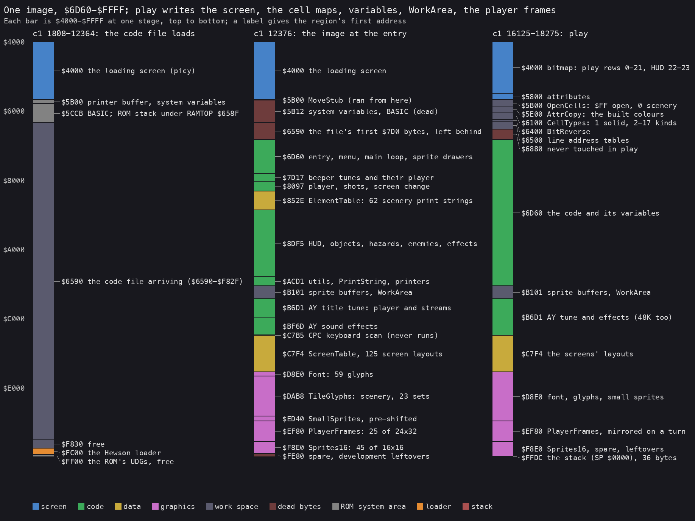
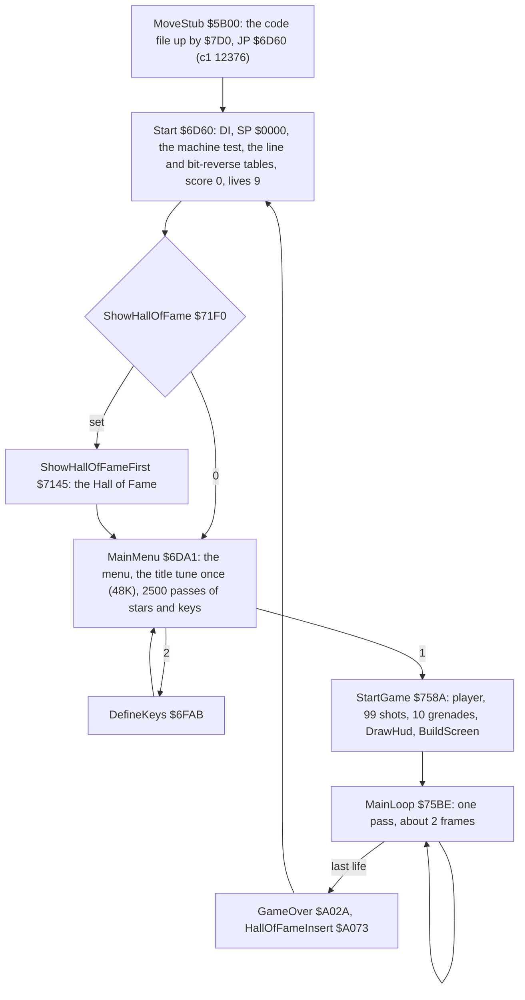
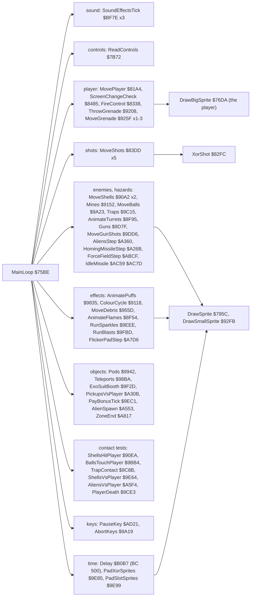
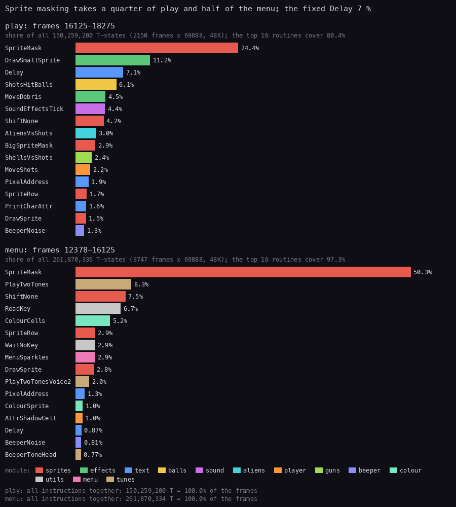
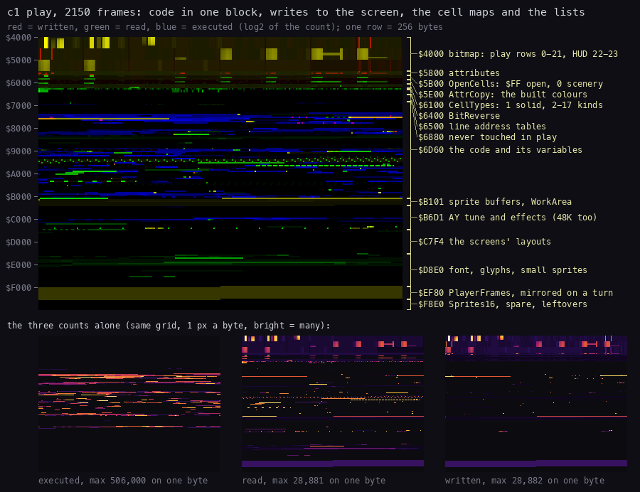

# 2. Architecture

What this covers:

- the machine budget: 48K and 128K, no interrupt, no paging (2.1);
- the memory map at three stages (2.2);
- the stages from the tape to play (2.3);
- the main loop's call graph (2.4);
- where the CPU time goes, in play and in the menu (2.5);
- the memory heatmap of a game (2.6);
- the 34 modules (2.7).

Every name is the one in `src/game/game.ann`; [11](11-data-reference.md) and [12](12-routine-reference.md) list every
entry. The recordings it rests on ([Terms](README.md#terms)):

- `c1`: power-on with `Exolon.tzx`, 48K, the load, then 16 000 frames of seeded random play (`work/c1`). Opened
  read-only on an own instance as `work/docs/docA/c1` (port base 27000). Two L1 builds of windows of it:
  - `work/docs/docA/c1-play`: frames 16125-18275, the first game from StartGame to GAME OVER
    (`re_session.py build --work work/docs/docA/c1 --from-frame 16125 --to-frame 18275 --into work/docs/docA/c1-play`);
  - `work/docs/docA/c1-menu`: frames 12378-16125, the menu and the define keys screen (the same with 12378, 16125).
- `c128`: the same capture on the 128K (WALKTHROUGH 1), for the machine test and the paging.
- The 97 warp runs `w/NNN` (clones, WALKTHROUGH 6.0) only through the code coverage they gave the annotation.

## 2.1 The machine budget

One image for two machines:

- **The 48K is the reference.** The tape says "48K / 128K", and both run the same bytes.
- **The machine test** at Start `$6D60`: `LD A,($386E)`, `SUB $FF`, into SoundIsAy `$6E16`. The 48K ROM holds `$FF`
  at `$386E` (flag 0); the 128K's 48 BASIC ROM holds `$DD` (flag `$DE`). Witness: `c1` and `c128` (WALKTHROUGH 1).
- **The flag picks the sound only**:
  - 48K: the beeper (BeeperNoise `$7C26`, BeeperSweep `$7C3C`, the tunes of `tunes.asm`);
  - 128K: the AY title music (`music.asm`) and the AY effects (`sound.asm`); the beeper routines return at once.
  - The AY code runs on the 48K too (SoundEffectsTick `$BF7E`, three calls a pass). Its `OUT ($FFFD)` and
    `OUT ($BFFD)` go nowhere there. Witness: AyWrite `$BF6D`, 17 of 17 bytes executed in `c1`.
- **No paging**: no write to `$7FFD` anywhere in the image (`c128`, WALKTHROUGH 1). The 128K's extra RAM is unused.

The CPU:

- **No interrupt**: Start runs `DI` and the game never runs `EI`. There is no frame sync. A pass of the main loop
  takes as long as its work, about two frames ([doc 4](04-game-loop.md), 4.3).
- Two pieces of an interrupt set-up are in the image and never ran: SetupIm2 `$7BDB` (an IM 2 table of `$81` at
  `$8000-$8100`) and StrayReti `$768E`, a lone `RETI`.
- **The stack**: Start sets SP to `$0000`, so the stack grows down from `$FFFF`. In play it reaches `$FFDC`: `c1`
  frame 16200 differs from the image in `$FFDC-$FFFF` only, over LeftoverCode (`memory_at`). 36 bytes.
- **The game never returns to BASIC**: it uses the printer buffer `$5B00` and the system variables up to `$687F` as
  its cell maps and tables (2.2).

Two pieces of foreign code are in the image:

- CpcReadKeyboard `$C7B5`: a keyboard scan through ports `$F4xx` / `$F6xx`, the Amstrad CPC's PPI and PSG. It never
  ran in any recording, and nothing calls it. It suggests the Spectrum and CPC versions shared source; that is not
  proven.
- SerialDownloader `$FF78`: a download routine over the ZX Interface 1 RS-232 port, with the development machine's
  BASIC stack (LeftoverStack `$FF18`) and UDGs before it. It never ran.

## 2.2 The memory map



How to read the figure:

- **Three bars**, each the address space `$4000-$FFFF` from the top down, at three stages of `c1`:
  - frames 1808-12364: the code file loading at `$6590`, under the loading screen, with the loader at `$FC00`;
  - frame 12376: the image as MoveStub leaves it, at the game's first instruction;
  - frames 16125-18275: play.
- **A colour** is the kind of the region (the legend).
- **A label** gives the region's first address and what it holds at that stage.
- **The point**: the game is one image of 37 536 bytes, moved up by `$7D0` to `$6D60-$FFFF`. Below it, play reuses
  the dead system area for seven tables built at run time. Above `$6D60` the code area and the graphics stay as
  loaded, except the variables, two buffers and the player's frames.

```bash
python3 tools/fig_memmap.py --png docs/img/arch/memory-map.png --regions-out work/docs/docA/regions-play.txt
```

The tables below the image, built by Start and by the screen builder:

| Address | Name | Size | What |
| --- | --- | ---: | --- |
| `$5B00` | OpenCells | 768 | per character cell: `$FF` open, 0 scenery in front (sprites masked out) |
| `$5E00` | AttrCopy | 768 | the attributes as the screen builder left them; sprites colour only cells that are 0 |
| `$6100` | CellTypes | 768 | per cell: 0 empty, 1 solid, 2-17 an object cell while the screen is built |
| `$6400` | BitReverse | 256 | each byte bit-reversed (BuildReverseTable `$7B99`), for the mirrored player |
| `$6500` | LineAddrHigh | 192 | the high byte of each pixel line's address (BuildLineTables `$7BEF`) |
| `$6600` | LineAddrLow | 192 | the low byte |
| `$6700` | LineCol8Addr | 384 | the address of column 8 of each line (the Hall of Fame scroll) |

What play writes above `$6D60` (`c1-play`'s L1 byte counts, runs of 16 bytes or more):

- `$78DA-$795B`: SpriteSavedSP and ShiftBuffer of the sprite drawers;
- the object lists inside the code area: ShotList `$845F`, ShellList `$90CB`, DebrisList `$95B6`, the puffs `$9870`,
  BallList `$9A99`, GunShots `$9E18`, the aliens `$A508`, and the single variables between them;
- WorkArea `$B181-$B6D0`: the sprite save buffers;
- PlayerFrames `$EF80-$F87F`: the 24 frames, mirrored in place at every turn (FlipPlayerFrames `$7BAA`).

`$6880-$6D5F` is neither read nor written in play: the first `$7D0` bytes of the code file, left behind by the move.

## 2.3 The stages from the tape to play

The load is [03](03-build-and-load.md). From the game's entry:



How to read the diagram:

- **A box** is a routine that holds the machine for a while; the arrow labels are keys or flags.
- **The point**: the whole game runs from one entry, `$6D60`. GAME OVER, the name entry and the abort keys all go
  back to it, and it resets the score and the lives each time. [Doc 4](04-game-loop.md) (4.1) has every transition.

The timings in `c1`: the game entered at frame 12376, the menu at 12378, StartGame at 16125, the first pass at 16139,
the first GAME OVER at 18275.

## 2.4 The main loop's call graph

MainLoop `$75BE` makes 54 calls of 47 routines in a fixed order every pass ([doc 4](04-game-loop.md),
4.2). Grouped by what they do:



How to read the diagram:

- **A box on the left** is a group of MainLoop's calls, with their addresses; `x3` means the call is in the list three
  times.
- **A box on the right** is a drawing routine the group reaches. Every moving thing is drawn by the routine that
  moves it, at the moment it moves: there is no separate draw phase and no back buffer ([doc 6](06-rendering.md)).
- **The point**: the time pads reach the same sprite drawers as the enemies, with blank sprites.

## 2.5 Where the CPU time goes



How to read the figure:

- **Two panels**: play (`c1` frames 16125-18275, the first game) and the menu (frames 12378-16125).
- **A bar** is one routine's own time (its callees not included), as a share of all T-states of the window. The top
  16 routines are shown; the colour is the routine's module (the legend).
- **The point**:
  - SpriteMask `$79CA`, the masking step of the 16x16 drawer, is the biggest single cost: 24.4 % of play and 50.3 %
    of the menu, where the twelve twinkling stars are 16x16 sprites;
  - in play DrawSmallSprite `$92FB` (11.2 %) and SpriteMask are mostly the time pads' blank draws ([doc 4](04-game-loop.md),
    4.4);
  - Delay `$B0B7`, a wait that does nothing, is the third cost of play (7.1 %);
- The CPU never halts: `HALT` is 0 % in both windows.

```bash
python3 ../../kit/fig_budget.py work/docs/docA/c1-play/l1.json docs/img/arch/budget.png --ann src/game/game.ann \
    --state "menu=work/docs/docA/c1-menu/l1.json" --label play --top 16 \
    --title 'Sprite masking takes a quarter of play and half of the menu; the fixed Delay 7 %'
```

## 2.6 The memory heatmap of a game



How to read the figure:

- **The large grid** is `$4000-$FFFF`, one row of 256 bytes per two pixel rows, `$4000` at the top left. A byte's
  colour mixes red (written), green (read) and blue (executed), each the log2 of its count over the window.
- **The brackets on the right** name the regions of the play stage of 2.2.
- **The three small grids** are the counts alone, executed, read and written.
- **The point**:
  - the executed code (blue) is `$6D60-$B100` and the AY code at `$BF6D-$C7B4`; the music player `$B6D1-$BF6C` is
    dark in play on the 48K;
  - the reads (green) are the graphics `$D8E0-$FE7F` (the font, the scenery glyphs, the sprites) and the cell maps
    at `$5B00-$63FF`;
  - the writes (red, yellow where also read) are the screen, the cell maps, the object lists inside the code area,
    WorkArea `$B181`, and the player frames `$EF80-$F87F` (each turn mirrors them);
  - the screen's own inset (under each small grid) shows the writes in the top lines (the time pads), the player's
    place and the HUD.

```bash
python3 tools/fig_heatmap.py work/docs/docA/c1-play/l1.json docs/img/arch/heatmap.png --regions work/docs/docA/regions-play.txt
```

`tools/fig_heatmap.py` is Zynaps' layout of `kit/heatmap.py`'s panels at 900 px, copied into this case.

## 2.7 The modules

`src/game/` holds 34 modules, cut by address. Routines / data entries per module:

| From | To | Module | Routines / data | What |
| --- | --- | --- | ---: | --- |
| `$6D60` | `$7144` | menu | 10 / 11 | the entry, the machine test, the menu with its stars, the define keys and the ZORBA cheat |
| `$7145` | `$7589` | hiscore | 4 / 4 | the Hall of Fame: the table of 50 and its rolling display |
| `$758A` | `$76D9` | mainloop | 3 / 2 | the start of a game, the main loop and the HUD frame |
| `$76DA` | `$7AE8` | sprites | 20 / 4 | the sprite drawers: 24x32 and 16x16, shifted, masked by the open cells |
| `$7AE9` | `$7C23` | input | 10 / 2 | the controls (keyboard, Interface 2, Kempston) and the tables built at the start |
| `$7C24` | `$7C5E` | beeper | 3 / 0 | the beeper noise and sweep effects |
| `$7C5F` | `$7D16` | colour | 5 / 0 | the sprites' colour cells, and the wait for a key or fire |
| `$7D17` | `$8096` | tunes | 8 / 5 | the beeper tunes and the two-voice tone player |
| `$8097` | `$8484` | player | 18 / 16 | the cell map helpers, the player's walk, jump and fall, the shots |
| `$8485` | `$8DF4` | screens | 3 / 66 | the screen change, the screen builder and its 62 scenery elements |
| `$8DF5` | `$8E85` | hud | 9 / 3 | the cell maps cleared and saved, the HUD numbers |
| `$8E86` | `$9151` | objects | 12 / 7 | the object cells indexed into lists: flames, turrets and their shells, the colour cycle |
| `$9152` | `$9207` | mines | 3 / 3 | the mines |
| `$9208` | `$92FA` | grenade | 6 / 2 | the grenade: the throw, the arc, the walls |
| `$92FB` | `$98B9` | effects | 14 / 6 | the small XOR sprites and their wall probes, the grenade blast, the debris, the puffs |
| `$98BA` | `$9A22` | pickups | 6 / 3 | the teleports, the ammunition and grenade pods, the printers, the abort keys |
| `$9A23` | `$9BD5` | balls | 9 / 2 | the balls and their spawners |
| `$9BD6` | `$9D7E` | death | 10 / 3 | the player's contacts, the traps, the death |
| `$9D7F` | `$9E84` | guns | 8 / 2 | the guns and their shots, the shells against the shots and the player |
| `$9E85` | `$9F70` | passtime | 8 / 7 | the pass time pads, the bonus ticks, the teleport sparkles, the exoskeleton booth |
| `$9F71` | `$A029` | blasts | 4 / 2 | the aliens hit, the blasts |
| `$A02A` | `$A239` | gameover | 7 / 5 | GAME OVER and the Hall of Fame name entry |
| `$A23A` | `$A816` | aliens | 13 / 10 | the homing missile, the stars, the bonus pick-ups, the aliens on paths, the flickering pad |
| `$A817` | `$AB96` | zoneend | 5 / 6 | the end of a zone: the bonuses, the bonus screen, CONGRATULATIONS |
| `$AB97` | `$ACD0` | forcefield | 6 / 6 | the force field and the idle missile |
| `$ACD1` | `$ADE0` | utils | 7 / 4 | the keyboard, the pause, the random numbers, the score |
| `$ADE1` | `$B100` | text | 16 / 0 | the character printers, the string interpreter, the screen helpers |
| `$B101` | `$B6D0` | workarea | 0 / 1 | the sprite save buffers |
| `$B6D1` | `$BF6C` | music | 18 / 3 | the 128K title tune on the AY |
| `$BF6D` | `$C7B4` | sound | 28 / 2 | the AY sound effects (silent on a 48K) |
| `$C7B5` | `$C7F3` | cpc | 2 / 0 | the Amstrad CPC keyboard scan, never run on the Spectrum |
| `$C7F4` | `$D8DF` | layouts | 0 / 2 | the screen table and the 125 screen layouts |
| `$D8E0` | `$FF17` | graphics | 0 / 6 | the font, the scenery glyphs, the sprites |
| `$FF18` | `$FFFF` | leftover | 1 / 2 | what the development machine left: the BASIC stack, the UDGs, a serial downloader |

The counts are the entry lines of `game.ann` (`c` routines, `b w t s` data) in each module's range, 473 in all.
The code is one contiguous block, `$6D60-$B100`, plus the AY code `$B6D1-$C7B4`.
