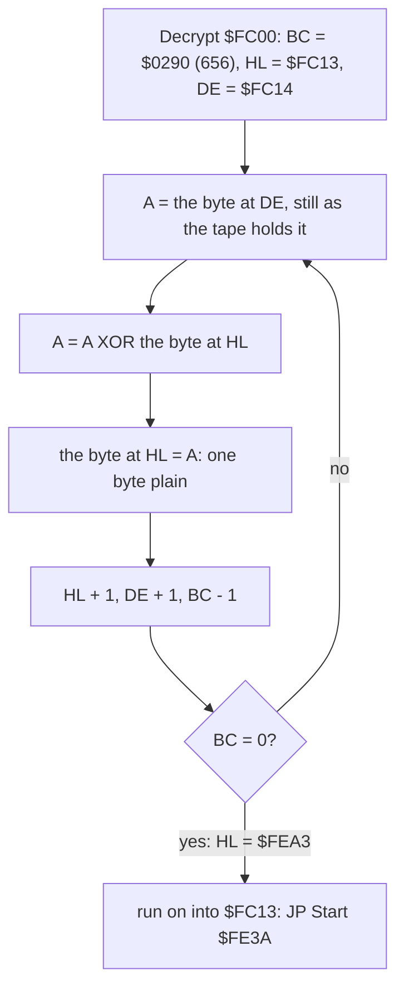
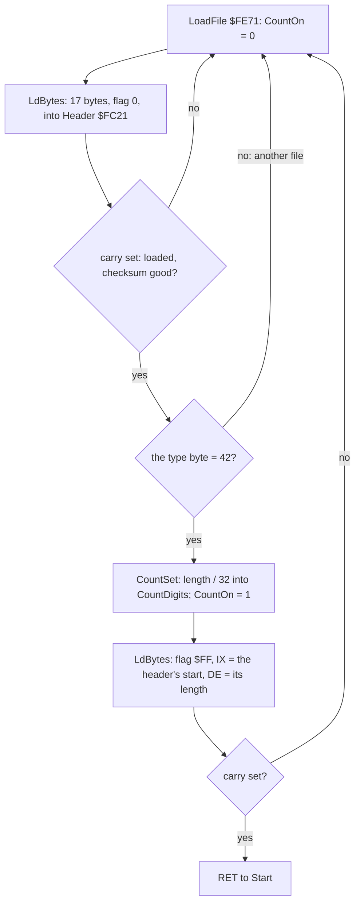
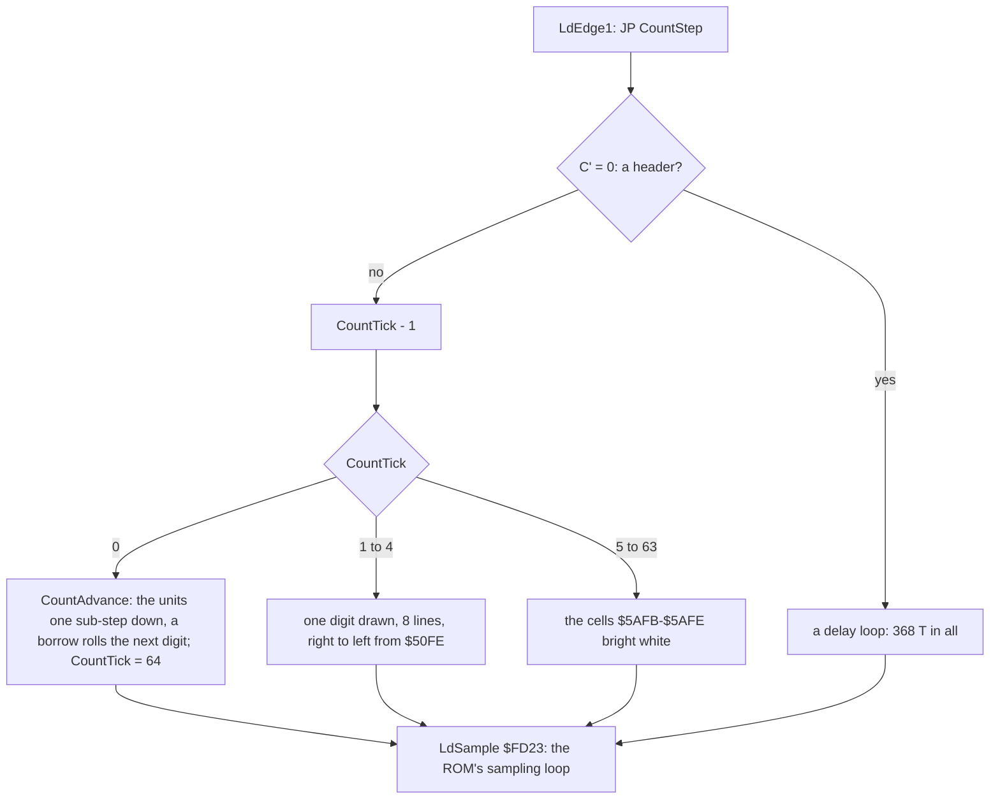
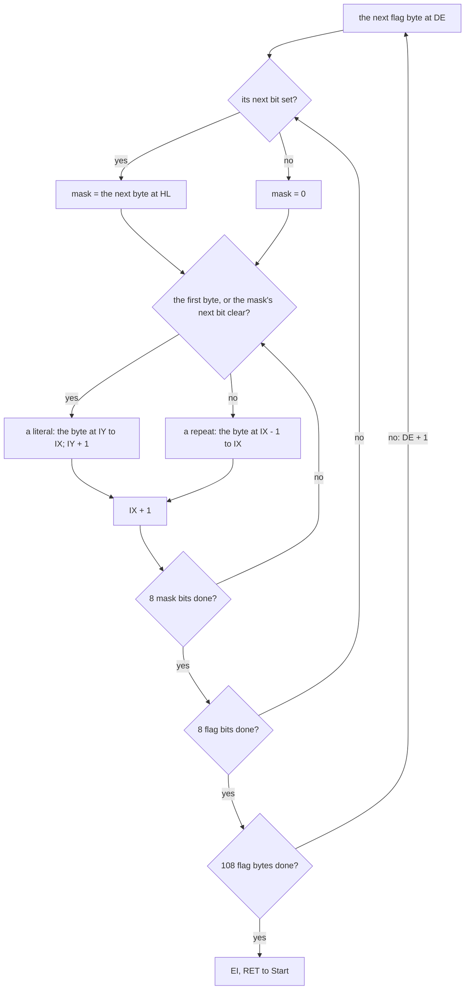
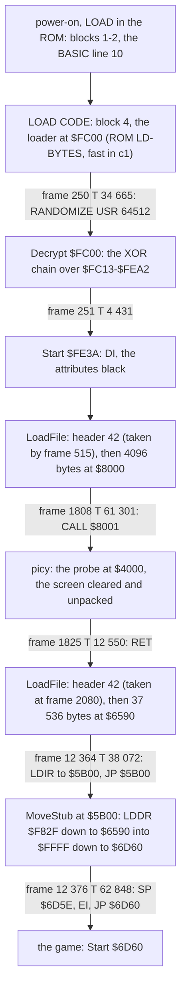
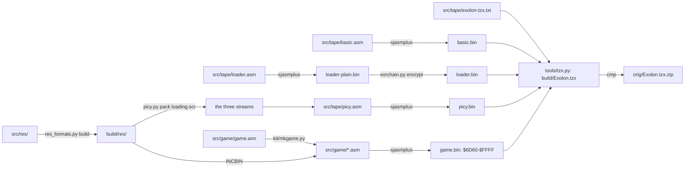

# 3. Build and load

What this covers: the medium block by block, the Hewson loader, the packed loading screen, the move of the game into
place, and the source build. It rests on the static decode of the tape (`tools/tzxblocks.py`,
`tools/basic_list.py`, `tools/xorchain.py`, `tools/picy.py`) and on one recording ([Terms](README.md#terms)):

- `c1`: power-on with `Exolon.tzx`, 48K, the load (12 700 frames), then 16 000 frames of seeded random play
  (`work/c1`, WALKTHROUGH 1). The emulator's fast load took the two ROM-loaded blocks (BASIC and loader) by frame
  250; the Hewson loader's blocks played at signal speed. Every frame number here is a `c1` frame.

`python3 tools/check_load.py --work work/c1` reads `c1`'s memory at each stage's entry and compares it with the
static decode (3.5).

## 3.1 The tape

The reference medium is the "perfect TZX" of the Hewson release (`orig/Exolon.tzx.zip`; the TZX md5
`7ba525e945808b0031f479dfb6fb2fd5`). Its archive-info block (`$32`) names the game, Hewson Consultants, Raffaele
Cecco, 1987, the price 7.95, the loader "Hewson II", and "Perfect TZX sampled from the original cassette by Church
of the Latter-Day Speccy".

`python3 tools/tzxblocks.py list work/media/tzx/Exolon.tzx`:

| TZX block | Kind | Name, fields | Bytes | Loads at | Pause | Plays for |
| --- | --- | --- | ---: | --- | ---: | ---: |
| 0 | `$32` archive info | | | | | |
| 1 | `$10` header | Program `exolon`, LINE 0, length 81 | 17 (+2) | | 1007 ms | 5.09 s |
| 2 | `$10` BASIC | | 81 (+2) | PROG | 999 ms | 2.43 s |
| 3 | `$10` header | Bytes `exolon`, start 64512 (`$FC00`), length 768 | 17 (+2) | | 1003 ms | 5.10 s |
| 4 | `$10` CODE | the loader | 768 (+2) | `$FC00-$FEFF` (ROM LD-BYTES) | 1008 ms | 6.37 s |
| 5 | `$10` header | type 42 (`$2A`) `exolon`, start `$8000`, length 4096 | 17 (+2) | | 1008 ms | 5.09 s |
| 6 | `$10` data | the packed loading screen and its unpacker | 4096 (+2) | `$8000-$8FFF` (the Hewson loader) | 1011 ms | 24.84 s |
| 7 | `$10` header | type 42 (`$2A`) `exolon`, start `$6590`, length 37536 | 17 (+2) | | 1003 ms | 5.10 s |
| 8 | `$10` data | the game | 37536 (+2) | `$6590-$F82F`, then moved to `$6D60-$FFFF` | 0 | 204.35 s |

- Every block is a standard-speed `$10` block with the ROM's timings (pilot 2168, sync 667 / 735, bits 855 / 1710
  T), 8063 pilot pulses before a header and 3223 before data; all eight checksums are good.
- The signal, pauses included, takes 265.4 s, 13 270 frames at 50 Hz (the script's total).
- Blocks 5 and 7 are headers of type 42, not a type the ROM's LOAD takes; the Hewson loader reads them and checks
  the 42 (3.3). The second word of each header (the ROM's "param 2") holds `$4000` and `$6784`; the loader does
  not read it.


How to read the figure:

- **The top bar** is the TZX played at ROM speed, in frames from the start of the tape (50 a second): each block a
  box (grey: headers; blue: the BASIC; orange: the loader; violet: picy; green: the game), the pauses dark between.
- **The middle bar** is what `c1` did with it: the two ROM files taken by the emulator's fast LD-BYTES trap (the
  loader entered at frame 250), the picy file until its unpacker runs at frame 1808, the code file until MoveStub
  at frame 12364, the move until the game's entry at frame 12376.
- **The five screens** are `c1`'s screen at the end of the frame the yellow dot marks (TTD `memory_at`):
  - frame 200: the ROM's own screen, while the fast load takes the BASIC and the loader;
  - frame 1818: black, though picy is writing the bitmap: the loader cleared the attributes to 0 (3.3, 3.4);
  - frame 1826: the attributes are written and the whole picture is there at once;
  - frame 12300: the same picture for 10 500 frames, the counter in the boxes at the bottom right;
  - frame 12500: the game's menu.
- **The point**: the two ROM files cost nothing in `c1`, the two Hewson files play at the signal's own speed. The
  player sees the picture after about 36 s and then waits about 3.5 minutes with only the counter moving.

```bash
python3 tools/fig_load_tape.py --work work/docs/docA/c1 --out docs/img/load/tape.png
```

`work/docs/docA/c1` is `c1` opened read-only on an own instance (`re_session.py open --work work/docs/docA/c1
--ttd work/c1/session.ttd --port-base 27000`); the traces below are kept in its `traces/`.

`orig/Exolon.tap.zip` holds a modified copy, not the release. Its blocks 4-8 are those of the TZX except the
loader, which is stored already decrypted (equal byte for byte to the output of 3.3). Its BASIC (two lines, 457
bytes) clears like the original, loads the loader, then `POKE 64659,0`, `POKE 65105-65107` (`JP $FC99`), POKEs 28
bytes of a DATA line to `$FC96-$FCB1` (a jump into the ROM's LD-BYTES at `$0562` and a patch of the loader's
`LoadFile`), and enters at `$FE3A` (65082), past the decryption. The case keeps it as found; the build targets the
TZX.

## 3.2 The BASIC (TZX block 2)

`python3 tools/basic_list.py work/media/exolon.bas`:

```text
   10 BORDER 0: PAPER 0: INK 7: CLEAR 25999: LOAD "" CODE : RANDOMIZE USR 64512
   20 REM *************            (length word 98: runs 84 bytes past the program's end)
```

The same program as Zynaps' but for the `CLEAR` (Zynaps: 32767): RAMTOP goes to `$658F`, one below the code
file's start. `LOAD "" CODE` takes the loader to `$FC00` (the header's address), `RANDOMIZE USR 64512` enters it.

## 3.3 The loader (TZX block 4)

The loader is Zynaps' Countdown II (Zynaps [3.3](../../zynaps/docs/03-build-and-load.md#33-the-loader-tzx-block-4-an-xor-chain-over-itself)):
19 plain bytes that decrypt the rest with one forward XOR chain, each byte XORed with the next as the tape holds
it. Here the chain is 656 bytes long (`LD BC,$0290`), `$FC13-$FEA2`; Zynaps' was 652. `tools/xorchain.py` writes
the plain loader; its first instruction at `$FC13` is `JP $FE3A`.

The plain head, as `src/tape/loader.asm` has it (`DecryptEnd` is `$FEA3`, the first plain byte after the chain):

```asm
Decrypt:
  LD BC,DecryptEnd-DecryptFrom  ; 656 bytes
  LD HL,DecryptFrom
  LD DE,DecryptFrom+1
DecryptLoop:
  LD A,(DE)                     ; the next byte, still as the tape holds it
  XOR (HL)
  LD (HL),A
  INC HL
  INC DE
  DEC BC
  LD A,B
  OR C
  JR NZ,DecryptLoop
DecryptFrom:
  JP Start
```

```text
for a = $FC13 to $FEA2:
    memory[a] = memory[a] XOR memory[a + 1]     ; memory[a + 1] is still the tape's byte
```

The key of each byte is the next byte as the tape holds it, so the chain needs no key of its own.



A worked step, the first three bytes and the last, from the tape's block 4 (`work/media/loader.bin`):

| Step | Before: HL, DE, BC | A = (DE) | XOR (HL) | Stored at HL | After: HL, DE, BC |
| --- | --- | --- | --- | --- | --- |
| 1 | `$FC13`, `$FC14`, `$0290` | `$B4` | `$77` | `$C3` (`JP`) | `$FC14`, `$FC15`, `$028F` |
| 2 | `$FC14`, `$FC15`, `$028F` | `$8E` | `$B4` | `$3A` | `$FC15`, `$FC16`, `$028E` |
| 3 | `$FC15`, `$FC16`, `$028E` | `$70` | `$8E` | `$FE`: `JP $FE3A` | `$FC16`, `$FC17`, `$028D` |
| 656 | `$FEA2`, `$FEA3`, `$0001` | `$00` (plain) | `$C9` | `$C9` (`RET`) | `$FEA3`, `$FEA4`, `$0000`: the loop ends |

Each step reads the key at DE before the step at DE writes it: DE runs one byte ahead of HL, so the key is always
the tape's byte. The loop is nine instructions, 59 T-states a round, so 656 rounds take 38 699 T; `c1` measures
39 570 T. Interrupts are still on (the `DI` comes at Start), so the rest is most likely the ROM's frame interrupt at
the start of frame 251.

The first and the last bytes (`work/media/loader.bin`, the tape's block 4, and `loader1.bin`, the decrypted loader):

| Address | Tape byte | XOR the next tape byte | Plain byte | What |
| --- | --- | --- | --- | --- |
| `$FC13` | `$77` | `$B4` | `$C3` | `JP` |
| `$FC14` | `$B4` | `$8E` | `$3A` | low byte of `$FE3A` |
| `$FC15` | `$8E` | `$70` | `$FE` | high byte: `JP $FE3A`, Start |
| `$FC16` | `$70` | `$38` | `$48` | CountDigits, the first digit (9 x 8) |
| `$FEA2` | `$C9` | `$00` (`$FEA3`, plain) | `$C9` | `RET`, the last byte of `LoadFile` |


How to read the animation:

- **The grid** is the loader's 768 bytes `$FC00-$FEFF`, 32 a row, each cell with its value at that moment of `c1`.
- **The colours**:
  - grey: plain on the tape (Decrypt itself and the tail `$FEA3-$FEFF`);
  - red: still as the tape holds it;
  - green: decrypted;
  - yellow: decrypted in this step of the animation; the white box is the byte HL points at.
- **The subtitle** gives the frame, the T-state, the count of decrypted bytes and HL.
- **The last picture** names the parts of the decrypted loader (white bars at the starts) with their ranges.
- **What it shows**: the green front moves forward one byte at a time. A byte becomes code or data only when the
  chain has passed it: `JP Start` at `$FC13`, the digit glyphs at `$FC32` (the regular `C6 FE FE ...` rows), the
  moved LD-BYTES.
- **The numbers**: the chain runs from frame 250 T 34 709 to frame 251 T 4 391, about 39 600 T-states; 653 of the
  656 bytes change (three bytes meet a zero as their key).
- **The point**: the protection is one forward pass of XOR with the next byte. A disassembler sees noise until the
  chain has run; the emulator sees it run in a little over half a frame.

```bash
python3 tools/fig_loader.py decrypt --work work/docs/docA/c1 --window 250:34000-251:6000 \
    --out docs/img/load/decrypt.gif
```

Against Zynaps' decrypted loader, 105 of the 768 bytes differ:

- the countdown's screen addresses: the four digits at `$50FB-$50FE` (row 23, columns 27-30) and their attribute
  cells `$5AFB-$5AFE`, where Zynaps' were at columns 1-4: the counter is drawn into the strip of boxes at the
  bottom right of the loading screen;
- the stages at `$FE3A` (below), three bytes shorter (no `LD SP`), and `LoadFile` seven bytes longer (the type
  check below): the chain is four bytes longer, 656 bytes against 652;
- `LoadFile` (`$FE71`), which now refuses a header whose first byte is not 42 (`$2A`) and waits for the next one.

The stages, decoded from the plain loader:

```text
FE3A  DI
      LD HL,$5800 / LD DE,$5801 / LD BC,$02FF / LD (HL),0 / LDIR   ; every attribute black
      CALL LoadFile        ; header 42, then 4096 bytes at $8000
      CALL $8001           ; unpack the loading screen (3.4)
      CALL LoadFile        ; header 42, then 37536 bytes at $6590
      LD HL,$FE5F / LD DE,$5B00 / LD BC,18 / LDIR / JP $5B00       ; MoveStub to the printer buffer
5B00  LD HL,$F82F / LD DE,$FFFF / LD BC,$92A0 / LDDR               ; the game to $6D60-$FFFF
      LD SP,$6D5E
      EI
      JP $6D60
```

The game starts at `$6D60` with the stack below it; `$6590-$6D5F` keeps what the move left there (the first 2000
bytes of the code file as loaded) at the game's entry; Start then builds its tables over `$6590-$687F`, so only
`$6880-$6D5F` stays. `tools/image.py` writes the image as the move leaves it, `$6D60-$FFFF`.

The decrypted loader, part by part (`src/tape/loader.asm`):

| Address | Name | What |
| --- | --- | --- |
| `$FC00` | `Decrypt` | the XOR chain above, plain on the tape |
| `$FC13` | | `JP Start` |
| `$FC16-$FC19` | `CountDigits` | the four counter digits, units first, each 8 x the digit + a sub-step 0-7 |
| `$FC1A` | `CountOn` | 0 while a header loads, 1 while a data block loads |
| `$FC1B` / `$FC1D` / `$FC1F` | `CountGlyph`, `CountScreen`, `CountTick` | the digit being drawn, its screen address, the edges until the next move |
| `$FC21-$FC31` | `Header` | the 17 header bytes: type, name, length (`$FC2C`), start (`$FC2E`), a second parameter |
| `$FC32-$FC89` | `DigitGlyphs` | 11 glyphs of 8 lines, 0-9 and 0 again, inverted |
| `$FC8A` | `LdBytes` | the ROM's LD-BYTES (`$0556`), moved |
| `$FD1C` / `$FD20` / `$FD23` | `LdEdge2` / `LdEdge1` / `LdSample` | the ROM's LD-EDGE-2, LD-EDGE-1 and its sampling loop; `LdEdge1` jumps to `CountStep` first |
| `$FD3B` | `CountStep` | the countdown's work in the time of the ROM's delay loop (3.3.2) |
| `$FDA2` | `CountAdvance` | the odometer one sub-step down |
| `$FE0F` | `CountSet` | the start value: the header's length / 32 in four decimal digits |
| `$FE3A` | `Start` | the stages (above and 3.5) |
| `$FE5F` | `MoveStub` | 18 bytes copied to `$5B00` and run there |
| `$FE71` | `LoadFile` | a header of type 42, then its data block (3.3.1) |
| `$FEA3-$FEFF` | | plain, never run: 50 zeros, 20 bytes of leftover RAM, 23 bytes equal to the ROM's `$0652-$0668` |

### 3.3.1 LoadFile

Start calls LoadFile twice, once for each file. LoadFile loads a 17-byte header into `Header`, keeps it only if its
type byte is 42 (`$2A`), and then loads the data block that follows at the header's start address and length:

```asm
LoadFile:                       ; $FE71
  XOR A
  LD (CountOn),A                ; no counter while the header loads
  LD IX,Header                  ; $FC21
  LD DE,17
  XOR A                         ; flag 0: a header
  SCF                           ; carry: load, not verify
  CALL LdBytes
  JR NC,LoadFile                ; a bad block: start again
  LD A,(Header)
  CP FileType                   ; 42
  JR NZ,LoadFile                ; another type: wait for the next header
  CALL CountSet                 ; the counter from the length
  LD A,1
  LD (CountOn),A
  LD IX,(HeaderStart)           ; $FC2E
  LD DE,(HeaderLength)          ; $FC2C
  LD A,$FF                      ; flag $FF: data
  SCF
  CALL LdBytes
  JR NC,LoadFile                ; a bad block: start again with a header
  RET                           ; $FEA2
```



The two headers in `c1` (`memory_at` of `Header` at frames 600 and 2100), both named `exolon`:

| File | Type | Length | Start | Parameter 2 |
| --- | --- | --- | --- | --- |
| the packed screen | 42 | 4096 (`$1000`) | `$8000` | `$4000` |
| the code | 42 | 37 536 (`$92A0`) | `$6590` | `$6784` |

LdBytes is the ROM's LD-BYTES (`$0556-$05E2`) in its structure: the leader (a wait of `$0415` rounds,
then 256 pilot pulses), the two sync edges, the flag byte compared with A, the bytes loaded or verified with the XOR
checksum in H, carry set on return when the checksum is 0. What differs:

- **No return address is pushed**: the ROM pushes SA/LD-RET (`$053F`), which restores the border and tests BREAK.
  LdBytes simply returns, carry clear on any error, and LoadFile starts again.
- **The border**: `$0A` once at the start (`$FC92`); then every edge writes `$08` (`LD A,0 / LD A,$08` at `$FD33`,
  the same length as the ROM's `AND 7 / OR 8`), black. The ROM's red and cyan stripes (`OR 2` at `$FC9B` is
  `OR 0`, the `XOR 3` after the sync is gone) never appear.
- **The counter switch**: C' is cleared at the start (`$FC8F`) and set from CountOn after the sync (`$FCD3-$FCDB`),
  which also sets CountTick so that the counter moves on the first edge of the block.
- **The edge routine**: `LdEdge1` (`$FD20`) is `JP CountStep` where the ROM has its delay loop (`LD A,$16` ...
  `AND A`, 358 T). CountStep does the counter's work and jumps to LdSample (`$FD23`), the ROM's LD-SAMPLE.
- **The type check** (`$FE83-$FE89`): the ROM's LOAD compares the header with the name asked for; LoadFile takes the
  first header of type 42, whatever its name. The ROM's own files (types 0-3) are passed over: their data block
  follows as a block with flag `$FF` that LoadFile, waiting for a header (flag 0), refuses at the flag test.

The time of the hooked edge, counted from the listing with the Z80's T-states (the loader sits above `$8000`, no
contention):

| Path through CountStep | T-states before LdSample | The ROM's LD-EDGE-1 |
| --- | ---: | ---: |
| a header (C' = 0): `CountIdle`, `DJNZ` 23 times | 368 | 358 |
| the colours (`CountAttrs`, then `DJNZ` 13 times) | 368 | 358 |
| a digit drawn (8 lines) | 357 | 358 |
| the odometer moved (`CountAdvance`, no borrow) | 369 | 358 |

LdSample's loop is 59 T a round, and a bit is the count of rounds over two edges against a threshold (`LD B,$B0`
and `CP B` with `$CB` at `$FD07`, the ROM's). The 10 or 11 T of difference is a fifth of one round: the loader reads
a standard ROM-timed tape, and `c1` loads it at signal speed.

### 3.3.2 The countdown

While a data block loads, four digits at `$50FB-$50FE` (row 23, columns 27-30, the top line of the cells; the
glyph's 8 lines go down by `INC H`) show the blocks of 32 bytes still to come, and run down to zero as the block
arrives.

CountSet (`$FE0F`) starts them from the header: the length shifted right five times (/ 32), then four digits by
repeated subtraction of 1000 (the rest x 10 each time), stored as 8 x the digit, thousands at `$FC19` first. The
packed screen starts at 4096 / 32 = 128, the code at 37 536 / 32 = 1173.

Each digit byte is 8 x the digit + a sub-step: the glyph is drawn from `DigitGlyphs + byte`, eight lines from
there. A sub-step of 0 is the digit's own glyph; 1-7 start 1-7 lines lower, so the cell shows the bottom of this
glyph and the top of the next one up. Counting down from 7 to 0 the glyph slides from the digit + 1 to the digit:
the digits roll like an odometer. The eleventh glyph (`$FC82`, a 0 again) is the one 9 rolls from.

```text
CountStep (every edge, in place of the ROM's delay):
    if C' = 0: wait 368 T; sample                  ; a header: no counter
    CountTick -= 1
    if CountTick = 0: CountAdvance                 ; every 64 edges
    elif CountTick < 5:                            ; ticks 4, 3, 2, 1
        draw the next digit to the left: 8 bytes of DigitGlyphs[CountDigits[i]] down the cell at CountScreen - 1
    else:
        the four attributes $5AFB-$5AFE = $47       ; bright white ink, black paper
    sample

CountAdvance:
    units -= 1; if units < 0: units = 79 (9, sub-step 7); tens -= 1     ; a borrow
    else: for tens, hundreds, thousands in turn:
        if the digit is mid-roll (byte AND 7 <> 0): byte -= 1
        if it went below 0: byte = 79 and the next digit - 1, and the move ends
    restart the drawing at the units ($50FE); CountTick = 64
```



So one move comes every 64 edges: 32 bits, 4 bytes. Eight moves make one unit, 32 bytes. The counter runs only
inside the bit loop and takes no time of its own.

In `c1` (`memory_at` of `$FC16-$FC31`):

| Frame | CountDigits (units first) | CountOn | The counter | What |
| --- | --- | --- | --- | --- |
| 400 | `48 48 48 48` | 0 | 9999 (the image's) | the first header loading |
| 515 | | 1 | 0128 (CountSet) | the screen's header taken; its data block's leader |
| 665 | | 1 | | the first move (the data's sync) |
| 1000 | `46 40 00 00` | 1 | 0088 (units mid-roll) | the screen loading |
| 1800 | `0A 00 00 00` | 1 | 0001 | |
| 1830 | `4F FF 00 00` | 0 | | one move past zero: the units wrapped to 9, the tens to `$FF` |
| 2081 | | 1 | 1173 | the code's header taken |
| 6000 | `19 20 38 00` | 1 | 0743 | |
| 12363 | `00 00 00 00` | 1 | 0000 | the last bytes of the code |

The data block's first edge moves the counter at once (CountTick set to 1 after the sync), so a block of n bytes
makes n / 4 + 1 moves: one more than the counter holds, which is why the state at frame 1830 is one past zero. At
frame 1000 the four cells hold `$47` and the top line of each glyph, `$FE` (`memory_at` of `$5AFB` and `$50FB`).
The rate: 1173 units over frames 2081-12364, about 8.8 frames for 32 bytes.

The glyphs, inverted (a set bit is white paper, so the digit shows dark on a bright white cell):

```text
0 FE C6 BA BA BA BA C6 FE     5 FE 82 BE 86 FA BA C6 FE
1 FE EE CE EE EE EE 82 FE     6 FE E6 DE 86 BA BA C6 FE
2 FE C6 BA F6 EE DE 82 FE     7 FE 82 FA F6 F6 EE EE FE
3 FE 82 F6 E6 FA BA C6 FE     8 FE C6 BA C6 BA BA C6 FE
4 FE F6 E6 D6 B6 82 F6 FE     9 FE C6 BA BA C2 FA C6 FE
```

## 3.4 The loading screen (TZX block 6)

The 4096 bytes at `$8000` have Zynaps' `picy` layout (a zero byte, `JR` over a header of three stream offsets and
the border colour, the unpacker) and the same format: `tools/picy.py unpack` gives the 6912 bytes of the screen
(literals up to `$8BC0`, masks up to `$8F0C`, flags up to `$8F78`, border 0). The packer is Zynaps' rule, a byte
marked as a repeat whenever it equals the byte before it: `python3 tools/picy.py check` packs the unpacked screen
again and gets the tape's three streams exactly (2850 literals, 844 masks, 108 flags). The unpacker is Zynaps' byte
for byte: `src/tape/picy.asm`, Zynaps' source with only the padding changed, assembles to the tape's block (3.6).
The streams are shorter than Zynaps', so 136 zero bytes fill the block's end where Zynaps' had 6.

The block (`src/tape/picy.asm`):

| Address | Bytes | What |
| --- | --- | --- |
| `$8000` | `00` | a zero byte before the entry |
| `$8001` | `18 08` | `JR Unpack`: Start calls here |
| `$8003` | `00` | unused |
| `$8004` | `$009D` | the literals' offset from `$8001`: `$809E-$8BBF`, 2850 bytes (read as `IX+3`) |
| `$8006` | `$0BBF` | the masks: `$8BC0-$8F0B`, 844 bytes (`IX+5`) |
| `$8008` | `$0F0B` | the flags: `$8F0C-$8F77`, 108 bytes (`IX+7`) |
| `$800A` | `$00` | the border colour (`IX+9`) |
| `$800B` | | the unpacker, 147 bytes to `$809D` |
| `$8F78` | 136 x `00` | to the block's 4096 bytes |

**Where am I.** The unpacker does not trust its own address: it writes `E1 E9` (`POP HL`, `JP (HL)`) to `$4000`
and calls it (`$8014-$801A`). The two bytes pop the return address, `$801D`, into HL and jump back there; less 28
gives `$8001`, the header, into IX, and the stream offsets are added to it. Then the screen clear (`LDIR` of 6912
zeros from `$4000`) wipes the probe. `c1` shows the probe as its own stage: code run at `$4000` at frame 1808
T 61 434, 133 T after the entry (3.5).

**The format.** The output is the 6912 screen bytes in address order from `$4000`: the bitmap in the Spectrum's
screen order, then the attributes. The flag stream has one byte for each 64 output bytes (108 x 64 = 6912), one
bit for each 8 of them, the lowest bit first: a set bit takes the next mask byte from the mask stream, a clear bit
stands for a mask of 0. The mask has one bit for each output byte, again the lowest first: set repeats the last
output byte, clear takes the next byte of the literal stream. The very first byte is always a literal (the carry
kept in F' is set before the first byte and cleared after it).

```text
IX = $4000; IY = literals; HL = masks; DE = flags; first = true
repeat 108 times:                          ; B = 108 groups
    for flag bit C = 1, 2, 4 ... 128:
        mask = (flags[DE] AND C) ? next byte at HL : 0
        for mask bit B' = 1, 2, 4 ... 128:
            if first or (mask AND B') = 0: (IX) = (IY); IY += 1       ; a literal, $8073
            else:                          (IX) = (IX - 1)             ; a repeat, $8081
            IX += 1; first = false
    DE += 1
```



A worked example, the first 24 output bytes, from the tape's streams: the flags begin `FF FB`, the masks
`C8 FF F1`, the literals `00 76 00 08 00 03 B0 00`.

| Output | Flag bit | Mask | Mask bits, lowest first | Bytes written |
| --- | --- | --- | --- | --- |
| `$4000-$4007` | flag 0 bit 0: set | `$C8` | 0 0 0 1 0 0 1 1 | `00 76 00` literals, `00` repeat, `08 00` literals, `00 00` repeats |
| `$4008-$400F` | bit 1: set | `$FF` | 1 1 1 1 1 1 1 1 | eight repeats of `00` |
| `$4010-$4017` | bit 2: set | `$F1` | 1 0 0 0 1 1 1 1 | `00` repeat, `03 B0 00` literals, four repeats of `00` |

The result, `00 76 00 00 08 00 00 00 / 00 x 8 / 00 03 B0 00 00 00 00 00`, is the start of
`src/res/screens/loading.scr` byte for byte: the start of the screen's top pixel line.

The screen: the EXOLON logo in yellow among dithered planets on black, HEWSON at the bottom left, a strip of boxes
at the bottom right that the countdown fills.


How to read the animation:

- **Left, "what the TV shows"**: the screen as the TV draws it at that moment. It stays black: Start cleared the
  attributes to 0, black ink on black paper.
- **Right, "the bitmap as written"**: the same bytes drawn white on dark, so the bitmap can be seen. It fills in the
  Spectrum's screen order: line 0 of every character row of the first third, then line 1, and so on. New bytes are
  coloured: yellow a literal from the stream, cyan a repeat of the byte before.
- **The four bars** count the output bytes and how much of each stream is used: literals (`$809E`, IY), masks
  (`$8BC0`, HL), flags (`$8F0C`, DE); their totals are the tape's 2850, 844 and 108.
- **The last pictures**: the attributes `$5800-$5AFF` arrive and the picture appears on the TV at once.
- **The numbers**: the unpacker runs from frame 1808 T 61 301 to its `RET` at frame 1825 T 12 550, about 16.3
  frames; 2850 bytes come from the literal stream, the other 4062 are repeats.
- **The point**: the screen is unpacked hidden and shown in one stroke, in its last 768 bytes. Exolon's picture
  has large flat areas (the black sky between the planets), so 59 % of its bytes are repeats.

```bash
python3 tools/fig_loader.py unpack --work work/docs/docA/c1 --window 1808:61000-1826:0 \
    --out docs/img/load/picy-unpack.gif
```

## 3.5 The stages in `c1`



The counter runs during both data blocks: frames 665-1808 for the screen (128 units), 2081-12 364 for the code
(1173). The `LDDR` of 37 536 bytes (21 T a byte, 788 256 T without contention) takes about 12 frames, the last stage
before the game.

`re_session.py stages --work work/c1` lists the code arrivals; each is a stage of 3.3:

| Stage | Entered at | Frame, T | Written by | Entered from | What |
| --- | --- | --- | --- | --- | --- |
| 0 | `$FC00` | 250, 34 665 | `$0802` (the ROM's LD-BYTES, fast load) | `$34BB` (`USR`) | the loader as the tape holds it |
| 1 | `$FC13` | 251, 4 431 | `$FC0B` (the XOR chain) | `$FC11` | the decrypted loader |
| 2 | `$8001` | 1 808, 61 301 | `$FCE7` (the loader's LD-BYTES) | `$FE4B` | the picy unpacker |
| 3 | `$4000` | 1 808, 61 434 | `$8017` | `$801A` | two bytes the unpacker writes into the screen and calls to find its own address (Zynaps 3.4) |
| 4 | `$5B00` | 12 364, 38 072 | `$FE5A` | `$FE5C` | MoveStub |
| 5 | `$6D60` | 12 376, 62 848 | `$5B09` (the LDDR) | `$5B0F` | the game |

`tools/check_load.py` at those moments:

| Read | At | Bytes that differ from the static decode |
| --- | --- | --- |
| `$FC00-$FEFF` | 251:4431 | 0 of 768 (`xorchain.py decrypt`) |
| `$8000-$8FFF` | 1808:61301 | 0 of 4096 (block 6) |
| `$4000-$5AFF` | 12364:38072 | 24 of 6912 (`picy.py unpack`), all in `$51FB-$56FE`: row 23, columns 27-30, the countdown's digits drawn over the picture |
| `$6590-$F82F` | 12364:38072 | 0 of 37536 (block 8 as loaded) |
| `$6D60-$FFFF` | 12376:62848 | 0 of 37536 (`tools/image.py`) |

The game is entered 12 376 frames into `c1`, about 4 minutes 8 seconds of the load. The unpacker is entered in
frame 1808, so the picture stands for about 10 568 frames, the code file's load.

## 3.6 The build

`tools/build.sh` writes `build/Exolon.tzx` from the sources and compares it with the TZX in `orig/Exolon.tzx.zip`:



- **A box** is a file, **an arrow** the tool that makes the next file (the steps of `tools/build.sh` in order).
- `kit/mkgame.py` runs before the build, not inside it: it writes `src/game/*.asm` from the annotations and installs
  them only when sjasmplus gives the original image.
- The two transforms of the tape are reversed in the build: the XOR chain (`xorchain.py encrypt`) and the picy
  packer (`picy.py pack`, Zynaps' repeat rule).

| TZX block | Source | Tool |
| --- | --- | --- |
| 0 | `src/tape/exolon-tzx.txt` (the archive-info strings) | `tools/tzx.py` |
| 1, 3, 5, 7 | `src/tape/exolon-tzx.txt` (the headers: types 0, 3, 42, 42, names, addresses, parameter 2, pauses) | `tools/tzx.py` |
| 2 | `src/tape/basic.asm` | sjasmplus |
| 4 | `src/tape/loader.asm` (the loader in the clear) | sjasmplus, then `tools/xorchain.py encrypt` |
| 6 | `src/tape/picy.asm` and `src/res/screens/loading.scr` | `tools/picy.py pack`, then sjasmplus |
| 8 | `src/game/game.asm` (written by `kit/mkgame.py` from `src/game/game.ann`) | sjasmplus |

`src/tape/loader.asm` is Zynaps' loader source with the changes of 3.3: the counter's screen addresses
(`CountRow` `$50FF`, `CountAttr` `$5AFB`), no `LD SP,$FFFF` at `Start` (the stack stays the BASIC's), the game's
addresses in `MoveStub`, the type check in `LoadFile` (`CP 42`), and 50 zero bytes before the leftover tail where
Zynaps' had 54. `tools/tzx.py` is Zynaps' with a header form for the type-42 headers.

```text
$ rm -rf build && tools/build.sh
build: Exolon.tzx identical to orig/Exolon.tzx.zip's Exolon.tzx
```
