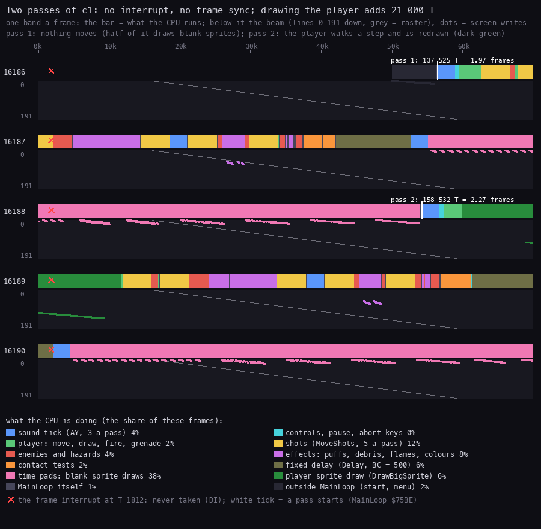
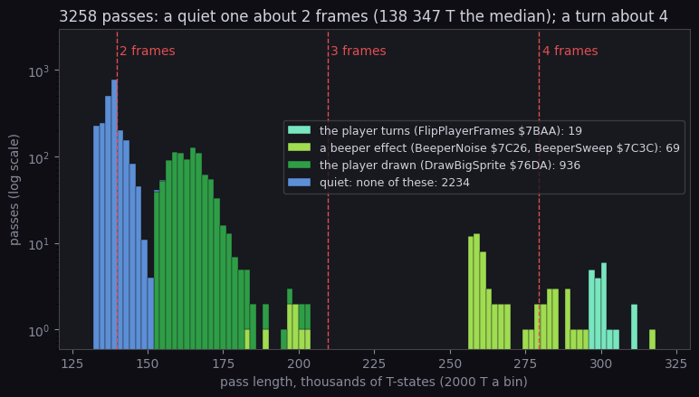
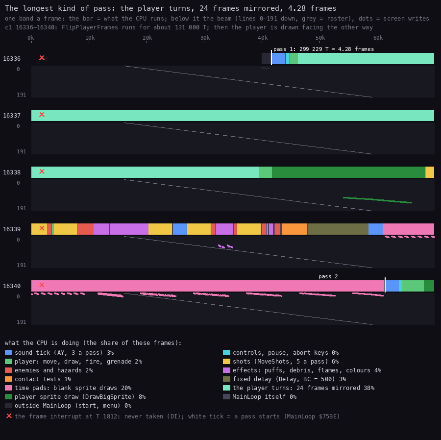
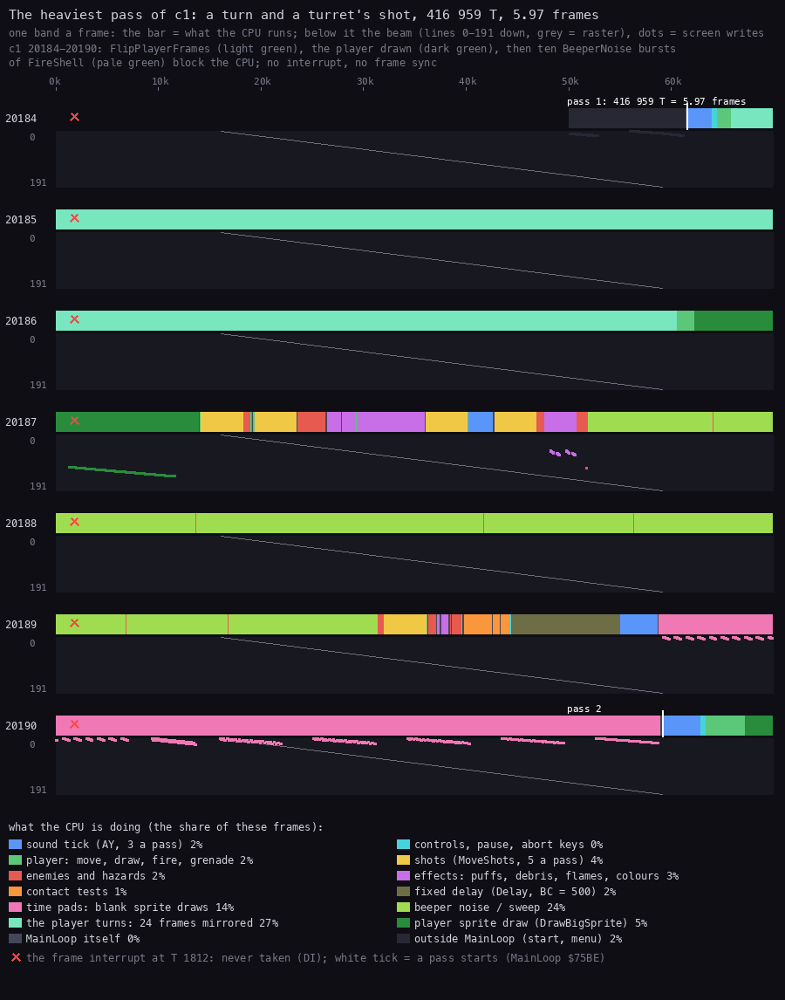
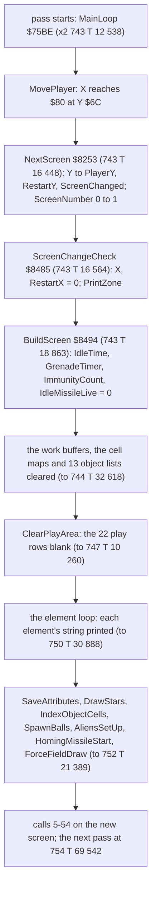
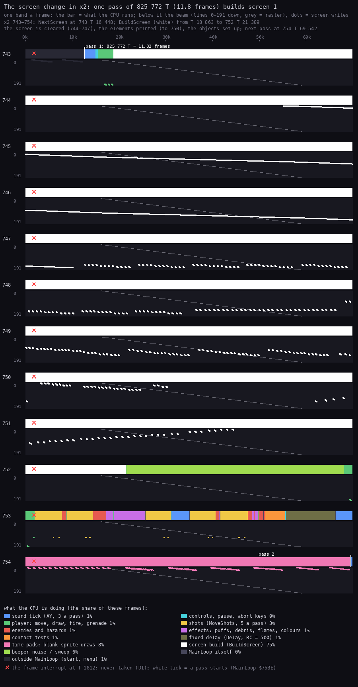
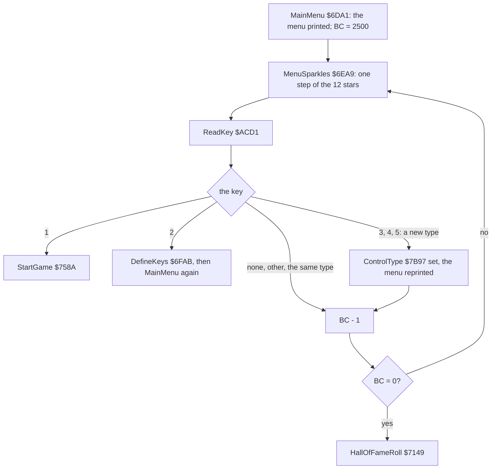
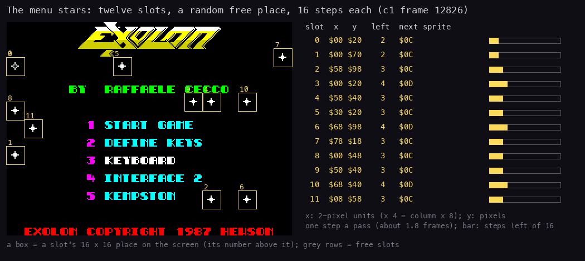

# 4. Game loop

What this covers:

- the state machine of the whole program, every transition with its trigger (4.1);
- the main loop: one routine, 54 calls of 45 routines in a fixed order, all listed, and why the order is so (4.2);
- the interrupts: IM 1 left by the ROM, an IM 2 set-up that never runs, no handler, every `DI` / `EI` window, no
  frame sync, and what an overrun costs (4.3);
- the time pads that keep a pass steady (4.4);
- the lengths of all 3259 complete passes of `c1` and of the 4180 of `c128`, and the heaviest pass against the
  beam (4.5);
- the pause, the abort, a death and the end of a zone (4.6);
- the screen change: one pass that builds the next screen (4.7);
- the menu loop and its twelve stars, and the 2500-pass timeout (4.8);
- design notes (4.9).

The names are those of `src/game/game.ann` ([Terms](README.md#terms)). The recordings it rests on:

- `c1` (power-on, the load, 16 000 frames of seeded random play, 48K), opened read-only on an own instance:
  `re_session.py open --work work/docs/docA/c1 --ttd work/c1/session.ttd --port-base 27000` (and again as
  `work/docs/fillL/c1`, port base 33400, for the heaviest pass, the menu passes and the interrupts of the load).
  - Its access traces of frames 16186-16191, 16336-16341 (`work/docs/docA/c1/traces/`) and 20184-20191
    (`work/docs/fillL/c1/traces/`) give the pass figures and the per-call times of 4.2.
  - TTD `find_event` on MainLoop `$75BE` gives every pass start (cached in
    `work/docs/docA/c1/passes-75BE-12376-28760.txt`). The same on `$76DA`, `$7BAA`, `$7C26`, `$7C3C` and `$8494`
    gives the passes that drew the player, turned him, played a beeper effect or built a screen.
  - Its L1 builds `c1-play` and `c1-menu` count the interrupts taken in play and in the menu: 0 and 0.
- `c128`: the same capture on the 128K, opened as `work/docs/fillL/c128`. It gives the 128K pass lengths and the
  only menu timeout of any recording.
- `x2`: a clone that walks right through screens 0-5 (WALKTHROUGH 6.0), opened as `work/docs/fillL/x2`. It gives
  the screen change.
- `h1`: a clone with the score POKEd to 009000 (WALKTHROUGH 6.0). It gives the Hall of Fame path.
- `w/124`: a warp clone started on screen 124 (WALKTHROUGH 6.0). It gives the round end and the bonus screen.
- The code of `src/game/mainloop.asm`, `menu.asm`, `passtime.asm`, `death.asm`, `zoneend.asm`, `gameover.asm`,
  `hiscore.asm`, `screens.asm`, and the loader's `src/tape/loader.asm` and `picy.asm` for the interrupts of the load.

A **frame** is 1/50 s of the machine (69 888 T on the 48K, 70 908 T on the 128K); a **pass** is one turn of
MainLoop. The two are not tied together ([Terms](README.md#terms)).

## 4.1 The state machine

```mermaid
stateDiagram-v2
    [*] --> Start: JP $6D60 from MoveStub (c1 12376)
    Start --> MainMenu: ShowHallOfFame $71F0 = 0
    Start --> HallOfFame: ShowHallOfFame set; ShowHallOfFameFirst $7145 clears it
    MainMenu --> MainMenu: key 3, 4 or 5 sets ControlType $7B97 (the count goes on)
    MainMenu --> DefineKeys: key 2 (JP Z at $6DF2)
    DefineKeys --> MainMenu: five keys typed (JP MainMenu at $7058); ZORBA toggles the cheat
    MainMenu --> HallOfFame: 2500 menu passes with no key 1-5 (JP Z at $6E10)
    MainMenu --> Play: key 1 (JP Z,StartGame at $6DED)
    HallOfFame --> Play: key 1 (JP Z,StartGame at $7187)
    HallOfFame --> MainMenu: any other key ($718A), or 960 steps done ($717B)
    Play --> Play: one pass, JP MainLoop at $7689
    Play --> NewScreen: X reaches $80, the right edge (NextScreen $8253)
    NewScreen --> Play: BuildScreen $8494 done, the same pass goes on
    Play --> Paused: key 3 alone (PauseKey $AD21)
    Paused --> Play: any key or fire (WaitKeyOrFire $7CEC)
    Play --> Dying: a hit while not immune (KillPlayer $9CAF, DeathTimer 46)
    Dying --> Play: DeathTimer 0, lives left (restart at RestartX, RestartY)
    Dying --> GameOver: DeathTimer 0, no life left (JP Z at $9D38)
    Play --> ZoneEnd: the end marker of screen 24, 49, 74, 99 or 124 (ZoneEnd $A817)
    ZoneEnd --> Play: ZoneRefill $A8A5 returns into the pass
    Play --> Start: 7 8 9 0 held together (AbortKeys $9A19, JP Start at $9A20)
    GameOver --> NameEntry: the score takes a place (HallOfFameInsert $A073)
    NameEntry --> Start: ENTER ($A13A sets ShowHallOfFame, JP Start at $A142)
    GameOver --> Start: no place, then a key ($A04C) or 20 000 ReadKey rounds ($A054)
    state ZoneEnd {
        [*] --> Panel: LIVES BONUS, BRAVERY BONUS (no exoskeleton)
        Panel --> Congratulations: screen 124 (RoundEnd $A867)
        Panel --> Bonus: screens 24, 49, 74, 99
        Congratulations --> Bonus: screen number $FF
        Bonus --> AddLife: fire stops the pointer, lives below 9
        Bonus --> Refill: lives 9
        AddLife --> Refill: ZoneAddLife $A8A1
        Refill --> [*]: 99 shots, 10 grenades, the next screen built
    }
```



How to read the diagram:

- **A state** is a stretch of the game with its own screen and its own loop.
- **An arrow** is a transition. Its label is the key, the flag or the counter that takes it, with the address of
  the jump.
- **Start** `$6D60` is entered three ways: from the loader, after GAME OVER (with or without a name), and by the
  abort keys. Each time it resets the score to 000000 (`$6D88-$6D94`) and the lives to 9 (`$6D95-$6D99`).
- **Play, NewScreen, Paused, Dying and ZoneEnd** all run inside MainLoop's pass: NewScreen inside
  ScreenChangeCheck (call 4), Dying in the passes where PlayerDeath (call 8) counts DeathTimer down, ZoneEnd inside
  ZoneEnd (call 40), Paused inside PauseKey (call 49). None of them leaves the loop.
- **The point**: there is no interrupt handler and no state variable. Each state is a loop. A transition is a `JP`
  from inside a routine that loop calls, so the stack is thrown away: Start sets SP to `$0000` again each time.
  MainLoop itself never returns.

Each loop in turn:

- **MainMenu** `$6DA1` draws the menu and runs MenuLoop `$6DDD`: one star step and one key read a pass, 2500 passes
  (4.8).
  - On a 48K the beeper title tune plays at the first menu after each entry to Start (the load, every GAME OVER,
    the abort), not after define keys or a control change (PlayTune `$7D17`, TitleTunePending `$7D67`; `c1`: 4
    times). It blocks: `c1` enters MainMenu at frame 12378 and MenuLoop at 12802, 424 frames (8.5 s) later.
- **DefineKeys** `$6FAB` asks for five keys and patches them into the keyboard reader ([doc 5](05-controls.md)).
- **HallOfFame**: HallOfFameRoll `$7149` scrolls the table up for 960 steps; a key read after each step. Its
  drawing is in [doc 8](08-hud-and-text.md).
- **Play** is MainLoop `$75BE` (4.2).
- **GameOver** `$A02A`:
  - it prints the band, plays the jingle and waits two Delays of 65 536 bytes (1 376 256 T each, about 20 frames
    or 0.4 s);
  - HallOfFameInsert `$A073` returns when the score takes no place; otherwise it runs the name entry, which ends
    with `JP Start`;
  - then WaitNoKey and 20 000 rounds of ReadKey: a key, or the end of the count, jumps to Start.

```asm
GameOver:
  LD HL,GameOverText
  CALL PrintString
  LD HL,JingleTune
  CALL PlayTune
  LD BC,$0000
  CALL Delay
  CALL Delay
  CALL HallOfFameInsert   ; jumps to Start itself after a name entry
  CALL WaitNoKey
  LD BC,$4E20             ; 20 000 rounds
GameOverWait:
  CALL ReadKey            ; any key: the menu at once
  OR A
  JP NZ,Start
  DEC BC
  LD A,B
  OR C
  JR NZ,GameOverWait
  JP Start
```

What the recordings reached:

| Transition | Witness |
| --- | --- |
| entry, menu | `c1` frames 12376 (Start), 12378 (MainMenu), 12802 (MenuLoop, after the title tune) |
| a control type (key 5) | `c1` 12886 (`$6DFE`) |
| define keys | `c1` 14595 (DefineKeys), back to the menu 14996 |
| start a game | `c1` 16125 (StartGame), first MainLoop pass 16139; later games at 18928, 22580, 27830 |
| a screen change | `x2` (clone): NextScreen at frames 743, 1471, 1770, 2419, 2944 (4.7) |
| GAME OVER | `c1` 18275, 21171, 24277, each followed by the menu (18444, 21438, 24724) |
| name entry, Hall of Fame first | `h1` (clone): GameOver 2326, the name done at `$A13A` in frame 6640, ShowHallOfFameFirst 6661, the menu 7786 |
| the menu's timeout to the Hall of Fame | `c128`: MenuLoop from frame 14507, HallOfFameRoll 18784 (4.8); a key ended the roll at 18797 |
| zone end, CONGRATULATIONS, bonus screen | `w/124` (warp clone): RoundEnd 664, BonusScreen 797, ZoneRefill 1016; 9 warp runs reached a BonusScreen |
| abort keys | exC's clone run `t1` (frame 1750, an annotation agent's run); no case recording |
| pause | exD's clone run `d1` (an annotation agent's run); no case recording |
| the Hall of Fame's key 1 to play | known only from the code (`$7187`): `h1` ended with the menu, `c128` with another key |
| ZoneAddLife | known only from the code (`$A8A1`): every warp run had nine lives |

[Doc 1](01-game-design.md) (1.2) shows the screen of each state.

## 4.2 The main loop

StartGame `$758A` sets up a game and falls into MainLoop `$75BE`:

- `DI` (again), the AY silenced, the screen cleared, the player's frames turned back to face right;
- the player at X `$10`, Y `$70`, which is also the restart place;
- 99 shots, 10 grenades;
- the HUD (DrawHud `$7690`), then the first screen (BuildScreen `$8494`).

MainLoop is one flat list of 54 calls:

- It starts by zeroing the two draw counters of the time pads (4.4).
- It ends by counting the pass three ways, then jumps back.
- Between them, every routine of the game runs once a pass whether its objects are on the screen or not. A routine
  whose list is empty returns at the list's end mark, in 45-140 T.

```text
loop forever:
    xorSpriteDraws = 0
    slotSpriteDraws = 0
    sound tick
    read the controls
    move the player; when he left on the right, build the next screen now
    fire; move the shots (five times in the pass, between the other jobs)
    the death, mines, grenade, balls, traps, puffs, colours, pods, debris, teleports, sound tick,
    shells, flames, turrets, guns, bonus ticks, sparkles, aliens, blasts, booth, missiles, pick-ups,
    the flickering pad, the zone end, the force field, the idle missile
    test every enemy against the player
    test the pause and abort keys
    wait 500 x 21 T
    sound tick
    draw blank sprites for the draws this pass did not make     (the time pads)
    if immunity > 0: immunity = immunity - 1
    passCount = passCount + 1
    idleTime = idleTime + 1
```

The list in full. "Runs" is the count of the `CALL` in `c1`'s L1 (the whole recording). The two T columns are each
call's own time with everything it calls, in two traced passes: a quiet one (`c1` 16186 T 56 450, 137 525 T) and
the heaviest of `c1` (20184 T 61 504, 416 959 T, 4.5).

| # | `CALL` at | Routine | Group | What it does | Runs | T, quiet | T, heaviest |
| ---: | --- | --- | --- | --- | ---: | ---: | ---: |
| 1 | `$75C5` | SoundEffectsTick `$BF7E` | sound | one tick of the 16 AY effect slots | 3263 | 2436 | 2420 |
| 2 | `$75C8` | ReadControls `$7B72` | controls | the chosen device into ControlLeft..ControlFire | 3263 | 594 | 526 |
| 3 | `$75CB` | MovePlayer `$81A4` | player | fall, jump, crouch, walk; draws the player | 3263 | 2898 | 159 156 |
| 4 | `$75CE` | ScreenChangeCheck `$8485` | player | the next screen, when he left on the right (4.7) | 3263 | 45 | 45 |
| 5 | `$75D1` | FireControl `$8338` | player | a shot a press; the hold count for the grenade | 3263 | 141 | 141 |
| 6 | `$75D4` | MoveShots `$83DD` | shots | the hit tests, then every shot 1 unit (2 pixels) | 3263 | 4128 | 4128 |
| 7 | `$75D7` | MoveShells `$90A2` | enemies | every turret shell 1 unit | 3263 | 733 | 736 |
| 8 | `$75DA` | PlayerDeath `$9CE3` | player | one pass of the death leap; a life lost at its end | 3263 | 45 | 45 |
| 9 | `$75DD` | Mines `$9152` | enemies | an armed mine fires under the player | 3260 | 112 | 132 |
| 10 | `$75E0` | ThrowGrenade `$9208` | player | a grenade after 15 passes of fire held | 3260 | 140 | 140 |
| 11 | `$75E3` | MoveGrenade `$925F` | player | one step of the grenade's arc | 3260 | 45 | 65 |
| 12 | `$75E6` | MoveShots `$83DD` | shots | (second step) | 3260 | 4128 | 4133 |
| 13 | `$75E9` | MoveBalls `$9A23` | enemies | the balls' random walk | 3260 | 2789 | 2803 |
| 14 | `$75EC` | Traps `$9C15` | enemies | the floor probes rise, hold, sink | 3260 | 92 | 101 |
| 15 | `$75EF` | AnimatePuffs `$9835` | effects | one frame of every puff | 3260 | 1413 | 1419 |
| 16 | `$75F2` | ColourCycle `$9118` | effects | the cycling cells in PassCount's ink | 3260 | 1355 | 1416 |
| 17 | `$75F5` | Pods `$9942` | player | the ammunition and grenade pods refill | 3260 | 96 | 96 |
| 18 | `$75F8` | MoveDebris `$955D` | effects | every debris piece; the 48K crackle | 3260 | 6652 | 6671 |
| 19 | `$75FB` | MoveShots `$83DD` | shots | (third step) | 3260 | 4128 | 4128 |
| 20 | `$75FE` | Teleports `$98BA` | player | up in one teleport moves to the other | 3260 | 64 | 84 |
| 21 | `$7601` | SoundEffectsTick `$BF7E` | sound | (second tick) | 3260 | 2434 | 2420 |
| 22 | `$7609` | MoveGrenade `$925F`, if GrenadeTimer `$925A` < `$13` | player | a second step on the arc's last part | 3260 | 64 | 45 |
| 23 | `$760C` | MoveShots `$83DD` | shots | (fourth step) | 3260 | 4142 | 4128 |
| 24 | `$760F` | MoveShells `$90A2` | enemies | (second step of the shells) | 3260 | 738 | 751 |
| 25 | `$7612` | AnimateFlames `$8F54` | effects | the jets one frame on | 3260 | 3175 | 3159 |
| 26 | `$7615` | AnimateTurrets `$8F95` | enemies | the turrets fire at random and animate | 3260 | 590 | 120 998 |
| 27 | `$7618` | MoveShots `$83DD` | shots | (fifth step) | 3260 | 4142 | 4128 |
| 28 | `$7620` | MoveGrenade `$925F`, if GrenadeTimer < `$13` | player | a third step on the arc's last part | 3260 | 45 | 64 |
| 29 | `$7623` | Guns `$9D7F` | enemies | the gun emplacements fire | 3260 | 53 | 53 |
| 30 | `$7626` | MoveGunShots `$9DD6` | enemies | every gun shot two units left | 3260 | 789 | 779 |
| 31 | `$7629` | PayBonusTick `$9EC1` | effects | one pending 25 points and a click | 3260 | 52 | 71 |
| 32 | `$762C` | RunSparkles `$9EEE` | effects | the teleport sparkles | 3260 | 325 | 325 |
| 33 | `$762F` | AlienSpawn `$A553` | enemies | an alien from the right now and then | 3260 | 108 | 105 |
| 34 | `$7632` | RunBlasts `$9FBD` | effects | every live blast, a crackle | 3260 | 757 | 757 |
| 35 | `$7635` | ExoSuitBooth `$9F2D` | player | up in the booth: the suit on or off | 3260 | 81 | 81 |
| 36 | `$7638` | HomingMissileStep `$A26B` | enemies | the homing missile | 3260 | 106 | 116 |
| 37 | `$763B` | PickupsVsPlayer `$A30B` | contact | a bonus pick-up touched: 1000 points | 3260 | 67 | 53 |
| 38 | `$763E` | AliensStep `$A360` | enemies | every alien along its path | 3260 | 908 | 904 |
| 39 | `$7641` | FlickerPadStep `$A7D6` | enemies | the flickering pad | 3260 | 68 | 68 |
| 40 | `$7644` | ZoneEnd `$A817` | player | at the end marker: the whole zone end (4.6) | 3260 | 56 | 65 |
| 41 | `$7647` | ForceFieldStep `$ABCF` | enemies | the force field's buzz, colours, contact | 3260 | 56 | 56 |
| 42 | `$764A` | IdleMissileStart `$AC59` | enemies | IdleTime 700: a missile from the right | 3260 | 114 | 113 |
| 43 | `$764D` | IdleMissileStep `$AC7D` | enemies | the idle missile 2 left | 3260 | 45 | 48 |
| 44 | `$7650` | ShellsHitPlayer `$90EA` | contact | a turret shell against the player | 3260 | 733 | 869 |
| 45 | `$7653` | BallsTouchPlayer `$9BB4` | contact | a ball against the player | 3260 | 1844 | 1829 |
| 46 | `$7656` | TrapContact `$9C8B` | contact | a raised trap against the player | 3260 | 72 | 53 |
| 47 | `$7659` | GunShotsVsPlayer `$9E64` | contact | a gun shot against the player | 3260 | 733 | 751 |
| 48 | `$765C` | AliensVsPlayer `$A5F4` | contact | an alien against the player | 3260 | 919 | 932 |
| 49 | `$765F` | PauseKey `$AD21` | keys | key 3 alone pauses (4.6) | 3260 | 77 | 61 |
| 50 | `$7662` | AbortKeys `$9A19` | keys | 7 8 9 0 together: `JP Start` | 3260 | 71 | 53 |
| 51 | `$7668` | Delay `$B0B7`, BC = 500 | time | 500 x 21 T doing nothing | 3260 | 10 605 | 10 624 |
| 52 | `$766B` | SoundEffectsTick `$BF7E` | sound | (third tick) | 3260 | 2440 | 3714 |
| 53 | `$766E` | PadXorSprites `$9E85` | time | the missing small XOR sprite draws, blank (4.4) | 3260 | 18 440 | 18 309 |
| 54 | `$7671` | PadSlotSprites `$9E99` | time | six blank 16x16 draws (4.4) | 3260 | 50 378 | 51 818 |

```bash
python3 tools/mainloop_calls.py --l1 work/c1/l1.json \
    --trace work/docs/docA/c1/traces/16186_50000-16191_10000.uatr \
    --trace work/docs/fillL/c1/traces/20184_50000-20191_0.uatr
```

How to read the table:

- **3263 against 3260**: `c1` played four games. Three of them ended at GAME OVER, which leaves from call 8
  (PlayerDeath's `JP Z,GameOver` at `$9D38`). So calls 9-54 ran three times fewer. The fourth game was still
  running when the recording ended.
- **The conditional calls 22 and 28** were taken in every pass of `c1`: MoveGrenade's 9780 runs are exactly
  3 x 3260. No grenade flew in `c1`, GrenadeTimer stayed 0, and 0 is below `$13`; MoveGrenade then returns at once
  (45-65 T). With a grenade in flight GrenadeTimer counts down from `$20`: the first 13 steps (timer `$20` to `$14`) run
  once a pass; from the pass that starts at `$13` three a pass (calls 22 and 28 test the timer below `$13`). The
  steps from `$13` take it to 1, where it stays (`$926B` `DEC A / JR Z` never stores 0), and the grenade goes on
  three steps a pass until a wall, the floor or an edge ends it (GrenadeEnd `$92D4`).
- **The quiet pass** spends 58 % of its time in the Delay and the two pads (calls 51, 53, 54: 79 423 T). The
  rest, about 58 000 T with the three sound ticks, is the game's own work.
- **The heaviest pass** has two long calls: MovePlayer (call 3) turned the player (FlipPlayerFrames, about
  134 000 T) and drew him; AnimateTurrets (call 26) let a turret fire, and FireShell `$9071` played ten BeeperNoise
  bursts of B = `$1E` (about 118 700 T on the 48K).
- **The point**: the cost of a pass is set by the few calls that do something rare; the other 50 cost the same in
  every pass.

Why the order is what it is (read from the code; the authors left no notes):

- **The controls first** (call 2). Everything after them in the pass sees the same input.
- **The move, then the screen change at once** (calls 3-4). When the player left on the right, ScreenChangeCheck
  builds the next screen before any other routine moves or draws. The object lists are then those of the new
  screen, and nothing of the old screen is drawn over the new one (4.7).
- **Fire, then the first shot step** (calls 5-6). A shot fired in this pass moves in the same pass.
- **The death early** (call 8). PlayerDeath advances the death leap before the hazards move. While DeathTimer runs,
  AbortIfDying `$9D78` makes MovePlayer, FireControl and the grenade routines return before their work.
- **Five shot steps spread through the list** (calls 6, 12, 19, 23, 27). Each step moves a shot 2 pixels and runs
  the hit tests first. A shot therefore flies 10 pixels a pass but is tested at every 2 pixels, so it cannot jump
  over a thin target. The spread is most likely meant to keep the shots' XOR sprites moving evenly across the pass.
- **Three sound ticks** (calls 1, 21, 52) at about a third of a pass apart. On a 128K the AY effects step three
  times a pass, about every 0.66 frames.
- **The contact tests after every move** (calls 44-48). Each enemy is tested against the player where both are at
  the end of this pass.
- **The keys last** (calls 49-50). The pause stops the game between two complete passes, with the screen as the
  pass left it.
- **The Delay and the pads at the very end** (calls 51, 53-54). They touch nothing, so their place does not matter
  to the logic. At the end they pad the pass after its real work is known: PadXorSprites reads how many draws the
  pass made.

The end of the pass, as the listing has it:

```asm
  CALL PauseKey           ; the pause key 3 ($AD21, PauseKey)
  CALL AbortKeys
  LD BC,$01F4             ; the pass's fixed delay
  CALL Delay
  CALL SoundEffectsTick
  CALL PadXorSprites
  CALL PadSlotSprites
  LD A,(ImmunityCount)    ; the immunity after a restart counts down
  OR A
  JR Z,MainLoopCount
  DEC A
  LD (ImmunityCount),A
MainLoopCount:
  LD HL,PassCount         ; PassCount and the screen's pass count $AC7B
  INC (HL)
  LD HL,(IdleTime)
  INC HL
  LD (IdleTime),HL
  JP MainLoop
```

Three counters close the pass:

- PassCount `$768C` (8 bits, never reset): its low 3 bits pick the cycling colours (ColourCycle `$9118`, the force
  field);
- IdleTime `$AC7B` (16 bits, zeroed by BuildScreen): 700 passes on one screen start the idle missile
  (IdleMissileStart `$AC59`);
- ImmunityCount `$768D`: set to 66 by a death and counted down; while it runs, KillPlayer `$9CAF` returns at once.

`c1` enters MainLoop 3263 times.

## 4.3 Interrupts, and one pass against the frame

### The mode: IM 1, never taken

- The game never runs an `IM` instruction. The ROM's IM 1 stays set from power-on.
- Start `$6D60` runs `DI` as its first instruction, and StartGame `$758A` runs it again. The game has no `EI`.
- So the IM 1 handler at `$0038` is never reached in the game. `c1`'s L1 counts 169 interrupts over the whole
  recording, all in frames 83-251 (the ROM, the BASIC and the start of the loader). The L1 windows `c1-menu`
  (frames 12378-16125) and `c1-play` (16125-18275) count 0. So do `x2`, `h1` and `m1` over their whole runs.

### The IM 2 set-up that never runs

SetupIm2 `$7BDB` would set IM 2 with a vector table of 257 bytes of `$81` at `$8000-$8100`:

```asm
SetupIm2:
  LD HL,$8000
  LD (HL),$81
  LD DE,$8001
  LD BC,$0101             ; 257 bytes: the table and its overflow byte
  LDIR
  IM 2
  LD A,$80
  LD I,A
  RET
```

```text
memory[$8000 .. $8100] = $81
interrupt mode = 2; I = $80
(with interrupts enabled, a frame interrupt would read its vector at $80xx: always $8181)
```

- **The table**: with I = `$80` the CPU reads the vector at `$80` x 256 + the byte on the data bus. 257 equal bytes
  make the vector `$8181` whatever that byte is. This is the usual Spectrum trick for a bus that floats.
- **Where it points**: `$8181` is in the middle of TestAbove `$8179`, not a handler.
- **What it would destroy**: `$8000-$8100` is live code and data in this image: the silent beeper twin BeeperRest
  `$8004`, the two-voice engine PlayTwoTones `$803D` and its NoteReloads `$8062`, CellOffset `$8097` (every menu
  star and every cell lookup), BlockMapCell `$80C1`, AttrShadowCell `$80DA` and the start of TestRight `$80F3`.
- **No caller**: no `CALL`, `JP` or address constant in the image reaches `$7BDB`. Not executed in any recording
  (`c1`, `c128`, `x1`, `x2`, `h1`, `m1`, the 97 warp runs).

### No handler

There is nothing to read line by line:

- no IM 2 table exists in memory at any time of any recording, and the IM 1 handler is the ROM's;
- StrayReti `$768E` is a lone `RETI` after ImmunityCount. No code jumps there. `$A897` in ZoneEnd loads its address
  into HL (`LD HL,$768E`) and never uses HL afterwards. Not executed in any recording.

SetupIm2 and StrayReti look like the two halves of an interrupt set-up (a table and a handler's return) from an
earlier build. That is a guess; the image gives no other trace of it.

### Every `DI` / `EI` window from power-on

```mermaid
flowchart LR
  A["frames 0-82: ROM start-up, interrupts off"] --> B["frames 83-251: IM 1, EI; 169 interrupts (BASIC, the fast loads)"]
  B -- "frame 250 T 34 665: USR 64512" --> C["Decrypt $FC00 runs with EI; the last interrupt at 251 T 1827"]
  C -- "251 T 4431" --> D["loader Start $FE3A: DI"]
  D --> E["LoadFile, LdBytes $FC8D: DI again, no EI on return"]
  E -- "1808 T 61 301" --> F["picy $800B: DI ... $809C: EI"]
  F -- "1825 T 12 550: RET, about 105 T with EI" --> G["LoadFile, LdBytes $FC8D: DI"]
  G -- "12364 T 38 072" --> H["MoveStub at $5B00: LDDR, LD SP, EI at $5B0E"]
  H -- "14 T with EI: EI, JP $6D60" --> I["Start $6D60: DI (12376 T 62 848)"]
  I --> J["the game: interrupts off for good; StartGame $758A: DI again"]
```



How to read the diagram:

- **A box** is a stretch of code with the interrupt state it runs under. An edge carries the `c1` frame and T of the
  change.
- **The ROM part**: the ROM enables interrupts after its start-up. The BASIC's `LOAD "" CODE` runs the ROM's
  LD-BYTES, which disables them for the block and enables them again on its way out (SA/LD-RET). The emulator's
  fast load took both ROM blocks in a few frames ([doc 3](03-build-and-load.md)).
- **Decrypt** runs with interrupts on. The interrupt of frame 251 lands inside it (`$0038` at 251 T 1827, HL =
  `$FE86`). The ROM's frame handler running there is most likely the 871 T by which the measured chain is longer
  than its count of 38 699 T ([doc 3](03-build-and-load.md), 3.3).
- **The loader** disables interrupts at its Start `$FE3A`. Its LD-BYTES copy disables them again on entry, and
  unlike the ROM's it does not enable them on return.
- **picy** brackets its unpack with `DI` ... `EI` (`$800B`, `$809C`) and returns with interrupts on. The loader's
  next LdBytes disables them about 105 T later: `RET`, `CALL LoadFile` and ten more instructions. No interrupt
  falls in that window: it is at T 12 550 of the frame, and the ULA's interrupt is only raised at the frame's
  start.
- **MoveStub** ends with `LD SP,$6D5E`, `EI`, `JP $6D60`. The `EI` takes effect after the `JP`, and the first
  instruction at `$6D60` is `DI`. The window is the 14 T of `EI` and `JP`, at T 62 848 of frame 12376, far from
  the next frame start.
- **The point**: from the game's entry to the end of every recording, interrupts are off. The two `EI`s of the
  load are leftovers of general-purpose code (picy, and a stub that would let a game start with interrupts on);
  here they open windows of 105 T and 14 T that no interrupt hits.

### No frame sync

Nothing ties a pass to the 50 Hz frame:

- there is no `HALT` in the game; L1's `HALT` share is 0 % in both `c1-play` and `c1-menu` ([doc 2](02-architecture.md),
  2.5);
- nothing reads the beam or a frame counter (the game has none);
- the CPU runs MainLoop end to end, then starts it again; a pass takes as long as its work.



How to read the figure:

- **One band is one frame** of 69 888 T (48K). The bar is what the CPU runs, coloured by the MainLoop call it is
  inside. The calls are grouped by meaning (the legend).
- **The panel under each bar** is the beam. The grey diagonal is the raster from line 0 to line 191. A dot is a
  write to the screen, at its line (vertical) and its time (horizontal).
- **The red cross** marks T 1812, where the frame interrupt would be taken. It never is (`DI`).
- **White ticks** mark the start of a pass (MainLoop `$75BE`), with its length.
- **Pass 1** (137 525 T, 1.97 frames): nothing moves. Half of it (68 818 of 137 525 T) draws blank sprites (pink: the time pads).
- **Pass 2** (158 532 T, 2.27 frames): the player walks one step and is redrawn (dark green: DrawBigSprite `$76DA`,
  about 21 000 T).
- **The point**: a pass starts wherever the last one ended. These two start at T 56 450 of frame 16186 and T 54 199
  of frame 16188.

```bash
python3 tools/fig_pass.py --work work/docs/docA/c1 --window 16186:50000-16191:10000 --rows 16186-16190 \
    --title 'Two passes of c1: no interrupt, no frame sync; drawing the player adds 21 000 T' \
    --note 'pass 1: nothing moves (half of it draws blank sprites); pass 2: the player walks a step and is redrawn (dark green)' \
    --out docs/img/loop/pass.png
```

Where the time of these two passes goes (the legend's shares of the five frames, as `tools/fig_pass.py` prints them):

| Work | Share | Note |
| --- | ---: | --- |
| time pads (PadXorSprites, PadSlotSprites) | 38 % | 4.4 |
| shots (MoveShots, 5 calls) | 12 % | the object hit tests run inside each call |
| effects (puffs, debris, flames, colour cycle) | 8 % | |
| fixed delay (Delay `$B0B7`, BC = 500) | 6 % | 10 500 T a pass |
| player sprite draw (DrawBigSprite) | 6 % | only in pass 2 |
| sound tick (3 calls) | 4 % | |
| enemies and hazards | 4 % | |
| contact tests | 2 % | |
| player logic (move, fire, grenade) | 2 % | |

Delay `$B0B7` is an `LDIR` of BC bytes from `$0000` to `$0000`:

- each byte is copied onto itself, 21 T a byte, so the main loop's call costs 500 x 21 = 10 500 T;
- the bytes are ROM bytes, so nothing changes. `c1`'s L1 of play counts exactly 500 written bytes in the ROM page:
  this `LDIR`.

### Overruns

Every pass is longer than a frame, so in the usual sense every pass overruns. With no interrupt and no sync, an
overrun costs nothing but speed: no frame is dropped and no handler is late. The game simply runs slower when a pass
does more. From the pass lengths of 4.5:

| Pass | Length | Frames | Passes a second | Witness |
| --- | ---: | ---: | ---: | --- |
| quiet (median) | 138 347 T | 1.98 | 25.3 | `c1`, 2234 passes |
| the player drawn (median) | 163 152 T | 2.33 | 21.5 | `c1`, 936 passes |
| a beeper effect (median, 48K) | 260 929 T | 3.73 | 13.4 | `c1`, 69 passes |
| the player turns (median) | 300 140 T | 4.29 | 11.7 | `c1`, 20 passes |
| the heaviest of `c1`: a turn and a turret's shot | 416 959 T | 5.97 | 8.4 | `c1` 20184-20190 |
| a grenade's blast (128K) | 552 549 T | 7.79 (70 908 T) | 6.4 | `c128` 20375-20383 |
| a screen change | 825 772 T | 11.82 | 4.2 | `x2` 743-754 (4.7) |

- **Passes a second** = 3 500 000 / the length (3.5 MHz; the 128K's clock is 3.5469 MHz, within 2 %).
- **The point**: everything in the game moves by a fixed step per pass (2 pixels a shot step, one walk step, one
  jump step). So the game's own speed is the pass rate: it plays at 25 steps a second on a quiet screen and drops
  to a third of that for the pass of a turn with a turret firing. The time pads (4.4) keep the common case even;
  the rare heavy passes are visible as stutters.

## 4.4 The time pads

Two routines at the end of each pass draw sprites that change nothing on the screen:

- **PadXorSprites `$9E85`**: every 8x8 XOR sprite draw (DrawSmallSprite `$92FB`) raises XorSpriteCount `$9E98`.
  The pad draws the missing ones, up to 16, with sprite 6.
- **PadSlotSprites `$9E99`**: the same for the 16x16 drawer DrawSprite `$795C`, up to 6 draws of frame 0. Its
  counter SlotSpriteCount `$9EAE` is zeroed each pass and raised nowhere in the image, so it always draws 6.

```asm
PadXorSprites:
  LD A,(XorSpriteCount)
  CP $10
  RET NC
  LD B,A
  LD A,$10
  SUB B
  LD B,A
  LD A,$06
PadXorSpritesLoop:
  CALL DrawSmallSprite
  DJNZ PadXorSpritesLoop
  RET
```

```text
padDraws = 16 - xorSpriteDraws          (none when 16 or more were made)
repeat padDraws times:
    draw small sprite 6 by XOR at whatever position DE holds
```

Both sprites are blank:

- small sprite 6 is the 64 bytes at `$EEC0` (SmallSprites `$ED40` + 6 x 64): all zero in `c1` frame 16188
  (`memory_at`);
- 16x16 frame 0 is the 32 bytes at `$F8E0`: all zero; DrawSprite erases from NoSaveBuffer `$B101` (128 zeros).

What follows:

- A blank XOR leaves every pixel as it was, but costs the time of a real draw.
- A pass with few moving objects therefore costs about as much as a busy one.
- [Doc 6](06-rendering.md) (6.5) shows the pad writes at the top of the screen. Each writes back the byte that was
  there.
- The pads do not cover the player's sprite, the screen build, the player's turn or the beeper effects. Those make
  the long passes of 4.5.

## 4.5 Pass lengths



How to read the figure:

- **One bar** is the number of passes whose length falls in a bin of 2000 T. The vertical scale is logarithmic.
- **The colour** is the heaviest thing the pass did, tested in this order:
  - the player turned (FlipPlayerFrames `$7BAA` ran);
  - a beeper effect ran (BeeperNoise `$7C26` or BeeperSweep `$7C3C`);
  - the player was redrawn (DrawBigSprite `$76DA`);
  - none of these.
- **Red dashed lines** mark 2, 3, 4 and 6 frames.
- **The gaps between games** (over 5 000 000 T: the GAME OVER, the menu and the next start) are left out; every
  other interval between two MainLoop starts is a pass.
- **The point**: the pads keep a quiet pass within 132 005-154 115 T. The player's draw adds about 25 000 T. A
  beeper effect or the mirror of 24 frames doubles a pass. The longest pass, 416 959 T (6 frames, `c1` 20184-20190),
  is a turn and a beeper effect together.

```bash
python3 tools/fig_pass_lengths.py --work work/docs/docA/c1 --from 12376 --to 28760 --out docs/img/loop/pass-lengths.png
```

The classes, from the same data:

| Class | Passes | Median | Range or note |
| --- | ---: | ---: | --- |
| quiet | 2234 | 138 347 T (1.98 frames) | 132 005-154 115 T |
| the player drawn | 936 | 163 152 T (2.33 frames) | |
| a beeper effect | 69 | 260 929 T (3.73 frames) | 48K only |
| the player turns | 20 | 300 140 T (4.29 frames) | 296 615-311 808 T; one of 416 959 T with a beeper effect |

A beeper effect blocks the CPU while it plays: the CPU itself drives the speaker ([doc 9](09-sound.md)). On the
128K BeeperNoise and BeeperSweep return at once and the AY plays the effect (SoundIsAy `$6E16`); the 128K table
below measures it.

The turn: FlipPlayerFrames `$7BAA` mirrors all 24 player frames in place (768 lines of 3 bytes through BitReverse
`$6400`) each time the player changes direction.



How to read the figure:

- The layout is the one of the first pass figure (4.3).
- **Light green** is FlipPlayerFrames: about 131 000 T, from frame 16336 to frame 16338.
- **Dark green** in frame 16338 is the player drawn facing the other way.
- **The point**: one turn costs as much as a whole quiet pass. This pass is 299 229 T, 4.28 frames: the game runs at
  half speed for the step of every turn.

```bash
python3 tools/fig_pass.py --work work/docs/docA/c1 --window 16336:40000-16341:0 --rows 16336-16340 \
    --title 'The longest kind of pass: the player turns, 24 frames mirrored, 4.28 frames' \
    --note 'c1 16336-16340: FlipPlayerFrames runs for about 131 000 T; then the player is drawn facing the other way' \
    --out docs/img/loop/pass-turn.png
```

The heaviest pass of `c1` against the beam:



How to read the figure:

- The layout is the one of the first pass figure (4.3).
- **Frame 20184**, the dark part before the white tick, is the end of the previous pass (the trace starts inside
  it; the legend calls it "outside MainLoop").
- **Light green**, from the end of 20184 to 20186: FlipPlayerFrames, the player turns (about 134 000 T).
- **Dark green** in 20186-20187: the player drawn facing the other way (DrawBigSprite, about 24 000 T).
- **Pale green** from 20187 to 20189: ten BeeperNoise bursts of FireShell `$9071`, a turret's shot (call 26,
  AnimateTurrets). The thin red lines in the bar are the gaps between the bursts. About 118 700 T, during which the
  screen gets no write at all.
- **Pink** in 20189-20190: the two time pads, then the next pass at 20190 T 59 135.
- **The point**: the pass is 416 959 T, almost six frames. The game stands still for 0.12 s, and the turret's
  shot is heard as a solid noise while nothing moves. This is the stutter a 48K player sees when he turns as a
  turret fires.

```bash
python3 tools/fig_pass.py --work work/docs/fillL/c1 --window 20184:50000-20191:0 --rows 20184-20190 \
    --title "The heaviest pass of c1: a turn and a turret's shot, 416 959 T, 5.97 frames" \
    --note 'c1 20184-20190: FlipPlayerFrames (light green), the player drawn (dark green), then ten BeeperNoise bursts' \
    --note "of FireShell (pale green) block the CPU; no interrupt, no frame sync" \
    --out docs/img/loop/pass-heaviest.png
```

The trace has ten entries of BeeperNoise `$7C26` in this pass, each called from `$9099` in FireShell
(`work/docs/fillL/hits.py` on the same trace).

The 128K, from `c128` (one game, frames 19221-27776; the 128K frame is 70 908 T):

| Class | Passes | Median | Range |
| --- | ---: | ---: | --- |
| quiet | 3435 | 136 800 T (1.93 frames) | 131 309-552 549 T |
| the player drawn | 628 | 164 219 T (2.32 frames) | 151 996-270 661 T |
| a beeper routine called (it returns at once) | 94 | 166 660 T (2.35 frames) | 135 917-189 478 T |
| the player turns | 23 | 297 612 T (4.20 frames) | 291 521-321 259 T |

```bash
python3 tools/pass_classes.py --work work/docs/fillL/c128 --from 19221 --to 28215 --frame-t 70908
```

- **The beeper class shrinks**: on the 128K BeeperNoise and BeeperSweep return at once (SoundIsAy `$6E16`), so a
  pass that calls them is an ordinary pass (median 166 660 T against 260 929 T on the 48K). The AY plays the
  effect from SoundEffectsTick instead ([doc 9](09-sound.md)).
- **The quiet class's maximum** of 552 549 T is a grenade's blast that no class names: `c128` frame 20375 T 23 912.
  `tools/mainloop_calls.py` on its trace (`work/docs/fillL/c128/traces/20375_20000-20383_30000.uatr`) gives
  MoveGrenade (call 11) 274 802 T and MoveDebris (call 18) 165 486 T. It is the longest pass measured outside a screen
  change; `c1` threw no grenade.
- **The point**: the 128K passes are as long as the 48K's, but for the beeper effects. The turn and the grenade
  still stall the game.

The first pass on a new screen also runs BuildScreen `$8494`. In `c1` the player never left screen 0:

- BuildScreen ran four times, once per game start (frames 16129, 18931, 22584, 27834), before the first pass;
- the first took about 708 000 T, 10 frames (16129 T 14 159 to the first pass at 16139 T 23 157);
- so the figure has no BuildScreen class. [Doc 6](06-rendering.md) (6.4) animates that build, and 4.7 shows a
  screen change of `x2` against the beam.

## 4.6 The pause, the abort, a death, a zone end

### The pause

PauseKey `$AD21` reads the half-row of keys 1-5 (`$F7FE`). Only key 3, alone, pauses (`AND $1F` = `$1B`):

```asm
PauseKey:
  LD A,$F7
  IN A,($FE)
  AND $1F
  CP $1B
  RET NZ
PauseWait:
  LD BC,$01F4
  CALL Delay
  CALL WaitNoKey          ; WaitNoKey: 3 up
  JP WaitKeyOrFire        ; WaitKeyOrFire returns to the main loop
```

```text
if key 3 is the only key of 1-5 down:
    short delay
    wait until no key is down
    wait for any key or fire, then go on with the pass
```

- The pause shows nothing: the picture stays as it was.
- No case recording pressed 3 in play. exD's clone run `d1` held 3 for 20 frames, then P: PauseWait ran, and the
  game went on after P.

### The abort

- AbortKeys `$9A19` reads the half-row 6-0 (`$EFFE`).
- With 0, 9, 8 and 7 all down (bits 0-3 zero) it falls into AbortGame `$9A20`: `JP Start`.
- Witness: exC's clone run `t1` (frame 1750).
- The same half-row is the Interface 2 stick ([doc 5](05-controls.md)), but a stick cannot press up and down at
  once, so it cannot abort.

### A death

- KillPlayer `$9CAF` sets DeathTimer `$9CE2` to 46 and ImmunityCount `$768D` to 66.
- PlayerDeath `$9CE3` runs each pass while DeathTimer counts down: the player leaps and falls (DeathLeap `$9D4A`).
  Meanwhile AbortIfDying `$9D78` makes the movement, fire and grenade routines return early.
- At 0:
  - the frames face right again;
  - a life is taken (`DEC A` at `$9D1D`), ammunition back to 99, grenades to 10;
  - with no life left, a `JP Z` at `$9D38` goes to GameOver `$A02A`;
  - else the player drops in at RestartX, RestartY (`$82F3`, `$82F4`).
- The 20 passes left of ImmunityCount after the restart keep him safe.
- Witness: `c1`'s first game, frames 16125-18275, nine deaths on screen 0 and GAME OVER.

### The end of a zone

```text
ZoneEnd, each pass:
    if this screen has an end marker (screens 24, 49, 74, 99, 124) and the player's X has reached it:
        the bonus panel: LIVES BONUS = lives x 1000 points
        without the exoskeleton: BRAVERY BONUS, 80 x 125 = 10 000 points, a click each
        RoundEnd: on screen 124, CONGRATULATIONS and screen number $FF
        BonusScreen: a pointer steps down eight lines until fire
        one more life when below nine
        ZoneRefill: exoskeleton off, 99 shots, 10 grenades, the next screen (25, 50, 75, 100, or 0)
        return to the pass
```

- ZoneEnd `$A817`, RoundEnd `$A867`, BonusScreen `$A8DB`, ZoneAddLife `$A8A1`, ZoneRefill `$A8A5`.
- The whole sequence runs inside one MainLoop call. Its waits are Delays of 65 536 bytes, about 20 frames each:
  - RoundEnd on screen 124: two before CONGRATULATIONS, four after it;
  - BonusScreen: six before the bonus screen, one after it is printed, three after fire;
  - the pointer steps once per Delay of 6000 bytes (126 000 T, 1.8 frames) until fire.
- The bonus panel and the CONGRATULATIONS screen both say PRESS FIRE TO RESUME PLAY, but no code reads fire there.
  Delays end them: the panel stays six Delays (about 2.4 s), two on screen 124; CONGRATULATIONS stays ten (about
  4 s).
- `w/124` agrees: RoundEnd at frame 664 to BonusScreen at 797 is 133 frames for six Delays, a screen clear and a
  print.
- Witness: `w/124` (warp clone): RoundEnd at frame 664, BonusScreen 797, ZoneRefill 1016. ZoneAddLife never ran:
  every warp run that reached a zone end had the lives POKE (nine lives).
- The rules of the bonuses are in [doc 10](10-gameplay-logic.md).

## 4.7 The screen change

The game is flip-screen: the player walks off the right edge and the next screen is built in its place. There is no
way back to the left. The change is not a state of its own: it happens inside one pass of MainLoop, between call 3
and call 5.

The chain, in the order it runs:

1. **MovePlayer** `$81A4` (call 3) first clears ScreenChanged `$82F2`. Its walk ends in DrawPlayer `$8229`, which
   compares the new X with `$80`, the right edge.
2. **NextScreen** `$8253` (reached by `JR Z` from `$822E`, with A = the player's Y) stores Y in PlayerY, RestartY
   and ScreenChanged (a Y, not 0, so ScreenChanged is now "set"), raises ScreenNumber `$8523` and sets
   PlayerFrameShown `$8269` to `$FF` (the player must be redrawn). It does not draw him.
3. **ScreenChangeCheck** `$8485` (call 4) finds ScreenChanged set, puts X and RestartX to 0 (the player enters on
   the left at the height he left at), prints the new ZONES number (PrintZone `$8E7B`) and falls into BuildScreen.
4. **BuildScreen** `$8494` resets the per-screen state, clears the play area, prints the screen's elements and
   sets up its objects ([doc 6](06-rendering.md) draws it; [doc 7](07-objects.md) lists the objects).
5. **The rest of the pass** (calls 5-54) runs on the new screen. The player is drawn by the next pass's MovePlayer,
   since PlayerFrameShown is `$FF`.

```asm
NextScreen:                 ; from DrawPlayer: X = $80, A = Y
  LD (PlayerY),A
  LD (RestartY),A
  LD (ScreenChanged),A    ; not 0: build the next screen in this pass
  LD A,(ScreenNumber)
  INC A
  LD (ScreenNumber),A
  LD A,$FF
  LD (PlayerFrameShown),A ; redraw the player
  RET

ScreenChangeCheck:          ; call 4 of MainLoop
  LD A,(ScreenChanged)
  OR A
  RET Z
  XOR A
  LD (PlayerX),A          ; enter on the left
  LD (RestartX),A
  CALL PrintZone          ; the ZONES number
BuildScreen:                ; falls through
  LD HL,$0000
  LD (IdleTime),HL
  XOR A
  LD (GrenadeTimer),A
  LD (ImmunityCount),A
  LD (IdleMissileLive),A
  CALL ClearWorkArea
  CALL FillOpenMap
  CALL ClearBlockMap
  CALL ClearShots
  ; ... twelve more list clears, ClearPlayArea, the element loop, the object set-up
```

```text
MovePlayer:          screenChanged = 0; ...walk...; if x = $80: NextScreen(y)
NextScreen(y):       playerY = restartY = screenChanged = y; screen = screen + 1; frameShown = $FF
ScreenChangeCheck:   if screenChanged = 0: return
                     playerX = restartX = 0; print the screen number
                     BuildScreen: reset the screen's state, clear, print the elements, set up the objects
```

The stages, with the times of `x2`'s first change (screen 0 to 1):



How to read the diagram:

- **A box** is one stage. Its frame and T are those of `x2`, from TTD `find_event` on each address and
  `work/docs/fillL/hits.py` on the traced pass.
- **The point**: the whole change is one pass of 825 772 T, 11.8 frames. The build itself (E to I) is 631 511 T,
  75 % of it.

What is reset, and what is not:

| Variable | At the screen change | Where |
| --- | --- | --- |
| PlayerX, RestartX `$82F5`, `$82F3` | 0 | ScreenChangeCheck |
| PlayerY, RestartY `$82F6`, `$82F4` | the Y he left at | NextScreen |
| ScreenNumber `$8523` | + 1 | NextScreen |
| IdleTime `$AC7B` | 0 (the idle missile's 700 passes start again) | BuildScreen |
| GrenadeTimer `$925A` | 0 (a grenade in flight is lost) | BuildScreen |
| ImmunityCount `$768D` | 0 (a restart's immunity ends) | BuildScreen |
| IdleMissileLive `$AC78` | 0 | BuildScreen |
| the cell maps, the work buffers, every object list | cleared, then built for the new screen | BuildScreen |
| Score, Lives, Ammo, Grenades, ExoSuit, PassCount | kept | |

A worked example, `x2` at the start of the pass and at the start of the next (`memory_at`):

| Field | 743 T 12 538 | 754 T 69 542 |
| --- | --- | --- |
| ScreenNumber | 0 | 1 |
| PlayerX, PlayerY | `$7F`, `$68` | `$00`, `$6C` |
| RestartX, RestartY | `$10`, `$70` | `$00`, `$6C` |
| IdleTime | 222 | 1 (zeroed by BuildScreen, then + 1 at the pass's end) |
| PassCount | `$DE` | `$DF` |
| Score, Ammo, Grenades, Lives | 000300, 99, 10, 9 | 000300, 99, 10, 9 |

- The player was at X `$7F`, one unit from the edge; the walk took him to `$80`, so he left at the Y of that step,
  `$6C`.
- The restart place moved with him: a death on screen 1 restarts at X 0, Y `$6C`, not at the game's start.



How to read the figure:

- The layout is the one of the pass figures of 4.3: one band a frame, the bar what the CPU runs, the beam under it.
- **White** is BuildScreen. It holds the CPU from frame 743 T 18 863 to 752 T 21 389.
- **The dots** in 744-747 are the play area being cleared, line by line down the screen; those in 747-750 are the
  elements printed, a character cell at a time.
- **The red crosses** are the frame interrupts not taken, eleven of them.
- **The point**: the player sees the old screen wiped and the new one drawn over about a quarter of a second, while
  nothing else moves. The next screen is drawn in full view: there is no back buffer.

```bash
python3 tools/fig_pass.py --work work/docs/fillL/x2 --window 743:0-755:10000 --rows 743-754 \
    --title 'The screen change in x2: one pass of 825 772 T (11.8 frames) builds screen 1' \
    --note 'x2 743-754: NextScreen at 743 T 16 448; BuildScreen (white) from T 18 863 to 752 T 21 389' \
    --note 'the screen is cleared (744-747), the elements printed (to 750), the objects set up; next pass at 754 T 69 542' \
    --out docs/img/loop/pass-screen-change.png
```

Witnesses:

- `x2` changes screen five times: NextScreen at frames 743, 1471, 1770, 2419 and 2944 (TTD `find_event` `$8253`),
  BuildScreen right after each (`$8494`: 743, 1471, 1770, 2419, 2944, and 184 for the game's start). The
  annotation's frames 751, 1481, 1771, 2421 and 2951 are those of `x2`'s saved screens; frame 751 falls inside the
  first build (IndexObjectCells, 751 T 44 652).
- `c1` never left screen 0: its four builds are the game starts (4.5).

ZoneRefill `$A8A5` uses the same chain at the end of a zone. It calls NextScreen with A = `$88` and then
ScreenChangeCheck, so the zone's next screen is built the same way. After screen 124 RoundEnd has set ScreenNumber
to `$FF`, and NextScreen's `INC` takes it to 0: the game starts again on screen 0. ZoneRefill then moves the player
to the start place of the new screen from ZoneStarts `$AAE0` (`w/124`: ZoneRefill at frame 1016).

## 4.8 The menu loop and its stars

MainMenu `$6DA1` clears the screen and the cell maps, prints MenuText `$6E17`, highlights the control type, plays the
title tune on a 48K (4.1), saves the attributes, clears the work area and the twelve star slots, then runs MenuLoop:

```asm
  LD BC,$09C4             ; the menu's timeout: 2500 passes
MenuLoop:
  CALL MenuSparkles       ; one sparkle step, one key read
  CALL ReadKey
  CP $31                  ; only '1'-'5' count
  JR C,MenuCountdown
  CP $36
  JR NC,MenuCountdown
  CP $31
  JP Z,StartGame
  CP $32
  JP Z,DefineKeys
  SUB $33                 ; '3'-'5': the control type 0-2
  ; ... the type stored, the menu printed again, the highlight
MenuCountdown:
  DEC BC                  ; the timeout: the Hall of Fame roll
  LD A,B
  OR C
  JP Z,HallOfFameRoll
  JP MenuLoop
```

```text
count = 2500
loop:
    one star step (MenuSparkles)
    key = ReadKey
    key 1: start the game;  key 2: define keys
    keys 3-5: the control type (the menu reprinted; the count is not reset)
    count = count - 1; at 0: the Hall of Fame roll
```



### The stars

MenuSparkles `$6EA9` runs twelve slots of 3 bytes each, SparkleSlots `$6F5E-$6F81` (then `$FF`):

- **x**: in 2-pixel units, 4 x the column (0-120, so columns 0-30, even);
- **y**: in pixels, 8 x the row (rows 0-21);
- **steps left**: 16 down to 0. 0 is a free slot.

Each slot has its own 48-byte save buffer in WorkArea, from `$B181`.

One step, for each slot in turn:

- **A free slot** draws a random column (`Random AND $1E`: even, 0-30) and a random row (`Random AND $1F`; 22 or more
  is refused, and the slot tries again next pass). It reads the four CellTypes `$6100` bytes of the 2 x 2 cells
  there. MainMenu cleared CellTypes, and MenuText starts with `$E8 01`, so every cell the menu printed is 1. Only
  when all four are 0 does the slot take the place, with 16 steps. Nothing is drawn in that step.
- **A live slot** counts down and draws the sprite at `$6F4D` + the count before the step (SparkleFrames `$6F4E`
  is entry 1), in its place, through DrawSprite `$795C`, which first puts back what the slot's buffer saved under
  the last picture. Then
  ColourSprite paints its cells `$47` (bright white on black) where the attribute copy is black.

```asm
SparkleSlot:
  PUSH HL                 ; D = y, A = frames left
  INC HL
  LD D,(HL)
  INC HL
  LD A,(HL)
  OR A
  JR NZ,SparkleDraw
  CALL Random             ; a free slot: a random column (even, 0-30)
  AND $1E
  LD E,A
  CALL Random             ; a random row: 22 and over tries again next pass
  AND $1F
  CP $16
  JR NC,SparkleSkip
  LD D,A
  CALL CellOffset         ; HL = 32 row + column in the occupancy map $6100
  LD BC,CellTypes
  ADD HL,BC
  LD A,(HL)               ; the 2 x 2 cells: all must be 0
  INC HL
  OR (HL)
  LD BC,$0020
  ADD HL,BC
  OR (HL)
  DEC HL
  OR (HL)
  JR NZ,SparkleSkip
  ; ... free: x = 4 column, y = 8 row, 16 steps
SparkleDraw:
  DEC (HL)                ; A = the count before the step
  LD L,A
  LD H,$00
  LD BC,AyTickCount       ; SparkleFrames - 1
  ADD HL,BC
  LD A,(HL)               ; the sprite
  ; ... DrawSparkle (DrawSprite), ColourSprite with C = $47
```

```text
for each slot:
    if slot.left = 0:
        column = random AND $1E; row = random AND $1F
        if row < 22 and the 2 x 2 cells at (row, column) are all 0 in CellTypes:
            slot = (4 x column, 8 x row, 16)
    else:
        sprite = SparkleFrames[slot.left - 1]; slot.left = slot.left - 1
        draw sprite at (slot.x, slot.y), restoring what was under the last one; colour it $47 on black
```

SparkleFrames `$6F4E`, read from the top down as the count falls from 16 to 1 (`c1`, `memory_at` at frame 12820):

| Count before the step | 16 | 15 | 14 | 13 | 12 | 11 | 10 | 9 | 8 | 7 | 6 | 5 | 4 | 3 | 2 | 1 |
| --- | --- | --- | --- | --- | --- | --- | --- | --- | --- | --- | --- | --- | --- | --- | --- | --- |
| Sprite | `$0C` | `$0C` | `$0E` | `$0D` | `$0E` | `$0E` | `$0F` | `$0F` | `$0F` | `$0E` | `$0E` | `$0D` | `$0D` | `$0C` | `$0C` | `$00` |

- The star grows from sprite `$0C` to `$0F` and shrinks back.
- The last step draws sprite 0, which is blank: drawing it restores the background, so the star is gone and the slot
  is free.

A worked slot, slot 0 in `c1` (`memory_at` of `$6F5E`, the end of each frame):

| Frame | x, y, left | What happened |
| --- | --- | --- |
| 12828 | `$00`, `$20`, 1 | one step left: sprite `$0C` drawn at column 0, row 4 |
| 12830 | `$00`, `$20`, 0 | sprite 0 drawn: the star erased, the slot free |
| 12832 | `$70`, `$08`, 16 | a new place: Random gave column `$1C` (28) and row 1; the four cells at rows 1-2, columns 28-29 are 0 |
| 12834 | `$70`, `$08`, 14 | two steps: sprites `$0C`, `$0C` |
| 12838 | `$70`, `$08`, 12 | sprites `$0E`, `$0D` |
| 12854 | `$70`, `$08`, 3 | 13 steps in 22 frames |

- Slot 0 moves to column 28 (x = `$70` = 4 x 28) and row 1 (y = 8): the top right corner, right of the logo.
- Its 16 steps take about 30 frames, at one step a menu pass.
- Slots 3 and 11 stayed free at 12832 and 12834: their random rows were 22 or more, or fell on the text.



How to read the animation:

- **Left**: `c1`'s screen at the end of each frame from 12826 to 12866. A box marks each live slot's 16 x 16 place,
  with the slot's number.
- **Right**: the twelve slots, x, y, the steps left and the sprite the next step draws; the bar is the steps left of
  16. A grey row is a free slot.
- **What it shows**: around frame 12831 most slots end together and take new places at once (they were started
  together after MainMenu cleared them). Then each counts down at one step a pass, and the stars grow and shrink in
  their boxes. No box ever covers the text.
- **The point**: the stars are a random sample of the empty cells, refreshed every 16 passes.

```bash
python3 tools/fig_menu.py --work work/docs/fillL/c1 --from 12826 --to 12866 --out docs/img/loop/menu-stars.gif
```

### The time of the menu

- **One menu pass** is about 128 000 T on the 48K: `c1` MenuLoop `$6DDD` at 12820 T 23 685, 12822 T 11 207,
  12824 T 839 and 12825 T 59 700, so passes of 127 298, 129 408 and 128 749 T (1.84 frames)
  (`work/docs/fillL/hits.py --work work/docs/fillL/c1 --window 12820:0-12826:0 6DDD`).
- **The stars are about half of it.** SpriteMask, the masking step of DrawSprite, is 50.3 % of the whole `c1-menu`
  window ([doc 2](02-architecture.md), 2.5). Each live star is a full 16x16 masked draw every pass.
- **On the 128K** DrawSparkle also steps the AY title music every fourth draw (TuneTick `$B767`). `c128`'s passes
  at frames 16000-16008 are 112 177-121 501 T.
- **The timeout** was reached once, in `c128`: MenuLoop entered at frame 14507 T 33 241 (no other MainMenu until
  18797), and
  HallOfFameRoll `$7149` at 18784 T 22 311. That is 303 262 586 T for 2500 passes: 121 305 T a pass on average,
  4276.8 frames of 70 908 T, **85.5 s**. Keys 3-5 do not reset the count; any key outside 1-5 is ignored.
- **On the 48K**, 2500 passes of about 128 500 T are about 321 000 000 T, about 4600 frames or 92 s. No 48K
  recording left the menu alone that long: `c1`'s 3978 MenuLoop passes are spread over seven menus, and
  HallOfFameRoll never ran in it.

The menu then rolls the Hall of Fame. Its exits are in 4.1; its scroll is drawn in [doc 8](08-hud-and-text.md).

## 4.9 Design notes

- **No interrupts at all.** The game runs with `DI` throughout. The beeper effects and the two-voice tune engine
  time the speaker with the CPU's own loops, and an interrupt in them would put a click in the sound; that is most
  likely why. The cost is that
  nothing can keep time but the work itself.
- **Pads instead of a sync.** Without an interrupt there is no frame to wait for, so the authors made each pass
  cost about the same: a fixed Delay and the blank sprite draws of 4.4. They cover the common variation (the number
  of moving things), not the rare one (a turn, a beeper effect, a screen build).
- **One flat loop.** All 45 routines run every pass, empty or not. That costs little (45-140 T for an empty list)
  and keeps every pass the same shape, so the speed of the game is the rate of passes and nothing else.
