# 4. Game loop

What this covers:

- the state machine from the entry to play and back (4.1);
- the main loop: one routine, 54 calls of 47 routines, no interrupt (4.2);
- one pass against the frame and the beam (4.3);
- the time pads that keep a pass steady (4.4);
- the lengths of all 3258 complete passes of `c1`, and what makes a pass long (4.5);
- the pause, the abort, a death and the end of a zone (4.6).

The names are those of `src/game/game.ann` ([Terms](README.md#terms)). The recordings it rests on:

- `c1` (power-on, the load, 16 000 frames of seeded random play, 48K), opened read-only on an own instance:
  `re_session.py open --work work/docs/docA/c1 --ttd work/c1/session.ttd --port-base 27000`.
  - Its access traces of frames 16186-16191 and 16336-16341 (`work/docs/docA/c1/traces/`) give the pass figures.
  - TTD `find_event` on MainLoop `$75BE` gives every pass start (cached in
    `work/docs/docA/c1/passes-75BE-12376-28760.txt`). The same on `$76DA`, `$7BAA`, `$7C26`, `$7C3C` and `$8494`
    gives the passes that drew the player, turned him, played a beeper effect or built a screen.
- `h1`: a clone with the score POKEd to 009000 (WALKTHROUGH 6.0). It gives the Hall of Fame path.
- `w/124`: a warp clone started on screen 124 (WALKTHROUGH 6.0). It gives the round end and the bonus screen.
- The code of `src/game/mainloop.asm`, `menu.asm`, `passtime.asm`, `death.asm`, `zoneend.asm`, `gameover.asm`.

## 4.1 The state machine

```mermaid
stateDiagram-v2
    [*] --> Start: JP $6D60 from MoveStub (c1 frame 12376)
    Start --> MainMenu: ShowHallOfFame $71F0 = 0
    Start --> HallOfFame: ShowHallOfFame set (after a name entry)
    MainMenu --> DefineKeys: key 2 (DefineKeys $6FAB)
    DefineKeys --> MainMenu: five keys typed (ZORBA toggles the cheat)
    MainMenu --> MainMenu: keys 3, 4, 5 set ControlType $7B97
    MainMenu --> HallOfFame: 2500 menu passes with no key (HallOfFameRoll $7149)
    HallOfFame --> MainMenu: the roll ends
    MainMenu --> Play: key 1 (StartGame $758A)
    Play --> Play: a death with lives left (PlayerDeath $9CE3)
    Play --> ZoneEnd: the end marker of screen 24, 49, 74, 99 or 124 (ZoneEnd $A817)
    ZoneEnd --> Play: bonuses, BonusScreen $A8DB, ZoneRefill $A8A5, the next screen (0 after 124)
    Play --> GameOver: the last life (GameOver $A02A)
    GameOver --> NameEntry: the score takes a place (HallOfFameInsert $A073)
    NameEntry --> Start: ENTER ($A13A sets ShowHallOfFame)
    GameOver --> Start: no place; a key or the timeout
    Play --> Start: 7 8 9 0 held (AbortKeys $9A19)
```



How to read the diagram:

- **A state** is a stretch of the game with its own screen and its own loop.
- **An arrow** is a transition, labelled with the key or the routine that takes it.
- **Start** `$6D60` is entered three ways: from the loader, after GAME OVER, and by the abort keys. Each time it
  resets the score to 000000 (`$6D88-$6D94`) and the lives to 9 (`$6D95-$6D99`).
- **The point**: there is no interrupt handler and no state variable. Each state is a loop. A transition is a `JP`
  or a call from inside a routine that loop calls. GAME OVER and the zone end run inside routines that MainLoop
  calls; MainLoop itself never returns.

The menu is a loop too:

- MenuLoop `$6DDD` counts down from `$09C4` (2500 passes).
- Each pass runs one star step (MenuSparkles `$6EA9`) and one key read (ReadKey `$ACD1`).
- Keys 1-5 act ([doc 5](05-controls.md), 5.3). Any other key does nothing.
- On a 48K the beeper title tune plays once per load, before the loop (PlayTune `$7D17`, TitleTunePending
  `$7D67`).

GAME OVER is a loop of its own:

- GameOver `$A02A` prints the band, plays the jingle, waits two Delays of 65 536 bytes. One such Delay is 65 536 x 21 = 1 376 256 T, about 20 frames or 0.4 s
  (the routine's description in `game.ann` says 1.6 s; the arithmetic and `w/124` below say 0.4 s).
- HallOfFameInsert `$A073` asks for a name when the score takes a place, and then never returns: it jumps to Start.
- Otherwise 20 000 rounds of ReadKey: a key, or the end of the count, jumps to Start.

What the recordings reached:

| Transition | Witness |
| --- | --- |
| entry, menu | `c1` frames 12376 (Start), 12378 (MainMenu) |
| define keys | `c1` 14595 (DefineKeys), back to the menu 14996 |
| start a game | `c1` 16125 (StartGame), first MainLoop pass 16139; later games at 18928, 22580, 27830 |
| GAME OVER | `c1` 18275, 21171, 24277, each followed by the menu (18444, 21438, 24724) |
| name entry, Hall of Fame first | `h1` (clone): GameOver 2326, the name done at `$A13A` in frame 6640, ShowHallOfFameFirst 6661, the menu 7786 |
| zone end, CONGRATULATIONS, bonus screen | `w/124` (warp clone): RoundEnd 664, BonusScreen 797, ZoneRefill 1016; 9 warp runs reached a BonusScreen |
| abort keys | exC's clone run `t1` (frame 1750, an annotation agent's run); no case recording |
| pause | exD's clone run `d1` (an annotation agent's run); no case recording |
| the menu's timeout to the Hall of Fame | the code only: HallOfFameRoll `$7149` never ran in `c1` |

[Doc 1](01-game-design.md) (1.2) shows the screen of each state.

## 4.2 The main loop

StartGame `$758A` sets up a game and falls into MainLoop `$75BE`:

- the AY silenced, the screen cleared, the player's frames turned back to face right;
- the player at X `$10`, Y `$70`, which is also the restart place;
- 99 shots, 10 grenades;
- the HUD (DrawHud `$7690`), then the first screen (BuildScreen `$8494`).

MainLoop is one flat list of calls:

- It starts by zeroing the two draw counters of the time pads (4.4).
- It ends by counting the pass three ways, then jumps back.

```asm
MainLoop:
  XOR A                   ; one pass of the game, about two frames
  LD (XorSpriteCount),A
  LD (SlotSpriteCount),A
  CALL SoundEffectsTick   ; the AY sound step (three times a pass)
  CALL ReadControls       ; the controls into ControlLeft..ControlFire
  CALL MovePlayer
  CALL ScreenChangeCheck
  CALL FireControl
  CALL MoveShots
  ; ... 42 more calls: shells, death, mines, grenade, balls, traps, puffs,
  ; ... colours, pods, debris, teleports, guns, aliens, the zone end,
  ; ... the force field, the contact tests
  CALL PauseKey           ; the pause key 3 ($AD21, PauseKey)
  CALL AbortKeys
  LD BC,$01F4             ; the pass's fixed delay
  CALL Delay
  CALL SoundEffectsTick
  CALL PadXorSprites
  CALL PadSlotSprites
  LD A,(ImmunityCount)    ; the immunity after a restart counts down
  OR A
  JR Z,MainLoopCount
  DEC A
  LD (ImmunityCount),A
MainLoopCount:
  LD HL,PassCount         ; PassCount and the screen's pass count $AC7B
  INC (HL)
  LD HL,(IdleTime)
  INC HL
  LD (IdleTime),HL
  JP MainLoop
```

```text
loop forever:
    xorSpriteDraws = 0
    slotSpriteDraws = 0
    sound tick
    read the controls
    move the player; change the screen when he left on the right
    fire; move the shots (five times in the pass, between the other jobs)
    move and test every enemy, hazard and effect of the screen
    test the pause and abort keys
    wait 500 x 21 T
    sound tick
    draw blank sprites for the draws this pass did not make     (the time pads)
    if immunity > 0: immunity = immunity - 1
    passCount = passCount + 1
    idleTime = idleTime + 1
```

Notes on the list:

- **MoveShots `$83DD` runs five times a pass**, spread through the list. A shot moves one unit (2 pixels) a call,
  so it flies 10 pixels a pass.
- **SoundEffectsTick `$BF7E` runs three times a pass**, on the 48K too. It drives the AY ports, which go nowhere
  on a 48K ([doc 9](09-sound.md)).
- **MoveGrenade `$925F` runs once, and twice more** while GrenadeTimer `$925A` is below `$13`.
- **Three counters**:
  - PassCount `$768C` (8 bits): its low 3 bits pick the cycling colours (ColourCycle `$9118`, the force field);
  - IdleTime `$AC7B` (16 bits, zeroed by BuildScreen): 700 passes on one screen start the idle missile
    (IdleMissileStart `$AC59`);
  - ImmunityCount `$768D`: set to 66 by a death and counted down; while it runs, KillPlayer `$9CAF` returns at once.
- **No exit**: GAME OVER and the abort leave by `JP` from the routines called here. The zone end runs its screens
  inside ZoneEnd and returns to the pass.

Every routine in the list runs every pass. A routine whose objects are absent from the screen returns at the end
mark of its list. `c1` enters MainLoop 3263 times.

## 4.3 One pass against the frame

The game sets `DI` at Start and never enables interrupts. Nothing ties a pass to the 50 Hz frame:

- the CPU runs MainLoop end to end, then starts it again;
- a pass takes as long as its work;
- StrayReti `$768E` (a lone `RETI`) and SetupIm2 `$7BDB` (an IM 2 table at `$8000`) never ran in any recording.
  They may be left over from a version with an interrupt; that is a guess.


How to read the figure:

- **One band is one frame** of 69 888 T (48K). The bar is what the CPU runs, coloured by the MainLoop call it is
  inside. The calls are grouped by meaning (the legend).
- **The panel under each bar** is the beam. The grey diagonal is the raster from line 0 to line 191. A dot is a
  write to the screen, at its line (vertical) and its time (horizontal).
- **The red cross** marks T 1812, where the frame interrupt would be taken. It never is (`DI`).
- **White ticks** mark the start of a pass (MainLoop `$75BE`), with its length.
- **Pass 1** (137 525 T, 1.97 frames): nothing moves. 40 % of it draws blank sprites (pink: the time pads).
- **Pass 2** (158 532 T, 2.27 frames): the player walks one step and is redrawn (dark green: DrawBigSprite `$76DA`,
  about 21 000 T).
- **The point**: a pass starts wherever the last one ended. These two start at T 56 450 of frame 16186 and T 54 199
  of frame 16188.

```bash
python3 tools/fig_pass.py --work work/docs/docA/c1 --window 16186:50000-16191:10000 --rows 16186-16190 \
    --title 'Two passes of c1: no interrupt, no frame sync; drawing the player adds 21 000 T' \
    --note 'pass 1: nothing moves (40 % of it draws blank sprites); pass 2: the player walks a step and is redrawn (dark green)' \
    --out docs/img/loop/pass.png
```

Where the time of these two passes goes (the legend's shares of the five frames):

| Work | Share | Note |
| --- | ---: | --- |
| time pads (PadXorSprites, PadSlotSprites) | 38 % | 4.4 |
| shots (MoveShots, 5 calls) | 12 % | the object hit tests run inside each call |
| effects (puffs, debris, flames, colour cycle) | 8 % | |
| fixed delay (Delay `$B0B7`, BC = 500) | 6 % | 10 500 T a pass |
| player sprite draw (DrawBigSprite) | 6 % | only in pass 2 |
| sound tick (3 calls) | 4 % | |
| enemies and hazards | 4 % | |
| contact tests | 2 % | |
| player logic (move, fire, grenade) | 2 % | |

Delay `$B0B7` is an `LDIR` of BC bytes from `$0000` to `$0000`:

- each byte is copied onto itself, 21 T a byte, so the main loop's call costs 500 x 21 = 10 500 T;
- the bytes are ROM bytes, so nothing changes. `c1`'s L1 of play counts exactly 500 written bytes in the ROM page:
  this `LDIR`.

## 4.4 The time pads

Two routines at the end of each pass draw sprites that change nothing on the screen:

- **PadXorSprites `$9E85`**: every 8x8 XOR sprite draw (DrawSmallSprite `$92FB`) raises XorSpriteCount `$9E98`.
  The pad draws the missing ones, up to 16, with sprite 6.
- **PadSlotSprites `$9E99`**: the same for the 16x16 drawer DrawSprite `$795C`, up to 6 draws of frame 0. Its
  counter SlotSpriteCount `$9EAE` is zeroed each pass and raised nowhere in the image, so it always draws 6.

```asm
PadXorSprites:
  LD A,(XorSpriteCount)
  CP $10
  RET NC
  LD B,A
  LD A,$10
  SUB B
  LD B,A
  LD A,$06
PadXorSpritesLoop:
  CALL DrawSmallSprite
  DJNZ PadXorSpritesLoop
  RET
```

```text
padDraws = 16 - xorSpriteDraws          (none when 16 or more were made)
repeat padDraws times:
    draw small sprite 6 by XOR at whatever position DE holds
```

Both sprites are blank:

- small sprite 6 is the 64 bytes at `$EEC0` (SmallSprites `$ED40` + 6 x 64): all zero in `c1` frame 16188
  (`memory_at`);
- 16x16 frame 0 is the 32 bytes at `$F8E0`: all zero; DrawSprite erases from NoSaveBuffer `$B101` (128 zeros).

What follows:

- A blank XOR leaves every pixel as it was, but costs the time of a real draw.
- A pass with few moving objects therefore costs about as much as a busy one.
- [Doc 6](06-rendering.md) (6.5) shows the pad writes at the top of the screen. Each writes back the byte that was
  there.
- The pads do not cover the player's sprite, the screen build, the player's turn or the beeper effects. Those make
  the long passes of 4.5.

## 4.5 Pass lengths


How to read the figure:

- **One bar** is the number of passes whose length falls in a bin of 2000 T. The vertical scale is logarithmic.
- **The colour** is the heaviest thing the pass did, tested in this order:
  - the player turned (FlipPlayerFrames `$7BAA` ran);
  - a beeper effect ran (BeeperNoise `$7C26` or BeeperSweep `$7C3C`);
  - the player was redrawn (DrawBigSprite `$76DA`);
  - none of these.
- **Red dashed lines** mark 2, 3 and 4 frames.
- **The point**: the pads keep a quiet pass within 132 005-154 115 T. The player's draw adds about 25 000 T. A
  beeper effect or the mirror of 24 frames doubles a pass.

```bash
python3 tools/fig_pass_lengths.py --work work/docs/docA/c1 --from 12376 --to 28760 --out docs/img/loop/pass-lengths.png
```

The classes, from the same data:

| Class | Passes | Median | Range or note |
| --- | ---: | ---: | --- |
| quiet | 2234 | 138 347 T (1.98 frames) | 132 005-154 115 T |
| the player drawn | 936 | 163 152 T (2.33 frames) | |
| a beeper effect | 69 | 260 929 T (3.73 frames) | 48K only |
| the player turns | 19 | about 300 000 T (4.3 frames) | 296 000-312 000 T |

A beeper effect blocks the CPU while it plays: the CPU itself drives the speaker ([doc 9](09-sound.md)). On the
128K the beeper routines return at once and the AY plays the effect (SoundIsAy `$6E16`). Those 128K passes should
be shorter; `c128` was not measured here.

The turn: FlipPlayerFrames `$7BAA` mirrors all 24 player frames in place (768 lines of 3 bytes through BitReverse
`$6400`) each time the player changes direction.


How to read the figure:

- The layout is the one of the first pass figure (4.3).
- **Light green** is FlipPlayerFrames: about 131 000 T, from frame 16336 to frame 16338.
- **Dark green** in frame 16338 is the player drawn facing the other way.
- **The point**: one turn costs as much as a whole quiet pass. This pass is 299 229 T, 4.28 frames: the game runs at
  half speed for the step of every turn.

```bash
python3 tools/fig_pass.py --work work/docs/docA/c1 --window 16336:40000-16341:0 --rows 16336-16340 \
    --title 'The longest kind of pass: the player turns, 24 frames mirrored, 4.28 frames' \
    --note 'c1 16336-16340: FlipPlayerFrames runs for about 131 000 T; then the player is drawn facing the other way' \
    --out docs/img/loop/pass-turn.png
```

The first pass on a new screen also runs BuildScreen `$8494`. In `c1` the player never left screen 0:

- BuildScreen ran four times, once per game start (frames 16129, 18931, 22584, 27834), before the first pass;
- the first took about 708 000 T, 10 frames (16129 T 14 159 to the first pass at 16139 T 23 157);
- so the figure has no BuildScreen class. [Doc 6](06-rendering.md) (6.4) animates that build.

## 4.6 The pause, the abort, a death, a zone end

### The pause

PauseKey `$AD21` reads the half-row of keys 1-5 (`$F7FE`). Only key 3, alone, pauses (`AND $1F` = `$1B`):

```asm
PauseKey:
  LD A,$F7
  IN A,($FE)
  AND $1F
  CP $1B
  RET NZ
PauseWait:
  LD BC,$01F4
  CALL Delay
  CALL WaitNoKey          ; WaitNoKey: 3 up
  JP WaitKeyOrFire        ; WaitKeyOrFire returns to the main loop
```

```text
if key 3 is the only key of 1-5 down:
    short delay
    wait until no key is down
    wait for any key or fire, then go on with the pass
```

- The pause shows nothing: the picture stays as it was.
- No case recording pressed 3 in play. exD's clone run `d1` held 3 for 20 frames, then P: PauseWait ran, and the
  game went on after P.

### The abort

- AbortKeys `$9A19` reads the half-row 6-0 (`$EFFE`).
- With 0, 9, 8 and 7 all down (bits 0-3 zero) it falls into AbortGame `$9A20`: `JP Start`.
- Witness: exC's clone run `t1` (frame 1750).
- The same half-row is the Interface 2 stick ([doc 5](05-controls.md)), but a stick cannot press up and down at
  once, so it cannot abort.

### A death

- KillPlayer `$9CAF` sets DeathTimer `$9CE2` to 46 and ImmunityCount `$768D` to 66.
- PlayerDeath `$9CE3` runs each pass while DeathTimer counts down: the player leaps and falls (DeathLeap `$9D4A`).
  Meanwhile AbortIfDying `$9D78` makes the movement, fire and grenade routines return early.
- At 0:
  - the frames face right again;
  - a life is taken (`DEC A` at `$9D1D`), ammunition back to 99, grenades to 10;
  - with no life left, a `JP Z` at `$9D38` goes to GameOver `$A02A`;
  - else the player drops in at RestartX, RestartY (`$82F3`, `$82F4`).
- The 20 passes left of ImmunityCount after the restart keep him safe.
- Witness: `c1`'s first game, frames 16125-18275, nine deaths on screen 0 and GAME OVER.

### The end of a zone

```text
ZoneEnd, each pass:
    if this screen has an end marker (screens 24, 49, 74, 99, 124) and the player's X has reached it:
        the bonus panel: LIVES BONUS = lives x 1000 points
        without the exoskeleton: BRAVERY BONUS, 80 x 125 = 10 000 points, a click each
        RoundEnd: on screen 124, CONGRATULATIONS and screen number $FF
        BonusScreen: a pointer steps down eight lines until fire
        one more life when below nine
        ZoneRefill: exoskeleton off, 99 shots, 10 grenades, the next screen (25, 50, 75, 100, or 0)
        return to the pass
```

- ZoneEnd `$A817`, RoundEnd `$A867`, BonusScreen `$A8DB`, ZoneAddLife `$A8A1`, ZoneRefill `$A8A5`.
- The whole sequence runs inside one MainLoop call. Its waits are Delays of 65 536 bytes, about 20 frames each:
  - RoundEnd on screen 124: two before CONGRATULATIONS, four after it;
  - BonusScreen: six before the bonus screen, one after it is printed, three after fire;
  - the pointer steps once per Delay of 6000 bytes (126 000 T, 1.8 frames) until fire.
- The bonus panel and the CONGRATULATIONS screen both say PRESS FIRE TO RESUME PLAY, but no code reads fire there.
  Delays end them: the panel stays six Delays (about 2.4 s), two on screen 124; CONGRATULATIONS stays ten (about
  4 s).
- `w/124` agrees: RoundEnd at frame 664 to BonusScreen at 797 is 133 frames for six Delays, a screen clear and a
  print.
- Witness: `w/124` (warp clone): RoundEnd at frame 664, BonusScreen 797, ZoneRefill 1016. ZoneAddLife never ran:
  every warp run that reached a zone end had the lives POKE (nine lives).
- The rules of the bonuses are in [doc 10](10-gameplay-logic.md).
