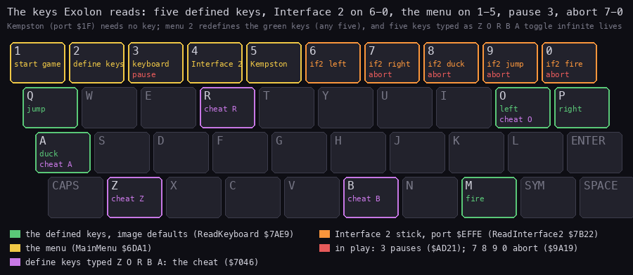
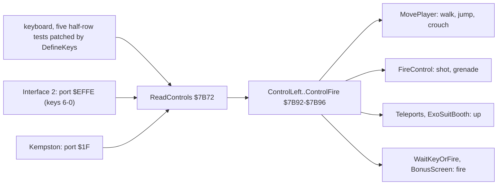

# 5. Controls

What this covers:

- every key and port the game reads, on one figure (5.1);
- the three control types and the five control bytes (5.2);
- the keyboard, the Interface 2 stick and the Kempston stick, decoded (5.3);
- the define keys screen and the ZORBA cheat, with a worked example of the patch (5.4);
- the menu, GAME OVER, the name entry, the pause and the abort (5.5);
- what the recordings pressed (5.6).

The names are those of `src/game/game.ann` ([Terms](README.md#terms)). The recordings it rests on:

- `c1` (power-on, the load, 16 000 frames of seeded random play, 48K, WALKTHROUGH 1): the menu keys, the define keys
  screen (frames 14595-14996), Interface 2 and Kempston play. Its L1 gives the run counts.
- `x1` and `m1` (no POKE, from the game's entry, WALKTHROUGH 6.0): `x1` the menu options 5 then 1, `m1` 2, 3, 4, 5
  and 1, each key held 30 frames.
- `h1` (a clone with the score POKEd, WALKTHROUGH 6.0): the name entry.
- The annotation agents' own clone runs (WALKTHROUGH 6.1): `exA1` (the ZORBA cheat, the pause), exD's `d1` (the
  pause, the name entry's delete), exC's `t1` (the abort keys).
- The code of `src/game/input.asm`, `menu.asm`, `utils.asm`, `colour.asm`, `gameover.asm`, `pickups.asm`.

## 5.1 The keys on one figure



How to read the figure:

- **A key with a coloured border** is read by the game. The text inside names what it does, in the colour of its
  group (the legend). A key with two lines has two roles at different times.
- **Green**: the five defined keys in play, as the image holds them (O P Q A M). Menu option 2 redefines them.
- **Orange**: the Interface 2 stick, which the Spectrum reads as keys 6-0.
- **Yellow**: the menu.
- **Red**: in play, 3 alone pauses and 7 8 9 0 together abort.
- **Violet**: the five defined keys typed as Z O R B A turn on the cheat.
- **The point**: in play and on the menu, apart from the defined keys, every key the game reads is on the top row.
  The figure shows those only: the name entry and the any-key waits read the whole keyboard (ENTER ends a name,
  CAPS SHIFT deletes, 5.5).

```bash
python3 tools/fig_keys.py --out docs/img/controls/keys.png
```

## 5.2 Control types and control bytes

ReadControls `$7B72` runs once a pass ([doc 4](04-game-loop.md), 4.2). It clears five control bytes, then calls the
reader of the chosen control type:

```asm
ReadControls:
  CALL ClearControls
  LD A,(ControlType)
  OR A
  JP Z,ReadKeyboard
  CP $01
  JP Z,ReadInterface2
  JP ReadKempston
```

```text
left = right = jump = duck = fire = 0
if controlType == 0:   read the keyboard
elif controlType == 1: read the Interface 2 stick
else:                  read the Kempston stick
```

| Byte | Address | Read by |
| --- | --- | --- |
| ControlLeft | `$7B92` | MovePlayer `$81A4` (walk left) |
| ControlRight | `$7B93` | MovePlayer, through HL after ControlLeft (walk right) |
| ControlJump | `$7B94` | MovePlayer (jump), Teleports `$98BA`, ExoSuitBooth `$9F2D` (up in a booth) |
| ControlDuck | `$7B95` | MovePlayer (crouch) |
| ControlFire | `$7B96` | FireControl `$8338` (shot, and the grenade after 15 passes held), WaitKeyOrFire `$7CEC`, BonusScreen `$A8DB` |
| ControlType | `$7B97` | 0 keyboard, 1 Interface 2, 2 Kempston; set by menu keys 3-5, and to 0 by DefineKeys |
| ControlSpare | `$7B98` | written 0 at `$8343`, read by nothing |

Each control byte is 1 when pressed and 0 when not. No reader keeps a history; FireControl counts the passes fire is
held in FireHeld `$83DC` ([doc 10](10-gameplay-logic.md)).



How to read the diagram: three sources on the left, one of which ControlType picks; the five bytes in the middle;
their readers on the right. The point: the game logic never reads a port; it reads the five bytes.

## 5.3 The three readers

### Kempston (ControlType 2)

ReadKempston `$7B4A` reads port `$1F` and takes its bits from bit 0 up:

| Bit | 0 | 1 | 2 | 3 | 4 |
| --- | --- | --- | --- | --- | --- |
| Meaning | right | left | down: duck | up: jump | fire |

```asm
ReadKempston:
  LD C,$1F
  IN D,(C)
  CALL NextInputBit
  LD (ControlRight),A
  CALL NextInputBit
  LD (ControlLeft),A
  ; ... duck, jump, fire the same way
  RET
NextInputBit:
  XOR A
  SRL D
  RLA
  RET
```

```text
bits = in(port $1F)                  (1 = pressed on a Kempston)
right = bit 0; left = bit 1; duck = bit 2; jump = bit 3; fire = bit 4
```

### Interface 2 (ControlType 1)

ReadInterface2 `$7B22` reads port `$EFFE`, the keyboard half-row 0 9 8 7 6, where the Interface 2 stick shows as
keys. The bits are 0 when pressed, so it complements them (`CPL`, `AND $1F`):

| Bit | 0 | 1 | 2 | 3 | 4 |
| --- | --- | --- | --- | --- | --- |
| Key | 0 | 9 | 8 | 7 | 6 |
| Meaning | fire | jump | duck | right | left |

### Keyboard (ControlType 0)

ReadKeyboard `$7AE9` is five tests of 10 bytes each from KeyLeftTest `$7AF0`. Each test reads one half-row and one
bit; the half-row's port high byte (offset +2) and the bit mask (offset +6) are operands that DefineKeys writes:

```asm
ReadKeyboard:
  LD D,$01
  LD HL,ClearControls+$000D
  LD C,$FE
KeyLeftTest:
  INC HL                  ; LEFT: LD B,$DF / AND $02 (O)
  LD B,$DF
  IN A,(C)
  AND $02
  JR NZ,KeyRightTest
  LD (HL),D
  ; ... four more tests: RIGHT, JUMP, DUCK, FIRE
```

```text
for each of the five controls (left, right, jump, duck, fire), in order:
    if in(port row*256 + $FE) AND mask == 0: control = 1
```

The image's keys:

| Control | Key | Half-row port | Bit |
| --- | --- | --- | ---: |
| left | O | `$DFFE` | 1 |
| right | P | `$DFFE` | 0 |
| jump | Q | `$FBFE` | 0 |
| duck | A | `$FDFE` | 0 |
| fire | M | `$7FFE` | 2 |

ReadKeyboard never ran in any recording: every play chose Kempston or Interface 2 before starting (5.6).

## 5.4 Define keys and the ZORBA cheat

Menu key 2 runs DefineKeys `$6FAB`:

- ControlType is set to 0, the keyboard. The screen shows SELECT KEY FOR.... and the five prompts LEFT, RIGHT, JUMP,
  DUCK, FIRE ([doc 1](01-game-design.md), 1.2).
- For each prompt: a `?`, a wait for no key, then a wait for a key (ReadKey `$ACD1`).
- ReadKey scans the half-rows `$FEFE` to `$7FFE`, bits 0-4. It returns the key's character from KeyTable `$ACEF`
  in A (1 CAPS SHIFT, 2 SYMBOL SHIFT, 13 ENTER, 32 SPACE), the half-row's high byte in D and the bit mask in E.
- D and E are written into the test's operands, the character into TypedKeys `$708B`, and the key's name is printed
  with a click.
- After the fifth key, two Delays, then TypedKeys is compared with CheatWord `$7090`, "ZORBA". Any difference goes
  back to the menu. Five equal characters run ZorbaCheat `$7046`.

```asm
DefineKeyWait:
  CALL ReadKey            ; wait for a key: A ASCII, D port high byte, E bit
                          ; mask
  OR A
  JR Z,DefineKeyWait
  LD (IX+$02),D           ; the key test's LD B,n and AND n operands of
                          ; ReadKeyboard
  LD (IX+$06),E
  LD DE,$000A
  ADD IX,DE
  LD (IY+$00),A           ; the ASCII for the cheat word check
  INC IY
```

```text
test = KeyLeftTest
for each prompt in LEFT, RIGHT, JUMP, DUCK, FIRE:
    wait for a key: character, halfRow, mask = ReadKey()
    test.port = halfRow; test.mask = mask
    test = test + 10 bytes
    typed.append(character)
if typed == "ZORBA": toggle the cheat
back to the menu
```

**A worked example**: K for JUMP.

- ReadKey scans `$FE`, `$FD`, `$FB`, `$F7`, `$EF`, `$DF`, `$BF`: the first 0 bit is bit 2 of half-row `$BF`
  (ENTER L K J H).
- KeyTable's byte there is `$4B`, "K". So A = `$4B`, D = `$BF`, E = `$04`.
- The JUMP test at `$7B04` (KeyLeftTest + 20) gets `$BF` at `$7B06` and `$04` at `$7B0A`. In play it then runs
  `LD B,$BF`, `IN A,(C)`, `AND $04`.

**The cheat**: ZorbaCheat toggles the byte at `$9D1D`, the `DEC A` that takes a life, between `$3D` and `$00`
(`NOP`): infinite lives, and back. Turning it on plays JingleTune `$7D68` on the beeper (on the 128K too). The keys
stay defined as Z O R B A: left Z, right O, jump R, duck B, fire A. Witness: exA's clone run `exA1`: the five
compares passed, `$9D1D` became 0, and in play ten deaths took no life. No case recording typed ZORBA.

## 5.5 The other keys

| Where | Keys | Routine | What |
| --- | --- | --- | --- |
| the menu | 1 | MainMenu `$6DA1` | start the game (StartGame `$758A`) |
| the menu | 2 | | define keys (5.4) |
| the menu | 3, 4, 5 | | ControlType 0, 1, 2; the menu is printed again with the choice in bright white (HighlightControl `$6F90`) |
| the menu | none for 2500 passes | | the Hall of Fame rolls (HallOfFameRoll `$7149`) |
| the title tune (48K) | any key | PlayTune `$7D17` | stops the tune |
| in play | 3 alone (`$F7FE` AND `$1F` = `$1B`) | PauseKey `$AD21` | pause until any key or fire (WaitKeyOrFire `$7CEC`) |
| in play | 0 9 8 7 together (`$EFFE` bits 0-3) | AbortKeys `$9A19` | back to the entry `$6D60` |
| GAME OVER | any key | GameOver `$A02A` | back to the entry at once (else after 20 000 key reads) |
| the name entry | any character key | HofNameKey `$A0E5` | stored at the cursor (8 places, columns 12-19) |
| the name entry | CAPS SHIFT | HofDelete `$A102` | delete the character before the cursor |
| the name entry | SYMBOL SHIFT | | ignored |
| the name entry | ENTER | | the name into the table, ShowHallOfFame set, back to the entry |
| the bonus screen | fire | BonusScreen `$A8DB` | stop the pointer |

Notes:

- **The pause and menu key 3 are the same key**. In the menu it picks the keyboard; in play it pauses.
- **The pause needs 3 alone** in its half-row: 3 with 1, 2, 4 or 5 does nothing.
- **The abort and the Interface 2 stick share the half-row** `$EFFE`. A stick cannot press 7, 8 and 9 (right, duck,
  jump) at once, so it cannot abort by accident.
- **WaitKeyOrFire** resumes on fire from the chosen control type or on any of the 40 keys.
- **The name entry**'s keys come from ReadKey: digits and letters are stored as typed. The delete ran only in exD's
  clone run `d1` (E X, CAPS, O L O N A B C, CAPS, D, ENTER gave EOLONABD).

## 5.6 What the recordings pressed

| Recording | Control type | Witness |
| --- | --- | --- |
| `c1` | Interface 2 and Kempston, both | `c1`'s L1: ReadInterface2 443 runs, ReadKempston 2820 runs, ReadKeyboard none |
| `c128` | Kempston | ReadKempston 4181 runs |
| the warp runs | Kempston | all of them (the count in ReadKempston's description) |
| `x1`, `m1` | menu 5, then 1; `m1` also 2, 3, 4 | WALKTHROUGH 6.0 |

What no case recording reached:

- the keyboard reader in play (ReadKeyboard `$7AE9`): only patched by DefineKeys, never run;
- CAPS SHIFT and SYMBOL SHIFT as defined keys (DefineKeyCapsShift: exA's `exA1` only);
- the pause and the abort keys (exD's `d1` and exC's `t1` only);
- the ZORBA cheat (exA's `exA1` only);
- the Amstrad CPC keyboard scan CpcReadKeyboard `$C7B5`: nothing calls it ([doc 2](02-architecture.md), 2.1).
