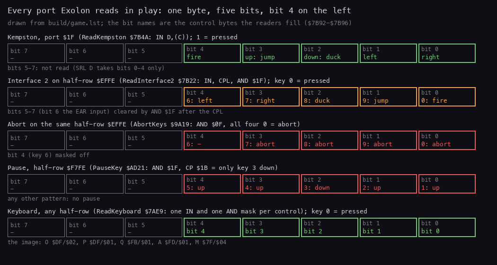
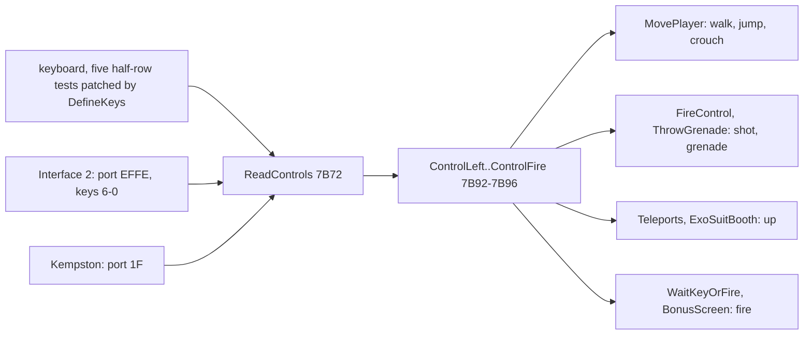
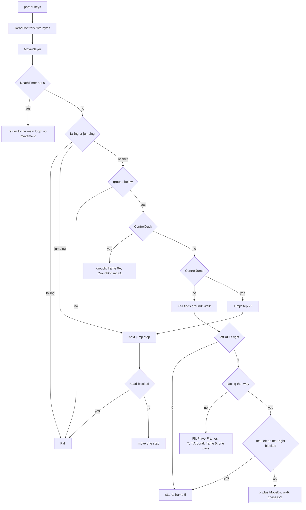
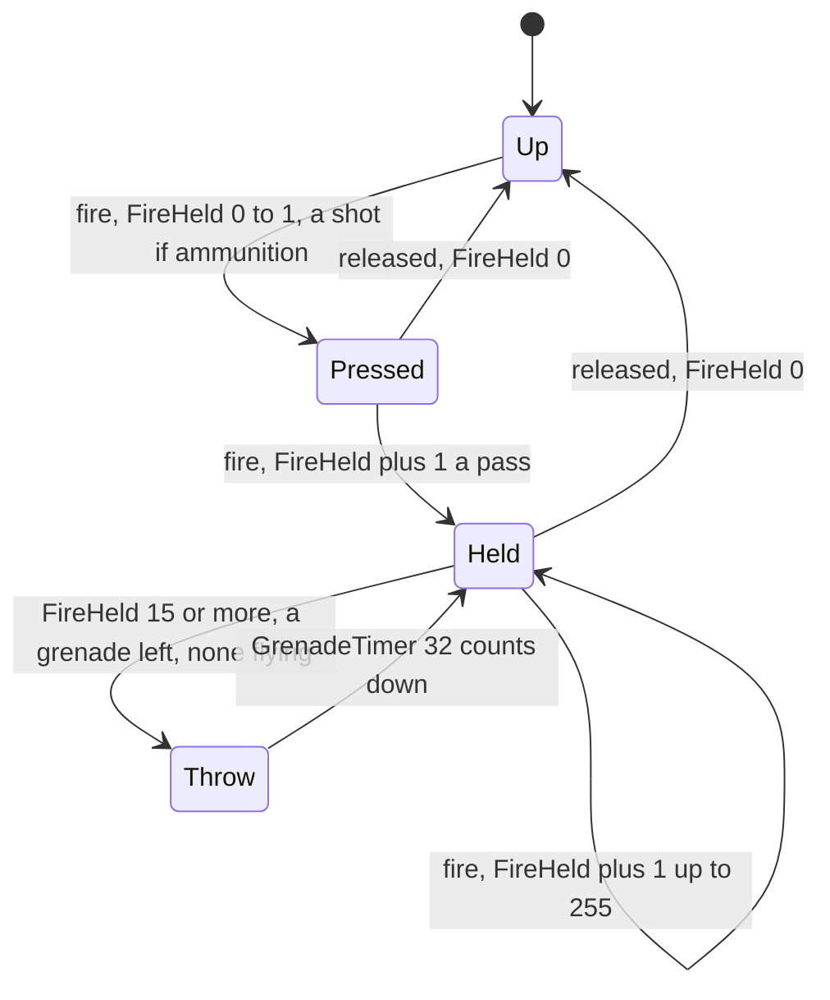
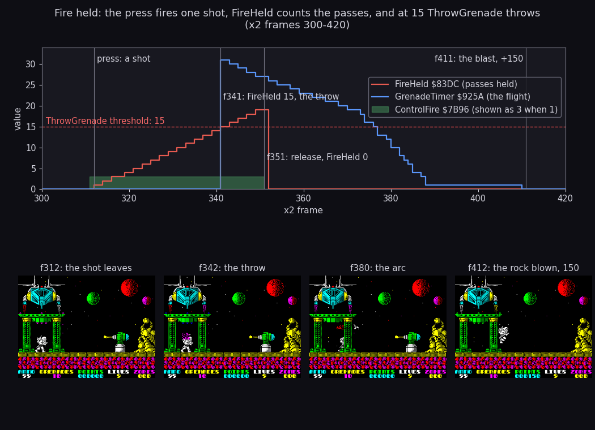
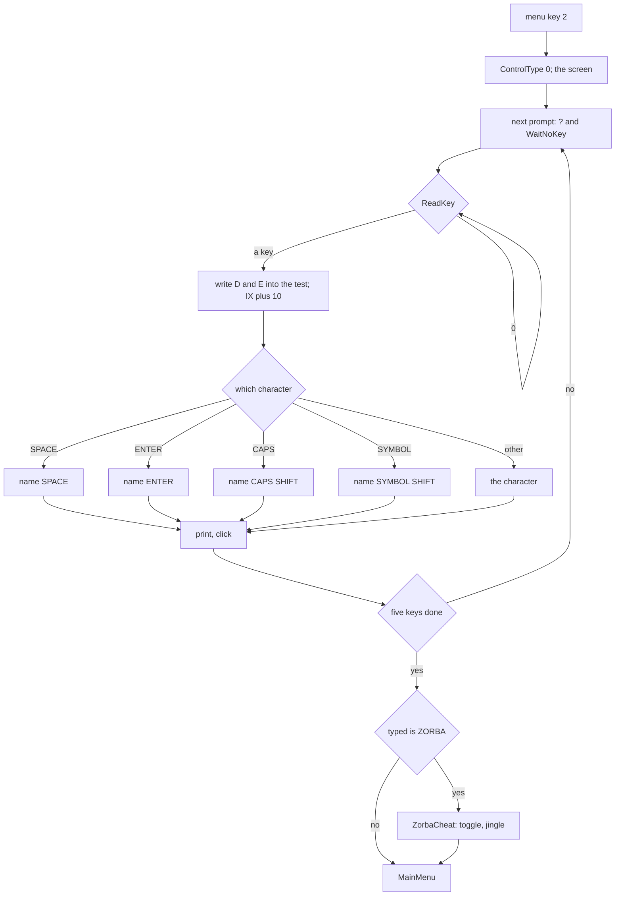
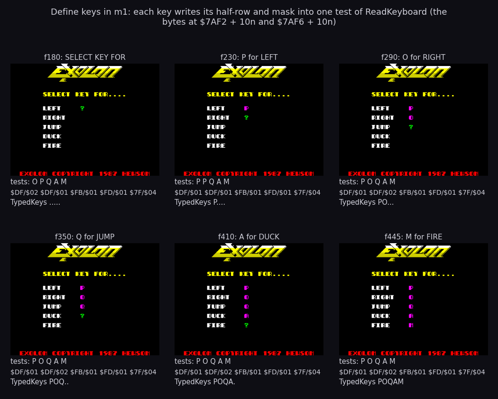
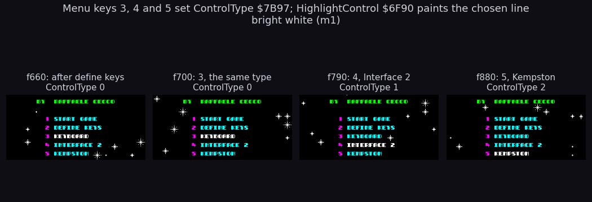
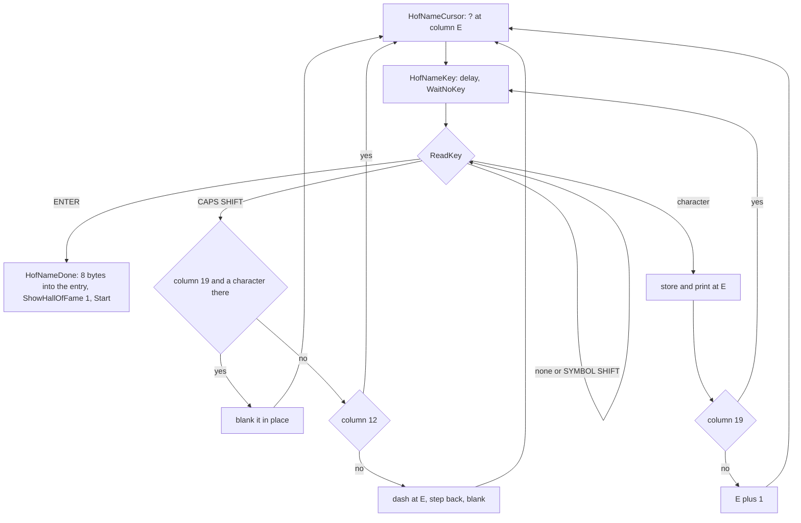
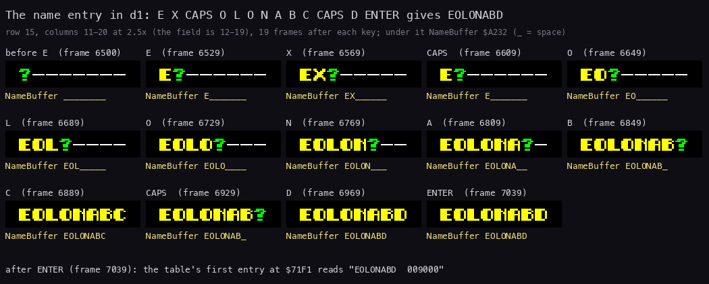

# 5. Controls

What this covers:

- every key the game reads, on one figure (5.1);
- every port the image reads: the 20 `IN` instructions, the bit layouts, and the devices it does not read (5.2);
- the three control types, the five control bytes, and when `c1` changed type (5.3);
- the keyboard, the Interface 2 stick and the Kempston stick, decoded (5.4);
- from the control bytes to the hero: walk, turn, crouch, jump, the booths, and the death barrier (5.5);
- the fire button's two roles: the shot and the grenade (5.6);
- ReadKey, the define keys screen and the ZORBA cheat (5.7);
- the menu and its highlight (5.8);
- the name entry (5.9);
- the pause, the abort, GAME OVER, the tunes (5.10);
- what the recordings pressed (5.11);
- design notes (5.12).

The names are those of `src/game/game.ann` ([Terms](README.md#terms)). The recordings it rests on:

- `c1` (power-on, the load, 16 000 frames of seeded random play, 48K, WALKTHROUGH 1): the menu keys, the define keys
  screen (frames 14595-14996), Interface 2 and Kempston play. Read through `memory_at` only (MCP port 19100). Its L1
  gives the run counts.
- `x1` and `m1` (no POKE, from the game's entry, WALKTHROUGH 6.0): `x1` the menu options 5 then 1, `m1` 2, 3, 4, 5
  and 1, each key held 30 frames. `m1` was opened again as `work/docs/fillP/m1` (own instance, port base 31350).
- `x2` (clone, the ZXDB POKEs; Kempston): fire held, the first grenade, a jump (`work/docs/fillP/x2`).
- `h1` (a clone with the score POKEd, WALKTHROUGH 6.0): the name entry.
- The annotation agents' own clone runs (WALKTHROUGH 6.1): `exA1` (the ZORBA cheat, the pause), exD's `d1` (the
  pause, the name entry's delete; opened again as `work/docs/fillP/d1`), exC's `t1` (the abort keys).
- `w/108` (a warp clone on screen 108): up in the exoskeleton booth.
- The code of `src/game/input.asm`, `menu.asm`, `utils.asm`, `colour.asm`, `gameover.asm`, `player.asm`.

A frame is 1/50 s. A pass is one turn of the main loop, about 2 frames ([doc 4](04-game-loop.md)).

## 5.1 The keys on one figure


How to read the figure:

- **A key with a coloured border** is read by the game. The text inside names what it does, in the colour of its
  group (the legend). A key with two lines has two roles at different times.
- **Green**: the five defined keys in play, as the image holds them (O P Q A M). Menu option 2 redefines them.
- **Orange**: the Interface 2 stick, which the Spectrum reads as keys 6-0.
- **Yellow**: the menu.
- **Red**: in play, 3 alone pauses and 7 8 9 0 together abort.
- **Violet**: the five defined keys typed as Z O R B A turn on the cheat.
- **The point**: in play and on the menu, apart from the defined keys, every key the game reads is on the top row.
  The figure shows those only: the name entry and the any-key waits read the whole keyboard (ENTER ends a name,
  CAPS SHIFT deletes, 5.9).

```bash
python3 tools/fig_keys.py --out docs/img/controls/keys.png
```

## 5.2 Every port the image reads

The image holds 20 `IN` instructions and no block input (`INI`, `INIR`, `IND`, `INDR`). The list comes from
`build/game.lst` (`grep -n 'IN A\|IN D' build/game.lst`):

| Address | Routine | Instruction | Port | What it reads |
| --- | --- | --- | --- | --- |
| `$7AF3`, `$7AFD`, `$7B07`, `$7B11`, `$7B1B` | ReadKeyboard `$7AE9` | `IN A,(C)` | `$xxFE`, B patched by DefineKeys | one half-row each: left, right, jump, duck, fire |
| `$7B25` | ReadInterface2 `$7B22` | `IN A,(C)` | `$EFFE` | keys 0 9 8 7 6: the Interface 2 stick |
| `$7B4C` | ReadKempston `$7B4A` | `IN D,(C)` | `$1F` | the Kempston stick |
| `$7CFF` | WaitKeyOrFire `$7CEC` | `IN A,($FE)` | `$FEFE` to `$7FFE` | the 40 keys, half-row by half-row |
| `$7D18` | PlayTune `$7D17` | `IN A,($FE)` | `$00FE` | all half-rows at once: wait for no key |
| `$7D23` | PlayTune | `IN A,($FE)` | `$00FE` | all half-rows: a key ends the tune |
| `$9A1B` | AbortKeys `$9A19` | `IN A,($FE)` | `$EFFE` | 0 9 8 7 held together |
| `$ACD9` | ReadKey `$ACD1` | `IN A,($FE)` | `$FEFE` to `$7FFE` | the first key down |
| `$AD19` | WaitNoKey `$AD18` | `IN A,($FE)` | `$00FE` | all half-rows: wait for no key |
| `$AD23` | PauseKey `$AD21` | `IN A,($FE)` | `$F7FE` | 3 alone |
| `$C7C0`, `$C7D9` | CpcReadKeyboard `$C7B5` | `IN A,(C)` | `$F4xx`, `$F6xx` | the Amstrad CPC's keyboard; nothing calls it |
| `$FFAB`, `$FFB0`, `$FFB5`, `$FFC0` | SerialReadByte `$FFA7` | `IN A,($F7)` | `$F7` | Interface 1's RS232 line: the developers' downloader, never called in play |

`IN A,($FE)` puts A on the high half of the address. With A = 0 every half-row line is low, so one read sees every key:
that is the "any key" test of PlayTune and WaitNoKey.



How to read the figure:

- **Five rows of eight boxes**, bit 7 on the left. A coloured box is a bit the routine uses, labelled with its
  meaning; a grey box is ignored.
- **Kempston** (green): 1 = pressed, bits 0-4. **Interface 2** (orange): the same half-row as the keys 0-6, 0 =
  pressed, complemented by the reader. **Abort** and **pause** (red): what the test needs to see.
- **The keyboard row**: any half-row and any bit; the image's five tests are listed under it.
- **The point**: every device gives five bits, and every reader turns them into the same five bytes (5.3). Only the
  bit order differs.

```bash
python3 tools/fig_controls.py ports    # docs/img/controls/ports.png, drawn from the listing alone
```

### The devices it does not read

The inventory settles which joysticks are missing:

- **No Fuller stick.** No instruction reads port `$7F`.
- **No cursor (Protek, AGF) stick.** The cursor keys are 5, 6, 7, 8 and 0. In play, 5 is never read, 6-0 are read
  only as the Interface 2 stick (6 left, 7 right, 8 down, 9 up, 0 fire), not as 5 left, 8 right, 6 down, 7 up.
  A cursor stick would steer wrongly through the Interface 2 type.
- **No second Interface 2 socket.** That socket shows as keys 1-5. In play only PauseKey reads that half-row, and only
  to see 3 alone. A stick in the second socket pulling down (key 3) pauses the game.
- **The socket it does read**, keys 6-0, is the one emulators call "Sinclair 1" (Fuse, unreal-ng). Which physical
  socket of the Interface 2 that is was not checked against the hardware here.
- **No Kempston detection.** ReadKempston reads `$1F` whatever is there. With no interface fitted the read returns
  what the bus floats; this case did not measure what that does on a real 48K.

## 5.3 Control types and control bytes

ReadControls `$7B72` runs once a pass ([doc 4](04-game-loop.md), 4.2). It clears five control bytes, then calls the
reader of the chosen control type:

```asm
ReadControls:
  CALL ClearControls
  LD A,(ControlType)
  OR A
  JP Z,ReadKeyboard
  CP $01
  JP Z,ReadInterface2
  JP ReadKempston
```

```text
left = right = jump = duck = fire = 0
if controlType == 0:   read the keyboard
elif controlType == 1: read the Interface 2 stick
else:                  read the Kempston stick
```

| Byte | Address | Read by |
| --- | --- | --- |
| ControlLeft | `$7B92` | Walk `$8295` (as the low byte of a word) |
| ControlRight | `$7B93` | Walk (the high byte of the same word) |
| ControlJump | `$7B94` | MovePlayer `$81A4` (jump), Teleports `$98BA`, ExoSuitBooth `$9F2D` (up in a booth) |
| ControlDuck | `$7B95` | MovePlayer (crouch) |
| ControlFire | `$7B96` | FireControl `$8338` (shot, and the grenade after 15 passes held), WaitKeyOrFire `$7CEC`, BonusScreen `$A8DB` |
| ControlType | `$7B97` | 0 keyboard, 1 Interface 2, 2 Kempston; set by menu keys 3-5, and to 0 by DefineKeys |
| ControlSpare | `$7B98` | written 0 at `$8343`, read by nothing |

Each control byte is 1 when pressed and 0 when not. No reader keeps a history; the history is in the users:
FireHeld `$83DC` counts the passes fire is held (5.6), and the booths keep a latch of up (5.5).



How to read the diagram: three sources on the left, one of which ControlType picks; the five bytes in the middle;
their readers on the right. The point: the game logic never reads a port; it reads the five bytes.

### The control types in `c1`

ControlType `$7B97` read with `memory_at` every 50 frames of `c1` from 12000 to 28700, each change then narrowed to
its frame (`work/docs/fillP/firstchange.py`):

| Frame | ControlType | What set it |
| ---: | --- | --- |
| load | 0 keyboard | the image's byte |
| 12887 | 2 Kempston | menu key 5 |
| 14599 | 0 keyboard | DefineKeys (the screen shows SELECT KEY FOR at 14620) |
| 15893 | 2 Kempston | menu key 5 |
| 22139 | 1 Interface 2 | menu key 4 |
| 22320 | 2 Kempston | menu key 5 |
| 25554 | 0 keyboard | DefineKeys again (SELECT KEY FOR at 25560) |
| 27232 | 2 Kempston | menu key 5 |
| 27764 | 1 Interface 2 | menu key 4, to the end (28700) |

- The seeded play chose a joystick type before every game, so ReadKeyboard never ran in play (L1: 443 runs of
  ReadInterface2, 2820 of ReadKempston, none of ReadKeyboard).
- Both define-keys visits left the keyboard type set, and both times the menu's next choice replaced it.

## 5.4 The three readers

### Kempston (ControlType 2)

ReadKempston `$7B4A` reads port `$1F` and takes its bits from bit 0 up:

| Bit | 0 | 1 | 2 | 3 | 4 |
| --- | --- | --- | --- | --- | --- |
| Meaning | right | left | down: duck | up: jump | fire |

```asm
ReadKempston:
  LD C,$1F
  IN D,(C)
  CALL NextInputBit
  LD (ControlRight),A
  CALL NextInputBit
  LD (ControlLeft),A
  ; ... duck, jump, fire the same way
  RET
NextInputBit:
  XOR A
  SRL D
  RLA
  RET
```

```text
bits = in(port $1F)                  (1 = pressed on a Kempston)
right = bit 0; left = bit 1; duck = bit 2; jump = bit 3; fire = bit 4
```

NextInputBit shifts D right; the bit that falls out goes through the carry into A. So each call returns the next bit
as 0 or 1, from bit 0 up.

**A worked example**: `x2` frame 392, a jump to the right.

- The control bytes at the end of the frame show right and up, so the port read `$09` = `%00001001`: bits 0
  (right) and 3 (up). The input script holds the Kempston bits; the `IN` itself was not traced.
- NextInputBit five times: right 1, left 0, duck 0, jump 1, fire 0.
- Memory at the end of the frame: ControlRight = 1, ControlJump = 1, the others 0. JumpStep `$82F7` became `$15`, Y
  went from `$70` to `$6C` and X from `$1F` to `$20`.

### Interface 2 (ControlType 1)

ReadInterface2 `$7B22` reads port `$EFFE`, the keyboard half-row 0 9 8 7 6, where the Interface 2 stick shows as
keys. The bits are 0 when pressed, so it complements them (`CPL`, `AND $1F`), then takes them from bit 0 up:

```asm
ReadInterface2:
  LD BC,$EFFE
  IN A,(C)
  CPL
  AND $1F
  LD D,A
  CALL NextInputBit
  LD (ControlFire),A
  CALL NextInputBit
  LD (ControlJump),A
  CALL NextInputBit
  LD (ControlDuck),A
  CALL NextInputBit
  LD (ControlRight),A
  CALL NextInputBit
  LD (ControlLeft),A
  RET
```

| Bit | 0 | 1 | 2 | 3 | 4 |
| --- | --- | --- | --- | --- | --- |
| Key | 0 | 9 | 8 | 7 | 6 |
| Meaning | fire | jump | duck | right | left |

A worked example, known only from the code: the stick pushed up-left with fire. Keys 6, 9 and 0 are down, so the port
reads `%xxx01100` in bits 0-4 (0 = down): bits 0, 1 and 4 are 0. CPL and AND `$1F` give `%00010011`. The five calls
give fire 1, jump 1, duck 0, right 0, left 1.

### Keyboard (ControlType 0)

ReadKeyboard `$7AE9` is five tests of 10 bytes each from KeyLeftTest `$7AF0`. Each test reads one half-row and one
bit; the half-row's port high byte (offset +2) and the bit mask (offset +6) are operands that DefineKeys writes:

```asm
ReadKeyboard:
  LD D,$01
  LD HL,ClearControls+$000D
  LD C,$FE
KeyLeftTest:
  INC HL                  ; LEFT: LD B,$DF / AND $02 (O)
  LD B,$DF
  IN A,(C)
  AND $02
  JR NZ,KeyRightTest
  LD (HL),D
  ; ... four more tests: RIGHT, JUMP, DUCK, FIRE
```

```text
for each of the five controls (left, right, jump, duck, fire), in order:
    if in(port row*256 + $FE) AND mask == 0: control = 1
```

The image's keys:

| Control | Key | Half-row port | Bit |
| --- | --- | --- | ---: |
| left | O | `$DFFE` | 1 |
| right | P | `$DFFE` | 0 |
| jump | Q | `$FBFE` | 0 |
| duck | A | `$FDFE` | 0 |
| fire | M | `$7FFE` | 2 |

ReadKeyboard never ran in any recording: every play chose Kempston or Interface 2 before starting (5.3).

## 5.5 From the control bytes to the hero

The five bytes reach the player through four routines of the main loop, called in this order each pass
([doc 4](04-game-loop.md#42-the-main-loop)):

| Call at | Routine | Uses |
| --- | --- | --- |
| `$75C8` | ReadControls `$7B72` | the port: the five bytes |
| `$75CB` | MovePlayer `$81A4` | left, right, up, down |
| `$75D1` | FireControl `$8338` | fire: the shot (5.6) |
| `$75E0` | ThrowGrenade `$9208` | FireHeld: the grenade (5.6) |
| `$75FE` | Teleports `$98BA` | up, on its edge |
| `$7635` | ExoSuitBooth `$9F2D` | up, on its edge |



How to read the diagram: one pass of MovePlayer from the top. Every path ends in one frame of the player. The barrier
at the top is AbortIfDying; the turn is the path through TurnAround.

```text
MovePlayer:
    AbortIfDying                          (return to the main loop while a death runs)
    if falling: Fall; return
    if JumpStep: next jump step; return
    if no ground below: Fall; return
    CrouchOffset = $FA
    if duck: frame $0A; return            (crouched: no walk, no jump)
    CrouchOffset = 0
    if not jump: Fall                     (finds the ground, goes on to Walk)
    else: JumpStep = 22; next jump step
Walk:
    MoveDir = left XOR right
    if MoveDir == 0: frame 5; return      (neither, or both)
    if left: MoveDir = Facing = $FF else Facing = 1
    if the frames face the other way: FlipPlayerFrames; frame 5; return
    if the side is blocked: frame 5; return
    X += MoveDir; frame = WalkPhase (0-9)
```

### Left XOR right

Walk loads the two bytes as one word, ControlLeft into L and ControlRight into H, and XORs them:

```asm
Walk:                     ; $8295
  LD HL,(ControlLeft)     ; L = left, H = right
  LD A,H
  XOR L
  LD (MoveDir),A
  LD A,$05                ; neither or both: the standing frame
  JP Z,PlayerFrame
  LD A,$01
  LD (Facing),A
  BIT 0,L
  JR Z,WalkRight
  LD A,$FF                ; left: MoveDir = Facing = -1
  LD (MoveDir),A
  LD (Facing),A
  LD A,(PlayerFlipped)
  OR A
  CALL Z,FlipPlayerFrames ; not mirrored yet: mirror the frames
  JR Z,TurnAround         ; and spend this pass turning
  CALL TestLeft
  JR WalkTested
```

A worked example, known only from the code: a Kempston pushed left and right at once (bits 0 and 1, `%00000011`).
NextInputBit gives right = 1 and left = 1. Walk loads HL = `$0101`; H XOR L = 0; MoveDir = 0 and the zero flag sends
him to frame 5: he stands. Neither direction is preferred.

### The turn costs a pass

When the direction asked differs from the way the frames face, Walk calls FlipPlayerFrames `$7BAA`, which mirrors the
player's frames in place, and goes to TurnAround `$82E8`: PlayerFrameShown = `$FF` (a redraw is forced) and the
standing frame 5. He does not move that pass. The flip is long, so the pass is longer too: [doc 4](04-game-loop.md),
4.5 measures it.

### Crouch

On the ground with ControlDuck set, MovePlayer leaves CrouchOffset `$82FB` at `$FA` and shows frame `$0A`. It returns
before Walk and before the jump test: crouched, he neither walks nor jumps. The offset lowers his shots (SpawnShot
`$8391` uses Y + `$13` instead of Y + `$0E`) and his grenades (ThrowFromCrouch: Y + 6).

### Up in a booth: the jump that does not happen

Up is both the jump and the booth key. The booth wins without a test of its own:

- A teleport pad and the exoskeleton booth leave map value 1 (solid) in the cell above the player's head
  ([doc 7](07-objects.md#75-balls-mines-pods-and-teleports)).
- MovePlayer starts the jump, and its first rising step calls TestAbove `$8179`, which finds the solid cell. JumpStep
  goes back to 0 and the player falls, which on the ground is standing.
- The same pass, Teleports and ExoSuitBooth see ControlJump = 1. Each acts on the edge of up only: a latch
  (TeleportLatch `$9935`, BoothUpLatch `$9F6D`) is set at the first pass and cleared when up is released.

```asm
ExoSuitBooth:             ; $9F2D
  LD A,(ControlJump)
  OR A
  JR NZ,ExoSuitBoothPressed
  LD (BoothUpLatch),A     ; up released: the latch cleared
  RET
ExoSuitBoothPressed:
  LD A,(BoothUpLatch)     ; up held: act only on the first pass
  OR A
  RET NZ
  INC A
  LD (BoothUpLatch),A
```

Witness: `w/108`, screen 109. Up pressed from frame 1609: Y stays `$18` and JumpStep stays 0 over frames 1609-1616
while ControlJump = 1. ExoSuit `$9ED8` goes from 0 to `$0C` at frame 1614. Holding up longer did nothing more: the
latch held.

### AbortIfDying: the death barrier

```asm
AbortIfDying:             ; $9D78
  LD A,(DeathTimer)
  OR A
  RET Z                   ; alive: carry on in the caller
  POP AF                  ; dying: drop the caller's return address
  RET                     ; and return to the caller's caller (the main loop)
```

MovePlayer, FireControl and ThrowGrenade begin with `CALL AbortIfDying` (and one more caller at `$A553`). While
DeathTimer `$9CE2` is not 0, the `POP AF` throws away the return into the caller, so the `RET` goes straight back to
the main loop. The controls are read but nothing moves, fires or throws. Teleports and ExoSuitBooth do not call it;
during a death the player is not standing under a pad, so their tests fail anyway.

The death itself, its timer and its leap belong to the rules: [doc 10](10-gameplay-logic.md#104-deaths-and-lives).

## 5.6 The fire button: a shot and a grenade

One button does two jobs. The press fires a shot. Holding it counts passes in FireHeld `$83DC`, and at 15 the next
routine of the pass throws a grenade.

```text
FireControl (each pass):
    AbortIfDying
    if PlayerX >= $76: ControlSpare = 0; return       (the right edge: no shot)
    if not fire: FireHeld = 0; return                 (released)
    if FireHeld != 0:                                 (held)
        FireHeld += 1, but not past 255; return
    FireHeld = 1                                      (a new press)
    if Ammo == 0: return
    click; Ammo -= 1; the shot sound; print the ammunition
    SpawnShot
    if ExoSuit: SpawnShot again, 6 pixels lower
ThrowGrenade (each pass, after FireControl):
    AbortIfDying
    if PlayerX >= $76 or Grenades == 0 or FireHeld < 15 or GrenadeTimer != 0: return
    GrenadeTimer = 32; the grenade at X + 4, Y (Y + 6 crouching); Grenades -= 1
```

```asm
FireControl:              ; $8338
  CALL AbortIfDying
  LD A,(PlayerX)
  CP $76
  JR C,FireTestButton
  XOR A
  LD (ControlSpare),A
  RET
FireTestButton:
  LD A,(ControlFire)
  OR A
  JR NZ,FireHeldCount
  LD (FireHeld),A         ; released: the count back to 0
  RET
FireHeldCount:
  LD A,(FireHeld)         ; held: count the passes, no new shot
  OR A
  JR Z,FirePress
  INC A
  RET Z                   ; 255 + 1 = 0: stays at 255
  LD (FireHeld),A
  RET
FirePress:
  INC A                   ; a new press
  LD (FireHeld),A
  LD A,(Ammo)
  OR A
  RET Z
  LD B,$3C
  CALL BeeperNoise
  LD A,(Ammo)
  DEC A
  LD (Ammo),A
  CALL PlaySfxShot
  CALL PrintAmmo
  CALL SpawnShot
  LD A,(ExoSuit)          ; the suit: a second shot 6 lower
  OR A
  RET Z
```

```asm
ThrowGrenade:             ; $9208
  CALL AbortIfDying
  LD A,(PlayerX)          ; X at the right edge: no throw
  CP $76
  RET NC
  LD A,(Grenades)         ; no grenades left
  OR A
  RET Z
  LD A,(FireHeld)         ; fire held for fewer than 15 passes
  CP $0F
  RET C
  LD A,(GrenadeTimer)     ; one in flight already
  OR A
  RET NZ
  LD A,$20                ; the flight's 32-step timer
  LD (GrenadeTimer),A
```



How to read the diagram: the states of the button over passes. A shot happens only on the way from Up to Pressed. A
grenade happens from Held whenever the count is 15 or more and the last grenade has ended, so a button held for a long
time throws again after each landing (known only from the code).



How to read the figure:

- **Top**: three bytes per frame of `x2` from 300 to 420, read with `memory_at`. Red: FireHeld. Blue: GrenadeTimer
  `$925A`. Green band: ControlFire (drawn as 3 when 1). The dashed line is the threshold 15.
- **Labels**: the press (312), the throw at FireHeld 15 (341), the release (351), the blast (411).
- **Bottom**: the screen at 312, 342, 380 and 412: the shot, the throw, the grenade in its arc, the blast with 150 on
  the score.
- **The point**: one press gave one shot and, 29 frames later, a grenade. The count climbs one a pass, so its steps
  are about two frames wide, and wider where a shot made a pass longer.

```bash
python3 tools/fig_controls.py fire --work work/docs/fillP/x2    # docs/img/controls/fire.png
```

The worked example, `x2` (Kempston fire held from frame 312):

| Frame | ControlFire | FireHeld | GrenadeTimer | What |
| ---: | ---: | ---: | ---: | --- |
| 312 | 1 | 1 | 0 | the press: Ammo 99 to 98, a shot |
| 316 | 1 | 3 | 0 | the count; the shot's click made this pass longer (3 at 316 and at 318) |
| 341 | 1 | 15 | `$20` | ThrowGrenade: the grenade leaves |
| 342 | 1 | 15 | `$1F` | the flight's first step |
| 350 | 1 | 19 (`$13`) | | still held |
| 351 | 0 | 19 | | released this frame |
| 352 | 0 | 0 | | FireControl saw the release |
| 388-410 | 0 | 0 | 1 | the grenade has landed; the timer waits at 1 |
| 411 | 0 | 0 | 0 | the blast (GrenadeBlast `$93E2`) |
| 412 | 0 | 0 | 0 | score 000000 to 000150 |

The shot's position: SpawnShot `$8391` places it at Y + `$0E` (Y + `$13` crouching), X + `$0C` facing right or X - 4
facing left. Its flight and hits are the objects' side: [doc 7](07-objects.md#76-missiles-blasts-debris-and-puffs) and
[doc 10](10-gameplay-logic.md#107-grenades).

## 5.7 ReadKey, define keys and the ZORBA cheat

### ReadKey

ReadKey `$ACD1` serves the menu, define keys and the name entry. It returns the first key it finds down.

```asm
ReadKey:                  ; $ACD1
  PUSH BC
  PUSH HL
  LD HL,KeyTable          ; $ACEF: 40 characters in scan order
  LD D,$FE                ; the first half-row: CAPS Z X C V
ReadKeyRow:
  LD A,D
  IN A,($FE)
  LD E,$01                ; the bit mask
  LD B,$05
ReadKeyBit:
  RRCA                    ; the next bit into the carry
  JR NC,ReadKeyFound      ; 0: this key is down
  INC HL
  SLA E
  DJNZ ReadKeyBit
  RLC D                   ; the next half-row: FE FD FB F7 EF DF BF 7F
  JR C,ReadKeyRow
ReadKeyFound:
  LD A,(HL)               ; A = the character (the byte after the 40: 0, no key)
  POP HL
  POP BC
  RET
```

```text
for row in $FE, $FD, $FB, $F7, $EF, $DF, $BF, $7F:
    bits = in(row * 256 + $FE)
    for bit in 0..4:
        if bit is 0: return KeyTable[5 * index(row) + bit], D = row, E = 1 << bit
return 0
```

KeyTable `$ACEF` in scan order:

| Half-row | Bit 0 | Bit 1 | Bit 2 | Bit 3 | Bit 4 |
| --- | --- | --- | --- | --- | --- |
| `$FE` | CAPS SHIFT (1) | Z | X | C | V |
| `$FD` | A | S | D | F | G |
| `$FB` | Q | W | E | R | T |
| `$F7` | 1 | 2 | 3 | 4 | 5 |
| `$EF` | 0 | 9 | 8 | 7 | 6 |
| `$DF` | P | O | I | U | Y |
| `$BF` | ENTER (13) | L | K | J | H |
| `$7F` | SPACE (32) | SYMBOL SHIFT (2) | M | N | B |

**The priority**: the first half-row wins, and inside it the lowest bit. CAPS SHIFT is the very first key, so it beats
every other.

A worked example, known only from the code: Q and A held together. Half-row `$FD` comes before `$FB`, so ReadKey
returns A (D = `$FD`, E = 1). In the name entry, CAPS SHIFT with a letter is a delete, never the letter.

### Define keys

Menu key 2 runs DefineKeys `$6FAB`:

- ControlType is set to 0, the keyboard. The screen shows SELECT KEY FOR.... and the five prompts LEFT, RIGHT, JUMP,
  DUCK, FIRE ([doc 1](01-game-design.md), 1.2).
- For each prompt: a `?` in `$44`, a wait for no key (WaitNoKey), then a wait for a key (ReadKey).
- D and E are written into the test's operands, the character into TypedKeys `$708B`. The key's name is printed in
  `$43`: the character itself, or SPACE, ENTER, CAPS SHIFT, SYMBOL SHIFT from KeyNames `$705B`. A click follows.
- After the fifth key, two Delays, then TypedKeys is compared with CheatWord `$7090`, "ZORBA". Any difference goes
  back to the menu. Five equal characters run ZorbaCheat `$7046`.

```asm
DefineKeyWait:
  CALL ReadKey            ; wait for a key: A ASCII, D port high byte, E bit mask
  OR A
  JR Z,DefineKeyWait
  LD (IX+$02),D           ; the key test's LD B,n and AND n operands of ReadKeyboard
  LD (IX+$06),E
  LD DE,$000A
  ADD IX,DE
  LD (IY+$00),A           ; the ASCII for the cheat word check
  INC IY
  POP DE
  LD HL,KeyNames          ; the name: the character itself
  CP $20                  ; SPACE
  JR NZ,DefineKeyNotSpace
  LD HL,KeyNames+$0004
  ; ... ENTER, CAPS SHIFT, SYMBOL SHIFT the same way
```

```text
test = KeyLeftTest
for each prompt in LEFT, RIGHT, JUMP, DUCK, FIRE:
    print "?"; wait for no key
    wait for a key: character, halfRow, mask = ReadKey()
    test.port = halfRow; test.mask = mask
    test = test + 10 bytes
    typed.append(character)
    print the key's name; click
if typed == "ZORBA": toggle the cheat
back to the menu
```



**The worked example**, `m1` (menu key 2 at frame 100, DefineKeys at 109, then P O Q A M, each key held 30 frames):

| Frame | Key | Prompt | Test bytes written (+2, +6) | TypedKeys |
| ---: | --- | --- | --- | --- |
| 190 | P | LEFT | `$7AF2` = `$DF`, `$7AF6` = `$01` (was `$DF`, `$02`: O) | P |
| 250 | O | RIGHT | `$7AFC` = `$DF`, `$7B00` = `$02` | PO |
| 310 | Q | JUMP | `$7B06` = `$FB`, `$7B0A` = `$01` | POQ |
| 370 | A | DUCK | `$7B10` = `$FD`, `$7B14` = `$01` | POQA |
| 430 | M | FIRE | `$7B1A` = `$7F`, `$7B1E` = `$04` | POQAM |
| 468 | | | P is not Z: back to the menu | |

So `m1` swapped left and right against the image's keys. ControlType went to 0 at frame 109.



How to read the figure:

- **Six screens** of `m1` at frames 180, 230, 290, 350, 410 and 445: before the first key, then after each.
- **Under each**: the five tests of ReadKeyboard as read from memory at that frame (half-row and mask, decoded to a
  key) and TypedKeys `$708B`.
- **The point**: each key changes two bytes in the code itself. The keyboard reader is rewritten, not configured.

```bash
python3 tools/fig_controls.py define --work work/docs/fillP/m1    # docs/img/controls/define-keys.png
```

What DefineKeys does not check, known only from the code:

- **No duplicate check.** The same key may be given to two controls; both bytes then turn on together.
- **Any key is accepted**, including 3 and 7-0. A defined 3 pauses the game when pressed alone; 7, 8, 9 and 0 defined
  together abort it when held at once.
- **CAPS SHIFT and SYMBOL SHIFT** are valid keys (DefineKeyCapsShift `$7014`, DefineKeySymbolShift `$701B`): only
  `exA1` defined one.

### The ZORBA cheat

ZorbaCheat toggles the byte at `$9D1D`, the `DEC A` that takes a life, between `$3D` and `$00` (`NOP`): infinite
lives, and back. Turning it on plays JingleTune `$7D68` on the beeper (on the 128K too). The keys stay defined as Z O
R B A: left Z, right O, jump R, duck B, fire A. Witness: exA's clone run `exA1`: the five compares passed, `$9D1D`
became 0, and in play ten deaths took no life. No case recording typed ZORBA. The rule side is
[doc 10](10-gameplay-logic.md#1010-the-zorba-cheat).

## 5.8 The menu

MenuLoop `$6DDD` runs one sparkle step and one ReadKey a round:

```asm
MenuLoop:                 ; $6DDD
  CALL MenuSparkles       ; one sparkle step
  CALL ReadKey
  CP $31                  ; only '1'-'5' count
  JR C,MenuCountdown
  CP $36
  JR NC,MenuCountdown
  CP $31
  JP Z,StartGame
  CP $32
  JP Z,DefineKeys
  SUB $33                 ; '3'-'5': the control type 0-2
  LD E,A
  LD A,(ControlType)
  CP E
  JR Z,MenuCountdown      ; the same type again: nothing to do
  LD A,E
  LD (ControlType),A
  LD HL,MenuText          ; the menu printed again (resets every option's colour)
  PUSH BC
  CALL PrintString
  CALL HighlightControl
  POP BC
MenuCountdown:
  DEC BC                  ; the timeout: the Hall of Fame roll
  LD A,B
  OR C
  JP Z,HallOfFameRoll
  JP MenuLoop
```

```asm
HighlightControl:         ; $6F90
  LD A,(ControlType)
  ADD A,A
  ADD A,$0F               ; row 15 + 2 x type
  LD D,A
  LD E,$0B                ; column 11
  CALL CellOffset
  LD DE,$5800
  ADD HL,DE               ; the attribute cell
  LD (HL),$47             ; bright white
  LD E,L
  LD D,H
  INC E
  LD BC,$000D
  LDIR                    ; 13 more cells: 14 in all
  RET
```

```text
BC = 2500 (set by MainMenu)
loop:
    one sparkle; key = ReadKey()
    if key == '1': StartGame
    if key == '2': DefineKeys
    if key in '3'..'5':
        type = key - '3'
        if type != ControlType:
            ControlType = type; print MenuText; paint row 15 + 2 x type, columns 11-24, bright white
    BC -= 1; if BC == 0: HallOfFameRoll
```

The countdown is not reset by a key: 2500 rounds after the menu appears, the Hall of Fame rolls whatever was pressed
(1, 2 or a new type leave the loop first).



How to read the figure:

- **Four menu crops** of `m1`: frame 660 (ControlType 0 after define keys), 700 (after key 3 at 670), 790 (after key
  4 at 760), 880 (after key 5 at 850). The caption gives ControlType at each.
- **The point**: key 3 at frame 670 changed nothing on screen, because ControlType was already 0 (DefineKeys had set
  it): HighlightControl did not run. Keys 4 and 5 each repainted the menu, at frames 762 and 851.

```bash
python3 tools/fig_controls.py menu --work work/docs/fillP/m1    # docs/img/controls/menu-choice.png
```

MainMenu `$6DA1` also calls HighlightControl (`$6DB5`) after it prints MenuText, so every menu opens with the current
type in white; the timeout BC = `$09C4` is loaded just before MenuLoop (`$6DDA`).

## 5.9 The name entry

A score that beats an entry of the Hall of Fame asks for a name of 8 places ([doc 8](08-hud-and-text.md#86-the-text-screens)
draws the screen, [doc 10](10-gameplay-logic.md#109-the-hall-of-fame) inserts the entry). HofMakeRoom `$A095` fills
NameBuffer `$A232` with 8 spaces and puts the cursor at row 15, column 12 (DE = `$0F0C`). HL points at NameBuffer.
Then the keys:

```text
cursor:                                   (HofNameCursor $A0DE)
    print "?" at (row 15, E) in $44
key:                                      (HofNameKey $A0E5)
    a short delay; wait for no key
    repeat: k = ReadKey() until k != 0 and k != SYMBOL SHIFT
    if k == ENTER: copy NameBuffer (8 bytes) into the entry; ShowHallOfFame = 1; wait for no key; Start
    if k == CAPS SHIFT:                   (HofDelete $A102)
        if E == 19 and NameBuffer[E] != space: NameBuffer[E] = space; goto cursor
        if E == 12: goto cursor           (nothing to delete)
        print "-" at E in $47; HL -= 1; NameBuffer[E - 1] = space; E -= 1; goto cursor
    NameBuffer[E] = k; print k at E in $46    (HofNameChar $A122)
    if E == 19: goto key                  (the last place: the cursor stays, no "?")
    HL += 1; E += 1; goto cursor
```



How to read the diagram: the loop of one key. The two column tests make the edges: at column 12 a delete has nothing
to remove; at column 19 a character overwrites the last place and a delete blanks it without stepping back.

```asm
HofNameKey:               ; $A0E5
  LD BC,$03E8             ; a short delay, then wait for the keys up
  CALL Delay
  CALL WaitNoKey
  PUSH DE                 ; the cursor's row and column
HofNameRead:
  CALL ReadKey            ; ReadKey until a key
  OR A
  JR Z,HofNameRead
  CP $02                  ; SYMBOL SHIFT: not a character
  JR Z,HofNameRead
  POP DE
  CP $0D                  ; ENTER: the end
  JR Z,HofNameDone
  CP $01                  ; CAPS SHIFT: delete
  JR NZ,HofNameChar
HofDelete:                ; $A102
  LD A,E                  ; at the last place (column 19)
  CP $13
  JR NZ,HofDeleteBack
  LD A,(HL)               ; a character there: blank it, the cursor stays
  CP $20
  JR Z,HofDeleteBack
  LD (HL),$20
  JR HofNameCursor
HofDeleteBack:
  LD A,E                  ; at the first place: nothing to delete
  CP $0C
  JR Z,HofNameCursor
  LD A,$2D                ; "-" in white over the cursor
  LD C,$47
  CALL PrintChar
  DEC HL                  ; one place back, blanked
  LD (HL),$20
  DEC E
  JR HofNameCursor
HofNameChar:              ; $A122
  LD (HL),A               ; the character into the name
  LD C,$46                ; bright yellow
  CALL PrintChar
  LD A,E                  ; the last place: the cursor stays on it
  CP $13
  JR Z,HofNameKey
  INC HL                  ; the next place
  INC E
  JR HofNameCursor
HofNameDone:              ; $A131
  POP DE                  ; DE = the entry
  LD HL,NameBuffer
  LD BC,$0008             ; the 8 characters into the entry's name
  LDIR
  LD A,$01
  LD (ShowHallOfFame),A
  CALL WaitNoKey
  JP Start
```

The empty places of the field show "-" (the panel prints them, `h1` 6600 in [doc 1](01-game-design.md), 1.2). So the
delete's "-" at the old cursor place restores the empty mark, and the "?" moves one place back over the blanked
character. The name keeps every
character ReadKey returns: letters, digits, and the space (a SPACE key stores `$20`).

**The worked example**, exD's `d1` (GAME OVER at frame 2424, HofMakeRoom at 2577, then 13 keys):

| Frame | Key | Path | E after | NameBuffer after |
| ---: | --- | --- | ---: | --- |
| 6510 | E | HofNameChar | 13 | `E` |
| 6550 | X | HofNameChar | 14 | `EX` |
| 6590 | CAPS | HofDeleteBack (`$A115`): "-" at 14, X blanked | 13 | `E` |
| 6630 | O | HofNameChar | 14 | `EO` |
| 6670 | L | | 15 | `EOL` |
| 6710 | O | | 16 | `EOLO` |
| 6750 | N | | 17 | `EOLON` |
| 6790 | A | | 18 | `EOLONA` |
| 6830 | B | | 19 | `EOLONAB` |
| 6870 | C | HofNameChar at 19: the cursor stays | 19 | `EOLONABC` |
| 6910 | CAPS | HofDelete at 19 (`$A10C`): C blanked in place | 19 | `EOLONAB` and a space |
| 6950 | D | HofNameChar at 19 | 19 | `EOLONABD` |
| 7020 | ENTER | HofNameDone | | copied: the entry at `$71F1` reads `EOLONABD  009000`; ShowHallOfFame `$71F0` = 1 |



How to read the figure:

- **Fourteen panels**: the field before the first key (frame 6500), then 19 frames after each of the 13 keys. Each is
  row 15, columns 11-20, at 2.5x; the "?" is the cursor, "-" an empty place.
- **Under each**: NameBuffer `$A232` at that frame, read with `memory_at` (`_` is a space).
- **The two deletes**: CAPS at 6609 (the back path: `EX?` becomes `E?`) and CAPS at 6929 (column 19: the C blanked,
  the cursor back on it).
- **The last line**: the first entry of the table after ENTER.
- **The point**: both delete paths ran on real keys, and the eighth place takes any number of overwrites.

```bash
python3 tools/fig_controls.py name --work work/docs/fillP/d1    # docs/img/controls/name-entry.png
```

The delete in the recordings: `d1` ran both paths of HofDelete (`$A10C` and `$A115`), so the CAPS SHIFT delete is
witnessed. No `case.json` recording ran it: `h1` typed no CAPS SHIFT.

## 5.10 The pause, the abort and the other waits

| Where | Keys | Routine | What |
| --- | --- | --- | --- |
| the menu | 1 | MenuLoop `$6DDD` | start the game (StartGame `$758A`) |
| the menu | 2 | | define keys (5.7) |
| the menu | 3, 4, 5 | | ControlType 0, 1, 2 and the highlight (5.8) |
| the menu | none for 2500 rounds | | the Hall of Fame rolls (HallOfFameRoll `$7149`) |
| the title tune (48K) | any key | PlayTune `$7D17` | stops the tune |
| in play | 3 alone (`$F7FE` AND `$1F` = `$1B`) | PauseKey `$AD21` | pause until any key or fire (WaitKeyOrFire `$7CEC`) |
| in play | 0 9 8 7 together (`$EFFE` bits 0-3) | AbortKeys `$9A19` | back to the entry `$6D60` |
| GAME OVER | any key | GameOver `$A02A` | back to the entry at once (else after 20 000 key reads) |
| the name entry | characters, CAPS SHIFT, ENTER | HofNameKey `$A0E5` | 5.9 |
| the bonus screen | fire | BonusScreen `$A8DB` | stop the pointer |

### The pause

```asm
PauseKey:                 ; $AD21
  LD A,$F7                ; the half-row 1 2 3 4 5
  IN A,($FE)
  AND $1F
  CP $1B                  ; %11011: only 3 down
  RET NZ
PauseWait:                ; $AD2A
  LD BC,$01F4
  CALL Delay
  ; ... wait for 3 up, then WaitKeyOrFire
```

```asm
WaitKeyOrFire:            ; $7CEC
  PUSH BC
  PUSH HL
PauseLoop:
  CALL ReadControls       ; the controls first: fire resumes with A = '0'
  LD A,(ControlFire)
  OR A
  LD A,$30
  JR NZ,PauseDone
  LD HL,KeyTable
  LD D,$FE
PauseScanRow:
  LD A,D                  ; one half-row of the keyboard
  IN A,($FE)
  LD E,$01
  LD B,$05
PauseScanBit:
  RRCA
  JR NC,WaitKeyOrFireKey
  INC HL
  SLA E
  DJNZ PauseScanBit
  RLC D
  JR C,PauseScanRow
  JR PauseLoop
WaitKeyOrFireKey:
  LD A,(HL)               ; A = the key's ASCII
PauseDone:
  POP HL
  POP BC
  RET
```

```text
PauseKey: if the half-row 1-5 reads only 3 down: PauseWait
PauseWait: a delay; wait until 3 is up; WaitKeyOrFire
WaitKeyOrFire: loop: read the controls; fire: return '0'; any of the 40 keys: return its character
```

WaitKeyOrFire is ReadKey's scan with the fire test in front; the character it returns is not used by the pause.

The worked example, exD's `d1`:

| Frame | What |
| ---: | --- |
| 790 | 3 pressed in play |
| 791 | PauseWait entered |
| 810 | 3 released: WaitKeyOrFire entered |
| 890 | P pressed: WaitKeyOrFire returns at `$7D14` with A = `$50` ("P"); play goes on |

Notes:

- **The pause and menu key 3 are the same key**. In the menu it picks the keyboard; in play it pauses.
- **The pause needs 3 alone** in its half-row: 3 with 1, 2, 4 or 5 does nothing.
- **The abort and the Interface 2 stick share the half-row** `$EFFE`. A stick cannot press 7, 8 and 9 (right, duck,
  jump) at once, so it cannot abort by accident.

### The abort

```asm
AbortKeys:                ; $9A19
  LD A,$EF                ; the half-row 0 9 8 7 6
  IN A,($FE)
  AND $0F                 ; keys 0, 9, 8, 7
  RET NZ                  ; any of them up: no abort
AbortGame:
  JP Start
```

All four keys must be down: any 1 bit among bits 0-3 returns. Witness: exC's `t1` held them at frame 1750 and the
jump ran once.

### The tunes and the waits for no key

- PlayTune `$7D17` first loops until no key is down (`$7D18`, all half-rows at once), so a key still held from the
  menu delays the tune until it is released.
- Then before each note it reads all half-rows again (`$7D23`); any key down ends the tune.
- WaitNoKey `$AD18` is the same "all keys up" loop, used by DefineKeys, GameOver, HofMakeRoom, BonusScreen and
  PauseWait. Every screen that takes a key first waits for the last key to be released, so a held key never answers
  two prompts.

## 5.11 What the recordings pressed

| Recording | Control type | Witness |
| --- | --- | --- |
| `c1` | Interface 2 and Kempston, both | the timeline in 5.3; `c1`'s L1: ReadInterface2 443 runs, ReadKempston 2820 runs, ReadKeyboard none |
| `c128` | Kempston | ReadKempston 4181 runs |
| the warp runs | Kempston | all of them (the count in ReadKempston's description) |
| `x1` | menu 5, then 1 | WALKTHROUGH 6.0 |
| `m1` | menu 2 (P O Q A M), 3, 4, 5, then 1 | 5.7 and 5.8: frames 100-940 |
| `x2` | Kempston | 5.4 (frame 392), 5.6 (frames 312-412) |
| `d1` | pause (3, then P), the name entry | 5.9, 5.10 |

The run counts are the L1 instruction counts of each recording (`case.json` builds, WALKTHROUGH 6.0).

What no case recording reached:

- the keyboard reader in play (ReadKeyboard `$7AE9`): only patched by DefineKeys, never run;
- CAPS SHIFT and SYMBOL SHIFT as defined keys (DefineKeyCapsShift: exA's `exA1` only);
- the pause, the abort keys and the name entry's delete (exD's `d1` and exC's `t1` only);
- the ZORBA cheat (exA's `exA1` only);
- a grenade thrown again by a held button (5.6): known only from the code;
- the Amstrad CPC keyboard scan CpcReadKeyboard `$C7B5`: nothing calls it ([doc 2](02-architecture.md), 2.1).

## 5.12 Design notes

- **Five bytes between the devices and the game.** Each reader fills the same five bytes, so adding a device is one
  reader. The game logic never knows which device is in use.
- **The keyboard reader is rewritten, not configured.** DefineKeys pokes the port and the mask into the reader's own
  instructions: no table lookup in play, five `IN` and five `AND` a pass.
- **Edges live in the users.** The bytes are levels. FireControl keeps FireHeld, the booths keep their latches: each
  user decides whether it wants a press, a hold or a level.
- **One fire button.** The grenade is a long press, so the game needs no sixth control, and the Interface 2 and
  Kempston one-button sticks play it fully.
