# 6. Rendering

What this covers:

- the screen: one buffer, drawn in place, no frame sync, and how a position becomes an address (6.1);
- the three cell maps behind the picture (6.2);
- the string interpreter, its patched operands, and one scenery element decoded byte by byte (6.3);
- the screen builder as a stage sequence, the screen change that calls it, and the stars it scatters (6.4);
- the sprites: the four drawers and the shell dot, the mask, the colour, the save buffers and the player's frames (6.5);
- who writes the screen, in a build and in two passes (6.6);
- the mirror of the player's frames and what triggers it (6.7);
- the drawing against the beam, measured (6.8);
- the cost of drawing (6.9).

The names are those of `src/game/game.ann` ([Terms](README.md#terms)). The recordings it rests on:

- `c1` (power-on, the load, 16 000 frames of seeded random play, 48K), opened read-only on an own instance as
  `work/docs/docA/c1` (`re_session.py open --work work/docs/docA/c1 --ttd work/c1/session.ttd --port-base 27000`).
  Its access traces (`work/docs/docA/c1/traces/`): frames 16129-16139 (the build of screen 0), 16186-16191 (two
  passes), 16188-16189 (one DrawBigSprite call), 16336-16341 (a turn). Its memory at frames 16200 and 18950
  (`memory_at`) gives the cell maps and the stars.
- `x2` (a clone run that crosses screens 0-5; exploration only), opened on the writer's own instance as
  `work/docs/fillR/x2`: the screen change (frames 743-756), the walk cycle (1415-1456), the mask (388-389), DrawSprite
  (1781), DrawSmallSprite (342), DrawStars (750-752).
- The code of `src/game/sprites.asm`, `text.asm`, `screens.asm`, `player.asm`, `colour.asm`, `effects.asm`,
  `aliens.asm`, `workarea.asm`.
- `c1` never left screen 0. The other screens' elements were drawn by exB's copy of the print interpreter
  (`work/ann/exB/render.py`, WALKTHROUGH 6.1) and appear here through the element sheet of 6.3 and
  [doc 1](01-game-design.md)'s sheet of warp screens.

## 6.1 The screen

- **One buffer**: everything is drawn straight into the Spectrum screen at `$4000`. There is no back buffer and no
  copy.
- **The layout**: character rows 0-21 are the play area; rows 22-23 are the HUD (DrawHud `$7690`, [doc 8](08-hud-and-text.md)).
  ClearPlayArea `$B061` clears only the 22 play rows and their attributes.
- **A static scene**: the scenery is printed once per screen, by BuildScreen `$8494` (6.4). It does not scroll.
- **Moving things are XORed** on and off by the routine that moves them, at the moment it moves them (6.5).
- **No frame sync**: the game runs with interrupts off ([doc 4](04-game-loop.md), 4.3). A draw happens wherever the
  pass happens to be against the beam (6.8).
- **Positions**: X counts units of 2 pixels (0-`$7F` across the screen, 4 units a character column); Y counts
  pixels. The cell of a position is (Y / 8, X / 4).

### From a position to a screen address

Start builds two tables of 192 bytes (BuildLineTables `$7BEF`): LineAddrHigh `$6500` holds the high byte of each
pixel line's address and LineAddrLow `$6600` the low byte. PixelAddress `$B088` turns D = Y and E = X into HL:

```asm
PixelAddress:
  PUSH AF
  LD L,D
  LD H,$65
  LD A,(HL)
  INC H
  LD L,(HL)
  LD H,A
  LD A,E
  AND $7C
  RRCA
  RRCA
  ADD A,L
  LD L,A
  POP AF
  RET
```

```text
high = LineAddrHigh[Y]
low  = LineAddrLow[Y] + (X AND $7C) / 4      # the character column; X AND 3 is the shift
HL   = high * 256 + low
```

**A worked example**: the player of 6.5's mask figure, X = `$1F`, Y = `$70` (112).

- Line 112 is in the second third (lines 64-127), character row 6 of that third, pixel line 0.
- The tables at `c1` 16200 read LineAddrHigh[112] = `$48` and LineAddrLow[112] = `$C0`.
- `$1F` AND `$7C` = `$1C`; `$1C` / 4 = 7, the column.
- HL = `$48C0` + 7 = `$48C7`. X AND 3 = 3 is left for the drawer: a shift of (2 x `$1F`) AND 7 = 6 pixels.

**The point**: a table read replaces the Spectrum's bit shuffling of Y. The sprite drawers step down a line with
an inline `INC H` and its fix-up; NextPixelLine `$B099` does the same step for BuildLineTables `$7BEF` and
ClearPlayArea `$B061`.

## 6.2 The cell maps

Three maps of 32 x 24 bytes, laid out like the attributes, record what the screen builder printed in each cell:

| Map | Address | Written by | Read by |
| --- | --- | --- | --- |
| OpenCells | `$5B00` | FillOpenMap `$8E03` (`$FF`), each printed glyph (0, or `$FF` after PrintString `$EA`), EraseBlock and EraseBlockDebris (`$FF`) | the sprite drawers: a 0 cell masks the sprite out |
| AttrCopy | `$5E00` | SaveAttributes `$8E11`: a copy of the attributes after the build; EraseBlock and EraseBlockDebris set a cell to 0 | ColourCells `$7CA7` (through AttrShadowCell), XorShot, XorShell and DrawStars: only a test, "is this cell black?" |
| CellTypes | `$6100` | each printed glyph (PrintString `$E8 n`, 1 for scenery), IndexObjectCells `$8E86` | the movement and shot tests (BlockMapCell `$80C1`) |

AttrCopy is never copied back to the screen. No routine reads it to restore an attribute: every reader only asks
whether a cell is 0. A sprite that leaves a black cell leaves its colour behind until another sprite or a rebuild
paints the cell; the cell's pixels are black, so the colour does not show.


How to read the figure:

- **Top left** is screen 0 as `c1` shows it in frame 16200, the player standing inside the gantry.
- **The other three panels** are the same screen dimmed, with one map drawn over it, one square a character cell:
  - **OpenCells** `$5B00`: a red square is a 0, a cell where scenery was printed. 283 of the 704 play cells. The
    landing craft, the gantry, the floor and the rocks are red; the planets and the stars are not;
  - **AttrCopy** `$5E00`: a green square is a 0, a cell whose attribute is black on black. 392 cells. Only there
    does a sprite set its own colour;
  - **CellTypes** `$6100`: a grey square is 1, solid. 222 cells: the floor, the rocks and the top of the landing
    craft. The gantry is not solid: the player walks through it. The numbered square is kind 3, the gun turret.
- **The point**: the gantry's pillars are in front of the player (OpenCells 0) but not in his way (CellTypes 0).
  Three maps, three questions: is scenery in front, may a sprite colour this cell, can the player pass.

```bash
python3 tools/fig_cellmaps.py --work work/docs/docA/c1 --frame 16200 --out docs/img/render/cell-maps.png
```

## 6.3 The string interpreter

Every piece of fixed text and scenery is a string for PrintString `$AF2B`: the HUD, the menus, the 62 scenery
elements, GAME OVER, the bonus panels. A string is glyph codes mixed with control codes. The full table, the
interpreter's asm and its dispatch diagram are in [8.2](08-hud-and-text.md#82-the-string-printer-af2b). In short:

| Bytes | Meaning |
| --- | --- |
| `$00-$60` | a glyph at (row, column), then column + 1 |
| `$61-$CE` | a cursor move (relative, or the next row) |
| `$CF-$E0` | the ink, the absolute cursor, the attribute |
| `$E1-$E7` | repeats, sub-strings, runs of one glyph, the glyph set, a space |
| `$E8-$EB` | what the next glyphs write into CellTypes and OpenCells |
| any other | the end (the strings use `$FF`) |

**The five printers** and how a glyph lands in a cell (PrintChar `$ADE1`, with its asm and a worked example) are in
[8.3](08-hud-and-text.md#83-printchar-and-the-five-plot-modes). For the scenery the printer is PrintChar, plot
mode 0: it writes the glyph, the attribute, and one byte into each of CellTypes and OpenCells.

### The patched operands of the print path

The print path keeps its state in its own code: seven operands are written by other routines.

| Operand | Inside | Written by | Holds |
| --- | --- | --- | --- |
| `$ADEF` | PrintChar's `LD BC,n` | PrintString `$E6` (`$AFE0`), DrawStars, the HUD number printers, AnimateFlames, BonusScreen, ForceFieldDraw and five more | GlyphBase: glyph g is 8 bytes at n + 8 g |
| `$AE1B` (`PrintCharLine+$18`) | PrintChar's `LD (HL),n` into CellTypes | BuildScreen (1), ForceFieldDraw, PrintString `$E8 n` (`$B00E`) | the cell type of the next glyphs |
| `$AE21` (`PrintCharLine+$1E`) | PrintChar's `LD (HL),n` into OpenCells | BuildScreen (0), ForceFieldDraw, AddScore (`$AD74`), PrintString `$E9` (0, `$B01A`) and `$EA` (`$FF`, `$B026`) | 0 = scenery in front, `$FF` = open |
| `$AF33`, `$AFC0`, `$AFD2`, `$AFFE` | PrintString's four `CALL`s of the plot routine | SetPrinter `$99F8` from Printers `$9A0F` | the plot mode 0-4 |

So BuildScreen's `LD (PrintCharLine+$0018),A` with A = 1 makes every scenery glyph solid, and
`LD (PrintCharLine+$001E),A` with A = 0 marks it as scenery in front, until the element's string says otherwise.

### One element, byte by byte

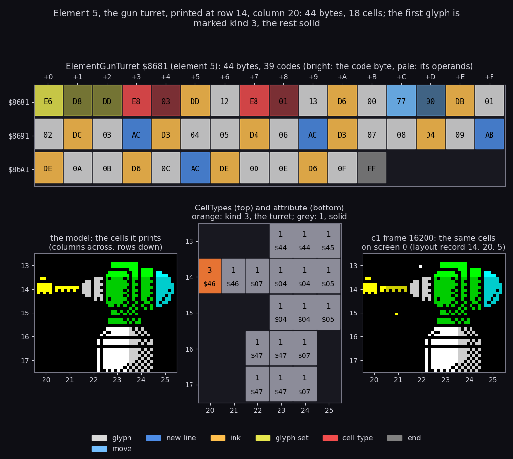

How to read the figure:

- **Top**: ElementGunTurret `$8681`, 16 bytes a row, each coloured by the code it belongs to (the legend at the
  bottom); a code byte is bright, its operands pale.
- **Bottom left**: the cells the printer model (`tools/fig_docb.py print_string`) draws for it at row 14, column 20.
- **Bottom middle**: the CellTypes value (top) and the attribute (bottom) the model leaves in each cell.
- **Bottom right**: the same cells of screen 0 in `c1` frame 16200 (layout record 14, 20, 5).
- **The point**: the model and the recording agree cell for cell; one string sets the glyph set, the kind of the
  first cell and the colours of every cell.

The bytes, in order, from the cursor at row 14, column 20:

| Bytes | Meaning | Cursor after |
| --- | --- | --- |
| `$E6 $D8 $DD` | glyph set `$DDD8` | 14, 20 |
| `$E8 $03` | the next glyphs are kind 3, the turret (IndexObjectCells finds it here) | 14, 20 |
| `$DD` `$12` | ink 14 = bright yellow (`$46`); glyph `$12`, the turret's muzzle | 14, 21 |
| `$E8 $01` | the rest is solid | 14, 21 |
| `$13` | glyph `$13` | 14, 22 |
| `$D6` `$00` | ink 7 (`$07`); glyph 0 | 14, 23 |
| `$77 $00` | a move: row + (`$77` - `$78`) = -1, column + 0 | 13, 23 |
| `$DB` `$01 $02` | ink 12 = bright green (`$44`); glyphs 1, 2 | 13, 25 |
| `$DC` `$03` | ink 13 = bright cyan (`$45`); glyph 3 | 13, 26 |
| `$AC` | the next row, column + (`$AC` - `$AF`) = -3 | 14, 23 |
| `$D3` `$04 $05` `$D4` `$06` | ink 4, glyphs 4, 5; ink 5, glyph 6 | 14, 26 |
| `$AC` `$D3` `$07 $08` `$D4` `$09` | the next row, the same pattern: glyphs 7-9 | 15, 26 |
| `$AB` | the next row, column - 4 | 16, 22 |
| `$DE` `$0A $0B` `$D6` `$0C` | ink 15 = bright white (`$47`), glyphs `$0A`, `$0B`; ink 7, glyph `$0C` | 16, 25 |
| `$AC` `$DE` `$0D $0E` `$D6` `$0F` | the next row: glyphs `$0D-$0F`, the turret's base | 17, 25 |
| `$FF` | the end | |

44 bytes print 18 cells. The muzzle's cell is the one of kind 3: IndexObjectCells `$8E86` turns it into a turret of
the turret list ([doc 7](07-objects.md)).

**The clip.** An element may be placed so that part of it falls off the screen: the layouts use negative columns
and columns past 31. PrintChar returns at once when bit 5 of the column is set: columns 32-63, and -32 to -1 (`$E0-$FF`).
The cursor still moves, so the rest of the string lands where it should. Known only from the code: no recorded build
shows a clipped glyph.

**AddDestructible** `$9487`, called with the element number before each print, notes the element's destructible
pieces in DestructibleList (IX) for the grenade and mine blasts ([doc 7](07-objects.md)).

### All 62 elements

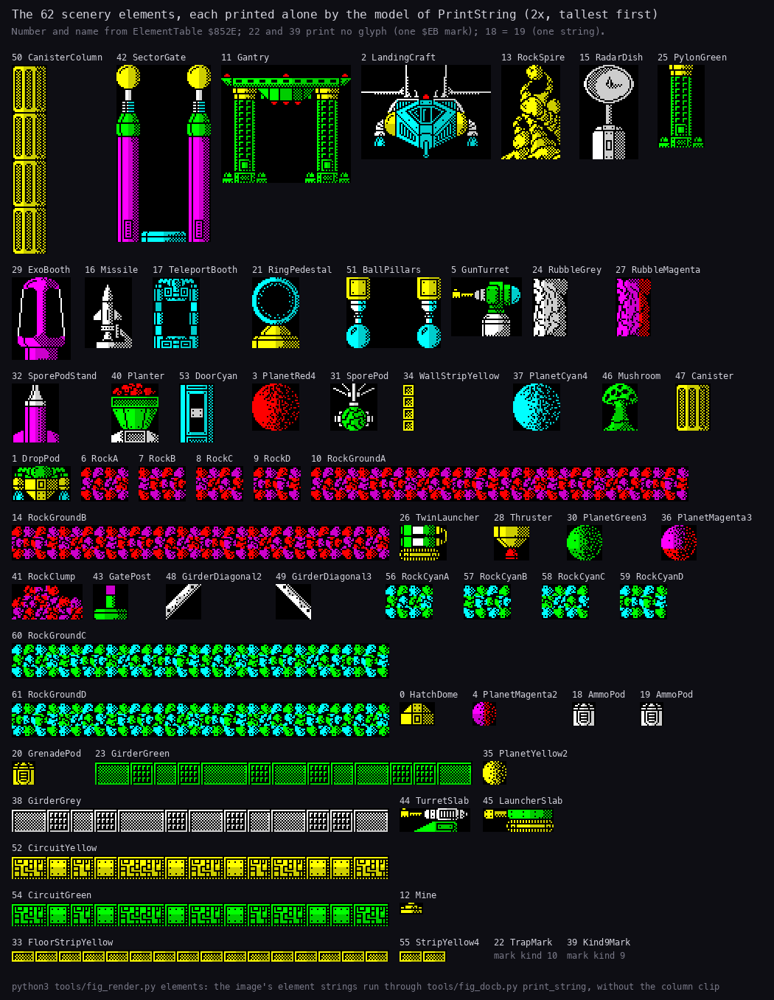

How to read the figure:

- One tile per element, labelled with its number and name from ElementTable `$852E`; drawn by the printer model at
  row 0, column 0 of a blank screen, cropped to the cells it printed.
- **The point**: the scenery of 125 screens is these 62 strings placed by the layouts; no screen has a bitmap of its
  own.

```bash
python3 tools/fig_render.py element    # element-turret.png
python3 tools/fig_render.py elements   # elements.png
```

## 6.4 The screen builder

BuildScreen `$8494` runs at the start of a game, at each screen change and after a zone end. Its stages, in order:

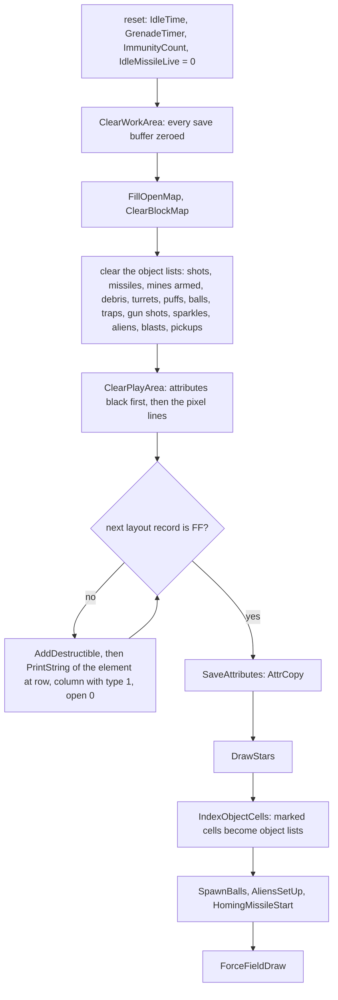

- **The reset** clears everything of the old screen. ClearWorkArea zeroes the 1360 bytes of save buffers at
  `$B181`, so the first XOR of every sprite on the new screen erases nothing (6.5).
- **The layout** comes from ScreenTable `$C7F4`: 3-byte records of row, column, element number, `$FF` the end.
- **The order matters**: SaveAttributes runs after the scenery and before the stars, so the star cells stay 0 in
  AttrCopy and a sprite passing over a star colours it.

```asm
BuildScreen:
  LD HL,$0000
  LD (IdleTime),HL
  XOR A
  LD (GrenadeTimer),A
  LD (ImmunityCount),A
  LD (IdleMissileLive),A
  CALL ClearWorkArea
  CALL FillOpenMap
  CALL ClearBlockMap
  CALL ClearShots
  CALL ClearShellList
  CALL ArmMines
  CALL ClearDebris
  CALL ResetTurretList
  CALL ClearPuffs
  CALL ClearBalls
  CALL ClearTraps
  CALL ClearGunShots
  CALL ClearSparkles
  CALL ClearAliens
  CALL ClearBlasts
  CALL ClearPickups
  CALL ClearPlayArea
  LD A,(ScreenNumber)
  LD BC,ScreenTable
  CALL TableWord
  LD IX,DestructibleList
BuildScreenNext:
  LD A,(HL)               ; the next element record; $FF ends
  CP $FF
  JR Z,BuildScreenDone
  LD D,A
  INC HL
  LD E,(HL)
  INC HL
  PUSH HL
  LD A,(HL)
  CALL AddDestructible
  LD BC,ElementTable
  CALL TableWord
  LD A,$01
  LD (PrintCharLine+$0018),A
  XOR A
  LD (PrintCharLine+$001E),A
  LD C,A
  CALL PrintString
  POP HL
  INC HL
  JP BuildScreenNext
BuildScreenDone:
  LD (IX+$00),$FF         ; close the object list, index the object cells,
                          ; start the screen's objects
  CALL SaveAttributes
  CALL DrawStars
  CALL IndexObjectCells
  CALL SpawnBalls
  CALL AliensSetUp
  CALL HomingMissileStart
  JP ForceFieldDraw
```

```text
reset the screen's counters; zero the save buffers; open map = $FF; types = 0; clear every object list
clear the play area (attributes, then pixels)
for each (row, column, element) in layout[screenNumber] until $FF:
    note the element's destructible pieces
    cellType = 1; openCell = 0; attribute = 0
    print ElementTable[element] at (row, column)
AttrCopy = attributes
scatter the stars
index the object cells; start balls, aliens, the homing missile; draw the force field
```

**A worked example: screen 0's layout** (Screen000Layout `$C8EE`), nine records:

| Row | Column | Element | What |
| ---: | ---: | ---: | --- |
| 19 | 0 | 10 | RockGroundA: the purple rock ground |
| 18 | 0 | 33 | FloorStripYellow: the yellow floor |
| 2 | 0 | 2 | LandingCraft |
| 8 | 0 | 11 | Gantry |
| 1 | 24 | 3 | PlanetRed4 |
| 4 | 16 | 30 | PlanetGreen3 |
| 5 | 29 | 4 | PlanetMagenta2 |
| 10 | 29 | 13 | RockSpire |
| 14 | 20 | 5 | GunTurret (decoded in 6.3) |


How to read the animation:

- **Left**: the memory `$5B00-$FFFF`, 256 bytes a row. Green is executed in this slice, blue read, yellow written;
  older touches fade to a dark trail.
- **Middle**: the screen as it is drawn; bytes written in the slice flash.
- **Right**: the listing round the instruction last executed, with the registers and the frame.
- **What happens**: ClearPlayArea wipes the 22 rows line by line (the first pictures, about 130 000 T), then the nine
  elements appear in the layout's order: the ground and floor at the bottom, the landing craft, the gantry, the
  planets, the spire, the turret. The stars come last (the squares that flash over the sky).
- **The point**: the scenery is printed once, as character glyphs, in about 700 000 T (10 frames). The player sees
  the screen being drawn.

```bash
python3 ../../kit/routine_anim.py --work work/docs/docA/c1 --window 16129:14000-16139:0 --listing build/game.lst \
    --out docs/img/render/BuildScreen.gif --pc 8494-B100 --view screen --range 5B00-FFFF --pictures 60 --delay 120 \
    --hold 2000 --title 'BuildScreen $8494: screen 0 printed element by element from its layout (c1 frames 16129-16139)'
```

### Who writes the screen in a build

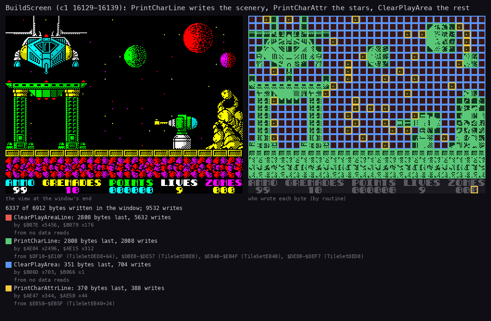

How to read the figure:

- **Left**: the screen at the end of the window, `c1` frame 16139.
- **Right**: each byte coloured by the routine that wrote it last in the window; grey was not written.
- **The list**: each writer, its bytes written last, its writes in all, the instructions and the memory it read.
- **What it shows**:
  - ClearPlayAreaLine wrote 5632 times and is the last writer of 2808 bytes: the empty sky (red);
  - PrintCharLine (PrintChar's loop) wrote 2808 bytes once each: the scenery glyphs (green), read from four glyph
    sets;
  - ClearPlayArea wrote the 704 play attributes (blue, the black cells);
  - PrintCharAttrLine wrote 370 bytes: the stars (yellow boxes), each a glyph and an attribute, read from
    TileSetE840 + 24 (glyph 3).
- **The point**: 6337 of 6912 bytes change in a build, by four writers; the stars are the only bytes not written
  by the scenery printer.

```bash
python3 ../../kit/writers_map.py --trace work/docs/docA/c1/traces/16129_14000-16139_0.uatr --listing build/game.lst \
    --out docs/img/render/writers-build.png --view screen --sources \
    --title 'BuildScreen (c1 16129-16139): PrintCharLine writes the scenery, PrintCharAttr the stars, ClearPlayArea the rest'
```

### The screen change

The player leaves a screen on the right. MovePlayer computes his new X; when it is `$80`, one unit past the right
edge, DrawPlayer does not draw him and asks for the next screen:

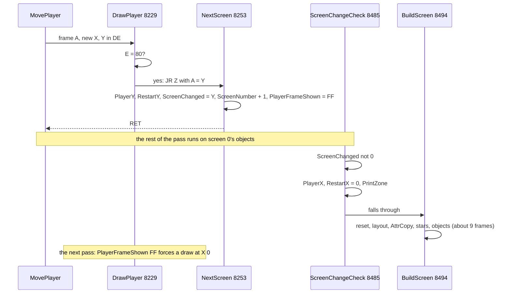

```asm
DrawPlayer:
  EX AF,AF'
  LD A,E
  CP $80
  LD A,D
  JR Z,NextScreen
  ; ...
NextScreen:
  LD (PlayerY),A
  LD (RestartY),A
  LD (ScreenChanged),A
  LD A,(ScreenNumber)
  INC A
  LD (ScreenNumber),A
  LD A,$FF
  LD (PlayerFrameShown),A
  RET
ScreenChangeCheck:
  LD A,(ScreenChanged)
  OR A
  RET Z
  XOR A
  LD (PlayerX),A
  LD (RestartX),A
  CALL PrintZone
                          ; and on into BuildScreen
```

```text
DrawPlayer(frame, x, y):
    if x == $80:                      # off the right edge
        playerY = restartY = screenChanged = y
        screenNumber += 1
        playerFrameShown = $FF        # the next draw must happen
        return
ScreenChangeCheck():                  # later in the same pass
    if screenChanged == 0: return
    playerX = restartX = 0            # the left edge, same height
    PrintZone()                       # ZONES on the HUD
    BuildScreen()
```

ScreenChanged holds Y, which is never 0 on a screen, so the flag and the restart height are one byte. RestartX and
RestartY are where a death on the new screen puts the player back ([doc 10](10-gameplay-logic.md)).

**The witness, `x2`** (`find_event` on `$8253`, `$8494`, `$8E86`, `$AB97`, `$76DA`; `memory_at` of ScreenNumber `$8523`):

| Event | Frame + T |
| --- | --- |
| NextScreen, screen 0 to 1 | 743 + 16 448 |
| BuildScreen starts | 743 + 18 863 |
| DrawStars | 750 + 55 540 |
| IndexObjectCells | 751 + 44 669 |
| ForceFieldDraw, the end of the build | 752 + 21 399 |
| the first DrawPlayer on screen 1: frame 3, X 1, Y `$70` | 756 |

The build takes about 631 500 T, nine frames. The other four changes of `x2` are at 1471 + 37 750, 1770 + 15 856,
2419 + 19 584 and 2944 + 62 513.

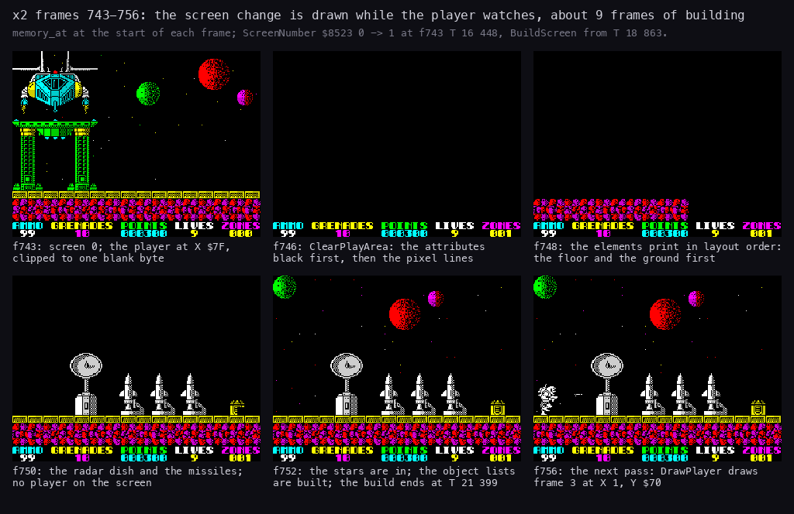

How to read the figure:

- Six screens read with `memory_at` at the start of the frames named under each.
- **743**: screen 0, the player at X `$7F`, clipped to one blank byte (the right-edge clip of 6.5).
- **746**: ClearPlayArea has blacked the attributes and is clearing the pixel lines.
- **748, 750**: the elements print in layout order.
- **752**: the stars are in and the build is ending.
- **756**: the next pass draws the player at the left edge.
- **The point**: the flip is not instant. For about nine frames the player sees an empty, then a growing, screen.

```bash
python3 tools/fig_render.py flip
```

### The stars

DrawStars `$A2D5` runs once per build, after SaveAttributes:

- for each of the rows 21 down to 0 it makes three tries;
- a try picks a column with Random AND `$1F`;
- the star is printed only where AttrCopy is 0, a black and empty cell;
- the star is glyph 3 of TileSetE840 (`00 00 00 00 10 00 00 00`, one pixel on line 4), in ink Random AND 7 OR `$42`
  (bright, bit 1 of the ink always set: ink 2, 3, 6 or 7, red, magenta, yellow or white; never green or cyan);
- it prints through PrintCharAttr: no CellTypes or OpenCells write, so a star is neither solid nor in front.

```asm
DrawStars:
  LD HL,TileSetE840
  LD (PrintChar+$000E),HL
  LD B,$16
DrawStarsRow:
  PUSH BC
  LD A,$03
DrawStarsTry:
  EX AF,AF'
  CALL Random
  AND $1F
  LD E,A
  LD D,B
  DEC D
  CALL CellOffset
  PUSH BC
  LD BC,AttrCopy
  ADD HL,BC
  POP BC
  LD A,(HL)
  OR A
  JR NZ,DrawStarsNext
  CALL Random
  AND $07
  OR $42
  LD C,A
  LD A,$03
  CALL PrintCharAttr
DrawStarsNext:
  EX AF,AF'
  DEC A
  JR NZ,DrawStarsTry
  POP BC
  DJNZ DrawStarsRow
  RET
```

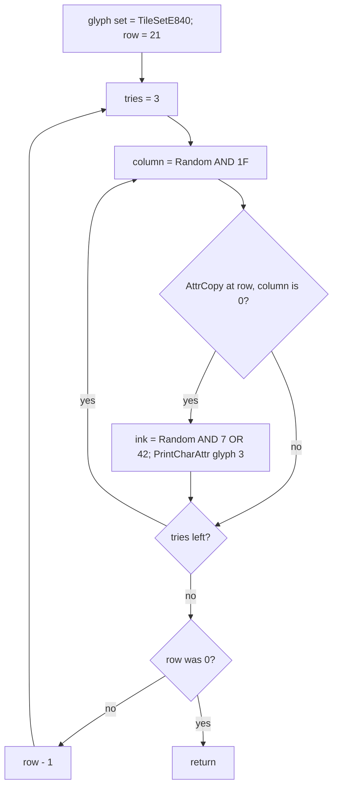

**A worked example**: a try at row 10 draws column 13. AttrCopy `$5E00` + 10 x 32 + 13 = `$5F4D`. If it is 0,
a second Random gives, say, 5: ink 5 OR `$42` = `$47`, a bright white star at row 10, column 13; its pixel is bit 4 of
the screen byte on the cell's line 4.

**The witness**: screen 0 of `c1` was built at frames 16129-16139 and again before frame 18950.

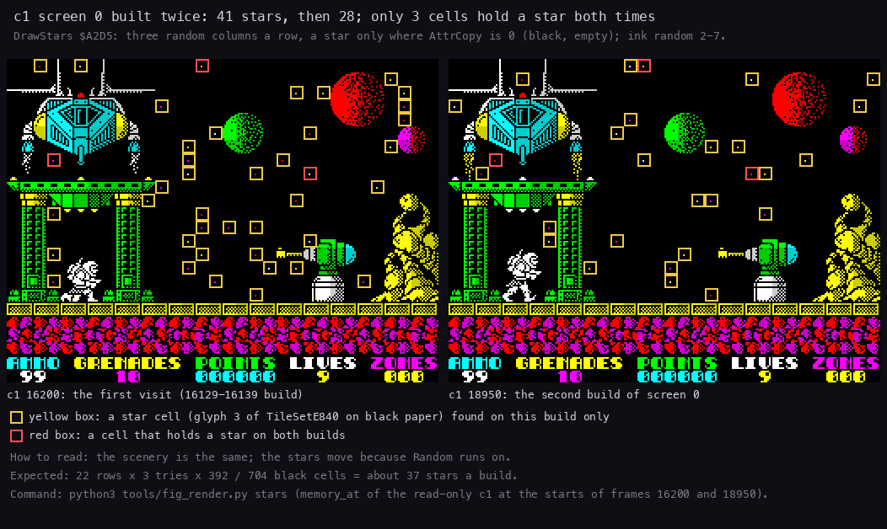

How to read the figure:

- **Left**: `c1` frame 16200; **right**: frame 18950. Both are screen 0.
- A yellow box is a cell holding exactly glyph 3 on black paper, found on that build only; a red box holds a star on
  both builds.
- **The point**: the stars are random: 41 and 28, with 3 cells in common. 22 rows x 3 tries x 392 / 704 black cells
  gives about 37 stars a build. Every visit to a screen has a new sky.

```bash
python3 tools/fig_render.py stars
```

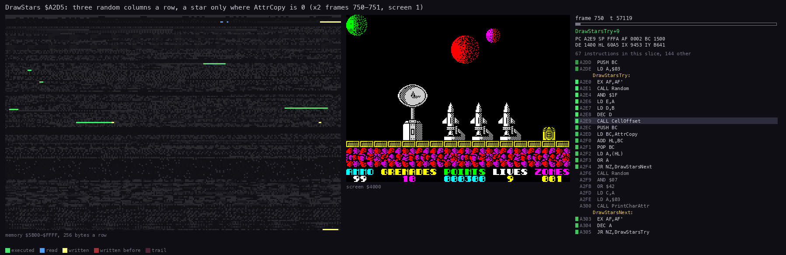

How to read the animation:

- The panels are those of BuildScreen's animation.
- **What happens**: Random's code runs (green), AttrCopy at `$5E00` is read (blue, the third map row band), and now
  and then a star's 8 bytes and its attribute are written (yellow flash in the screen panel); rows go from the
  bottom of the play area to the top.
- **The point**: about 59 000 T for 66 tries: a try that finds a coloured cell costs about 600 T, one that prints
  about 1100 T.

```bash
python3 ../../kit/routine_anim.py --trace work/docs/fillR/x2/traces/750_55000-752_0.uatr --listing build/game.lst \
    --out docs/img/render/DrawStars.gif --pc A2D5-A30A --view screen --range 5B00-FFFF \
    --title 'DrawStars $A2D5: three random columns a row, a star only where AttrCopy is 0 (x2 750-752)'
```

## 6.5 The sprites

Four drawers and one dot routine, all XOR:

| Routine | Size | Frames | Users | Shift | Masked by OpenCells | Save buffer |
| --- | --- | --- | --- | --- | --- | --- |
| DrawBigSprite `$76DA` | 24x32 | PlayerFrames `$EF80`, 96 bytes each | the player, the traps | at draw time, 0/2/4/6 pixels | yes, and a right-edge clip | 128 bytes |
| DrawSprite `$795C` | 16x16 | Sprites16 `$F8E0`, 32 bytes each | the menu stars, aliens, the missiles, the flickering pad, the blasts, the time pad | at draw time | yes | 48 bytes |
| DrawSmallSprite `$92FB` | 16x8 drawn (8x8 shapes) | SmallSprites `$ED40`, 4 pre-shifted copies, 64 bytes each | the grenade, debris, puffs, balls, gun shots, the time pad | pre-shifted (X AND 3) | no | none |
| XorShot `$82FC` | 8x1 | the byte `$BD` | the player's shots | | no | none |
| XorShell `$903D` | 2x2 | the byte `$C0` shifted | the turrets' shells | at draw time | no | none |

The two big drawers move a sprite in one call:

- the caller passes the new place (DE), the old place (BC), the frame (A) and a buffer (HL) holding the image as it
  was last drawn;
- the new image is shifted, masked by OpenCells, and kept;
- the old image is XORed off at the old place and the new one XORed on at the new place, line by line;
- HL = NoSaveBuffer `$B101` (128 zero bytes) means nothing to erase and nothing to keep: that is how the time pads
  draw.

### DrawBigSprite

Its steps, for frame A at X, Y:

1. **Frame address**: `$EF80` + 96 A. SP is set to it and the lines are read with `POP`.
2. **Shift**: (2 X) AND 7 is the pixel shift, 0, 2, 4 or 6. BigShiftJumps `$78CA` picks the routine. A shift of 4 or 6
   is done as a left shift of 4 or 2 of the line placed one byte to the right, which gives the same pixels in fewer
   steps. Each of the 32 lines becomes 4 bytes in ShiftBuffer `$78DC`.
3. **Mask**: BigSpriteMask `$776C` ANDs the OpenCells bytes of the 4 x 4 cells under the new place (5 rows when Y is
   not a multiple of 8). All `$FF`: no scenery in front, no masking. Else BigMaskRows cuts the image where a cell is
   0 (below).
4. **Clip**: X from `$75` on keeps only the bytes that stay on the line: three for `$75-$77`, two for `$78-$7B`, one
   from `$7C`.
5. **XOR**: BigXorLoop `$7814` XORs the new line on, BigOldLine `$7837` XORs the old line off, 32 times.
6. **Keep**: the 128 new bytes go into the buffer, unless it is `$B101`.

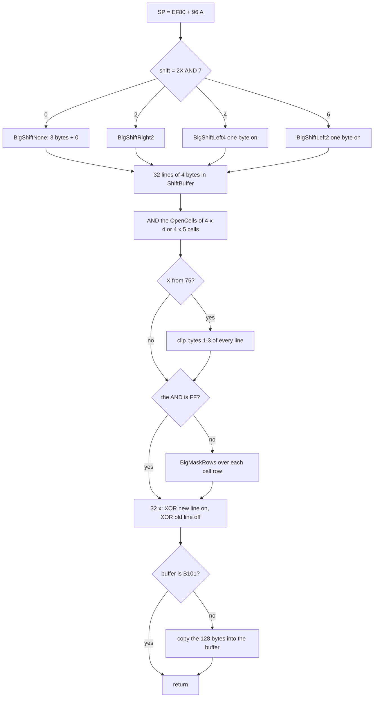

A worked example of the shift: line 15 of frame 5 (standing) is `03 FB 0C`, `00000011 11111011 00001100`. At
X = `$11` the shift is (2 x `$11`) AND 7 = 2. BigShiftRight2 moves the 24 pixels two places right into 4 bytes:
`00000000 11111110 11000011 00000000`, that is `00 FE C3 00`. The sprite is 2 pixels right of the byte boundary of
column 4 (34 = 4 x 8 + 2).

The XOR of one line at the new place, from BigXorLoop:

```asm
BigXorLoop:
  POP DE                  ; the new line from ShiftBuffer XORed on
  LD A,E
  XOR (HL)
  LD (HL),A
  INC L
  LD A,D
  XOR (HL)
  LD (HL),A
  INC L
  POP DE
  LD A,E
  XOR (HL)
  LD (HL),A
  INC L
  LD A,D
  XOR (HL)
  LD (HL),A
  DEC L
  DEC L
  DEC L
  INC H
  ; ... the next screen line (the Spectrum's line order), then BigOldLine
```

```text
for line in 0..31:
    for b in 0..3:
        screen[newAddress + b] ^= shifted[line][b]
    for b in 0..3:
        screen[oldAddress + b] ^= saved[line][b]
    newAddress, oldAddress = next pixel line of each
saved = shifted          (unless the buffer is NoSaveBuffer)
```


How to read the animation:

- The panels are those of 6.4.
- **What happens**: the frame's lines are read from `$EF80` + 96 A (blue at the bottom of the memory panel) and
  written into ShiftBuffer `$78DC` (yellow near `$7800`); the mask reads OpenCells `$5B00` (the top rows); then the
  XOR loop writes the screen lines of the player one by one, and the 128 bytes are copied into the player's buffer
  in WorkArea `$B181`.
- **The point**: one call of about 23 000 T both erases and draws. The player's pixels change line by line, never
  all at once.

```bash
python3 ../../kit/routine_anim.py --work work/docs/docA/c1 --window 16188:59900-16189:13000 --listing build/game.lst \
    --out docs/img/render/DrawBigSprite.gif --pc 76DA-795B --view screen --range 5B00-FFFF --pictures 40 --delay 150 \
    --title 'DrawBigSprite $76DA: the player erased and redrawn by XOR, masked by OpenCells (c1 frame 16188, 23 000 T)'
```

**The right-edge clip, witnessed**: in `x2` frames 742-743 the player stands at X `$7F`. Only byte 0 of each line
stays, and with frame 3 that byte is blank: the player's kept buffer at `$B181` is all zero and he has vanished
from the screen before NextScreen (the first picture of the screen-change figure).

### The mask

The mask is computed per cell, then applied per line:

1. BigSpriteMask finds the OpenCells address of the top-left cell (the screen address's high bits give the third
   and row; the low byte gives row and column).
2. It ANDs the 4 cells of each of the 4 or 5 rows into A. `$FF` means no cell is 0: the image stays whole and the
   rest is skipped.
3. Otherwise it walks the cell rows. The first row gets 8 - (Y AND 7) lines; then three full rows of 8 lines
   (BigMaskRows8); then the last row gets Y AND 7 lines (BigMaskTail, patched; 8 when Y is aligned).
4. BigMaskRows loads the row's 4 cell bytes: three into the operands of `AND n` (BigMask0, 1, 2), the fourth into C.
   For each line it ANDs the 4 bytes of ShiftBuffer with them. A cell byte is 0 or `$FF`, so a byte of the image is
   kept whole or cleared whole.

```asm
BigMaskRows:
  LD A,(HL)
  LD (BigMask0+$0001),A
  INC HL
  LD A,(HL)
  LD (BigMask1+$0001),A
  INC HL
  LD A,(HL)
  LD (BigMask2+$0001),A
  INC HL
  LD C,(HL)
BigMaskLine:
  LD A,(DE)
BigMask0:
  AND $00                 ; AND n: the first cell (patched)
  LD (DE),A
  INC DE
  LD A,(DE)
BigMask1:
  AND $00                 ; AND n: the second cell (patched)
  LD (DE),A
  INC DE
  LD A,(DE)
BigMask2:
  AND $00                 ; AND n: the third cell (patched)
  LD (DE),A
  INC DE
  LD A,(DE)
  AND C
  LD (DE),A
  INC DE
  DJNZ BigMaskLine
  LD BC,$001D
  ADD HL,BC
  RET
```

```text
m = AND of OpenCells over the cells under the sprite
if m == $FF: skip
rows = [8 - (Y AND 7)] + [8, 8, 8] + [Y AND 7 or 8]
cell = OpenCells address of the top-left cell
for n in rows:
    c0, c1, c2, c3 = cell[0..3]
    repeat n times:  line = next 4 bytes of ShiftBuffer;  line[i] &= c_i
    cell += 32
```

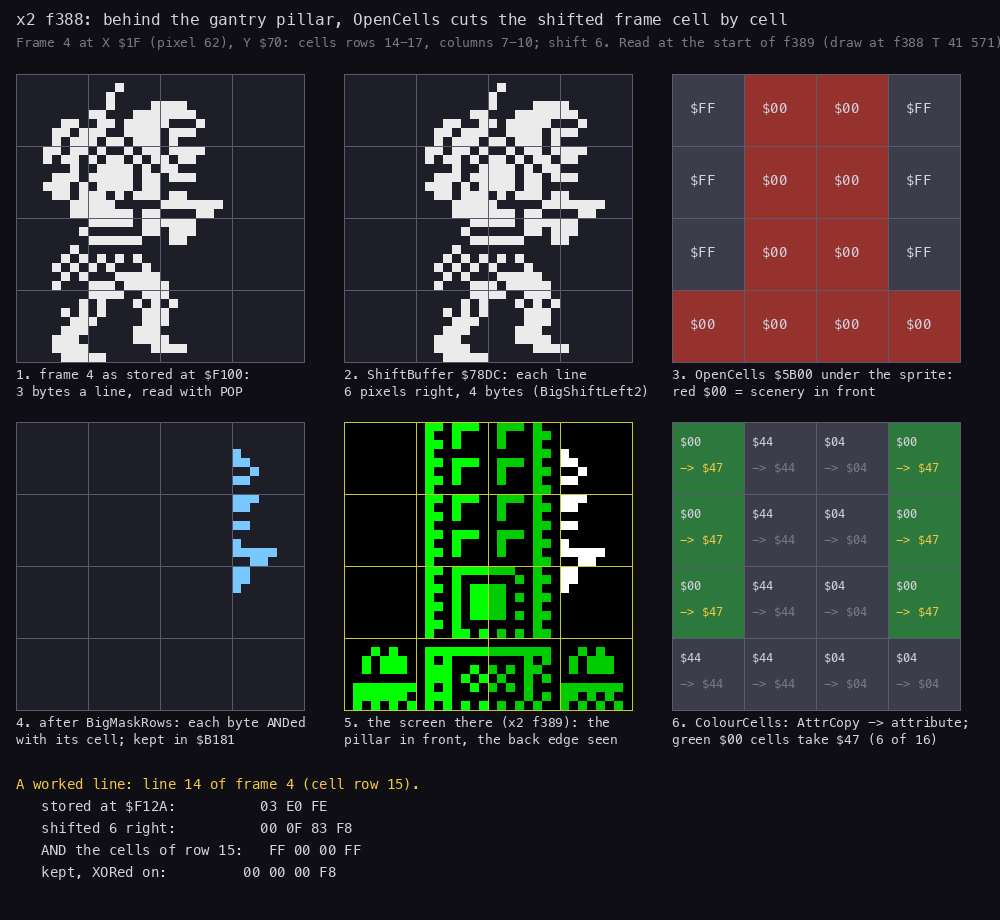

How to read the figure:

- **The draw**: `x2` frame 388 at T 41 571 (`find_event` on `$76DA`), frame 4 at X `$1F`, Y `$70`; the memory read at
  the start of frame 389.
- **Panel 1**: frame 4 as stored, 3 bytes a line, on a grid of the cells it will cover.
- **Panel 2**: ShiftBuffer after the 6-pixel shift, 4 bytes a line.
- **Panel 3**: the OpenCells bytes of the 4 x 4 cells (rows 14-17, columns 7-10); red is 0, scenery in front.
- **Panel 4**: the image after BigMaskRows, the bytes kept in the player's buffer `$B181`.
- **Panel 5**: the screen there in frame 389: the pillar in front, the player's back edge seen past it.
- **Panel 6**: ColourCells (below) on the same cells.
- **The worked line**: line 14 of the frame, in cell row 15, stored as `03 E0 FE`; shifted 6 right it is
  `00 0F 83 F8`; ANDed with the cells `FF 00 00 FF` it keeps `00 00 00 F8`.
- **The point**: a byte is the unit of the mask. The player is cut at a cell edge, never inside a cell.

```bash
python3 tools/fig_render.py mask
```

### DrawSprite

DrawSprite `$795C` draws a 16x16 frame from Sprites16 `$F8E0` + 32 A. It works like DrawBigSprite at a smaller
size:

1. SP = the frame; each line is 2 bytes, read with `POP`.
2. SpriteShiftJumps `$7AD9` picks a shift routine by (2 X) AND 7; each line becomes 3 bytes in ShiftBuffer
   (16 lines, 48 bytes).
3. SpriteMask `$79CA` ANDs the OpenCells of 3 x 2 cells (3 x 3 when Y is not a multiple of 8); MaskRows `$7AB9`
   applies the cells to the lines as BigMaskRows does.
4. SpriteXorLoop `$7A37` XORs the new line on and SpriteOldLine the old line off.
5. The 48 bytes go into the caller's buffer.

There is no right-edge clip: the users keep their sprites inside the screen.

```asm
DrawSprite:
  ; ...                   the registers saved
  LD L,A                  ; HL = 32 A + $F8E0: the frame
  LD H,$00
  ADD HL,HL
  ADD HL,HL
  ADD HL,HL
  ADD HL,HL
  ADD HL,HL
  LD A,E
  LD DE,Sprites16
  ADD HL,DE
  LD (SpriteSavedSP),SP   ; SP = the frame, read with POP
  LD SP,HL
  ADD A,A                 ; the shift (2x AND 7) picks the routine
  AND $07
  ADD A,A
  LD L,A
  LD H,$00
  LD DE,SpriteShiftJumps
  ADD HL,DE
  LD E,(HL)
  INC HL
  LD D,(HL)
  LD IX,$0000
  ADD IX,DE
  LD HL,ShiftBuffer       ; 16 lines into ShiftBuffer
  LD B,$10
SpriteRow:
  POP DE
  XOR A
  JP (IX)
  ; ...
ShiftRight2:
  SRL E
  RR D
  RRA
  SRL E
  RR D
  RRA
ShiftNone:
  LD (HL),E
  INC HL
  LD (HL),D
  INC HL
  LD (HL),A
  INC HL
  DJNZ SpriteRow
SpriteMask:
  LD SP,(SpriteSavedSP)
  POP DE
  CALL PixelAddress
  ; ...                   HL = the OpenCells cell
  LD A,D
  LD DE,$001E
  LD B,$02
  AND $07
  JR Z,SpriteMapAnd
  INC B
SpriteMapAnd:
  LD A,$FF                ; A = $FF AND the map cells
SpriteMapRow:
  AND (HL)                ; three cells a row
  INC L
  AND (HL)
  INC L
  AND (HL)
  ADD HL,DE
  DJNZ SpriteMapRow
```

```text
src = $F8E0 + 32 * frame
for each of 16 lines: (left, right) = pop; shift by (2X AND 7) into 3 bytes of ShiftBuffer
m = AND of OpenCells over 3 x (2 or 3) cells
if m != $FF: MaskRows (as BigMaskRows, 3 bytes a line)
for each of 16 lines: XOR new on, XOR old off
buffer = ShiftBuffer (48 bytes)
```

**A worked example**: the menu's sparkle frame `$0C` is at `$F8E0` + 32 x `$0C` = `$F8E0` + `$180` = `$FA60`; at X = 5 the shift is (2 x 5) AND 7 = 2, so ShiftRight2 turns each 2-byte line into 3 bytes.

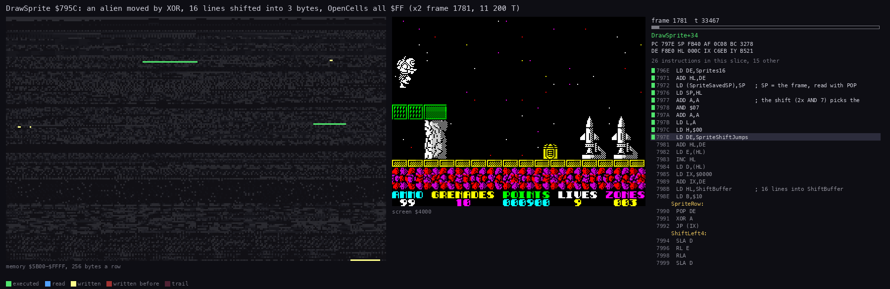

How to read the animation:

- The panels are those of 6.4.
- **What happens**: the frame's 32 bytes are read from Sprites16 (blue in Sprites16, from `$F8E0`), ShiftBuffer is written
  (yellow near `$7900`), OpenCells is read, then 16 short line writes on the screen.
- **The point**: one alien costs about 11 200 T (`x2` 1781, T 147-11 371 of the trace window), half the player's draw.

```bash
python3 ../../kit/routine_anim.py --trace work/docs/fillR/x2/traces/1781_33000-1781_47000.uatr --listing build/game.lst \
    --out docs/img/render/DrawSprite.gif --pc 795C-7AE8 --view screen --range 5B00-FFFF \
    --title 'DrawSprite $795C: one alien moved, shifted into 3-byte lines, masked, XORed (x2 1781)'
```

### DrawSmallSprite

DrawSmallSprite `$92FB` has no shift code, no mask and no buffer. Its frames are stored shifted:

- SmallSprites `$ED40` holds 9 sprites of 64 bytes; each is 4 copies of 16 bytes, shifted 0, 2, 4 and 6 pixels;
- a copy is 8 lines of 2 bytes;
- the address is `$ED40` + 64 A + 16 (E AND 3);
- the loop reads with `POP`, two lines a pass, 4 passes (BC = `$0407`: B the passes, C the line mask 7);
- the second line of each pair is written right byte first, walking back with `DEC L`, so L needs no reset;
- it XORs and returns; the caller XORs the same sprite again at the old place to erase it;
- it adds 1 to XorSpriteCount `$9E98`, which the time pad reads to make every pass draw 16 small sprites
  ([doc 4](04-game-loop.md)).

SmallSprites ends at `$EF80`, where PlayerFrames starts. The copies are in the image, not built at run time.

```asm
DrawSmallSprite:
  PUSH AF
  PUSH BC
  PUSH DE
  PUSH HL
  CALL PixelAddress
  PUSH HL
  ADD A,A
  ADD A,A
  LD L,A
  LD H,$00
  ADD HL,HL
  ADD HL,HL
  ADD HL,HL
  ADD HL,HL
  LD A,E
  AND $03
  ADD A,A
  ADD A,A
  ADD A,A
  ADD A,A
  LD E,A
  LD D,$00
  ADD HL,DE
  LD BC,SmallSprites
  ADD HL,BC
  POP DE
  LD (SpriteSavedSP),SP   ; SP = the frame's bytes
  LD SP,HL
  EX DE,HL
  LD BC,$0407             ; B = 4 pairs of lines, C = 7
DrawSmallSpriteLoop:
  POP DE                  ; line 1: left byte, right byte
  LD A,E
  XOR (HL)
  LD (HL),A
  INC L
  LD A,D
  XOR (HL)
  LD (HL),A
  INC H                   ; the next line down
  ; ...                   the character-row fix-up
DrawSmallSpriteLine2:
  POP DE                  ; line 2: the right byte first, back to the left
  LD A,D
  XOR (HL)
  LD (HL),A
  DEC L
  LD A,E
  XOR (HL)
  LD (HL),A
  INC H
  ; ...                   the character-row fix-up
DrawSmallSpriteNext:
  DJNZ DrawSmallSpriteLoop ; the next pair
  LD SP,(SpriteSavedSP)
  LD HL,XorSpriteCount    ; one more sprite drawn this pass
  INC (HL)
  ; ...
```

```text
src = $ED40 + 64 * sprite + 16 * (X AND 3)
p = PixelAddress(Y, X)
repeat 4:
    (l, r) = pop;  p[0] ^= l;  p[1] ^= r;  p = next line
    (l, r) = pop;  p[1] ^= r;  p[0] ^= l;  p = next line
XorSpriteCount += 1
```

**A worked example**: the ball, sprite 7, at E = `$21`. E AND 3 = 1, the copy shifted 2 pixels. The address is
`$ED40` + 7 x 64 + 16 = `$ED40` + `$1C0` + `$10` = `$EF10`.

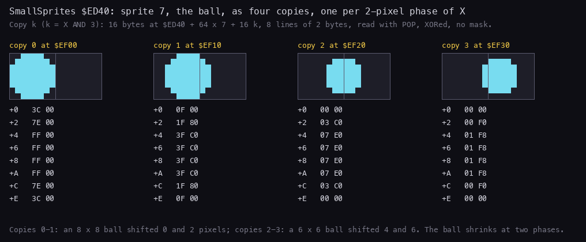

How to read the figure:

- Each copy is 8 lines of 2 bytes, drawn 16 pixels wide, with its address and its bytes.
- **The point**: copies 0-1 are an 8x8 ball shifted 0 and 2; copies 2-3 are a 6x6 ball shifted 4 and 6. A full ball
  shifted 6 would not fit 16 pixels, so the artist drew a smaller one: the ball shrinks at the right of its cell.

```bash
python3 tools/fig_render.py small
```


How to read the animation:

- **What happens**: 16 bytes read from SmallSprites (blue at `$ED40-$EF7F`), 16 screen bytes XORed, no other memory
  written but XorSpriteCount.
- **The point**: about 1030-1047 T a call, a tenth of DrawSprite. That is why the many small things use it.

```bash
python3 ../../kit/routine_anim.py --work work/docs/fillR/x2 --window 342:23000-342:28500 --listing build/game.lst \
    --out docs/img/render/DrawSmallSprite.gif --pc 92FB-9350 --view screen --range 5B00-FFFF \
    --title 'DrawSmallSprite $92FB: 8 lines XORed two at a time from a pre-shifted copy (x2 342)'
```

### Colour

The drawers do not touch the attributes. The movers colour their sprites afterwards:

- ColourBigSprite `$7C5F` (3 x 4 cells), ColourSprite `$7C8F` (2 x 2) and ColourCell (1 x 1) patch the width and
  height into ColourCells `$7CA7` and enter it;
- ColourCells adds one column when X AND 3 is not 0 and one row when Y AND 7 is not 0;
- for each cell, ColourBlackCell `$7CD1` writes attribute C only if the cell's AttrCopy byte is 0;
- a cell whose AttrCopy byte is not 0 keeps its colour: a sprite passing in front of coloured scenery takes the
  scenery's colour.

```asm
ColourCells:
  CALL AttrShadowCell     ; HL = AttrCopy cell of (D, E)
  LD A,C
  PUSH HL
  LD BC,OpenCells-CellTypes ; -$0600: AttrCopy to the attributes
  ADD HL,BC
  LD C,A
  PUSH HL
  ; ...                   width + 1 if X AND 3, height + 1 if Y AND 7
ColourStart:
  POP HL                  ; HL = the screen attributes, DE = the copy
  POP DE
ColourRow:
  EX AF,AF'
ColourRowCells:
  LD B,$00                ; LD B,n: the cells of a row (patched)
ColourBlackCell:
  LD A,(DE)               ; a black background cell takes C
  OR A
  JR NZ,ColourNextCell
  LD (HL),C
ColourNextCell:
  INC HL
  INC DE
  DJNZ ColourBlackCell
  ; ...                   on to the next row; DEC A; JR NZ,ColourRow
```

```text
w = width + (1 if X AND 3 else 0);  h = height + (1 if Y AND 7 else 0)
for r in 0..h-1:
    for c in 0..w-1:
        if AttrCopy[row + r][col + c] == 0:
            attributes[row + r][col + c] = C
```

**A worked example**, panel 6 of the mask figure: the player at X `$1F` (X AND 3 = 3, so 4 columns), Y `$70` (aligned,
so 4 rows), C = `$47`. AttrCopy over rows 14-16 reads `00 44 04 00` and over row 17 `44 44 04 04`. 6 of the 16 cells
are 0 and turn bright white; the 10 others keep the gantry's green and the floor's colours.

The shots: XorShot `$82FC` XORs one pixel line of 8 pixels, `$BD` = `10111101`. The two cells a shot crosses turn bright
white only when both are 0 in AttrCopy; one coloured cell keeps both as they are (`$8325`-`$8328`).

### The shell dot

XorShell `$903D` draws the shell of a gun turret: a 2x2-pixel dot. The shells fly left.

```asm
XorShell:
  ; ...                   the registers saved
  CALL PixelAddress
  LD A,E
  AND $03
  INC A
  LD B,A
  LD A,$03
XorShellShift:
  RRCA
  RRCA
  DJNZ XorShellShift
  LD B,A
  XOR (HL)
  LD (HL),A
  INC H
  LD A,B
  XOR (HL)
  LD (HL),A
  ; ...                   HL = the AttrCopy cell
  LD A,(HL)
  DEC L
  OR (HL)
  JR NZ,XorShellDone
  LD BC,OpenCells-CellTypes
  ADD HL,BC
  LD (HL),$47
```

```text
dot = $03 rotated right 2 * (X AND 3 + 1) times      # $C0, $30, $0C, $03
screen[p] ^= dot; screen[next line of p] ^= dot
if AttrCopy[cell] == 0 and AttrCopy[cell - 1] == 0: attribute[cell - 1] = $47
```

**A worked example**: X AND 3 = 2. `$03` rotated right 6 times is `$0C`, `00001100`: pixels 4-5 of the byte, two
lines tall. The colour goes on the cell to the left, the one the shell came from, when both cells are black.

### The save buffers

Every moving thing that DrawBigSprite or DrawSprite draws has a fixed buffer for the image it last drew. They all sit
in WorkArea, and ClearWorkArea zeroes `$054F` + 1 bytes from `$B181` at every build.

| Owner | Buffer | Size | Passed in |
| --- | --- | --- | --- |
| nothing to keep (time pads) | NoSaveBuffer `$B101` | 128 zeros | HL |
| the player | `$B181` | 128 | HL (DrawPlayer) |
| traps 1-4 | `$B201` + `$80` n | 128 each | HL |
| blasts 1-5 | `$B401` + `$30` n | 48 each | HL |
| the homing missile | `$B4F1` | 48 | HL |
| aliens 1-6 | `$B521` + `$30` n | 48 each | IY |
| the flickering pad, 2 halves | `$B641`, `$B671` | 48 each | HL |
| the idle missile | `$B6A1` | 48 | HL |
| the menu stars 1-12 (the menu only) | `$B181` + 48 n, up to `$B3C0` | 48 each | IY |

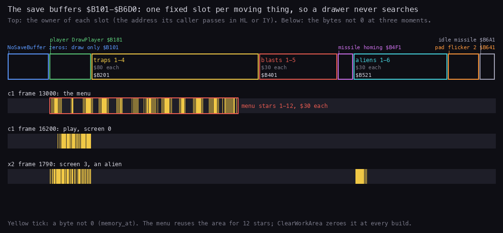

How to read the figure:

- **Top**: the area `$B101-$B6D0` with each owner's slot, coloured.
- **Below**: three `memory_at` reads; a yellow tick is a byte not 0. `c1` 13000 is the menu: the 12 menu stars fill
  `$B181-$B3C0`. `c1` 16200 is play on screen 0: only the player's slot is in use. `x2` 1790 is screen 3: the player
  and one alien.
- **The point**: the slots overlap between the menu and play, which never run at once. A sprite's erase is only as
  good as its buffer, so every build zeroes them all.

```bash
python3 tools/fig_render.py buffers
```

### The player's frames

The player is 25 frames of 24x32 at PlayerFrames `$EF80`, 96 bytes each:

| Frames | Shown when |
| --- | --- |
| 0-9 | the walk cycle: Walk draws WalkPhase, then adds 1 (back to 0 after 9) |
| 3 | in the air: a jump |
| 5 | standing still, blocked, or turning |
| 9 | falling |
| `$0A` | crouching |
| `$0B` | the death |
| 12-23 | the same 12 in the Exo-suit: PlayerFrame adds ExoSuit `$9ED8` (0 or `$0C`) |
| 24 (`$F880`) | caught in a trap |

DrawPlayer `$8229` draws a frame:

```asm
PlayerFrame:
  LD C,A
  LD A,(ExoSuit)
  ADD A,C
DrawPlayer:
  EX AF,AF'
  LD A,E
  CP $80
  LD A,D
  JR Z,NextScreen
  LD C,$47
  EX AF,AF'
  CALL ColourBigSprite
  LD BC,(PlayerX)
  LD (PlayerX),DE
  LD HL,(PlayerFrameShown)
  CP L
  JR NZ,DrawPlayerSprite
  LD H,B
  LD L,C
  AND A
  SBC HL,DE
  RET Z
DrawPlayerSprite:
  LD (PlayerFrameShown),A ; remember the frame, draw it through $76DA
  LD HL,WorkArea
  JP DrawBigSprite
```

```text
PlayerFrame(a, x, y):  a += ExoSuit                     # 0 or 12
DrawPlayer(a, x, y):
    if x == $80: NextScreen(y); return
    ColourBigSprite(x, y, $47)                           # bright white on black cells
    old = (playerX, playerY); (playerX, playerY) = (x, y)
    if a == playerFrameShown and old == (x, y): return   # nothing changed: no draw
    playerFrameShown = a
    DrawBigSprite(a, new = (x, y), old, buffer = $B181)
```

**A worked example**: frame 7 of the walk in the suit is 7 + `$0C` = 19, at `$EF80` + 19 x 96 = `$EF80` + `$720` =
`$F6A0`. Frame 24, the trap, is at `$EF80` + 24 x 96 = `$F880`.

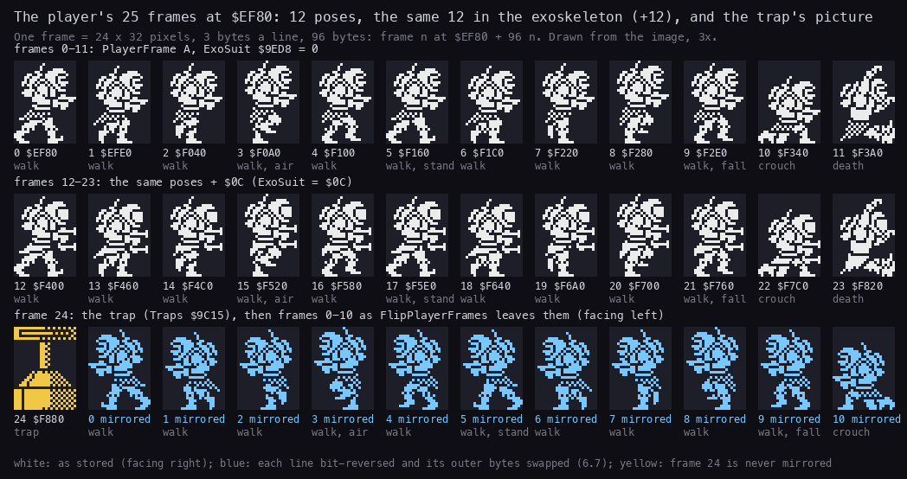

How to read the figure:

- **Top rows**: the 25 frames as stored, each labelled with its number and role.
- **Bottom row**: frames 0-11 as FlipPlayerFrames leaves them (6.7).
- **The point**: one walk cycle of 10 frames, three poses, a death, a trap, all doubled for the suit: the suit is a
  second costume, not a palette change.

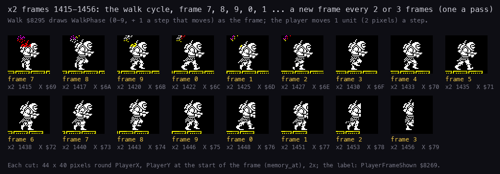

How to read the figure:

- Each cut is 44 x 40 pixels round the player at the start of an `x2` frame, shown when PlayerFrameShown `$8269`
  changed; under it, that frame number, the `x2` frame and X.
- **The point**: a pass draws one frame and moves the player 1 unit (2 pixels); a pass takes 2-3 TV frames, so the
  walk runs at about 20 steps a second. In `x2` frames 190-3000 the player never faces left and never wears the suit:
  frames 12-23 and the mirrored set are known only from the code and the image.

```bash
python3 tools/fig_render.py frames
python3 tools/fig_render.py walk
```

## 6.6 Code against the screen


How to read the figure:

- **Left**: the screen at the end of the window.
- **Right**: the same screen grey, with each byte written in the window coloured by the routine that wrote it last.
- **The list** gives each writer: how many screen bytes it wrote last, how many writes in all, the instructions that
  wrote, and the memory it read the bytes from.
- **What it shows**:
  - BigXorLoop and BigOldLine (DrawBigSprite) wrote the player's 128 bytes (cyan box in the gantry);
  - ColourBlackCell (ColourCells) coloured his 12 cells;
  - ColourCycleLoop (ColourCycle `$9118`) wrote 6 attribute cells of the gantry (pink, ColourCycleList `$9135`); the
    colour cycle is explained in [doc 7](07-objects.md);
  - PrintCharAttrLine wrote 36 bytes: the landing craft's two jets, two glyphs each, reprinted in a random bright
    ink every pass (orange; AnimateFlames `$8F54` through PrintCharAttr `$AE26`); the flames are in
    [doc 7](07-objects.md);
  - SpriteXorLoop and SpriteOldLine (DrawSprite) wrote 624 times each into the top two rows (red and green boxes at the
    top): the time pad, 6 blank 16x16 draws a pass, which XOR zeros and so change nothing;
  - DrawSmallSprite's loops wrote 512 times and are the last writer of no byte: its pad draws land on the same top
    bytes before DrawSprite's.
- **The point**: in two passes only 293 of 6912 screen bytes are written, and most of the 2136 writes change nothing.

```bash
python3 ../../kit/writers_map.py --trace work/docs/docA/c1/traces/16186_50000-16191_10000.uatr --listing build/game.lst \
    --out docs/img/render/writers-pass.png --view screen --sources \
    --title 'Two passes (c1 16186-16191): the player redrawn, two cells cycled; the time pads write blanks at the top'
```

## 6.7 The mirror

The player's frames exist facing right only. When he turns, FlipPlayerFrames `$7BAA` mirrors all 24 frames 0-23 in
place and toggles PlayerFlipped `$7BDA`:

- each 3-byte line: every byte replaced by its bit-reverse (BitReverse `$6400`, built by BuildReverseTable `$7B99`),
  and the outer two bytes swapped;
- 768 lines, about 131 000 T, nearly two frames ([doc 4](04-game-loop.md), 4.5).

**The trigger** is in Walk `$8295`. Left and right are XORed: neither or both is "stand". Moving left with the frames
unflipped, or right with them flipped, calls FlipPlayerFrames and goes to TurnAround, which forces a redraw of the
standing frame. The turn pass does not move the player.

```asm
Walk:
  LD HL,(ControlLeft)
  LD A,H
  XOR L
  LD (MoveDir),A
  LD A,$05
  JP Z,PlayerFrame
  LD A,$01
  LD (Facing),A
  BIT 0,L
  JR Z,WalkRight
  LD A,$FF
  LD (MoveDir),A
  LD (Facing),A
  LD A,(PlayerFlipped)
  OR A
  CALL Z,FlipPlayerFrames
  JR Z,TurnAround
  CALL TestLeft
  JR WalkTested
WalkRight:
  LD A,(PlayerFlipped)    ; facing right: mirror back first if the frames are
                          ; mirrored
  OR A
  CALL NZ,FlipPlayerFrames
  JR NZ,TurnAround
  CALL TestRight
  ; ...
TurnAround:
  LD A,$FF                ; the frames were just mirrored: force the redraw,
                          ; standing frame
  LD (PlayerFrameShown),A
  LD A,$05
  JP PlayerFrame
```

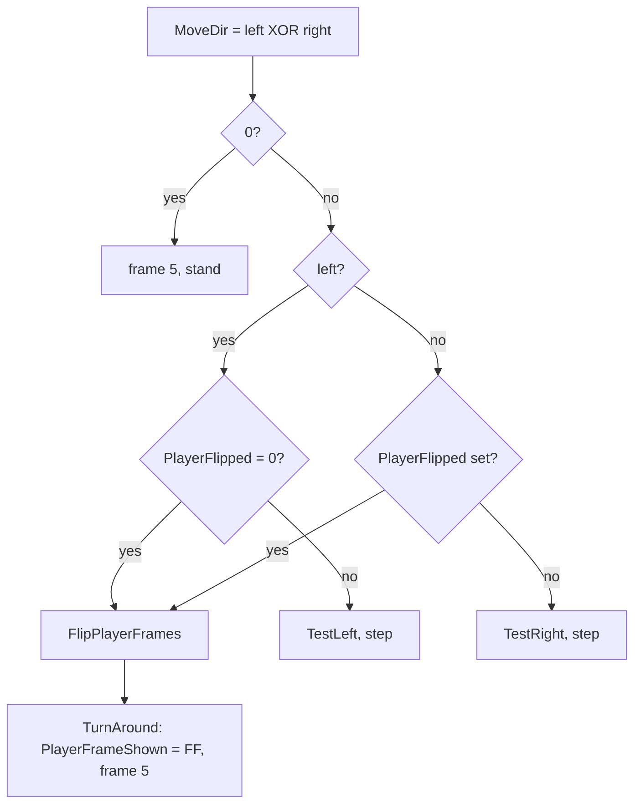

The mirror of one line:

```asm
FlipLine:
  PUSH BC                 ; one 3-byte line: reverse each, swap the outer two
  PUSH HL
  LD E,(HL)
  LD A,(DE)
  LD C,A
  INC HL
  LD E,(HL)
  LD A,(DE)
  LD (HL),A
  INC HL
  LD E,(HL)
  ; ...
```

```text
for each of the 768 lines (left, middle, right) at $EF80:
    left, middle, right = reverse(right), reverse(middle), reverse(left)
playerFlipped = playerFlipped XOR 1
```

**A worked example**: line 15 of frame 5 (standing), at `$EF80` + 5 x 96 + 15 x 3 = `$F18D`:

| | Byte 0 | Byte 1 | Byte 2 | The 24 pixels |
| --- | --- | --- | --- | --- |
| facing right (the image) | `$03` | `$FB` | `$0C` | `00000011 11111011 00001100` |
| reversed, swapped | `$30` | `$DF` | `$C0` | `00110000 11011111 11000000` |

The 24 pixels read backwards are the mirrored line. The bottom row of the player-frames figure (6.5) shows frames
0-11 after the mirror.

**The witness**: `c1` turned at frame 16338; its trace 16336-16341 shows FlipPlayerFrames running for nearly two
frames ([doc 4](04-game-loop.md), 4.5), then the standing frame drawn.

A death and StartGame also flip the frames back when PlayerFlipped is set, so a new life always starts facing right.

**The point**: one copy of the frames serves both directions, at the price of a two-frame pause at each turn.

## 6.8 The drawing against the beam

The game draws without regard to the beam.

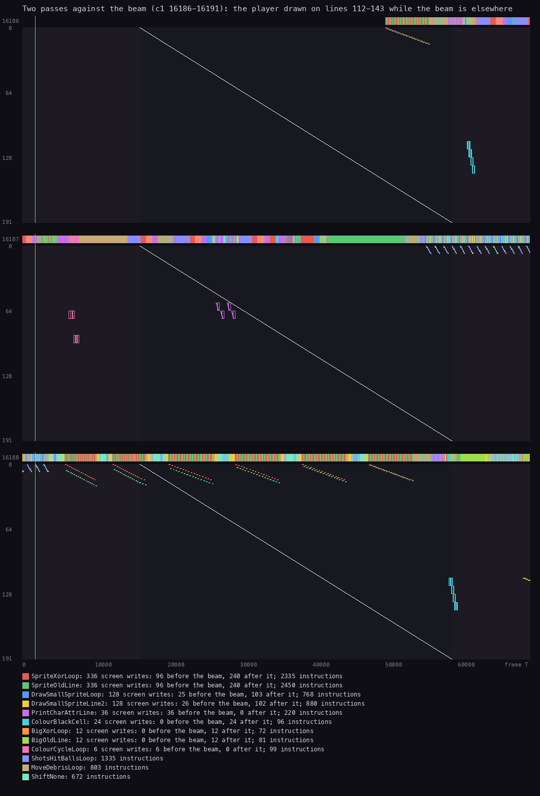

How to read the figure:

- One band per frame (16186, 16187, 16188). Across: the T-state in the frame. Down: the screen line, 0-191.
- The white diagonal is the beam: it paints line 0 at T 14 336 and moves one line every 224 T. The darker parts are
  the borders.
- Each mark is a screen write, at its line and its time, coloured by the routine (the legend). The bar on top shows
  which routine runs.
- **What it shows**: the player's writes (BigXorLoop, BigOldLine, ColourBlackCell) are at lines 112-143 near the end
  of frames 16186 and 16188, after the beam has passed those lines. The time-pad writes (SpriteXorLoop,
  SpriteOldLine, DrawSmallSprite) go to the top rows, mostly behind the beam.
- **The point**: in this window every player write came after the beam (0 before, 12 after for BigXorLoop), so the
  picture showed him whole.

```bash
python3 ../../kit/beam_timeline.py --trace work/docs/docA/c1/traces/16186_50000-16191_10000.uatr --listing build/game.lst \
    --machine 48k --out docs/img/render/beam-pass.png \
    --title 'Two passes against the beam (c1 16186-16191): the player drawn on lines 112-143 while the beam is elsewhere'
```

Two of the traced player draws, from the pass figures of [doc 4](04-game-loop.md):

- **Frame 16188** (4.3, the second pass): DrawBigSprite runs from T 59 995 into frame 16189. The player stands at
  Y `$70`, so his writes are on lines 112-143. They are made at the very end of frame 16188 (beam at the bottom
  border) and in the first 9000 T of frame 16189 (beam in the top border).
- **Frame 16338** (4.5, the turn): the player is drawn on the same lines from about T 54 000, when the beam is near
  line 177. The draw ends about T 66 000, well before the next frame's beam reaches line 112 (T 39 424).

So neither traced draw met the beam. Nothing in the code makes this so. The pass length drifts against the 69 888 T
frame (4.5), so some draws can cross the beam and show a split player for one frame. How often was not measured.

## 6.9 The cost of drawing

| Work | T-states | Witness |
| --- | ---: | --- |
| DrawBigSprite, the player moved | about 23 000 | `c1` 16188 (the animation in 6.5) |
| DrawSprite, one alien | about 11 200 | `x2` 1781 |
| DrawSmallSprite, one ball or shot | about 1 040 | `x2` 342 |
| DrawStars, 66 tries | about 59 000 | `x2` 750 |
| FlipPlayerFrames | about 131 000 | `c1` 16338 ([doc 4](04-game-loop.md)) |
| BuildScreen, screen 1 | about 631 500 | `x2` 743-752 |
| BuildScreen, screen 0 | about 700 000 | `c1` 16129-16139 |

**The point**: the player is the costliest thing in a pass, and a screen change costs as much as about 5 passes (9-10 frames); the
game hides neither.
