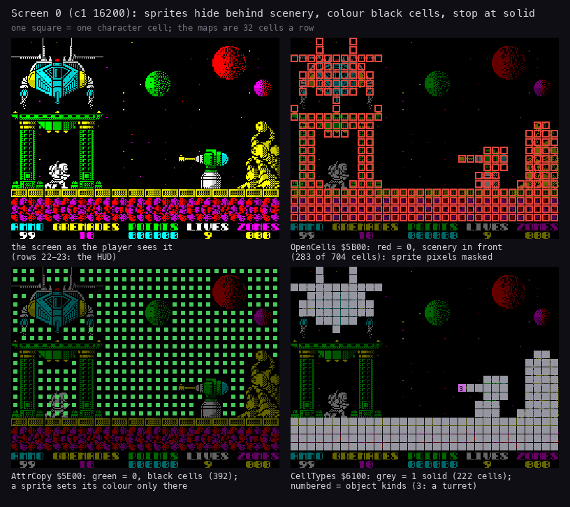
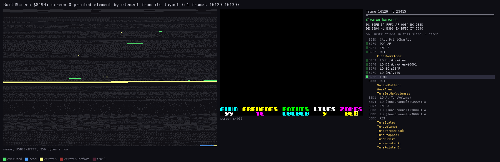
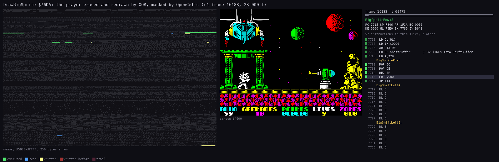
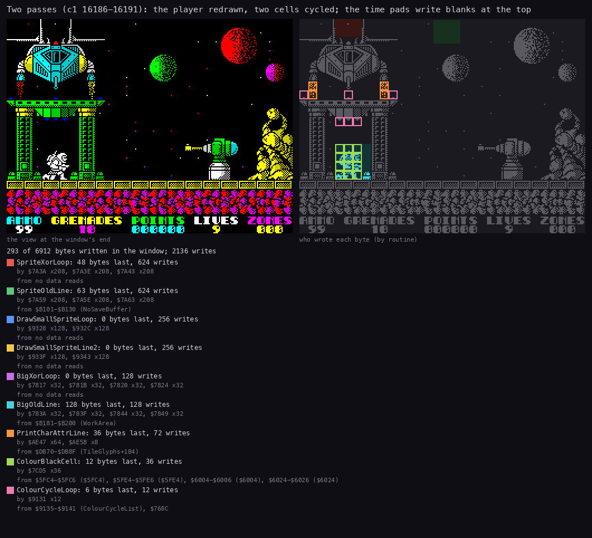

# 6. Rendering

What this covers:

- the screen: one buffer, drawn in place, no frame sync (6.1);
- the three cell maps behind the picture (6.2);
- the string interpreter and its five printers, with a worked example (6.3);
- the screen builder, animated (6.4);
- the sprites: four drawers, all XOR, masked by the cell maps (6.5);
- who writes the screen in two passes (6.6);
- the mirror of the player's frames, with a worked example (6.7);
- the drawing against the beam (6.8).

The names are those of `src/game/game.ann` ([Terms](README.md#terms)). The recordings it rests on:

- `c1` (power-on, the load, 16 000 frames of seeded random play, 48K), opened read-only on an own instance as
  `work/docs/docA/c1` (`re_session.py open --work work/docs/docA/c1 --ttd work/c1/session.ttd --port-base 27000`).
  Its access traces (`work/docs/docA/c1/traces/`): frames 16129-16139 (the build of screen 0), 16186-16191 (two
  passes), 16188-16189 (one DrawBigSprite call), 16336-16341 (a turn). Its memory at frame 16200 (`memory_at`,
  cached in `work/docs/docA/c1/mem-at/`) gives the cell maps.
- The code of `src/game/sprites.asm`, `text.asm`, `screens.asm`, `colour.asm`, `effects.asm`, `input.asm`.
- `c1` never left screen 0. The other screens' elements were drawn by exB's copy of the print interpreter
  (`work/ann/exB/render.py`, WALKTHROUGH 6.1) and appear here only through [doc 1](01-game-design.md)'s sheet of warp
  screens.

## 6.1 The screen

- **One buffer**: everything is drawn straight into the Spectrum screen at `$4000`. There is no back buffer and no
  copy.
- **The layout**: character rows 0-21 are the play area; rows 22-23 are the HUD (DrawHud `$7690`, [doc 8](08-hud-and-text.md)).
  ClearPlayArea `$B061` clears only the 22 play rows and their attributes.
- **A static scene**: the scenery is printed once per screen, by BuildScreen `$8494` (6.4). It does not scroll.
- **Moving things are XORed** on and off by the routine that moves them, at the moment it moves them (6.5).
- **No frame sync**: the game runs with interrupts off ([doc 4](04-game-loop.md), 4.3). A draw happens wherever the
  pass happens to be against the beam (6.8).
- **Screen addresses** come from two tables built by Start: LineAddrHigh `$6500` and LineAddrLow `$6600`, the
  address of each of the 192 pixel lines (BuildLineTables `$7BEF`). PixelAddress `$B088` reads them.
- **Positions**: X counts units of 2 pixels (0-`$7F` across the screen, 4 units a character column); Y counts
  pixels. The cell of a position is (Y / 8, X / 4).

## 6.2 The cell maps

Three maps of 32 x 24 bytes, laid out like the attributes, record what the screen builder printed in each cell:

| Map | Address | Written by | Read by |
| --- | --- | --- | --- |
| OpenCells | `$5B00` | FillOpenMap `$8E03` (`$FF`), each printed glyph (0, or `$FF` after PrintString `$EA`) | the sprite drawers: a 0 cell masks the sprite out |
| AttrCopy | `$5E00` | SaveAttributes `$8E11`: a copy of the attributes after the build | ColourCells `$7CA7`: a sprite colours only cells that are 0 here |
| CellTypes | `$6100` | each printed glyph (PrintString `$E8 n`, 1 for scenery), IndexObjectCells `$8E86` | the movement and shot tests (BlockMapCell `$80C1`) |



How to read the figure:

- **Top left** is screen 0 as `c1` shows it in frame 16200, the player standing inside the gantry.
- **The other three panels** are the same screen dimmed, with one map drawn over it, one square a character cell:
  - **OpenCells** `$5B00`: a red square is a 0, a cell where scenery was printed. 283 of the 704 play cells. The
    landing craft, the gantry, the floor and the rocks are red; the planets and the stars are not;
  - **AttrCopy** `$5E00`: a green square is a 0, a cell whose attribute is black on black. 392 cells. Only there
    does a sprite set its own colour;
  - **CellTypes** `$6100`: a grey square is 1, solid. 222 cells: the floor, the rocks and the top of the landing
    craft. The gantry is not solid: the player walks through it. The numbered square is kind 3, the gun turret.
- **The point**: the gantry's pillars are in front of the player (OpenCells 0) but not in his way (CellTypes 0).
  Three maps, three questions: is scenery in front, may a sprite colour this cell, can the player pass.

```bash
python3 tools/fig_cellmaps.py --work work/docs/docA/c1 --frame 16200 --out docs/img/render/cell-maps.png
```

## 6.3 The string interpreter

Every piece of fixed text and scenery is a string for PrintString `$AF2B`: the HUD, the menus, the 62 scenery
elements, GAME OVER, the bonus panels. A string is glyph codes mixed with control codes:

| Byte | Meaning |
| --- | --- |
| `$00-$60` | a glyph of the current glyph set at (row, column), then column + 1 |
| `$61-$8F` n | a relative move: row + (code - `$78`), column + n |
| `$90-$CE` | the next row, column + (code - `$AF`) |
| `$CF-$DE` | the ink: code - `$CF`; 8-15 are the bright inks 0-7 |
| `$DF` r c | row and column absolute |
| `$E0` a | the attribute |
| `$E1` n ... `$E2` | repeat the bytes between n times |
| `$E3` lo hi | print the string at hi lo here, then go on (a subroutine) |
| `$E4` n g / `$E5` n g | glyph g n times to the right / down |
| `$E6` lo hi | the glyph set: glyph g is 8 bytes at hi lo + 8 g |
| `$E7` | a space of the font, column + 1 |
| `$E8` n | the cell type the next glyphs write into CellTypes |
| `$E9` / `$EA` | the next glyphs mark OpenCells 0 (scenery) / `$FF` (open) |
| `$EB` n | the current cell's type = n, without a glyph |
| `$EC-$FF` | the end (the strings use `$FF`) |

The first branches of the interpreter:

```asm
PrintString:
  LD A,(HL)
  INC HL
  CP $61
  JP NC,PrintStringMove
  CALL PrintChar          ; the plot mode's routine (operand $AF33 set by
                          ; SetPlotMode)
  INC E
  JP PrintString
PrintStringMove:
  CP $90                  ; $61-$8F: a relative move, the row from the code,
                          ; the column from the next byte
  JP NC,PrintStringNewLine
  SUB $78
  ADD A,D
  LD D,A
  LD A,(HL)
  ADD A,E
  LD E,A
  INC HL
  JP PrintString
  ; ...
```

```text
loop:
    code = next byte
    if code < $61:  plot glyph code at (row, column); column += 1
    elif code < $90: row += code - $78; column += next byte
    elif code < $CF: row += 1; column += code - $AF
    elif code < $DF: ink = code - $CF (8-15 bright)
    ... the codes $DF-$EB as in the table ...
    else: return
```

**The five printers.** The glyph is plotted by one of five routines. SetPrinter `$99F8` writes the chosen one into the
four `CALL`s of PrintString, from Printers `$9A0F`:

| Mode | Routine | What it does to the cell |
| --- | --- | --- |
| 0 | PrintChar `$ADE1` | glyph and attribute; writes CellTypes and OpenCells; skips columns 32-63 (off-screen parts of an element) |
| 1 | PrintCharAttr `$AE26` | glyph and attribute, no maps, no clip (the HUD numbers) |
| 2 | XorCharAttr `$AE5D` | glyph XORed on, attribute set (the turrets' barrels) |
| 3 | EraseBlockDebris `$AE95` | glyph XORed off, the cell made open and empty, two debris pieces started (scenery broken by a grenade) |
| 4 | EraseBlock `$AEE4` | the same without debris (the pods taken) |

**A worked example: HudText `$76A2`**, the HUD's labels. Its bytes and what each does:

| Bytes | Meaning |
| --- | --- |
| `$DF $16 $00` | row 22, column 0 |
| `$E6 $E0 $D7` | glyph set `$D7E0`: the font (code `$20`, space, at `$D8E0`) |
| `$E8 $01` | the cells get type 1 |
| `$E9` | the cells are marked as scenery in OpenCells |
| `$DC` `AMMO` `$20` | ink `$DC` - `$CF` = 13 = bright 5, cyan: AMMO and a space |
| `$DD` `GRENADES` `$20` | ink 14 = bright 6, yellow |
| `$DB` `POINTS` `$20` | ink 12 = bright 4, green |
| `$DE` `LIVES` `$20` | ink 15 = bright 7, white |
| `$DA` `ZONES` | ink 11 = bright 3, magenta |
| `$DF $17 $00` | row 23, column 0 |
| `$E4 $20 $20` | 32 spaces across |
| `$E3 $82 $AD` | the sub-string at `$AD82`: the score |
| `$FF` | the end |

The result is row 22 of every play screen in [doc 1](01-game-design.md)'s figures: AMMO in cyan, GRENADES in yellow,
POINTS in green, LIVES in white, ZONES in magenta.

## 6.4 The screen builder

BuildScreen `$8494` runs at the start of a game, at each screen change and after a zone end:

- it resets every object list of the screen, fills OpenCells with `$FF` and clears CellTypes and the play rows;
- it reads the screen's layout from ScreenTable `$C7F4`: 3-byte records of row, column, element number, `$FF` the
  end;
- for each record it notes the element's destructible pieces (AddDestructible `$9487`), then prints the element's
  string from ElementTable `$852E` at the row and column, with cell type 1 and OpenCells 0 (the string can change
  both);
- at the end: SaveAttributes (AttrCopy), the stars, IndexObjectCells (the object cells the strings marked become the
  lists of turrets, mines, pods...), then the balls, aliens, missile and force field of the screen.

```asm
BuildScreenNext:
  LD A,(HL)               ; the next element record; $FF ends
  CP $FF
  JR Z,BuildScreenDone
  LD D,A
  INC HL
  LD E,(HL)
  INC HL
  PUSH HL
  LD A,(HL)
  CALL AddDestructible
  LD BC,ElementTable
  CALL TableWord
  LD A,$01
  LD (PrintCharLine+$0018),A
  XOR A
  LD (PrintCharLine+$001E),A
  LD C,A
  CALL PrintString
  POP HL
  INC HL
  JP BuildScreenNext
```

```text
for each (row, column, element) in layout[screenNumber] until $FF:
    note the element's destructible pieces
    cellType = 1; openCell = 0; attribute = 0
    print ElementTable[element] at (row, column)
```

**A worked example: screen 0's layout** (Screen000Layout `$C8EE`), nine records:

| Row | Column | Element | What |
| ---: | ---: | ---: | --- |
| 19 | 0 | 10 | RockGroundA: the purple rock ground |
| 18 | 0 | 33 | FloorStripYellow: the yellow floor |
| 2 | 0 | 2 | LandingCraft |
| 8 | 0 | 11 | Gantry |
| 1 | 24 | 3 | PlanetRed4 |
| 4 | 16 | 30 | PlanetGreen3 |
| 5 | 29 | 4 | PlanetMagenta2 |
| 10 | 29 | 13 | RockSpire |
| 14 | 20 | 5 | GunTurret |



How to read the animation:

- **Left**: the memory `$5B00-$FFFF`, 256 bytes a row. Green is executed in this slice, blue read, yellow written;
  older touches fade to a dark trail.
- **Middle**: the screen as it is drawn; bytes written in the slice flash.
- **Right**: the listing round the instruction last executed, with the registers and the frame.
- **What happens**: ClearPlayArea wipes the 22 rows line by line (the first pictures, about 130 000 T), then the nine elements appear in the layout's order: the ground and floor at the bottom, the landing craft,
  the gantry, the planets, the spire, the turret. The stars come last (the squares that flash over the sky).
- **The point**: the scenery is printed once, as character glyphs, in about 700 000 T (10 frames). The player sees
  the screen being drawn.

```bash
python3 ../../kit/routine_anim.py --work work/docs/docA/c1 --window 16129:14000-16139:0 --listing build/game.lst \
    --out docs/img/render/BuildScreen.gif --pc 8494-B100 --view screen --range 5B00-FFFF --pictures 60 --delay 120 \
    --hold 2000 --title 'BuildScreen $8494: screen 0 printed element by element from its layout (c1 frames 16129-16139)'
```

## 6.5 The sprites

Four drawers, all XOR:

| Routine | Size | Frames | Users | Shift | Masked by OpenCells | Save buffer |
| --- | --- | --- | --- | --- | --- | --- |
| DrawBigSprite `$76DA` | 24x32 | PlayerFrames `$EF80`, 96 bytes each | the player, the traps | at draw time, 0/2/4/6 pixels | yes, and a right-edge clip | 128 bytes |
| DrawSprite `$795C` | 16x16 | Sprites16 `$F8E0`, 32 bytes each | the menu stars, aliens, the missiles, the flickering pad, the blasts, the time pad | at draw time | yes | 48 bytes |
| DrawSmallSprite `$92FB` | 16x8 drawn (8x8 shapes) | SmallSprites `$ED40`, 4 pre-shifted copies, 64 bytes each | the grenade, debris, puffs, balls, gun shots, the time pad | pre-shifted (X AND 3) | no | none |
| XorShot `$82FC` | 8x1 | the byte `$BD` | the player's shots | | no | none |

The two big drawers move a sprite in one call:

- the caller passes the new place (DE), the old place (BC), the frame (A) and a buffer (HL) holding the image as it
  was last drawn;
- the new image is shifted, masked by OpenCells, and kept;
- the old image is XORed off at the old place and the new one XORed on at the new place, line by line;
- HL = NoSaveBuffer `$B101` (128 zero bytes) means nothing to erase and nothing to keep: that is how the time pads
  draw.

### DrawBigSprite

Its steps, for frame A at X, Y:

1. **Frame address**: `$EF80` + 96 A. SP is set to it and the lines are read with `POP`.
2. **Shift**: (2 X) AND 7 is the pixel shift, 0, 2, 4 or 6. BigShiftJumps `$78CA` picks the routine. A shift of 4 or 6
   is done as a left shift of 4 or 2 into the byte before. Each of the 32 lines becomes 4 bytes in ShiftBuffer
   `$78DC`.
3. **Mask**: BigSpriteMask `$776C` ANDs the OpenCells bytes of the 4 x 4 cells under the new place (5 rows when Y is
   not a multiple of 8). All `$FF`: no scenery in front, no masking. Else BigMaskRows cuts the image where a cell is
   0.
4. **Clip**: X from `$75` on keeps only the bytes that stay on the line: three for `$75-$77`, two for `$78-$7B`, one
   from `$7C`.
5. **XOR**: BigXorLoop `$7814` XORs the new line on, BigOldLine `$7837` XORs the old line off, 32 times.
6. **Keep**: the 128 new bytes go into the buffer, unless it is `$B101`.

A worked example of the shift: X = `$11` (34 pixels). (2 x `$11`) AND 7 = 2: the sprite is 2 pixels right of the
byte boundary of column 4 (34 = 4 x 8 + 2). Each 3-byte line goes through BigShiftRight2 and becomes 4 bytes.

The XOR of one line at the new place, from BigXorLoop:

```asm
BigXorLoop:
  POP DE                  ; the new line from ShiftBuffer XORed on
  LD A,E
  XOR (HL)
  LD (HL),A
  INC L
  LD A,D
  XOR (HL)
  LD (HL),A
  INC L
  POP DE
  LD A,E
  XOR (HL)
  LD (HL),A
  INC L
  LD A,D
  XOR (HL)
  LD (HL),A
  DEC L
  DEC L
  DEC L
  INC H
  ; ... the next screen line (the Spectrum's line order), then BigOldLine
```

```text
for line in 0..31:
    for b in 0..3:
        screen[newAddress + b] ^= shifted[line][b]
    for b in 0..3:
        screen[oldAddress + b] ^= saved[line][b]
    newAddress, oldAddress = next pixel line of each
saved = shifted          (unless the buffer is NoSaveBuffer)
```



How to read the animation:

- The panels are those of 6.4.
- **What happens**: the frame's lines are read from `$EF80` + 96 A (blue at the bottom of the memory panel) and
  written into ShiftBuffer `$78DC` (yellow near `$7800`); the mask reads OpenCells `$5B00` (the top rows); then the
  XOR loop writes the screen lines of the player one by one, and the 128 bytes are copied into the player's buffer
  in WorkArea `$B181`.
- **The point**: one call of about 23 000 T both erases and draws. The player's pixels change line by line, never
  all at once.

```bash
python3 ../../kit/routine_anim.py --work work/docs/docA/c1 --window 16188:59900-16189:13000 --listing build/game.lst \
    --out docs/img/render/DrawBigSprite.gif --pc 76DA-795B --view screen --range 5B00-FFFF --pictures 40 --delay 150 \
    --title 'DrawBigSprite $76DA: the player erased and redrawn by XOR, masked by OpenCells (c1 frame 16188, 23 000 T)'
```

### Colour

The drawers do not touch the attributes. The movers colour their sprites afterwards:

- ColourCells `$7CA7` writes attribute C over the cells a sprite covers (one column more when X AND 3 is not 0, one
  row more when Y AND 7 is not 0);
- a cell whose AttrCopy byte is not 0 keeps its colour: a sprite passing in front of coloured scenery takes the
  scenery's colour;
- ColourBigSprite `$7C5F` (3 x 4 cells) and ColourSprite `$7C8F` (2 x 2) set the size and enter ColourCells.

The shots: XorShot `$82FC` XORs one pixel line of 8 pixels, `$BD` = `10111101`. The cells a shot crosses turn bright
white where the scenery colour is black.

## 6.6 Code against the screen



How to read the figure:

- **Left**: the screen at the end of the window.
- **Right**: the same screen grey, with each byte written in the window coloured by the routine that wrote it last.
- **The list** gives each writer: how many screen bytes it wrote last, how many writes in all, the instructions that
  wrote, and the memory it read the bytes from.
- **What it shows**:
  - BigXorLoop and BigOldLine (DrawBigSprite) wrote the player's 128 bytes (cyan box in the gantry);
  - ColourBlackCell (ColourCells) coloured his 12 cells;
  - ColourCycleLoop (ColourCycle `$9118`) wrote 6 attribute cells of the gantry (pink, ColourCycleList `$9135`);
  - PrintCharAttrLine wrote 36 bytes: the landing craft's two jets, two glyphs each, reprinted in a random bright
    ink every pass (orange; AnimateFlames `$8F54` through PrintCharAttr `$AE26`);
  - SpriteXorLoop and SpriteOldLine (DrawSprite) wrote 624 times each into the top two rows (red and green boxes at the
    top): the time pad, 6 blank 16x16 draws a pass, which XOR zeros and so change nothing;
  - DrawSmallSprite's loops wrote 512 times and are the last writer of no byte: its pad draws land on the same top
    bytes before DrawSprite's.
- **The point**: in two passes only 293 of 6912 screen bytes are written, and most of the 2136 writes change nothing.

```bash
python3 ../../kit/writers_map.py --trace work/docs/docA/c1/traces/16186_50000-16191_10000.uatr --listing build/game.lst \
    --out docs/img/render/writers-pass.png --view screen --sources \
    --title 'Two passes (c1 16186-16191): the player redrawn, two cells cycled; the time pads write blanks at the top'
```

## 6.7 The mirror

The player's frames exist facing right only. When he turns, FlipPlayerFrames `$7BAA` mirrors all 24 frames in place
and toggles PlayerFlipped `$7BDA`:

- each 3-byte line: every byte replaced by its bit-reverse (BitReverse `$6400`, built by BuildReverseTable `$7B99`),
  and the outer two bytes swapped;
- 768 lines, about 131 000 T, nearly two frames ([doc 4](04-game-loop.md), 4.5).

```asm
FlipLine:
  PUSH BC                 ; one 3-byte line: reverse each, swap the outer two
  PUSH HL
  LD E,(HL)
  LD A,(DE)
  LD C,A
  INC HL
  LD E,(HL)
  LD A,(DE)
  LD (HL),A
  INC HL
  LD E,(HL)
  ; ...
```

```text
for each of the 768 lines (left, middle, right) at $EF80:
    left, middle, right = reverse(right), reverse(middle), reverse(left)
playerFlipped = playerFlipped XOR 1
```

**A worked example**: line 15 of frame 5 (standing), at `$EF80` + 5 x 96 + 15 x 3 = `$F00D`:

| | Byte 0 | Byte 1 | Byte 2 | The 24 pixels |
| --- | --- | --- | --- | --- |
| facing right (the image) | `$03` | `$FB` | `$0C` | `00000011 11111011 00001100` |
| reversed, swapped | `$30` | `$DF` | `$C0` | `00110000 11011111 11000000` |

The 24 pixels read backwards are the mirrored line.

A death and StartGame also flip the frames back when PlayerFlipped is set, so a new life always starts facing right.

## 6.8 The drawing against the beam

The game draws without regard to the beam. Two of the traced player draws, from the pass figures of
[doc 4](04-game-loop.md):

- **Frame 16188** (4.3, the second pass): DrawBigSprite runs from T 59 995 into frame 16189. The player stands at
  Y `$70`, so his writes are on lines 112-143. They are made at the very end of frame 16188 (beam at the bottom
  border) and in the first 9000 T of frame 16189 (beam in the top border).
- **Frame 16338** (4.5, the turn): the player is drawn on the same lines from about T 54 000, when the beam is near
  line 177. The draw ends about T 66 000, well before the next frame's beam reaches line 112 (T 39 424).

So neither traced draw met the beam: each picture showed the player either before or after the draw, not half of
each. Nothing in the code makes this so. The pass length drifts against the 69 888 T frame (4.5), so some draws
must cross the beam and show a split player for one frame. That case was not caught in a trace.
