# 7. Objects

What this covers:

- how the scenery turns into objects: the cell maps, the marks the elements carry, and the 16 object lists the
  screen builder fills;
- each kind of object: what it does, its record, its routine;
- the things that move but are not built from the scenery: aliens, shells, gun shots, balls, missiles, blasts,
  debris;
- the two sprite sets they are drawn from.

The recordings it rests on:

- `x2` (`tests/inputs/x2-imm-right.txt` on `entry-imm.z80`, a clone with the ZXDB POKEs for lives, ammunition,
  grenades, immunity, mines and traps; exploration only): screens 0-5, frames 0-23 110. Aliens, balls and pods come
  from it.
- `t1` (exC's clone `work/ann/exC/t1`: `entry.z80` warped to screen 14 with only the lives and immunity POKEs, so the
  traps run; exploration only): 1850 frames, the traps.
- `x1` (no POKE, screen 0): turret shells, nine deaths.
- The 97 warp runs `work/w/NNN` (each a clone on one start screen, traps and the mine kill POKEd; exploration only):
  homing missiles (`w/006`, `w/008`), the exoskeleton (`w/108`), gun shots (`w/006`, `w/008`, `w/009`), mines.
- The image itself (`work/mkgame/original.bin`) for the tables. The figures that rest on the image alone say so
  ("model").

Scope: the hero's moves and his shots are in [10.11](10-gameplay-logic.md#1011-the-hero) and
[10.12](10-gameplay-logic.md#1012-the-players-shots), the keys in [5. Controls](05-controls.md); the rules (points, deaths, zones) are in
[10. Gameplay logic](10-gameplay-logic.md); the drawing primitives are in [6. Rendering](06-rendering.md).

## 7.1 Three cell maps and the build

A screen is 32 columns by 24 rows of 8 x 8 cells. Rows 22 and 23 hold the HUD. The playfield is rows 0-21: 704
cells (`$02C0`).

The screen builder BuildScreen `$8494` keeps three maps of 768 bytes, one byte a cell:

| Map | Address | Values |
| --- | --- | --- |
| OpenCells | `$5B00` | `$FF` open, 0 scenery drawn. The sprite routines use it as a mask: a sprite never covers scenery. |
| AttrCopy | `$5E00` | a copy of the attributes, taken by SaveAttributes `$8E11` when the build is done. A sprite colours only the cells that are 0 here (black on black); coloured scenery keeps its colour ([6.2](06-rendering.md#62-the-cell-maps)) |
| CellTypes | `$6100` | 0 empty, 1 solid; during the build also 2-17, the object kinds |

The builder reads the screen's layout from ScreenTable `$C7F4`.
There are 125 layouts, one per screen.
A layout is a list of (row, column, element) triples ended by `$FF`.
Each element is a string in the 62-entry ElementTable `$852E`, printed by PrintString `$AF2B`
([8.2](08-hud-and-text.md#82-the-string-printer-af2b)).

Two codes of that printer put object marks into CellTypes:

- `$E8 n`: every cell printed after it gets CellTypes `n` (until the next `$E8`).
- `$EB n`: CellTypes `n` at the cursor; nothing is printed and the cursor does not move.

When every element is printed, IndexObjectCells `$8E86` scans the 704 playfield cells.
Each cell of value 2 or more becomes a record in the list of its kind.

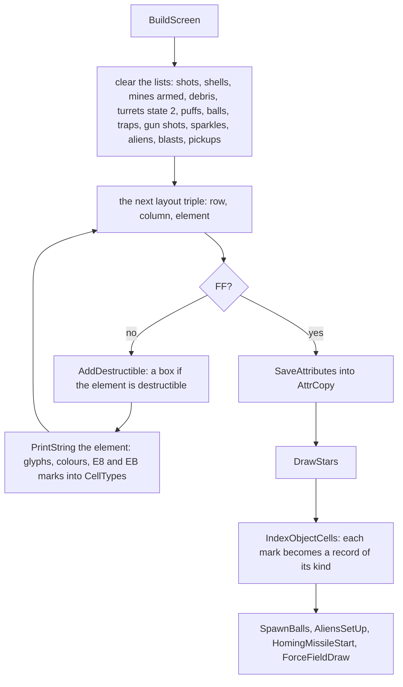

KindTable `$8EF4` describes the kinds.
The record of kind `n` sits at `$8EE8 + 6n` (kinds start at 2, so the first record is at `$8EF4`).
Its six bytes:

- +0/+1: the list's start;
- +2/+3: the write pointer;
- +4: the record size (2 or 3 bytes);
- +5: the value the map cell gets after the cell is listed.

```asm
IndexObjectCells:
  LD HL,KindTable
  LD B,$10
IndexObjectCellsReset:
  LD E,(HL)
  ; ...                   ; each list: $FF at its start, the pointer reset
  DJNZ IndexObjectCellsReset
  LD HL,CellTypes
  LD BC,$02C0
IndexObjectCellsScan:
  LD A,(HL)
  CP $02
  CALL NC,AddObjectCell
  ; ...
AddObjectCell:
  ; ...                   ; E = column, D = row from HL - $6100
  LD BC,KindTable-$000C
  ADD HL,BC               ; IX = the kind's record ($8EE8 + 6 A)
  ; ...
  LD (HL),E               ; column, row at the write pointer
  INC HL
  LD (HL),D
  LD C,(IX+$04)
  ; ...                   ; the pointer moves on by the record size
  LD (HL),$FF             ; the end mark after the new record
  POP HL
  LD A,(IX+$05)
  LD (HL),A               ; the map cell: 0, 1, or the kind kept
```

The same as pseudocode:

```text
for kind in 2..17: list[kind].start[0] = $FF; list[kind].write = list[kind].start
for cell in 0..703:
    kind = CellTypes[cell]
    if kind >= 2:
        rec = list[kind].write
        rec[0] = cell % 32            # column
        rec[1] = cell / 32            # row
        list[kind].write += size[kind]
        list[kind].write[0] = $FF
        CellTypes[cell] = after[kind] # 0 open, 1 solid, 3 or 13 kept
```

A worked example: a gun cell at column 18, row 9 is CellTypes address `$6100 + 9 * 32 + 18 = $6232`.
AddObjectCell gets E = `$32 AND $1F` = 18 and D = `$0132 / 32` = 9.
Kind 11's record is at `$8EE8 + 66 = $8F2A`.
The list GunList `$9DC1` gets the bytes `12 09` and an `$FF`; the map cell becomes 0.

Only two kinds keep their number in the map: the turret (3) and the missile launcher (13).
HomingMissileStep tests the launcher's cell for 13 every pass: a grenade that blows the launcher away leaves 0 there
(7.6).

### The 16 kinds on their elements


```sh
python3 tools/fig_objects.py kinds     # both figures
```

How to read:

- Two figures, 8 and 6 elements; the first ends with a note on the `$E8` and `$EB` codes.
- One panel an element, drawn by a model of PrintString (`tools/fig_docb.py`) from the image's bytes. The model's
  KindTable is checked against the image before drawing.
- A box marks a cell the element types as an object; the number next to it is the kind, in the kind's colour (one
  number a kind, on the first free side of its first cell).
- Under each panel: the kind's name, how many cells the element marks, the list address, the record size and the map
  value after the build.
- Element 22 prints nothing: it is a bare `$EB 0A`, the trap's mark. The green sprite next to it is what Traps draws
  there later (PlayerFrames frame 24, sprite `$18`).

What it shows:

- The objects are part of the scenery's strings, not a separate table. A teleport booth (element 17) carries its
  teleport (kind 6, one cell) and four blinking lights (kind 4).
- A gun (element 26) marks two cells as kind 11 and the two cells behind its barrel as kind 14 (pickup cells, 7.7).
- The drop pod (element 1) carries two flame jets (kind 2) and the force field emitter (kind 17).
- Ball spawners come in two forms: the ring on a pedestal (element 21) and a bare mark (element 39).

### A built screen: records, not cells


```sh
python3 tools/fig_objects.py lists
```

How to read:

- Left: the screen of `t1` at frame 500 (screen 14), from the recording's saved RAM. Each box is one record of one
  list at its (column, row); the number is the kind, once for each group of one kind.
- Right, top: CellTypes `$6100` from the same RAM, white = 1 (solid), black = 0. The boxes show where the records
  point.
- Right, bottom: OpenCells `$5B00`, white where scenery is drawn.
- Bottom: every list that holds records, its bytes decoded, and the comparison with the model of the build.

What it shows:

- Screen 14 has 17 records in five lists: 8 blinking lights, 2 teleports, 3 traps, 2 gun cells, 2 pickup cells.
- After the build CellTypes holds only 0 and 1: every object cell got its kind's "after" value.
- The model (PrintString on ScreenTable entry 14, then the scan) gives the same 17 cells as the RAM.
- The trap records carry a third byte, the counter (`$5D`, `$42`, `$3C` at this frame); the pickup records carry
  their live flag (`$01`).

The kinds over all 125 screens are drawn in the zone figure of [10.2](10-gameplay-logic.md#102-zones-of-25-screens),
and their counts per zone are in the table under it ("No difficulty level, but a curve in the tables").

## 7.2 What each kind does

The main loop `$75BE` calls each kind's routine once a pass (a few twice).
A pass takes about two frames ([4. Game loop](04-game-loop.md)).
Every routine walks its list until the `$FF` after the last record.

| Kind | List | Routine | What it does | Witness |
| ---: | --- | --- | --- | --- |
| 2 | FlameList `$8F89` | AnimateFlames `$8F54` | a jet of flame below the drop pod; three phases, glyphs `$15 + 2p` of the tile set `$DAB8` | screen 0 in `x1` |
| 3 | TurretList `$9022` | AnimateTurrets `$8F95` | idle (state 1); fires with chance 6 in 256 a pass; a recoil runs states 9 down to 2 through TurretFrames `$9019`, drawn by XOR from the tile set `$DDD8` (below) | `x1` frames 1200-1800, `x2` 1584-1608 |
| 4 | `$9135` | ColourCycle `$9118` | a blinking light: its ink is PassCount AND 7, bright | `x2` frames 405-420, screen 0: the six cells (0,8) (5,8) (10,8) (4,11) (5,11) (6,11) read ink 2, 4, 4, 4, 4, 5, 6 together; 50 screens |
| 5 | MineList `$91B0` | Mines `$9152` | armed (state 1): fires when the player's bottom line is the line just above it and his X is within E-7..E+2; a spent mine burns with glyphs `$1D-$20` | `w030` (1 mine fired), 23 warp runs |
| 6 | `$9930` | Teleports `$98BA` | up pressed while standing in a booth: sparkles `$9ED9`, the AY pulse `$C162`, the player moved to the other booth (7.5) | `x2` frames 1609-1610, screen 2 |
| 7 | AmmoPod `$99F2` | Pods `$9942` | the ammunition pod: touching it sets ammunition to 99 | `x2` screen 2 (taken: `ff 09` at frame 1750); 53 taken in the warp runs |
| 8 | GrenadePod `$99F5` | Pods `$9942` | the grenade pod: grenades to 10 | `x2` screens 1, 3; 33 taken in the warp runs |
| 9 | `$9B4B` | SpawnBalls `$9B07`, MoveBalls `$9A23` | a ball spawner: 8 balls, each a random walk; a shot ball is worth 50 points; a ball that touches the player kills both | `x2` screen 5, frames 3000 on |
| 10 | TrapList `$9C70` | Traps `$9C15`, TrapContact `$9C8B` | a probe that rises out of the floor (7.3) | `t1` |
| 11 | GunList `$9DC1` | Guns `$9D7F`, MoveGunShots `$9DD6` | fires with chance 9 in 256 a pass, only while the player is more than 32 X units (64 pixels) to its left; the shot can be shot (50 points) | `w/006` 250, `w/008` 1750, `w/009` 1000-1500 |
| 12 | `$9F6E` | ExoSuitBooth `$9F2D` | the exoskeleton booth: UP pressed (on its first pass) while standing in it toggles ExoSuit `$9ED8` between 0 and `$0C` (the player's frames shift by 12) | `w/108` frame 1613, screen 109 |
| 13 | `$A266` | HomingMissileStart `$A23A`, HomingMissileStep `$A26B` | the missile launcher; the missile comes in from the right edge (7.6) | `w/006` 1500-2000, `w/008` 250-500 |
| 14 | PickupList `$A333` | PickupsVsPlayer `$A30B` | the two cells behind a gun's barrel: touching one pays 40 bonus ticks (1000 points) and plays the AY trill `$C12E` | code only |
| 15 | `$A814` | FlickerPadStep `$A7D6` | the flickering pad between the two pillars of element 42 or 51 (sprites `$1C-$20`); decoration | `w/024` frame 500, screen 24 (below) |
| 16 | `$AAEF` | ZoneEnd `$A817` | the zone's last screen: the zone ends when PlayerX reaches the marker's column, X `$3C` or `$50`, mid-screen ([10.2](10-gameplay-logic.md#102-zones-of-25-screens)) | `w/024` frames 516-806 |
| 17 | `$ABCC` | ForceFieldDraw `$AB97`, ForceFieldStep `$ABCF`, ForceFieldVsShots `$AC04` | a force field from the drop pod: a hum (`$C1A9`), death when the player's X + `$0C` reaches the field; 25 hits destroy it | `w/035` frame 500, screen 35 (below); the 25-hit end: code only |

Three names in the annotation do not match what the code does:

- ClearShellList `$910B` clears ShellList `$90CB`, the turret shells.
- GunShotsVsShots, DestroyGunShot and GunShotsVsPlayer (`$9E37-$9E64`) act on GunShots `$9E18`, the gun shots, not on the
  turret shells.
- The source keeps the names; this document says what each one touches.

### Turrets

A turret is the gun barrel of element 5, two glyphs side by side.
TurretList `$9022` holds up to 4 records of column, row and state.
ResetTurretList `$902F` fills the state bytes with 2 before the build, so every turret starts in state 2.
The turret's cell keeps kind 3 in CellTypes; AnimateTurrets tests it every pass.

The states:

- 1: idle. Each pass Random is asked; `$FA` or more (6 in 256) fires a shell and sets state 9.
- 9 down to 2: the recoil, one state a pass. The barrel's glyph pair steps through TurretFrames `$9019`.
- 0: gone. The cell no longer holds 3 because a grenade blew the element away; the barrel is erased once and the
  record is skipped from then on.

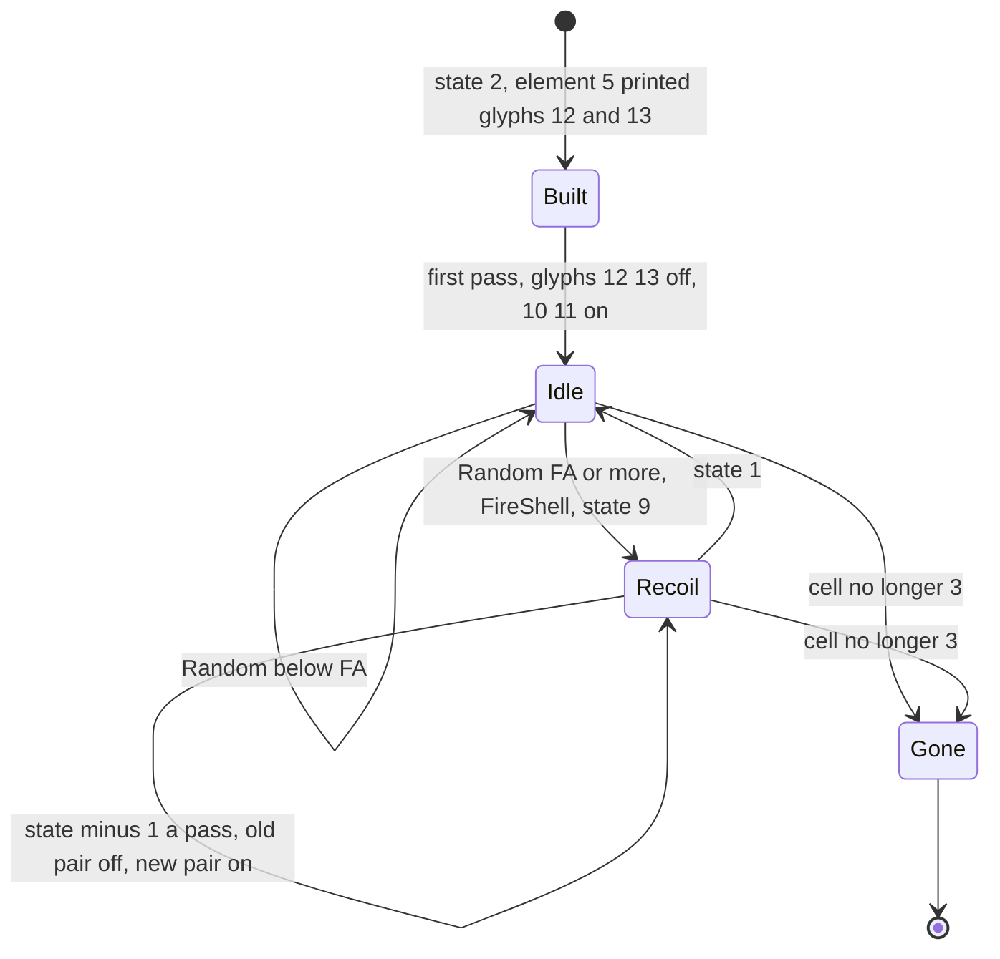

```asm
AnimateTurretsNext:
  LD E,(HL)               ; column; $FF: the end
  ; ...
  LD A,(HL)               ; the state; 0: gone, skip
  OR A
  JR Z,AnimateTurretsSkip
  ; ...                   ; the cell's kind in CellTypes
  CP $03
  JR Z,TurretIdle
  ; ...                   ; not 3: state 0, the barrel XORed off, glyphs $12 / $13 XORed
TurretIdle:
  LD A,(HL)               ; state 1: fire at random
  CP $01
  JR NZ,TurretRecoil
  CALL Random
  CP $FA
  JR C,AnimateTurretsSkip
  LD (HL),$09
  LD C,$FF                ; the shell flies left
  PUSH HL
  CALL FireShell
  POP HL
  JR AnimateTurretsSkip
TurretRecoil:
  PUSH HL                 ; states 2-9: A = the old state
  DEC (HL)
  CALL TurretFrame        ; the old state's glyph, HL at its table byte
  LD C,$46
  CALL XorCharAttr        ; XOR off, the left glyph bright yellow
  INC A
  INC E
  LD C,$06
  CALL XorCharAttr        ; the right glyph, yellow
  DEC E
  DEC HL                  ; the new state's glyph
  LD A,(HL)
  LD C,$46
  CALL XorCharAttr        ; XOR on
  ; ...
```

```text
for turret in TurretList:
    if turret.state == 0: continue
    if CellTypes[turret.cell] != 3:            # a grenade blew it away
        XOR off TurretFrames[state] pair; XOR glyphs $12, $13; state = 0
    elif turret.state == 1:
        if Random >= $FA: state = 9; FireShell(turret, left)
    else:
        XOR off TurretFrames[state] pair; state -= 1; XOR on TurretFrames[state] pair
```

A worked example of TurretFrames `10 12 14 16 18 1A 1C 1E 10`, entry n for state n:

- The element prints glyphs `$12`, `$13`: state 2's pair. The first pass is a recoil step from 2 to 1: `$12`/`$13`
  off, `$10`/`$11` on. That is why every turret starts in state 2: the first pass turns the printed barrel into the
  idle one.
- A fire sets 9 while `$10`/`$11` is on the screen. Entry 9 is `$10` again, so the first recoil step takes off the
  idle pair and puts on `$1E`/`$1F`.
- Then `$1C`, `$1A` ... `$12`, and at state 1 `$10` again: 8 passes of recoil.
- The destroyed branch: the blast prints element 5 again with printer 3, which XORs `$12`/`$13` over the barrel on
  the screen. AnimateTurrets then XORs off the barrel of the current state and XORs `$12`/`$13` once more. The two
  `$12`/`$13` XORs cancel, the barrel is gone, and the cell is clean.

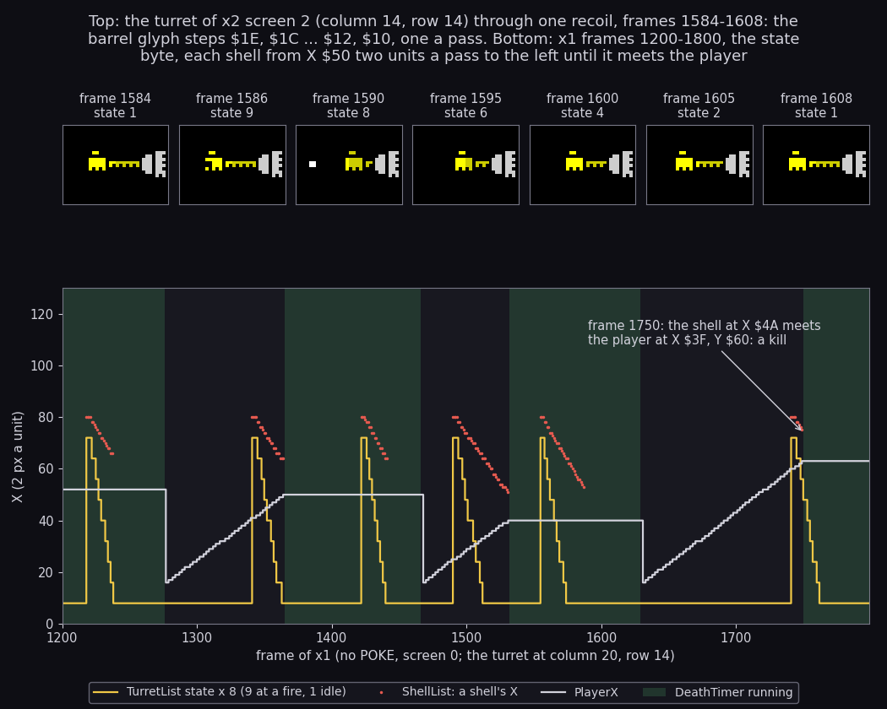

```sh
python3 work/docs/fillO/readsat.py work/docs/fillO/i work/x2/session.ttd work/docs/fillO/d/x2-screens.json \
    405,410,411,412,413,416,420,426,565,570,575,1584,1586,1590,1595,1600,1605,1608,1609,1610,1611,1620 \
    4000:6912 82F5:2 9437:80 95B6:120 9870:60 9F13:12 9022:13
python3 work/docs/fillO/reads.py work/docs/fillO/i work/x1/session.ttd work/docs/fillO/d/x1-turret.json \
    1200 1800 1 9022:13 90CB:31 82F5:2 768C:1 9CE2:1
python3 tools/fig_kinds.py turret
```

How to read:

- Top: seven crops of `x2` screen 2 around the turret (column 14, row 14), labelled with the frame and the state
  byte. The white dot left of the barrel at frame 1590 is the shell.
- Bottom: `x1` (no POKE, screen 0, the turret at column 20, row 14), frames 1200-1800. The yellow step line is the
  state x 8: a spike to 72 is a fire, the steps down are the recoil. Red dots: each shell's X. White: PlayerX. The
  green bands are the passes while DeathTimer runs.

What it shows:

- In `x2` the glyph steps one state a pass, from state 9 at frame 1586 to state 1 at frame 1608: about 22 frames for
  8 passes.
- In `x1` the turret fires 6 times in 600 frames: a fire every 50 passes or so, as 6 in 256 a pass predicts.
- Every shell stops where it meets the hero. Those fired at about frames 1340, 1490 and 1745 kill him (DeathTimer
  starts at 1366, 1532 and 1750); those of about 1220, 1425 and 1555 meet him inside a death band and simply vanish
  (next subsection).

### Turret shells and gun shots

Two kinds shoot, and their shots live in separate lists:

- Turret shells: ShellList `$90CB`, 10 slots of X, Y, direction (0 free). Turret shells cannot be shot.
- Gun shots: GunShots `$9E18`, 10 records of X, Y, dx (0 free). They can be shot (50 points).

#### Turret shells

FireShell `$9071` takes the first free slot of ShellList:

- X = 4 x column, Y = 8 x row + 3: the barrel's mouth;
- the direction C, always `$FF` (left) from AnimateTurrets;
- the shell drawn by XorShell `$903D`: a 2 x 2 pixel dot, XOR;
- the sound: 10 noise bursts (BeeperNoise, B = `$1E`), then the AY effect `$C148`.

MoveShells `$90A2` runs twice a pass. Each call moves each shell 1 unit (2 pixels) by its direction: 2 units a pass.
It never looks at the scenery: a shell flies through walls. A shell is freed at X `$7F` or more, which a left-moving
shell reaches by wrapping below 0.

ShellsHitPlayer `$90EA` runs once a pass. For each live shell it calls PlayerContact with BC = 0: the shell is a
point. A hit frees the slot first and then jumps to KillPlayer, which refuses while the hero is dying or immune.

```asm
FireShellSet:
  LD (HL),C               ; the direction
  DEC HL
  LD A,D                  ; Y = 8 row + 3
  ADD A,A
  ADD A,A
  ADD A,A
  INC A
  INC A
  INC A
  LD D,A
  LD (HL),A
  DEC HL
  LD A,E                  ; X = 4 column
  ADD A,A
  ADD A,A
  LD E,A
  LD (HL),A
  CALL XorShell
  LD B,$0A                ; 10 noise bursts
  ; ...
  JP PlaySfxBlast
MoveShellsNext:
  ; ...                   ; E = X, D = Y, A = direction
  CALL XorShell           ; erase
  ADD A,E                 ; X + direction
  LD E,A
  CP $7F
  JR C,MoveShellsStore    ; on the screen: stored and drawn
  ; ...                   ; else the slot freed
ShellsHitPlayerNext:
  ; ...
  LD BC,$0000             ; a point
  CALL PlayerContact
  OR A
  JR Z,ShellsHitPlayerNext
  CALL XorShell           ; erased, freed, then the kill
  DEC HL
  LD (HL),$00
  JP KillPlayer
```

```text
FireShell(cell, dir):  slot = first free; slot = (4 col, 8 row + 3, dir); draw; 10 bursts; AY $C148
MoveShells (2 calls a pass): for each live: erase; x += dir; if x >= $7F: free else draw
ShellsHitPlayer (1 a pass): for each live: if PlayerContact(shell, 0, 0): erase; free; KillPlayer
```

A worked example, `x1` frame 1750 (the bottom panel above):

- The turret at column 20, row 14 fires: the shell starts at X 80 (`$50`), Y 8 x 14 + 3 = 115 (`$73`).
- The hero walks right at X `$3F`, Y `$60`.
- PlayerContact with B = C = 0 asks for X - E in -12..-1 and Y - D in -32..-1, that is the shell's X within
  PlayerX + 1..PlayerX + 12 and its Y within PlayerY + 1..PlayerY + 32.
- The shell reaches X `$4A` = PlayerX + 11; Y `$73` = PlayerY + 19. Both hold: the shell is freed and the hero dies
  (DeathTimer starts at frame 1750).

The shells that meet the hero while he dies or is immune (frames 1238, 1442 and 1588 in `x1`) vanish the same way:
the slot is freed before KillPlayer refuses. A dying hero soaks up shells (10.13 item 2).

#### Gun shots

Guns `$9D7F` runs every pass over GunList `$9DC1` (up to 10 gun cells, column and row):

- A gun fires when Random is `$F7` or more: 9 in 256 a pass.
- The hero must be well to its left: PlayerX below (4 x column - 2) - `$1E`, more than 60 pixels.
- The shot takes a free record of GunShots: X = 4 x column - 2, Y = 8 x row, dx = -2; small sprite 8; the sound
  `$C13B`.

Two exits end the routine for the rest of the guns, not just for this one:

- a gun that wins its roll while the hero is not far enough left (`RET NC`);
- a full GunShots list (GunShotsFull `$9DA6`: `POP HL`, `RET`).

```asm
GunsLoop:
  LD E,(HL)               ; $FF: the end
  BIT 7,E
  RET NZ
  INC HL
  LD D,(HL)
  INC HL
  CALL Random             ; 9 chances in 256
  CP $F7
  JR C,GunsLoop
  CALL CellToPixels       ; C = the gun's X - 2 - $1E
  DEC E
  DEC E
  LD A,E
  SUB $1E
  LD C,A
  LD A,(PlayerX)          ; the player too close or right of it: done
  CP C
  RET NC
  ; ...                   ; a free record: dx -2, Y, X; frame 8; PlaySfxNoiseSweep
GunShotStep:
  LD A,C                  ; MoveGunShots: X + dx, drawn, painted $47
  ADD A,E
  LD E,A
  LD A,$08
  CALL DrawSmallSprite
  LD C,$47
  CALL ColourCell
```

```text
for gun in GunList:
    if Random < $F7: continue
    if PlayerX >= 4 col - 2 - $1E: return          # the remaining guns skip this pass
    rec = first free GunShots record, else return   # GunShotsFull: the same
    rec = (4 col - 2, 8 row, -2); draw sprite 8; sound
MoveGunShots, once a pass: for each live: erase; if X == 0: free; else X += dx; draw; colour $47
```

The tests on a gun shot:

- GunShotsVsShots `$9E37`, from MoveShots five times a pass: BallShot asks whether a player's shot lies within X - 2 ..
  X + 1 and Y - 1 .. Y + 8 of it. A hit: DestroyGunShot `$9E4F` (erased, freed, a puff, the AY effect 8, 50 points).
- GunShotsVsPlayer `$9E64`, once a pass: PlayerContact with B = 8, C = 4. A touch: DestroyGunShot (50 points as well)
  and KillPlayer.

A worked example, `w/009` screen 10: GunList holds `17 0F 17 10`, two gun cells at column 23, rows 15 and 16.
A shot starts at X 4 x 23 - 2 = 90, Y 120 or 128, and loses 2 units a pass.
The hero at X `$18` = 24 is far enough left: 24 is below 90 - 30 = 60.
At 9 in 256 for each of the two cells, a shot every 14 passes or so.

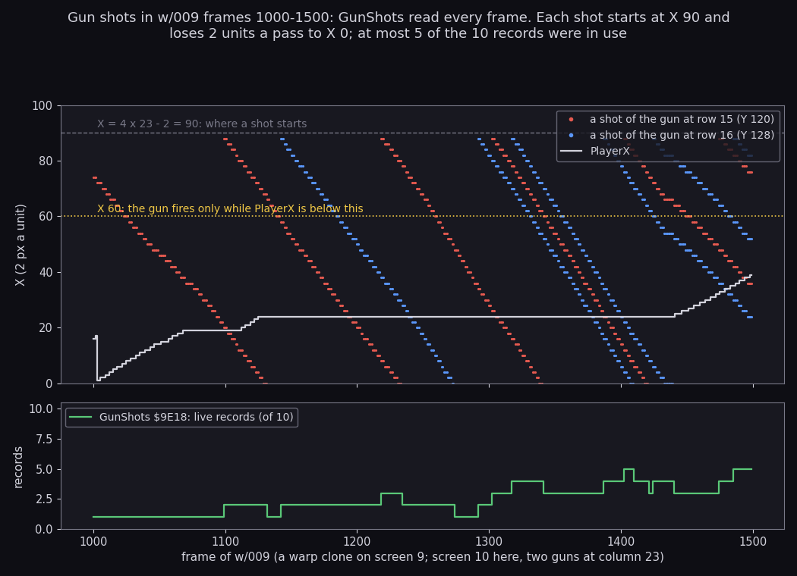

```sh
python3 work/docs/fillO/reads.py work/docs/fillO/i work/w/009/session.ttd work/docs/fillO/d/w009-guns.json \
    1000 1500 1 9E18:31 9DC1:21 82F5:2 8523:1 845F:25
python3 tools/fig_kinds.py guns
```

How to read:

- Top: each dot is one live shot's X at the end of a frame, red for the gun at row 15 (Y 120), blue for the gun at
  row 16 (Y 128). The dashed line is X 90, where a shot starts; the dotted line is X 60, the limit PlayerX must stay
  below. White: PlayerX.
- Bottom: how many of the 10 records are live.
- `w/009` is a warp clone started on screen 9; the hero is on screen 10 for the whole window.

What it shows:

- Every shot starts at X 90 (seen first at 88, after its first move) and falls by 2 a pass to X 0, where it is freed.
- At most 5 of the 10 records were in use at once: GunShotsFull never ran (10.13 item 5).

### The exoskeleton booth

ExoSuitBooth `$9F2D` runs every pass. The booth is kind 12: ExoBoothList `$9F6E` holds its cell, `$FF` when the screen
has none.
Up is taken on its edge: BoothUpLatch `$9F6D` is set on the first pass up is held and cleared when it is released.
The hero must stand in the booth: his Y = 8 x (row + 1) and his X - 4 x column within -12..+8.
Then ExoSuit `$9ED8` is XORed with `$0C`, the AY effect `$C0F4` plays, and the hero is redrawn with frame 5 in his new
set. What the suit changes is in [10.11](10-gameplay-logic.md#the-exoskeleton).

```asm
ExoSuitBooth:
  LD A,(ControlJump)
  OR A
  JR NZ,ExoSuitBoothPressed
  LD (BoothUpLatch),A     ; up released: the latch cleared
  RET
ExoSuitBoothPressed:
  LD A,(BoothUpLatch)     ; UP held: act only on the first pass
  OR A
  RET NZ
  INC A
  LD (BoothUpLatch),A
  LD DE,(ExoBoothList)
  BIT 7,E
  RET NZ
  INC D                   ; the row under the booth's top cell
  CALL CellToPixels
  LD A,(PlayerY)
  CP D
  RET NZ
  LD A,(PlayerX)          ; X - E - 9 >= -21: X - E within -12..+8
  SUB E
  SUB $09
  CP $EB
  RET C
  LD DE,(PlayerX)
  LD A,(ExoSuit)          ; the suit on or off
  XOR $0C
  LD (ExoSuit),A
  CALL PlaySfxAmmoRefill
  LD A,$05
  JP PlayerFrame
```

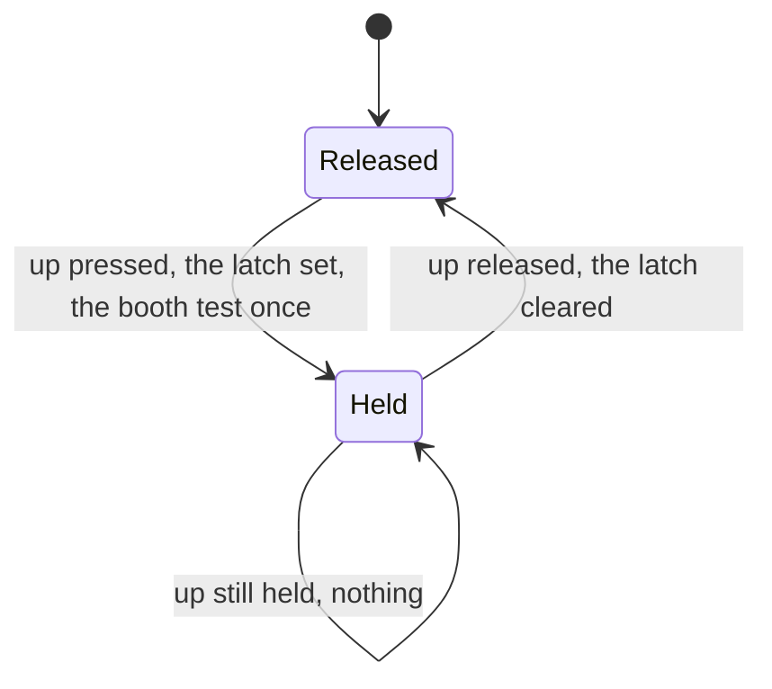

The teleport (7.5) has the same latch and the same test; they are two copies of one routine with a different action.

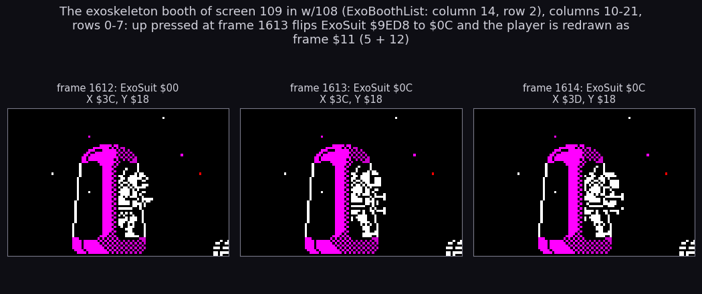

```sh
python3 work/docs/fillO/readsat.py work/docs/fillO/i work/w/108/session.ttd work/docs/fillO/d/w108-screens.json \
    1611,1612,1613,1614 4000:6912 82F5:2 9ED8:1
python3 tools/fig_kinds.py booth
```

How to read: three crops of screen 109 (columns 10-21, rows 0-7), with ExoSuit and the hero's place under each.

What it shows:

- At frame 1612 the hero stands in the booth without the suit (X `$3C`, Y `$18`).
- At frame 1613 up is down: ExoSuit reads `$0C` and the hero is drawn with frame `$11`, the suit's standing frame.
- At frame 1614 he walks out (X `$3D`) in the suit. The worked example of the test is in 10.11.

### The force field

Kind 17 is the emitter on top of the drop pod (element 1). ForceFieldList `$ABCC` holds its cell.

ForceFieldDraw `$AB97` runs at the end of the build:

- it prints glyph `$25` of the tile set `$DAB8` from the row under the emitter downwards, while CellTypes is 0;
- PrintChar is set to mark each printed cell solid (CellTypes 1) and drawn (OpenCells 0), so the hero cannot walk
  through;
- ForceFieldHeight `$AC57` = the cells drawn; ForceFieldHits `$AC58` = 0.

ForceFieldStep `$ABCF`, every pass:

- the hum `$C1A9` (AY effects 1 and `$0B`), restarted each pass;
- the ink of every cell of the column = PassCount AND 7, bright: the field cycles through the colours;
- PlayerX + `$0C` = 4 x column: KillPlayer. The field is solid, so the hero cannot get past that X anyway: touching
  it is death.

ForceFieldVsShots `$AC04`, from MoveShots five times a pass:

- a live shot whose X equals 4 x (column - 1), the last X before the field's cell, adds 1 to ForceFieldHits;
- the shot then meets the solid cell and ends (10.12), so each shot counts once;
- the 25th hit runs ForceFieldDestroy `$AC2B`: glyph `$25` XORed off cell by cell in random bright inks, the cells
  freed, ForceFieldList = `$FF`, the AY effect `$C148`, 40 bonus ticks (1000 points).

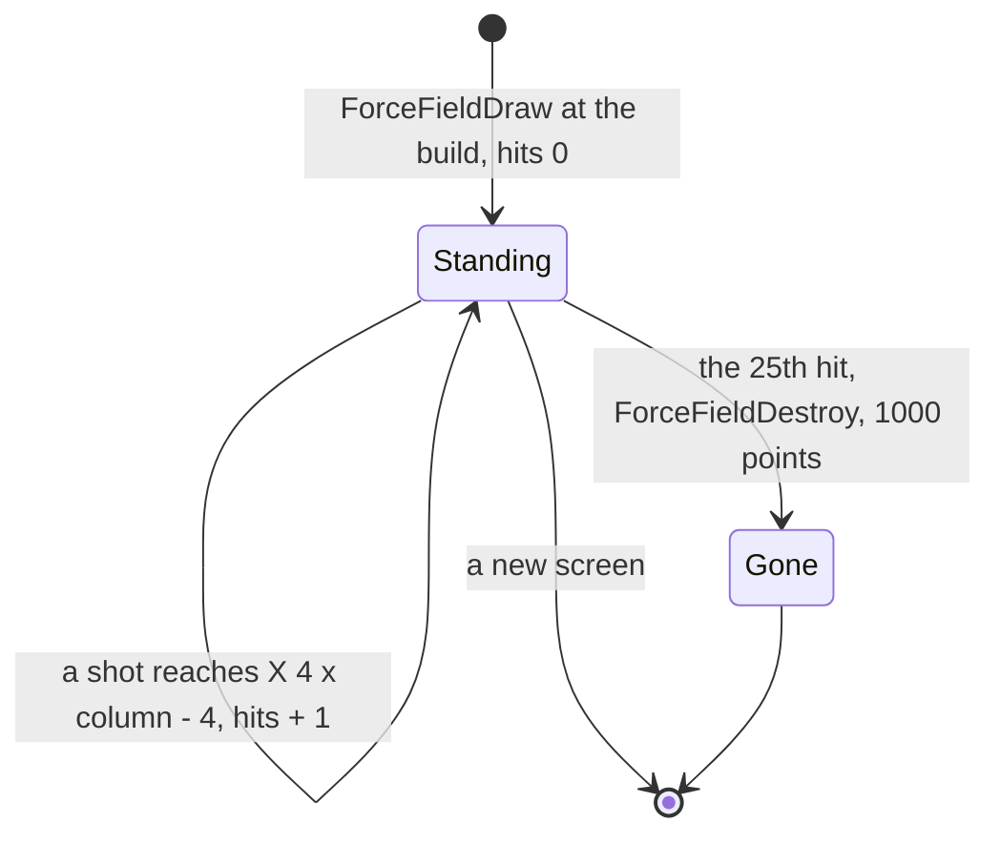

```asm
ForceFieldDraw:
  LD DE,(ForceFieldList)
  BIT 7,E
  RET NZ
  INC D                   ; from the row under the emitter
  ; ...                   ; font $DAB8, hits 0, PrintChar marks solid
  LD BC,$0001             ; B = 0: the count
ForceFieldDrawLoop:
  LD A,$25
  CALL PrintChar
  INC D
  INC B
  ; ...                   ; HL = CellTypes of the next row
  LD A,(HL)
  OR A
  JR Z,ForceFieldDrawLoop ; down to the first solid cell
  LD A,B
  LD (ForceFieldHeight),A
  RET
ForceFieldStep:
  ; ...                   ; the hum, the column's ink = PassCount AND 7, bright
  LD DE,(ForceFieldList)
  CALL CellToPixels
  LD A,(PlayerX)
  ADD A,$0C
  CP E
  JP Z,KillPlayer
  RET
ForceFieldVsShotsLoop:
  ; ...                   ; C = the shot's X, live shots only
  LD A,E                  ; E = 4 x (column - 1)
  CP C
  JR NZ,ForceFieldVsShotsLoop
  LD A,(ForceFieldHits)
  INC A
  LD (ForceFieldHits),A
  CP $19                  ; the 25th: ForceFieldDestroy follows
  RET C
```

```text
build:     h = 0; for row from emitter.row + 1 while CellTypes[row][col] == 0: print $25 solid; h += 1
           ForceFieldHeight = h; ForceFieldHits = 0
each pass: hum; ink of the h cells = PassCount AND 7 | $40; if PlayerX + 12 == 4 col: KillPlayer
each shot step: if a live shot has X == 4 (col - 1): hits += 1; if hits >= 25: destroy, 1000 points
```

A worked example, `w/035` frame 500 (screen 35, the left panel below): the emitter is at column 20, row 2.
The column is drawn from row 3 down to row 18, the last open cell above the floor: ForceFieldHeight reads 16.
The hero dies at PlayerX = 80 - 12 = 68 (`$44`); shots count at X 76 (`$4C`).
ForceFieldHits reads 3 at frame 500: three shots have reached the field, 22 short of its end.

The end is known only from the code: no recording put 25 shots into one field, and ForceFieldHits starts again at 0
with every screen.

#### The flicker pad

Kind 15 is the cell between the two pillars of element 42 or 51, on the zone-end screens 24, 49, 74, 99 and 124 and on
screens 25 and 66. FlickerPadStep `$A7D6` draws, every pass, two Sprites16 frames side by side at the cell: frame `$1C`
+ (Random AND 3) and the next one, 16 pixels right, in a random bright ink `$40-$47`. Nothing reads the cell
otherwise: it has no rule, it is decoration.

#### The zone-end marker

Kind 16 is the cell of the sector gate on the zone's last screen; ZoneEndList `$AAEF` holds it.
ZoneEnd `$A817` ends the zone on the first pass PlayerX reaches 4 x column: X `$3C`, the middle of the screen, on
screens 24, 74 and 99 (column 15); X `$50` on screens 49 and 124 (column 20).
The hero never has to reach the right edge. The trigger, the bonuses and the `w/024` witness (X `$3C` at frame 516,
the score 019000 at frame 577) are in [10.2](10-gameplay-logic.md#102-zones-of-25-screens).

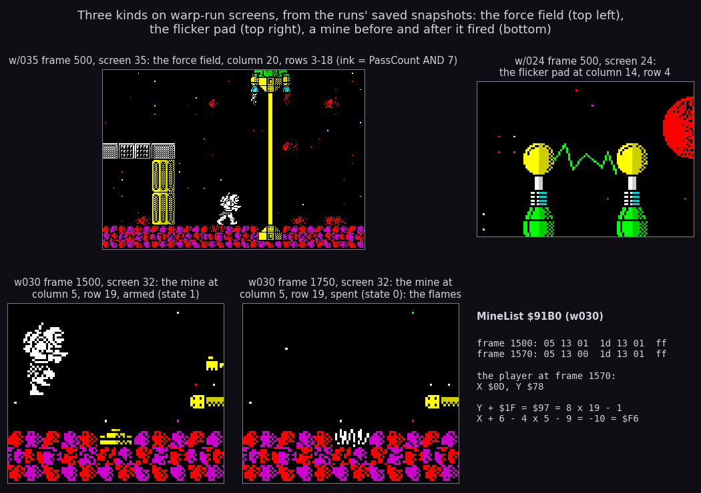

```sh
python3 tools/fig_kinds.py scenes     # from the saved snapshots of w/035 and w/024 at frame 500, w030's reads
```

How to read:

- Top left: `w/035` frame 500, screen 35: the force field is the yellow column at column 20, rows 3-18 (its ink is
  PassCount AND 7 at that frame).
- Top right: `w/024` frame 500, screen 24: the flicker pad between the pillars at column 14, row 4.
- Bottom: `w030`'s screen 32 at frames 1500 and 1750, the mine at column 5, row 19, armed and then burning; the text
  gives MineList and the trigger numbers (7.5).

## 7.3 Traps

A trap is a record of three bytes: column, row, counter.
ClearTraps `$9C7D` fills the 12 bytes of TrapList with `$5F` before the build; the build then writes the column and
row over the first two bytes of each record.
The counter goes up by one every pass.

The counter's thresholds, in the code below:

- below `$65`: the trap rests in the floor, harmless;
- `$65-$68`: it rises one row (8 pixels) a pass, 4 passes;
- `$69-$73`: it stands up, 11 passes;
- `$74-$77`: it sinks one row a pass, 4 passes;
- `$78`: a new rest: the counter goes to `$14` + a random 0-63.

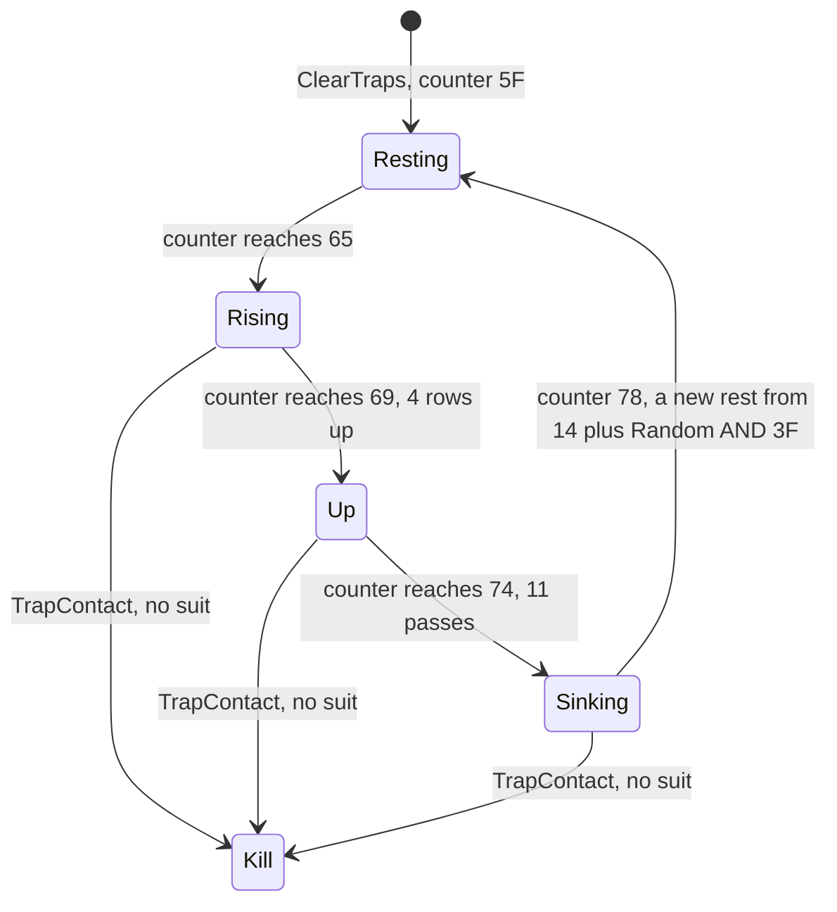

```asm
TrapsLoop:
  ; ...
  LD A,(HL)
  INC (HL)                ; the counter counted up
  INC HL
  CP $65                  ; resting
  JR C,TrapsLoop
  CP $69                  ; rising
  JR NC,TrapStanding
  DEC D                   ; one row up
  ; ...
TrapStanding:
  CP $74                  ; standing up
  JR C,TrapDraw
  CP $78                  ; sinking
  JR NC,TrapRestart
  INC D                   ; one row down
  ; ...
TrapRestart:
  DEC HL                  ; the next rest: $14 + a random 0-63
  CALL Random
  AND $3F
  ADD A,$14
  LD (HL),A
  ; ...
TrapDraw:
  ; ...
  LD A,$18                ; the big sprite $18 through the trap's buffer
  ; ...
  CALL DrawBigSprite
  LD C,$44                ; bright green
  CALL ColourBigSprite
```

```text
for trap in TrapList:
    c = trap.counter; trap.counter += 1
    if c < $65: continue                 # resting, not drawn
    if c < $69: trap.row -= 1            # rising
    elif c < $74: pass                   # up
    elif c < $78: trap.row += 1          # sinking
    else: trap.counter = $14 + random(0..63)
    draw PlayerFrames[24] at (trap.column, trap.row), bright green
```

A worked example: the start value `$5F` reaches `$65` after 6 passes, so a new screen's traps first rise 6 passes
after the build.
A rest after `$78` lasts `$65 - $14 - r` = 81 - r passes for r = 0..63: between 18 and 81 passes.
One cycle out of the floor is 4 + 11 + 4 = 19 passes.

TrapContact `$9C8B` tests only the traps whose counter is `$65` or more.
A touch goes to ShieldedKill `$9CAA`: the player dies unless he wears the exoskeleton.


```sh
python3 work/docs/docB/read_series.py work/docs/docB/i48 work/ann/exC/t1/session.ttd work/docs/docB/t1/traps.json 0 1850 1 8523:1 82F5:2 9C70:13 768C:2
python3 tools/fig_objects.py traps
```

How to read:

- The first command loads `t1` into my instance and reads ScreenNumber, PlayerX/Y, TrapList and PassCount at every
  frame through TTD `memory_at` (103 s). The second draws.
- The top three panels: one trap each (columns 8, 15, 22, row 20). The line is the counter. The bands are the four
  states: resting (grey), rising 4 (brown), up 11 (red), sinking 4 (brown), named on the right; the y axis marks
  `$14`, `$65` and `$78`. The labels on the line give each new rest's start.
- The bottom panel: the player's X (2 pixels a unit, 4 a column) and each trap's X span; red while the trap is out.

What it shows:

- All three traps start at `$5F` and reach `$65` together at frame 207; after that the random rests split them.
- The 15 rest starts the recording reached are all within `$14-$53`: `$26 $49 $16 $25 $1D`, `$32 $22 $40 $23 $3F`,
  `$14 $3A $3F $33 $2D`.
- The player walks into trap 0's span at frame 828 while it sinks (row `$13`). `t1` has the immunity POKE, so no
  death follows; what the contact test does there is exC's measure (294 tests, 34 touches).

The case's plain recordings never run the traps: `c1`, `x1`, `m1` and `h1` only play screen 0, and every warp clone
has the traps POKE (`$9C15` = `RET`). In `x2` the trap of screen 2 keeps its counter at `$5F` from frame 1500 to 1750
for that reason. `t1` is the only witness.

## 7.4 Aliens

Aliens are not built from the scenery.
AlienScreens `$A677` lists the 70 screens that have them, five bytes a screen: the screen, the path (a word), the
first frame of the alien's look, and the delay between aliens in passes.

AlienSpawn `$A553` starts an alien when all of these hold:

- the screen is in AlienScreens;
- AlienSpawnDelay `$A5C9` is 0 (it counts down one a pass);
- the player is at X below `$54` (the left two thirds);
- one of the 6 records of AlienList `$A508` is free;
- Random is `$C8` or more (56 in 256).

The new alien starts at X `$78` (240 pixels).
Its Y is the player's Y - 10 (Random `$AF` or more) or the player's Y + 0..15.
Its colour is `$40` + a random ink, 1 changed to 5 and 0 to 4 (never black or blue).

An AlienList record has 10 bytes:

| Offset | Field |
| ---: | --- |
| +0 | X (2-pixel units) |
| +1 | Y (pixels) |
| +2 | live (0 free) |
| +3/+4 | the path's start |
| +5/+6 | the path pointer |
| +7 | the hold count |
| +8 | the animation counter |
| +9 | the colour |

AliensStep `$A360` moves each live alien one step of its path a pass.
A path is a list of signed pairs dX, dY, with two codes:

- `$C4 n`: the pair that follows is used `n` passes;
- `$C3`: start the path again.

An alien whose X reaches `$80` or whose Y reaches `$B0` is off the playfield: its record is freed.

```asm
AliensPathRead:
  LD A,(BC)               ; the next path byte
  CP $C4
  JP Z,AliensPathHold
  CP $C3
  JP Z,AliensPathLoop
  ADD A,E                 ; X += dX
  LD E,A
  INC BC
  LD A,(BC)
  ADD A,D                 ; Y += dY
  LD D,A
  INC BC
  ; ...
AliensPathHold:
  INC BC                  ; $C4 n: hold the next pair n passes
  LD A,(BC)
  DEC A
  LD (HL),A
  ; ...
AliensMoved:
  ; ...
  LD A,E
  CP $80
  JP NC,AliensOff
  LD A,D
  CP $B0
  JP NC,AliensOff
```

```text
for alien in AlienList where alien.live:
    if alien.hold > 0:
        alien.hold -= 1; (dx, dy) = path[alien.ptr]          # the held pair again
        if alien.hold == 0: alien.ptr += 2
    else:
        loop:
            if path[ptr] == $C3: ptr = alien.start; continue
            if path[ptr] == $C4: alien.hold = path[ptr+1] - 1; ptr += 2; (dx, dy) = path[ptr]; break
            (dx, dy) = path[ptr]; ptr += 2; break
    alien.x += dx; alien.y += dy
    if alien.x >= $80 or alien.y >= $B0: alien.live = 0
    else: draw Sprites16[look + (alien.anim AND 3)] in alien.colour; alien.anim += 1
```

A worked example: path 4 (`$A4C5`) is `C4 28 FF 00 C4 64 FC 00 C3`.
`$28` = 40 passes of (-1, 0) take the alien from X `$78` to `$50` at 2 pixels a pass.
Then `$64` = 100 passes of (-4, 0) at 8 pixels a pass: X reaches 0 after 20 of them (still drawn) and the 21st wraps
it to `$FC`, which is `$80` or more, so the alien is freed. 40 + 21 = 61 passes in all.


```sh
python3 work/docs/docB/read_series.py work/docs/docB/i48 work/x2/session.ttd work/docs/docB/x2/aliens.json 3000 4000 1 8523:1 82F5:2 A508:60
python3 tools/fig_objects.py paths
```

How to read:

- Panels 1-6: each path run through the model of AliensStep from X `$78`, Y 96 until the alien leaves. The square
  is the start, dots every 10 passes. The title gives how many screens use the path and the passes to the left edge.
- Bottom left: AlienList read at every frame of `x2` 3000-3999 (screen 5, path 1). Solid: the measured track of each
  alien. Dotted: the model started from the same first position.
- Bottom right: the AlienScreens table summed up: how many screens use each look and each delay.

What it shows:

- Path 1 is a wave (31 pairs of dX -1 and dY up to +-3); path 2 is the same wave and then a dash; path 3 flies a
  loop; path 4 creeps then dashes; path 5 rises, sinks and waits; path 6 zig-zags round a box.
- Four paths (2, 4, 5, 6) end in 100 passes of (-4, 0): the alien crosses the rest of the screen at 8 pixels a pass.
- The measured aliens follow the model's wave where they live; most tracks end early because `x2` shoots them (205
  runs of KillAlien `$A62D` in the recording).
- Path 4 is the most used (19 screens), path 5 the least (5 screens).

AliensVsShots `$A5CA` tests the player's shots against each live alien: a hit kills it (KillAlien `$A62D`, a blast,
150 points). AliensVsPlayer `$A5F4` kills the player and the alien on contact.

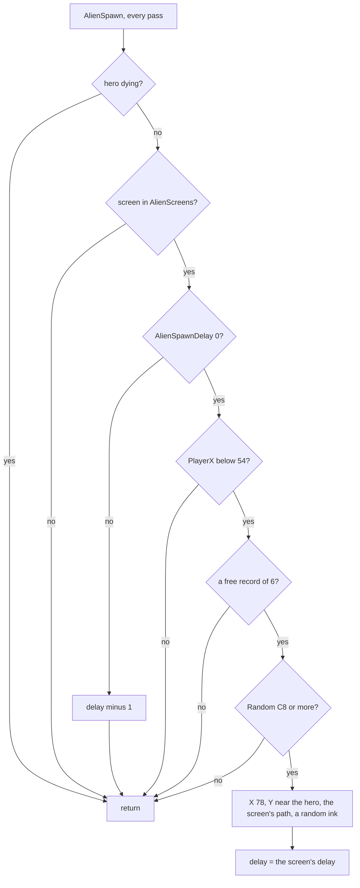

The new alien's Y: when a second Random is below `$AF` (175 in 256), PlayerY + 0..15; else PlayerY - 10.
Its ink is Random AND 7, raised by 4 when it would be 0 or 1 (black or blue), so an alien is always visible.

#### The contacts

```asm
AliensVsPlayerLoop:
  ; ...                   ; E = X, D = Y of a live alien
  LD BC,$0804             ; a box 4 units by 8 lines
  INC E                   ; at X + 2, Y + 4: the alien's body inside its 16 x 16 frame
  INC E
  INC D
  INC D
  INC D
  INC D
  CALL PlayerContact
  OR A
  JR Z,AliensVsPlayerNext
  ; ...
  CALL KillAlien          ; the alien dies too: a blast, 150 points
  CALL KillPlayer
ShotHitsAlienLoop:
  ; ...                   ; C = a shot's X, B = its Y; E = the alien's X + 2
  LD A,C
  SUB E
  CP $F8                  ; the shot's X within the alien's X - 6 .. X + 1
  JR C,ShotHitsAlienLoop
  LD A,B
  SUB D
  SUB $11
  CP $EE                  ; the shot's Y within the alien's Y - 1 .. Y + 16
  JR C,ShotHitsAlienLoop
  ; ...                   ; the shot erased and freed, A = 1
```

- AliensVsShots `$A5CA` (from MoveShots, five times a pass): ShotHitsAlien `$9F71` on each live alien. A hit runs
  KillAlien `$A62D`: the alien's slot drawn empty, a blast at its place, the AY effect 8, 150 points.
- AliensVsPlayer `$A5F4` (once a pass): PlayerContact with B = 8, C = 4 at the alien's X + 2, Y + 4. A touch kills
  both, and pays the 150 points as well.

A worked example: an alien at X `$40`, Y `$60`, the hero at X `$36`, Y `$48`.
The box point is X `$42`, Y `$64`.
PlayerContact asks X - E - C in -16..-1: `$36` - `$42` - 4 = -16, inside.
It asks Y - D - B in -40..-1: `$48` - `$64` - 8 = -36, inside. The hero dies.
One unit further left (X `$35`) gives -17: no contact.
### AliensStep at work


```sh
python3 ../../kit/routine_anim.py --work work/docs/docB/x2 --window 3392:0-3392:14000 --listing build/game.lst --out docs/img/routines/AliensStep.gif --pc A360-A405 --view screen --range A000-AFFF --pictures 40 --delay 150 --title "AliensStep \$A360: three aliens read their paths and are redrawn (x2 frame 3392, 14000 T)"
```

How to read:

- Left: memory `$A000-$AFFF`, 256 bytes a row: green executed, blue read, yellow written in this picture, red
  written earlier. AlienPaths (`$A406-$A507`) and AlienList (`$A508`) are rows 4 and 5.
- Middle: the screen. Right: the listing round the instruction last run, the registers, the routine's name.
- The window is `x2` frame 3392, T 0-14 000, with three live aliens. AliensStep's own instructions run at T
  1373-1908 (69 instructions, `work/docs/docB/trace_ranges.py`); DrawSprite `$795C` follows from T 1925 to 10 641.

## 7.5 Balls, mines, pods and teleports

### Balls

A ball spawner (kind 9) releases its balls once, at the build. BallSpawners `$9B4B` holds up to 3 spawners; BallList
`$9A99` holds up to 24 balls of four bytes: X, Y, state (1 alive), dx.

SpawnBalls `$9B07`:

- puts 8 balls at 4 x column + 2, 8 x row + 3, all on the same spot;
- gives each a dx of +1 or -1 from Random AND 1;
- XORs small sprite 4 there eight times, which leaves nothing on the screen.

MoveBalls `$9A23`, every pass, for each live ball:

- small sprite 7 XORed off. The 8 balls of a spawner sit on one spot at first, so their first erases cancel in pairs;
- dx reversed at X 0 or `$7B`, at random (Random `$DC` or more, 36 in 256), or when ProbeLeft / ProbeRight finds a
  wall on its side;
- a vertical step of +1 or -1 from Random AND 1, made 0 when ProbeBelow / ProbeAbove finds a wall that way;
- Y 0 becomes 1 (BallTopRow `$9A6E`; no recording reached it);
- sprite 7 drawn at the new place, the cell painted bright red `$42`.

```asm
MoveBallsLoop:
  ; ...                   ; E = X, D = Y; dead: the next
  LD A,$07                ; erase the ball
  CALL DrawSmallSprite
  LD A,E                  ; at an edge: turn
  OR A
  JR Z,BallTurn
  CP $7B
  JR Z,BallTurn
  CALL Random             ; at random: turn
  CP $DC
  JR NC,BallTurn
  LD A,(HL)               ; the wall on its side
  INC A
  JR NZ,BallWallRight
  CALL ProbeLeft
  JR BallWallTest
BallWallRight:
  CALL ProbeRight
BallWallTest:
  OR A
  JR Z,BallStepY
BallTurn:
  LD A,(HL)
  NEG
  LD (HL),A
BallStepY:
  LD A,(HL)               ; C = the new X; a random +1 / -1
  ADD A,E
  LD C,A
  CALL Random
  AND $01
  ; ...                   ; B = -1 or +1; ProbeAbove / ProbeBelow: a wall makes it 0
BallMoveY:
  LD A,B                  ; Y + step
  ADD A,D
  LD D,A
  ; ...                   ; Y 0: 1; sprite 7 drawn, colour $42, X and Y stored
```

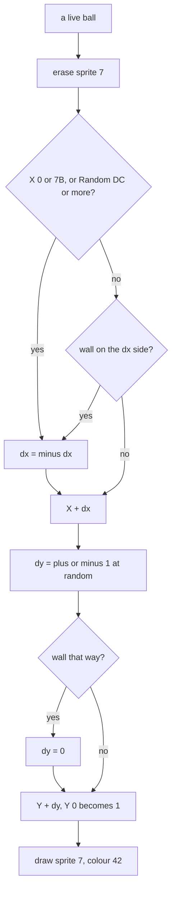

```text
for ball in BallList if ball.state:
    erase(ball)
    if ball.x in (0, $7B) or Random >= $DC or wall(ball.x, ball.y, ball.dx): ball.dx = -ball.dx
    x = ball.x + ball.dx
    dy = random choice of -1, +1;  if wall(ball, dy): dy = 0
    ball.y += dy; if ball.y == 0: ball.y = 1
    ball.x = x; draw(ball, ink $42)
```

The tests on a ball:

- ShotsHitBalls `$9B52`, the first test of MoveShots: BallShot `$9B82` finds a shot within X - 2..X + 1 and
  Y - 1..Y + 8 of the ball. A hit: BallHit `$9B6B` (erased, state 0, a puff, the AY effect 8, 50 points).
- BallsTouchPlayer `$9BB4`, once a pass: PlayerContact with B = 8, C = 4. A touch runs BallHit (50 points) and
  KillPlayer. There is no suit test: a ball kills through the exoskeleton.

A worked example, `x2` screen 5: BallSpawners reads `18 0F`, column 24, row 15.
The 8 balls start at X 4 x 24 + 2 = 98, Y 8 x 15 + 3 = 123.
The spawner sits in a pocket of scenery: walls 2 units either side and a few lines above and below.
So the walls turn the balls back every step or two, and they stay in X 96-100, Y 120-128 for the whole window.

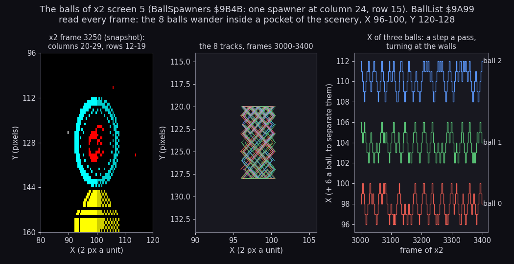

```sh
python3 work/docs/fillO/reads.py work/docs/fillO/i work/x2/session.ttd work/docs/fillO/d/x2-balls.json \
    3000 3400 1 9A99:97 82F5:2 845F:25 9B4B:7
python3 tools/fig_kinds.py balls
```

How to read:

- Left: `x2` frame 3250 from its snapshot, columns 20-29, rows 12-19: the ring of the spawner (cyan) and the red balls
  inside it, all 8 drawn over each other.
- Middle: each ball's (X, Y) over frames 3000-3400, one colour a ball.
- Right: the X of three balls, offset by 6 each so they do not overlap.

What it shows:

- No ball leaves the box X 96-100, Y 120-128: the walls of the pocket hold them.
- The X steps one unit a pass and turns at once at each wall.
- `x2` stalls on this screen and shoots aliens; the balls never reach the hero, which is why the run survives here.

### Mines

A mine (kind 5) is a record of column, row and state in MineList `$91B0`. ArmMines `$91FA` sets every state to 1
(armed) before the build.

Mines `$9152`, every pass, for each mine:

- armed (state 1): it fires when the hero's bottom line (Y + 31) is the line just above the mine, and his X is within
  E - 7..E + 2 of the mine's X = 4 x column;
- spent (state 0): it burns: glyph `$1D` or `$1F` (and the next) in a random bright red-ish ink `$42-$47`, the two
  alternating each pass.

MineFires:

- the state set to 0;
- MineBlast `$91CF`: the debris text printed with printer 3 one row above the mine;
- the blast sound `$C148`;
- ShieldedKill `$9CAA`: the kill, unless the suit is worn.

```asm
MineArmed:
  LD B,D                  ; BC = the cell; DE = its pixel position
  LD C,E
  CALL CellToPixels
  DEC D
  LD A,(PlayerY)          ; the player's bottom line (Y + 31) must be the line just above the mine
  ADD A,$1F
  CP D
  JR NZ,MinesLoop
  LD A,(PlayerX)          ; and his X within E-7..E+2
  ADD A,$06
  SUB E
  SUB $09
  CP $F6
  JR C,MinesLoop
MineFires:
  DEC HL                  ; state 0: spent
  LD (HL),$00
  LD D,B                  ; D = the row above the mine
  LD E,C
  DEC D
  CALL MineBlast
  CALL PlaySfxBlast
  JP ShieldedKill
```

MineBlastText `$91ED` is a string for PrintString: `E6 E0 D7 E0 05 E1 05 20 20 78 FE E2 FF`.

- `$E6 $E0 $D7`: the font at `$D7E0`;
- `$E0 05`: the colour; MineBlast first patches it with the attribute of the cell under the mine, so the debris has
  the floor's colour;
- `$E1 05 ... $E2`: repeat 5 times: two spaces, then `$78 $FE` (the cursor back 2 columns);
- `$FF`: the end.

Printer 3 XORs each character and starts two debris pieces for each (AddDebris, 7.6).
A space XORs nothing, so the text draws no picture: it only throws 5 x 2 characters x 2 = 20 pieces from the two cells
above the mine.

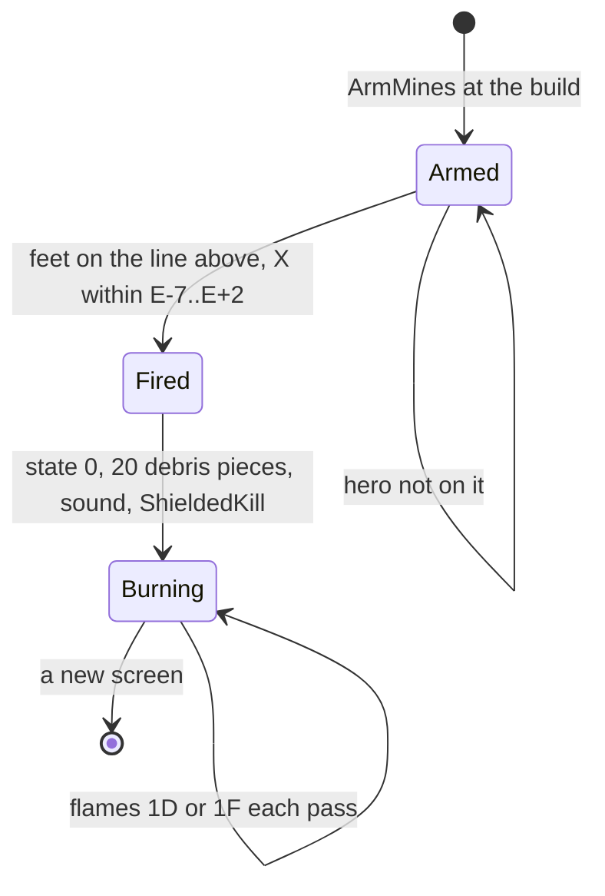

A worked example, `w030` frame 1570, screen 32: MineList reads `05 13 01 1D 13 01 FF`, two mines at row 19.

- The first mine: column 5, row 19. CellToPixels gives E = 20, D = 152; DEC D makes 151 (`$97`).
- The hero: X `$0D`, Y `$78`. Y + `$1F` = 120 + 31 = 151: the line matches.
- X + 6 - 20 - 9 = 13 + 6 - 29 = -10 = `$F6`. `$F6` is not below `$F6`: the X test passes (X = 13 is E - 7, the very
  edge of the window).
- The mine fires: frame 1570 reads `05 13 00`. The first debris records read `01 14 8C 00 FC 42`: state 1, X 20,
  Y 140, dx 0, dy -4, ink `$42`. Y was 8 x 18 = 144 and has moved once by -4.
- `w030` carries the mine POKE (ShieldedKill `$9CAA` = `RET`), so the kill itself is known only from the code.

The bottom panels of the scenes figure above (7.2) show this mine armed at frame 1500 and burning at frame 1750.

```sh
python3 work/docs/fillO/reads.py work/docs/fillO/i work/w030/session.ttd work/docs/fillO/d/w030-mines.json \
    0 2134 2 91B0:31 8523:1 82F5:2 95B6:60
```

### Pods

AmmoPod `$99F2` and GrenadePod `$99F5` hold one cell each (kinds 7 and 8; `$FF`: none or taken).
Pods `$9942` tests both every pass.

- The test point is one column right of the pod and two rows up: E = 4 x (column + 1), D = 8 x (row - 2).
- The pod is taken when PlayerY = D and PlayerX - E is within -12..-1.
- Taken: the pod's element string is printed again with printer 4 (XOR: it disappears), the record set to `$FF`,
  ammunition to 99 or grenades to 10 and printed, the AY sound `$C0F4` / `$C101`, the hero redrawn, five beeper
  chirps.

```asm
Pods:
  LD DE,(AmmoPod)
  BIT 7,E
  JR NZ,GrenadePodTest
  DEC D                   ; the test point: two rows up, one column right
  DEC D
  INC E
  CALL CellToPixels
  LD A,(PlayerX)
  SUB E
  CP $F4                  ; X - E within -12..-1
  JR C,GrenadePodTest
  LD A,(PlayerY)
  CP D
  JR NZ,GrenadePodTest
  LD DE,(AmmoPod)         ; taken: erase the pod
  LD A,$04
  CALL SetPrinter
  LD HL,ElementAmmoPod
  ; ...                   ; PrintString, AmmoPod = $FF, Ammo = 99, sound, redraw, chirps
```

A worked example, `x2` screen 2: the ammunition pod's record reads `FF 09` at frame 1750, taken; its row was 9.

- The test wants PlayerY = 8 x (9 - 2) = 56. The hero is 4 rows tall, so his rows are 7-10: the pod's cell is level
  with his third row, and he stands on row 11.
- The test wants PlayerX within 4 x (column + 1) - 12 .. 4 x (column + 1) - 1, that is 4 x column - 8 .. 4 x column
  + 3: his three columns overlap the pod's column.
- So walking through the pod at floor level takes it; jumping over it (Y not 56) does not.

### Teleports

A screen has at most one pair of pads (kind 6): TeleportPads `$9930` holds pad 1 and pad 2, `$FF` when none.

Teleports `$98BA`, every pass:

- Up is taken on its edge with TeleportLatch `$9935`, as in the booth (7.2).
- Pad 1 first: the hero must stand under it, his Y the line below the pad's row (8 x (row + 1)) and his X - 4 x column
  within -12..+8.
- From pad 1: a sparkle at pad 1, the AY pulse `$C162`, a sparkle at pad 2, and the hero put at pad 2: X = 4 x column
  - 3, Y = 8 x (row + 1), frame 5.
- Else the same test from pad 2 to pad 1.

```asm
TeleportPressed:
  LD A,(TeleportLatch)    ; up held: once per press
  OR A
  RET NZ
  INC A
  LD (TeleportLatch),A
  LD DE,(TeleportPads)    ; pad 1: none on this screen ($FF)
  BIT 7,E
  RET NZ
  INC D
  CALL CellToPixels
  LD A,(PlayerY)          ; the player's top line under the pad?
  CP D
  JR NZ,TeleportFromPad2
  LD A,(PlayerX)
  SUB E
  SUB $09
  CP $EB                  ; X - E within -12..+8
  JR C,TeleportFromPad2
  CALL StartSparkle       ; to pad 2
  LD DE,(TeleportPad2)
  INC D
  CALL CellToPixels
  CALL PlaySfxPulse
  CALL StartSparkle
  DEC E                   ; X = pad X - 3
  DEC E
  DEC E
  LD A,$05
  JP PlayerFrame
```

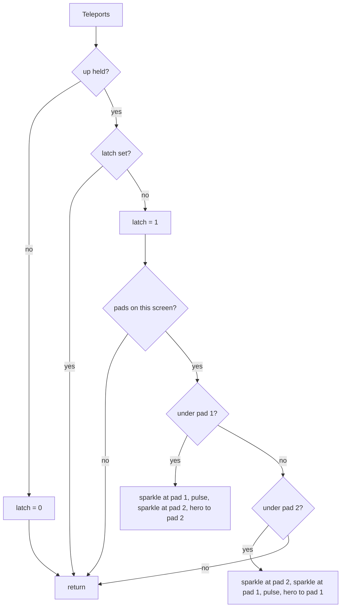

```text
on the first pass of up:
    for (src, dst) in ((pad1, pad2), (pad2, pad1)):
        if PlayerY == 8 (src.row + 1) and -12 <= PlayerX - 4 src.col <= 8:
            sparkle(src); sparkle(dst); pulse
            PlayerX, PlayerY = 4 dst.col - 3, 8 (dst.row + 1); frame 5
            return
```

A worked example, `x2` frame 1609 on screen 2: pad 1 is at column 5, row 13; pad 2 at column 23, row 6.

- The hero: X `$1A` = 26, Y `$70` = 112.
- Pad 1: Y wanted 8 x 14 = 112: true. X - 4 x 5 = 26 - 20 = 6, within -12..+8: true.
- Sparkles at (`$14`, `$70`) and (`$5C`, `$38`): pad 1 and pad 2.
- The hero arrives at X 4 x 23 - 3 = 89 = `$59`, Y 8 x 7 = 56 = `$38` (frame 1610).

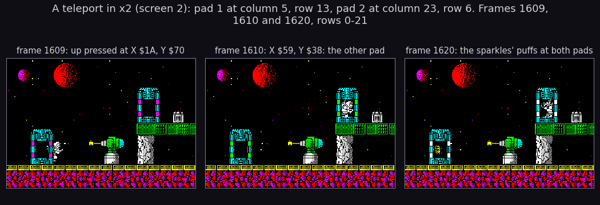

```sh
python3 tools/fig_kinds.py teleport    # from x2-screens.json, the read of 7.2's turret figure
```

How to read: the playfield of screen 2 (rows 0-21) at three frames; the caption over each gives the hero's place.

What it shows:

- Frame 1609: the hero in pad 1's booth, up pressed.
- Frame 1610: one pass later he stands in pad 2's booth, top right.
- Frame 1620: the sparkles' puffs over both booths. Each teleport starts two sparkles, not four (StartSparkle is
  called twice).
## 7.6 Missiles, blasts, debris and puffs

### The homing missile

The launcher is kind 13; MissileLauncher `$A266` holds its cell. The missile does not leave the launcher: it comes in
from the right edge.

HomingMissileStart `$A23A` runs at the build and whenever no missile flies:

- MissileLive `$A26A` = 0;
- nothing when the screen has no launcher, when the hero is dying, or when the launcher's cell no longer holds 13;
- else MissileLive = `$0D` and the missile at X `$78` (the right edge), Y `$20` + (Random AND `$7F`): a random height
  in 32-159.

HomingMissileStep `$A26B`, every pass:

- no missile: HomingMissileStart;
- the launcher's cell no longer 13 (a grenade blew it away): 34 bonus ticks (850 points), a blast at the missile, the
  missile removed; no new one follows, because the start test fails;
- X - 1 with Sprites16 frame `$0A`; below X `$46`, X - 1 again with frame `$0B`: 2 units a pass on the left part;
- X - 1 from 0 gives `$FF`: the missile is removed and the next starts in the same pass;
- Y one pixel toward PlayerY, or none when equal;
- PlayerContact with B = `$10`, C = 8: KillPlayer, a blast, removed, the next starts;
- drawn in the sprite slot `$B4F1`, white `$47`.

```asm
HomingMissileStart:
  XOR A
  LD (MissileLive),A
  LD DE,(MissileLauncher)
  BIT 7,E
  RET NZ                  ; no launcher on this screen
  LD A,(DeathTimer)
  OR A
  RET NZ
  ; ...                   ; HL = CellTypes of the launcher's cell
  LD A,(HL)
  CP $0D
  RET NZ                  ; the launcher destroyed
  LD (MissileLive),A
  CALL Random             ; the start height
  AND $7F
  ADD A,$20
  LD H,A
  LD L,$78                ; the right edge
  LD (MissilePosition),HL
  RET
HomingMissileStep:
  ; ...                   ; no missile: HomingMissileStart; launcher gone: 850 points
  LD L,$0A                ; the slow frame
  DEC E
  LD A,E
  CP $FF
  JR NC,HomingMissileRemove
  CP $46
  JR NC,HomingMissileSteer
  INC L                   ; the fast frame, one more step
  DEC E
HomingMissileSteer:
  LD A,(PlayerY)          ; one step toward the player's height
  CP D
  JR Z,HomingMissileHit
  JR NC,HomingMissileYStep
  DEC D
  DEC D
HomingMissileYStep:
  INC D
HomingMissileHit:
  LD BC,$1008             ; the player touched?
  CALL PlayerContact
  ; ...                   ; a touch: KillPlayer, StartBlast, removed, HomingMissileStart
```

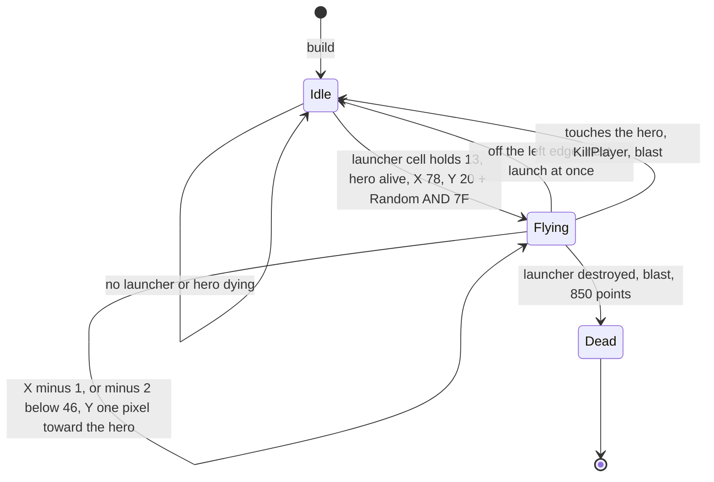

```text
start: live = 0; if no launcher or dying or CellTypes[launcher] != 13: return
       live = 13; x = $78; y = $20 + (Random AND $7F)
step:  if not live: start; return
       if CellTypes[launcher] != 13: bonus 34 ticks; blast; remove; start (fails); return
       x -= 1; if x == $FF: remove; start; return
       if x < $46: x -= 1                       # fast frame
       y += sign(PlayerY - y)
       if PlayerContact(x, y, 16, 8): KillPlayer; blast; remove; start; return
       draw
```

A worked example, `w/006` screen 8 (the launcher at column 20, row 11):

- At frame 1558 the missile reaches X 0. The next pass takes X to `$FF`: removed.
- In the same pass HomingMissileStart launches the next: frame 1562 reads X `$78`, Y `$45`. `$45` - `$20` = `$25`: the
  Random of that pass ANDed with `$7F` was 37.
- The flight from X `$78` to `$46` takes 50 passes at 1 unit, then 35 passes at 2 units: 85 passes. In `w/006` the
  flight from frame 1562 took 261 frames, about 3 frames a pass on this busy screen.
- The second relaunch, at frame 1823, starts at Y `$23`.
- At frame 2046 the hero reaches screen 9, which has no launcher: no missile.

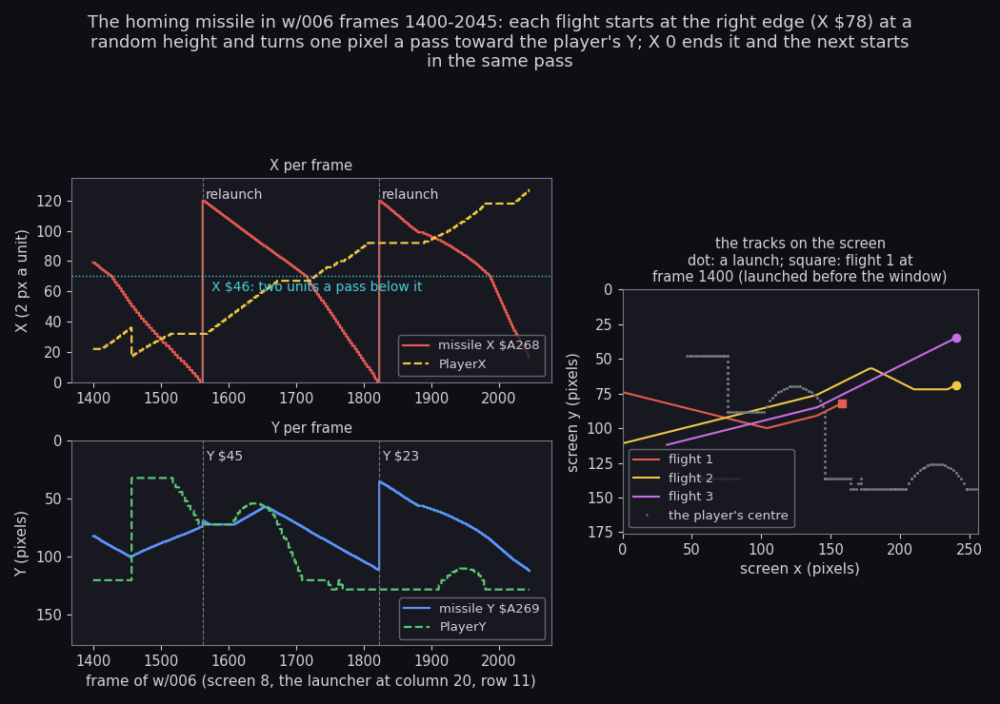

```sh
python3 work/docs/fillO/reads.py work/docs/fillO/i work/w/006/session.ttd work/docs/fillO/d/w006-missile.json \
    1400 2134 1 A266:5 82F5:2 8523:1 9ED6:2 A00C:16 9CE2:1
python3 tools/fig_kinds.py missile
```

How to read:

- Left: the missile's X (red) and Y (blue), PlayerX (white) and PlayerY (grey) per frame. The dotted line is X `$46`,
  where the missile speeds up. The dashed lines mark the relaunches.
- Right: the three flights drawn on the screen (X in pixels), each from its launch dot, with the hero's centre (grey
  dots).

What it shows:

- Every flight starts at X `$78`: the right edge, not the launcher's cell.
- X falls one unit a pass, then two below `$46`: the slope of the red line doubles.
- Y bends toward PlayerY one pixel a pass and flattens when they match.

The launcher destroyed while its missile flies, and the 850 points it pays, are known only from the code.

### The idle missile

IdleMissileStart `$AC59` and IdleMissileStep `$AC7D` send a missile (sprite `$24`) at the player's Y after IdleTime
`$AC7B` passes 700 on one screen ([10.8](10-gameplay-logic.md#108-the-idle-missile)).

### Blasts

StartBlast `$9FA3` takes a free record of BlastList `$A00C` (5 records of X, Y, passes left) and sets 11 passes.
Its callers are HomingMissileStep, KillAlien and IdleMissileStep.

RunBlasts `$9FBD`, every pass, for each live blast n:

- passes left - 1, with A keeping the old count 11..1;
- the frame BlastFrames[old count] drawn in sprite slot `$B401` + `$30` n (5 slots, one per record);
- the ink `$42-$45` at random, bright;
- a beeper crackle of 1-32 noise rounds (BeeperNoise).

BlastFrames `$A001` reads `00 09 09 08 08 07 07 06 06 05 05` for counts 1..11. In time order: 5, 5, 6, 6, 7, 7, 8, 8,
9, 9, then 0, the empty frame that clears the slot.

```asm
RunBlastsLoop:
  ; ...                   ; E = X, D = Y, A = passes left; 0: the next
  DEC (HL)                ; passes left - 1 (A keeps the old count: 11..1)
  LD L,A
  LD H,$00
  LD BC,$A000             ; BlastFrames - 1 + passes left
  ADD HL,BC
  LD A,(HL)
  PUSH IY                 ; the record's own sprite slot
  POP HL
  LD B,D
  LD C,E
  CALL DrawSprite
  CALL Random             ; ink $42-$45
  AND $03
  ADD A,$42
  LD C,A
  CALL ColourSprite
  CALL Random             ; 1-32 rounds of noise
  AND $1F
  INC A
  LD B,A
  CALL BeeperNoise
```

### Debris

Printer 3 (XorDebrisPrinter `$AE95`) calls AddDebris `$94F9` twice for every character it prints. Its users are the
mine blast (7.5) and the grenade blast (7.10).

AddDebris takes the first free record of DebrisList `$95B6` (100 records of state, X, Y, dx, dy, colour):

- X = 4 x column, Y = 8 x row;
- dx = DebrisSpeeds[Random AND 7]; DebrisSpeeds `$9555` reads -4, -3, -2, 0, 0, 2, 3, 4;
- dy = 2 x DebrisSpeeds[Random AND 7], drawn again while dx and dy are both 0;
- small sprite 2 drawn; the colour = the printer's colour AND `$47`.

MoveDebris `$955D`, every pass, for each piece:

- sprite 2 XORed off; X + dx, gone at `$78` or more; Y + dy, gone at `$A9` or more;
- no wall test: debris flies through the scenery;
- drawn again and its cell painted in its colour (ColourCell);
- on the 48K only, X x 8 AND `$F8` sent to port `$FE`: the speaker and MIC bits follow X, which crackles.

A piece moving left or up leaves by wrapping: X below 0 is `$FC`-`$FF`, which is `$78` or more.

```asm
DebrisSlotFound:
  LD (HL),$01             ; the record
  ; ...                   ; X = 4 column, Y = 8 row
  CALL Random             ; dx
  AND $07
  CALL DebrisSpeed
  LD (HL),A
  LD C,A
  INC HL
DebrisDy:
  CALL Random             ; dy = 2 x a speed, not both 0
  AND $07
  CALL DebrisSpeed
  ADD A,A
  LD B,A
  OR C
  JR Z,DebrisDy
DebrisMove:
  ; ...                   ; erased
  LD A,E                  ; X + dx; off the right edge: gone
  ADD A,(HL)
  LD E,A
  CP $78
  JR NC,DebrisGone
  INC HL
  LD A,D                  ; Y + dy; off the bottom: gone
  ADD A,(HL)
  LD D,A
  CP $A9
  JR NC,DebrisGone
```

```text
AddDebris(col, row, colour): rec = first free; rec = (1, 4 col, 8 row, s(), 0, colour AND $47)
                             repeat rec.dy = 2 s() until rec.dx or rec.dy;  draw     # s() = DebrisSpeeds[Random AND 7]
MoveDebris: for each live: erase; x += dx; y += dy; if x >= $78 or y >= $A9: free else draw, colour; 48K: OUT ($FE)
```

A worked example: of the 64 (dx, dy) index pairs, the 4 with both speeds 0 (index 3 or 4 for each) are drawn again,
so 60 directions remain. A piece moves at most 4 units across and 8 lines a pass. The first debris record of `w030`'s
mine (7.5), `01 14 8C 00 FC 42`, has dx 0 and dy -4: it rises straight up 4 lines a pass and leaves through the top,
wrapping to `$FC`, on its 36th move. `x2` threw 370 pieces, `c128` 98.

### Puffs

A puff is the small explosion. AddPuff `$981D` takes a free record of PuffList `$9870` (20 records of X, Y, timer) and
sets the timer to 10. Its callers:

- the player's shot at a wall (MoveShots, 10.12);
- the grenade's trail (MoveGrenade, 4 units behind it, while the timer is `$13` or more);
- BallHit and DestroyGunShot: a ball or a gun shot destroyed;
- RunSparkles: the teleport's sparkle;
- IdleMissileStep.

AnimatePuffs `$9835`, every pass, for each puff with timer t:

- t - 1 stored;
- PuffFrames[t] XORed (it takes off last pass's frame), then PuffFrames[t - 1] XORed on;
- the cell painted in a random bright ink with bit 1 set: A = R AND 7 OR `$42`. This is the R register, not Random.

PuffFrames `$9865` reads `06 05 05 05 04 05 03 05 04 03 06`. Small sprites 3, 4 and 5 are the frames, 6 is blank. In
pass order: 3, 4, 5, 3, 5, 4, 5, 5, 5, then 6: the puff flickers and shrinks, and the last frame is blank, so nothing is
left.

### Sparkles

StartSparkle `$9ED9` takes a free record of SparkleList `$9F13` (4 records of X, Y, passes) and sets 20 passes.
RunSparkles `$9EEE`, every pass, for each live sparkle: passes - 1, then a puff at X + (Random AND 3), Y + (Random AND
15). A sparkle is a column of puffs over a booth, 4 units wide and 16 lines high, for 20 passes.

The teleport is the only caller, twice per teleport: once at the pad left and once at the pad reached. `x2` frames
1609-1620 show both (the teleport figure, 7.5).

### The effects by pass

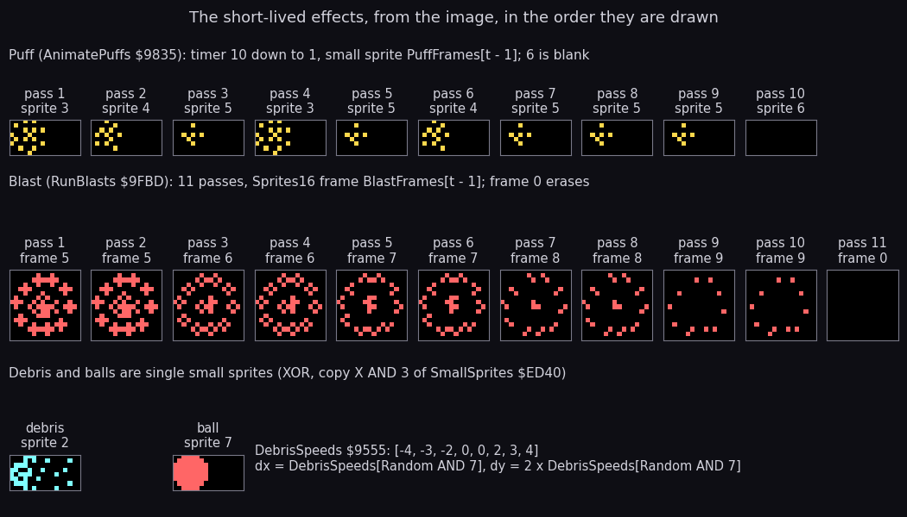

```sh
python3 tools/fig_kinds.py effects     # model: SmallSprites $ED40, Sprites16 $F8E0, PuffFrames, BlastFrames
```

How to read:

- Row 1: the puff, passes 1-10, the small sprite PuffFrames gives for each.
- Row 2: the blast, passes 1-11, the Sprites16 frame BlastFrames gives for each; frame 0 erases.
- Row 3: the debris piece (small sprite 2) and the ball (small sprite 7), with DebrisSpeeds.

What it shows:

- The blast opens out from a dense ring to scattered dots: frames 5 to 9 are drawn in that order, two passes each.
- The puff is a small cluster that jumps between three shapes before it goes blank.

The point: blasts, debris and puffs are short lists, each with its own counter and its own routine, and none of them
can hurt the hero. They are drawn by XOR, so each one has to erase exactly what it drew; the blank last frames of the
puff and the blast do that.

## 7.7 The pickup cells behind the guns

Element 26 marks the two cells behind its two barrels as kind 14, element 45 the three cells behind its one.
PickupList `$A333` keeps them as three-byte records: column, row, live.
ClearPickups `$A352` makes only the first 4 records live (`$01`).
PickupsVsPlayer `$A30B` pays 40 bonus ticks (1000 points) and plays the AY trill `$C12E` when the player touches a
live one, then clears its live byte.

This is known only from the code. No recording shows a touch: the gun cells sit in front of the pickup cells, so the
player has to get past a live gun.

## 7.8 The two sprite sets


```sh
python3 tools/fig_objects.py sprites   # both figures
```

How to read:

- First figure: SmallSprites `$ED40`, 9 sprites of 16 x 8 pixels in four copies each shifted 2 pixels right (64 bytes
  a sprite), stacked by copy. DrawSmallSprite picks copy E AND 3. The label under a sprite is the caller found in the
  source.
- Second figure: Sprites16 `$F8E0`, 45 frames of 16 x 16 (32 bytes each). The label under a frame and its colour are
  its role: an alien look from AlienScreens, the blast frames, the missiles, the menu star, the flicker pad; the
  legend below gives the routines.
- Grey: no caller in the source passes that number.

What it shows:

- The aliens use six looks of four frames: 1, 16, 20, 24, 37, 41 (AlienScreens +3); the look's frame is the alien's
  animation counter AND 3.
- Small sprite 6, which PadXorSprites `$9E85` draws to keep the pass time even, is all zeros: the padding draws
  nothing (the source's open question "whether sprite 6 is blank" is answered by its bytes).
- Small sprites 3-5 are the puff's frames, picked through PuffFrames `$9865`; Sprites16 33-35 have no caller.
- The trap is a third set: PlayerFrames `$EF80` frame 24, 24 x 32, drawn by DrawBigSprite.

## 7.9 What no recording reached

- A mine killing the player: every clone that reaches a mine carries the mine POKE.
- A pickup cell touched (7.7), and a force field destroyed by 25 hits.
- All 10 gun shot records in use.
- The traps run only in `t1`, an exploration clone; no plain recording leaves screen 0.
- A launcher destroyed while its missile flies (the 850 points, 7.6).
- A ball reaching the top line (BallTopRow), and GunShotsFull: no list of gun shots was ever full.
- The flicker pad has no rule to reach: it is decoration (7.2).
- A grenade thrown to the left: every throw in the recordings went right (10.7).

## 7.10 Destructible scenery and the grenade blast

Some elements of the scenery can be blown up by a grenade. The screen builder registers them as it prints them:
for every element it calls AddDestructible `$9487` with the element, its column and its row.

DestructibleKinds `$94C6` lists the 10 destructible elements, five bytes each: element, dx, width, dy, height.
The box of an element printed at (column, row) is:

- x0 = column + dx, x1 = x0 + width (columns x0..x1 - 1);
- y0 = row + dy, y1 = y0 + height (rows y0..y1 - 1).

| Element | dx | Width | dy | Height | What it is (screen 0 and elsewhere) |
| ---: | ---: | ---: | ---: | ---: | --- |
| `$05` | -1 | 8 | -2 | 5 | the turret on its pedestal |
| `$0D` | -3 | 5 | -2 | 10 | the rock spire |
| `$0F` | -2 | 7 | -1 | 9 | |
| `$10` | -2 | 6 | -2 | 8 | the decorative missile |
| `$12` | -6 | 11 | 1 | 7 | |
| `$15` | -2 | 7 | -2 | 8 | |
| `$1F` | -1 | 6 | -2 | 6 | |
| `$28` | -1 | 6 | -2 | 8 | |
| `$2C` | -1 | 8 | -2 | 4 | |
| `$2E` | -1 | 5 | -2 | 6 | the mushroom |

DestructibleList `$9437` holds up to 11 records of 7 bytes: x0, x1, y0, y1, the element's column, its row, the
element. `$80` in x0 means destroyed; `$FF` ends the list.

GrenadeBlast `$93E2` runs when a grenade's flight ends (10.7). It turns the grenade's place into a cell, column = X / 4
and row = Y / 8, and takes the first live record whose box holds that cell:

- the element printed again at its place with printer 3: XOR, so it disappears, and two debris pieces for each
  character (7.6);
- x0 = `$80`;
- the blast sound `$C148` and 150 points.

At most one piece goes per grenade. A grenade that ends outside every box does nothing to the scenery.

```asm
GrenadeBlast:
  LD A,E                  ; column = X / 4
  AND $7C
  RRCA
  RRCA
  LD E,A
  LD A,D                  ; row = Y / 8
  AND $F8
  RRCA
  RRCA
  RRCA
  LD D,A
  LD HL,DestructibleList  ; DE = (row, column)
BlastLoop:
  LD A,(HL)               ; $FF: the end; $80: destroyed already
  CP $FF
  RET Z
  CP $80
  PUSH HL
  JR Z,BlastNext
  LD A,E                  ; column in x0..x1-1, row in y0..y1-1
  CP (HL)
  INC HL
  JR C,BlastNext
  CP (HL)
  INC HL
  JR NC,BlastNext
  LD A,D
  CP (HL)
  INC HL
  JR C,BlastNext
  CP (HL)
  INC HL
  JR NC,BlastNext
  LD E,(HL)               ; DE = the element's place, A = the element
  INC HL
  LD D,(HL)
  INC HL
  LD A,(HL)
  LD BC,ElementTable
  CALL TableWord
  LD A,$03                ; printer 3 (XOR + debris)
  CALL SetPrinter
  CALL PrintString
  XOR A
  CALL SetPrinter
  POP HL
  LD (HL),$80             ; the piece destroyed
  CALL PlaySfxBlast
  LD DE,Points150+$0005   ; 150 points
  JP AddScore
```

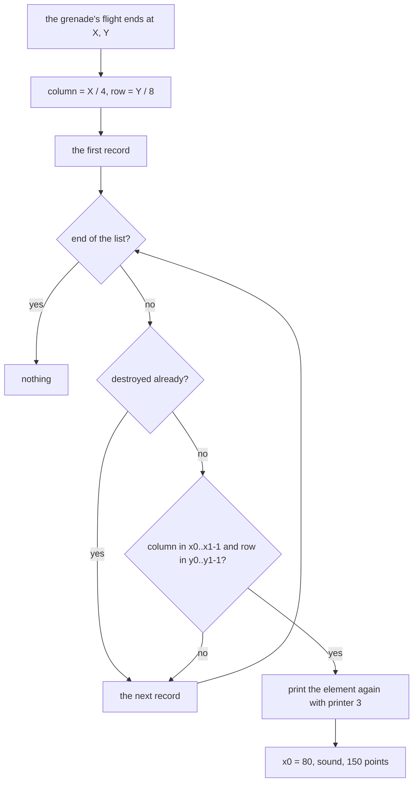

```text
GrenadeBlast(x, y):
    col, row = x / 4, y / 8
    for rec in DestructibleList until $FF:
        if rec.x0 == $80: continue
        if rec.x0 <= col < rec.x1 and rec.y0 <= row < rec.y1:
            print element rec.element at (rec.col, rec.row) with printer 3   # XOR off + debris
            rec.x0 = $80; sound; score += 150
            return
```

A worked example, `x2` screen 0. The layout has two destructible elements:

- the turret, element `$05` at column 20, row 14: x0 = 19, x1 = 27, y0 = 12, y1 = 17. The record reads
  `13 1B 0C 11 14 0E 05`;
- the spire, element `$0D` at column 29, row 10: x0 = 26, x1 = 31, y0 = 8, y1 = 18. The record reads
  `1A 1F 08 12 1D 0A 0D`.

The first grenade ends at X `$4C`, Y `$77` (frame 410): column 19, row 14. The spire's box starts at column 26, so it
does not match. The turret's does: 19 is in 19..26 and 14 in 12..16. The turret is printed again, and at frame 412
its record reads `80 1B ...`.
The next grenade ends at X `$6C`, Y `$71` (frame 566): column 27, row 14, inside the spire's box. Frame 570 shows both
records marked `$80`.

The annotation's count "c1: 36 elements on screen 0, 8 of them destructible" is over c1's four screen builds, all of
screen 0: 9 elements a build, 2 of them destructible.

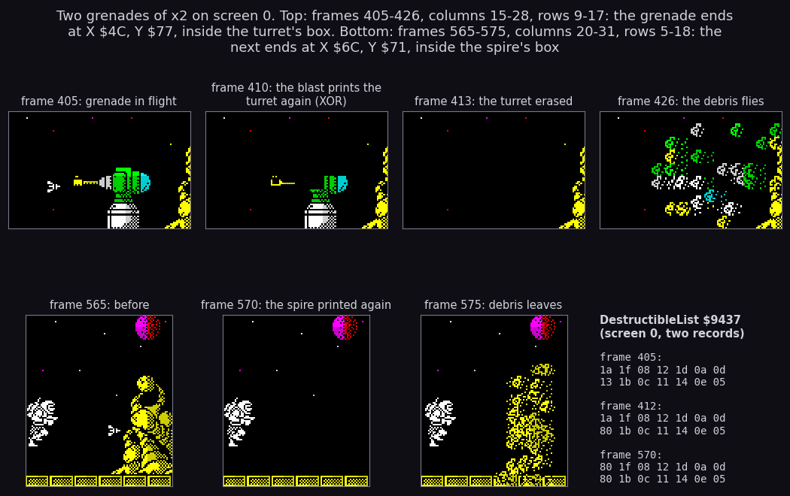

```sh
python3 tools/fig_kinds.py blast       # from x2-screens.json (the read of the turret figure, 7.2)
```

How to read:

- Top: frames 405-426, columns 15-28, rows 9-17. The grenade in flight; at frame 410 the blast prints the turret again
  (XOR) and the first debris appears; at frame 413 the turret is gone; at 426 the debris flies.
- Bottom: frames 565-575, columns 20-31, rows 5-18: the spire before, printed again, and its debris leaving.
- Right: DestructibleList at frames 405, 412 and 570.

What it shows:

- The debris starts in the pass of the blast, at frame 410, and the `$80` mark is seen at 412: the read at 410 caught
  the pass in the middle of the print.
- The debris takes the colours of the element: green, white and cyan for the turret, yellow for the spire.
- The turret's own record in TurretList goes to state 0 in the same pass: its cell is no longer 3 (7.2).

Two records can never be destroyed. Element `$10` on screen 23 stands at row 1, and two mushrooms (element `$2E`) on
screen 53 too. With dy = -2, y0 = 1 - 2 = `$FF`. The row test `row >= y0` is unsigned, and no row is `$FF` or more, so
the box never matches. `w/023` frame 250 holds `12 18 FF 07 14 01 10` ([10.13](10-gameplay-logic.md#1013-bugs-and-oddities) item 3).

## 7.11 Collision

Every contact in the game is one of four tests.

PlayerContact `$9BD6` is the box test against the hero. The caller gives the object's place in E (X) and D (Y) and its
size in C (units) and B (lines). The answer is 1 when:

- PlayerX - E - C is within -(C + 12)..-1: the object's X within PlayerX - C + 1 .. PlayerX + 12;
- standing: PlayerY - D - B within -(B + 32)..-1: the object's Y within PlayerY - B + 1 .. PlayerY + 32;
- crouching: PlayerY + 6 - D - B within -(B + 26)..-1: the hero's top is 6 lines lower.

So the hero is a box of 12 units (24 pixels) by 32 lines, 26 when crouched. The `SUB` and one unsigned `CP` test a
window of both ends at once.

```asm
PlayerContact:
  PUSH HL
  LD A,C
  ADD A,$0C
  NEG
  LD L,A
  LD A,(PlayerX)          ; X - E - C within -(C + 12)..-1
  SUB E
  SUB C
  CP L
  LD A,$00
  JR C,PlayerContactDone
  LD A,(CrouchOffset)     ; crouching: the shorter box
  OR A
  JR NZ,PlayerContactCrouched
  LD A,B                  ; standing: Y - D - B within -(B + 32)..-1
  ADD A,$20
  NEG
  LD H,A
  LD A,(PlayerY)
  SUB D
  SUB B
  CP H
  LD A,$00
  JR C,PlayerContactDone
  INC A
PlayerContactDone:
  POP HL
  RET
```

The two shot tests walk ShotList `$845F` against one object and free the shot that hits:

- BallShot `$9B82` (balls, gun shots): a shot within X - 2..X + 1 and Y - 1..Y + 8 of the object;
- ShotHitsAlien `$9F71` (aliens): a shot within X - 6..X + 1 and Y - 1..Y + 16.

The probes `$9362-$93C2` test the cell map for a small sprite's move (shots, balls, grenades):

- ProbeRight / ProbeLeft answer 0 unless X is a multiple of 4 (the sprite's edge on a cell boundary); then they read
  the cell right or left, and the one below it too when Y is not a multiple of 8;
- ProbeBelow / ProbeAbove answer 0 unless Y is a multiple of 8; then they read the cell below or above, and the one to
  the right too when X is not a multiple of 4.

So a probe never sees a wall from the middle of a cell: a move is blocked only at the step that would cross a cell
boundary.

Every contact test, its box and its order in the pass:

| Test | Caller | Object box | Against | Result |
| --- | --- | --- | --- | --- |
| Player's shot vs ball | ShotsHitBalls `$9B52` | BallShot: X - 2..X + 1, Y - 1..Y + 8 | ShotList | ball dies, 50 points |
| Player's shot vs gun shot | GunShotsVsShots `$9E37` | BallShot | ShotList | gun shot dies, 50 points |
| Player's shot vs alien | AliensVsShots `$A5CA` | ShotHitsAlien: X - 6..X + 1, Y - 1..Y + 16 | ShotList | alien dies, 150 points |
| Player's shot vs force field | ForceFieldVsShots `$AC04` | shot X = 4 x (column - 1) | ShotList | hit count + 1 |
| Shot vs wall | MoveShots `$83DD` | ProbeLeft / ProbeRight | the cell map | shot ends, puff |
| Turret shell vs hero | ShellsHitPlayer `$90EA` | PlayerContact B 0, C 0 | the hero | KillPlayer |
| Gun shot vs hero | GunShotsVsPlayer `$9E64` | PlayerContact B 8, C 4 | the hero | 50 points, KillPlayer |
| Ball vs hero | BallsTouchPlayer `$9BB4` | PlayerContact B 8, C 4 | the hero | 50 points, KillPlayer |
| Alien vs hero | AliensVsPlayer `$A5F4` | PlayerContact B 8, C 4 at X + 2, Y + 4 | the hero | 150 points, KillPlayer |
| Homing missile vs hero | HomingMissileStep `$A26B` | PlayerContact B 16, C 8 | the hero | KillPlayer, blast |
| Idle missile vs hero | IdleMissileStep `$AC7D` | PlayerContact B 16, C 8 | the hero | KillPlayer, blast |
| Trap vs hero | TrapContact `$9C8B` | PlayerContact B 32, C 12 at the trap's cell | the hero | ShieldedKill |
| Force field vs hero | ForceFieldStep `$ABCF` | PlayerX + 12 = 4 x column | the hero | KillPlayer |
| Mine vs hero | Mines `$9152` | bottom line = mine's line - 1, X within E - 7..E + 2 | the hero | ShieldedKill |
| Pod vs hero | Pods `$9942` | PlayerY = 8 (row - 2), X within E - 12..E - 1 | the hero | refill |
| Pickup cell vs hero | PickupsVsPlayer `$A30B` | PlayerContact B 8, C 4 at the cell | the hero | 1000 points |
| Grenade vs scenery | GrenadeBlast `$93E2` | the cell in a destructible box | DestructibleList | piece gone, 150 points |

The order: MoveShots runs the four shot tests (balls, gun shots, aliens, force field) before it moves the shots, five
times a pass. A shot that hits a ball is freed before the alien test sees it. The hero's tests run once a pass, each
from its own routine in the main loop ([4.2](04-game-loop.md#42-the-main-loop)).

A worked example: a gun shot at X 50, Y 120 and the hero at X 40, Y 96, standing.

- GunShotsVsPlayer gives B = 8, C = 4.
- X: 40 - 50 - 4 = -14; the window is -16..-1: inside.
- Y: 96 - 120 - 8 = -32; the window is -40..-1: inside. A contact: 50 points, then KillPlayer.
- The same shot at X 53 gives 40 - 53 - 4 = -17: outside, no contact. The hero's right edge is X 52.

The BoxOverlap routine at `$ADCD` would test two boxes against each other, but nothing calls it (10.13 item 14).

The point: there is no general collision engine. Each pair of things has its own small test, sized for its sprites,
and the tests run in a fixed order each pass.

## 7.12 Random

Random `$AD36` is the game's one pseudo-random source:

- HL = RandomSeed `$AD51` + 7;
- RandomSeed = 13 x HL, as `ADD HL,HL` twice, a copy, once more, plus the copy, plus the first value;
- A = A XOR the new seed's high byte. The caller's A is mixed in; most callers then AND a mask.

```asm
Random:
  PUSH HL
  PUSH DE
  PUSH BC
  LD HL,(RandomSeed)
  LD DE,$0007
  ADD HL,DE               ; HL = seed + 7
  LD E,L
  LD D,H
  ADD HL,HL
  ADD HL,HL               ; 4 HL
  LD C,L
  LD B,H
  ADD HL,HL               ; 8 HL
  ADD HL,BC               ; 12 HL
  ADD HL,DE               ; 13 HL
  LD (RandomSeed),HL
  XOR H
  POP BC
  POP DE
  POP HL
  RET
```

```text
seed = (13 x (seed + 7)) mod 65536 = (13 seed + 91) mod 65536
A = A XOR (seed >> 8)
```

The seed is a linear congruential generator with multiplier 13 and increment 91. 13 is 1 more than a multiple of 4 and
91 is odd, so the seed runs through all 65 536 values before it repeats.

A worked example from seed 0, the value c1 holds through the load:

| Call | Seed + 7 | New seed | High byte |
| ---: | --- | --- | --- |
| 1 | `$0007` | `$005B` | `$00` |
| 2 | `$0062` | `$04FA` | `$04` |
| 3 | `$0501` | `$410D` | `$41` |
| 4 | `$4114` | `$4E04` | `$4E` |
| 5 | `$4E0B` | `$F68F` | `$F6` |

Two places do not call Random. BeeperNoise `$7C2B` and the puff's ink in AnimatePuffs read the R register
(10.13 item 16).

The users, with the chance each one asks for:

| User | Test | Chance |
| --- | --- | --- |
| Turret fire | Random `$FA` or more | 6 in 256 a pass |
| Gun fire | Random `$F7` or more | 9 in 256 a pass |
| Alien spawn | Random `$C8` or more | 56 in 256 a pass |
| Ball turn | Random `$DC` or more | 36 in 256 a pass |
| Ball vertical step | Random AND 1 | up or down |
| Missile height | Random AND `$7F` | Y 32-159 |
| Trap rest | Random AND `$3F` | the counter restarts at `$14` + 0..63 |
| Debris speeds | Random AND 7, twice | 60 directions |
| Sparkle point | Random AND 3, AND 15 | a 4 x 16 box |
| Stars | Random AND `$1F` | 3 columns a row |
| Inks | Random AND 7 or 3 | blasts, mines, the force field's end, the flicker pad |

The point: one 16-bit seed drives every chance in the game, and the caller's A is XORed in. The A a caller brings is
usually left from its own work, so the same seed gives different answers to different callers.
