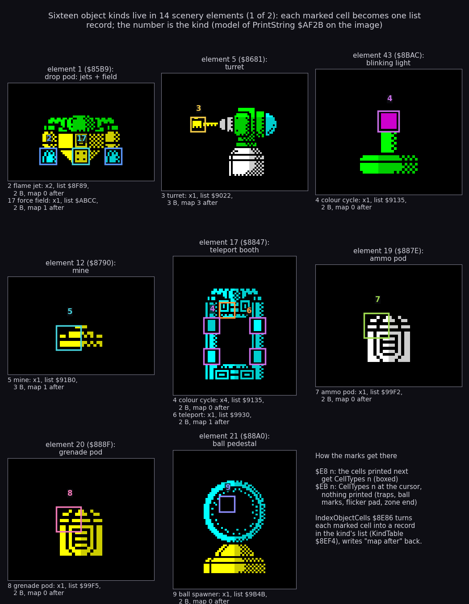
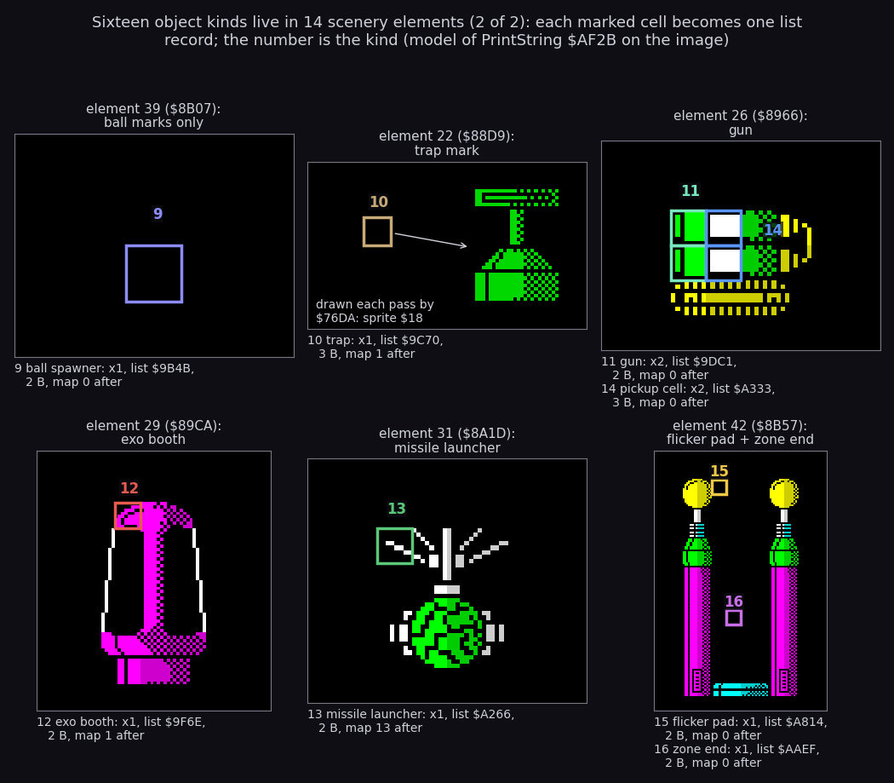
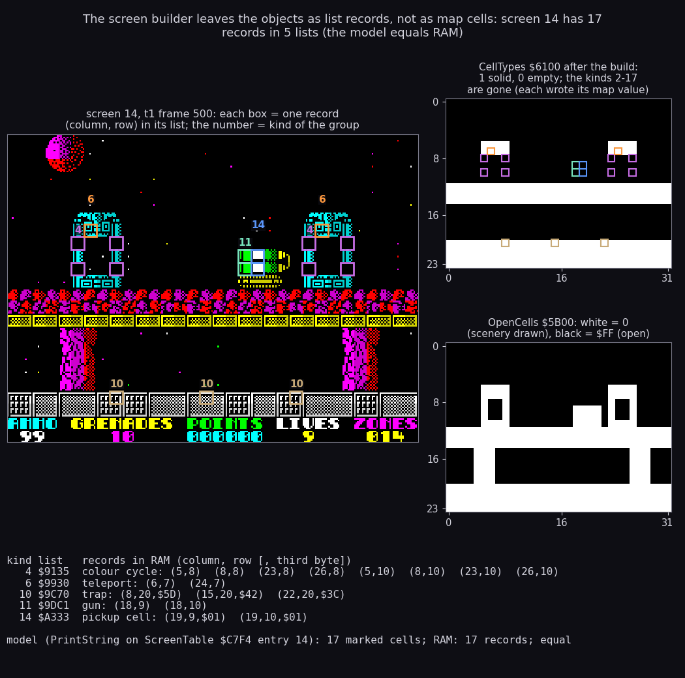
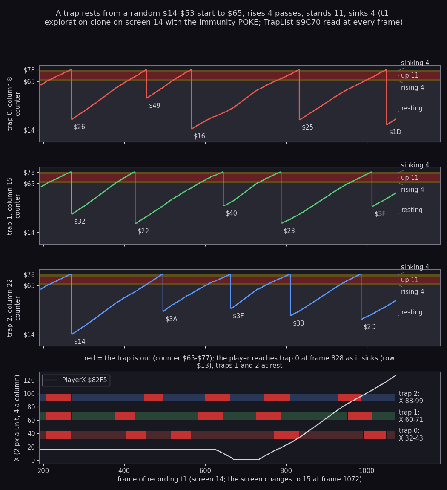
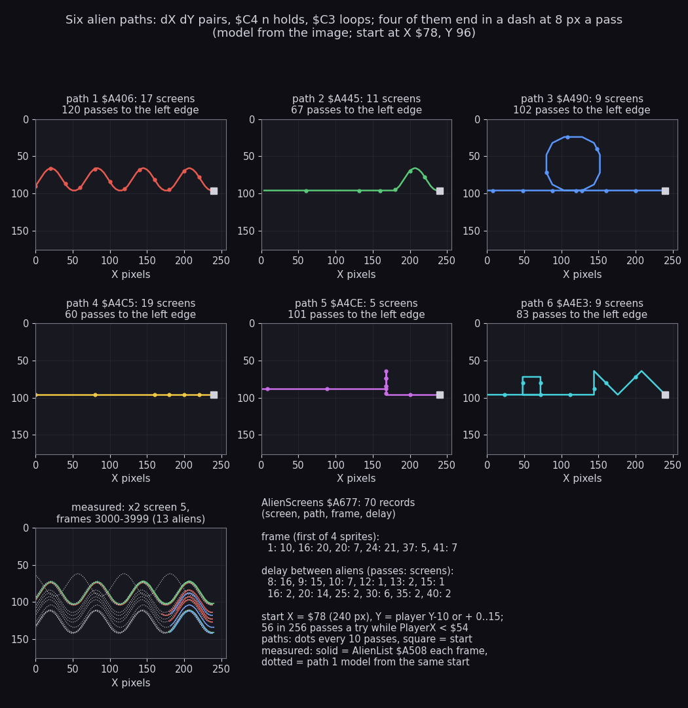
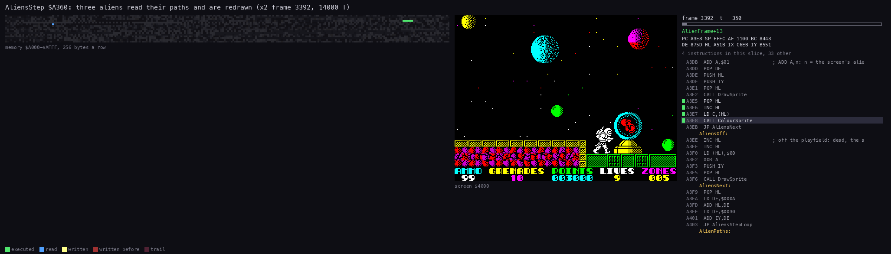
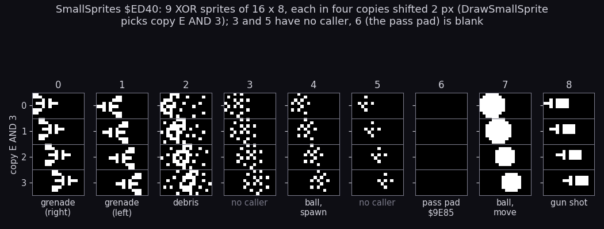
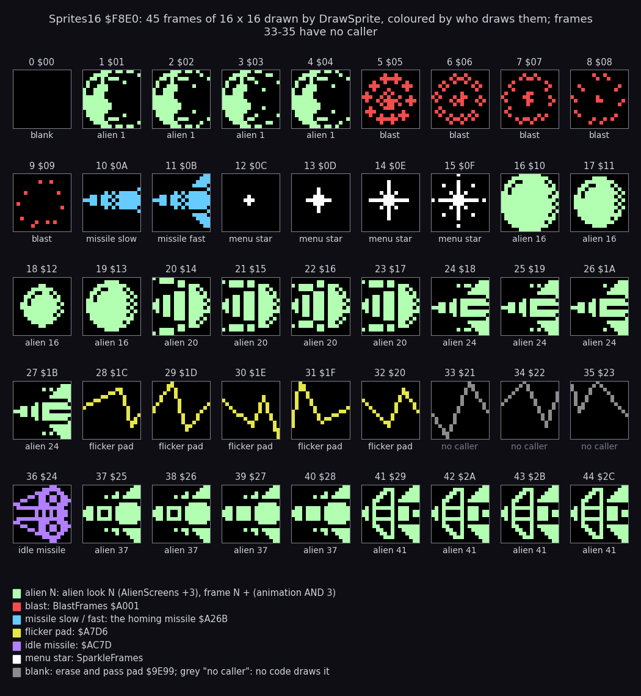

# 7. Objects

What this covers:

- how the scenery turns into objects: the cell maps, the marks the elements carry, and the 16 object lists the
  screen builder fills;
- each kind of object: what it does, its record, its routine;
- the things that move but are not built from the scenery: aliens, shells, gun shots, balls, missiles, blasts,
  debris;
- the two sprite sets they are drawn from.

The recordings it rests on:

- `x2` (`tests/inputs/x2-imm-right.txt` on `entry-imm.z80`, a clone with the ZXDB POKEs for lives, ammunition,
  grenades, immunity, mines and traps; exploration only): screens 0-5, frames 0-23 110. Aliens, balls and pods come
  from it.
- `t1` (exC's clone `work/ann/exC/t1`: `entry.z80` warped to screen 14 with only the lives and immunity POKEs, so the
  traps run; exploration only): 1850 frames, the traps.
- `x1` (no POKE, screen 0): turret shells, nine deaths.
- The 97 warp runs `work/w/NNN` (each a clone on one start screen, traps and the mine kill POKEd; exploration only):
  homing missiles (`w/006`, `w/008`), the exoskeleton (`w/108`), gun shots (`w/006`, `w/008`, `w/009`), mines.
- The image itself (`work/mkgame/original.bin`) for the tables. The figures that rest on the image alone say so
  ("model").

Scope: the player and his shots are in [5. Controls](05-controls.md); the rules (points, deaths, zones) are in
[10. Gameplay logic](10-gameplay-logic.md); the drawing primitives are in [6. Rendering](06-rendering.md).

## 7.1 Three cell maps and the build

A screen is 32 columns by 24 rows of 8 x 8 cells. Rows 22 and 23 hold the HUD. The playfield is rows 0-21: 704
cells (`$02C0`).

The screen builder BuildScreen `$8494` keeps three maps of 768 bytes, one byte a cell:

| Map | Address | Values |
| --- | --- | --- |
| OpenCells | `$5B00` | `$FF` open, 0 scenery drawn. The sprite routines use it as a mask: a sprite never covers scenery. |
| AttrCopy | `$5E00` | the attribute of each cell, kept to restore colours after a sprite passes |
| CellTypes | `$6100` | 0 empty, 1 solid; during the build also 2-17, the object kinds |

The builder reads the screen's layout from ScreenTable `$C7F4`.
There are 125 layouts, one per screen.
A layout is a list of (row, column, element) triples ended by `$FF`.
Each element is a string in the 62-entry ElementTable `$852E`, printed by PrintString `$AF2B`
([8.2](08-hud-and-text.md#82-the-string-printer-af2b)).

Two codes of that printer put object marks into CellTypes:

- `$E8 n`: every cell printed after it gets CellTypes `n` (until the next `$E8`).
- `$EB n`: CellTypes `n` at the cursor; nothing is printed and the cursor does not move.

When every element is printed, IndexObjectCells `$8E86` scans the 704 playfield cells.
Each cell of value 2 or more becomes a record in the list of its kind.

KindTable `$8EF4` describes the kinds.
The record of kind `n` sits at `$8EE8 + 6n` (kinds start at 2, so the first record is at `$8EF4`).
Its six bytes:

- +0/+1: the list's start;
- +2/+3: the write pointer;
- +4: the record size (2 or 3 bytes);
- +5: the value the map cell gets after the cell is listed.

```asm
IndexObjectCells:
  LD HL,KindTable
  LD B,$10
IndexObjectCellsReset:
  LD E,(HL)
  ; ...                   ; each list: $FF at its start, the pointer reset
  DJNZ IndexObjectCellsReset
  LD HL,CellTypes
  LD BC,$02C0
IndexObjectCellsScan:
  LD A,(HL)
  CP $02
  CALL NC,AddObjectCell
  ; ...
AddObjectCell:
  ; ...                   ; E = column, D = row from HL - $6100
  LD BC,KindTable-$000C
  ADD HL,BC               ; IX = the kind's record ($8EE8 + 6 A)
  ; ...
  LD (HL),E               ; column, row at the write pointer
  INC HL
  LD (HL),D
  LD C,(IX+$04)
  ; ...                   ; the pointer moves on by the record size
  LD (HL),$FF             ; the end mark after the new record
  POP HL
  LD A,(IX+$05)
  LD (HL),A               ; the map cell: 0, 1, or the kind kept
```

The same as pseudocode:

```text
for kind in 2..17: list[kind].start[0] = $FF; list[kind].write = list[kind].start
for cell in 0..703:
    kind = CellTypes[cell]
    if kind >= 2:
        rec = list[kind].write
        rec[0] = cell % 32            # column
        rec[1] = cell / 32            # row
        list[kind].write += size[kind]
        list[kind].write[0] = $FF
        CellTypes[cell] = after[kind] # 0 open, 1 solid, 3 or 13 kept
```

A worked example: a gun cell at column 18, row 9 is CellTypes address `$6100 + 9 * 32 + 18 = $6232`.
AddObjectCell gets E = `$32 AND $1F` = 18 and D = `$0132 / 32` = 9.
Kind 11's record is at `$8EE8 + 66 = $8F2A`.
The list GunList `$9DC1` gets the bytes `12 09` and an `$FF`; the map cell becomes 0.

Only two kinds keep their number in the map: the turret (3) and the missile launcher (13).
HomingMissileStep tests the launcher's cell for 13 every pass: a grenade that blows the launcher away leaves 0 there
(7.6).

### The 16 kinds on their elements





```sh
python3 tools/fig_objects.py kinds     # both figures
```

How to read:

- Two figures, 8 and 6 elements; the first ends with a note on the `$E8` and `$EB` codes.
- One panel an element, drawn by a model of PrintString (`tools/fig_docb.py`) from the image's bytes. The model's
  KindTable is checked against the image before drawing.
- A box marks a cell the element types as an object; the number next to it is the kind, in the kind's colour (one
  number a kind, on the first free side of its first cell).
- Under each panel: the kind's name, how many cells the element marks, the list address, the record size and the map
  value after the build.
- Element 22 prints nothing: it is a bare `$EB 0A`, the trap's mark. The green sprite next to it is what Traps draws
  there later (PlayerFrames frame 24, sprite `$18`).

What it shows:

- The objects are part of the scenery's strings, not a separate table. A teleport booth (element 17) carries its
  teleport (kind 6, one cell) and four blinking lights (kind 4).
- A gun (element 26) marks two cells as kind 11 and the two cells behind its barrel as kind 14 (pickup cells, 7.7).
- The drop pod (element 1) carries two flame jets (kind 2) and the force field emitter (kind 17).
- Ball spawners come in two forms: the ring on a pedestal (element 21) and a bare mark (element 39).

### A built screen: records, not cells



```sh
python3 tools/fig_objects.py lists
```

How to read:

- Left: the screen of `t1` at frame 500 (screen 14), from the recording's saved RAM. Each box is one record of one
  list at its (column, row); the number is the kind, once for each group of one kind.
- Right, top: CellTypes `$6100` from the same RAM, white = 1 (solid), black = 0. The boxes show where the records
  point.
- Right, bottom: OpenCells `$5B00`, white where scenery is drawn.
- Bottom: every list that holds records, its bytes decoded, and the comparison with the model of the build.

What it shows:

- Screen 14 has 17 records in five lists: 8 blinking lights, 2 teleports, 3 traps, 2 gun cells, 2 pickup cells.
- After the build CellTypes holds only 0 and 1: every object cell got its kind's "after" value.
- The model (PrintString on ScreenTable entry 14, then the scan) gives the same 17 cells as the RAM.
- The trap records carry a third byte, the counter (`$5D`, `$42`, `$3C` at this frame); the pickup records carry
  their live flag (`$01`).

The kinds over all 125 screens are in `work/docs/docB/kinds-per-screen.txt` (the model run on every layout); their
map over the zones is in [10.2](10-gameplay-logic.md#102-zones-of-25-screens).

## 7.2 What each kind does

The main loop `$75BE` calls each kind's routine once a pass (a few twice).
A pass takes about two frames ([4. Game loop](04-game-loop.md)).
Every routine walks its list until the `$FF` after the last record.

| Kind | List | Routine | What it does | Witness |
| ---: | --- | --- | --- | --- |
| 2 | FlameList `$8F89` | AnimateFlames `$8F54` | a jet of flame below the drop pod; three phases, glyphs `$15 + 2p` of the tile set `$DAB8` | screen 0 in `x1` |
| 3 | TurretList `$9022` | AnimateTurrets `$8F95` | idle (state 1); fires with chance 6 in 256 a pass; a recoil runs states 9 down to 2 through TurretFrames `$9019`, drawn by XOR from the font `$DDD8` | `x1` frame 1500, `m1` 1000 |
| 4 | `$9135` | ColourCycle `$9118` | a blinking light: its ink is PassCount AND 7, bright | every screen with a booth |
| 5 | MineList `$91B0` | Mines `$9152` | armed (state 1): fires when the player's bottom line is the line just above it and his X is within E-7..E+2; a spent mine burns with glyphs `$1D-$20` | `w030` (1 mine fired), 23 warp runs |
| 6 | `$9930` | Teleports `$98BA` | up pressed while standing in a booth: sparkles `$9ED9`, the AY pulse `$C162`, the player moved to the other booth | screens 2, 6, 8, 10, 12, 14, 17, 18 ... |
| 7 | AmmoPod `$99F2` | Pods `$9942` | the ammunition pod: touching it sets ammunition to 99 | `x2` screen 2 (taken: `ff 09` at frame 1750); 53 taken in the warp runs |
| 8 | GrenadePod `$99F5` | Pods `$9942` | the grenade pod: grenades to 10 | `x2` screens 1, 3; 33 taken in the warp runs |
| 9 | `$9B4B` | SpawnBalls `$9B07`, MoveBalls `$9A23` | a ball spawner: 8 balls, each a random walk; a shot ball is worth 50 points; a ball that touches the player kills both | `x2` screen 5, frames 3000 on |
| 10 | TrapList `$9C70` | Traps `$9C15`, TrapContact `$9C8B` | a probe that rises out of the floor (7.3) | `t1` |
| 11 | GunList `$9DC1` | Guns `$9D7F`, MoveGunShots `$9DD6` | fires with chance 9 in 256 a pass, only while the player is more than 32 X units (64 pixels) to its left; the shot can be shot (50 points) | `w/006` 250, `w/008` 1750, `w/009` 1000-1500 |
| 12 | `$9F6E` | ExoSuitBooth `$9F2D` | the exoskeleton booth: entering toggles ExoSuit `$9ED8` between 0 and `$0C` (the player's frames shift by 12) | `w/108` frames 1750-2000, screens 109-110 |
| 13 | `$A266` | HomingMissileStart `$A23A`, HomingMissileStep `$A26B` | the missile launcher (7.6) | `w/006` 1500-2000, `w/008` 250-500 |
| 14 | PickupList `$A333` | PickupsVsPlayer `$A30B` | the two cells behind a gun's barrel: touching one pays 40 bonus ticks (1000 points) and plays the AY trill `$C12E` | code only |
| 15 | `$A814` | FlickerPadStep `$A7D6` | the flickering pad between the two pillars of element 42 (sprites `$1C-$20`); decoration | screens with element 42 |
| 16 | `$AAEF` | ZoneEnd `$A817` | the zone's last screen: walking off its right edge ends the zone ([10.2](10-gameplay-logic.md#102-zones-of-25-screens)) | the warp runs on screens 24, 124 |
| 17 | `$ABCC` | ForceFieldDraw `$AB97`, ForceFieldStep `$ABCF`, ForceFieldVsShots `$AC04` | a force field from the drop pod: a hum (`$C1A9`), death when the player's X + `$0C` reaches the field; 25 hits destroy it | screens with element 1; the 25-hit end never happened |

Three names in the annotation do not match what the code does:

- ClearMissileList `$910B` clears ShellList `$90CB`, the turret shells.
- ShellsVsShots, DestroyShell and ShellsVsPlayer (`$9E37-$9E64`) act on GunShots `$9E18`, the gun shots, not on the
  turret shells.
- The source keeps the names; this document says what each one touches.

### Turret shells and gun shots

Two kinds shoot, and their shots live in separate lists:

- Turret shells: ShellList `$90CB`, 10 slots. MoveShells `$90A2` runs twice a pass and moves each shell 2 X units
  left. ShellsHitPlayer `$90EA` kills the player on contact. Turret shells cannot be shot.
- Gun shots: GunShots `$9E18`, 10 records of 3 bytes (dX 0: free). MoveGunShots `$9DD6` moves them (small sprite 8);
  ShellsVsShots `$9E37` tests them against the player's shots (a hit: 50 points); ShellsVsPlayer kills the player.
  No recording filled all 10 records.

## 7.3 Traps

A trap is a record of three bytes: column, row, counter.
ClearTraps `$9C7D` fills the 12 bytes of TrapList with `$5F` before the build; the build then writes the column and
row over the first two bytes of each record.
The counter goes up by one every pass.

The counter's thresholds, in the code below:

- below `$65`: the trap rests in the floor, harmless;
- `$65-$68`: it rises one row (8 pixels) a pass, 4 passes;
- `$69-$73`: it stands up, 11 passes;
- `$74-$77`: it sinks one row a pass, 4 passes;
- `$78`: a new rest: the counter goes to `$14` + a random 0-63.

```asm
TrapsLoop:
  ; ...
  LD A,(HL)
  INC (HL)                ; the counter counted up
  INC HL
  CP $65                  ; resting
  JR C,TrapsLoop
  CP $69                  ; rising
  JR NC,TrapStanding
  DEC D                   ; one row up
  ; ...
TrapStanding:
  CP $74                  ; standing up
  JR C,TrapDraw
  CP $78                  ; sinking
  JR NC,TrapRestart
  INC D                   ; one row down
  ; ...
TrapRestart:
  DEC HL                  ; the next rest: $14 + a random 0-63
  CALL Random
  AND $3F
  ADD A,$14
  LD (HL),A
  ; ...
TrapDraw:
  ; ...
  LD A,$18                ; the big sprite $18 through the trap's buffer
  ; ...
  CALL DrawBigSprite
  LD C,$44                ; bright green
  CALL ColourBigSprite
```

```text
for trap in TrapList:
    c = trap.counter; trap.counter += 1
    if c < $65: continue                 # resting, not drawn
    if c < $69: trap.row -= 1            # rising
    elif c < $74: pass                   # up
    elif c < $78: trap.row += 1          # sinking
    else: trap.counter = $14 + random(0..63)
    draw PlayerFrames[24] at (trap.column, trap.row), bright green
```

A worked example: the start value `$5F` reaches `$65` after 6 passes, so a new screen's traps first rise 6 passes
after the build.
A rest after `$78` lasts `$65 - $14 - r` = 81 - r passes for r = 0..63: between 18 and 81 passes.
One cycle out of the floor is 4 + 11 + 4 = 19 passes.

TrapContact `$9C8B` tests only the traps whose counter is `$65` or more.
A touch goes to ShieldedKill `$9CAA`: the player dies unless he wears the exoskeleton.



```sh
python3 work/docs/docB/read_series.py work/docs/docB/i48 work/ann/exC/t1/session.ttd work/docs/docB/t1/traps.json 0 1850 1 8523:1 82F5:2 9C70:13 768C:2
python3 tools/fig_objects.py traps
```

How to read:

- The first command loads `t1` into my instance and reads ScreenNumber, PlayerX/Y, TrapList and PassCount at every
  frame through TTD `memory_at` (103 s). The second draws.
- The top three panels: one trap each (columns 8, 15, 22, row 20). The line is the counter. The bands are the four
  states: resting (grey), rising 4 (brown), up 11 (red), sinking 4 (brown), named on the right; the y axis marks
  `$14`, `$65` and `$78`. The labels on the line give each new rest's start.
- The bottom panel: the player's X (2 pixels a unit, 4 a column) and each trap's X span; red while the trap is out.

What it shows:

- All three traps start at `$5F` and reach `$65` together at frame 207; after that the random rests split them.
- The 15 rest starts the recording reached are all within `$14-$53`: `$26 $49 $16 $25 $1D`, `$32 $22 $40 $23 $3F`,
  `$14 $3A $3F $33 $2D`.
- The player walks into trap 0's span at frame 828 while it sinks (row `$13`). `t1` has the immunity POKE, so no
  death follows; what the contact test does there is exC's measure (294 tests, 34 touches).

The case's plain recordings never run the traps: `c1`, `x1`, `m1` and `h1` only play screen 0, and every warp clone
has the traps POKE (`$9C15` = `RET`). In `x2` the trap of screen 2 keeps its counter at `$5F` from frame 1500 to 1750
for that reason. `t1` is the only witness.

## 7.4 Aliens

Aliens are not built from the scenery.
AlienScreens `$A677` lists the 70 screens that have them, five bytes a screen: the screen, the path (a word), the
first frame of the alien's look, and the delay between aliens in passes.

AlienSpawn `$A553` starts an alien when all of these hold:

- the screen is in AlienScreens;
- AlienSpawnDelay `$A5C9` is 0 (it counts down one a pass);
- the player is at X below `$54` (the left two thirds);
- one of the 6 records of AlienList `$A508` is free;
- Random is `$C8` or more (56 in 256).

The new alien starts at X `$78` (240 pixels).
Its Y is the player's Y - 10 (Random `$AF` or more) or the player's Y + 0..15.
Its colour is `$40` + a random ink, 1 changed to 5 and 0 to 4 (never black or blue).

An AlienList record has 10 bytes:

| Offset | Field |
| ---: | --- |
| +0 | X (2-pixel units) |
| +1 | Y (pixels) |
| +2 | live (0 free) |
| +3/+4 | the path's start |
| +5/+6 | the path pointer |
| +7 | the hold count |
| +8 | the animation counter |
| +9 | the colour |

AliensStep `$A360` moves each live alien one step of its path a pass.
A path is a list of signed pairs dX, dY, with two codes:

- `$C4 n`: the pair that follows is used `n` passes;
- `$C3`: start the path again.

An alien whose X reaches `$80` or whose Y reaches `$B0` is off the playfield: its record is freed.

```asm
AliensPathRead:
  LD A,(BC)               ; the next path byte
  CP $C4
  JP Z,AliensPathHold
  CP $C3
  JP Z,AliensPathLoop
  ADD A,E                 ; X += dX
  LD E,A
  INC BC
  LD A,(BC)
  ADD A,D                 ; Y += dY
  LD D,A
  INC BC
  ; ...
AliensPathHold:
  INC BC                  ; $C4 n: hold the next pair n passes
  LD A,(BC)
  DEC A
  LD (HL),A
  ; ...
AliensMoved:
  ; ...
  LD A,E
  CP $80
  JP NC,AliensOff
  LD A,D
  CP $B0
  JP NC,AliensOff
```

```text
for alien in AlienList where alien.live:
    if alien.hold > 0:
        alien.hold -= 1; (dx, dy) = path[alien.ptr]          # the held pair again
        if alien.hold == 0: alien.ptr += 2
    else:
        loop:
            if path[ptr] == $C3: ptr = alien.start; continue
            if path[ptr] == $C4: alien.hold = path[ptr+1] - 1; ptr += 2; (dx, dy) = path[ptr]; break
            (dx, dy) = path[ptr]; ptr += 2; break
    alien.x += dx; alien.y += dy
    if alien.x >= $80 or alien.y >= $B0: alien.live = 0
    else: draw Sprites16[look + (alien.anim AND 3)] in alien.colour; alien.anim += 1
```

A worked example: path 4 (`$A4C5`) is `C4 28 FF 00 C4 64 FC 00 C3`.
`$28` = 40 passes of (-1, 0) take the alien from X `$78` to `$50` at 2 pixels a pass.
Then `$64` = 100 passes of (-4, 0) at 8 pixels a pass: X falls below 0 after 20 of them and wraps to `$FC`, which
is `$80` or more, so the alien is freed. 40 + 20 = 60 passes in all.



```sh
python3 work/docs/docB/read_series.py work/docs/docB/i48 work/x2/session.ttd work/docs/docB/x2/aliens.json 3000 4000 1 8523:1 82F5:2 A508:60
python3 tools/fig_objects.py paths
```

How to read:

- Panels 1-6: each path run through the model of AliensStep from X `$78`, Y 96 until the alien leaves. The square
  is the start, dots every 10 passes. The title gives how many screens use the path and the passes to the left edge.
- Bottom left: AlienList read at every frame of `x2` 3000-3999 (screen 5, path 1). Solid: the measured track of each
  alien. Dotted: the model started from the same first position.
- Bottom right: the AlienScreens table summed up: how many screens use each look and each delay.

What it shows:

- Path 1 is a wave (31 pairs of dX -1 and dY up to +-3); path 2 is the same wave and then a dash; path 3 flies a
  loop; path 4 creeps then dashes; path 5 rises, sinks and waits; path 6 zig-zags round a box.
- Four paths (2, 4, 5, 6) end in 100 passes of (-4, 0): the alien crosses the rest of the screen at 8 pixels a pass.
- The measured aliens follow the model's wave where they live; most tracks end early because `x2` shoots them (205
  kills in the recording).
- Path 4 is the most used (19 screens), path 5 the least (5 screens).

AliensVsShots `$A5CA` tests the player's shots against each live alien: a hit kills it (KillAlien `$A62D`, a blast,
150 points). AliensVsPlayer `$A5F4` kills the player and the alien on contact.

### AliensStep at work



```sh
python3 ../../kit/routine_anim.py --work work/docs/docB/x2 --window 3392:0-3392:14000 --listing build/game.lst --out docs/img/routines/AliensStep.gif --pc A360-A405 --view screen --range A000-AFFF --pictures 40 --delay 150 --title "AliensStep \$A360: three aliens read their paths and are redrawn (x2 frame 3392, 14000 T)"
```

How to read:

- Left: memory `$A000-$AFFF`, 256 bytes a row: green executed, blue read, yellow written in this picture, red
  written earlier. AlienPaths (`$A406-$A507`) and AlienList (`$A508`) are rows 4 and 5.
- Middle: the screen. Right: the listing round the instruction last run, the registers, the routine's name.
- The window is `x2` frame 3392, T 0-14 000, with three live aliens. AliensStep's own instructions run at T
  1373-1908 (69 instructions, `work/docs/docB/trace_ranges.py`); DrawSprite `$795C` follows from T 1925 to 10 641.

## 7.5 Balls, mines, pods and teleports

Balls:

- A ball spawner (kind 9) releases its balls once: SpawnBalls `$9B07` places 8 balls (small sprite 4) and gives each
  a dX of -1 or +1.
- MoveBalls `$9A23` moves each ball by a random walk and redraws it (small sprite 7).
- BallsTouchPlayer `$9BB4` kills the player and the ball. A shot ball is worth 50 points.
- Witness: `x2` screen 5 from frame 3000, the dome on a pedestal where the run stalls.

Mines (kind 5):

- A record is column, row, state. State 1 is armed.
- Mines `$9152` fires an armed mine when the player's bottom line (Y + 31) is the line just above the mine and his X
  is within E-7..E+2 of the mine's X E.
- MineFires sets the state to 0, MineBlast `$91CF` throws debris (DebrisList `$95B6`, 100 records), the blast sound
  plays, and ShieldedKill kills the player unless he wears the exoskeleton.
- A spent mine burns: Mines prints glyph `$1D` or `$1F` (and the next) in a random bright red-ish ink, alternating
  every pass.
- Witness: `w030` fired one mine and 23 warp runs one each. All of them carry the mine POKE (`$9CAE` = `RET`), so the
  kill itself is known only from the code.

Pods (kinds 7 and 8):

- AmmoPod `$99F2` and GrenadePod `$99F5` hold one cell each.
- Pods `$9942` takes a pod when the player's X is within 12 units left of its column + 1 and his Y is two rows above
  its row.
- The pod is printed again with printer 4 (an XOR erase), its record marked `$FF`, and ammunition set to 99 or
  grenades to 10, with the AY sounds `$C0F4` / `$C101` on 128K and five beeper sweeps on 48K.
- `x2` frame 1750: the ammunition pod of screen 2 reads `ff 09`, taken.

Teleports (kind 6):

- Two booths a screen. Up pressed while standing in one sends the player to the other: Teleports `$98BA`, sparkles
  from `$9ED9`, the AY pulse `$C162`.

## 7.6 Missiles, blasts, debris and puffs

Homing missile (kind 13):

- HomingMissileStart `$A23A` launches one missile from the launcher's cell; MissileLive marks it.
- HomingMissileStep `$A26B` moves it left one X unit a pass (sprite `$0A`), two units a pass once it is left of
  X `$46` (sprite `$0B`), and one pixel a pass toward the player's Y.
- It tests the launcher's cell for 13 every pass. A launcher destroyed while the missile flies pays 34 bonus ticks
  (850 points).
- Witness: `w/006` frames 1500-2000 (screen 8) and `w/008` frames 250-500.

The idle missile:

- IdleMissileStart `$AC59` and IdleMissileStep `$AC7D` send a missile (sprite `$24`) at the player's Y after IdleTime
  `$AC7B` passes 700 on one screen ([10.8](10-gameplay-logic.md#108-the-idle-missile)).

Blasts:

- StartBlast `$9FA3` takes a record of BlastList `$A00C`. RunBlasts `$9FBD` draws it 11 passes; the frame comes from
  BlastFrames `$A001` by the passes left: 9, 9, 8, 8, 7, 7, 6, 6, 5, 5, then 0 (erased), in a random bright ink
  `$42-$45`.

Debris and puffs:

- Debris (`$95B6`, 100 records): small sprite 2, each with a random dX and a dY of twice a speed, never both 0. On
  48K the debris routine crackles the beeper with an `OUT` at `$959D`.
- Puffs (`$9870`) are the smoke of a shot hitting scenery.

## 7.7 The pickup cells behind the guns

Elements 26 and 45 (the guns) mark the two cells behind the barrel as kind 14.
PickupList `$A333` keeps them as three-byte records: column, row, live.
ClearPickups `$A352` makes only the first 4 records live (`$01`).
PickupsVsPlayer `$A30B` pays 40 bonus ticks (1000 points) and plays the AY trill `$C12E` when the player touches a
live one, then clears its live byte.

This is known only from the code. No recording shows a touch: the gun cells sit in front of the pickup cells, so the
player has to get past a live gun.

## 7.8 The two sprite sets





```sh
python3 tools/fig_objects.py sprites   # both figures
```

How to read:

- First figure: SmallSprites `$ED40`, 9 sprites of 16 x 8 pixels in four copies each shifted 2 pixels right (64 bytes
  a sprite), stacked by copy. DrawSmallSprite picks copy E AND 3. The label under a sprite is the caller found in the
  source.
- Second figure: Sprites16 `$F8E0`, 45 frames of 16 x 16 (32 bytes each). The label under a frame and its colour are
  its role: an alien look from AlienScreens, the blast frames, the missiles, the menu star, the flicker pad; the
  legend below gives the routines.
- Grey: no caller in the source passes that number.

What it shows:

- The aliens use six looks of four frames: 1, 16, 20, 24, 37, 41 (AlienScreens +3); the look's frame is the alien's
  animation counter AND 3.
- Small sprite 6, which PadXorSprites `$9E85` draws to keep the pass time even, is all zeros: the padding draws
  nothing (the source's open question "whether sprite 6 is blank" is answered by its bytes).
- Small sprites 3 and 5 and Sprites16 33-35 have no caller.
- The trap is a third set: PlayerFrames `$EF80` frame 24, 24 x 32, drawn by DrawBigSprite.

## 7.9 What no recording reached

- A mine killing the player: every clone that reaches a mine carries the mine POKE.
- A pickup cell touched (7.7), and a force field destroyed by 25 hits.
- All 10 gun shot records in use.
- The traps run only in `t1`, an exploration clone; no plain recording leaves screen 0.
