# 8. HUD and text

What this covers:

- the HUD on rows 22 and 23: its labels, its five numbers and who prints them;
- PrintString `$AF2B`, the one string printer the game uses for text, the HUD and all the scenery, with every code;
- PrintChar `$ADE1`, how one glyph lands in a cell, and the five plot modes behind it;
- the font, the logo, the frame pieces, the tile area and its 22 glyph-set bases;
- the score, which is a string;
- the text screens, each with its string;
- the flows behind them: the menu and its stars (8.7), GAME OVER (8.8), the name entry (8.9), the Hall of Fame roll
  (8.10) and the zone-end panel (8.11).

The recordings it rests on:

- `x1` (`tests/inputs/x1-right.txt` on `entry.z80`, no POKE): the game's start at frame 184 (the HUD drawn), GAME
  OVER at frame 2630 and its timeout.
- `m1` (`tests/inputs/m1-menus.txt`, no POKE): define keys, the menu options.
- `h1` (`tests/inputs/h1-hall-of-fame.txt` on `entry-score.z80`, a clone with the score set to 009000 and its reset
  removed; exploration only): the name entry and the whole Hall of Fame roll.
- the warp runs `w/124` and `w/024` (clones on screens 124 and 24; exploration only): CONGRATULATIONS, the bonus
  screen and the zone-end panel.
- `c128` (the `c1` capture on the 128K model): the menu's timeout.
- `x1`, `h1`, `c128` and `w/024` were opened on the writer's own instance (`work/docs/fillR/<name>`, port base 31025)
  for `find_event`, `memory_at` and traces.
- the image (`work/mkgame/original.bin`) for the strings, fonts and the printer model in `tools/fig_docb.py`.

Scope: the scenery that PrintString draws is in [7. Objects](07-objects.md#71-three-cell-maps-and-the-build); the
pixel routines are in [6. Rendering](06-rendering.md); the bonus and Hall of Fame rules are in
[10. Gameplay logic](10-gameplay-logic.md).

## 8.1 The HUD

The HUD is rows 22 and 23. DrawHud `$7690` prints it whole when a game starts (StartGame) and again after each zone
end (ZoneRefill `$A8A5`, which follows the bonus screen; `w/024` runs it at frame 817):

```asm
DrawHud:
  LD HL,HudText
  CALL PrintString
  CALL PrintAmmo
  CALL PrintGrenades
  CALL PrintLives
  JP PrintZone
```

HudText `$76A2` prints the labels on row 22 and clears row 23.
The numbers on row 23 come from five printers:

| Field | Row, column | Attribute | Printer | Value |
| --- | --- | --- | --- | --- |
| AMMO label | 22, 0 | `$45` bright cyan | HudText | |
| GRENADES label | 22, 5 | `$46` bright yellow | HudText | |
| POINTS label | 22, 14 | `$44` bright green | HudText | |
| LIVES label | 22, 21 | `$47` bright white | HudText | |
| ZONES label | 22, 27 | `$43` bright magenta | HudText | |
| ammunition | 23, 1 | `$47` | PrintAmmo `$8E4F` (two digits) | Ammo `$8E5A`, 0-99 |
| grenades | 23, 8 | `$43` | PrintGrenades `$8E5B` | Grenades `$8E66`, 0-10 |
| score | 23, 14 | `$45` | ScoreText `$AD82` through PrintString | Score `$AD8A`, six ASCII digits |
| lives | 23, 23 | `$46` | PrintLives `$8E67` (one digit) | Lives `$8E7A`, 0-9 |
| zone | 23, 28 | `$46` | PrintZone `$8E7B` (three digits, PrintNumber3 `$B0C6`) | ScreenNumber `$8523` |

The attribute bytes of row 22 read in `x1` from frame 185 on: `45 45 45 45 45 46 ... 44 ... 47 ... 43`, the five
label colours in the table.

The ZONES field shows the screen number, 0-124, not the zone (`x2` counts it 0 to 5 over its first 3000 frames).

PrintAmmo and PrintGrenades print through PrintTwoDigits `$8E1D`, PrintLives one digit, PrintZone three through
PrintNumber3 `$B0C6`; all of them with PrintCharAttr, the printer that writes the attribute with each glyph.
Each is called again whenever its value changes: FireControl, the pods, the death and the grenade start.

**The witness of an update**: in `h1` frame 371, FireControl writes Ammo `$8E5A` from `$63` to `$62` at T 11 356
(`$836F`, a shot), and PrintAmmo `$8E4F` runs 484 T later, at T 11 840. The new "98" is on the screen within the
same pass. (`find_event` on the write to `$8E5A` and on `$8E4F`.)

### The number printers

Two copies of one algorithm turn a byte into decimal digits by repeated subtraction:

```asm
PrintTwoDigits:
  PUSH BC
  PUSH HL
  LD HL,FontBase
  LD (PrintChar+$000E),HL
  LD B,$64
  CALL HudDigit
  LD B,$0A
  CALL HudDigit
  LD B,$01
  CALL HudDigit
  POP HL
  POP BC
  RET
HudDigit:
  LD L,$00
HudDigitCount:
  SUB B
  JR C,HudDigitOut
  INC L
  JR HudDigitCount
HudDigitOut:
  ADD A,B
  PUSH AF
  LD A,B
  CP $64
  JR Z,HudDigitDone
  LD A,L
  ADD A,$30
  CALL PrintCharAttr
  INC E
HudDigitDone:
  POP AF
  RET
PrintAmmo:
  LD A,(Ammo)
  LD DE,$1701
  LD C,$47
  JP PrintTwoDigits
```

```text
PrintTwoDigits(value, row, column, attr):         # PrintNumber3 is the same, with the hundreds printed
    glyph set = the font
    for b in 100, 10, 1:
        digit = 0
        while value >= b: value -= b; digit += 1
        if b != 100: PrintCharAttr('0' + digit); column += 1
```

- HudDigit computes the hundreds and drops them: the AMMO and GRENADES fields are two cells wide, and their values
  never pass 99.
- PrintDigit `$B0E0`, used by PrintNumber3, prints all three.

**Worked examples**:

- AMMO 7: hundreds 0 (not printed); tens: 7 - 10 borrows at once, digit 0, "0"; units: 7 subtractions, "7". The
  field reads "07" at row 23, columns 1-2, attribute `$47`.
- ZONES 124: hundreds: one subtraction leaves 24, "1"; tens: two leave 4, "2"; units "4". The field reads "124" at
  row 23, columns 28-30, attribute `$46`.

**The point**: no division, and at most 9 subtractions a digit; the cost hardly matters for a field printed only
when it changes.

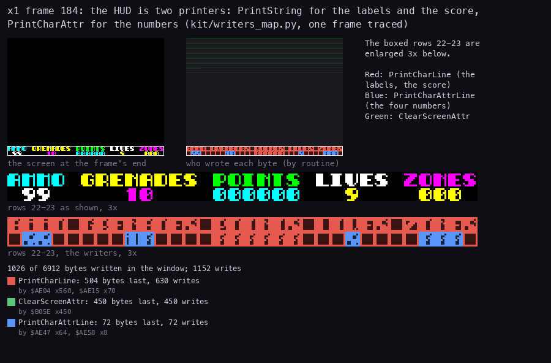

```sh
python3 tools/fig_hud.py writers
# runs: python3 ../../kit/writers_map.py --work work/docs/docB/x1 --window 184:0-185:0 --listing build/game.lst \
#   --out work/docs/docB/writers-hud-raw.png --view screen --scale 3
# and lays its panels and legend out 900 px wide
```

How to read:

- Top left: the screen at the end of `x1` frame 184, the frame in which DrawHud runs (the row 22 attributes are 0 at
  the end of frame 183 and set at the end of 184; TTD reads at every frame).
- Top middle: each byte of the screen coloured by the routine that wrote it last in the frame; grey was not written.
- Middle: the boxed HUD rows 22-23 of both views enlarged 3 times.
- The legend (from `kit/writers_map.py`) counts bytes and writes per routine, and the instructions that did them.

What it shows:

- PrintCharLine (red, the inner loop of PrintChar `$ADE1`, plot mode 0) writes the labels, the blanks of row 23 and
  the score: 504 bytes.
- PrintCharAttrLine (blue) writes the four numbers AMMO, GRENADES, LIVES and ZONES: 72 bytes: 8 glyphs, 64 pixel bytes and 8 attributes.
- ClearScreenAttr (green) writes the attributes of the playfield: the screen is cleared in the same frame, and the
  scenery comes later (BuildScreen).
- The score is not a number printer's job: it is a string (8.5).

## 8.2 The string printer `$AF2B`

PrintString takes HL = the string, D = the row, E = the column, C = the attribute.
It reads one byte at a time:

| Byte | Meaning |
| --- | --- |
| below `$61` | a glyph: print it, the column + 1 |
| `$61-$8F` n | a move: the row + (code - `$78`), the column + n (signed) |
| `$90-$CE` | the next row, the column + (code - `$AF`) |
| `$CF-$DE` | the ink: code - `$CF`; 8-15 are inks 0-7 bright; the paper is kept |
| `$DF` r c | the cursor to row r, column c |
| `$E0` a | the attribute a |
| `$E1` n ... `$E2` | repeat the bytes between n times; the attribute is put back on each pass |
| `$E3` lo hi | a sub-string at hi lo; the cursor and the attribute are kept round it |
| `$E4` n g | glyph g n times across |
| `$E5` n g | glyph g n times down |
| `$E6` lo hi | the glyph set: glyph g is at hi lo + 8 g |
| `$E7` | a space from FontBase `$D7E0` |
| `$E8` n | CellTypes n for the cells printed next |
| `$E9` / `$EA` | OpenCells 0 / `$FF` for the cells printed next |
| `$EB` n | CellTypes n at the cursor, nothing printed, no move (plot mode 0 only) |
| anything else | the end |

```asm
PrintString:
  LD A,(HL)
  INC HL
  CP $61
  JP NC,PrintStringMove
  CALL PrintChar          ; the plot mode's routine (operand $AF33 set by
                          ; SetPrinter)
  INC E
  JP PrintString
PrintStringMove:
  CP $90                  ; $61-$8F: a relative move, the row from the code,
                          ; the column from the next byte
  JP NC,PrintStringNewLine
  SUB $78
  ADD A,D
  LD D,A
  LD A,(HL)
  ADD A,E
  LD E,A
  INC HL
  JP PrintString
PrintStringNewLine:
  CP $CF                  ; $90-$CE: the next row, the column moved by code -
                          ; $AF
  JP NC,PrintStringInk
  INC D
  SUB $AF
  ADD A,E
  LD E,A
  JP PrintString
  ; ...
PrintStringCall:
  CP $E3                  ; $E3 lo hi: the sub-string, position and attribute
                          ; kept
  ; ...
  PUSH BC
  PUSH DE
  CALL PrintString
  POP DE
  POP BC
```

```text
loop:
    b = mem[hl]; hl += 1
    if b < $61:  print glyph b at (row, col); col += 1
    elif b < $90: row += b - $78; col += signed(mem[hl]); hl += 1
    elif b < $CF: row += 1; col += b - $AF
    elif b < $DF: attr = (attr AND $38) OR ink(b - $CF)
    elif b == $DF: row, col = mem[hl], mem[hl+1]; hl += 2
    elif b == $E3: PrintString(word(mem[hl]), row, col, attr); hl += 2   # row, col, attr kept
    ...                                                                   # the table above
    else: return
```

The dispatch is a chain of compares, each code range tried in order:

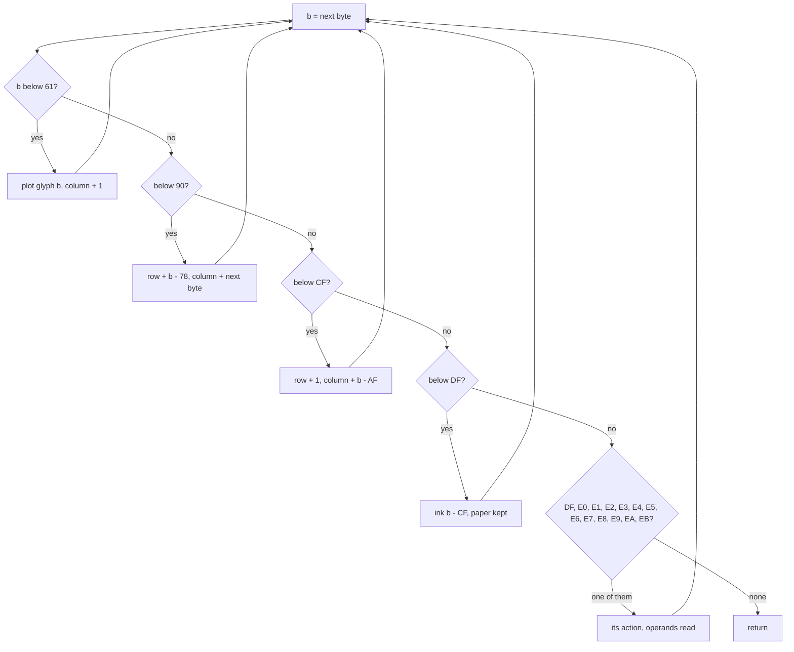

A worked example from MenuText: after "DEFINE KEYS" the bytes are `7A F3 DA 33 DC 20 4B 45 59 42 ...`.

- `$7A` is a move: the row + (`$7A` - `$78`) = 2; the next byte `$F3` = -13 moves the column back 13, to the column of the digit 2.
- `$DA` sets ink `$DA` - `$CF` = 11: ink 3 bright, magenta.
- `$33` prints the glyph "3". `$DC` sets ink 13: ink 5 bright, cyan.
- `$20 4B 45 59 ...` print " KEYB...". So option 3 sits two rows under option 2, at the same column, its digit in
  magenta and its text in cyan.

A second example, a new line: `$AD` gives the next row and the column + (`$AD` - `$AF`) = -2. After two glyphs at
columns 4 and 5 the cursor is at column 6; `$AD` brings it to column 4 of the next row, under the first glyph. The
elements build their 2 x 2 tiles this way (element 19, the ammunition pod: `... $00 $E8 $00 $D6 $01 $AD ...`).

### Two strings through the model

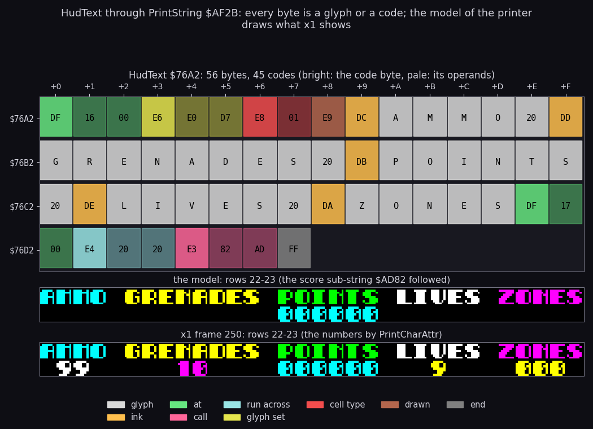

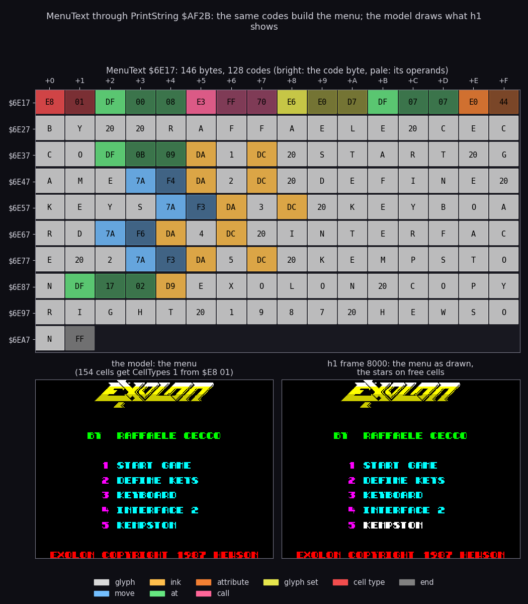

```sh
python3 tools/fig_hud.py strings   # both figures
```

How to read:

- Top of each figure: the bytes of the string, 16 a row (the row's address on the left, the offset on top), coloured
  by the code they belong to (the legend at the bottom). The first byte of a code is solid; its operands are paler.
  Glyph bytes show their letter.
- Below: the string run through the printer model (`tools/fig_docb.py print_string`), sub-strings followed, and the
  same place in a recording: rows 22-23 of `x1` frame 250, the menu of `h1` frame 8000.

What it shows:

- HudText is 56 bytes and 45 codes: `$DF 16 00` (row 22), `$E6 E0 D7` (the font), `$E8 01 $E9` (the HUD cells are
  solid and drawn), five inks with their labels, `$DF 17 00` and `$E4 20 20` (32 spaces), and the sub-string
  `$E3 82 AD`, the score.
- The model's rows 22-23 equal the recording's except the four numbers, which the HUD's number printers add.
- MenuText is 146 bytes and 128 codes. It starts with `$E8 01`: the 154 cells it prints are marked solid in
  CellTypes, and the menu's stars (MenuSparkles) only twinkle on cells left at 0. The logo is a sub-string
  (LogoText `$70FF`).
- The recording's "5 KEMPSTON" is white, not cyan: HighlightControl `$6F90` paints the current control option
  bright white after the text is printed.

## 8.3 PrintChar and the five plot modes

PrintString does not draw a glyph itself.
Four `CALL` operands inside it (`$AF33`, `$AFC0`, `$AFD2`, `$AFFE`) hold the address of the glyph routine.
SetPrinter `$99F8` patches all four from Printers `$9A0F`:

| Mode | Routine | What it does | Users |
| ---: | --- | --- | --- |
| 0 | PrintChar `$ADE1` | the glyph, its attribute, CellTypes and OpenCells written; columns with bit 5 set (32-63, or negative) are clipped | every string by default |
| 1 | PrintCharAttr `$AE26` | the glyph and attribute only | the HUD numbers, the flame jets, the stars, the Hall of Fame entries (called directly; the name entry and the zone-end digits go through PrintChar `$ADE1`) |
| 2 | XorCharAttr `$AE5D` | the glyph by XOR, the attribute set | no string; AnimateTurrets calls it directly for the recoil frames |
| 3 | EraseBlockDebris `$AE95` | the glyph XORed off, the maps cleared, AddDebris called twice a glyph (two debris pieces) | MineBlast, GrenadeBlast |
| 4 | EraseBlock `$AEE4` | the glyph XORed off, the maps cleared | Pods (a taken pod erased by printing it again) |

Every caller of modes 3 and 4 sets mode 0 again after its print.
So a destructible piece of scenery is erased by printing its own element string again in mode 3: the same codes
that drew it walk the same cells and take them away, with debris.

### PrintChar, one glyph into one cell

PrintChar takes A = the glyph code, D = the row, E = the column, C = the attribute. Its steps:

1. **The clip**: bit 5 of E set (columns 32-63, or -32 to -1) returns at once. The caller still moves the cursor.
2. **The glyph**: GlyphBase + 8 A. GlyphBase is the operand of `LD BC,n` at `$ADEF`, written by PrintString's `$E6`
   and by the routines that pick a font.
3. **The screen address**: high byte (D AND `$F8`) OR `$40` (the third and line 0), low byte ((D AND 7) rotated right
   3 times) + E (the row in the third, and the column).
4. **8 lines**: one byte a line, `INC D` steps down a pixel line inside the cell.
5. **The attribute**: from the last line's high byte: ((D rotated right 3) AND 3) OR `$58`; L is the same. C goes
   there.
6. **The maps**: attribute + `$0900` is the cell in CellTypes `$6100`; it gets the operand at `$AE1B`. That address
   minus `$0600` is the cell in OpenCells `$5B00`; it gets the operand at `$AE21`.

```asm
PrintChar:
  BIT 5,E
  RET NZ
  PUSH AF
  PUSH DE
  PUSH HL
  PUSH BC
  ADD A,A
  LD L,A
  LD H,$00
  ADD HL,HL
  ADD HL,HL
  LD BC,$0000             ; BC = GlyphBase: the operand ($ADEF) is written by
                          ; PrintString $E6, $E7 and the callers ($715D, $8E1F,
                          ; $8F95, $9152, $A2D5, $A8DB, $AB9F, $AC2B, $B0C8)
  ADD HL,BC
  LD A,D
  AND $F8
  OR $40
  LD B,A
  LD A,D
  LD D,B
  AND $07
  RRCA
  RRCA
  RRCA
  ADD A,E
  LD E,A
  LD B,$08
PrintCharLine:
  LD A,(HL)               ; 8 pixel lines down the cell
  LD (DE),A
  INC D
  INC HL
  DJNZ PrintCharLine
  DEC D                   ; back to the cell's last line: its attribute address
                          ; from H
  LD A,D
  RRCA
  RRCA
  RRCA
  AND $03
  OR $58
  LD H,A
  LD L,E
  POP BC
  LD (HL),C
  LD DE,$0900
  ADD HL,DE
  LD (HL),$00             ; the cell type map ($6100 + cell): the operand at
                          ; $AE1B, PrintString $E8 n
  LD DE,OpenCells-CellTypes ; DE = $FA00 (-$0600): from the $6100 map to the
                          ; $5B00 map
  ADD HL,DE
  LD (HL),$00             ; the empty-cell map ($5B00 + cell): the operand at
                          ; $AE21, 0 ($E9) or $FF ($EA)
  POP HL
  POP DE
  POP AF
  RET
```

```text
PrintChar(code, row, col, attr):
    if col AND $20: return
    src = GlyphBase + 8 * code
    dst = ((row AND $F8) OR $40) * 256 + ((row AND 7) * 32) + col
    for line in 0..7: screen[dst + 256 * line] = src[line]
    cell = $5800 + 32 * row + col
    mem[cell] = attr
    mem[cell + $0900] = CellTypeOperand        # $6100 + 32 row + col
    mem[cell + $0900 - $0600] = OpenOperand    # $5B00 + 32 row + col
```

**A worked example**: the "A" of AMMO, code `$41` at row 22, column 0, with the font (GlyphBase `$D7E0`) and the
attribute `$45`.

- The glyph is at `$D7E0` + 8 x `$41` = `$D9E8`.
- 22 = `$16`: (`$16` AND `$F8`) OR `$40` = `$50`; (`$16` AND 7) = 6, rotated right 3 times = `$C0`; + 0 = `$C0`. The
  eight lines go to `$50C0`, `$51C0` ... `$57C0`.
- The last line's high byte `$57`, rotated right 3 times and ANDed with 3, is 2; OR `$58` = `$5A`. The attribute
  goes to `$5AC0`.
- CellTypes: `$5AC0` + `$0900` = `$63C0` gets 1 (HudText's `$E8 01`). OpenCells: `$63C0` - `$0600` = `$5DC0` gets
  0 (HudText's `$E9`).

**The witness**: the writers map of 8.1 shows PrintCharLine as the writer of the AMMO label's 8 bytes in `x1` frame
184. The clip is known only from the code: no recording prints past the right edge.

**The point**: one routine writes four things a cell: pixels, colour, solidity and depth. That is why the scenery
needs no other map builder.

## 8.4 The font, the logo and the tile area

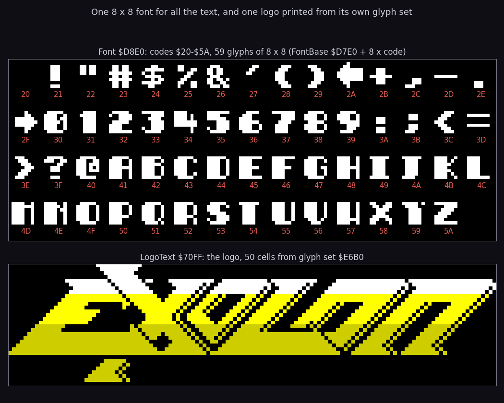

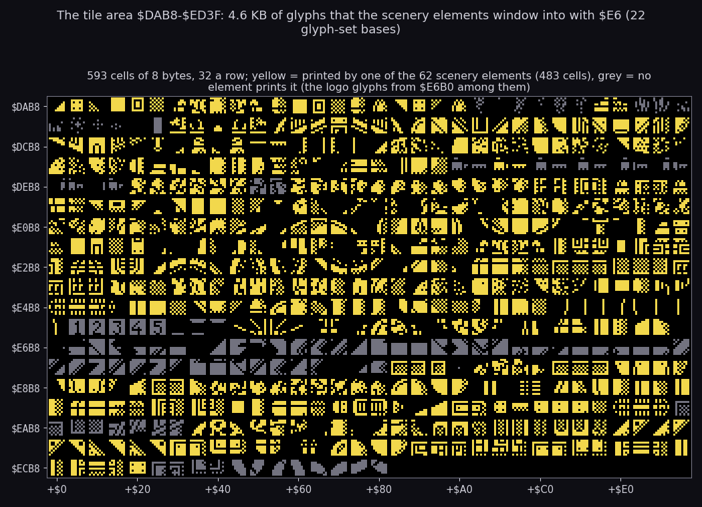

```sh
python3 tools/fig_hud.py glyphs    # both figures
```

How to read:

- First figure, top: Font `$D8E0`, the codes `$20-$5A` (FontBase `$D7E0` + 8 x code), each with its code under it.
- First figure, bottom: LogoText `$70FF` run through the model; the title gives its cells and its glyph set.
- Second figure: the tile area `$DAB8-$ED3F` as 593 cells of 8 bytes, 32 a row, every second row's address on the
  left. Yellow: a cell some element prints (the model run over all 62 elements, `$E6` bases followed); grey: no
  element prints it.

What it shows:

- Text uses one font of 59 glyphs: space, punctuation, an arrow, digits and capitals. There are no lower-case letters.
- The logo is 50 cells from glyph set `$E6B0`. The menu and define keys print it as the sub-string `$E3 FF 70`; the
  other text screens in 8.6 show the same logo.
- The 62 elements print 483 of the 593 tile cells, through 22 glyph-set bases (`$DAB8` to `$EC48`). A base is not a
  separate table: elements open windows into one area, and windows overlap.
- The grey cells are the logo, the turret's recoil frames (the tile set `$DDD8`, mode 2), the frame pieces of the text
  screens and the menu digits.

### The logo, decoded

LogoText `$70FF` is 70 bytes, 65 codes, 50 cells:

| Bytes | Meaning |
| --- | --- |
| `$E6 $B0 $E6` | glyph set `$E6B0`, the logo's glyphs |
| `$E0 $47` | attribute `$47` |
| `$DE` `$00-$07` | ink 15 (bright white): glyphs 0-7, the top row of the left block |
| `$A7` | the next row, column - 8 |
| `$DD` `$08-$0F` `$A7` | ink 14 (bright yellow): glyphs 8-15, the middle row |
| `$D5` `$10-$17` | ink 6 (yellow): glyphs 16-23, the bottom row |
| `$76 $00` | a move: row - 2, column + 0: the top of the right block, next to the left one |
| `$DE` `$18-$1F` `$A7` `$DD` `$20-$27` `$A7` `$D5` `$28-$2F` | the right block, 8 x 3, the same three inks |
| `$79 $F2` | a move: row + 1, column - 14 |
| `$30 $31` | glyphs `$30-$31`, the two cells under the word |
| `$FF` | the end |

Two blocks of 8 x 3 cells, 48 glyphs numbered in reading order, then two more: the logo is a picture cut into 50
glyphs, coloured by row, white over yellow over dark yellow.

### The frame pieces

The name entry's frame is made of two small strings, called with `$E3`:

- **PanelCorner** `$A228` (10 bytes): `$DC 00 $D4 01 $AD $DC 02 $D4 03 $FF`, a 2 x 2 corner of glyphs 0-3, bright cyan
  on the left, cyan on the right.
- **PanelBar** `$A210` (24 bytes): `$E3 28 A2` (a corner), `$DC`, `$78 02` (column + 2), `$E1 0E 08 09 $E2`
  (14 times glyphs 8, 9: the bar's top half), `$93` (the next row, column - 28), `$D4`, `$E1 0E 0A 0B $E2` (the bottom
  half), `$77 00` (back up a row), `$E3 28 A2` (the other corner), `$FF`. A 2 x 32 bar of 54 cells.

HofEntryText prints PanelBar at rows 0-1 and again at rows 22-23, and between them repeats a 2 x 2 side piece 10 times down columns 0-1 and 30-31 (`$E1 0A ... $E2`), in glyph set `$ECE0` ([8.9](#89-the-name-entry)).

### The glyph-set bases of the scenery

The 62 elements set 22 bases with `$E6`. Each base is a window into the tile area; the count is how many glyph codes
the elements print from it (from the printer model over all 62 elements):

| Base | Glyphs used | Elements |
| --- | ---: | --- |
| `$DAB8` | 23 | 0 HatchDome, 1 DropPod, 2 LandingCraft, 12 Mine |
| `$DBE8` | 42 | 2 LandingCraft |
| `$DD38` | 20 | 3 PlanetRed4, 4 PlanetMagenta2, 35 PlanetYellow2, 37 PlanetCyan4 |
| `$DDD8` | 18 | 5 GunTurret, 44 TurretSlab |
| `$DED8` | 18 | 6-10, 14, 41, 56-61: the rocks and rock grounds (13 elements) |
| `$DF78` | 19 | 11 Gantry, 25 PylonGreen |
| `$E018` | 31 | 13 RockSpire |
| `$E110` | 42 | 15 RadarDish, 16 Missile |
| `$E260` | 12 | 17 TeleportBooth |
| `$E2C0` | 4 | 18, 19 AmmoPod, 20 GrenadePod |
| `$E2E0` | 20 | 21 RingPedestal |
| `$E380` | 25 | 23 GirderGreen, 24 RubbleGrey, 27 RubbleMagenta, 38 GirderGrey |
| `$E448` | 18 | 26 TwinLauncher, 30 PlanetGreen3, 36 PlanetMagenta3 |
| `$E4D8` | 29 | 28 Thruster, 29 ExoBooth |
| `$E600` | 22 | 31 SporePod, 32 SporePodStand |
| `$E840` | 2 | 33 FloorStripYellow, 34 WallStripYellow, 55 StripYellow4 (and DrawStars' glyph 3) |
| `$E860` | 28 | 40 Planter, 41 RockClump |
| `$E940` | 29 | 42 SectorGate, 43 GatePost |
| `$EA28` | 17 | 44 TurretSlab, 45 LauncherSlab |
| `$EAF0` | 31 | 46 Mushroom, 47 Canister, 48-49 GirderDiagonal, 50 CanisterColumn |
| `$EBE8` | 12 | 51 BallPillars |
| `$EC48` | 19 | 52 CircuitYellow, 53 DoorCyan, 54 CircuitGreen |

The text uses four more: the font `$D7E0`, the logo `$E6B0`, the zone panel's frame `$EAB0` and the name entry's
frame `$ECE0`. The windows overlap: `$E840` + 8 x 4 is `$E860`, the next base. That is how 62 elements fit 483 cells.

## 8.5 The score is a string

The score has no binary form.
Score `$AD8A` is six ASCII digits inside ScoreText `$AD82`:

```text
$AD82  E0 45        attribute $45
$AD84  E6 E0 D7     glyph set $D7E0
$AD87  DF 17 0E     row 23, column 14
$AD8A  30 30 30 30 30 30   "000000"
$AD90  FF           end
```

AddScore `$AD53` adds a six-digit ASCII addend digit by digit and prints the string again:

```asm
AddScore:
  ; ...
  LD C,$00
  LD HL,Score+$0005
  LD B,$06
AddScoreLoop:
  LD A,(DE)
  ADD A,(HL)
  SUB $30
  ADD A,C
  CP $3A
  LD C,$01
  JR C,AddScoreNoCarry
  SUB $0A
  JR AddScoreDigit
AddScoreNoCarry:
  DEC C
AddScoreDigit:
  LD (HL),A
  DEC HL
  DEC DE
  DJNZ AddScoreLoop
  ; ...
  LD HL,ScoreText
  CALL PrintString
```

```text
carry = 0
for i in 5 down to 0:
    d = score[i] + addend[i] - '0' + carry      # an ASCII digit, perhaps past '9'
    if d > '9': d -= 10; carry = 1 else: carry = 0
    score[i] = d
PrintString(ScoreText)
```

DE points at the last digit of an addend in PointValues `$AD91`: ten addends of 6 ASCII digits for 25, 50, 100,
125, 150, 200, 250, 300, 350 and 1000 points.

A worked example: score "000975" plus "000050". Digit 5: `'5' + '0' - '0'` = `'5'`, no carry. Digit 4:
`'7' + '5' - '0'` = `'<'` (`$3C`), past `'9'`: `$3C - 10` = `'2'`, carry 1. Digit 3: `'9' + '0' - '0' + 1` = `':'`,
past `'9'`: `'0'`, carry 1. Digit 2: `'0' + 1` = `'1'`. The result is "001025".

The Hall of Fame compares and copies these same ASCII digits ([10.9](10-gameplay-logic.md#109-the-hall-of-fame)).

## 8.6 The text screens

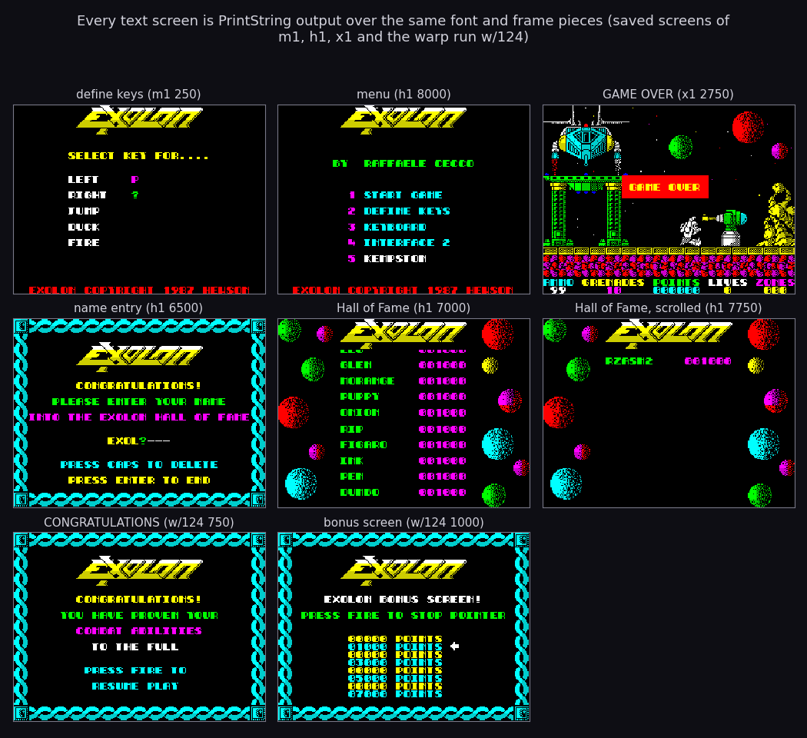

```sh
python3 tools/fig_hud.py screens
```

How to read:

- Eight screens saved by the recordings every 250 frames; the title of each gives the recording and the frame.
- `h1` and `w/124` are clones (exploration only): the score clone reaches the name entry, the warp run reaches the
  round end.

Each screen is one string (the bytes and codes from the printer model, `tools/fig_docb.py print_string`; codes count
each pass of a repeat):

| Screen | String | Bytes | Codes run | Cells | Explained in |
| --- | --- | ---: | ---: | ---: | --- |
| the HUD | HudText `$76A2` | 56 | 45 | 64 | 8.1, 8.2 |
| the menu | MenuText `$6E17` | 146 | 128 | 154 | 8.2, 8.7 |
| define keys | DefineKeysText `$7095` | 102 | 83 | 126 | [5.7](05-controls.md#57-readkey-define-keys-and-the-zorba-cheat) |
| the logo (a sub-string) | LogoText `$70FF` | 70 | 65 | 50 | 8.4 |
| GAME OVER | GameOverText `$A057` | 28 | 19 | 33 | 8.8 |
| the name entry | HofEntryText `$A156` | 186 | 356 | 370 | 8.9 |
| the Hall of Fame | HallOfFameScreen `$718D` | 99 | 221 | 318 | 8.10 |
| the zone end | ZoneBonusText `$AAF2` | 162 | 314 | 323 | 8.11 |
| the bonus screen | BonusScreenText `$A961` | 222 | 394 | 400 | [10](10-gameplay-logic.md) |
| CONGRATULATIONS | CongratulationsText `$AA3F` | 161 | 331 | 345 | [10](10-gameplay-logic.md) |

What it shows, with the code behind each:

- Define keys (DefineKeys `$6FAB`): "SELECT KEY FOR...." and the five actions, the keys pressed printed next to
  each. Its keys and the cheat word are in [5.7](05-controls.md#57-readkey-define-keys-and-the-zorba-cheat).
- The menu (MainMenu `$6DA1`, MenuText `$6E17`): the logo, "BY RAFFAELE CECCO", five options, the copyright line.
  Stars twinkle only on free cells (8.7).
- GAME OVER (GameOver `$A02A`): a bright yellow on red band printed over the playfield; the jingle plays
  ([9.3](09-sound.md#93-beeper-tunes-on-48k)); the flow is in 8.8.
- The name entry (`$A095`): the frame of pieces, "CONGRATULATIONS! PLEASE ENTER YOUR NAME INTO THE EXOLON HALL OF
  FAME", the name under a cursor `?`, "PRESS CAPS TO DELETE", "PRESS ENTER TO END". `h1` typed EXOLON (8.9).
- The Hall of Fame (HallOfFameRoll `$7149`): the logo and the planets stay, the table scrolls one pixel line a step
  in columns 8-23, 960 steps for the 50 entries and 10 empty ones. `h1` ran the whole roll (8.10).
- CONGRATULATIONS (`$AA3F`, at the round end on screen 124): "YOU HAVE PROVEN YOUR COMBAT ABILITIES TO THE FULL",
  "PRESS FIRE TO RESUME PLAY".
- The bonus screen (BonusScreen `$A8DB`): "EXOLON BONUS SCREEN! PRESS FIRE TO STOP POINTER", eight lines 00000 to
  07000 POINTS, and the pointer.

## 8.7 The menu and its stars

MainMenu `$6DA1` clears the screen and the maps, prints MenuText (whose `$E8 01` marks its 154 cells solid in
CellTypes), highlights the control type, plays the beeper title tune once on a 48K, then SaveAttributes,
ClearWorkArea and ClearMenuStars. MenuLoop `$6DDD` then runs 2500 passes (BC = `$09C4`) of one MenuSparkles step
and one ReadKey. The keys '1'-'5', the reprint after a control change and the highlight are in
[5.8](05-controls.md#58-the-menu).

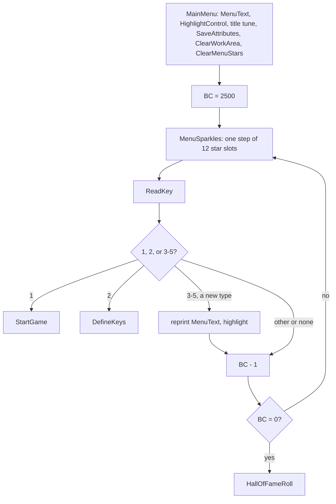

**The timeout**: a pass with 12 live stars costs about 123 000 T (`h1` frames 108-128: 11 passes in 20 frames,
`find_event` on `$6DDD`), so 2500 passes are about 4400 frames, 88 seconds on a 48K. `c128` measured it: MenuLoop
starts at frame 14507 + 33 241 and HallOfFameRoll at 18784 + 22 311, 4277 frames, 85.5 seconds. (`c128` then pressed
a key in the roll's first steps and was back in the menu at frame 18791.) No 48K recording waited that long.

### MenuSparkles

Twelve slots of 3 bytes at SparkleSlots `$6F5E` (x, y, frames left), `$FF` after the last. Slot n draws through the
save buffer `$B181` + 48 n (IY), the play's buffers reused.

- **A free slot** (frames left 0) picks a column Random AND `$1E` (even, 0-30) and a row Random AND `$1F`; a row of 22
  or more gives up until the next pass. The 2 x 2 cells there must all be 0 in CellTypes: no text, no logo, no
  other star's cells (the stars do not mark CellTypes, so two may overlap). Then x = 4 x column, y = 8 x row, 16
  frames.
- **A live slot** decrements its count and draws frame SparkleFrames[count before], read from AyTickCount `$6F4D` +
  count, so the table is read backwards. DrawSparkle draws it in place (old place = new place, so the old frame is
  XORed off and the new one on), then ColourSprite paints the 2 x 2 cells `$47` where AttrCopy is black.
- **The frames**: the bytes at `$6F4E-$6F5D` are `00 0c 0c 0d 0d 0e 0e 0f 0f 0f 0e 0e 0d 0e 0c 0c`; read from count 16
  down to 1 they give `0C 0C 0E 0D 0E 0E 0F 0F 0F 0E 0E 0D 0D 0C 0C 00`: a star that grows to frame `$0F` and shrinks.
- **Why the last frame is blank**: frame 0 of Sprites16 is empty. Drawing it XORs the last star frame off and
  keeps nothing, so the slot is free with nothing left on the screen. Without it the star would stay.
- **On a 128K** DrawSparkle also counts its draws in AyTickCount and plays one step of the AY title tune every fourth
  draw: the stars are the music's clock ([doc 9](09-sound.md)).

```asm
MenuSparkles:
  ; ...                   AF, BC, DE, HL, IY saved
  LD IY,WorkArea          ; the slots' save buffers, 48 bytes each from $B181
  LD HL,SparkleSlots
SparkleNext:
  LD E,(HL)               ; the next slot: $FF ends
  BIT 7,E
  JR Z,SparkleSlot
  ; ...                   restore, RET
SparkleSlot:
  PUSH HL                 ; D = y, A = frames left
  INC HL
  LD D,(HL)
  INC HL
  LD A,(HL)
  OR A
  JR NZ,SparkleDraw
  CALL Random             ; a free slot: a random column (even, 0-30)
  AND $1E
  LD E,A
  CALL Random             ; a random row: 22 and over tries again next pass
  AND $1F
  CP $16
  JR NC,SparkleSkip
  LD D,A
  CALL CellOffset         ; HL = 32 row + column in the occupancy map $6100
  LD BC,CellTypes
  ADD HL,BC
  LD A,(HL)
  INC HL
  OR (HL)
  LD BC,$0020
  ADD HL,BC
  OR (HL)
  DEC HL
  OR (HL)
  JR NZ,SparkleSkip
  POP HL                  ; free: x = 4 column, y = 8 row, 16 frames
  PUSH HL
  LD A,E
  ADD A,A
  ADD A,A
  LD (HL),A
  INC HL
  LD A,D
  ADD A,A
  ADD A,A
  ADD A,A
  LD (HL),A
  INC HL
  LD (HL),$10
  JR SparkleSkip
SparkleDraw:
  DEC (HL)                ; A = the frames left before this one: the frame from
                          ; SparkleFrames
  LD L,A
  LD H,$00
  LD BC,AyTickCount
  ADD HL,BC
  LD A,(HL)
  LD B,D                  ; BC = DE: the star stays in place, the previous
                          ; frame erased where it was drawn
  LD C,E
  PUSH IY
  POP HL
  CALL DrawSparkle
  LD C,$47                ; bright white over the black cells
  CALL ColourSprite
SparkleSkip:
  POP HL                  ; the next slot and its buffer
  INC HL
  INC HL
  INC HL
  LD DE,$0030
  ADD IY,DE
  JR SparkleNext
```

```text
for n, slot in enumerate(slots):                    # 12 slots, buffer $B181 + 48 n
    if slot.left == 0:
        col = Random AND $1E; row = Random AND $1F
        if row < 22 and CellTypes 2x2 at (row, col) all 0:
            slot = (4 * col, 8 * row, 16)
    else:
        f = SparkleFrames[slot.left]; slot.left -= 1
        DrawSprite(f, at = old = (slot.x, slot.y), buffer)   # f = 0 at the end: erased
        ColourSprite(slot.x, slot.y, $47)
```

**A worked example**: a free slot draws column `$0E` (14) and row 3; the cells (3, 14), (3, 15), (4, 14), (4, 15)
are all 0 in CellTypes, so the slot becomes x = `$38`, y = `$18`, 16. On the next pass it draws frame `$0C` at
pixel (112, 24); 15 passes later frame 0 erases it.

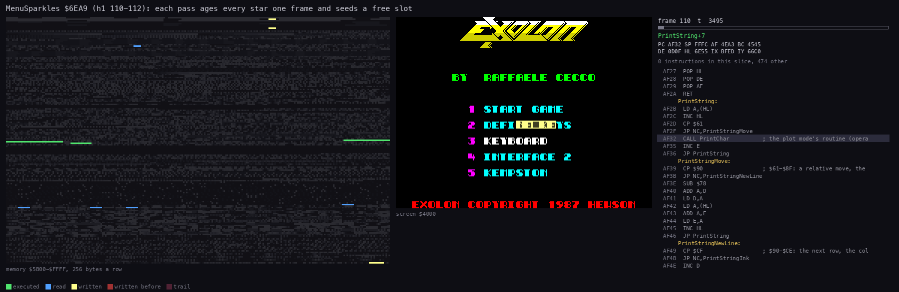

How to read the animation:

- The panels are those of [6.4](06-rendering.md#64-the-screen-builder): memory, screen, listing.
- **What happens**: the slots at `$6F5E` are read, Random runs, CellTypes `$6100` is read for the free-cell test,
  and DrawSprite redraws each live star in place (the flashing 2 x 2 boxes left of the menu), each followed by
  ColourSprite.
- **The point**: about 11 000 T a star, 12 stars a pass: the menu's pass is as heavy as a play pass, and that sets
  the 85-second timeout.

```bash
python3 ../../kit/routine_anim.py --trace work/docs/fillR/h1/traces/110_0-112_0.uatr --listing build/game.lst \
    --out docs/img/render/MenuSparkles.gif --pc 6EA9-6F5D --view screen --range 5B00-FFFF --pictures 40 \
    --title 'MenuSparkles $6EA9 (h1 110-112): each pass ages every star one frame and seeds a free slot'
```

## 8.8 GAME OVER

The last life lost calls GameOver `$A02A`:

```asm
GameOver:
  LD HL,GameOverText
  CALL PrintString
  LD HL,JingleTune
  CALL PlayTune
  LD BC,$0000
  CALL Delay
  CALL Delay
  CALL HallOfFameInsert
  CALL WaitNoKey
  LD BC,$4E20
GameOverWait:
  CALL ReadKey            ; any key: the menu at once
  OR A
  JP NZ,Start
  DEC BC
  LD A,B
  OR C
  JR NZ,GameOverWait
  JP Start
```

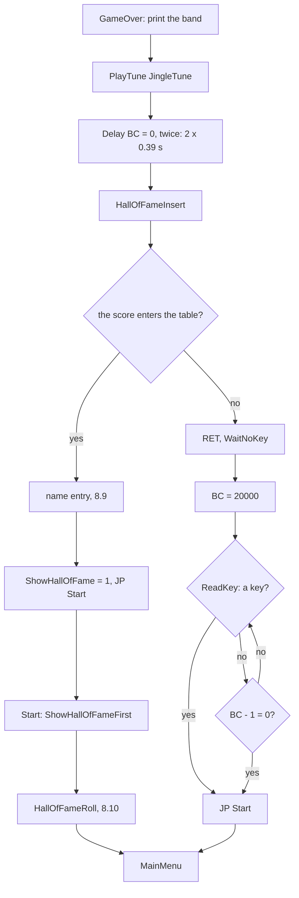

- **The band**: GameOverText, three rows of 11 cells.
- **The jingle** plays on the beeper ([9.3](09-sound.md#93-beeper-tunes-on-48k)).
- **Delay** `$B0B7` is `LDIR` of BC bytes from 0 onto 0, the ROM onto itself: 21 T a byte. BC = 0 means 65 536 bytes,
  1.38 million T, 0.39 s.
- **HallOfFameInsert** `$A073` compares the score with each entry ([10.9](10-gameplay-logic.md#109-the-hall-of-fame)).
  When the score enters, it makes room, runs the name entry and ends with `JP Start`: it never returns.
- **The timeout**: otherwise 20 000 rounds of ReadKey. A round costs 2000 T (`x1` frame 3000, a trace: `$A048` every
  2000 T), so the wait is 40 million T, 572 frames, 11.4 seconds. A key ends it at once.

**GameOverText `$A057`, byte by byte** (28 bytes, 19 codes, 33 cells):

| Bytes | Meaning |
| --- | --- |
| `$DF $09 $0A` | row 9, column 10 |
| `$E6 $E0 $D7` | the font, `$D7E0` |
| `$E0 $56` | attribute `$56`: bright, paper 2 (red), ink 6 (yellow) |
| `$E4 $0B $20` | 11 spaces: the band's top row, columns 10-20 |
| `$A4` | the next row, column + (`$A4` - `$AF`) = -11: back to column 10 |
| `$20` `GAME OVER` `$20` | 11 glyphs |
| `$A4` | the next row, column 10 |
| `$E4 $0B $20` | 11 spaces |
| `$FF` | the end |

**The witness**:

- `x1` (no POKE): GameOver at frame 2630 + 16 999; HallOfFameInsert at 2783 + 43 227 (153 frames later: the
  jingle and the two delays); WaitNoKey at 2783 + 59 168; Start at 3358 + 64 744, 575 frames later, with no key: the
  timeout ran out. MainMenu follows at 3360. The score did not enter.
- `h1` (clone): GameOver at 2326 + 35 689, HallOfFameInsert at 2479 + 55 164, the same 153 frames; the score entered.
- The attributes of row 9, read in `h1` at frame 2400, are `$56` in columns 10-20: the band is bright yellow on red.

**The point**: GAME OVER waits about 14 seconds in all, and leaves early on any key; the band is printed over the
playfield, which stays as it was.

## 8.9 The name entry

When the score enters the table, HofMakeRoom `$A095` moves the lower entries down 16 bytes, copies the score
digits into the new entry, clears the screen, fills NameBuffer `$A232` with 8 spaces and prints HofEntryText `$A156`:

- the frame: PanelBar at rows 0-1 and 22-23, the side pieces down columns 0-1 and 30-31 (8.4);
- the logo at row 3, column 8;
- "CONGRATULATIONS!", "PLEASE ENTER YOUR NAME", "INTO THE EXOLON HALL OF FAME", a row of 8 "-" under the name's
  places, "PRESS CAPS TO DELETE", "PRESS ENTER TO END", in the font.

The name has 8 places, row 15, columns 12-19. The cursor is a "?" in `$44`; a typed character is printed in `$46`
through PrintChar. The key logic (the delay, WaitNoKey, ReadKey until a key, SYMBOL SHIFT ignored, CAPS SHIFT
deletes, ENTER ends), its asm, its diagram and the `d1` witness of both delete branches are in
[5.9](05-controls.md#59-the-name-entry). ENTER copies the 8 bytes into the entry, sets ShowHallOfFame to 1 and jumps
to Start, which goes to the roll first.

**The witness, `h1`** (`find_event` on HofNameKey `$A0E5`; `memory_at` of NameBuffer):

| Frame | Event | NameBuffer |
| --- | --- | --- |
| 2479 + 55 164 | HallOfFameInsert | |
| 2487 + 27 484 | the first key wait: the screen is printed | `"        "` |
| 6370 | after E | `"E       "` |
| 6410 | after X | `"EX      "` |
| 6450 | after O | `"EXO     "` |
| 6490 | after L | `"EXOL    "` |
| 6530 | after O | `"EXOLO   "` |
| 6570 | after N | `"EXOLON  "` |
| 6660 + 586 | ENTER: Start | `"EXOLON  "` |
| 6661 + 69 313 | HallOfFameRoll | |

**The point**: the entry's last two name bytes are never written: the name is 8 characters in a 10-byte field
(8.10).

## 8.10 The Hall of Fame roll

HallOfFameRoll `$7149` clears the attributes to `$44`, prints HallOfFameScreen `$718D` (the logo, the twelve planets
round the edges, and 19 rows of 8 spaces at column 16 in `$43`), then runs 960 steps (`$03C0`):

- a step whose count is a multiple of 16 calls PrintNextHallEntry `$7568`: the next entry's 16 characters at row 23,
  column 8, through PrintCharAttr, then Delay `$028E`;
- the other steps Delay `$0400`;
- every step calls ScrollHallOfFame `$7522`, which moves the window up one pixel line;
- a key ends the roll: '1' goes to StartGame, any other key to MainMenu. The end of the count goes to MainMenu.

60 entry slots of 16 pixel lines are 960 steps: the 50 entries, then the end mark, after which PrintNextHallEntry
only waits.

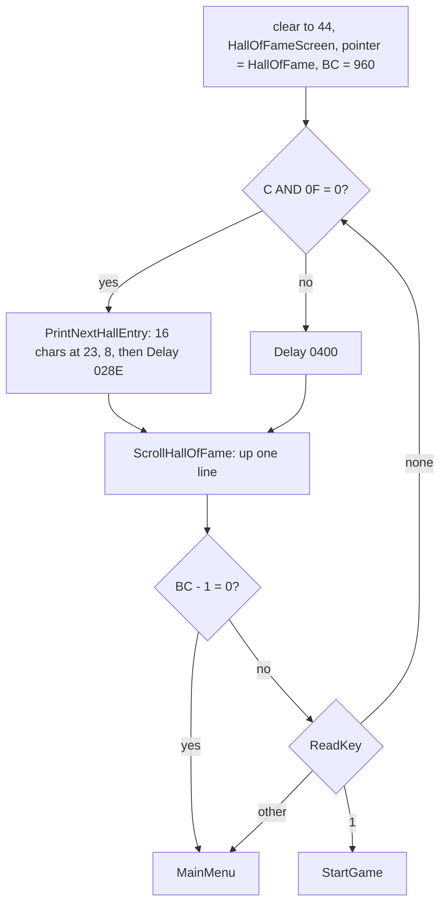

```asm
HallOfFameStep:
  PUSH BC                 ; one step: a print or a wait, then the scroll
  NOP
  NOP
  NOP
  LD A,C
  AND $0F
  OR A
  LD BC,$0400             ; the wait of the steps without a print
  CALL NZ,Delay
  CALL Z,PrintNextHallEntry
  CALL ScrollHallOfFame
  POP BC
  DEC BC
  LD A,B
  OR C
  JP Z,MainMenu
  CALL ReadKey            ; a key: 1 starts the game, any other the menu
  OR A
  JP Z,HallOfFameStep
  CP $31
  JP Z,StartGame
  JP MainMenu
PrintNextHallEntry:
  LD HL,(HallOfFamePtr)
  LD A,(HL)
  CP $FF
  JP Z,Delay
  LD DE,$1708
  LD BC,$1000
HallEntryChar:
  LD A,(HL)               ; one character, the column on
  CALL PrintCharAttr
  INC E
  INC HL
  DJNZ HallEntryChar
  LD (HallOfFamePtr),HL
  LD BC,$028E
  JP Delay
```

### ScrollHallOfFame

The scroll copies each pixel line of the window to the line above, using SP to walk a table of line addresses:

- LineCol8Addr `$6700` holds, for each pixel line, the screen address of its column 8;
- SP starts at `$6700` + 64, line 32 (row 4, the window's top); the first `POP DE` is the destination, then each
  `POP HL` the source;
- each line moves 14 bytes with `LDI`: columns 8-15, then two `INC` skip columns 16-17, then columns 18-23;
- `LDI` decrements BC; BC = `$08B2` = 159 x 14, so `JP PE` loops 159 times;
- the source becomes the next destination through the patched operand ScrollDest;
- at the end the bottom line, line 191 from column 8, is cleared over 17 bytes.

```asm
ScrollHallOfFame:
  PUSH BC
  LD (SpriteSavedSP),SP
  LD SP,LineCol8Addr+64
  LD BC,$08B2
  POP DE
ScrollLine:
  POP HL                  ; HL = the next line, which is the destination of the
                          ; line after it
  LD (ScrollDest+$0001),HL
  LDI
  LDI
  LDI
  LDI
  LDI
  LDI
  LDI
  LDI
  INC L                   ; columns 16 and 17 stay
  INC E
  INC L
  INC E
  LDI
  LDI
  LDI
  LDI
  LDI
  LDI
ScrollDest:
  LD DE,$0000             ; LD DE,n: n = the line above (patched)
  JP PE,ScrollLine
  LD SP,(SpriteSavedSP)   ; the bottom line of the window cleared
  EX DE,HL
  LD E,L
  LD D,H
  INC E
  LD BC,$0010
  LD (HL),B
  LDIR
  POP BC
  RET
```

```text
dst = LineCol8Addr[32]
for y in 33..191:
    src = LineCol8Addr[y]
    copy src[0..7] to dst[0..7]; copy src[10..15] to dst[10..15]     # columns 8-15 and 18-23
    dst = src
clear 17 bytes of line 191 from column 8
```

**The hidden row**: the entries are printed with C = 0 (`LD BC,$1000`: B the count, C the attribute), so row 23's
columns 8-23 are black on black. `h1` frame 6700 reads the attributes of row 23 as `00` in columns 8-23, while rows
21-22 are `$44` (names) and `$43` (scores). A new entry is printed out of sight and appears one pixel line at a time
as the scroll lifts it into row 22.

**The columns 16-17 quirk**: the scroll never moves columns 16-17. An entry is 8 name bytes, 2 spaces, 6 score
digits; the two spaces fall on columns 16-17. The name entry writes only 8 bytes (8.9) and every entry in the image
has spaces there, so the skipped columns are always blank and the skip saves 2 `LDI` a line (318 a step). A 9th or
10th character would stay on row 23, hidden by its black attribute. Known only from the code: no table in the image
or the recordings has such a name.

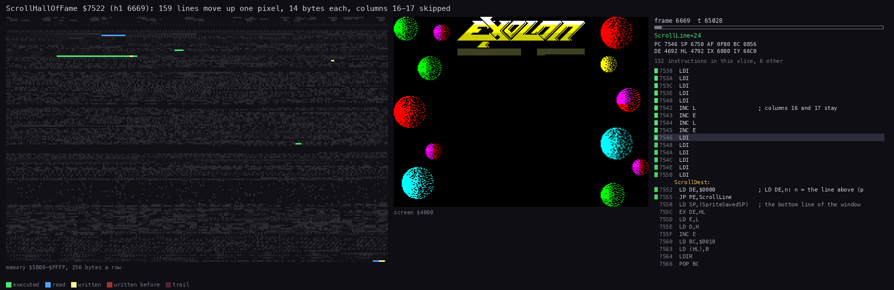

How to read the animation:

- The panels are those of [6.4](06-rendering.md#64-the-screen-builder).
- **What happens**: the line table at `$6700` is read (blue, by `POP`), and the screen rows of the table are written
  from the top down (yellow), 14 bytes a line; the last picture clears the bottom line.
- **The point**: one step is 57 852 T (`h1` 6669 T 63 067 to 6670 T 50 919), a whole frame's worth of `LDI`. With
  the delays, a step takes about 81 900 T: the 960 steps ran from frame 6661 to 7786, 1125 frames, 22.5 seconds.

```bash
python3 ../../kit/routine_anim.py --trace work/docs/fillR/h1/traces/6669_63000-6670_58000.uatr --listing build/game.lst \
    --out docs/img/render/ScrollHallOfFame.gif --pc 7522-7567 --view screen --range 5B00-FFFF --pictures 32 \
    --title 'ScrollHallOfFame $7522 (h1 6669): 159 lines move up one pixel, 14 bytes each, columns 16-17 skipped'
```

**The witness**: `h1` ran the whole roll with no key: HallOfFameRoll at 6661 + 69 313, MainMenu at 7786 + 41 092.

## 8.11 The zone-end panel

At the end of each zone ZoneEnd `$A817` checks the player against the zone's end column every pass. When he passes
it:

```asm
ZoneEnd:
  LD DE,(ZoneEndList)
  BIT 7,E
  RET NZ
  CALL CellToPixels
  LD A,(PlayerX)
  CP E
  RET C
  LD HL,ZoneBonusText
  CALL PrintString
  LD A,(Lives)
  LD B,A
  ADD A,$30
  LD DE,$0C0D
  LD C,$46
  CALL PrintChar
  LD DE,Points1000+$0005
ZoneEndLives:
  CALL AddScore           ; lives x Points1000
  DJNZ ZoneEndLives
  LD A,(ExoSuit)
  OR A
  JR NZ,RoundEnd
  LD C,$47
  LD A,$31
  LD DE,$080E
  CALL PrintChar
  LD BC,$0050
ZoneEndBravery:
  PUSH BC                 ; 80 x 125 = 10 000
  LD DE,Points125+$0005
  CALL AddScore
  LD B,$3C
  CALL BeeperNoise
  POP BC
  DEC BC
  LD A,B
  OR C
  JR NZ,ZoneEndBravery
  ; ... RoundEnd: CONGRATULATIONS on screen 124, then BonusScreen, ZoneRefill
```

```text
print ZoneBonusText                         # the frame and "BRAVERY BONUS 00000", "LIVES BONUS  X 1000"
print '0' + lives at (12, 13) in $46        # into the gap before " X 1000"
repeat lives: AddScore(1000)
if not ExoSuit:                             # the zone done without the suit
    print '1' at (8, 14) in $47             # 00000 becomes 10000
    repeat 80: AddScore(125); BeeperNoise($3C)
RoundEnd; BonusScreen; ZoneRefill (ammo 99, grenades 10, DrawHud)
```

**ZoneBonusText `$AAF2`** (162 bytes, 314 codes run, 323 cells):

| Bytes | Meaning |
| --- | --- |
| `$DF $03 $07` `$E0 $00` | row 3, column 7, attribute 0 |
| `$E6 $B0 $EA` | the frame's glyph set `$EAB0` |
| `$DD 00 $D5 01 $DD $E4 0F 04 ...` | the top bar: corner glyphs, 15 times glyph 4, corner; the next row the same with glyph 5 |
| `$E1 $0D` `$DD 06 $D5 07 $AD` `$E2` | 13 times the left side piece, down |
| `... $6A $FE` `$E1 $0D ... $E2` | the bottom bar, then up 14 rows for the right side, 13 pieces |
| `$6B $F1` `$E6 $E0 $D7` `$E1 $0D $E4 $0F $20 $A0 $E2` | back inside, the font, 13 rows of 15 spaces: the inside cleared |
| `$DA` `$6C $01` `BRAVERY BONUS` | ink 11 (bright magenta), up 12 rows: row 6 |
| `$7A $F7` `$DE` `00000` | two rows down, ink 15 (bright white): row 8, columns 14-18 |
| `$7A $F8` `$DB` `LIVES BONUS` | row 10, bright green |
| `$7A $F9` `$DD` `X 1000` | row 12, bright yellow, "X 1000" from column 15: column 13 is left for the digit |
| `$7A $F5` `$DC` `PRESS FIRE TO` `$7A $F4` `RESUME PLAY` | rows 14 and 16, bright cyan |
| `$FF` | the end |

**A worked example, `w/024`** (the warp clone that finishes zone 1 on screen 24, with 9 lives and no suit):

- ZoneEnd prints the panel at frame 517 + 918; the print takes about 4 frames;
- the digit 9 goes to row 12, column 13; nine AddScore calls make the score 009000;
- ExoSuit is 0: the "1" goes to row 8, column 14, over the first "0": the panel reads 10000;
- 80 rounds of 125 points with a noise each run from frame 521 + 65 100 to 577: the score climbs 009000, 010500
  (frame 530), 015875 (560), 018750 (576) to 019000;
- BonusScreen at 577 + 48 083; DrawHud again at 817 (ZoneRefill).

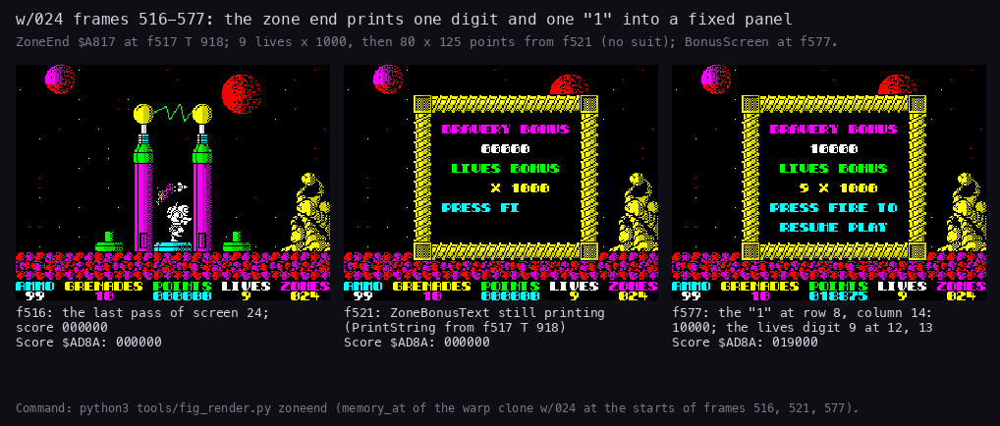

How to read the figure:

- Three screens read with `memory_at` at the start of frames 516, 521 and 577, with Score `$AD8A` under each.
- **516**: the last pass of screen 24. **521**: the panel half printed. **577**: the panel complete, "10000" and
  the lives digit 9, the score at 019000 (the HUD's POINTS lags until the next ScoreText print).
- **The point**: the panel is fixed text. The code adds the two changing parts as single glyphs: the lives digit, and
  a "1" that turns the static 00000 into the 10 000-point bravery bonus.

```bash
python3 tools/fig_render.py zoneend
```

## 8.12 What no recording reached

- PrintChar's clip of columns 32-63: known from the code (bit 5 of E tested); no recording shows a string printed
  past the right edge.
- Plot mode 2 through SetPrinter: no caller selects it; XorCharAttr runs only by direct calls (the turret).
- The menu's timeout on a 48K: `c128` measured it on the 128K (8.7); the 48K length is computed from the pass cost.
- A name of 9 or 10 characters in the Hall of Fame: impossible from the name entry; the columns 16-17 quirk is known
  only from the code (8.10).

The name entry's CAPS SHIFT delete did run: `d1` took both branches, at frame 6590 through `$A115` and at frame 6910
through `$A10C` ([5.9](05-controls.md#59-the-name-entry)).
