# 9. Sound

What this covers:

- the two sound systems in one image: the beeper on the 48K, the AY-3-8912 on the 128K, and the flag that picks one;
- the beeper: the two-voice tune player, the two tunes, the noise and sweep effects;
- the AY: the three-channel title tune and its tick, the 16-slot effect engine and its 23 streams;
- what each sound sounds like, shown as rendered spectrograms and speaker plots (nothing here was played).

The recordings and renders it rests on:

- `c1` (the 48K reference run, no POKE): the title tune at the load (frames 12 390-12 800, cut by a key), GAME OVER.
- `c128` (the 128K tape load, 16 000 frames after load frame 12 200): the AY tune's tick counts.
- `c128` traces on the agent's own instance (`analysis trace`, `work/docs/fillS/c128/traces/`): the menu from TuneStart,
  frames 12 150-12 400, and play, frames 20 000-20 100: every AY write, every SoundEffectsTick and StartSoundEffect.
- `x2` (a 48K run) traces the same way: frames 400-470 (the debris), 1600-1700 (a pod, a teleport, four effect
  slots), 2125-2185 (a kill, a shot hit, the blasts): every `OUT ($FE)` and every AY port write.
- `tools/aymodel.py`: a model of both AY players that gives every AY write of these traces (9.7, 9.8).
- The 48K renders (an experiment, `tools/fig_sound.py render`): `work/snaps/entry.z80` on a live 48K instance, the
  six bytes at `$6DCB` patched per sound, unreal-ng's beeper output captured to `work/docs/docB/audio/*.wav`.
- The 128K renders (an experiment, `render-ay` and `render-sfx`): the instance `re_session.py capture --media
  build/Exolon.tzx --model 128K --load-frames 12200` leaves, its AY 1 output captured.
- The image itself for the tables and the models. The figures that rest on the image alone say so ("model").

Scope: when the effects are triggered in play is in [7. Objects](07-objects.md) and
[10. Gameplay logic](10-gameplay-logic.md); the main loop that ticks them is in [4. Game loop](04-game-loop.md).

## 9.1 One image, two sound systems

Start `$6D60` writes SoundIsAy `$6E16` once.
It is 0 on a 48K and non-zero on a 128K (`$DE` in the 128K rig).
The beeper routines (BeeperNoise, BeeperSweep, the debris crackle `$9597`) test it, and so do the callers of the
two title tunes (MainMenu `$6DC5`, DrawSparkle `$6F23`); PlayTune, TuneTick and SoundEffectsTick do not:

| Routine | Address | 48K | 128K |
| --- | --- | --- | --- |
| PlayTune (the beeper tunes) | `$7D17` | plays | plays (no test) |
| BeeperNoise | `$7C26` | plays | returns at once |
| BeeperSweep | `$7C3C` | plays | returns at once |
| The beeper title tune in MainMenu | `$6DCB` | plays at the first menu after each entry to Start (`c1`: 4 times) | skipped (`c128`: `$6DCB` never ran) |
| TuneTick (the AY title tune) | `$B767` | never called | every 4th star draw |
| SoundEffectsTick (the AY effects) | `$BF7E` | runs, its `OUT`s reach nothing | plays |

So the two machines hear different games:

- the 48K hears a 40-second two-voice title tune at the first menu after each load or GAME OVER, and short noise bursts in play;
- the 128K hears an 84-second three-channel title tune in every menu, and 11 shaped effects in play;
- both hear the jingle (GAME OVER, the ZORBA cheat): PlayTune has no SoundIsAy test.

The effect triggers are paired in the code.
FirePress `$835D` calls BeeperNoise (`$8368`, B `$3C`) and then PlaySfxShot (`$8372`).
On a 48K the first sounds and the second writes AY ports nobody listens to.
On a 128K the first returns at once and the second sounds.

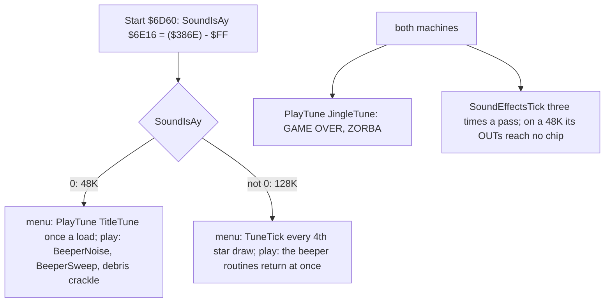

What the two players cost, measured in the `c128` traces (each instruction's time is the next one's start minus its
own; 9.7 and 9.8 name the traces):

| Player | Window | T a frame | Share of the frame | T a tick |
| --- | --- | ---: | ---: | ---: |
| TuneTick with its AyWrites (`$B6D1`-`$BA00`, `$BF6D`-`$BF7D`) | `c128` menu, frames 12 150-12 400, 360 ticks | 4045 | 5.7 % | 2810 |
| SoundEffectsTick with its AyWrites (`$BF7E`-`$C0E6`, `$BF6D`-`$BF7D`) | `c128` play, frames 20 000-20 100, 139 ticks | 5500 | 7.8 % | 3957 |
| BeeperNoise on a 128K (the test and the RET) | the same | 12 | 0.02 % | |

The effects tick costs the same on a 48K: it runs and writes AY ports there too.
The beeper routines cost their whole sound on a 48K: they block the CPU (9.4, 9.5).

## 9.2 The beeper engine: two square waves at once

PlayTwoTones `$803D` plays two notes together for a length.

The constants first:

- a voice is an 8-bit counter counted up by one each loop step; at its wrap to 0 the voice's speaker level flips
  (`XOR C`, C = `$10`, the speaker bit) and the counter reloads;
- the reload values come from NoteReloads `$8062` (53 entries, `$01` to `$F4`);
- a half-wave is (256 - reload) steps, so a full wave is 2 (256 - reload) steps;
- every path through the loop takes the same time: the `OR A` / `AND A` pads balance the branches;
- a length unit is 256 steps (B counts them, H counts the units).

```asm
PlayTwoTones:
  LD H,A                  ; the length in units of 256 steps
  LD IXL,E                ; voice 1's reload
  LD L,D                  ; voice 2's reload
  LD C,$10                ; the speaker bit
  ; ...
TwoTonesVoice1:
  EX AF,AF'               ; voice 1's step
  INC E
  OUT ($FE),A
  JR NZ,BeeperToneHead
  XOR C                   ; voice 1 wrapped: flip its level
  LD E,IXL
  ; ...
TwoTonesNext:
  OUT ($FE),A             ; output, pad, next of the 256 steps
  OR A
  AND A
  DJNZ TwoTonesStep
  DEC H
  JP NZ,TwoTonesVoice1
  RET
```

The algorithm:

```text
for unit in 1..length:
    repeat 256 times:
        counter1 += 1
        if counter1 wraps: level1 = not level1; counter1 = reload1
        counter2 += 1
        if counter2 wraps: level2 = not level2; counter2 = reload2
        output level1, then level2, to the speaker (the two OUTs mix the voices)
```

The step time: 96 T-states, on every path, counted from the listing:

| Path (one step) | Instructions and T-states | Sum |
| --- | --- | ---: |
| no voice wraps | OR 4, AND 4, EX 4, INC E 4, OUT 11, JR NZ taken 12, AND `$FF` 7, EX 4, INC D 4, JP NZ 10, OUT 11, OR 4, AND 4, DJNZ 13 | 96 |
| voice 1 wraps | OR 4, AND 4, EX 4, INC E 4, OUT 11, JR NZ 7, XOR C 4, LD E,IXL 8, EX 4, INC D 4, JP Z 10, OUT 11, OR 4, AND 4, DJNZ 13 | 96 |
| voice 2 wraps | as "no wraps" up to JP NZ (not taken, 10), then OUT 11, XOR C 4, LD D,L 4, DJNZ 13 | 96 |
| both wrap | as "voice 1 wraps" up to JP Z (taken, 10), then OUT 11, XOR C 4, LD D,L 4, DJNZ 13 | 96 |

The end of a unit adds 1 T (DJNZ not taken 8, DEC H 4, JP NZ 10, the two pads skipped).

The witness is the `c1` trace of frames 12 420-12 428 (`work/docs/docB/c1/traces/12420_0-12428_0.uatr`): of the
5817 intervals between two runs of the `OUT` at `$804B`, 5785 are 96 T, 21 are 97 T (a unit's end), 10 are 102 T
(the ULA holds an `OUT ($FE)` on a screen line) and one is 559 T (the note change: PlayTune's work).
The render agrees over the whole tune: TitleTune's 195 notes sum to 5706 units and the speaker moves for 40.09 s,
40.09 s x 3 500 000 / (5706 x 256) = 96.06 T a step.
So the 0.06 is about 460 T of PlayTune a note, 1 T a unit and a few contended `OUT`s; the game runs with interrupts
off, so none of it is interrupt time.
The code sits at `$803D`-`$8061`, above `$8000`, so no memory contention stretches it.

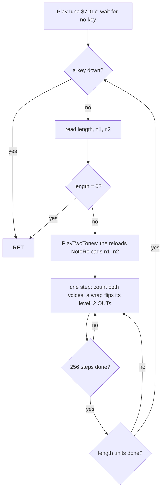

A worked example, the first note of TitleTune (`$7DA3`: `12 13 2B`):

- length `$12` = 18 units = 18 x 256 x 96 T = 442 368 T = 126 ms;
- note `$13` = 19: NoteReloads[19] = `$AA` = 170; a full wave is 2 x (256 - 170) x 96 = 16 512 T: 212.0 Hz;
- note `$2B` = 43: NoteReloads[43] = `$EB` = 235; 2 x 21 x 96 = 4032 T: 868.1 Hz;
- the render's spectrum of that note has its peaks at 206.8-216.2 Hz and 864.9-874.3 Hz (a 4096-point FFT, 10.8 Hz
  bins).

PlayTune `$7D17` feeds it three bytes a note:

```asm
PlayTune:
  XOR A
  IN A,($FE)              ; wait until no key is down
  CPL
  AND $1F
  JR NZ,PlayTune
  LD (TunePointer),HL
TuneNextNote:
  XOR A                   ; a key ends the tune
  IN A,($FE)
  AND $1F
  CP $1F
  JP Z,BeeperTuneNote
TuneDone:
  RET
BeeperTuneNote:
  LD HL,(TunePointer)     ; the length (0 ends), the two note numbers
  LD A,(HL)
  OR A
  JP Z,TuneDone
  ; ...
```

```text
wait for no key
for each note (length, n1, n2) from the tune until length = 0:
    if any key is down: stop
    if n1 = n2 = 0: silence for length units      (never in either tune)
    else: PlayTwoTones(NoteReloads[n1], NoteReloads[n2], length)
```

## 9.3 Beeper tunes on 48K

There are two tunes:

| Tune | Address | Notes | Units | Length | Callers |
| --- | --- | --- | --- | --- | --- |
| TitleTune | `$7DA3` | 195 | 5706 | 40.07 s (model), 40.09 s (render) | MainMenu `$6DCB`, 48K only, once after each entry to Start (TitleTunePending `$7D67`) |
| JingleTune | `$7D68` | 19 | 315 | 2.21 s (model and render) | ZorbaCheat `$7055`, GAME OVER `$A030`, both machines |

TitleTune uses 19 note numbers, from 7 (106 Hz, G#2) to 50 (1302 Hz, E6).
Voice 1 plays the bass (106-320 Hz), voice 2 the melody (mostly 500-1302 Hz; 16 of its 195 notes are lower,
down to 212 Hz).

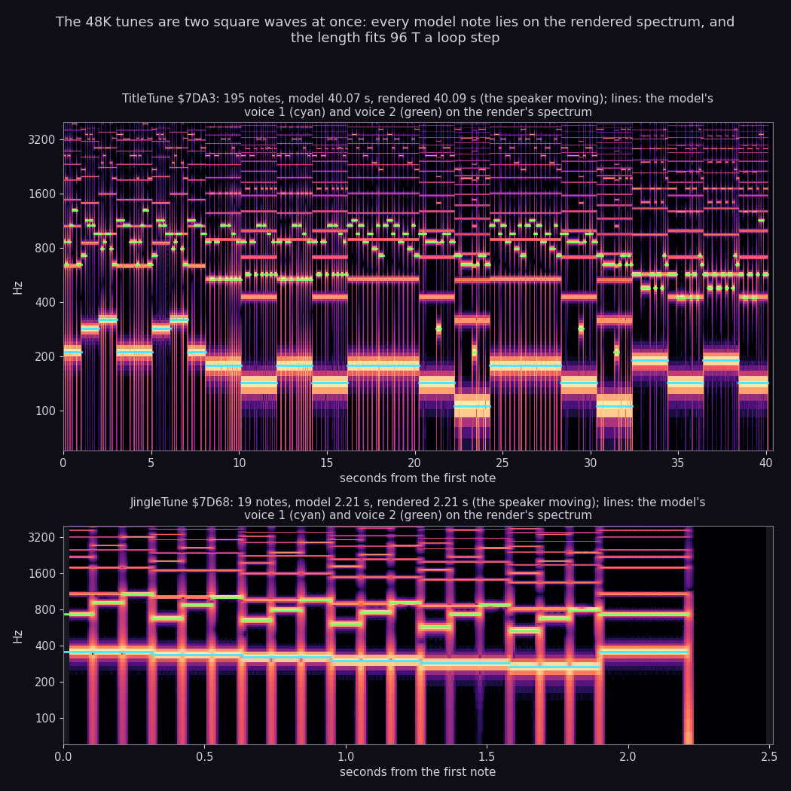

```sh
python3 tools/fig_sound.py render --work work/docs/docB/i48     # the WAVs (a live 48K instance, muted)
python3 tools/fig_sound.py beeptunes
```

How to read:

- Background: the spectrogram of the render, 60-4000 Hz on a log scale, bright = loud.
- Cyan lines: voice 1 of the model (`beeper_notes`: the tune bytes, NoteReloads, 96 T a step); green: voice 2.
- Top: TitleTune from its first note, 40 s. Bottom: JingleTune, 2.2 s, with a finer time step.
- The fainter bands above each line are the square waves' odd harmonics (3 f, 5 f).

What it shows:

- Every model line sits on a bright band of the render: the note table and the wave formula are right.
- The model's lengths end where the render goes quiet: the 96 T step holds over 40 s.
- The jingle's voice 1 stays at 268-357 Hz, voice 2 at 536-1072 Hz; it sounds the same on both machines.

The routine at work, eight frames of PlayTwoTones in `c1`:

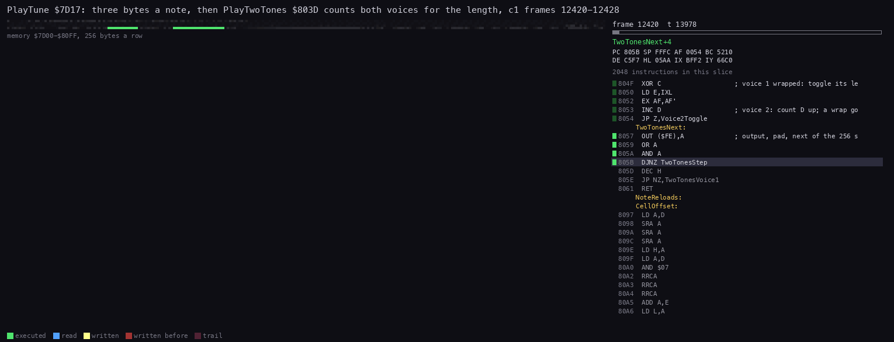

```sh
python3 ../../kit/routine_anim.py --work work/docs/docB/c1 --window 12420:0-12428:0 --listing build/game.lst \
    --out docs/img/routines/PlayTune.gif --view none --range 7D00-80FF --pc 7D17-8061 --pictures 40 --delay 150 \
    --title 'PlayTune $7D17: three bytes a note, then PlayTwoTones $803D counts both voices for the length, c1 frames 12420-12428'
```

How to read:

- Right: the listing around the PC of each slice (13 978 T a slice), with the instructions run in it lit.
- Top left: memory `$7D00`-`$80FF`, 256 bytes a row; green = executed, blue = read.
- The trace holds 81 752 instructions in 8 frames and 11 638 port accesses: one `OUT` every 48 T.

What it shows:

- The CPU does nothing else while a tune plays: the menu waits for it.
- The tune bytes are read once a note: 10 memory reads in 8 frames.

## 9.4 Beeper effects

BeeperNoise `$7C26` makes a noise burst of B rounds:

```asm
BeeperNoise:
  LD A,(SoundIsAy)
  OR A
  RET NZ                  ; nothing on a 128K
BeeperNoiseLoop:
  LD A,R
  AND $F8                 ; speaker and MIC bits random, border 0
  OUT ($FE),A
  LD E,B
  INC E
BeeperNoiseWait:
  DEC E
  JR NZ,BeeperNoiseWait
  XOR A
  OUT ($FE),A
  DJNZ BeeperNoiseLoop
  RET
```

```text
for b = B down to 1:
    speaker = a random level (the refresh register R)
    wait b + 1 short loops (16 T each)
    speaker = 0
```

So each round is one loop shorter than the last: the pulses shrink and rise in pitch as the burst ends.
A round costs about 74 + 16 b T-states uncontended.
The code sits at `$7C26`, in contended memory: the render of B `$C8` takes 119.5 ms against 96 ms uncontended.

### BeeperSweep: a falling tone

BeeperSweep `$7C3C` plays 16 steps of 10 half-waves.
Each step's half-wave is one `DJNZ` round longer, so the pitch falls.
It keeps every register and returns at once on a 128K.

```asm
BeeperSweep:
  PUSH AF ... PUSH HL
  LD A,(SoundIsAy)
  OR A
  JR NZ,BeeperSweepDone   ; nothing on a 128K
  XOR A
  LD DE,$1030             ; D = 16 steps, E = 48 rounds a half-wave
BeeperSweepStep:
  LD H,$0A                ; 10 half-waves of length E
BeeperSweepHalf:
  XOR $10                 ; flip the speaker bit
  OUT ($FE),A             ; $7C4E
  LD B,E
BeeperSweepWait:
  DJNZ BeeperSweepWait
  DEC H
  JR NZ,BeeperSweepHalf
  INC E                   ; the next step: one round longer
  DEC D
  JR NZ,BeeperSweepStep
```

```text
level = 0
for E in 48 .. 63:                  # 16 steps
    repeat 10 times:
        level = not level; speaker = level
        wait E DJNZ rounds
```

A half-wave costs XOR 7 + OUT 11 + LD 4 + DJNZ (13 E - 5) + DEC 4 + JR 12 = 13 E + 33 T, uncontended.

A worked example:

- step 1, E = 48: 13 x 48 + 33 = 657 T a half-wave, a wave of 1314 T: 3 500 000 / 1314 = 2664 Hz;
- step 16, E = 63: 852 T, a wave of 1704 T: 2054 Hz;
- one sweep: 10 x the sum of (13 E + 33) for E = 48 .. 63 = 120 720 T, 34.5 ms.

The code sits at `$7C3C`, in contended memory, so a half-wave that falls on the screen lines is longer.

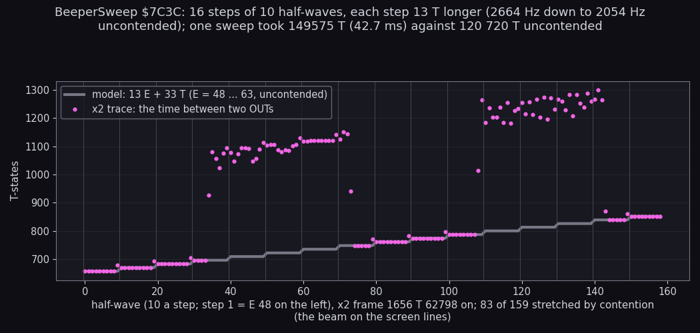

```sh
python3 tools/fig_ay.py sweep
```

How to read:

- x: the 160 half-waves of the first sweep of a pod (x2 frame 1656 T 62 798), 10 a step, step 1 on the left.
- The thick grey line: the model, 13 E + 33 T.
- The dots: the time between two `OUT`s at `$7C4E` in the `x2` trace of frames 1600-1700.

The point: off the screen lines every half-wave is exactly 13 E + 33 T; on them the ULA stretches it by about 1.6.
The five sweeps of that pod took 149 527-154 571 T each (42.7-44.2 ms), and the render's one sweep 43.0 ms.
Pods `$9942` call it five times a pod, so a pod on a 48K is a fifth of a second of chirps.

### The callers and their renders

The callers and their B:

| Caller | Address | B | Rounds | Rendered |
| --- | --- | --- | --- | --- |
| DefineKeys' key click | `$7029` | `$C8` | 200 | 119.5 ms |
| FirePress (the laser fired) | `$8368` | `$3C` | 60 | 8.7 ms |
| ShotHitNoise (a shot meets a thing) | `$844E` | `$14`, 20 times | 20 x 20 | 34.3 ms |
| FireShellNoise (a turret fires) | `$9096` | `$1E`, 10 times | 10 x 30 | 33.6 ms |
| PayBonusTick (one bonus tick paid) | `$9EC1` | `$28` | 40 | 4.3 ms |
| RunBlasts (each blast, each pass) | `$9FBD` | random 1-32 | 1-32 | not rendered |
| ZoneEndBravery (80 x 125 points) | `$A855` | `$3C`, 80 times | 80 x 60 | 974 ms (without AddScore's time) |
| Pods (a pod taken) | `$9996`, `$99EC` | BeeperSweep, 5 times | 5 x 16 x 10 half-waves | 43.0 ms one sweep (the render played one) |
| NoiseShort | `$7C24` | `$37` | no caller | none |

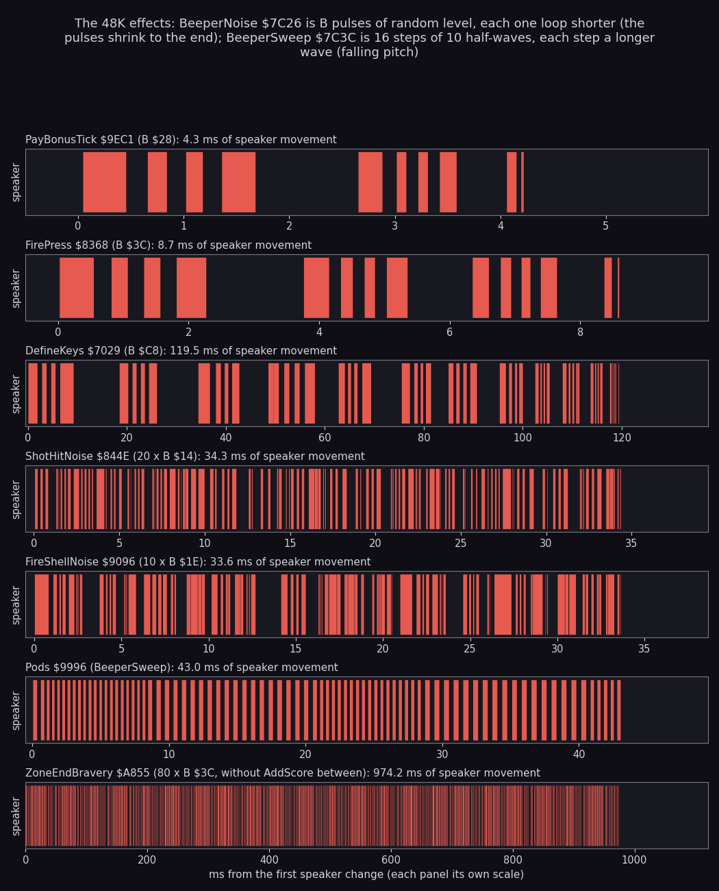

```sh
python3 tools/fig_sound.py beepfx
```

How to read:

- One panel a render: the speaker level (filled = high) against ms from the first change. Each panel has its own
  time scale.
- The title of each panel: the caller, B, and how long the speaker moved.
- A round whose random level is low leaves no mark, so a burst shows fewer pulses than rounds.

What it shows:

- The single bursts (bonus tick, fire) last a few ms: clicks, not tones.
- The repeated calls make a rattle: twenty or ten bursts back to back, 34 ms in all.
- BeeperSweep's pulses widen step by step: its pitch falls.
- ZoneEndBravery's 80 bursts last a second; in the game AddScore runs between them, so it is longer.

The renders patch the code: an experiment, not a recording.
The six bytes `LD HL,TitleTune / CALL PlayTune` at `$6DCB` became `CALL $7DA3`, and a stub over TitleTune's data
called BeeperNoise R times with B (or BeeperSweep once).
The routines themselves are the game's.

## 9.5 Who drives the 48K speaker in play

In play nothing drives the speaker in the background: there is no interrupt sound.
Every sound is the CPU writing port `$FE` in the main loop, and the pass waits while it does.
Five places write the speaker in play:

| Writer | `OUT` at | Called from | What it writes | Witness |
| --- | --- | --- | --- | --- |
| the debris crackle | `$95A3` | MoveDebris `$955D`, once a pass, one `OUT` per piece moved | X x 8 AND `$F8`: the speaker = bit 1 of the piece's X | `x2` frames 400-470: 401 `OUT`s, up to 36 a pass |
| BeeperNoise `$7C26` | `$7C2F`, `$7C37` | FirePress B 60, ShotHitNoise 20 x B 20, FireShellNoise 10 x B 30, RunBlasts B random 1-32, PayBonusTick B 40, ZoneEndBravery 80 x B 60 | R AND `$F8`, then 0 | `x2` frames 2125-2185: 998 pairs |
| BeeperSweep `$7C3C` | `$7C4E` | AmmoPodChirps, GrenadePodChirps, 5 times a pod | the speaker bit flipped | `x2` frames 1656-1667: 800 `OUT`s |

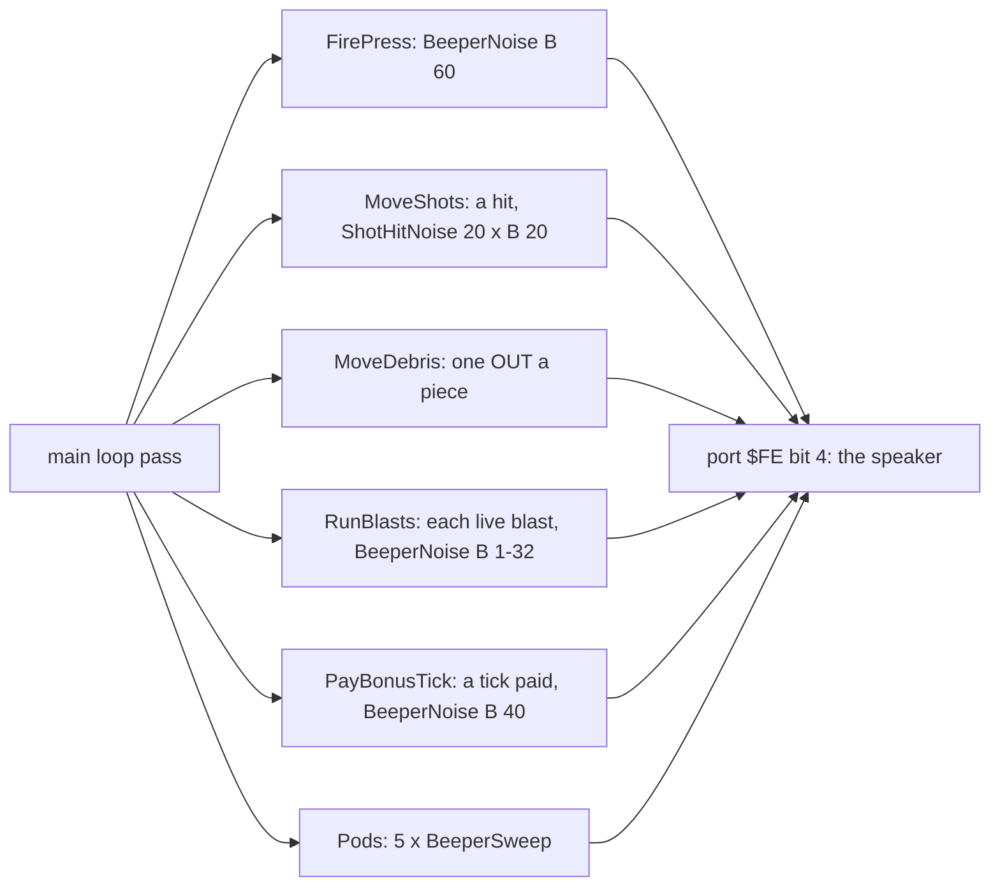

### The debris crackle

A destroyed thing leaves up to 100 debris pieces of 6 bytes in DebrisList `$95B6` (state, X, Y, dx, dy, colour).
MoveDebris erases each piece, moves it, draws it again, and on a 48K writes the piece's new X to the speaker:

```asm
DebrisSound:              ; $9597, after the piece is drawn and coloured
  LD A,(SoundIsAy)
  OR A
  JR NZ,MoveDebrisNext    ; a 128K skips the beeper
  LD A,E                  ; E = the piece's new X
  RLCA
  RLCA
  RLCA                    ; X x 8: bit 0 to MIC (bit 3), bit 1 to the speaker (bit 4)
  AND $F8                 ; the bits rotated into 0-2 cleared: border black
  OUT ($FE),A
```

```text
for piece in DebrisList while not $FF:
    if piece.state = 1:
        erase; X += dx; Y += dy; if off the play area: state = 0, next
        draw; colour
        if 48K: speaker = bit 1 of X, MIC = bit 0 of X
```

The sound is no tone: the speaker takes a new level once a piece, about every 3300-3900 T (the erase, the draw and
the colouring between two `OUT`s), and only when bit 1 of X changed.
dx comes from DebrisSpeeds `$9555` (`FC FD FE 00 00 02 03 04`), so bit 1 of X:

- flips every pass for dx = -2 and +2;
- flips every second pass for dx = -3, -1 (none in the table), +3;
- never changes for dx = -4, 0, +4: those pieces are silent.

A worked example, the first pass, at `x2` frame 413 T 21 198: 36 pieces, 36 `OUT`s over 124 790 T (35.7 ms), the
speaker levels `001000010000100111010010101010000000`.
Every fourth pass after the spawn all pieces hold bit 1 of their common start X, so the whole pass is silent (frames
424, 439, 452 and 465: all 36, 23, 18 and 13 levels are 0).
So the crackle is a run of irregular clicks once a pass (every three or four frames here).
A pass writes 12-36 levels over 40 000-125 000 T (12-36 ms), fewer as the pieces leave the play area.

### RunBlasts, PayBonusTick and the shots

- RunBlasts `$9FBD` draws each live blast (5 records of X, Y, passes left at BlastList `$A00C`; a blast lives 11
  passes) and calls BeeperNoise with B = Random AND `$1F` + 1. `x2` frames 2130-2179: B = 24, 24, 6, 2, 1, 9, 3, 20,
  32, 15, 2, one burst a pass. A blast is a random rattle of 11 bursts of 0.3-2.4 ms.
- PayBonusTick `$9EC1` pays one tick of 25 points a pass while BonusTicks `$9ED6` is not 0, each with BeeperNoise
  B 40 (4.3 ms rendered): the count-up rattles.
- ShotHitNoise `$844E`: 20 calls of B 20 back to back, 34 ms: `x2` frames 2128-2129 (20 calls), 2159-2161.
- FirePress `$835D`: one burst of B 60 (`$8368`): `x2` frames 438, 464, 2136.

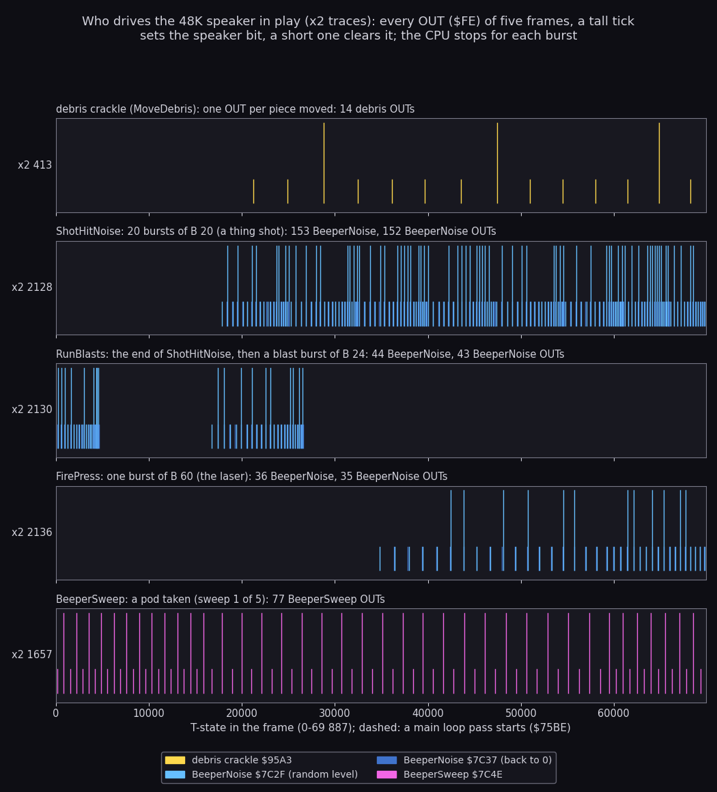

```sh
python3 tools/fig_ay.py speaker
```

How to read:

- One row a TV frame of `x2`, the 69 888 T across; the row's title names the event.
- A tick is one `OUT ($FE)`: tall when it sets the speaker bit, short when it clears it; colour = the instruction.
- The traces: `analysis trace` on the agent's instance with `x2` loaded, frames 400-470, 1600-1700 and 2125-2185
  (`work/docs/fillS/`).

The point:

- The beeper sounds only while a routine holds the CPU: a burst is a block of ticks, and the rest of the pass is
  silent.
- ShotHitNoise fills a whole frame (153 pulses); a blast burst or the laser takes a few thousand T.
- The debris writes are sparse and most of them are short: the crackle is quiet clicks, not a noise.

The two traces are also rendered to sound: the speaker bit of every `OUT` as a waveform
([9.10](#910-the-audio-files): `beeper-play-debris-x2-400.mp3`, `beeper-play-x2-2125.mp3`).
That is a synthesis from the trace: a TTD replay makes no sound.

## 9.6 The AY title tune: the format

The 128K's menu plays a tune on the AY's three channels.
MainMenu calls TuneStart `$B6EC` on each entry (117 calls in the runs).
DrawSparkle `$6F1F`, the menu star's draw, calls TuneTick `$B767` every fourth draw on a 128K (`c128`: 42 219
draws, 10 554 ticks).
So the tune's tempo is the pace of the star draws, not a clock.

The streams:

| Channel | Stream | Record | Notes | Calls | Ticks to its `$FF` |
| --- | --- | --- | --- | --- | --- |
| A | TuneStreamA `$BA01` | `$BE7D` | 340 | 40: 27 patterns, 11 envelopes, 2 from inside a pattern | 6560 |
| B | TuneStreamB `$BB7E` | `$BECD` | 364 (48 of them on noise) | 42: 30 patterns, 12 envelopes | 6561 |
| C | TuneStreamC `$BD06` | `$BF1D` | 90 | 57: 28 patterns, 29 envelopes | 6482 |

The ticks count from TuneStart and include the one-read-a-tick shift of 9.7 (B one tick, C two).

The constants first:

- the AY clock is 1 773 400 Hz; a tone period P gives 1 773 400 / (16 P) Hz;
- a note n takes its period from the word at NotePeriodsTune `$C71B` + 2 n, which is entry 24 of the effects'
  NotePeriods `$C6EB`: the tune lies two octaves above the effects' notes;
- NotePeriods holds 96 words: 0 (silence), `$0384` and `$0392` (the hum's two notes), then semitones from `$0C8E`
  (35 Hz) down to `$0010` (6927 Hz); doc 11 lists it;
- a channel record is 80 bytes: +0/+1 the period, +2 the ticks left of the note, +3 the volume, +6/+7 the AY
  registers, +8 the ceiling, +9 the transpose, +`$0A` the note length, +`$0B` the mixer bits, +`$0C` the call depth,
  +`$0D` the deferred read, +`$0E`-+`$18` the return points, +`$19`-+`$34` the pitch envelope, +`$35`-+`$4F` the
  volume envelope.

The codes TuneReadCode `$B89D` reads:

| Code | Meaning | In the streams |
| --- | --- | --- |
| `$00`-`$31` | a note of the current length (note 0 is a real period too) | yes |
| `$32`-`$63` n | the length = n, then the note code - `$32` | yes |
| `$64` | the mixer: XOR the channel's tone and noise bits (A `$09`, B `$12`, C `$24`) | yes |
| `$65`-`$74` | the volume ceiling = code - `$65` | no |
| `$75` lo hi / `$76` | call a stream / return | yes |
| `$77` n, `$78` lo hi | transpose, jump | no |
| `$79` n | the noise period = n | yes |
| `$89` n ..., `$8A` n ... | a pitch envelope, a volume envelope of n bytes | `$8A` only |
| `$FF` | the tune's end: the first channel to reach it stops all three (TuneEnd `$B9F7`) | yes |

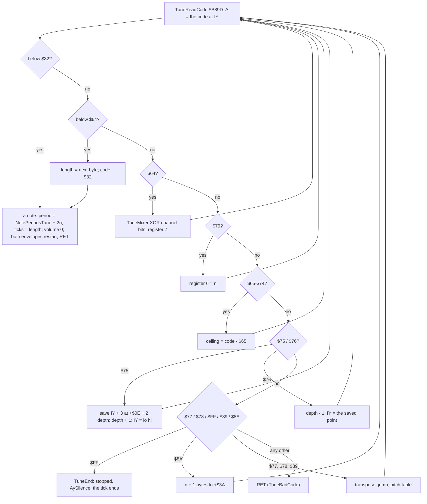

### The structure: order lists, patterns, envelopes

Each stream is an order list: a run of `$75 lo hi` calls ending with a note or two and `$FF`.
A call goes to a pattern (notes and codes ending with `$76`) or to an envelope sub-stream (`$8A` n ... `$76`).
A pattern may call another (depth 2); the return points sit in the record at +`$0E` + 2 x depth, written through
the self-modified `LD (IX+d),C` / `LD (IX+d),B` at `$B965` / `$B968` (and read back at `$B989` / `$B98C`).

The first 16 bytes of TuneStreamA, byte by byte:

| Address | Bytes | Meaning |
| --- | --- | --- |
| `$BA01` | `75 F3 BD` | call `$BDF3`: envelope 3 (`8A 06 02 07 01 0F FF 03 76`) |
| `$BA04` | `75 54 BB` | call pattern `$BB54` |
| `$BA07` | `75 41 BB` | call pattern `$BB41` |
| `$BA0A` | `75 41 BB` | call pattern `$BB41` again |
| `$BA0D` | `75 32 BB` | call pattern `$BB32` |
| `$BA10` | `75` ... | the next call (`$BB32` again) |

And the start of pattern `$BB54`: `75 5F BB` calls `$BB5F` (depth 2), whose first bytes are `51 0A`: the length
`$0A` = 10 ticks, then the note `$51` - `$32` = `$1F` = 31.
The order list ends `75 58 BA 4E A0 FF`: the last pattern, its own note (length 160, note `$1C`) and the end.

The volume envelopes are 17 sub-streams of TuneEnvelopes `$BDE1`-`$BE7C`; only 7 are called, and 10 are left
unused (envelopes 4, 6-12 and 14).

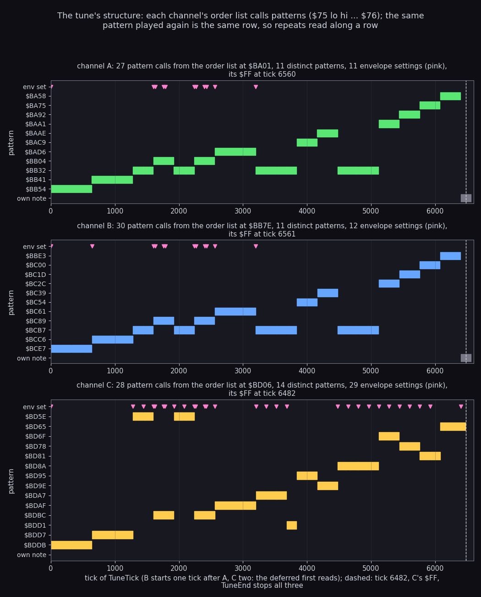

```sh
python3 tools/fig_ay.py order
```

How to read:

- One panel a channel; each row a distinct pattern (its address); a bar is one call of it, from the tick of its
  first note to its last.
- "own note": a note in the order list itself; pink marks: a call of an envelope sub-stream.
- The ticks are a walk of the streams, with B one tick and C two ticks late (9.7).

The point:

- B opens with four calls of its drum pattern `$BCE7`, between two mixer codes `$64` that turn its noise on and off.
- A and B change pattern on the same ticks all through the tune: one plan in two voices.
- Where A calls `$BB32`, B calls `$BCB7` (12 times each), and `$BB04` faces `$BC89` (twice each).
- C is a separate middle voice of long notes; its 18 calls of envelope 16 give its notes a slow decay.
- The order lists hold 85 pattern calls over 6482 ticks; the notes themselves are 794.

## 9.7 The AY tune player: TuneTick and TuneChannelStep

TuneTick `$B767` clears TuneStreamRead `$B6E1`, then, unless TuneStopped `$B6E4` is set, runs TuneChannelStep
`$B79F` for A, B and C with IX = the record and IY = the stream pointer.

```asm
TuneTick:
  XOR A
  LD (TuneStreamRead),A
  LD A,(TuneStopped)
  OR A
  JR NZ,TuneTickDone
  LD IX,TuneChannels
  LD IY,(TunePointerA)
  CALL TuneChannelStep
  LD (TunePointerA),IY
  ; ... the same for B ($BECD) and C ($BF1D)
```

TuneChannelStep does three things a tick:

1. the note: count +2 down; at 0 read the stream (TuneNextEvent `$B88F`);
2. the pitch envelope: every +`$1B` ticks add the step to the offset +`$19` and write the period + offset;
3. the volume envelope: every +`$36` ticks add the step to the volume, keep it in 0..ceiling, write it.

An envelope is a table of segments of three bytes: the steps, the step, the ticks a step.
A segment's three bytes are fetched through three `LD A,(IX+d)` whose d the code writes first (the operands `$B7E8`,
`$B7EE`, `$B7F4` for the pitch, `$B86E`, `$B874`, `$B87A` for the volume): d = +`$20` (or +`$3B`) + the segment index.
At the table's end the pitch table wraps to segment 0; the volume table holds: step 0, counters `$FF`.

```asm
TuneChannelStep:          ; $B79F
  LD A,(IX+$0D)
  OR A
  JR Z,TuneChannelCount
  LD (IX+$0D),$00         ; a deferred read: read now, then step the envelopes
  CALL TuneNextEvent
  JR TunePitchStep
TuneChannelCount:
  DEC (IX+$02)            ; the note's ticks
  JP Z,TuneNextEvent      ; the note ends: read, and no envelope step this tick
TunePitchStep:
  DEC (IX+$1B)            ; the pitch envelope's tick
  JP NZ,TuneVolumeStep
  LD A,(IX+$19)
  ADD A,(IX+$1D)          ; offset += step
  LD (IX+$19),A
  DEC (IX+$1C)
  JR NZ,TunePitchWrite
  LD A,(IX+$1A)           ; the next segment: index + 3, 0 at the length +$1F
  ADD A,$03
  LD (IX+$1A),A
  CP (IX+$1F)
  JR NZ,TunePitchSegment
  XOR A
  LD (IX+$1A),A
TunePitchSegment:
  ADD A,$20
  LD ($B7E8),A            ; the d of the three LD A,(IX+d) below
  INC A
  LD ($B7EE),A
  INC A
  LD ($B7F4),A
  LD A,(IX+$00)           ; $B7E6: d = $20 + index, the steps
  LD (IX+$1C),A
  LD A,(IX+$00)           ; $B7EC: the step
  LD (IX+$1D),A
  LD A,(IX+$00)           ; $B7F2: the ticks a step
  LD (IX+$1E),A
TunePitchWrite:
  ; $B7F8: +$1B = +$1E; HL = period + signed offset (none for period 0); registers +6 + 1 and +6
TuneVolumeStep:
  DEC (IX+$36)            ; the volume envelope's tick
  JR NZ,TuneChannelStepDone
  LD A,(IX+$03)
  ADD A,(IX+$38)          ; volume += step
  JP P,TuneVolumeFloor
  XOR A                   ; below 0: 0
TuneVolumeFloor:
  LD (IX+$03),A
  LD A,(IX+$08)
  CP (IX+$03)
  JR NC,TuneVolumeCeiling
  LD (IX+$03),A           ; above the ceiling: the ceiling
TuneVolumeCeiling:
  DEC (IX+$37)
  JR NZ,TuneVolumeWrite
  LD A,(IX+$35)           ; the next segment: index + 3
  ADD A,$03
  LD (IX+$35),A
  CP (IX+$3A)             ; the table's length
  JR NZ,TuneVolumeSegment
  LD (IX+$38),$00         ; the end: hold, step 0, counters $FF
  LD (IX+$37),$FF
  LD (IX+$39),$FF
  JR TuneVolumeWrite
TuneVolumeSegment:
  ; $B85F: the same three self-modified loads, d = $3B + index (operands $B86E, $B874, $B87A)
TuneVolumeWrite:
  LD A,(IX+$39)           ; $B87E: +$36 = +$39; register +7 = the volume
  LD (IX+$36),A
  LD A,(IX+$03)
  LD C,A
  LD A,(IX+$07)
  JP AyWrite
```

```text
channel_step(ch):
    if ch.deferred: ch.deferred = 0; next_event(ch); step_envelopes(ch)
    else:
        ch.ticks -= 1
        if ch.ticks = 0: next_event(ch); return          # the new note sounds from the next tick
        step_envelopes(ch)

step_envelopes(ch):
    ch.pitch_wait -= 1
    if ch.pitch_wait = 0:
        ch.offset += ch.pitch_step; ch.pitch_steps -= 1
        if ch.pitch_steps = 0: next pitch segment (wrap at the table's end)
        ch.pitch_wait = ch.pitch_ticks
        AY[tone] = ch.period + ch.offset (if the period is not 0)
    ch.vol_wait -= 1
    if ch.vol_wait = 0:
        ch.volume = clamp(ch.volume + ch.vol_step, 0, ch.ceiling)
        ch.vol_steps -= 1
        if ch.vol_steps = 0: next volume segment, or hold at the table's end
        ch.vol_wait = ch.vol_ticks
        AY[volume] = ch.volume

next_event(ch):
    if a channel has already read in this tick: ch.deferred = 1; return
    mark the tick read; read codes up to the next note
```

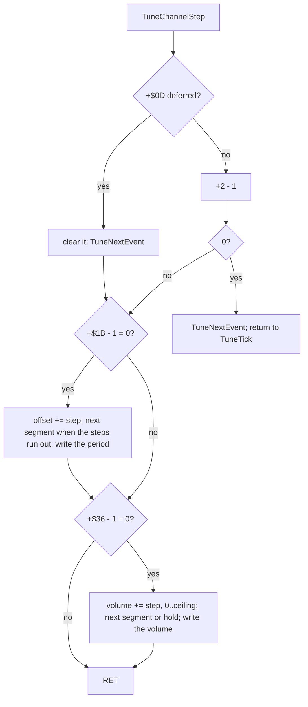

The ceiling: TuneSetMaxVolumes `$B6D1` puts TuneVolume `$B6E0` (12) in B's +8 and 13 in A's and C's.
The pitch tables are never set by a stream (`$89` is in none): the records keep the image's bytes, a vibrato:
A `02 01 02 / 04 FF 02 / 02 01 02` (plus or minus 2 over 16 ticks), B and C `03 01 01 / 06 FF 01 / 03 01 01`
(plus or minus 3 over 12 ticks).

### One read a tick

TuneNextEvent reads only when TuneStreamRead is 0 and sets it to `$FF`.
A second channel wanting to read in the same tick sets its +`$0D` and reads at the next tick, through the deferred
path, which steps the new note's envelopes in the same tick.

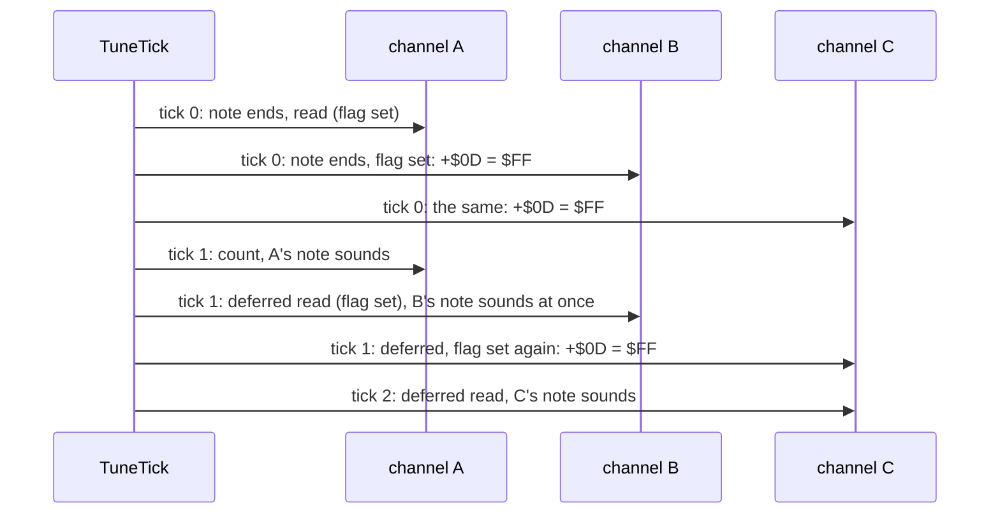

The model (`tools/aymodel.py stats`) finds three such reads in the whole tune, all in the first three ticks:
after them B starts its notes one tick after A and C two, and no two channels ever end a note in the same tick
again.
So the rule costs C two ticks over the tune: its `$FF` comes at tick 6482, not 6480.

### A worked example: channel A's first note

- TuneStart: the pointers, the records, AySilence (register 7 = `$B8`, 8-10 = 0), +2 = 1.
- Tick 0: A's +2 goes to 0; TuneNextEvent reads `75 F3 BD` (call `$BDF3`), `8A 06 02 07 01 0F FF 03` (6 bytes to
  +`$3A`: segments `02 07 01` and `0F FF 03`), `76`, `75 54 BB`, `75 5F BB`, `51 0A`: length 10, note 31.
- The period: the word at `$C71B` + 62 = 159; 1 773 400 / (16 x 159) = 697 Hz (F5 is 698.5 Hz).
- Tick 1: the pitch envelope's first segment: period 159 written; the volume: 0 + 7 = 7.
- Tick 2: volume 7 + 7 = 14, kept to 13 by the ceiling; the second segment begins: -1 every 3 ticks.
- Ticks 3-10: the period 160, 161, 160, 159 (the vibrato); the volume 12 at tick 5, 11 at tick 8.
- Tick 10: +2 reaches 0: the next note, `1A` = note 26, period 213, 520 Hz, sounds from tick 11.

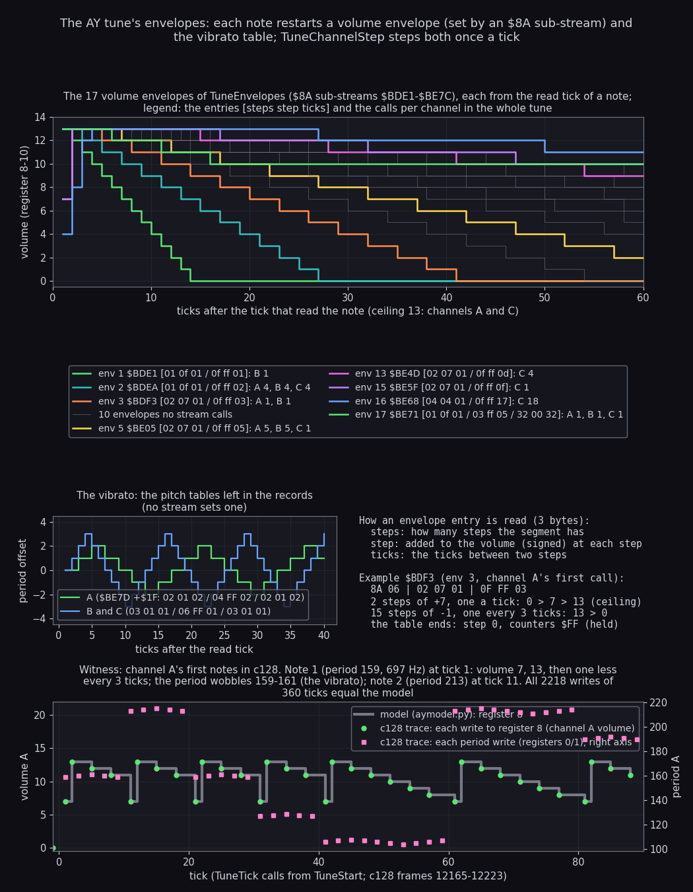

```sh
python3 tools/fig_ay.py envelopes
```

How to read:

- Top: the volume each envelope gives a note, tick by tick, as TuneVolumeStep computes it (ceiling 13); the legend
  gives each called envelope's segments and its calls per channel; grey: the 10 not called.
- Middle left: the pitch offset of the two vibrato tables.
- Bottom: channel A's volume writes (register 8, dots) and period writes (registers 0/1, squares) in the `c128`
  trace from TuneStart, on the model's line.

The point: the tune's notes are shaped by the player, not by the AY's own envelope generator (registers 11-13 are
never written).
The model of the player (`tools/aymodel.py`) gives every write of the `c128` trace of frames 12 150-12 400, 2218
writes in 360 ticks, with nothing different (`python3 tools/aymodel.py check`).

### The registers over time

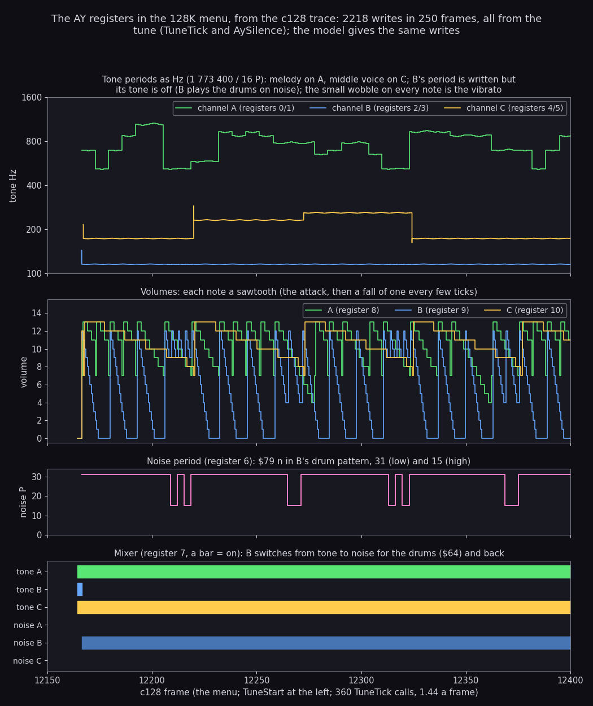

```sh
python3 tools/fig_ay.py menuregs
```

How to read:

- x: the `c128` frame, 12 150-12 400 (5 s of the menu from TuneStart).
- Top: each channel's tone period as Hz; second: each channel's volume register; third: the noise period; bottom:
  the mixer bits that are on.

The point: B plays the drums on the noise generator for the first bars (mixer `$AA`: tone B off, noise B on), its
noise period stepping 31 / 15; A and C play tones; every note is a short attack and a slow fall.

### The tune as rendered

The render left the 128K rig's machine alone for 7000 frames with AY 1 captured.
The machine was in play after the capture; GAME OVER came at about frame 1790 and MainMenu at frame 2510.
`render-ay` read TuneStopped `$B6E4` and the three stream pointers every frame.
A note's read frame is the first frame whose pointer equals the address after the note's code.

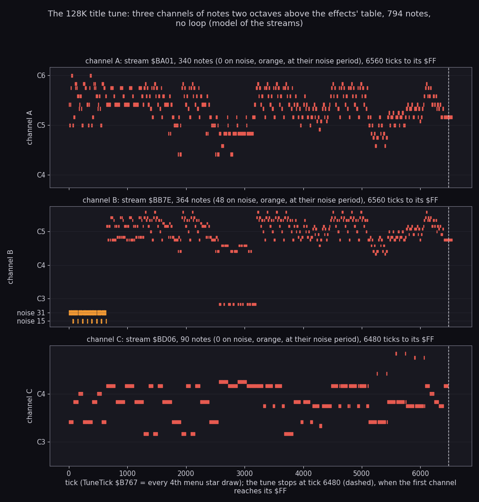

```sh
python3 tools/fig_sound.py aytune
```

How to read:

- One panel a channel; x is the tick, y the note on an octave grid, from the period.
- Orange bars on B: notes played on the noise generator, drawn at their noise period (31 or 15), not at a pitch.
- The dashed line: tick 6480, where C reaches its `$FF` in a walk without the one-read-a-tick shift.

What it shows:

- B opens with the drums (48 noise notes) under a bass line; A carries the melody, C a slow middle voice.
- The tune does not loop: A and B have 78 and 79 ticks left when C ends it.

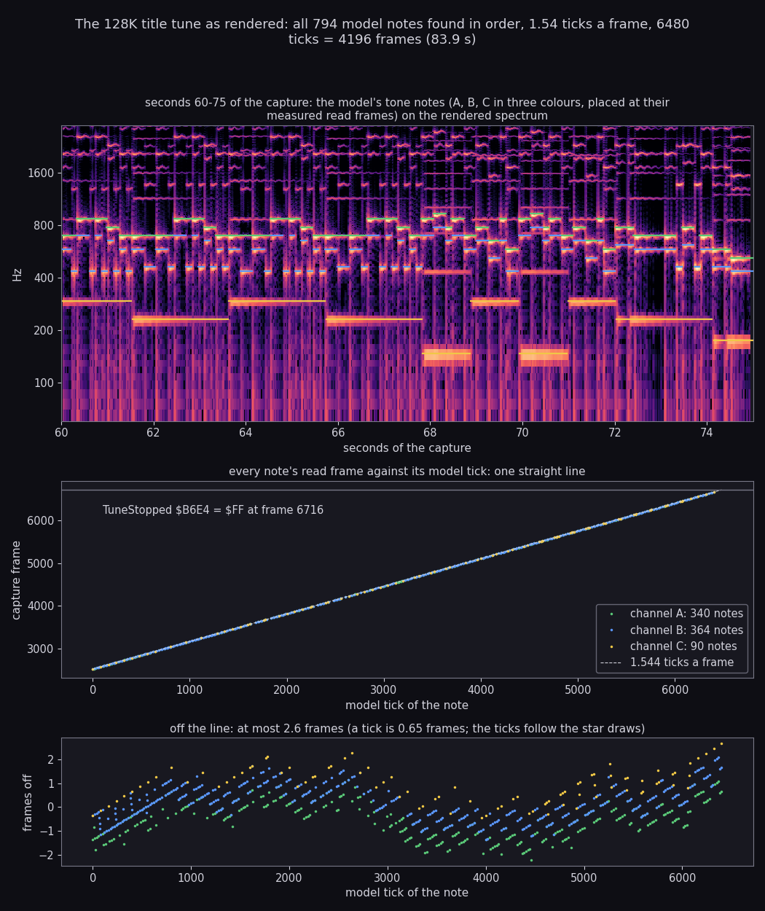

```sh
python3 tools/fig_sound.py render-ay --work work/docs/docB/r128
python3 tools/fig_sound.py aymeasured
```

How to read:

- Top: seconds 60-75 of the capture as a spectrogram, with the model's tone notes drawn at their measured read
  frames (A green, B blue, C yellow).
- Middle: each note's read frame against its model tick; the dashed line is the fit; the grey line is the frame
  where TuneStopped became `$FF`.
- Bottom: each note's distance from the fit, in frames.

What it shows:

- The model's 794 notes were all found in order: the code table above covers this tune.
- The tick rate is steady at 1.544 ticks a frame (6.2 star draws a frame): 6480 ticks take 4196 frames, 83.9 s.
- No note is more than 2.6 frames off the line. The bands in the bottom panel are the shift of B (one tick) and C
  (two ticks) behind A, which this walk does not include.
- TuneStopped became `$FF` at frame 6716, 2 frames after the fit puts tick 6480: C's `$FF` at tick 6482.

## 9.8 The AY effects engine

SoundEffectsTick `$BF7E` runs three times a main loop pass (`$75C5`, `$7601`, `$766B`; 237 645 times each in the
runs).
It walks 16 slots of 16 bytes at SfxSlots `$C5EB`.

The constants first:

- a slot: +0 `$FF` free / 0 active, +1/+2 the stream pointer, +3 the note's ticks left, +4 the volume, +5 the start
  volume, +6/+7 the decay counter and its reload, +8 the decay step, +9/+`$0A` the period, +`$0B` the mixer mask
  (0 tone and noise, 7 noise only, `$38` tone only), +`$0C` the note length;
- the first three active slots, in slot order, get channels A, B and C; a fourth and later run unheard;
- each starter puts its effect in a fixed slot, so a new shot restarts the old shot instead of taking a channel.

```asm
SoundEffectsTick:
  XOR A
  LD (SfxChannelIndex),A
  LD A,$BF
  LD (SfxMixer),A         ; all tones and noises off
  LD A,$F6
  LD (SfxChannelBits),A   ; tone A and noise A on
  LD IX,SfxSlots
  LD B,$10
SoundEffectsSlot:
  PUSH IX
  PUSH BC
  LD A,(IX+$00)
  CP $FF
  JR Z,SoundEffectsNext   ; a free slot: nothing, the bits stay
  CALL SfxSlotStep
  LD HL,SfxChannelBits
  RLC (HL)                ; the next channel's bits
SoundEffectsNext:
  ; ... the next slot
  LD A,$06                ; register 6 = SfxNoise, register 7 = SfxMixer
  ...
```

```text
tick:
    mixer = $BF (all off); bits = $F6; next channel = A
    for slot in 0..15:
        if the slot is active:
            note ticks -= 1; if 0: read the stream up to the next note (the $FF frees the slot: no channel)
            decay counter -= 1; if 0: reload it, volume -= step (when not 0)
            if not freed: hand the slot to the next channel (A, B, C, then nothing)
            bits = rotate left (bits)
    write the noise period (register 6) and the mixer (register 7)
```

The stream codes SfxReadStream `$BFE1` reads:

| Code | Meaning |
| --- | --- |
| `$FF` | the end: the slot is freed |
| `$FE` n | the start volume = n |
| `$FD` p s | the decay reload p, the step s (only in the streams of the starters with no caller) |
| `$FC` m | the mixer mask = m |
| `$FB` n | the noise period = n, and n is also the note that follows |
| `$00`-`$5F` | a note of the slot's length: the period from NotePeriods `$C6EB` |
| `$60`-`$FA` n | the note code - `$60`, then the length n |

StartSoundEffect `$C1D3` sets a slot: A the slot, BC the stream; volume 15, length 1, tone only, the first read at the
next tick.
It leaves +6 and +7: an effect with no `$FD` decays only when the counter a previous effect left runs out (from 0,
256 ticks), so the ones that run decay only by their own `$FE` steps.

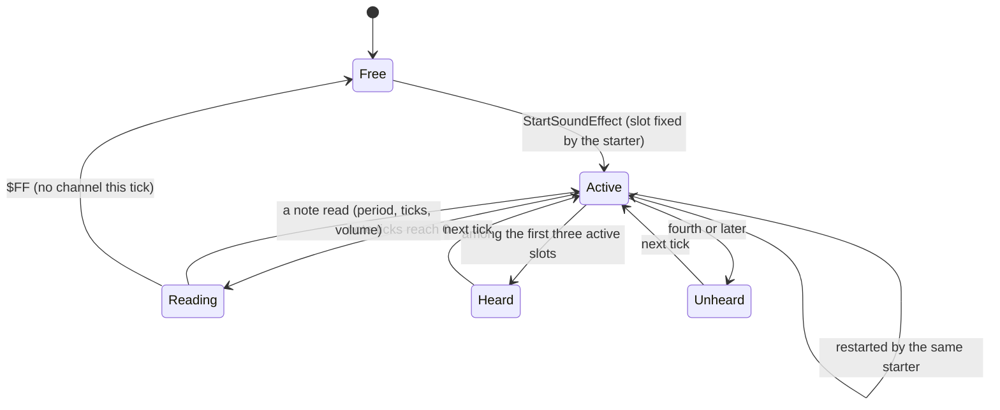

### A worked example: ShotSound

ShotSound `$C5A1` (PlaySfxShot, slot 15):

- the bytes: `FC 00  FE 0D  FB 0F  74 01  FE 0B 14  FE 09 14  FE 07 14  FE 03 74 03  FE 02 14  FF`;
- tick 1: mixer mask 0 (tone and noise), volume 13, noise period 15 and note 15: period `$0647`, 69 Hz, 1 tick;
- tick 2: `74 01`: note `$14` = 20, period `$04B4`, 92 Hz, length 1;
- ticks 3-5: note 20 again at volumes 11, 9, 7;
- ticks 6-8: volume 3, note 20 for 3 ticks; ticks 9-11: volume 2, note 20 (the length is still 3); then `$FF`;
- 11 ticks at three a pass are about 3.7 passes, 7 frames (0.15 s): a low thud in noise. The render is loud for
  0.15 s.
- In play: `c128` frame 20 023 T 64 645 StartSoundEffect A = 15, BC = `$C5A1`; the slot sounds at ticks 37-47 of the
  trace (frames 20 024-20 032) and is freed at tick 48: 11 ticks.

### A worked example with a decay: JingleBSound

`$FD` appears only in the six effects nothing starts; JingleBSound `$C54D` (slot 14) shows it:

- `FE 0F`: start volume 15; `FD 02 01`: decay reload 2, the counter 2 / 2 + 1 = 2, step 1;
- `A3 09`: note `$43` = 67, period 80 (1385 Hz), 9 ticks;
- the volume each tick: 15, 14, 14, 13, 13, 12, 12, 11, 11: one less every second tick;
- `A0 03`: note 64 for 3 ticks: the volume restarts at 15 at the read and the counter, which a note does not
  reset, takes it to 14 at once: 14, 14, 13.

The render `sfx-jingle-b.wav` (`ay-jingle-b.mp3`) is this phrase: six notes falling in loudness, 36 ticks.

### The channels and the mixer

SfxToAyChannel `$C05A` increments SfxChannelIndex `$C5EA` and jumps through SfxChannelWriters `$C077`: SfxWriteChannelA
`$C097`, B `$C0B1`, C `$C0CC`, then 13 times SfxNoChannel `$C7F3` (a RET).
Each writer ANDs the mixer with the channel bits OR the slot's mask, then writes the volume and the period:

```asm
SfxWriteChannelA:
  LD HL,SfxMixer
  LD A,(SfxChannelBits)   ; $F6 for the first active slot, $ED the second, $DB the third
  OR (IX+$0B)             ; the mask: 0 keeps tone and noise, 7 blocks the tone, $38 the noise
  AND (HL)
  LD (HL),A
  LD A,$08                ; register 8 = the volume (C)
  CALL AyWrite
  XOR A                   ; registers 0/1 = the period (E, D)
  LD C,E
  CALL AyWrite
  INC A
  LD C,D
  JP AyWrite
```

A register 7 bit of 0 turns a source on: bit 0-2 tone A-C, bits 3-5 noise A-C.
`$F6` = `11110110` opens tone A and noise A; one rotation, `$ED`, opens tone B and noise B; `$DB` tone C and noise C.

A worked example from the `c128` trace, tick 79 (frame 20 053): slots 6 (blast, mask 0), 9 (grenade A, mask `$38`)
and 15 (grenade B, mask `$38`):

- slot 6 to A: `$BF` AND (`$F6` OR 0) = `$B6`;
- slot 9 to B: `$B6` AND (`$ED` OR `$38` = `$FD`) = `$B4`;
- slot 15 to C: `$B4` AND (`$DB` OR `$38` = `$FB`) = `$B0`: tone A, B, C and noise A on;
- the trace writes register 7 = `$B0` at that tick.

The same rule for the hum and a shot (known only from the code: no traced run had the force field): slots 1 and 11
(hum, mask `$38`) take A and B, the shot in slot 15 takes C; the mixer is `$98`: three tones and noise C.

The quirk: a slot freed by its `$FF` rotates the bits but takes no channel.
The next slot then gets the next channel's writer with the bits one channel ahead.
In the `c128` trace at tick 93 (frame 20 063) the blast in slot 6 ends:

- slot 9 gets channel A (volume 14, period `$59`) with `$ED`, the bits of B;
- slot 15 gets channel B with `$DB`, the bits of C; channel C is not written and keeps slot 15's values of tick 92;
- the mixer is `$B9`: tone A off, tones B and C on;
- so for one tick (about 2/3 of a frame) grenade A is silent and grenade B sounds twice, on B and on C; at tick 94
  the bits are right again (`$BC`).

### Priority

The slot number is the priority: the three lowest active slots are heard.

| Slot | Effects | Heard against |
| --- | --- | --- |
| 0 | fanfare (no caller) | always |
| 1 | hum A | always |
| 2 | ammo refill, grenade refill | always but against slots 0-1 |
| 4, 5 | jingle A, trill, jingle B's bass | |
| 6 | blast | |
| 7 | noise sweep (a gun's shot) | |
| 8, 9, 10 | explosion, grenade A, chord | |
| 11, 12 | hum B, rise | |
| 13 | noise burst, pulse (teleport), wobble | |
| 14 | jingle B | |
| 15 | shot, grenade B, fanfare's bass | the first to drop out |

The player's shot is the lowest priority.

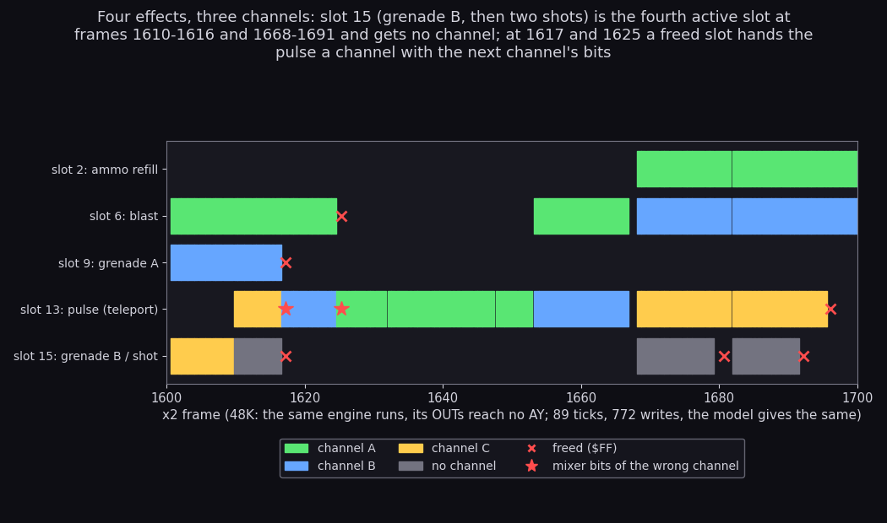

```sh
python3 tools/fig_ay.py channels
```

How to read:

- One row a slot used in `x2` frames 1600-1700, named by its stream; each tick of SoundEffectsTick a bar coloured by
  the channel the slot got; grey: no channel; x: freed; star: a channel written with another channel's bits.
- `x2` is a 48K run: the engine runs and writes the AY ports, no chip hears them; the decisions are the same.
- Slots 6, 9 and 15 were already running at frame 1600: their stream pointers (`$C318`, `$C3BD`, `$C42F`) lie in
  BlastSound, GrenadeSoundA and GrenadeSoundB.
- No tick runs during the pod's five sweeps (frames 1654-1668): the bars there stretch over the gap.
- The model, seeded from `memory_at` at frame 1600 with each StartSoundEffect of the trace, gives all 772 writes of
  the 89 ticks.

The point:

- At frame 1610 the teleport's pulse (slot 13) takes C, and grenade B (slot 15) loses its channel until it ends.
- At frames 1617 and 1625 a freed slot (grenade A, then the blast) hands the pulse a channel with the next channel's
  bits: the quirk.
- From frame 1668 the ammo refill (2), a new blast (6) and the pulse (13) hold A, B and C; the two laser shots
  started just before frames 1668 and 1682 (slot 15) run unheard. On a 128K those shots would be silent.

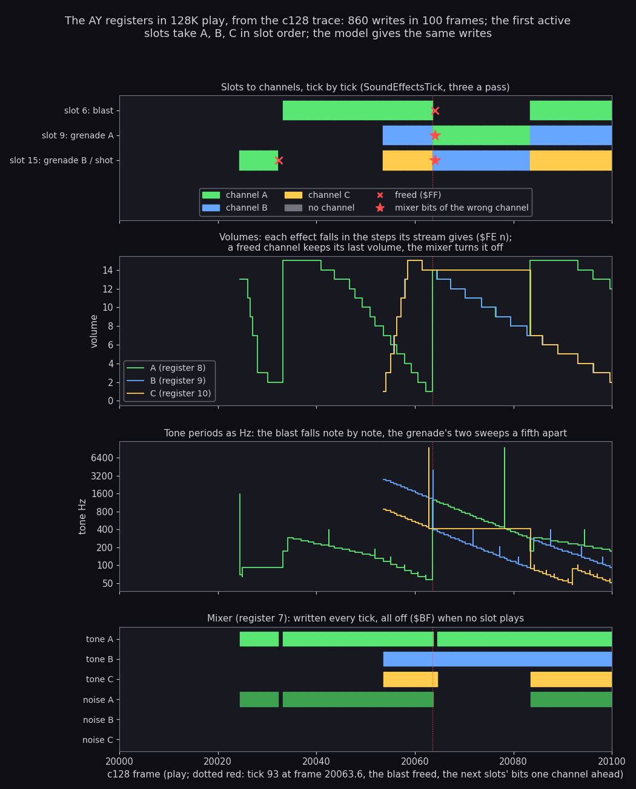

```sh
python3 tools/fig_ay.py playregs
```

How to read:

- x: the `c128` frame, 20 000-20 100 (play, 139 ticks).
- Top: the slots and their channels as above; then the volumes (registers 8-10), the periods as Hz, the mixer.
- The dotted red line: tick 93, the quirk.

The point: the effects write every register every tick: the volumes and periods of the slots handed a channel, then
registers 6 and 7; a channel nobody takes keeps its last values and the mixer silences it.

## 9.9 Every effect

The lengths are model ticks (`tools/fig_ay.py sheet`: each effect alone from free slots; the model gives every write
of the three traced windows); three ticks make a pass, about two frames.

| Effect | Starter | Slot(s) | Stream | Trigger | What it is | Ticks | Seen in play | Audio |
| --- | --- | --- | --- | --- | --- | ---: | --- | --- |
| shot | PlaySfxShot `$C177` | 15 | `$C5A1` | FirePress, `$8372` (2625 calls) | noise 15 + notes 15, 20, volume 13 to 2 | 11 | `c128` 20 023, `x2` 439, 2137 | `ay-shot.mp3` |
| noise burst | PlaySfxNoiseBurst `$C0E7` | 13 | `$C264` | MoveShots, `$8408` and `$8417` (419) | tone and noise, note 75, volume 13 to 3 | 14 | `x2` 468, 2128 | `ay-noise-burst.mp3` |
| blast | PlaySfxBlast `$C148` | 6 | `$C305` | FireShell `$909F`, `$91A9`, GrenadeBlast `$9427`; `$AC51` never ran | noise 31 and notes 40 down to 12, volume 15 to 1 | 43 | `c128` 20 032 (43 ticks to its `$FF`), `x2` 411 | `ay-blast.mp3` |
| explosion | PlaySfxExplosion `$C155` | 8 | `$C33E` | `$9B79`, `$9BD0`, `$9E5B`, `$9E7F`, `$A63C` | noise and notes 50 down to 36 | 9 | `x2` 2125 | `ay-explosion.mp3` |
| grenade | PlaySfxGrenade `$C1BE` | 9, 15 | `$C366`, `$C3D8` | ThrowGrenade `$9254` | two sweeps a fifth apart, volume up then down | 68 | `c128` 20 053 | `ay-grenade.mp3` |
| noise sweep | PlaySfxNoiseSweep `$C13B` | 7 | `$C2C7` | Guns, `$9DBB` | noise only, its period rising in steps of 2 | 32 | known from the code | `ay-noise-sweep.mp3` |
| trill | PlaySfxTrill `$C12E` | 5 | `$C280` | AddBonusTicks `$9EB1`, PickupsVsPlayer `$A32B` (156) | note 60 and silence (note 0) by turns, about 33 times | 201 | known from the code | `ay-trill.mp3` |
| ammo refill | PlaySfxAmmoRefill `$C0F4` | 2 | `$C218` | `$9980`, `$9F65` | arpeggio 79-71-63-55, volume 13 down to 3 | 72 | `x2` 1656 | `ay-ammo-refill.mp3` |
| grenade refill | PlaySfxGrenadeRefill `$C101` | 2 | `$C23E` | `$99D6` | arpeggio 84-76-68-60 | 72 | `x2` 2141 | `ay-grenade-refill.mp3` |
| pulse | PlaySfxPulse `$C162` | 13 | `$C462` | Teleports, `$98F3` and `$9928` (38, 8) | note 60 with a tremolo, 15 down to 4 | 73 | `x2` 1609 | `ay-pulse.mp3` |
| hum | PlaySfxHum `$C1A9` | 1, 11 | `$C35C`, `$C361` | ForceFieldStep, `$ABD6` (9349), every pass | notes 1 and 2 (periods `$0384`, `$0392`) beating | 10, restarted | known from the code | `ay-hum.mp3` |
| jingle A | PlaySfxJingleA `$C10E` | 4 | `$C55D` | no caller | phrase from note 67, decay 1, 1 | 9 | never ran | `ay-jingle-a.mp3` |
| jingle B | PlaySfxJingleB `$C116` | 14, 5 | `$C54D`, `$C56D` | no caller | phrase from note 67 over a bass, decay 2, 1 | 36 | never ran | `ay-jingle-b.mp3` |
| wobble | PlaySfxWobble `$C126` | 13 | `$C5BA` | no caller | notes 69-72-69 | 14 | never ran | `ay-wobble.mp3` |
| rise | PlaySfxRise `$C16F` | 12 | `$C5C8` | no caller | noise and notes 40 up to 56 | 23 | never ran | `ay-rise.mp3` |
| chord | PlaySfxChord `$C17F` | 8, 9, 10 | `$C577`, `$C585`, `$C593` | no caller | three voices, each a falling arpeggio (72-67-64-60 on top) | 28 | never ran | `ay-chord.mp3` |
| fanfare | PlaySfxFanfare `$C195` | 0, 15 | `$C44A`, `$C53F` | no caller | a major arpeggio stepping down a semitone at a time, over a bass | 42 | never ran | `ay-fanfare.mp3` |

"Seen in play" is the frame of the StartSoundEffect in a trace; the noise sweep, the trill and the hum ran in the
warp runs (the call counts) but no traced window holds them.

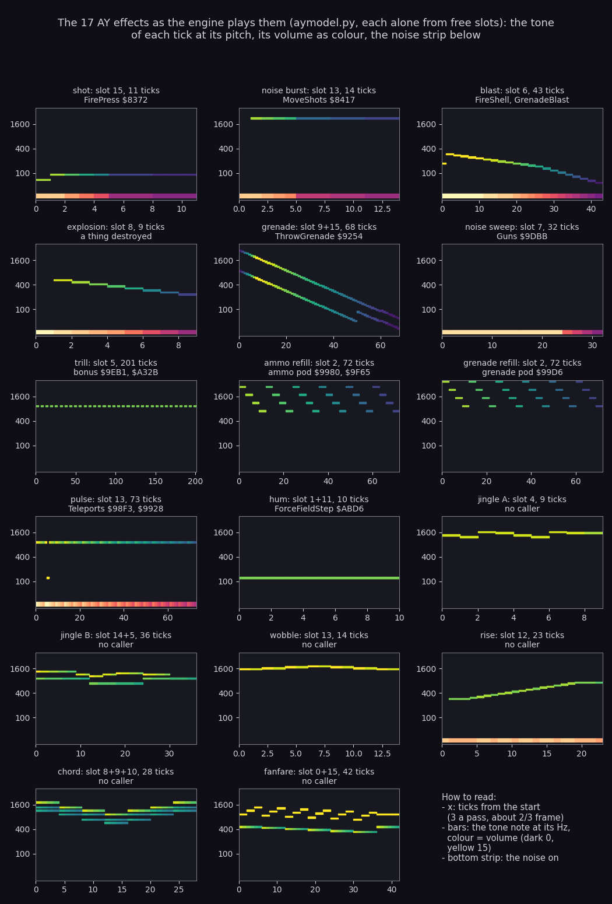

```sh
python3 tools/fig_ay.py sheet
```

How to read:

- One panel an effect; x: ticks from the start; a bar: the tone of a slot in that tick at its Hz, its colour the
  volume; the strip at the bottom: the noise on.
- The title: the slots, the length in ticks, the trigger.

The point: the game's effects are short (9-73 ticks, under a second) except the trill (201 ticks, 2.7 s); the
six without a caller are the only melodic phrases.

The renders are spectrograms of the same effects:

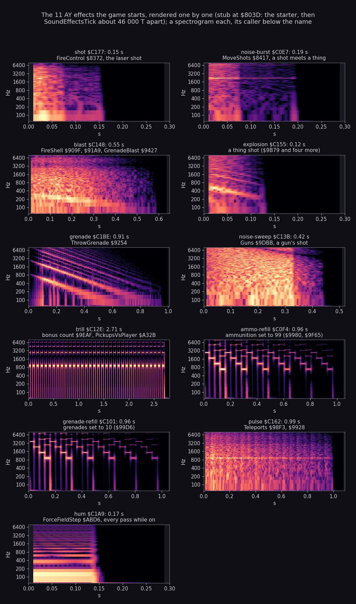

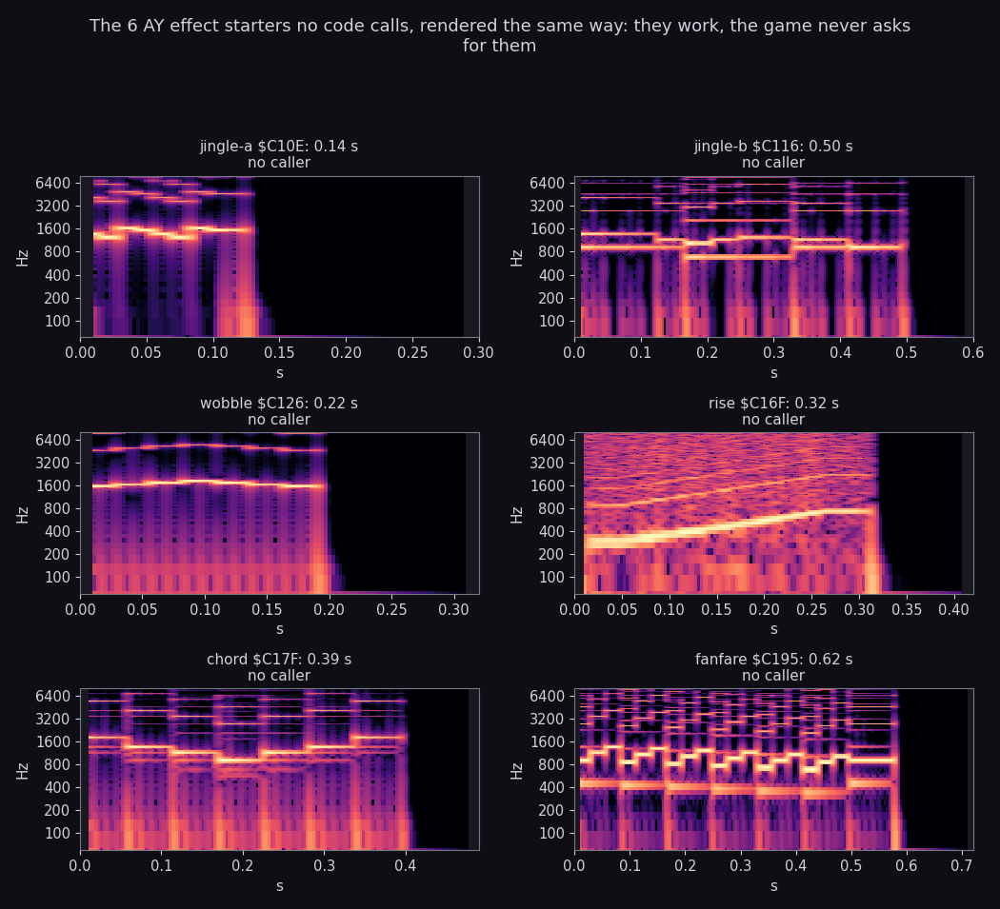

```sh
python3 tools/fig_sound.py render-sfx --work work/docs/docB/r128
python3 tools/fig_sound.py ayfx     # both figures
```

How to read:

- One spectrogram an effect, 40-8000 Hz on a log scale, from its start; the title gives the starter, the time the
  render was loud and the trigger.
- The render is an experiment: the rig ran to MainMenu (frame 2520), `$6DC9` became `JP $803D`, and a stub there
  ran DI, AySilence `$B753`, the starter, then SoundEffectsTick and a 1680-loop delay forever (about 46 000 T a
  tick, a third of doc 04's median pass of 138 347 T). The stub's ticks are even; in the game the three ticks of a
  pass are uneven.

What it shows:

- Shot, noise burst, explosion and blast are noise with a falling tone under it, 0.1-0.6 s.
- The grenade throw is sweeps falling together over 0.9 s.
- The refills are a falling four-note arpeggio repeated as it fades; the trill is one note pulsing for 2.7 s.
- The hum is two low notes; ForceFieldStep restarts it every pass while the field is on, so in play it lasts.
- The six orphan effects play. That they are phrases left from the engine's earlier use is a guess: they are tune
  phrases (jingles, a fanfare, a chord), the only streams with `$FD`, and nothing in the image starts them.

## 9.10 The audio files

The renders are published in `docs/audio` as MP3 (mono, 128 kbit/s).
`python3 tools/fig_ay.py audio` cuts them from the WAVs of `work/docs/docB/audio/` (the renders of 9.4 and 9.9).
It synthesizes the two in-play tracks from the `x2` traces: the speaker bit of each `OUT ($FE)` held until the next.
A TTD replay makes no sound, so those two are the only way to hear play on a 48K.
The AY effects are the first 3 s of each render; all but the trill end sooner.
None was played while making them.

| File | Seconds | What | Source |
| --- | ---: | --- | --- |
| [beeper-title-tune.mp3](audio/beeper-title-tune.mp3) | 47.8 | the 48K title tune (PlayTune TitleTune) | 48K render |
| [beeper-jingle.mp3](audio/beeper-jingle.mp3) | 5.9 | the jingle: GAME OVER, ZORBA | 48K render |
| [beeper-fire.mp3](audio/beeper-fire.mp3) | 0.6 | FirePress: BeeperNoise B `$3C` | 48K render |
| [beeper-shot-hit.mp3](audio/beeper-shot-hit.mp3) | 0.6 | ShotHitNoise: 20 x B `$14` | 48K render |
| [beeper-turret-shell.mp3](audio/beeper-turret-shell.mp3) | 0.6 | FireShellNoise: 10 x B `$1E` | 48K render |
| [beeper-bonus-tick.mp3](audio/beeper-bonus-tick.mp3) | 0.6 | PayBonusTick: B `$28` | 48K render |
| [beeper-key-click.mp3](audio/beeper-key-click.mp3) | 0.6 | DefineKeys' click: B `$C8` | 48K render |
| [beeper-bravery-bonus.mp3](audio/beeper-bravery-bonus.mp3) | 1.6 | ZoneEndBravery: 80 x B `$3C` | 48K render |
| [beeper-pod-sweep.mp3](audio/beeper-pod-sweep.mp3) | 0.6 | a pod: 5 x BeeperSweep | 48K render |
| [beeper-play-debris-x2-400.mp3](audio/beeper-play-debris-x2-400.mp3) | 1.4 | the speaker in play: the debris crackle, two shots fired, a hit | `x2` frames 400-470, synthesized from the `OUT`s |
| [beeper-play-x2-2125.mp3](audio/beeper-play-x2-2125.mp3) | 1.1 | the speaker in play: a kill, a shot hit, the blasts | `x2` frames 2125-2185, synthesized from the `OUT`s |
| [ay-title-tune.mp3](audio/ay-title-tune.mp3) | 85.4 | the AY title tune, MainMenu to TuneStopped | 128K render |
| [ay-shot.mp3](audio/ay-shot.mp3) | 3.0 | the AY effect: shot | 128K stub render |
| [ay-noise-burst.mp3](audio/ay-noise-burst.mp3) | 3.0 | the AY effect: noise burst | 128K stub render |
| [ay-blast.mp3](audio/ay-blast.mp3) | 3.0 | the AY effect: blast | 128K stub render |
| [ay-explosion.mp3](audio/ay-explosion.mp3) | 3.0 | the AY effect: explosion | 128K stub render |
| [ay-grenade.mp3](audio/ay-grenade.mp3) | 3.0 | the AY effect: grenade throw | 128K stub render |
| [ay-noise-sweep.mp3](audio/ay-noise-sweep.mp3) | 3.0 | the AY effect: noise sweep | 128K stub render |
| [ay-trill.mp3](audio/ay-trill.mp3) | 3.0 | the AY effect: trill | 128K stub render |
| [ay-ammo-refill.mp3](audio/ay-ammo-refill.mp3) | 3.0 | the AY effect: ammo refill | 128K stub render |
| [ay-grenade-refill.mp3](audio/ay-grenade-refill.mp3) | 3.0 | the AY effect: grenade refill | 128K stub render |
| [ay-pulse.mp3](audio/ay-pulse.mp3) | 3.0 | the AY effect: pulse (teleport) | 128K stub render |
| [ay-hum.mp3](audio/ay-hum.mp3) | 3.0 | the AY effect: hum | 128K stub render |
| [ay-jingle-a.mp3](audio/ay-jingle-a.mp3) | 3.0 | the AY effect: jingle A (no caller) | 128K stub render |
| [ay-jingle-b.mp3](audio/ay-jingle-b.mp3) | 3.0 | the AY effect: jingle B (no caller) | 128K stub render |
| [ay-wobble.mp3](audio/ay-wobble.mp3) | 3.0 | the AY effect: wobble (no caller) | 128K stub render |
| [ay-rise.mp3](audio/ay-rise.mp3) | 3.0 | the AY effect: rise (no caller) | 128K stub render |
| [ay-chord.mp3](audio/ay-chord.mp3) | 3.0 | the AY effect: chord (no caller) | 128K stub render |
| [ay-fanfare.mp3](audio/ay-fanfare.mp3) | 3.0 | the AY effect: fanfare (no caller) | 128K stub render |

## 9.11 What is known only from the code

- The rest in PlayTune (both note numbers 0): neither tune has one.
- NoiseShort `$7C24` (B `$37`): no caller.
- The AY tune codes `$65`-`$74`, `$77`, `$78`, `$89` and TuneBadCode: never in the streams.
- TuneEnd from the deferred path: its `POP AF` drops the return into TuneChannelStep, so the remaining channels of
  that tick would still step; the tune's `$FF` (on C) is read on the normal path, so this never happens.
- The effect code `$FD`: only the six orphan starters use it, and only the stub rendered them.
- The hum with a shot (the mixer `$98`): from the code; no traced window has the force field.
- The noise sweep and the trill in play: from the code and the call counts; not in a traced window.
- TuneState `$B6DF`, `$B6E2`, `$B6E3`: no reader or writer.
