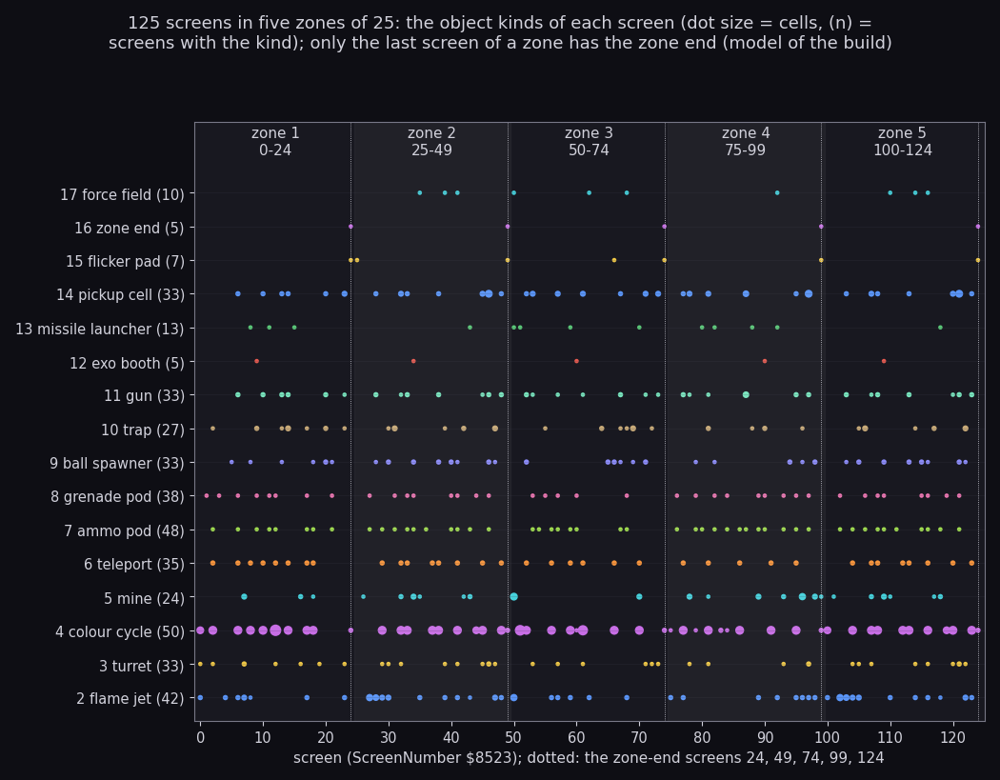
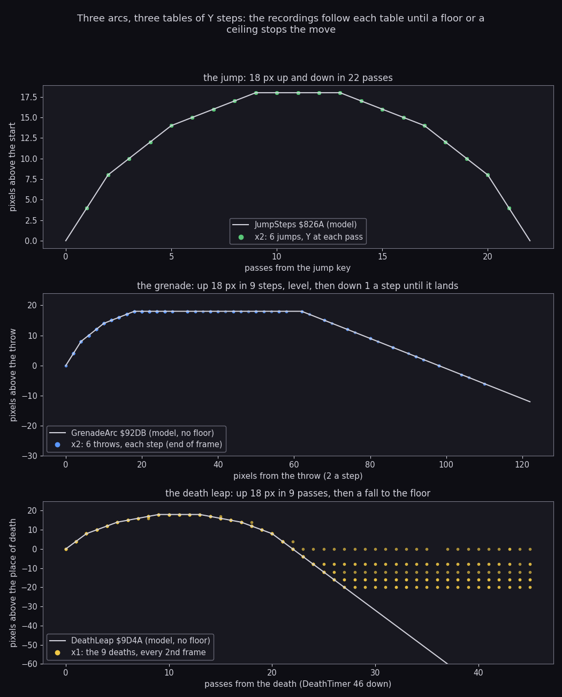
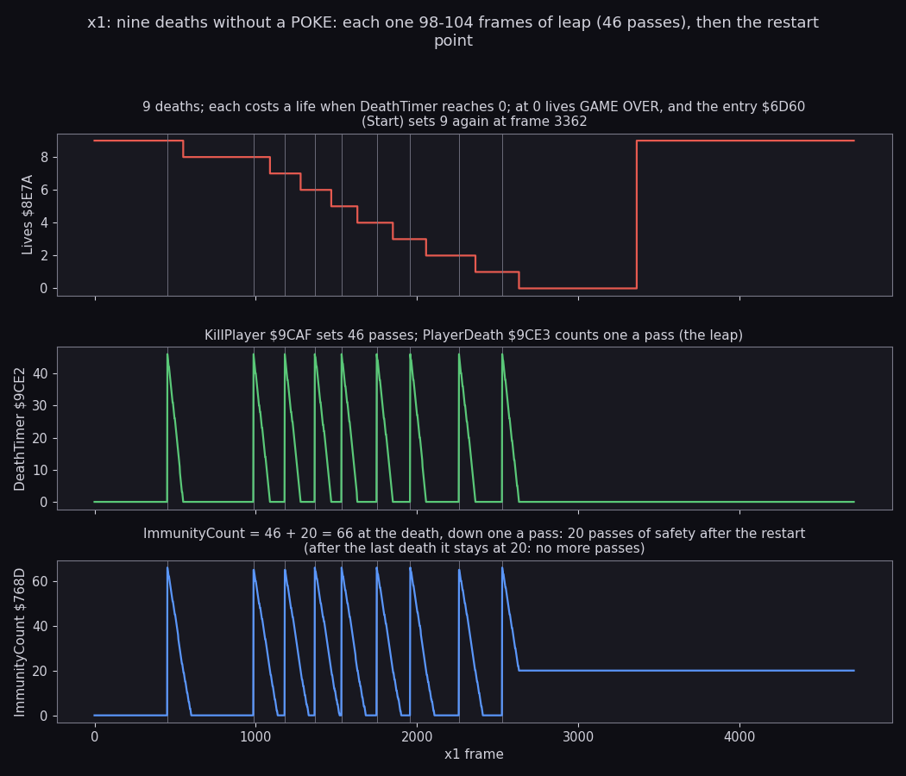
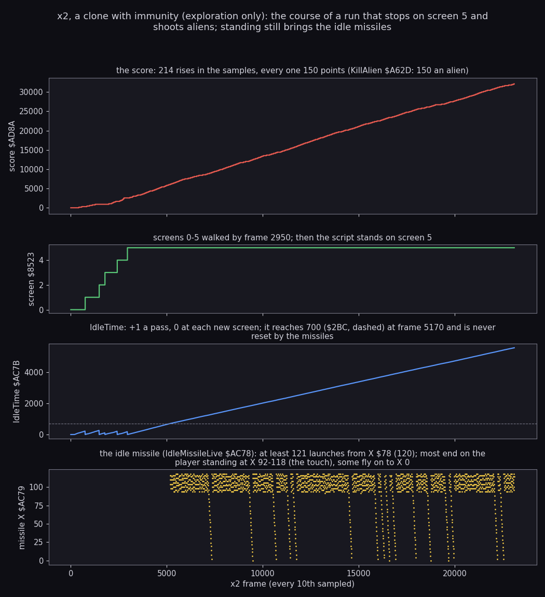
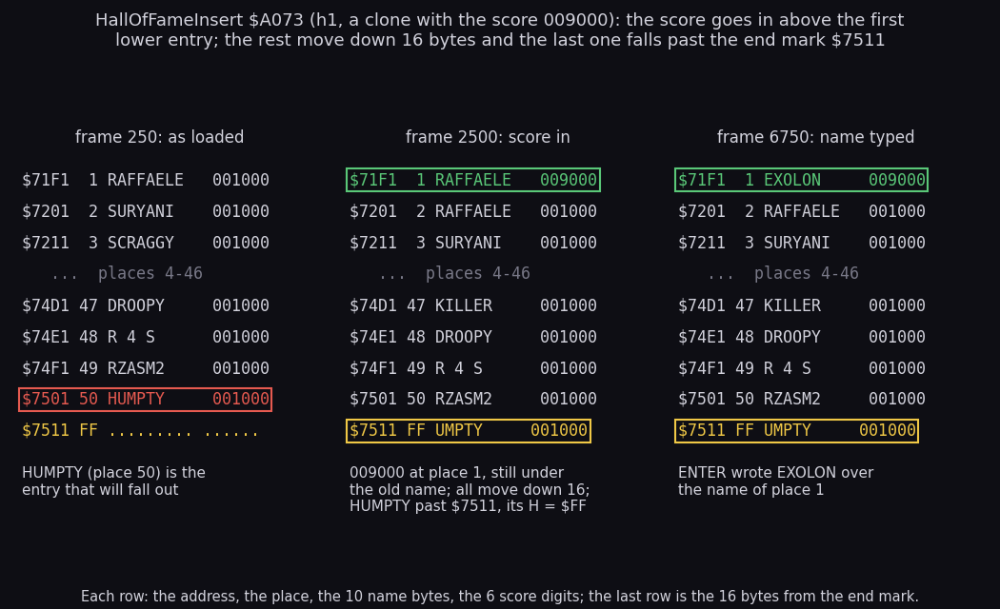

# 10. Gameplay logic

What this covers:

- the rules as code: lives, ammunition, grenades, what kills, what scores;
- the map: 125 screens in five zones of 25, the zone's end, its bonuses and the bonus screen;
- the arcs of the jump, the grenade and the death leap;
- the idle missile that punishes standing still;
- the Hall of Fame and the ZORBA cheat;
- the course of two recorded runs.

The recordings it rests on:

- `x1` (no POKE, from the game's entry, WALKTHROUGH 6.0): nine deaths on screen 0, the GAME OVER. Read every 2nd frame (`x1/deaths.json`).
- `x2` (`tests/inputs/x2-imm-right.txt` on `entry-imm.z80`, a clone with the ZXDB POKEs for lives, ammunition, grenades, immunity, mines and traps;
  exploration only): screens 0-5, 14 grenades, 23 110 frames. Read every frame for 0-1500 (`x2/arcs.json`) and
  every 10th to the end (`x2/play.json`).
- `h1` (`entry-score.z80`, a clone with the score set to 009000; exploration only): the Hall of Fame entry.
- The warp runs `w/024` and `w/124` (clones started on a zone's last screen, nine lives; exploration only): the
  zone end, the bonus screen, CONGRATULATIONS.
- exA's `exA1` (`work/ann/exA`): the ZORBA cheat.
- The image itself for the tables (models).

The values come from TTD reads (`time_travel memory_at`, the end of a frame) made with
`work/docs/docB/read_series.py`, for example:

```sh
python3 work/docs/docB/read_series.py work/docs/docB/i48 work/x1/session.ttd work/docs/docB/x1/deaths.json \
    0 4710 2 8E7A:1 9CE2:1 768C:2 82F5:2
python3 work/docs/docB/read_series.py work/docs/docB/i48 work/x2/session.ttd work/docs/docB/x2/play.json \
    0 23110 10 AD8A:6 8523:1 AC78:5 9ED6:1
python3 work/docs/docB/read_series.py work/docs/docB/i48 work/x2/session.ttd work/docs/docB/x2/arcs.json \
    0 1500 1 82F5:3 925A:3 9CE2:1
```

The warp-run states (score, screen, lives every 250 frames) come from `work/docs/docB/scan.py` (`scan.txt`).

Scope: the controls and the player's moves are in [5. Controls](05-controls.md); the objects and their routines in
[7. Objects](07-objects.md); the HUD's printers in [8. HUD and text](08-hud-and-text.md); the sounds in
[9. Sound](09-sound.md).

## 10.1 The rules in one table

| Rule | Value | Where |
| --- | --- | --- |
| Lives at the start | 9 | Start `$6D60` (`menu.asm`), Lives `$8E7A` |
| Ammunition | 99, one a shot | FireControl `$8338`, Ammo `$8E5A` |
| Grenades | 10, one a throw | ThrowGrenade, Grenades `$8E66` |
| Refill | 99 and 10 after each death and at each zone's end | DeathOver `$9D0E`, ZoneRefill `$A8A5` |
| A death | 46 passes of leap, then the restart point | KillPlayer `$9CAF`, PlayerDeath `$9CE3` |
| Safety after a death | 20 passes | ImmunityCount `$768D` = 46 + 20 |
| The map | 125 screens, five zones of 25 | ScreenNumber `$8523` |
| Standing still | a missile after 700 passes on one screen | IdleMissileStart `$AC59` |
| The score | 6 ASCII digits, wraps at 1 000 000 | AddScore `$AD53`, Score `$AD8A` |
| The Hall of Fame | 50 entries | HallOfFame `$71F1` |

The lives are set by Start, the game's entry, not by StartGame.
GAME OVER jumps back to the entry (`JP $6D60`), so each new game starts with 9.

## 10.2 Zones of 25 screens

The game is 125 screens, 0-124, walked left to right.
ScreenChangeCheck `$8485` builds the next screen when the player leaves on the right.
Every 25 screens is a zone, but the HUD's ZONES field prints the screen number itself, 0-124 (PrintZone `$8E7B`, 8.1).



```sh
python3 tools/fig_rules.py zones
```

How to read:

- One row an object kind (the kinds of 7.1), one column a screen; a dot = the kind is on the screen, its size =
  the cells it marks. The number after a kind's name is how many screens have it.
- The counts come from the model of the screen builder that draws 7.1's figures (`build_screen` in
  `tools/fig_docb.py`): the cells typed 2-17 and the object marks of each screen.
- The shaded bands are the zones; the dotted lines are the screens 24, 49, 74, 99, 124.

What it shows:

- The zone end (kind 16) is on exactly the five last screens, one a zone.
- Each zone has one exoskeleton booth: screens 9, 34, 60, 90, 109.
- The missile launchers (13 screens) and the force fields (10 screens) are spread over the whole map; the force
  field starts in zone 2 (screen 35).
- Colour cycles (50 screens), ammunition pods (48) and flame jets (42) are the commonest kinds; the counts show no
  difficulty curve.

### The zone's end

ZoneEnd `$A817` runs every pass.
ZoneEndList holds the marker's cell on the five last screens, `$FF` elsewhere.

```asm
ZoneEnd:
  LD DE,(ZoneEndList)
  BIT 7,E
  RET NZ                  ; no marker on this screen
  CALL CellToPixels
  LD A,(PlayerX)
  CP E
  RET C                   ; not yet at the marker's column
  LD HL,ZoneBonusText
  CALL PrintString
  ; ...
  LD DE,Points1000+$0005
ZoneEndLives:
  CALL AddScore           ; lives x Points1000
  DJNZ ZoneEndLives
  LD A,(ExoSuit)
  OR A
  JR NZ,RoundEnd          ; suited: no bravery bonus
  ; ...
```

```text
when the player's X reaches the marker:
    print the panel (BRAVERY BONUS / LIVES BONUS)
    score += lives x 1000
    if the exoskeleton is off: score += 80 x 125 = 10 000, one click a step
    if screen = 124: CONGRATULATIONS, the screen number becomes $FF (the next is 0)
    the bonus screen
    if lives < 9: lives += 1                       (ZoneAddLife, never ran)
    ZoneRefill: suit off, 99 ammunition, 10 grenades, the next screen, the player at its start
```

The start positions come from ZoneStarts `$AAE0`, three bytes a zone (screen, X, Y): `00 10 70`, `19 00 78`,
`32 00 20`, `4B 28 80`, `64 10 70`.

The witness is `w/024` (a clone on screen 24, nine lives):

- frame 500: score 000000, screen 24;
- frame 750: score 019000 = 9 lives x 1000 + 10 000 bravery (no suit);
- frame 1000: screen 25, the next zone.

After screen 124 the game goes on from screen 0 with the score and lives kept.
`w/124` shows it: screen 124, then `$FF` (frames 750-1000, CONGRATULATIONS), then screen 0 at frame 1250.

### The bonus screen

BonusScreen `$A8DB` shows EXOLON BONUS SCREEN! with eight lines of points.
A `*` steps down the eight lines until fire is pressed; the pointer's line pays.

```asm
BonusScreenStep:
  LD A,(BonusPointer)
  INC A
  LD (BonusPointer),A
  AND $07
  ADD A,$0D               ; row 13 + line
  ; ... "*" printed there, a space over the line before
  CALL ReadControls
  LD BC,$1770
  CALL Delay
  LD A,(ControlFire)
  OR A
  JP Z,BonusScreenStep
  ; ...
  LD A,(BonusPointer)
  AND $01
  RET Z                   ; an even line pays nothing
  LD A,(BonusPointer)
  AND $07
  LD B,A
  LD DE,Points1000+$0005
BonusScreenAdd:
  CALL AddScore           ; 1000 points a time, B times
  DJNZ BonusScreenAdd
```

```text
repeat: pointer += 1; draw "*" on line (pointer mod 8); wait 6000 delay rounds
until fire
line = pointer mod 8
if line is odd: score += line x 1000           (1000, 3000, 5000 or 7000)
```

The lines read 00000, 01000, 00000, 03000, 00000, 05000, 00000, 07000: the odd ones are what they say.
BonusPointer `$A960` is never reset, so the pointer starts where the last bonus screen left it.
The screens are pictured in [8. HUD and text](08-hud-and-text.md) (`w/124` frames 750 and 1000).

## 10.3 Three arcs from three tables

The jump, the grenade and the death leap are tables of vertical steps, one byte a pass (or a grenade step).
A step below `$0A` (0 or down) moves only when the floor test finds nothing under; an up step only when the ceiling
test finds nothing above.

| Arc | Table | Steps | Shape (pixels a step, minus is up) |
| --- | --- | --- | --- |
| The jump | JumpSteps `$826A`, read from JumpStep 22 down | 22 | -4 -4 -2 -2 -2 -1 -1 -1 -1, 0 x 4, +1 +1 +1 +1 +2 +2 +2 +4 +4 |
| The grenade | GrenadeArc `$92DB`, timer 32 down to 1 | 31, then +1 forever | -4 -4 -2 -2 -2 -1 -1 -1 -1, 22 level, +1 a step |
| The death leap | DeathLeap `$9D4A`, DeathTimer 46 down | 45 | -4 -4 -2 -2 -2 -1 -1 -1 -1, 0 x 4, +1 x 4, +2 x 3, +4 to the end |



```sh
python3 tools/fig_rules.py arcs
```

How to read:

- The line in each panel is the model: the table summed from the start, no floor.
- Top: six jumps of `x2` (frames 392-1456), the player's Y at the end of each pass against the passes since the
  jump key.
- Middle: six grenades of `x2`, X and Y in pixels from the throw (2 pixels a step), placed at their timer.
- Bottom: the nine deaths of `x1`, Y every 2nd frame against the passes since KillPlayer.

What it shows:

- The jump climbs 18 pixels in 9 passes, hangs 4 passes and comes down in 9: every recorded jump lies on the model.
- The grenade climbs 18 pixels over its first 9 steps (18 pixels across), flies level for 22 steps (44 pixels) and
  then falls one pixel a step until a floor ends it. The lowest recorded point is 6 pixels below the throw.
- The death leap rises 18 pixels and falls until the floor stops it: the flat rows are the floors the player died
  over (0 to 20 pixels below his place).

The grenade's late flight is faster.
The main loop calls MoveGrenade once more twice a pass while the timer is below `$13` (`$7609`, `$7620`): three
steps a pass for the level part and the fall.

## 10.4 Deaths and lives

KillPlayer `$9CAF` starts a death unless one runs (DeathTimer `$9CE2` not 0) or the safety time runs (ImmunityCount
`$768D` not 0).
PlayerDeath `$9CE3` plays it, one step a pass, and at the end takes the life.

```asm
KillPlayer:
  LD A,(DeathTimer)
  OR A
  RET NZ
  LD A,(ImmunityCount)    ; the guard after a death
  OR A
  RET NZ                  ; the immunity POKE (ZXDB 40120)
  ; ...
  LD A,$2E                ; 46 passes of death
  LD (DeathTimer),A
  ADD A,$14
  LD (ImmunityCount),A
  ; ...
DeathOver:
  ; ...
  LD A,(Lives)
  DEC A                   ; the lives POKE (ZXDB 40221)
  LD (Lives),A
  LD A,$63                ; ammunition 99, grenades 10
  LD (Ammo),A
  LD A,$0A
  LD (Grenades),A
  ; ...
  LD A,(Lives)            ; no lives: GAME OVER
  OR A
  JP Z,GameOver
  LD DE,(RestartX)        ; the restart position
```

```text
kill:
    if dying or immune: nothing
    IdleTime = 0; jump and fire cleared
    DeathTimer = 46; ImmunityCount = 66; frame $0B (the falling man)
each pass while DeathTimer > 0:
    DeathTimer -= 1
    if DeathTimer > 0: move by DeathLeap[DeathTimer] (down only into empty space)
    else: lives -= 1; 99 ammunition, 10 grenades; 0 lives: GAME OVER
          else the player at the restart point (the screen's entry), dropped to a floor
```

What kills, and through which door:

| Killer | Caller | Door |
| --- | --- | --- |
| A turret's shell | ShellsHitPlayer `$90EA` (`objects.asm`) | KillPlayer |
| A gun's shot | ShellsVsPlayer `$9E64` (`guns.asm`) | KillPlayer |
| A ball | BallsTouchPlayer `$9BB4` | KillPlayer |
| An alien | AliensVsPlayer `$A5F4` | KillPlayer |
| The homing missile | HomingMissileStep `$A26B` | KillPlayer |
| The idle missile | IdleMissileStep `$AC7D` | KillPlayer |
| The force field | ForceFieldStep `$ABCF` (`forcefield.asm`) | KillPlayer |
| A mine | MineFires `$91A0` (`mines.asm`) | ShieldedKill `$9CAA`: nothing while suited |
| A trap | TrapContact `$9C8B` (`death.asm`) | ShieldedKill `$9CAA`: nothing while suited |

The exoskeleton protects only from mines and traps.



```sh
python3 tools/fig_rules.py deaths
```

How to read:

- Top: Lives, every 2nd frame of `x1`. Middle: DeathTimer. Bottom: ImmunityCount.
- The grey lines mark the frames where DeathTimer jumps to 46.

What it shows:

- Each death takes 46 passes: 98-104 frames, about two frames a pass (doc 04's median pass is 1.98 frames).
- A life goes when DeathTimer reaches 0, not when the player is hit.
- ImmunityCount starts at 66 and still holds 20 when the player is back: 20 passes of safety.
- The ninth death reaches 0 lives: GAME OVER. The entry sets 9 again at frame 3362.

The routine at work, the first pass of `x1`'s first death:


```sh
python3 ../../kit/routine_anim.py --work work/docs/docB/x1 --window 452:0-454:0 --listing build/game.lst \
    --out docs/img/routines/PlayerDeath.gif --view screen --range 9C00-9DFF --pc 9CE3-9D49 --pictures 40 --delay 150 \
    --title 'PlayerDeath $9CE3: DeathTimer 46 to 45, the leap step -4 from DeathLeap, frame $0B drawn 4 lines up, x1 frames 452-454'
```

How to read:

- Middle: the screen as the slice leaves it. Right: the listing at the PC; lit lines ran in the slice.
- Top left: memory `$9C00`-`$9DFF`; DeathTimer `$9CE2` and DeathLeap `$9D4A` are in it.

What it shows:

- PlayerDeath itself is 19 instructions (T 51 853-51 999 of frame 452): a decrement, a table read, a move.
- The work is the redraw: PlayerFrame draws frame `$0B` 4 lines higher (PlayerY `$70` to `$6C` between frames 452
  and 454).

## 10.5 Scoring

AddScore `$AD53` adds a 6-digit ASCII number to the score and prints it.

The constants first:

- the score is 6 ASCII digits at Score `$AD8A`; the addends are 6 ASCII digits in PointValues `$AD91`;
- `"0"` is `$30`; a digit sum past `"9"` (`$3A` or more) loses 10 and carries 1;
- a carry out of the sixth digit is lost: the score wraps at 1 000 000.

```asm
AddScore:
  ; ...
  LD C,$00                ; the carry
  LD HL,Score+$0005       ; from the last digit
  LD B,$06
AddScoreLoop:
  LD A,(DE)
  ADD A,(HL)
  SUB $30
  ADD A,C
  CP $3A
  LD C,$01
  JR C,AddScoreNoCarry
  SUB $0A
  JR AddScoreDigit
AddScoreNoCarry:
  DEC C
AddScoreDigit:
  LD (HL),A
  DEC HL
  DEC DE
  DJNZ AddScoreLoop
```

```text
carry = 0
for i = 5 down to 0:
    d = score[i] + addend[i] - "0" + carry
    if d > "9": d -= 10; carry = 1 else carry = 0
    score[i] = d
print the score
```

A worked example: 009950 plus Points150 (`30 30 30 31 35 30`):

| Digit (from the right) | Score | Addend | Carry in | Sum | Result | Carry out |
| --- | --- | --- | --- | --- | --- | --- |
| 1 | 0 | 0 | 0 | 0 | 0 | 0 |
| 2 | 5 | 5 | 0 | 10 | 0 | 1 |
| 3 | 9 | 1 | 1 | 11 | 1 | 1 |
| 4 | 9 | 0 | 1 | 10 | 0 | 1 |
| 5 | 0 | 0 | 1 | 1 | 1 | 0 |
| 6 | 0 | 0 | 0 | 0 | 0 | 0 |

The result is 010100.

The points:

| Points | Addend | For | Where |
| --- | --- | --- | --- |
| 25 a tick | PointValues `$AD91` | a pending bonus, paid one tick a pass | PayBonusTick `$9EC1` |
| 50 | Points50 | a ball shot | `$9B7C` (`balls.asm`) |
| 50 | Points50 | a gun's shot shot down | DestroyShell `$9E4F` (`guns.asm`) |
| 150 | Points150 | an alien shot | KillAlien `$A62D` |
| 150 | Points150 | a destructible scenery piece blown up by a grenade | GrenadeBlast `$93E2` |
| 850 (34 ticks) | bonus ticks | a missile launcher destroyed while its missile flies | HomingMissileStep `$A2AE` |
| 1000 (40 ticks) | bonus ticks | a pick-up collected | PickupsVsPlayer `$A330` |
| 1000 (40 ticks) | bonus ticks | the force field's end | `$AC54` |
| lives x 1000 | Points1000 | the zone's end | ZoneEnd `$A817` |
| 10 000 (80 x 125) | Points125 | the zone's end without the exoskeleton | ZoneEndBravery `$A855` |
| 1000-7000 | Points1000 | the bonus screen's odd lines | BonusScreen `$A8DB` |

Five addends have no reader: 100, 200, 250, 300 and 350 (Points100 to Points350).

The bonus ticks pay slowly.
AddBonusTicks `$9EAF` adds to BonusTicks `$9ED6`; PayBonusTick pays one tick (25 points and a click) a pass.
A pick-up's 1000 points take 40 passes, about 80 frames, to reach the score.

## 10.6 The course of a run



```sh
python3 tools/fig_rules.py course
```

How to read:

- Every 10th frame of `x2` (a clone with immunity: the player never dies, so the run is exploration only).
- Top: the score. Second: the screen. Third: IdleTime `$AC7B` with the 700 line. Bottom: the idle missile's X
  while it lives.

What it shows:

- The script walks screens 0-5 by frame 2950 and then stands on screen 5 firing to the right.
- Every rise of the score is 150: aliens shot (KillAlien). 214 rises in the samples take the score to 032100.
- IdleTime drops to 0 at each new screen and climbs one a pass; on screen 5 it crosses 700 at frame 5170.
- From then on the idle missiles come one after another (10.8).

## 10.7 Grenades

ThrowGrenade `$9208` throws when fire has been held 15 passes (FireHeld `$83DC` counts them).
No throw at X `$76` or more, with no grenades left, or with a grenade in the air.

The throw:

- GrenadeTimer `$925A` = `$20`, the position player X + 4 and his Y (6 lower when crouching, ThrowFromCrouch `$9233`);
- the direction from Facing `$82FA`;
- one grenade off (the `DEC A` at `$9250`), the AY effect PlaySfxGrenade `$C1BE`, the count printed.

MoveGrenade `$925F` ends the flight at the screen's edges (X `$7C` or 0), at a wall on its side, on a solid cell under
it (when the step is not -1), or at Y `$A8` (the play area's bottom).
GrenadeBlast `$93E2` then destroys the first destructible piece whose box holds the end cell (150 points); a grenade
that hits none ends silently.

`x2` threw 14 grenades, `c128` 3, `w030` 8, and 78 warp clones threw.

## 10.8 The idle missile

A player who stays 700 passes on one screen gets a missile from the right at his height.

IdleTime `$AC7B` counts the passes.
It is set to 0 at a new screen (`$8497`) and at a death (KillPlayer); the main loop adds one a pass (`$7682`).

```asm
IdleMissileStart:
  LD A,(IdleMissileLive)
  OR A
  RET NZ                  ; one at a time
  LD HL,(IdleTime)
  AND A
  LD DE,$02BC             ; 700 passes
  SBC HL,DE
  RET C
  LD DE,(PlayerX)
  LD E,$78                ; X 120, the player's Y
  LD (IdleMissilePosition),DE
  LD A,$01
  LD (IdleMissileLive),A
  RET
```

```text
each pass:
    if no idle missile and IdleTime >= 700: a missile at X 120, Y = the player's Y
    the missile: X -= 2; smoke behind it on half the passes once X < 111
    a touch (PlayerContact, B = 16, C = 8): KillPlayer, and the missile ends in a blast
    X = 0: the missile ends in a blast
```

The missile does not reset IdleTime.
So once the 700 passes are up, missiles follow one another until the player leaves the screen or dies.

The witness is `x2` (10.6):

- IdleTime 679 at frame 5100, 701 at frame 5170, and IdleMissileLive `$AC78` = 1 with X `$74` at frame 5170;
- at least 121 launches in the samples to frame 23 110;
- most end at X 92-118 on the player (the touch: KillPlayer, turned away by the clone's immunity POKE); some fly on to
  X 0 while he jumps.

700 passes are about 28 s at two frames a pass.

## 10.9 The Hall of Fame

The table HallOfFame `$71F1` holds 50 entries of 16 bytes and an end mark `$FF` at `$7511`.
An entry is a name of 10 characters and the score in 6 ASCII digits (+10).
The image holds 50 names (RAFFAELE, SURYANI, SCRAGGY, ... HUMPTY), all 001000.

GameOver `$A02A` calls HallOfFameInsert `$A073` after the jingle and two delays (about 1.6 s each):

```text
for each entry from the top:
    compare the score with the entry's, digit by digit from the first
    the score higher: make room here, write the score, ask for the name
    the entry higher or equal: the next entry (an equal score goes under)
the end mark: the score does not enter
```

Making room moves every byte from the entry to the end mark down 16 (LDDR from `$7510` to `$7520`).
The last entry falls past the end, and the end mark is written again at `$7511` over its first byte.



```sh
python3 tools/fig_rules.py hof
```

How to read:

- Three snapshots of `h1` (a clone with the score set to 009000): only the rows that change, places 1-3 and 47-50,
  and the 16 bytes from the end mark `$7511`; places 4-46 are left out (they move down one place like the rest).
- Each row: the entry's address, its place, the 10 name bytes, the 6 score digits (`.` for a byte that is not a
  printable character).
- Boxed: the entry that will fall out (red), the inserted entry (green) and the end mark with HUMPTY's bytes after
  it (yellow).

What it shows:

- Frame 2500: 009000 is above RAFFAELE's 001000, so it went in at place 1. The name bytes of place 1 are still
  RAFFAELE: they are the old entry's, not yet typed over.
- Every entry moved down one place; HUMPTY left the table, and its bytes lie past the end mark as `FF UMPTY`.
- Frame 6750: the name typed (E X O L O N, ENTER) replaced the first 8 name bytes.

The name entry (HofNameKey) takes 8 characters, columns 12-19; CAPS SHIFT deletes, ENTER ends.
ENTER sets the flag ShowHallOfFame `$71F0` (at `$A13A`), and the entry `$6D60` then shows the Hall of Fame before the
menu (ShowHallOfFameFirst `$7145`).
The table lives in RAM: a new load brings the 50 default names back.

## 10.10 The ZORBA cheat

DefineKeys `$6FAB` compares the five keys the player typed with CheatWord, `ZORBA`.
Equal, ZorbaCheat `$7046` flips the lives' decrement.

```asm
ZorbaCheat:
  INC HL
  INC DE
  DJNZ CheatCompare       ; five equal characters: the cheat word
  LD A,(DeathOver+$000F)  ; DEC A ($3D) <-> NOP ($00): the infinite lives
  XOR $3D
  LD (DeathOver+$000F),A
  LD HL,JingleTune        ; the jingle only when the cheat turns on
  CALL Z,PlayTune
  JP MainMenu
```

```text
if the five defined keys spell ZORBA:
    the byte at $9D1D ^= $3D        (DEC A becomes NOP, or NOP becomes DEC A)
    if it is now NOP: play the jingle
back to the menu (the keys stay Z O R B A: left, right, jump, duck, fire)
```

`$9D1D` is the `DEC A` of DeathOver: the same byte as ZXDB's lives POKE 40221.
The cheat is a toggle: defining ZORBA again turns it off, silently.

No case recording spelled ZORBA.
exA's capture `exA1` (2, Z, O, R, B, A from `entry.z80`, exploration) is the witness: the five compares passed,
`$9D1D` became 0, the jingle played, and in play the NOP at `$9D1D` ran 10 times: ten deaths, no life lost.

## 10.11 What is known only from the code

- ZoneAddLife (one more life at a zone's end below nine): every warp run that reached a zone's end had nine lives.
- The bonus screen's pay-out on an odd line: `w/024` stopped on an even line (the score stays 019000 from frame 750 to
  1000); `w/124`'s samples do not separate the bonus screen's points from the play's.
- The five unused addends (100, 200, 250, 300, 350).
- A grenade thrown to the left (GrenadeLeftWall): every script faced right.
- The score's wrap at 1 000 000.
