# 10. Gameplay logic

What this covers:

- the rules as code: lives, ammunition, grenades, what kills, what scores;
- the map: 125 screens in five zones of 25, the zone's end, its bonuses and the bonus screen;
- the arcs of the jump, the grenade and the death leap;
- the idle missile that punishes standing still;
- the Hall of Fame and the ZORBA cheat;
- the course of two recorded runs.

The recordings it rests on:

- `x1` (no POKE, from the game's entry, WALKTHROUGH 6.0): nine deaths on screen 0, the GAME OVER. Read every 2nd frame (`x1/deaths.json`).
- `x2` (`tests/inputs/x2-imm-right.txt` on `entry-imm.z80`, a clone with the ZXDB POKEs for lives, ammunition, grenades, immunity, mines and traps;
  exploration only): screens 0-5, 14 grenades, 23 110 frames. Read every frame for 0-1500 (`x2/arcs.json`) and
  every 10th to the end (`x2/play.json`).
- `h1` (`entry-score.z80`, a clone with the score set to 009000; exploration only): the Hall of Fame entry.
- The warp runs `w/024` and `w/124` (clones started on a zone's last screen, nine lives; exploration only): the
  zone end, the bonus screen, CONGRATULATIONS.
- exA's `exA1` (`work/ann/exA`): the ZORBA cheat.
- The image itself for the tables (models).

The values come from TTD reads (`time_travel memory_at`, the end of a frame) made with
`work/docs/docB/read_series.py`, for example:

```sh
python3 work/docs/docB/read_series.py work/docs/docB/i48 work/x1/session.ttd work/docs/docB/x1/deaths.json \
    0 4710 2 8E7A:1 9CE2:1 768C:2 82F5:2
python3 work/docs/docB/read_series.py work/docs/docB/i48 work/x2/session.ttd work/docs/docB/x2/play.json \
    0 23110 10 AD8A:6 8523:1 AC78:5 9ED6:1
python3 work/docs/docB/read_series.py work/docs/docB/i48 work/x2/session.ttd work/docs/docB/x2/arcs.json \
    0 1500 1 82F5:3 925A:3 9CE2:1
```

The warp-run states (score, screen, lives every 250 frames) come from `work/docs/docB/scan.py` (`scan.txt`).

Scope: the keys are in [5. Controls](05-controls.md); the hero's moves and shots are here (10.11, 10.12); the objects
and their routines are in
[7. Objects](07-objects.md); the HUD's printers in [8. HUD and text](08-hud-and-text.md); the sounds in
[9. Sound](09-sound.md).

## 10.1 The rules in one table

| Rule | Value | Where |
| --- | --- | --- |
| Lives at the start | 9 | Start `$6D60` (`menu.asm`), Lives `$8E7A` |
| Ammunition | 99, one a shot | FireControl `$8338`, Ammo `$8E5A` |
| Grenades | 10, one a throw | ThrowGrenade, Grenades `$8E66` |
| Refill | 99 and 10 after each death and at each zone's end | DeathOver `$9D0E`, ZoneRefill `$A8A5` |
| A death | 46 passes of leap, then the restart point | KillPlayer `$9CAF`, PlayerDeath `$9CE3` |
| Safety after a death | 20 passes | ImmunityCount `$768D` = 46 + 20 |
| The map | 125 screens, five zones of 25 | ScreenNumber `$8523` |
| Standing still | a missile after 700 passes on one screen | IdleMissileStart `$AC59` |
| The score | 6 ASCII digits, wraps at 1 000 000 | AddScore `$AD53`, Score `$AD8A` |
| The Hall of Fame | 50 entries | HallOfFame `$71F1` |
| The walk | 1 unit (2 pixels) a pass; a turn costs one pass | Walk `$8295` (10.11) |
| The jump | 18 pixels up, 22 passes, not steerable | MovePlayer `$81A4`, JumpSteps `$826A` (10.11) |
| Shots | one a press, 8 on screen, 10 pixels a pass, 52 units of range | FireControl `$8338`, ShotList `$845F` (10.12) |
| The exoskeleton | a second shot, safe from mines and traps, no bravery bonus, off at a zone's end | ExoSuitBooth `$9F2D`, ExoSuit `$9ED8` (10.11) |
| Pods | ammunition to 99 or grenades to 10 | Pods `$9942` ([7.5](07-objects.md#75-balls-mines-pods-and-teleports)) |

The lives are set by Start, the game's entry, not by StartGame.
GAME OVER jumps back to the entry (`JP $6D60`), so each new game starts with 9.

## 10.2 Zones of 25 screens

The game is 125 screens, 0-124, walked left to right.
ScreenChangeCheck `$8485` builds the next screen when the player leaves on the right.
Every 25 screens is a zone, but the HUD's ZONES field prints the screen number itself, 0-124 (PrintZone `$8E7B`, 8.1).


```sh
python3 tools/fig_rules.py zones
```

How to read:

- One row an object kind (the kinds of 7.1), one column a screen; a dot = the kind is on the screen, its size =
  the cells it marks. The number after a kind's name is how many screens have it.
- The counts come from the model of the screen builder that draws 7.1's figures (`build_screen` in
  `tools/fig_docb.py`): the cells typed 2-17 and the object marks of each screen.
- The shaded bands are the zones; the dotted lines are the screens 24, 49, 74, 99, 124.

What it shows:

- The zone end (kind 16) is on exactly the five last screens, one a zone.
- Each zone has one exoskeleton booth: screens 9, 34, 60, 90, 109.
- The missile launchers (13 screens) and the force fields (10 screens) are spread over the whole map; the force
  field starts in zone 2 (screen 35).
- Colour cycles (50 screens), ammunition pods (48) and flame jets (42) are the commonest kinds; the counts show no
  difficulty curve.

### The zone's end

ZoneEnd `$A817` runs every pass.
ZoneEndList holds the marker's cell on the five last screens, `$FF` elsewhere.

```asm
ZoneEnd:
  LD DE,(ZoneEndList)
  BIT 7,E
  RET NZ                  ; no marker on this screen
  CALL CellToPixels
  LD A,(PlayerX)
  CP E
  RET C                   ; not yet at the marker's column
  LD HL,ZoneBonusText
  CALL PrintString
  ; ...
  LD DE,Points1000+$0005
ZoneEndLives:
  CALL AddScore           ; lives x Points1000
  DJNZ ZoneEndLives
  LD A,(ExoSuit)
  OR A
  JR NZ,RoundEnd          ; suited: no bravery bonus
  ; ...
```

```text
when the player's X reaches the marker:
    print the panel (BRAVERY BONUS / LIVES BONUS)
    score += lives x 1000
    if the exoskeleton is off: score += 80 x 125 = 10 000, one click a step
    if screen = 124: CONGRATULATIONS, the screen number becomes $FF (the next is 0)
    the bonus screen
    if lives < 9: lives += 1                       (ZoneAddLife, never ran)
    ZoneRefill: suit off, 99 ammunition, 10 grenades, the next screen, the player at its start
```

The marker is not the right edge.
On screens 24, 74 and 99 it is the cell of the sector gate at column 15 (row 13, row 14 on screen 74), so the zone
ends at X `$3C`, the middle of the screen. On screens 49 and 124 it is column 20, X `$50`.
The `CP E` / `RET C` above is the whole trigger: the first pass with PlayerX at or past the marker's X ends the zone.

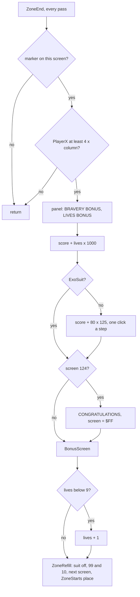

The start positions come from ZoneStarts `$AAE0`, three bytes a zone (screen, X, Y): `00 10 70`, `19 00 78`,
`32 00 20`, `4B 28 80`, `64 10 70`.

The witness is `w/024` (a clone on screen 24, nine lives), read every frame from 300 to 1000:

- frames 300-516: the hero walks (and jumps) from X `$10`; ZoneEndList `$AAEF` reads `0F 0D FF` (column 15, row
  13);
- frame 516: X `$3C` = 4 x 15; he moves no more;
- frames 517-521: the panel is printed, the score still 000000;
- frame 522: the score is 009125: the 9000 of the lives went in at once, the first bravery click is in;
- frames 522-577: the score climbs to 019000, 80 clicks of 125 in 56 frames (each click waits on a beep);
- frame 806: screen 25 (`$19`), X 0, Y `$88`: ZoneRefill's NextScreen; at frame 819 the hero stands at Y `$78`.

```sh
python3 work/docs/fillO/reads.py work/docs/fillO/i work/w/024/session.ttd work/docs/fillO/d/w024-zoneend.json \
    300 1000 1 82F5:2 8523:1 AD8A:6 AAEF:3 9ED8:1
```

The hero never reaches the right edge on these screens: the zone ends at the gate in the middle.

After screen 124 the game goes on from screen 0 with the score and lives kept.
`w/124` shows it: screen 124, then `$FF` (frames 750-1000, CONGRATULATIONS), then screen 0 at frame 1250.

What else crosses the loop: BonusPointer (never reset), the Hall of Fame table (it lives in RAM), and the ZORBA patch.
What is reset: the suit, the ammunition and the grenades (ZoneRefill), and everything a screen build clears.
Nothing gets harder on the second loop: the image has no counter of rounds and no table indexed by one. RoundEnd
sets ScreenNumber to `$FF` and NextScreen makes it 0; that byte is all the loop is.

### No difficulty level, but a curve in the tables

The difficulty is in the layouts, not in a variable. The counts per zone, from the model of the screen builder
(`work/docs/docB/kinds-per-screen.txt`) and AlienScreens `$A677`:

| Zone | Screens | Turrets | Mines | Ball spawners | Traps | Gun cells | Launchers | Force fields | Alien screens | Mean alien delay (passes) |
| ---: | --- | ---: | ---: | ---: | ---: | ---: | ---: | ---: | ---: | ---: |
| 0 | 0-24 | 8 | 6 | 7 | 11 | 11 | 3 | 0 | 12 | 22.2 |
| 1 | 25-49 | 9 | 10 | 13 | 10 | 12 | 1 | 3 | 14 | 14.6 |
| 2 | 50-74 | 6 | 9 | 10 | 9 | 9 | 4 | 3 | 14 | 17.0 |
| 3 | 75-99 | 5 | 18 | 7 | 6 | 12 | 4 | 1 | 16 | 14.5 |
| 4 | 100-124 | 9 | 10 | 13 | 10 | 12 | 1 | 3 | 14 | 9.9 |

```sh
python3 work/docs/fillO/zones.py
```

What it shows:

- Zone 0 has no force field and the slowest aliens (a new alien every 22 passes on average).
- Zone 4 has exactly zone 1's object counts, with the aliens coming half again as often (9.9 passes against 14.6).
  Screen n + 75 against screen n shows it: screen 104 has a delay of 10 where screen 29 has 25, screen 108 10 where
  screen 33 has 20; no zone 4 screen is slower than its zone 1 partner.
- Zone 3 doubles the mines (18).
- So the difficulty rises mostly through AlienScreens' delays and the mines, not through a counter.

### The bonus screen

BonusScreen `$A8DB` shows EXOLON BONUS SCREEN! with eight lines of points.
A `*` steps down the eight lines until fire is pressed; the pointer's line pays.

```asm
BonusScreenStep:
  LD A,(BonusPointer)
  INC A
  LD (BonusPointer),A
  AND $07
  ADD A,$0D               ; row 13 + line
  ; ... "*" printed there, a space over the line before
  CALL ReadControls
  LD BC,$1770
  CALL Delay
  LD A,(ControlFire)
  OR A
  JP Z,BonusScreenStep
  ; ...
  LD A,(BonusPointer)
  AND $01
  RET Z                   ; an even line pays nothing
  LD A,(BonusPointer)
  AND $07
  LD B,A
  LD DE,Points1000+$0005
BonusScreenAdd:
  CALL AddScore           ; 1000 points a time, B times
  DJNZ BonusScreenAdd
```

```text
repeat: pointer += 1; draw "*" on line (pointer mod 8); wait 6000 delay rounds
until fire
line = pointer mod 8
if line is odd: score += line x 1000           (1000, 3000, 5000 or 7000)
```

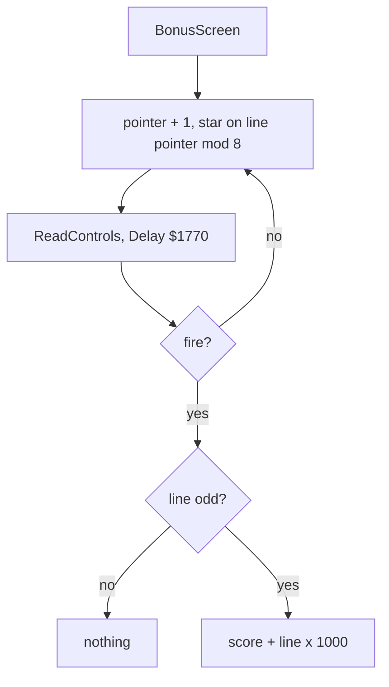

The lines read 00000, 01000, 00000, 03000, 00000, 05000, 00000, 07000: the odd ones are what they say.
BonusPointer `$A960` is never reset, so the pointer starts where the last bonus screen left it.
The screens are pictured in [8. HUD and text](08-hud-and-text.md) (`w/124` frames 750 and 1000).

## 10.3 Three arcs from three tables

The jump, the grenade and the death leap are tables of vertical steps, one byte a pass (or a grenade step).
A step below `$0A` (0 or down) moves only when the floor test finds nothing under; an up step only when the ceiling
test finds nothing above.

| Arc | Table | Steps | Shape (pixels a step, minus is up) |
| --- | --- | --- | --- |
| The jump | JumpSteps `$826A`, read from JumpStep 22 down | 22 | -4 -4 -2 -2 -2 -1 -1 -1 -1, 0 x 4, +1 +1 +1 +1 +2 +2 +2 +4 +4 |
| The grenade | GrenadeArc `$92DB`, timer 32 down to 1 | 31, then +1 forever | -4 -4 -2 -2 -2 -1 -1 -1 -1, 22 level, +1 a step |
| The death leap | DeathLeap `$9D4A`, DeathTimer 46 down | 45 | -4 -4 -2 -2 -2 -1 -1 -1 -1, 0 x 4, +1 x 4, +2 x 3, +4 to the end |


```sh
python3 tools/fig_rules.py arcs
```

How to read:

- The line in each panel is the model: the table summed from the start, no floor.
- Top: six jumps of `x2` (frames 392-1456), the player's Y at the end of each pass against the passes since the
  jump key.
- Middle: six grenades of `x2`, X and Y in pixels from the throw (2 pixels a step), placed at their timer.
- Bottom: the nine deaths of `x1`, Y every 2nd frame against the passes since KillPlayer.

What it shows:

- The jump climbs 18 pixels in 9 passes, hangs 4 passes and comes down in 9: every recorded jump lies on the model.
- The grenade climbs 18 pixels over its first 9 steps (18 pixels across), flies level for 22 steps (44 pixels) and
  then falls one pixel a step until a floor ends it. The lowest recorded point is 6 pixels below the throw.
- The death leap rises 18 pixels and falls until the floor stops it: the flat rows are the floors the player died
  over (0 to 20 pixels below his place).

The grenade's late flight is faster.
The main loop calls MoveGrenade once more twice a pass while the timer is below `$13` (`$7609`, `$7620`): three
steps a pass from timer 18 on, the last 17 level steps and the fall.

## 10.4 Deaths and lives

KillPlayer `$9CAF` starts a death unless one runs (DeathTimer `$9CE2` not 0) or the safety time runs (ImmunityCount
`$768D` not 0).
PlayerDeath `$9CE3` plays it, one step a pass, and at the end takes the life.

```asm
KillPlayer:
  LD A,(DeathTimer)
  OR A
  RET NZ
  LD A,(ImmunityCount)    ; the guard after a death
  OR A
  RET NZ                  ; the immunity POKE (ZXDB 40120)
  ; ...
  LD A,$2E                ; 46 passes of death
  LD (DeathTimer),A
  ADD A,$14
  LD (ImmunityCount),A
  ; ...
DeathOver:
  ; ...
  LD A,(Lives)
  DEC A                   ; the lives POKE (ZXDB 40221)
  LD (Lives),A
  LD A,$63                ; ammunition 99, grenades 10
  LD (Ammo),A
  LD A,$0A
  LD (Grenades),A
  ; ...
  LD A,(Lives)            ; no lives: GAME OVER
  OR A
  JP Z,GameOver
  LD DE,(RestartX)        ; the restart position
```

```text
kill:
    if dying or immune: nothing
    IdleTime = 0; jump and fire cleared
    DeathTimer = 46; ImmunityCount = 66; frame $0B (the falling man)
each pass while DeathTimer > 0:
    DeathTimer -= 1
    if DeathTimer > 0: move by DeathLeap[DeathTimer] (down only into empty space)
    else: lives -= 1; 99 ammunition, 10 grenades; 0 lives: GAME OVER
          else the player at the restart point (the screen's entry), dropped to a floor
```

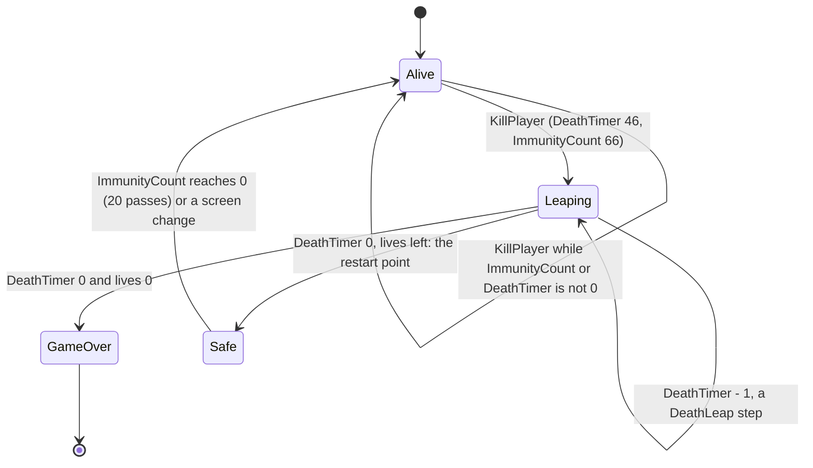

What kills, through which door, and with which box.
The box is PlayerContact `$9BD6`'s B (height) and C (width) around the killer's place; the hero's own box is 12 units
by 32 lines, 26 crouched ([7.11](07-objects.md#711-collision)).

| Killer | Caller | Door | Box B, C |
| --- | --- | --- | --- |
| A turret's shell | ShellsHitPlayer `$90EA` (`objects.asm`) | KillPlayer | 0, 0: a point |
| A gun's shot | GunShotsVsPlayer `$9E64` (`guns.asm`) | KillPlayer | 8, 4 |
| A ball | BallsTouchPlayer `$9BB4` | KillPlayer | 8, 4 |
| An alien | AliensVsPlayer `$A5F4` | KillPlayer | 8, 4 at X + 2, Y + 4 |
| The homing missile | HomingMissileStep `$A26B` | KillPlayer | 16, 8 |
| The idle missile | IdleMissileStep `$AC7D` | KillPlayer | 16, 8 |
| The force field | ForceFieldStep `$ABCF` (`forcefield.asm`) | KillPlayer | no box: PlayerX + `$0C` = the field's X |
| A mine | MineFires `$91A0` (`mines.asm`) | ShieldedKill `$9CAA`: nothing while suited | no box: the feet on the line above it, X within -7..+2 |
| A trap | TrapContact `$9C8B` (`death.asm`) | ShieldedKill `$9CAA`: nothing while suited | 32, 12 |

The exoskeleton protects only from mines and traps.


```sh
python3 tools/fig_rules.py deaths
```

How to read:

- Top: Lives, every 2nd frame of `x1`. Middle: DeathTimer. Bottom: ImmunityCount.
- The grey lines mark the frames where DeathTimer jumps to 46.

What it shows:

- Each death takes 46 passes: 98-104 frames, about two frames a pass (doc 04's median pass is 1.98 frames).
- A life goes when DeathTimer reaches 0, not when the player is hit.
- ImmunityCount starts at 66 and still holds 20 when the player is back: 20 passes of safety.
- The ninth death reaches 0 lives: GAME OVER. The entry sets 9 again at frame 3362.

The routine at work, the first pass of `x1`'s first death:

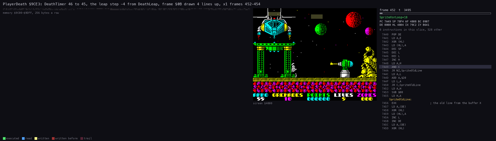

```sh
python3 ../../kit/routine_anim.py --work work/docs/docB/x1 --window 452:0-454:0 --listing build/game.lst \
    --out docs/img/routines/PlayerDeath.gif --view screen --range 9C00-9DFF --pc 9CE3-9D49 --pictures 40 --delay 150 \
    --title 'PlayerDeath $9CE3: DeathTimer 46 to 45, the leap step -4 from DeathLeap, frame $0B drawn 4 lines up, x1 frames 452-454'
```

How to read:

- Middle: the screen as the slice leaves it. Right: the listing at the PC; lit lines ran in the slice.
- Top left: memory `$9C00`-`$9DFF`; DeathTimer `$9CE2` and DeathLeap `$9D4A` are in it.

What it shows:

- PlayerDeath itself is 19 instructions (T 51 853-51 999 of frame 452): a decrement, a table read, a move.
- The work is the redraw: PlayerFrame draws frame `$0B` 4 lines higher (PlayerY `$70` to `$6C` between frames 452
  and 454).

### The restart point

- RestartX `$82F3` is `$10` at the game's start and 0 on every new screen (ScreenChangeCheck).
- RestartY `$82F4` is `$70` at the start and the Y the hero entered the screen at (NextScreen).
- At a zone's end both come from ZoneStarts.
- When DeathTimer reaches 0 with lives left, DeathOver turns the frames back to face right (Facing 1), puts the hero
  at (RestartX, RestartY) and drops him: while TestBelow finds no ground, DeathDropToFloor adds 1 to Y.
- No recording ran DeathDropToFloor's loop: every restart point was already on the ground.

The witness is `x1`'s nine deaths, read every 2nd frame (75 s):

```sh
python3 work/docs/fillO/reads.py work/docs/fillO/i work/x1/session.ttd work/docs/fillO/d/x1-deaths.json \
    0 4710 2 82F3:4 8E7A:1 9CE2:1 768D:1 8523:1
```

A kill is the first frame with DeathTimer `$9CE2` not 0; a restart is the frame Lives `$8E7A` drops.

| Kill (frame) | at X, Y | Restart (frame) | at X, Y | Lives after |
| ---: | --- | ---: | --- | ---: |
| 452 | `$21`, `$70` | 550 | `$10`, `$70` | 8 |
| 986 | `$44`, `$5C` | 1088 | `$10`, `$70` | 7 |
| 1180 | `$34`, `$68` | 1278 | `$10`, `$70` | 6 |
| 1366 | `$32`, `$64` | 1468 | `$10`, `$70` | 5 |
| 1532 | `$28`, `$68` | 1632 | `$10`, `$70` | 4 |
| 1750 | `$3F`, `$60` | 1850 | `$10`, `$70` | 3 |
| 1958 | `$3A`, `$60` | 2056 | `$10`, `$70` | 2 |
| 2260 | `$44`, `$60` | 2362 | `$10`, `$70` | 1 |
| 2528 | `$44`, `$5C` | 2632, GAME OVER | | 0 |

`x1` never leaves screen 0, so every restart is the game's start place.
At frame 1630 the read catches the pass between the decrement and the move (lives 4, X still `$28`); frame 1632 has
X `$10`.

## 10.5 Scoring

AddScore `$AD53` adds a 6-digit ASCII number to the score and prints it.

The constants first:

- the score is 6 ASCII digits at Score `$AD8A`; the addends are 6 ASCII digits in PointValues `$AD91`;
- `"0"` is `$30`; a digit sum past `"9"` (`$3A` or more) loses 10 and carries 1;
- a carry out of the sixth digit is lost: the score wraps at 1 000 000.

```asm
AddScore:
  ; ...
  LD C,$00                ; the carry
  LD HL,Score+$0005       ; from the last digit
  LD B,$06
AddScoreLoop:
  LD A,(DE)
  ADD A,(HL)
  SUB $30
  ADD A,C
  CP $3A
  LD C,$01
  JR C,AddScoreNoCarry
  SUB $0A
  JR AddScoreDigit
AddScoreNoCarry:
  DEC C
AddScoreDigit:
  LD (HL),A
  DEC HL
  DEC DE
  DJNZ AddScoreLoop
```

```text
carry = 0
for i = 5 down to 0:
    d = score[i] + addend[i] - "0" + carry
    if d > "9": d -= 10; carry = 1 else carry = 0
    score[i] = d
print the score
```

A worked example: 009950 plus Points150 (`30 30 30 31 35 30`):

| Digit (from the right) | Score | Addend | Carry in | Sum | Result | Carry out |
| --- | --- | --- | --- | --- | --- | --- |
| 1 | 0 | 0 | 0 | 0 | 0 | 0 |
| 2 | 5 | 5 | 0 | 10 | 0 | 1 |
| 3 | 9 | 1 | 1 | 11 | 1 | 1 |
| 4 | 9 | 0 | 1 | 10 | 0 | 1 |
| 5 | 0 | 0 | 1 | 1 | 1 | 0 |
| 6 | 0 | 0 | 0 | 0 | 0 | 0 |

The result is 010100.

The points:

| Points | Addend | For | Where |
| --- | --- | --- | --- |
| 25 a tick | PointValues `$AD91` | a pending bonus, paid one tick a pass | PayBonusTick `$9EC1` |
| 50 | Points50 | a ball shot | `$9B7C` (`balls.asm`) |
| 50 | Points50 | a gun's shot shot down | DestroyGunShot `$9E4F` (`guns.asm`) |
| 50 | Points50 | a gun's shot that touches the hero (it kills him as well) | DestroyGunShot from GunShotsVsPlayer `$9E64` |
| 50 | Points50 | a ball that touches the hero (it kills him as well) | BallHit from BallsTouchPlayer `$9BB4` |
| 150 | Points150 | an alien shot | KillAlien `$A62D` |
| 150 | Points150 | a destructible scenery piece blown up by a grenade | GrenadeBlast `$93E2` |
| 850 (34 ticks) | bonus ticks | a missile launcher destroyed while its missile flies | HomingMissileStep `$A2AE` |
| 1000 (40 ticks) | bonus ticks | a pick-up collected | PickupsVsPlayer `$A330` |
| 1000 (40 ticks) | bonus ticks | the force field's end | `$AC54` |
| lives x 1000 | Points1000 | the zone's end | ZoneEnd `$A817` |
| 10 000 (80 x 125) | Points125 | the zone's end without the exoskeleton | ZoneEndBravery `$A855` |
| 1000-7000 | Points1000 | the bonus screen's odd lines | BonusScreen `$A8DB` |

Five addends have no reader: 100, 200, 250, 300 and 350 (Points100 to Points350).

The bonus ticks pay slowly.
AddBonusTicks `$9EAF` adds to BonusTicks `$9ED6`; PayBonusTick pays one tick (25 points and a click) a pass.
A pick-up's 1000 points take 40 passes, about 80 frames, to reach the score.

## 10.6 The course of a run


```sh
python3 tools/fig_rules.py course
```

How to read:

- Every 10th frame of `x2` (a clone with immunity: the player never dies, so the run is exploration only).
- Top: the score. Second: the screen. Third: IdleTime `$AC7B` with the 700 line. Bottom: the idle missile's X
  while it lives.

What it shows:

- The script walks screens 0-5 by frame 2950 and then stands on screen 5 firing to the right.
- Every rise of the score is 150: 205 aliens shot (KillAlien `$A62D`, L1) and 9 scenery pieces blown up by
  grenades (GrenadeBlast `$942A`). 214 rises in the samples take the score to 032100.
- IdleTime drops to 0 at each new screen and climbs one a pass; on screen 5 it crosses 700 at frame 5170.
- From then on the idle missiles come one after another (10.8).

## 10.7 Grenades

ThrowGrenade `$9208` throws when fire has been held 15 passes (FireHeld `$83DC` counts them).
No throw at X `$76` or more, with no grenades left, or with a grenade in the air.

FireHeld goes on counting while fire stays down and stops at 255: FireControl's `INC A` / `RET Z` never stores the
wrap to 0. So a held button keeps FireHeld at 15 or above, and ThrowGrenade's only remaining test is GrenadeTimer: the
next grenade leaves in the first pass after the previous one lands. The fire button's state machine (one shot a press,
the hold, the throw) is in [5.6](05-controls.md#56-the-fire-button-a-shot-and-a-grenade).

The throw:

- GrenadeTimer `$925A` = `$20`, the position player X + 4 and his Y (6 lower when crouching, ThrowFromCrouch `$9233`);
- the direction from Facing `$82FA`;
- one grenade off (the `DEC A` at `$9250`), the AY effect PlaySfxGrenade `$C1BE`, the count printed.

MoveGrenade `$925F` ends the flight at the screen's edges (X `$7C` or 0), at a wall on its side, on a solid cell under
it (when the step is not -1), or at Y `$A8` (the play area's bottom).
GrenadeBlast `$93E2` then destroys the first destructible piece whose box holds the end cell (150 points); a grenade
that hits none ends silently.

The end tests in MoveGrenade:

```asm
GrenadeErase:
  LD DE,(GrenadeX)        ; the old position, erased
  LD A,(GrenadeFrame)
  CALL DrawSmallSprite
  LD A,E                  ; at the right edge
  CP $7C
  JR Z,GrenadeEnd
  OR A                    ; at the left edge
  JR Z,GrenadeEnd
  ; ...                   ; ProbeLeft or ProbeRight by the direction: a wall ends it
GrenadeAdvance:
  LD A,B                  ; X + direction
  ADD A,E
  LD E,A
  LD (GrenadeX),A
  LD A,(GrenadeY)
  LD D,A
  LD A,(HL)               ; a step of -1 skips the floor test
  CP $FF
  JR NC,GrenadeFall
  CALL ProbeBelow
  JR NZ,GrenadeEnd
GrenadeFall:
  LD A,(HL)               ; Y + the step
  ADD A,D
  LD D,A
  CP $A8                  ; below the play area: the end
  JR NC,GrenadeEnd
  ; ...                   ; drawn; a puff 4 units behind while the timer is $13 or more
GrenadeEnd:
  XOR A
  LD (GrenadeTimer),A
  JP GrenadeBlast
```

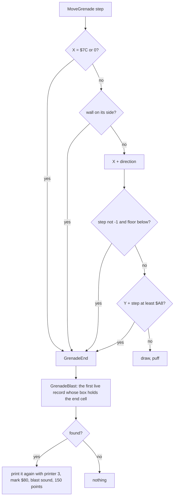

A worked example, `x2` frame 410: the grenade ends at X `$4C`, Y `$77`.
GrenadeBlast turns that into column `$4C` / 4 = 19 and row `$77` / 8 = 14.
Screen 0's second record is `13 1B 0C 11 14 0E 05`: columns 19-26, rows 12-16, the turret at column 20, row 14.
19 is in 19..26 and 14 in 12..16, so the turret is printed again (erased) and its record becomes `80 1B ...` at
frame 412; the turret's state goes to 0 in the same pass (7.2).
The next grenade ends at X `$6C`, Y `$71` (frame 566): column 27, row 14, inside the spire's box `1A 1F 08 12`.
The before and after pictures are in [7.10](07-objects.md#710-destructible-scenery-and-the-grenade-blast).

`x2` threw 14 grenades, `c128` 3, `w030` 8, and 78 warp clones threw.

## 10.8 The idle missile

A player who stays 700 passes on one screen gets a missile from the right at his height.

IdleTime `$AC7B` counts the passes.
It is set to 0 at a new screen (`$8497`) and at a death (KillPlayer); the main loop adds one a pass (`$7682`).

```asm
IdleMissileStart:
  LD A,(IdleMissileLive)
  OR A
  RET NZ                  ; one at a time
  LD HL,(IdleTime)
  AND A
  LD DE,$02BC             ; 700 passes
  SBC HL,DE
  RET C
  LD DE,(PlayerX)
  LD E,$78                ; X 120, the player's Y
  LD (IdleMissilePosition),DE
  LD A,$01
  LD (IdleMissileLive),A
  RET
```

```text
each pass:
    if no idle missile and IdleTime >= 700: a missile at X 120, Y = the player's Y
    the missile: X -= 2; smoke behind it on half the passes once X < 111
    a touch (PlayerContact, B = 16, C = 8): KillPlayer, and the missile ends in a blast
    X = 0: the missile ends in a blast
```

The missile does not reset IdleTime.
So once the 700 passes are up, missiles follow one another until the player leaves the screen or dies.

The witness is `x2` (10.6):

- IdleTime 679 at frame 5100, 701 at frame 5170, and IdleMissileLive `$AC78` = 1 with X `$74` at frame 5170;
- at least 121 launches in the samples to frame 23 110;
- most end at X 92-118 on the player (the touch: KillPlayer, turned away by the clone's immunity POKE); some fly on to
  X 0 while he jumps.

700 passes are about 28 s at two frames a pass.

## 10.9 The Hall of Fame

The table HallOfFame `$71F1` holds 50 entries of 16 bytes and an end mark `$FF` at `$7511`.
An entry is a name of 10 characters and the score in 6 ASCII digits (+10).
The image holds 50 names (RAFFAELE, SURYANI, SCRAGGY, ... HUMPTY), all 001000.

GameOver `$A02A` calls HallOfFameInsert `$A073` after the jingle and two delays (about 0.4 s each):

```text
for each entry from the top:
    compare the score with the entry's, digit by digit from the first
    the score higher: make room here, write the score, ask for the name
    the entry higher or equal: the next entry (an equal score goes under)
the end mark: the score does not enter
```

```asm
HallOfFameInsert:
  LD HL,TuneSetMaxVolumes
  LD IX,HallOfFame
HofEntryLoop:
  BIT 7,(IX+$00)
  RET NZ                  ; the end mark: the score does not enter
  PUSH IX
  LD DE,$000A             ; IX = the entry's score digits
  ADD IX,DE
  LD HL,Score
  LD B,$06
HofDigitLoop:
  LD A,(IX+$00)
  CP (HL)                 ; the entry's digit against the score's
  JP Z,HofNextDigit
  JP NC,HofNextEntry      ; the entry is higher: the next one
  ; ...                   ; the score is higher: HofMakeRoom
```

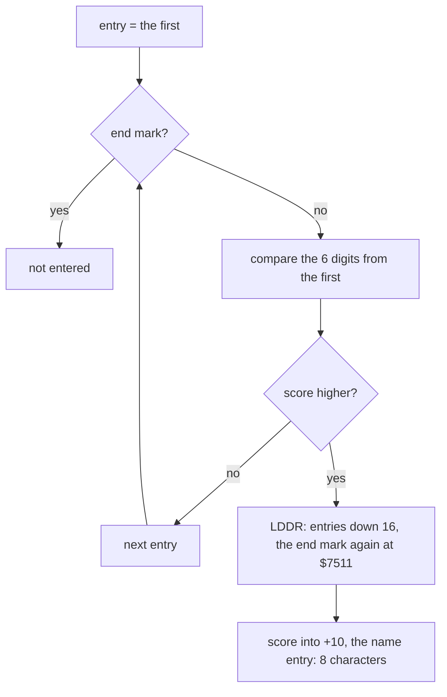

Making room moves every byte from the entry to the end mark down 16 (LDDR from `$7510` to `$7520`).
The last entry falls past the end, and the end mark is written again at `$7511` over its first byte.


```sh
python3 tools/fig_rules.py hof
```

How to read:

- Three snapshots of `h1` (a clone with the score set to 009000): only the rows that change, places 1-3 and 47-50,
  and the 16 bytes from the end mark `$7511`; places 4-46 are left out (they move down one place like the rest).
- Each row: the entry's address, its place, the 10 name bytes, the 6 score digits (`.` for a byte that is not a
  printable character).
- Boxed: the entry that will fall out (red), the inserted entry (green) and the end mark with HUMPTY's bytes after
  it (yellow).

What it shows:

- Frame 2500: 009000 is above RAFFAELE's 001000, so it went in at place 1. The name bytes of place 1 are still
  RAFFAELE: they are the old entry's, not yet typed over.
- Every entry moved down one place; HUMPTY left the table, and its bytes lie past the end mark as `FF UMPTY`.
- Frame 6750: the name typed (E X O L O N, ENTER) replaced the first 8 name bytes.

The name entry (HofNameKey) takes 8 characters, columns 12-19; CAPS SHIFT deletes, ENTER ends.
ENTER sets the flag ShowHallOfFame `$71F0` (at `$A13A`), and the entry `$6D60` then shows the Hall of Fame before the
menu (ShowHallOfFameFirst `$7145`).
The table lives in RAM: a new load brings the 50 default names back.

## 10.10 The ZORBA cheat

DefineKeys `$6FAB` compares the five keys the player typed with CheatWord, `ZORBA`.
Equal, ZorbaCheat `$7046` flips the lives' decrement.

```asm
ZorbaCheat:
  INC HL
  INC DE
  DJNZ CheatCompare       ; five equal characters: the cheat word
  LD A,(DeathOver+$000F)  ; DEC A ($3D) <-> NOP ($00): the infinite lives
  XOR $3D
  LD (DeathOver+$000F),A
  LD HL,JingleTune        ; the jingle only when the cheat turns on
  CALL Z,PlayTune
  JP MainMenu
```

```text
if the five defined keys spell ZORBA:
    the byte at $9D1D ^= $3D        (DEC A becomes NOP, or NOP becomes DEC A)
    if it is now NOP: play the jingle
back to the menu (the keys stay Z O R B A: left, right, jump, duck, fire)
```

`$9D1D` is the `DEC A` of DeathOver: the same byte as ZXDB's lives POKE 40221.
The cheat is a toggle: defining ZORBA again turns it off, silently.

No case recording spelled ZORBA.
exA's capture `exA1` (2, Z, O, R, B, A from `entry.z80`, exploration) is the witness: the five compares passed,
`$9D1D` became 0, the jingle played, and in play the NOP at `$9D1D` ran 10 times: ten deaths, no life lost.

## 10.11 The hero

The hero is one sprite of 24 x 32 pixels: three cells across, four down.
His place is PlayerX `$82F5` and PlayerY `$82F6`, the top left corner.
X counts 2-pixel units, so a cell is 4 units wide; Y counts pixels.
X `$80` is one unit past the right edge: reaching it is how a screen is left.

MovePlayer `$81A4` moves him once a pass, and a pass is about two frames ([4. Game loop](04-game-loop.md)).
It reads the controls that ReadControls `$7B72` left at `$7B92-$7B96`: left, right, up, down, fire.
Up is the jump key; down is the crouch.

The state lives in a row of bytes after the code:

| Byte | Address | Values |
| --- | --- | --- |
| ScreenChanged | `$82F2` | not 0 in the pass the hero left the screen |
| RestartX, RestartY | `$82F3`, `$82F4` | where a death puts him back (10.4) |
| PlayerX, PlayerY | `$82F5`, `$82F6` | the place, `$10`, `$70` at the start |
| JumpStep | `$82F7` | 22 down to 1 in a jump, 0 on the ground |
| MoveDir | `$82F8` | the horizontal move of the last walk: 0, 1 or `$FF` |
| WalkPhase | `$82F9` | the walk frame 0-9 |
| Facing | `$82FA` | 1 right, `$FF` left; the shots go this way |
| CrouchOffset | `$82FB` | `$FA` while crouching, else 0 |
| FallFlag | `$8294` | 9 while falling, else 0 |
| PlayerFrameShown | `$8269` | the frame last drawn; `$FF` forces a redraw |
| ExoSuit | `$9ED8` | 0, or `$0C` in the exoskeleton |

### The five states

```mermaid
stateDiagram-v2
    [*] --> Ground
    Ground --> Crouch: down held
    Crouch --> Ground: down released
    Ground --> Turn: left or right against Facing
    Turn --> Ground: next pass
    Ground --> Jump: up held, ground under the feet
    Jump --> Jump: JumpStep 22 down to 1, X + MoveDir
    Jump --> Fall: head or feet blocked
    Jump --> Ground: JumpStep 0 and ground
    Ground --> Fall: no ground under the feet
    Fall --> Fall: Y + 4 a pass, no steering
    Fall --> Ground: ground under the feet
    Ground --> Dying: KillPlayer
    Jump --> Dying: KillPlayer
    Fall --> Dying: KillPlayer
    Dying --> Ground: 46 passes, the restart point
```

- **Ground.** Left or right moves him one unit (2 pixels) a pass, about 50 pixels a second. Neither key, or both,
  stands him still.
- **Turn.** A key against Facing first mirrors his 24 frames (FlipPlayerFrames `$7BAA`) and draws the standing frame.
  That pass does not move him: a turn costs one pass.
- **Crouch.** Down held on the ground: frame `$0A`, CrouchOffset `$FA`, and no walk. His shots leave 5 pixels lower
  and his contact box is 6 lines shorter (10.12, [7.11](07-objects.md#711-collision)).
- **Jump.** Up held on the ground starts JumpStep at 22. Each pass reads one byte of JumpSteps `$826A` and moves Y by
  it: 18 pixels up in 9 passes, 4 passes level, 9 passes down (the table is in 10.3). X moves by MoveDir, the
  direction of the walk before the take-off: the jump cannot be steered.
- **Fall.** No ground under the feet: Y + 4 a pass, frame 9, and nothing else. No walk, no jump, no crouch until he
  lands.

### MovePlayer, step by step

```text
MovePlayer:
    if dying: return                              # AbortIfDying $9D78
    ScreenChanged = 0
    if FallFlag:            goto Fall
    if JumpStep:            goto JumpStep(JumpStep)
    if not ground below:    goto Fall
    CrouchOffset = $FA
    if down:                draw frame $0A; return
    CrouchOffset = 0
    if not up:              goto Fall             # Fall finds the ground and walks
    JumpStep(22)

JumpStep(a):
    JumpStep = a - 1
    dy = JumpSteps[a - 1]                          # read at $8269 + a
    if dy != 0:
        blocked = TestBelow if dy < $0A else TestAbove
        if blocked: JumpStep = 0; goto Fall
        Y += dy
    if MoveDir != 0 and not (TestRight if MoveDir = 1 else TestLeft): X += MoveDir
    draw frame 3

Fall:
    FallFlag = 0
    if ground below: goto Walk
    Y += 4; FallFlag = 9; draw frame 9

Walk:
    MoveDir = left XOR right
    if MoveDir = 0: draw frame 5; return
    Facing = MoveDir
    if the frames face the other way: flip them; PlayerFrameShown = $FF; draw frame 5; return
    if blocked on that side: draw frame 5; return
    X += MoveDir
    draw frame WalkPhase; WalkPhase = (WalkPhase + 1) mod 10
```

The code of the take-off and the jump step:

```asm
MovePlayer:
  CALL AbortIfDying
  XOR A
  LD (ScreenChanged),A
  LD DE,(PlayerX)
  LD A,(FallFlag)
  OR A
  JP NZ,Fall
  LD A,(JumpStep)
  OR A
  JR NZ,JumpStepNext
  CALL TestBelow
  JP Z,Fall
  LD A,$FA
  LD (CrouchOffset),A
  LD A,(ControlDuck)
  OR A
  LD A,$0A
  JP NZ,PlayerFrame       ; crouching: frame $0A, no walk
  XOR A
  LD (CrouchOffset),A
  LD A,(ControlJump)
  OR A
  JP Z,Fall               ; no jump: Fall, which walks on the ground
  CALL TestBelow
  JP Z,Fall
  LD A,$16                ; the take-off: step 22
JumpStepNext:
  LD HL,PlayerFrameShown  ; JumpSteps[A - 1] is the byte at $8269 + A
  LD C,A
  LD B,$00
  DEC A
  LD (JumpStep),A
  ADD HL,BC
  LD A,(HL)
  OR A
  JR Z,JumpMoveX          ; a level step: X only
  CP $0A
  JR NC,JumpTestUp
  CALL TestBelow          ; a falling step: the feet
  JR JumpTested
JumpTestUp:
  CALL TestAbove          ; a rising step: the head
JumpTested:
  JR Z,JumpMoveY
  XOR A                   ; blocked: the jump ends, the player falls
  LD (JumpStep),A
  JP Fall
JumpMoveY:
  LD A,(HL)               ; Y + dy
  ADD A,D
  LD D,A
JumpMoveX:
  LD A,(MoveDir)          ; the walk direction of the last walking pass
  ; ...                   ; TestRight or TestLeft, then X + MoveDir
JumpFrame:
  LD A,$03                ; frame 3: in the air
```

The walk and the turn:

```asm
Walk:
  LD HL,(ControlLeft)     ; L = left, H = right
  LD A,H
  XOR L
  LD (MoveDir),A
  LD A,$05
  JP Z,PlayerFrame        ; neither or both: standing
  LD A,$01
  LD (Facing),A
  BIT 0,L
  JR Z,WalkRight
  LD A,$FF
  LD (MoveDir),A
  LD (Facing),A
  LD A,(PlayerFlipped)
  OR A
  CALL Z,FlipPlayerFrames ; the frames faced right: mirror them
  JR Z,TurnAround
  CALL TestLeft
  JR WalkTested
WalkRight:
  ; ...                   ; the same for right
WalkTested:
  LD A,$05                ; blocked: standing frame
  JP NZ,PlayerFrame
  LD A,(MoveDir)
  ADD A,E
  LD E,A
  ; ...                   ; WalkPhase 0-9 is the frame
TurnAround:
  LD A,$FF                ; the frames were just mirrored: redraw, standing
  LD (PlayerFrameShown),A
  LD A,$05
  JP PlayerFrame
```

### The four cell tests

Four routines ask the block map whether the hero may move: TestRight `$80F3`, TestLeft `$8122`, TestBelow `$814E`
and TestAbove `$8179`.
BlockMapCell `$80C1` turns X, Y into an address in CellTypes `$6100` ([7.1](07-objects.md#71-three-cell-maps-and-the-build)).
Each test ORs the map bytes it looks at: any value but 0 blocks.
After a build the map holds 0 and 1, plus 3 under a turret and 13 under a missile launcher; a force field's cells are
written as 1. So scenery, turrets, launchers and force fields all stop the hero.

| Test | Asked when | Cells | Never blocked | Always blocked |
| --- | --- | --- | --- | --- |
| TestRight | walking or jumping right | column X/4 + 3, rows Y/8 to Y/8 + 3 (+ 4 when Y AND 7 is not 0) | X AND 3 not 0; X `$74` or more | |
| TestLeft | walking or jumping left | column X/4 - 1, the same rows | X AND 3 not 0 | X = 0 |
| TestBelow | standing, jumping down, falling | row Y/8 + 4, columns X/4 to X/4 + 2 (+ 3 when X AND 3 is not 0) | Y AND 7 not 0 | |
| TestAbove | jumping up | row Y/8 - 1, the same columns | Y AND 7 not 0 | |

Three rules fall out of the table:

- A wall is met only on a cell boundary: between boundaries the hero walks freely, and a step of one unit cannot skip
  a boundary.
- TestBelow says "no ground" whenever Y is not a multiple of 8. A jump step of 1 or 2 pixels lands him between rows,
  so the next steps keep going until Y is on a row again.
- X = 0 is a wall: there is no way back to the previous screen. X `$74` or more is never blocked on the right: the
  hero walks into X `$80`, and DrawPlayer turns that into the next screen.

A worked example: the hero stands at X `$10`, Y `$70` on screen 0.
TestBelow looks at row `$70`/8 + 4 = 18, columns 4, 5, 6 (X AND 3 is 0, so no fourth column).
CellTypes `$6100 + 18 * 32 + 4` = `$6344` and the next two bytes are the floor: 1, so he stands.
After one step right X is `$11`: X AND 3 = 1, so TestRight answers "free" without reading the map, and TestBelow reads
four columns, 4 to 7.

### The frames and the redraw

PlayerFrames `$EF80` holds 25 frames of 96 bytes (3 bytes by 32 lines).
PlayerFrame `$8224` adds ExoSuit to the frame number, so the suit's frames are the same roles 12 higher.

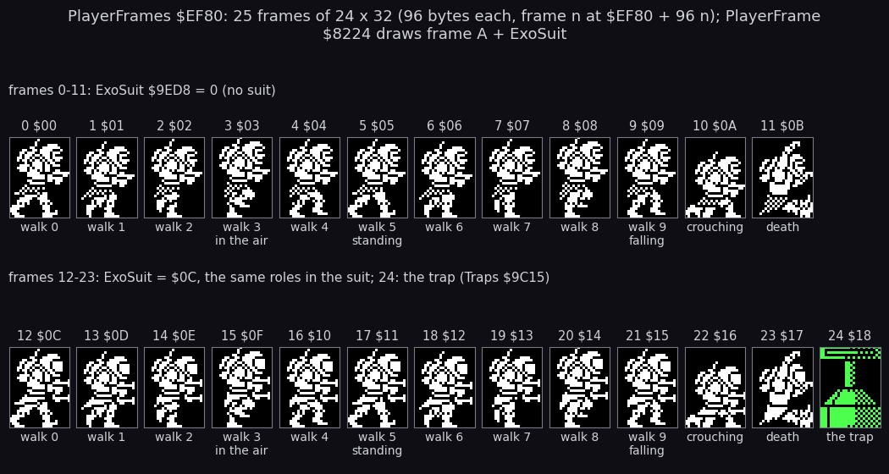

```sh
python3 tools/fig_hero.py sheet
```

How to read:

- One frame a panel, drawn from the image's bytes at `$EF80 + 96 n`, white pixels on black.
- Above each panel the frame number in decimal and hex; under it the role, from the callers that pass that number.
- Row one: ExoSuit 0. Row two: ExoSuit `$0C`, and frame 24, the trap, which Traps `$9C15` draws (in green).

What it shows:

- Ten walk frames, 0-9. Three of them have a second role: 3 is the jump and every step in the air, 5 is the standing
  frame, 9 is the fall.
- Frame `$0A` crouches and frame `$0B` is the death leap's falling man.
- The suit doubles the set: the hero in the exoskeleton is a bulkier figure on the same roles.

DrawPlayer `$8229` draws the frame:

```asm
DrawPlayer:
  EX AF,AF'
  LD A,E
  CP $80
  LD A,D
  JR Z,NextScreen         ; X = $80: off the right edge
  LD C,$47
  EX AF,AF'
  CALL ColourBigSprite    ; the black cells under him become white on black
  LD BC,(PlayerX)
  LD (PlayerX),DE
  LD HL,(PlayerFrameShown)
  CP L
  JR NZ,DrawPlayerSprite  ; a new frame: draw
  LD H,B
  LD L,C
  AND A
  SBC HL,DE
  RET Z                   ; same frame, same place: nothing to draw
DrawPlayerSprite:
  LD (PlayerFrameShown),A
  LD HL,WorkArea
  JP DrawBigSprite
```

The redraw rule: the sprite is drawn only when the frame or the place changed.
A hero standing still costs one ColourBigSprite a pass and no sprite draw.
A turn mirrors the frame bytes without moving him, and the rule would skip the redraw when frame 5 was already shown.
That is why TurnAround writes `$FF` into PlayerFrameShown first.

NextScreen `$8253` handles X = `$80`.
It sets PlayerY, RestartY and ScreenChanged to the hero's Y, raises ScreenNumber `$8523`, and writes `$FF` into
PlayerFrameShown.
ScreenChangeCheck `$8485` then sees ScreenChanged, sets X and RestartX to 0, prints the screen number and builds the
next screen.
The hero keeps his Y and his jump: a jump that leaves one screen lands on the next.

### Witness: walking and jumping in x2

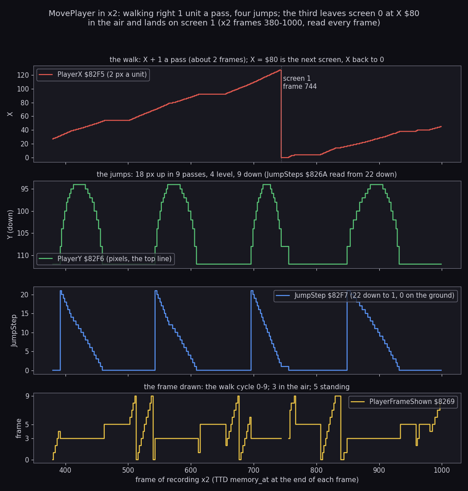

```sh
python3 work/docs/fillO/reads.py work/docs/fillO/i work/x2/session.ttd work/docs/fillO/d/x2-hero.json 0 3000 1 \
    7B92:5 8269:147 845F:25 8523:1 768C:1 8E5A:1 9ED8:1 925A:5 9437:80 9F13:12 9022:13
python3 tools/fig_hero.py moves
```

How to read:

- `x2` frames 380-1000, read at the end of every frame on my instance (TTD `memory_at`). The bytes `$8269-$82FB`
  hold PlayerFrameShown, JumpSteps and the state row; ScreenNumber is the dotted line.
- Top: PlayerX. Second: PlayerY, drawn downwards like the screen. Third: JumpStep. Bottom: the frame last drawn
  (gaps are `$FF`, the forced redraw).

What it shows:

- The walk: X + 1 a pass. Frames 380-389 read X `$1C`, `$1D`, `$1E`, `$1F` at frames 381, 384, 387, 389: one unit
  every 2-3 frames, which is one a pass.
- The jumps: JumpStep jumps to 21 (the take-off pass already used step 22) and counts down by one a pass. Y climbs
  `$70` to `$5E` (18 pixels) and comes back.
- X keeps rising through every jump: the take-off direction is kept. At frames 919-929 right is no longer held
  (the control byte reads 0) and X still goes `$22`, `$23`, `$24`, `$25`.
- The third jump leaves screen 0 in the air. Frame 741: X `$7F`, JumpStep 2. Frame 744: X 0, screen 1,
  PlayerFrameShown `$FF`, JumpStep 1: the jump ends on the new screen.
- The frame panel: 0-9 while walking, 3 in the air, 5 when standing.

### Witness: crouch, both keys, the turn

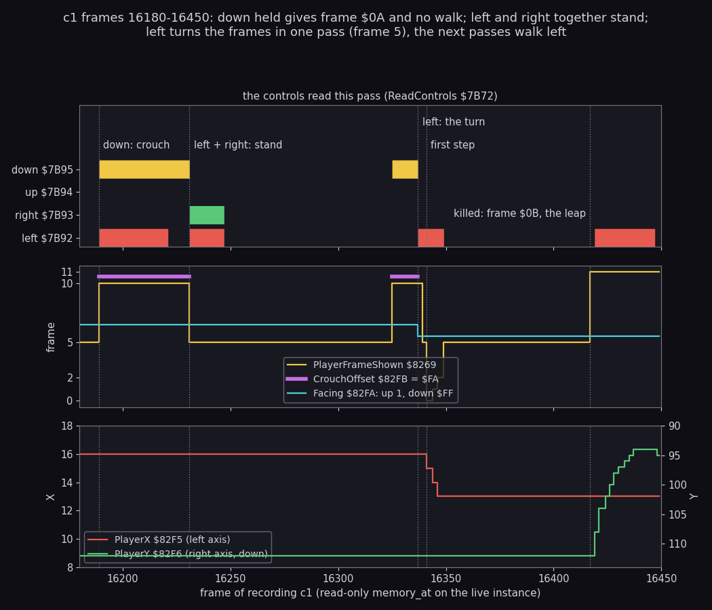

```sh
python3 work/docs/fillO/c1read.py work/docs/fillO/d/c1-turn.json 16150 16450 1 82F3:9 8269:1 8294:1 7BDA:1 7B92:5 \
    8523:1 768C:1
python3 tools/fig_hero.py moves     # draws turn.png too
```

How to read:

- The live `c1` instance read with `time_travel memory_at` only (read-only); one read a frame.
- Top: the four direction keys as ReadControls left them. Middle: the frame, CrouchOffset and Facing. Bottom: X on
  the left axis, Y on the right axis.

What it shows:

- 16189-16229: down held (with left): CrouchOffset `$FA`, frame `$0A`, and X stays `$10`. Crouching stops the walk
  even with a direction held.
- 16231: left and right together: frame 5, no move. MoveDir is left XOR right, which is 0.
- 16337: left alone: Facing becomes `$FF` and PlayerFlipped `$7BDA` 1. Frame 16339 shows frame 5 at X `$10`: the
  turn pass. The steps follow: X `$0F` at 16341 (frame 0), `$0E` at 16344, `$0D` at 16346.
- 16417: killed; frame `$0B` and Y rises from `$70` (the death leap of 10.4).

The point: the hero is a small machine of five states, and most of his feel comes from three choices in it. A turn
costs a pass, the jump cannot be steered, and a fall cannot be steered either. The cell tests look only at cell
boundaries, so a wall is met exactly when the sprite's edge reaches a cell's edge.

### The exoskeleton

The exoskeleton is a state of the hero, not an object.
ExoSuit `$9ED8` holds 0 or `$0C`; ExoSuitBooth `$9F2D` flips it ([7.2](07-objects.md#72-what-each-kind-does)).
Everything it changes:

| Effect | Where | How |
| --- | --- | --- |
| The frames | PlayerFrame `$8224` | frame + `$0C`: frames 12-23 |
| A second shot | FireControl `$8338` (`$837B`) | SpawnShot again with PlayerY + 6, for the same one ammunition |
| Safe from mines and traps | ShieldedKill `$9CAA` | returns while ExoSuit is not 0 |
| Not safe from anything else | KillPlayer `$9CAF` | shells, gun shots, balls, aliens, missiles and the force field still kill |
| No bravery bonus | ZoneEnd `$A817` | the 10 000 points are skipped while suited |
| Taken off | ZoneRefill `$A8A5` | ExoSuit = 0 at every zone's end |

A death does not take it off: DeathOver `$9D0E` leaves ExoSuit alone.

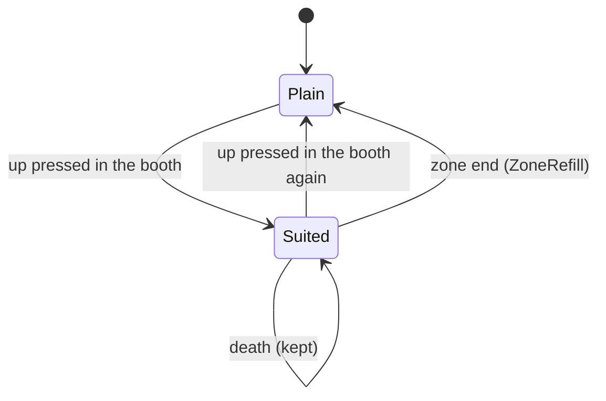

The witness is `w/108` (a warp clone on screen 108; exploration only):

- frame 1600: ExoSuit 0, X `$39`, Y `$18`, frame 8 shown;
- frame 1613: up pressed, X `$3C`, Y `$18`: ExoSuit `$0C`, BoothUpLatch 1, the frame shown `$11` = 5 + 12;
- frames 1629-2080: the suit stays on through screen 109 and into 110; the latch goes back to 0 each time up is
  released.

A worked example of the booth test at frame 1613: ExoBoothList `$9F6E` reads `0E 02`, column 14, row 2.
The test wants PlayerY = 8 x (2 + 1) = `$18`: true.
It wants PlayerX - 4 x 14 = `$3C` - `$38` = 4 within -12..+8: true. The suit goes on.

Command: `python3 work/docs/fillO/reads.py work/docs/fillO/i work/w/108/session.ttd work/docs/fillO/d/w108-suit.json 1600 2134 1 7B92:5 8269:147 845F:25 8523:1 9ED8:1 9F6D:4`.

The point: the suit is a trade. It doubles the fire and shrugs off the floor's dangers, but it costs the 10 000-point
bravery bonus at the zone's end.

## 10.12 The player's shots

The hero's gun fires one shot a press of fire.
A shot is a dash of 8 pixels on one line, drawn by XOR (XorShot `$82FC`, the pattern `$BD`).
ShotList `$845F` holds 8 shots of three bytes: X, Y, direction (1 right, `$FF` left, 0 free), and `$FF` after the
last.

The rules:

- one shot a press: holding fire does not repeat;
- no shot at X `$76` or more (no room on the right), and none with no ammunition;
- one ammunition a press; in the exoskeleton the press fires two shots, the second 6 pixels lower;
- at most 8 shots on the screen: a press with all 8 slots busy spends the ammunition and fires nothing;
- a shot moves 1 unit a call and MoveShots runs 5 times a pass: 5 units, 10 pixels a pass;
- it ends at a wall, at X `$7C` (the right edge) or 1, or 52 units right of the hero (48 to the left).

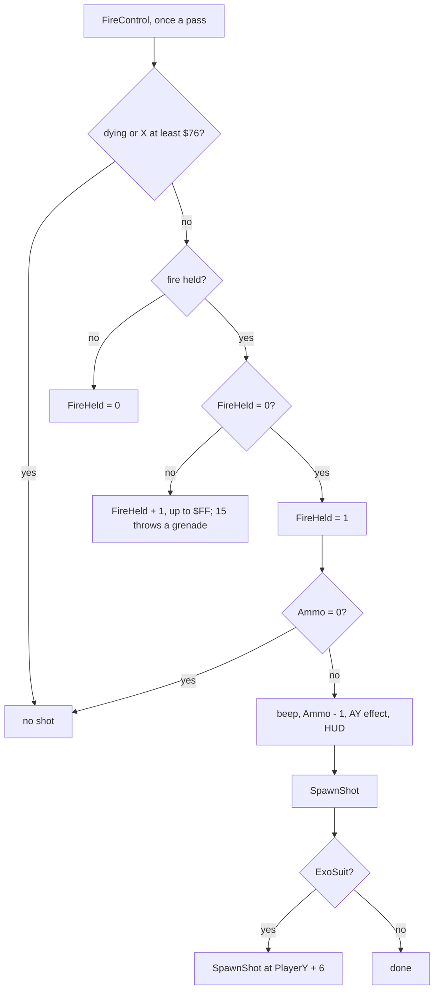

### FireControl and SpawnShot

```asm
FirePress:
  INC A                   ; a new press
  LD (FireHeld),A
  LD A,(Ammo)
  OR A
  RET Z
  LD B,$3C
  CALL BeeperNoise
  LD A,(Ammo)
  DEC A                   ; the ammunition POKE (ZXDB 33646) at $836E
  LD (Ammo),A
  CALL PlaySfxShot
  CALL PrintAmmo
  CALL SpawnShot
  LD A,(ExoSuit)
  OR A
  RET Z
  LD A,(PlayerY)          ; the suit: a second shot 6 pixels lower
  PUSH AF
  ADD A,$06
  LD (PlayerY),A
  CALL SpawnShot
  POP AF
  LD (PlayerY),A
  RET
SpawnShot:
  LD HL,ShotList
SpawnShotFind:
  BIT 7,(HL)
  RET NZ                  ; all 8 busy: nothing
  ; ...                   ; the first slot with direction 0
  LD A,(Facing)
  LD (HL),A
  LD DE,(PlayerX)
  LD A,(CrouchOffset)
  OR A
  LD A,$0E                ; Y + $0E standing
  JR Z,SpawnShotY
  LD A,$13                ; Y + $13 crouching
SpawnShotY:
  ; ...
  LD A,(Facing)
  INC A
  OR A
  LD A,$FC                ; facing left: X - 4
  JR Z,SpawnShotX
  LD A,$0C                ; facing right: X + $0C
SpawnShotX:
  ADD A,E
  LD E,A
  CP $78
  JR NC,SpawnShotCancel
  CP $04
  JR C,SpawnShotCancel
  LD (HL),E
  PUSH HL
  CALL BlockMapCell       ; scenery in the cell or the next one: no shot
  LD A,(HL)
  INC L
  OR (HL)
  POP HL
  JP Z,XorShot
SpawnShotCancel:
  ; ...                   ; the slot freed again
```

```text
on a new press of fire, X < $76, Ammo > 0:
    Ammo -= 1
    spawn(PlayerY)
    if suited: spawn(PlayerY + 6)

spawn(y):
    slot = the first of 8 with direction 0, else return
    slot.dir = Facing
    slot.y = y + ($13 if crouching else $0E)
    slot.x = PlayerX + $0C if Facing = 1 else PlayerX - 4
    if slot.x >= $78 or slot.x < 4 or scenery at (slot.x, slot.y) or the cell right of it: slot.dir = 0
    else draw it
```

### MoveShots

MoveShots `$83DD` first runs the four tests of the things a shot can hit, then moves the shots.
The order matters: a shot that hits a ball is gone before the alien test sees it.

1. ShotsHitBalls `$9B52`: the balls ([7.5](07-objects.md#75-balls-mines-pods-and-teleports)).
2. GunShotsVsShots `$9E37`: the gun shots (7.2).
3. AliensVsShots `$A5CA`: the aliens (7.4).
4. ForceFieldVsShots `$AC04`: the force field's hit count (7.2).

Then each live shot:

```asm
MoveShotsNext:
  ; ...                   ; E = X, D = Y, A = direction
  CALL XorShot            ; erase
  ; ...
  INC A
  JR NZ,MoveShotRight
  CALL ProbeLeft          ; going left: the cell on the left
  CALL NZ,PlaySfxNoiseBurst
  JR NZ,ShotHitWall
  JR MoveShotRange
MoveShotRight:
  LD A,E
  CP $7C
  JR Z,ShotEnd
  CALL ProbeRight         ; going right: the cell on the right
  CALL NZ,PlaySfxNoiseBurst
  JR NZ,ShotHitWall
MoveShotRange:
  LD D,C
  LD A,E
  CP $7C                  ; the edges
  JR Z,ShotEnd
  CP $01
  JR Z,ShotEnd
  LD A,(PlayerX)          ; the range: 52 units right of a right shot's start
  ADD A,$40
  CP E
  JR Z,ShotEnd
  LD A,(PlayerX)          ; 48 units left of a left shot's start
  SUB $34
  CP E
  JR Z,ShotEnd
  LD A,B                  ; X + direction, redrawn
  ADD A,E
  LD E,A
  ; ...
  CALL XorShot
  JR MoveShotsNext
ShotHitWall:
  DEC HL                  ; freed, a puff at the shot, 20 noise bursts
  LD (HL),$00
  INC HL
  LD D,C
  CALL AddPuff
  LD B,$14
  ; ...
```

The range is measured from the hero's X as it is now, not from where the shot started.
A right shot starts at PlayerX + `$0C` and ends at PlayerX + `$40`: 52 units if the hero stands still.
The test is an equality, so it holds only because the shot gains 5 units a pass while the hero moves at most 1: the
gap closes one unit at a time and cannot jump over 0.
A teleport moves the hero many units at once and can carry the range end past a shot; that shot then flies on to
the edge (known only from the code).

A shot is not drawn white unless it needs to be: XorShot paints the two cells' attributes `$47` only where AttrCopy
`$5E00` is 0, that is on black cells. Over coloured scenery the shot takes the scenery's ink.

A worked example, `x2` frame 439: the hero is at X 47, Y 97 (jumping), facing right, and fire goes down (FireHeld
1).
SpawnShot puts the shot at X 47 + 12 = 59, Y 97 + 14 = 111.
At the end of frame 440 the slot reads X 61, Y 111, direction 1: two of the pass's five MoveShots calls have run.
By frame 468 the shot is at X 106, nine passes later (PassCount `$6C` to `$75`): 45 units, 5 a pass.
At X 108 ProbeRight sees column 28, the rock spire: the slot is freed and a puff starts.
Its range end, PlayerX + `$40` = 54 + 64 = 118, was never reached.

### Witness

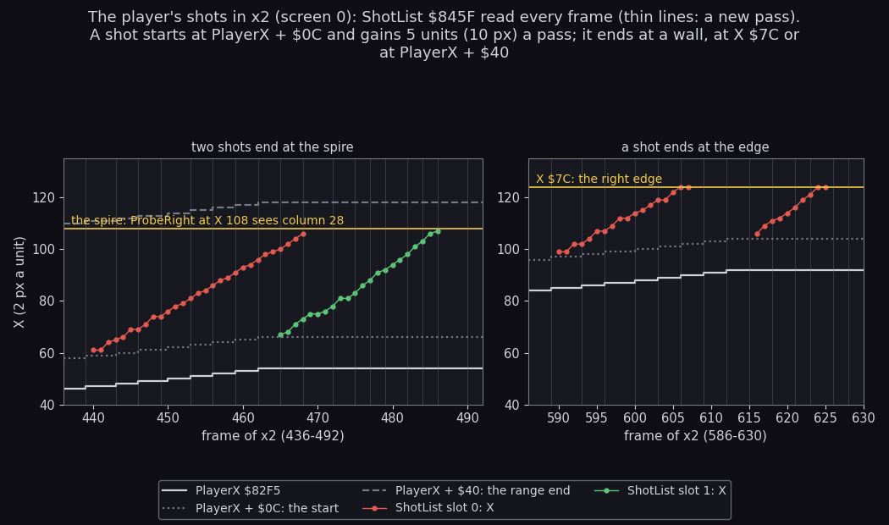

```sh
python3 tools/fig_hero.py shots     # from work/docs/fillO/d/x2-hero.json (the read of 10.11)
```

How to read:

- `x2` screen 0, every frame. Left: frames 436-492, two shots. Right: frames 586-630, two shots fired from further
  right.
- The white step line is PlayerX; dotted, PlayerX + `$0C` (where a shot starts); dashed, PlayerX + `$40` (where it
  would run out). The yellow line is the wall that ended the shots. Thin vertical lines mark each new pass.
- Each dot is one shot's X at the end of a frame.

What it shows:

- Each shot starts 12-14 units right of the hero (the start plus the moves already made in that pass) and climbs 5
  units a pass.
- Left: both shots stop at X 106-107, short of the range end: the spire's cell stops them.
- Right: the hero stands at X 85-92, so PlayerX + `$40` is past the edge; the shots stop at X `$7C`.
- `x2` carries the ammunition POKE, so Ammo `$8E5A` stays 99 here; the decrement is the `DEC A` at `$836E`.

The point: a shot is fast (10 pixels a pass against the hero's 2) and short-ranged (about 100 pixels). The range
rides with the hero, so walking behind a shot stretches it, and walking away shortens it.

## 10.13 Bugs and oddities

Each item says what the code does, why it is odd, and what shows it: a recording and frame, the image's bytes (a
model), or "known only from the code".

| # | Oddity | Where | Witness |
| ---: | --- | --- | --- |
| 1 | Touching a ball or a gun's shot pays 50 points while it kills: BallsTouchPlayer and GunShotsVsPlayer go through BallHit / DestroyGunShot, which add Points50 | `$9BB4`, `$9E64` | `w/006` frames 243-244: the gun shot at X `$1C`, Y `$90` meets the hero at X `$10`, Y `$80` with no player shot live; its record is freed and the score goes from 000000 to 000050. No death follows in the clone. The ball touch: code only |
| 2 | A turret shell that meets the hero is spent even when KillPlayer refuses the kill (dying or immune) | ShellsHitPlayer `$90EA` | `x1` frames 1238, 1442, 1588: the shell is freed at X `$3E` / `$34` while DeathTimer runs (7.2 figure) |
| 3 | Two destructible pieces of row 1 can never be blown up: dy -2 gives y0 = `$FF`, and the unsigned row test never passes | AddDestructible `$9487`, GrenadeBlast `$93E2` | model and RAM: `w/023` frame 250 holds `12 18 FF 07 14 01 10`, `w/053` frame 250 two records with y0 `$FF` (7.10) |
| 4 | Guns: a gun that wins its 9-in-256 roll while the player is not far enough left ends the loop with `RET NC`, so the guns after it skip the pass | Guns `$9D7F` | code only |
| 5 | Guns: a full GunShots list (GunShotsFull `$9DA6`) also ends the pass for the remaining guns | `$9DA6` | code only: no recording used more than 5 of the 10 records (`w/009`, 7.2) |
| 6 | Pickup cells 5 and 6 are never live: ClearPickups arms only the first 4 records, and screens 46, 97 and 121 have 6 pickup cells | ClearPickups `$A352` | model (7.7) |
| 7 | The homing missile is an endless stream: a flight that ends at X 0, on the hero or by the launcher's loss starts the next one in the same pass | HomingMissileStep `$A26B` | `w/006` frames 1561-1562 and 1822-1823 (7.6) |
| 8 | The idle missile never resets IdleTime: past 700 passes the missiles follow one another | IdleMissileStart `$AC59` | `x2`, 121 launches after frame 5170 (10.8) |
| 9 | A screen change zeroes ImmunityCount: the 20 safe passes after a death end if the hero walks off the screen | BuildScreen `$8494` | code only |
| 10 | The jump takes MoveDir from the last walking pass, not from the keys held at take-off: up + right pressed together from a standstill jumps straight up | JumpMoveX `$820A` | code only; `x2` frames 919-929 show the other half (the direction kept after right is released) |
| 11 | BonusPointer is never reset: each bonus screen's pointer starts where the last one stopped | `$A960` | code only (10.2) |
| 12 | SlotSpriteCount is never raised, so PadSlotSprites always draws 6 blank sprites | `$9EAE` | code only ([4. Game loop](04-game-loop.md)) |
| 13 | FlameList has room for 5 jets; a sixth would overwrite FlamePhase `$8F94`. Screens 27, 50 and 102 have exactly 5 | `$8F89` | model |
| 14 | BoxOverlap is never called | `$ADCD` | the image: no CALL or JP to `$ADCD` |
| 15 | Four routine names in the annotation name the wrong list: ClearShellList clears ShellList; GunShotsVsShots, DestroyGunShot and GunShotsVsPlayer act on the gun shots | `$910B`, `$9E37-$9E64` | the code (7.2) |
| 16 | Two random sources: most users call Random `$AD36`, but BeeperNoise `$7C2B` and the puffs' ink read the R register | `$7C2B`, AnimatePuffs `$9835` | code (7.12) |
| 17 | The exoskeleton's second shot costs no extra ammunition | FireControl `$837B` | code only |
| 18 | A grenade's rising steps of -2 and -4 test the floor below; only the -1 steps skip it | MoveGrenade `$925F` | code only |

One more is in another document and is only pointed at here: SetupIm2's table over live code
([4.3](04-game-loop.md#43-interrupts-and-one-pass-against-the-frame)).

The worked example of item 3, from the image: element `$10` (the decorative missile) has DestructibleKinds `FE 06 FE
08`.
On screen 23 it stands at column 20, row 1.
x0 = 20 - 2 = 18, x1 = 24, y0 = 1 - 2 = `$FF`, y1 = `$FF` + 8 = 7.
GrenadeBlast asks `row >= y0` with an unsigned compare: no row 0-21 is `$FF` or more, so the record never matches.
The same holds for the two mushrooms (element `$2E`, dy -2) at row 1 of screen 53.

The point: none of these breaks the game; most are economies (a RET for a loop exit, a shared routine for a kill and a
shot). Items 3, 6 and 7 change what a player can score or survive on particular screens.

## 10.14 What is known only from the code

- ZoneAddLife (one more life at a zone's end below nine): every warp run that reached a zone's end had nine lives.
- The bonus screen's pay-out on an odd line: `w/024` stopped on an even line (the score stays 019000 from frame 750 to
  1000); `w/124`'s samples do not separate the bonus screen's points from the play's.
- The five unused addends (100, 200, 250, 300, 350).
- A grenade thrown to the left (GrenadeLeftWall): every script faced right.
- The score's wrap at 1 000 000.
- DeathDropToFloor's loop: every restart point was on the ground.
- A vertical jump from a standstill with up and right pressed together (10.13 item 10).
- A screen change ending the safe passes after a death (10.13 item 9).
- A shot whose range end a teleport carried past it (10.12).
- The exoskeleton's second shot (10.12): no recording fired in the suit while the shots were read.
