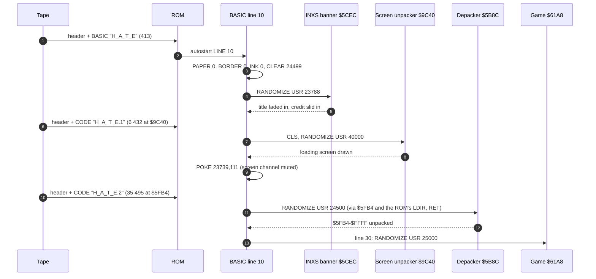
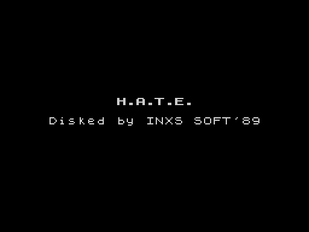
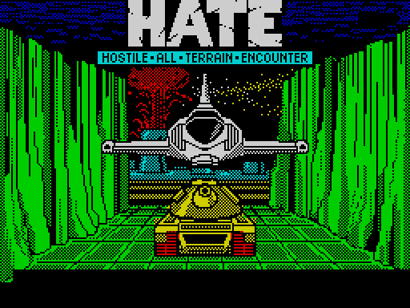
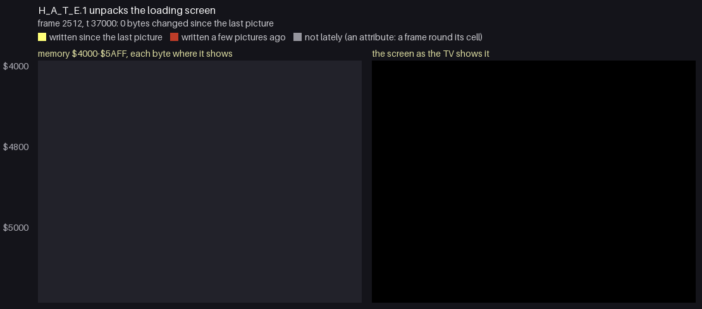
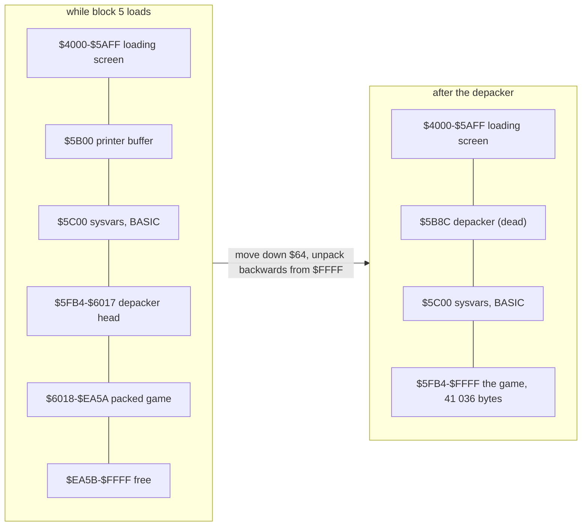
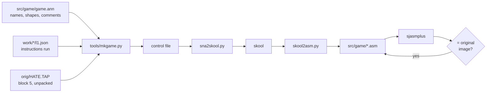

# 3. Build and load

How the game gets from tape into memory, and how the source tree makes the same tape again. The tape has two
layers: Vortex's game with its own loading screen and depacker, and the BASIC loader with a banner added by INXS
Soft for their 1989 disk version, from which this tape was made back.

## 3.1 The tape

| Block | Kind | Name | Bytes | Loads at | Plays for (ROM speed) |
| --- | --- | --- | --- | --- | --- |
| 0 | header | `H_A_T_E` | 17 (+2) | | 5.1 s |
| 1 | BASIC, LINE 10 | | 413 (+2) | PROG (`$5CCB`) | 4.2 s |
| 2 | header | `H_A_T_E.1` | 17 (+2) | | 5.1 s |
| 3 | CODE | screen unpacker + loading screen | 6 432 (+2) | `$9C40` | 38.8 s |
| 4 | header | `H_A_T_E.2` | 17 (+2) | | 5.1 s |
| 5 | CODE | depacker + packed game | 35 495 (+2) | `$5FB4` | 204.4 s |

All blocks use the ROM's standard encoding (flag byte, data, XOR checksum; pilot 2 168 T, 8 063 pulses for a header
and 3 223 for data, bits of 2 x 855 T and 2 x 1 710 T). The play times are computed from the bit counts of each block,
pauses not included: 263 s, 13 159 frames of tape signal in all. There is no custom loader: every block goes through
the ROM's LD-BYTES (`$0556`). The first recording loaded the tape with the emulator's fast loading (the LD-BYTES trap): each
block took a few frames, the whole load 2 540 frames, so the recording's frame numbers (the banner at 2 380, the game's
entry at 2 613) do not follow these times.

The headers: the BASIC one is as the ROM's `SAVE "H_A_T_E" LINE 10` writes it (length and program length 413,
line 10). The two CODE headers hold `$2020`, two spaces, as their second parameter where the ROM's `SAVE ... CODE`
writes 32 768: the tape was written by a copier from INXS's disk version, not saved from BASIC.

## 3.2 The load, step by step




```text
LOAD ""               ROM        BASIC "H_A_T_E" into PROG, autostart LINE 10
LINE 10               BASIC      PAPER 0: BORDER 0: POKE 23624,0: INK 0      black screen, BORDCR = 0
                                 CLEAR 24499                                 RAMTOP = $5FB3, the stack below it
                                 RANDOMIZE USR 23788                         INXS banner (3.3)
                                 LOAD "H_A_T_E.1" CODE                       6 432 bytes at $9C40
                                 CLS
                                 RANDOMIZE USR 40000                         loading screen unpacked (3.4)
                                 POKE 23739,111                              S channel output -> $096F (RET)
                                 LOAD "H_A_T_E.2" CODE                       35 495 bytes at $5FB4, no message
                                 RANDOMIZE USR 24500                         depack into $5FB4-$FFFF (3.5)
LINE 20               BASIC      REM NO POKE
LINE 30               BASIC      RANDOMIZE USR 25000                         the game ($61A8)
```

The game's entry is reached by BASIC falling through from line 10 to line 30.

`POKE 23739,111` changes the low byte of the S channel's output address in the channel table (CHANS + 5) from `$F4`
(`$09F4`, PRINT-OUT) to `$6F`: `$096F` is a lone `RET` in the ROM. Everything printed to the screen channel is dropped
from then on, so the ROM's "Bytes: H_A_T_E.2" line does not appear over the loading screen.

`CLEAR 24499` puts RAMTOP right below the load address of the last block, `$5FB4`, so the BASIC stack and the GO SUB
stack stay out of the way of the 41 036 bytes the depacker writes from `$5FB4` up to `$FFFF`.

## 3.3 INXS's banner (line 0, `$5CEC`)

Line 0 is a REM: the text `Disked by INXS SOFT'89` (at `$5CD0`, padded with spaces) followed by the code at `$5CEC`,
reached by `USR 23788`. Line 1 is a REM with the title `H.A.T.E.` (`$5D9E`). The banner is not part of the game; it is
documented because the tape carries it and the build reproduces it.

| Address | Routine | What it does |
| --- | --- | --- |
| `$5CEC` | `Banner` | calls the five routines below in order and returns to BASIC |
| `$5CFC` | `MeasureTitle` | length of line 1's text up to CR (at most 30) into `$5D19`; centre column (32 - length) / 2 into `$5D1A` |
| `$5D6F` | `BoldFont` | makes a bold copy of the ROM font: each byte of `$3D00-$3FFF` ORed with itself shifted right once, into `$C350`; CHARS = `$C250` |
| `$5D1B` | `FadeInTitle` | opens channel 2; eight times: `AT 10, col`, `INK 0` to `INK 7`, prints the title, waits 3 frames (`$5D47`): the title fades in from black to white |
| `$5D8A` | `RomFont` | CHARS back to `$3C00` |
| `$5D4F` | `WipeCredit` | row 12, from column 31 down to 5: prints the first (32 - column) characters of the credit text at the column, so the line slides in from the right; at column 5 the whole 27-character credit shows |

Its data lives in its own REM: `$5D19` (title length) and `$5D1A` (column) are the two bytes after `MeasureTitle`'s
`RET`. The bold font at `$C350` is overwritten later by the depacker.



*Frame 2 380 of the recording: the banner done, the tape about to play `H_A_T_E.1`.*

## 3.4 The loading screen (`H_A_T_E.1`, `$9C40`)

The block is Vortex's screen unpacker followed by one packed picture. It is position independent: it may be loaded
anywhere.

```text
$9C40  JR $9C46            skip the four parameter bytes
$9C42  DB 1, $FF, $FF, $0C picture number, first third, thirds, flags (IY+0..3)
$9C46  CALL $007C          a lone RET in the ROM: the return address ($9C49) stays below SP
       DEC SP x2, EX (SP),HL, INC SP x2
       HL - 7 -> IY        IY = the parameter bytes, wherever the block is
```

**Pictures.** From IY + `$12A` (`$9D6C`) the block holds pictures, each `DW length`, `DB first third`, `DB thirds`,
`DB flags`, then the packed bytes. The first third and the thirds are taken from the picture only where the
parameter bytes hold `$FF`. This picture's length counts two bytes after its packed data that are never read. The unpacker skips
`number - 1` pictures by their lengths. This tape holds one picture: thirds 0 to 2 (the whole screen), flags `$01`.

**Order.** Flag bit 0 set: the bitmap is filled by pixel lines across, third by third, character row by row, each
pixel line 32 bytes; clear: by columns down (one byte, the next pixel line). The attributes of the same thirds
follow in address order. Flag bit 2 is the unpacker's run state, bit 3 marks the attribute phase.

**Packing.** RLE with the escape 0: any byte other than 0 is itself; `00 N V` is N copies of V (N = 0 means 256).
A run carries across the bitmap/attribute boundary. The run counter and value are kept in the alternate registers
B' and C' between calls.

**Exit.** The first-third and thirds parameters are set back to `$FF` and the unpacker returns to BASIC.

The picture packs 6 912 bytes into 5 965. After the picture the block holds 160 more bytes (`$B4C0-$B55F`) that
nothing reads: RLE fragments left in the packer's buffer. Between the code and the pictures, 25 bytes (`$9D53-$9D6B`)
are not read either. The build keeps both as they are.



The unpacker at work, one picture every quarter frame (17 472 T-states) from frame 2512, t 37000 to frame 2531 (made by `tools/memanim.py` from TTD `memory_at`):
on the left the screen page `$4000-$5AFF` as memory, in the screen's own geometry and at its size (`--screen-geometry`:
each bitmap byte as its 8 pixels, set bits light; a written attribute as a frame round its cell), on the right the
screen as the Spectrum shows it. A byte written since the last picture flashes yellow at the place it shows and fades
to red. The bitmap comes first, row by row; the attributes follow, so the picture stays black (black ink on black
paper) until they arrive.



```bash
python3 tools/memanim.py --work work/c2 --from 2512:37000 --to 2531:37000 --step 17472 --screen --screen-geometry \
    --label 'H_A_T_E.1 unpacks the loading screen' docs/img/anim-loading-screen.gif
```

*Frame 2 531: the screen complete. At frame 2 530 the unpacker is still writing attribute row 21.*

## 3.5 The depacker (`H_A_T_E.2`, `$5FB4`)

The block loads at `$5FB4`: `$64` bytes of depacker and padding, then 35 395 packed bytes that unpack into the 41 036
bytes `$5FB4-$FFFF`, the depacker's own bytes included.

```text
$5FB4  LD HL,$5FCC : LD DE,$5B8C : LD BC,$37 : PUSH DE : LDIR     the depacker into the printer buffer
       LD HL,$6018 : LD DE,$5FB4 : LD BC,$9FE8 : JP $33C3         the packed data down $64 bytes;
                                                                   ROM $33C3 is LDIR; RET: returns to $5B8C
$5B8C  LD HL,$E9F6 : LD DE,$FFFF                                  the last packed byte, the last byte of RAM
loop:  HL = $5FB3 ? RET (to BASIC, line 30 next)
       (HL) <> $97 ?  LDD                                         a literal
       else  N = (HL - 1)
             N bit 7 set:   count = N & $7F; value = 0 if count = 0 or count >= 3, else $97
             N bit 7 clear: count = N, value = (HL - 2)
             count (0 = 256) bytes of value, downwards; HL past the token
```

Unpacking runs backwards so that the output, growing down from `$FFFF`, never overtakes the input it still has to
read: both are in the same memory and the output is longer.

**Packing.** The packer walks the image forwards. A run of three or more equal bytes becomes a token: zeros take 256
at a time while 256 remain (`$80 $97`), then up to 127 (`$80 | n, $97`); other values up to 127 (`v, n, $97`). A
remainder shorter than three stays literal. A literal `$97` is written as `$81 $97`.

**Proof.** `tools/depack.py` on the tape block gives the memory `$5FB4-$FFFF` of frame 2 613 of the recording, all
41 036 bytes. `tools/pack.py` packs that image into the tape's 35 395 bytes, all identical.

The depacker at work, one picture a frame from frame 2531 to its return at frame 2613, t 53257 (`tools/memanim.py`):
the write front starts at `$FFFF` and climbs to `$5FB4` while the packed data it reads, just below the front, is
consumed. Reading backwards is what lets the packed and the unpacked data share memory without a buffer.


One row of the picture is 256 bytes, `$5B00` at the top; a byte's grey is its value, yellow fading to red marks the
bytes just written. The band climbing from the bottom is the write front.

```bash
python3 tools/memanim.py --work work/c2 --from 2531 --to 2613:53257 --step 69888 --from-address 5B00 \
    --label 'The depacker at $5B8C unpacks the game backwards from $FFFF' docs/img/anim-depacker.gif
```

## 3.6 Memory after the load




| Range | Contents |
| --- | --- |
| `$4000-$5AFF` | the loading screen |
| `$5B00-$5BFF` | printer buffer; `$5B8C-$5BC2` the depacker (dead after the load) |
| `$5C00-$5CCA` | system variables, the channel table (CHANS `$5CB6`) |
| `$5CCB-$5E68` | the BASIC loader (lines 0, 1, 10, 20, 30) and its variables |
| `$5E69-$5FB3` | BASIC workspace and stacks, below RAMTOP `$5FB3` |
| `$5FB4-$FFFF` | the game (41 036 bytes) |

The game's own memory map is in [2. Architecture](02-architecture.md).

## 3.7 The source build

```bash
tools/build.sh [path/to/sjasmplus]        # build/HATE.TAP, compared with orig/HATE.TAP byte for byte
```

| Block | Source | Made by | State |
| --- | --- | --- | --- |
| 0, 1 BASIC | `src/loader.asm`: the lines as tokens, the banner as code | sjasmplus | **identical** (413 bytes) |
| 2, 3 loading screen | `src/screen.asm` (the unpacker), `src/res/screens/loading.scr` (the picture), `src/res/leftovers/screen-tail.bin` | `tools/screen_pack.py`, sjasmplus | **identical** (6 432 bytes) |
| 4, 5 game | `src/depacker.asm` (the `$64`-byte head), `src/game/*.asm` (the image), `src/res/` (its resources) | sjasmplus, `tools/pack.py` | **identical** (35 495 bytes) |
| headers, TAP | `tools/tap.py` | | **identical** |

### The game's source, `src/game`

`src/game/game.asm` includes 18 modules in address order and saves `game.bin`, the image `$5FB4`-`$FFFF` (41 036
bytes) as the depacker leaves it at frame 2 613; `tools/pack.py` packs it into block 5 again.

| Module | Range | Contents | Docs |
| --- | --- | --- | --- |
| `buffers` | `$5FB4`-`$7FFF` | the ground profile `$6000`, the entry `$61A8`, the font with its strings, the sprite scratch page `$6500`, the sprite graphics | 6, 8 |
| `titleplayer` | `$8000`-`$85FF` | the title music player, its IM 2 handler, the song, patterns and drums | 2.3, 9 |
| `startup` | `$8600`-`$BFFF` | stale copies left from the build, the start-up `$9F12`, the screen image `$A000` | 2.3 |
| `gamedata` | `$C000`-`$C3FF` | the object records, the variables, the templates, the sprite table `$C300`, the hit table `$C380` | 7 |
| `course` | `$C400`-`$CF31` | the tiles, the runs and rows, the ten courses, the course table `$CF04` | 6.5 |
| `mainloop` | `$CF32`-`$D0EE` | the state machine: menu, game, round, pass, losing, GAME OVER | 4 |
| `roundsetup` | `$D0EF`-`$D35D` | the ground profile, the round set-up, the attribute paint | 4, 10.2 |
| `scroller` | `$D35E`-`$D9D5` | the blit, the scroll step and strip phases, the course expansion, the blit address list | 6 |
| `sprites`, `shadows` | `$D9D6`-`$E15B` | the sprite and shadow lists, the saved strips, the shadow masks | 6 |
| `mover` | `$E15C`-`$E68B` | moving the records: height, walls, the barrier, the pair scan | 7, 10 |
| `player` | `$E68C`-`$EA37` | the controls, AUTO, the player's vehicle, firing, the random numbers | 5, 10.3 |
| `statics` | `$EA38`-`$EBA9` | pads and dishes stamped into the buffer (`StampStatics`), the sprites drawn from the list `$FF00` (`DrawSprites` `$EAE3`) | 6.6 |
| `hits` | `$EBAA`-`$EE12` | the hit handlers, pods, the convoy | 7.6, 10.4 |
| `hud`, `objview` | `$EE13`-`$F0DA` | the print routine, the score, MAX and HIGH, objects to screen places | 8 |
| `menu` | `$F0DB`-`$F2FF` | the messages, the menu, the sound effects | 5, 8, 9 |
| `coursedata` | `$F300`-`$FFFF` | the objects of every round, the saved strips `$F800`, the IM 2 jump `$FDFD` and table `$FE00` | 6, 7 |

The `.asm` files are generated, not edited by hand: `tools/mkgame.py` builds them from what the reverse knows and from what the
recordings saw, and refuses to install them unless sjasmplus gives the original bytes.



- **Code** is every instruction start the recordings ran (`work/*/l1.json`) whose opcode is the image's byte (an
  operand may be self-modified later), widened by a walk along the branches no recording took, which stops at bytes
  the game reads as data. The walk takes the game's data reads only from the recordings that start after the depacker (in the
  load the depacker reads its packed input at addresses that later hold the game's code). Seven hit handlers that no recording ran (`$EBFC`, `$EC01`, `$EC04`, `$EC35`,
  `$EC73`, `$ED3B`, `$ED81`) are code by `game.ann`: they are reached through the table `$C380` only. 8 677 bytes,
  4 883 instructions are code; 4 568 of those instructions ran.
- **Data** is everything else, shaped by `game.ann` (bytes or words per line, text, the entry boundaries at tables,
  records and sprite sets).
- **Names and comments** come from `src/game/game.ann`: 355 entries, 137 of them code, every one named. An address
  operand inside an entry is written as `Label+offset` (120 of them), so a reader sees which field a load touches;
  where the bytes are a constant that only looks like an address (`LD HL,-6`, `LD SP,$FFFF`), `@isub` in `game.ann`
  writes the instruction as the source means it (5 of them).
- **Resources**: 66 entries of `game.ann` carry `@res FILE` (graphics, the game screen, tiles, courses, round
  objects, the title tune, the renderer's tables, leftovers): their bytes go to `src/res/` (the graphics and the title tune as editable
  sources, below; the rest as raw `.bin` / `.scr`), each assembled with `INCBIN` under the entry's label, 28 067 bytes in 62 files. [src/res/README.md](../src/res/README.md)
  lists every file with its address, size and format. The graphics and the title tune are kept as editable sources:
  22 PNG files and one tune text (`music/title/tune.txt`) stand for 30 of the files. `tools/res_formats.py build`,
  run by `build.sh`, turns them back into the original bytes under `build/res`. sjasmplus reads the resources from
  there (`-I build`), so an edited picture or note goes straight into the build, and the TAP compare shows it. A
  changed pixel of `slot-00.png` or one `long` of the tune makes the TAP differ; the sources as exported give it
  byte for byte. `mkgame.py --install` writes these sources through `res_formats.py`, not the `.bin` files.
- **Previews**: `tools/res_preview.py` draws every resource to `docs/img/res/` (81 images; the gallery at the end of
  [src/res/README.md](../src/res/README.md)). It applies the game's own rules to the files: the course strips as
  `FreshStrip` builds them, the ground profiles as `$D0EF` reads the anchors, the round objects by position, the
  title tune run as the player runs it (a piano roll), the sprites and the explosion as GIFs, the tables and
  leftovers as 1-bit pixels. It reads the row lists from `build/game.bin`, so it runs after `tools/build.sh`. The
  images are only for looking; the source is the files of `src/res`: the PNG and text sources and the remaining
  `.bin` / `.scr` files.
- **Checks against the recordings**: six scripts compare the files and the rules the previews use with memory in
  the recordings, through an unreal-ng instance with the recording open (`re_session.py open`):
  `tools/verify_buffer.py` (the course strips and pads in all four buffer sets, [6.4](06-rendering.md)),
  `verify_profile.py` (the ground profiles, 6.5), `verify_objects.py` (the round objects, [7.1](07-objects.md)) and
  `verify_sprites.py` (the sprite and explosion graphics and their drawing, 6.6) on `work/p2`; `verify_tune.py` (the
  title tune, [9.5](09-sound.md)) on `work/c2`. `verify_res.py` compares every `INCBIN` piece with memory where the
  assembled image has it, on either recording (`--work`). Each prints what it compared and exits 1 on a difference.
- **The check**: the assembled `game.bin` must equal the image unpacked from the original tape; then `build.sh`
  packs it and the TAP is compared with `orig/HATE.TAP`.

```bash
python3 tools/mkgame.py --venv SKOOLKIT_VENV --sjasmplus SJASMPLUS --install   # rewrite src/game from game.ann
python3 tools/refdocs.py                                                       # docs 11 and 12 from the same
python3 tools/res_formats.py check                                             # the PNG / text sources round trip
python3 tools/res_preview.py                                                   # docs/img/res, after build.sh
python3 tools/verify_sprites.py --scan 200 12000 --unreal UNREAL_NG            # work/p2 open in unreal-ng
python3 tools/verify_tune.py --unreal UNREAL_NG                                # work/c2 open in unreal-ng
```

[11. Data reference](11-data-reference.md) and [12. Routine reference](12-routine-reference.md) are written from the
same entries, with what the recordings saw each one do.
