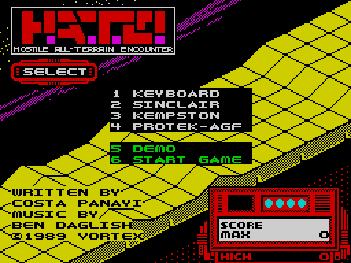
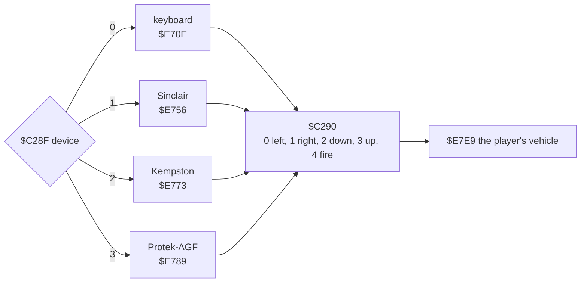
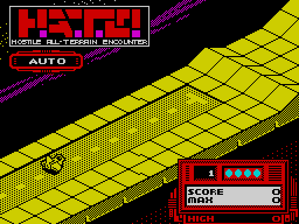
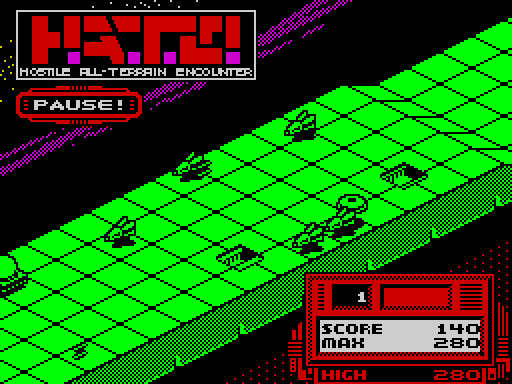

# 5. Controls

Four input devices, one control byte. The menu picks the device; every pass of the play loop, one reader turns that
device into the same five bits. The rest of the game sees only those bits, so the device choice lives in one
routine.

Evidence:

- the code from the start image (`work/game/start.bin`);
- the recording, read back with TTD `memory_at`. The device byte `$C28F` is 3 (Protek-AGF) during play, at frames
  35 000 and 44 000.
- L1, which saw ports `$EFFE` and `$F7FE` read at `$E68C`. Those are the two rows the Protek-AGF reader uses.

## 5.1 The menu



Before the first menu, the title music player (`$8000`, [2.3](02-architecture.md)) runs until any key is pressed; only
then does the menu read its keys (the autopilot of [10](10-gameplay-logic.md) presses a key first, otherwise the title
would swallow its first menu key, the 3).

`$F1AA` draws the menu (string `$F140`) and the credits (`$63D8`, `$64D8`). It waits for all keys to be released and
beeps. Then it loops:

| Key | Row, bit | Effect |
| --- | --- | --- |
| 1-4 | `$F7FE`, bits 0-3 | device = 0..3 (`$C28F`); the 13-cell highlight bar at attribute row 8 + device moves (`$F0DF`) |
| 5 | `$F7FE`, bit 4 | demo: `$F0DB` = `$FF` |
| 6 | `$EFFE`, bit 4 | start the game |
| none | | after 256 × 2 000 passes of the loop (`$F0DC`, `$F0DD`), the demo starts by itself |

Every pass of the menu loop also increments `$EA36`, the seed of the random number generator (`Random` `$EA19`, [12](12-routine-reference.md)). The
time a player spends in the menu therefore decides the random sequence of the game.

The main loop goes back to the menu after the game ends, after ABORT and after the demo ([4. Game loop](04-game-loop.md)).

## 5.2 The control byte

`$C290`, written once a pass by `$E68C` (via `$E6FF`) and read by the game logic:

| Bit | Meaning |
| --- | --- |
| 0 | left |
| 1 | right |
| 2 | down |
| 3 | up |
| 4 | fire |

This is the Kempston interface's layout with bits 0 and 1 swapped. The bits are active high: 1 means pressed. In play,
left raises the position across (`$C003`) and right lowers it; on the aircraft, down climbs and up descends
(the keyboard swaps Q and A with the vehicle so that Q always climbs or speeds up, below).

## 5.3 The four readers



| Device | Ports read | Mapping |
| --- | --- | --- |
| 0 keyboard | `$FBFE`, `$FDFE`, `$BFFE`, `$7EFE` | **Q** and **A** for up and down, **K** left, **L** right, fire: any key on the two bottom rows (`$7EFE` selects both `$7FFE` and `$FEFE`) |
| 1 Sinclair | `$F7FE`, `$EFFE` | both Interface 2 ports at once: 1 left, 2 right, 3 down, 4 up, 5 fire; and 6 left, 7 right, 8 down, 9 up, 0 fire |
| 2 Kempston | `$1F` | bits 0-4 of the port, left and right swapped into the game's order |
| 3 Protek-AGF | `$F7FE`, `$EFFE` | the cursor keys: 5 left, 8 right, 6 down, 7 up, 0 fire |

The Sinclair reader merges the two joystick rows into one value. It reverses the five bits of row `$EFFE`, whose
keys run 0, 9, 8, 7, 6 from bit 0, so that they line up with row `$F7FE`'s 1, 2, 3, 4, 5. It then ORs the rows
together.

**Q and A swap.** The keyboard reader decides from bit 0 of `$C000` which of Q and A means up:

```text
$E713  LD A,$FB
       IN A,($FE)        ; Q W E R T
       RRA
       JR C,$E724        ; Q not pressed
       BIT 0,(HL)        ; HL = $C000
       JR Z,$E722
       SET 3,B           ; bit 0 set: Q = up
       JR $E724
$E722  SET 2,B           ; bit 0 clear: Q = down
```

A does the opposite. `$C000` is loaded from the course data at the start of each round (`$D233`), so the meaning of
Q and A changes with the round. The same byte gives `$C0A0` = `(byte + 1) AND 1` (`$D23B`). So Q always climbs the aircraft
and speeds up the ground vehicle ([10.3](10-gameplay-logic.md#103-driving-the-two-vehicles)). The joystick readers do not swap.

## 5.4 The automatic start



At the start of a round, the countdown `$E68B` is set (`$D251`): 70 passes for the aircraft (type 0: `$C008` = 2 ×
type is 0), 14 for the ground vehicle. While it runs, `$E68C` does not read the device. It prints " AUTO " (`$64F6`) in the status
window and sets sound flag 3 (`$F2BF`, see [9](09-sound.md)). It also steers the vehicle by itself: the
position `$C003` moves 2 a pass toward `$2C`, and `$C2F6` is set from `$C004` and the countdown (the meaning of
both is in [10](10-gameplay-logic.md)). The pass that ends the countdown clears the window (`$F136`).

## 5.5 Keys read by the main loop

The play loop (`$CFAC`-`$D0EC`, [4. Game loop](04-game-loop.md)) reads some keys itself, after the
pass's work is done. They work with every device:

| Keys | Code | Effect |
| --- | --- | --- |
| **U** and **G** together | `$D089`: `$DFFE` bit 3 and `$FDFE` bit 4 | ABORT!: prints `$F12C`; outside the demo, prints the box `$F0F5`, beeps twice and goes back to the menu |
| **P**, without ENTER | `$D0BA`: `$DFFE` bit 0, `$BFFE` bit 0 | PAUSE!: beeps, prints `$F0EB`, waits for ENTER, beeps, clears the window (`$F136`) |
| ENTER | `$D0D8` | ends the pause |



In the demo (`$F0DB` ≠ 0), the loop prints " DEMO " every pass and skips `$E68C` entirely (`$CFAC`). How the demo
steers is in [10](10-gameplay-logic.md). ABORT ends the demo too, with one beep and no box.

## 5.6 Design notes

- **One byte between input and game.** Adding a device costs a reader of a dozen instructions and a menu line. The
  demo and the AUTO start drive the game through the same variables the reader fills.
- **Reading the joystick rows of the keyboard.** Sinclair and Protek-AGF interfaces present themselves as keys, so
  no extra hardware has to be probed. Only Kempston reads a port of its own (`$1F`).
- **Abort on two far-apart keys.** U and G are on different rows and different hands, so a stray press during play
  does not end the game.
- **Random seed from the menu.** The seed is bumped every pass of the menu loop and never reset, so the player's
  reaction time picks the course of the game.
