# H.A.T.E. resources

The game's data that is not code. Raw files hold the bytes exactly as they stand in the original image. The
graphics (PNG) and the title tune (text) are editable sources, converted back to those bytes by
`tools/res_formats.py` into `build/res`. `tools/build.sh` assembles `src/game/game.asm` with `INCBIN` from there
(sjasmplus, `build` and `src/game` on the include path); the tape it writes is `orig/HATE.TAP` byte for byte.

- **Where they come from.** `tools/mkgame.py` writes every file of the game image (all but the two marked
  *by hand* below) from the pristine image: an entry of `src/game/game.ann` followed by `@res FILE` is a resource,
  its bytes go to `src/res/FILE` (for the graphics and the tune, the PNG or text source of FILE: see Editable
  sources) and its data lines in `src/game/*.asm` become `INCBIN "res/FILE",offset,length`
  under the entry's label and description. Entries that name one file share it (the file holds the bytes from the
  first entry to the end of the last). Edit `game.ann`, not the `.asm` files, and rerun
  `tools/mkgame.py --venv VENV --install`; it installs only when the assembled image is the original's.
- **What stays in the source.** Tables of addresses (`dw Label`: the sprite table `$C300`, the course table
  `$CF04`, the row lists `$C8EA`, the blit list `$D5B2`, the handler tables), records and variables, strings
  (`DEFM`, readable in place) and small tables the code reads field by field: they are part of the program's
  structure, and labels inside them are referenced from code.
- **Previews.** `python3 tools/res_preview.py` (after `tools/build.sh`: the row lists are read from the assembled
  image) draws every resource to `docs/img/res/`. Screens, font and tiles appear as on the screen. Sprites and
  explosions are drawn as the game draws them, with a GIF of the frames. Each course gets its strips, its ground
  profile and its objects. The title tune is run as the player runs it and drawn as a piano roll. Tables and
  leftovers appear as 1-bit pixels, 32 bytes a row. These previews are for looking only. The source is the files
  of src/res: the PNG and text sources below, and the `.bin` / `.scr` files. Formats below, the [gallery](#courses) at the end; the full descriptions are in
  [docs/11-data-reference.md](../../docs/11-data-reference.md).
- **Checked against the recordings.** `tools/verify_res.py` finds each `INCBIN` piece in the assembled image and
  compares it with memory in a recording. In the title of the first recording (`work/c2`, frames 2700-30200), 65 of
  the 66 pieces equal their files at every frame sampled. The exception is `udg.bin`, where the title's stack holds
  `$FFF9-$FFFE`. In the bot's game (`work/p2`, frames 210-11000), 47 pieces never change: the font, tiles, sprites,
  explosions, courses, tile runs, anchors and round objects. The others hold work areas in play: everything in
  `$8000-$BFFF` (the playfield buffer over the title player, the game screen copy and the renderer tables), the
  ground profile `$6000`, the sprite save buffer `$F800` and the sprite list and stack over the UDGs. The sprite,
  buffer, profile, object and tune scripts of [docs/03](../../docs/03-build-and-load.md) 3.7 check the rules on top.
- **Editable sources.** The graphics are PNG and the title tune is text. `tools/res_formats.py` builds them into
  the original `.bin` files under `build/res` (`tools/build.sh` runs it before assembling). The build still has to
  give the original tape byte for byte, so an edit shows at once as a difference. The PNG and text formats are below.
  The font, the tiles, 14 sprite blocks and 6 explosion frames make 22 PNG files. The title's song, 5 patterns and 2
  drum patterns are in `music/title/tune.txt`. `res_formats.py export` writes the sources from `.bin` files, and
  `tools/mkgame.py --install` uses it. `res_formats.py check` builds every source and writes it back out, and the
  bytes must come out the same. Courses, objects, tables and leftovers stay raw bytes: they are numbers already, and
  docs 6-7 and 11 explain them.

## Formats

| Format | Layout |
| --- | --- |
| **ZX screen** (`.scr`) | 6 912 bytes: 6 144 bytes of pixels in the Spectrum's display order (`$4000` layout: thirds, character rows, pixel lines), then 768 attributes, 32 a character row. Opens in any ZX screen viewer. |
| **Font** | 8 bytes a glyph, one byte a pixel line from the top, bit 7 the leftmost pixel; glyph = file + (code - `$20`) × 8, codes `$20`-`$5A`. |
| **Course tile** | 8 bytes a tile, one byte a line of the strip, the first byte the bottom line on the screen (`FreshStrip` copies the 8 bytes with `LDI` down the buffer column, the blit shows a column bottom line first; the preview draws them that way). |
| **Sprite block** | Four pre-shifted frames, picked by (phase - 1) AND 3. A frame is a row of strips 8 pixels wide; a strip is a mask byte and a pixel byte a line (`AND` mask, `OR` pixels), the first pair the bottom line. Frame 3 is one strip narrower. By block size: 630 = 21 lines, strips 4+4+4+3 (types 0-3); 420 = 14 lines, 4+4+4+3 (pads, dishes); 374 = 17 lines, 3+3+3+2 (types 4-10); 182 = 13 lines, 2+2+2+1 (types 11-13). [docs/06-rendering.md 6.6](../../docs/06-rendering.md) |
| **Explosion frame** | 168 bytes: one frame of 4 strips of 21 lines, mask and pixel byte a line as a sprite, drawn as a type 3. |
| **Tile runs** | Tile numbers from the bottom of a strip up; a course row is the address of a run in here, read as row i at offset i. Runs overlap (rows one byte apart are the same run shifted by one tile). [6.5](../../docs/06-rendering.md) |
| **Ground anchors** | Lists ended by `$FF`, picked by a course byte b at file + b / 2: one anchor byte for every 8 bytes of the ground profile, height in bits 0-4, walls in bits 5-7. [7.4](../../docs/07-objects.md) |
| **Course** | The player's type (0 aircraft, 1 ground vehicle), then one segment byte a course piece (an index into the row lists `$C8EA` and the ground anchors), ended by `$FF`. [4.2](../../docs/04-game-loop.md) |
| **Round objects** | 16 records of 8 bytes, copied into the object slots `$C0B0-$C1A0` at the round setup: +0 type, +1,+2 position along, +3 across, +4 height, +5 direction, +6 speed, +7 behaviour bits. [7.1-7.4](../../docs/07-objects.md) |
| **Title song** | Song entries: n and a pattern address (the pattern played n times), `$FB` and a drum pattern address, `$FD` and an address (jump), `$FC` stop. The addresses in the `.bin` are absolute (`$8467`...), so the file only works at its place; `tune.txt` writes labels instead. The song's last 4 bytes are never reached (`play 1 $83E8`, `stop` in `tune.txt`). [9](../../docs/09-sound.md) |
| **Title pattern** | Pattern commands (the handlers at `$83FC`): 10 with two periods, 11 or 12 with one, 0 holds, 18 n holds n note lengths, 1-4 voice parameters, 5-8 voice envelope modes, 13-15 voices off, 16 drum pattern, 17 note length, 9 ends. |
| **Drum pattern** | The speed (frames a step), then the steps: 2 click, 3 noise (or the tones), 0 rest, 1 loop. [9.5](../../docs/09-sound.md) |
| **Glyph PNG** (`gfx/font.png`, `gfx/tiles.png`) | 8 x 8 cells, 16 a row, in file order: a font glyph from code `$20`, a tile from tile 0. Palette: index 0 paper, 1 ink, 2 no glyph (the cells after the last). Tiles are drawn upright; the file keeps each one bottom line first. |
| **Sprite PNG** (`gfx/sprites/*.png`, `gfx/explosions/*.png`) | The four frames side by side, each as wide as frames 0-2, upright (21, 17, 13 or 14 lines, by block). Palette: 0 see-through (mask 1, pixel 0), 1 black (mask 0, pixel 0), 2 ink (mask 0, pixel 1), 3 ink over the background (mask 1, pixel 1; never used), 4 no strip, which must fill exactly the last strip of frame 3. An explosion is one frame of 4 strips. RGB in exactly these colours is read too. |
| **Tune text** (`music/title/tune.txt`) | The sections `song TuneSong`, `pattern PatternInit` ... `PatternD`, `drums DrumPatternA`, `drums DrumPatternB`, in this order, laid one after the other from `$843F`, so a section may grow or shrink. Song: `play N Label`, `drums Label`, `jump Label`, `call Label`, `return`, `stop`. Pattern: `note AB pa pb`, `note A p`, `note B p`, `hold`, `long n`, `length n`, `width A n`, `envelope A n`, `sustain A`, `decay A`, `off AB` (A, B and AB as the command allows), `drums Label`, `end`. Drums: `speed n`, then `steps` of `rest loop click noise rise sweep fall`. An address is `Label`, `Label+offset` or a number; `db $xx,...` writes bytes as they are. |
| **Raw** | Bytes with no format of their own: tables in RAM, or leftovers the game never reads as such, kept because the image holds them. |

## Files

All addresses are where the bytes sit in the game image (`$5FB4-$FFFF`, as the depacker leaves it).

| File | Address | Bytes | Labels in `src/game` | Format | What it is | Preview |
| --- | --- | ---: | --- | --- | --- | --- |
| `screens/loading.scr` | tape block 3 | 6 912 | - (*by hand*: `src/screen.asm`) | ZX screen | The loading screen; `tools/screen_pack.py` packs it at build time into the RLE stream `src/screen.asm` unpacks | [png](../../docs/img/res/screen-loading.png) |
| `leftovers/screen-tail.bin` | tape block 3 | 160 | - (*by hand*: `src/screen.asm`) | Raw | The last 160 bytes of block 3, after the packed screen: RLE fragments left in the packer's buffer, not read by the unpacker | [png](../../docs/img/res/leftovers/screen-tail.png) |
| `leftovers/profile-margin.bin` | `$5FB4-$5FFF` | 76 | `ProfileMargin` | Raw | Mask/pixel pairs left from the build below the ground profile; overwritten before play | [png](../../docs/img/res/leftovers/profile-margin.png) |
| `leftovers/profile-buffer.bin` | `$6000-$61A7` | 424 | `ProfileBuffer` | Raw | The ground profile buffer's image contents (leftovers; cleared at every round start), up to the entry `$61A8` | [png](../../docs/img/res/leftovers/profile-buffer.png) |
| `leftovers/profile-buffer-tail.bin` | `$61AF-$62FF` | 337 | `GroundProfileTail` | Raw | The rest of the profile buffer: 42 bytes of loader code that never runs, then zeros | [png](../../docs/img/res/leftovers/profile-buffer-tail.png) |
| `gfx/font.png` (builds `.bin`) | `$6300-$64D7` | 472 | `Font`, `FontHigh` | Font | The font, codes `$20`-`$5A` (big GAME OVER at `$22`-`$2C`). The glyph slots `$63D8-$63FF` hold the credits string `CreditsText1`: in the file, but assembled from its `DEFM` | [png](../../docs/img/res/font.png) |
| `gfx/sprites/slot-00.png` (builds `.bin`) | `$6580-$67F5` | 630 | `SpriteGfx00` | Sprite block | Table slot `$00` | [png](../../docs/img/res/sprites/slot-00.png), [gif](../../docs/img/res/sprites/slot-00.gif) |
| `gfx/sprites/slot-02.png` (builds `.bin`) | `$67F6-$6A6B` | 630 | `SpriteGfx02` | Sprite block | Table slot `$02` | [png](../../docs/img/res/sprites/slot-02.png), [gif](../../docs/img/res/sprites/slot-02.gif) |
| `gfx/sprites/slot-04.png` (builds `.bin`) | `$6A6C-$6CE1` | 630 | `SpriteGfx04` | Sprite block | Table slot `$04` | [png](../../docs/img/res/sprites/slot-04.png), [gif](../../docs/img/res/sprites/slot-04.gif) |
| `gfx/sprites/slot-06.png` (builds `.bin`) | `$6CE2-$6F57` | 630 | `SpriteGfx06` | Sprite block | Table slot `$06` | [png](../../docs/img/res/sprites/slot-06.png), [gif](../../docs/img/res/sprites/slot-06.gif) |
| `gfx/sprites/slot-1c.png` (builds `.bin`) | `$6F58-$70FB` | 420 | `SpriteGfx1C` | Sprite block | Table slot `$1C`: a pad or dish, stamped by `StampStatics` | [png](../../docs/img/res/sprites/slot-1c.png), [gif](../../docs/img/res/sprites/slot-1c.gif) |
| `gfx/sprites/slot-1e.png` (builds `.bin`) | `$70FC-$729F` | 420 | `SpriteGfx1E` | Sprite block | Table slot `$1E`: a pad or dish | [png](../../docs/img/res/sprites/slot-1e.png), [gif](../../docs/img/res/sprites/slot-1e.gif) |
| `gfx/sprites/slot-14.png` (builds `.bin`) | `$72A0-$7415` | 374 | `SpriteGfx14` | Sprite block | Table slot `$14` | [png](../../docs/img/res/sprites/slot-14.png), [gif](../../docs/img/res/sprites/slot-14.gif) |
| `gfx/sprites/slot-08.png` (builds `.bin`) | `$7416-$758B` | 374 | `SpriteGfx08` | Sprite block | Table slot `$08`: the type 4 missile | [png](../../docs/img/res/sprites/slot-08.png), [gif](../../docs/img/res/sprites/slot-08.gif) |
| `gfx/sprites/slot-0a.png` (builds `.bin`) | `$758C-$7701` | 374 | `SpriteGfx0A` | Sprite block | Table slots `$0A` and `$0C`: the type 6 missile | [png](../../docs/img/res/sprites/slot-0a.png), [gif](../../docs/img/res/sprites/slot-0a.gif) |
| `gfx/sprites/slot-0e.png` (builds `.bin`) | `$7702-$7877` | 374 | `SpriteGfx0E` | Sprite block | Table slot `$0E`: the type 7 missile | [png](../../docs/img/res/sprites/slot-0e.png), [gif](../../docs/img/res/sprites/slot-0e.gif) |
| `gfx/sprites/slot-10.png` (builds `.bin`) | `$7878-$79ED` | 374 | `SpriteGfx10` | Sprite block | Table slots `$10` and `$12`: the jets | [png](../../docs/img/res/sprites/slot-10.png), [gif](../../docs/img/res/sprites/slot-10.gif) |
| `gfx/sprites/slot-16.png` (builds `.bin`) | `$79EE-$7AA3` | 182 | `SpriteGfx16` | Sprite block | Table slot `$16` | [png](../../docs/img/res/sprites/slot-16.png), [gif](../../docs/img/res/sprites/slot-16.gif) |
| `gfx/sprites/slot-18.png` (builds `.bin`) | `$7AA4-$7B59` | 182 | `SpriteGfx18` | Sprite block | Table slot `$18`: the shots (templates `$C360`, `$C2E1`) | [png](../../docs/img/res/sprites/slot-18.png), [gif](../../docs/img/res/sprites/slot-18.gif) |
| `gfx/sprites/slot-1a.png` (builds `.bin`) | `$7B5A-$7C0F` | 182 | `SpriteGfx1A` | Sprite block | Table slot `$1A`: the shell (template `$C370`) | [png](../../docs/img/res/sprites/slot-1a.png), [gif](../../docs/img/res/sprites/slot-1a.gif) |
| `gfx/explosions/slot-22.png` (builds `.bin`) | `$7C10-$7CB7` | 168 | `ExplosionGfx22` | Explosion frame | Counter `$22` | [png](../../docs/img/res/explosions/slot-22.png) |
| `gfx/explosions/slot-20.png` (builds `.bin`) | `$7CB8-$7D5F` | 168 | `ExplosionGfx20` | Explosion frame | Counters `$20` and `$24` | [png](../../docs/img/res/explosions/slot-20.png) |
| `gfx/explosions/slot-26.png` (builds `.bin`) | `$7D60-$7E07` | 168 | `ExplosionGfx26` | Explosion frame | Counter `$26` | [png](../../docs/img/res/explosions/slot-26.png) |
| `gfx/explosions/slot-28.png` (builds `.bin`) | `$7E08-$7EAF` | 168 | `ExplosionGfx28` | Explosion frame | Counter `$28` | [png](../../docs/img/res/explosions/slot-28.png) |
| `gfx/explosions/slot-2a.png` (builds `.bin`) | `$7EB0-$7F57` | 168 | `ExplosionGfx2A` | Explosion frame | Counter `$2A` | [png](../../docs/img/res/explosions/slot-2a.png) |
| `gfx/explosions/slot-2c.png` (builds `.bin`) | `$7F58-$7FFF` | 168 | `ExplosionGfx2C` | Explosion frame | Counter `$2C`, the last before the record is gone | [png](../../docs/img/res/explosions/slot-2c.png), [gif of the whole explosion](../../docs/img/res/explosions/explosion.gif) |
| `music/title/tune.txt` (`song TuneSong`, builds `song.bin`) | `$843F-$8466` | 40 | `TuneSong` | Title song | The title tune's song (it loops until a key; the last 4 bytes are never reached) | [piano roll](../../docs/img/res/music/title-tune.png) |
| `music/title/tune.txt` (`pattern PatternInit`, builds `pattern-init.bin`) | `$8467-$8472` | 12 | `PatternInit` | Title pattern | The set-up pattern | [piano roll](../../docs/img/res/music/title-tune.png) |
| `music/title/tune.txt` (`pattern PatternA`, builds `pattern-a.bin`) | `$8473-$84A7` | 53 | `PatternA` | Title pattern | Pattern A | [piano roll](../../docs/img/res/music/title-tune.png) |
| `music/title/tune.txt` (`pattern PatternB`, builds `pattern-b.bin`) | `$84A8-$84C5` | 30 | `PatternB` | Title pattern | Pattern B | [piano roll](../../docs/img/res/music/title-tune.png) |
| `music/title/tune.txt` (`pattern PatternC`, builds `pattern-c.bin`) | `$84C6-$853A` | 117 | `PatternC` | Title pattern | Pattern C | [piano roll](../../docs/img/res/music/title-tune.png) |
| `music/title/tune.txt` (`pattern PatternD`, builds `pattern-d.bin`) | `$853B-$85A1` | 103 | `PatternD` | Title pattern | Pattern D | [piano roll](../../docs/img/res/music/title-tune.png) |
| `music/title/tune.txt` (`drums DrumPatternA`, builds `drums-a.bin`) | `$85A2-$85B3` | 18 | `DrumPatternA` | Drum pattern | Clicks and noise | [piano roll](../../docs/img/res/music/title-tune.png) |
| `music/title/tune.txt` (`drums DrumPatternB`, builds `drums-b.bin`) | `$85B4-$85C5` | 18 | `DrumPatternB` | Drum pattern | The three tones | [piano roll](../../docs/img/res/music/title-tune.png) |
| `leftovers/startup-copy.bin` | `$8600-$8669` | 106 | `StartupCopy` | Raw | A stale copy of the start-up block `$9F00-$9F69`, never run | [png](../../docs/img/res/leftovers/startup-copy.png) |
| `leftovers/sprite-gfx-copy.bin` | `$8700-$98FF` | 4 608 | `SpriteGfxCopy` | Raw | A stale copy of the sprite graphics `$6E00-$7FFF` | [png](../../docs/img/res/leftovers/sprite-gfx-copy.png) |
| `leftovers/title-player-copy.bin` | `$9900-$9EFF` | 1 536 | `TitlePlayerCopy` | Raw | A stale copy of the title player `$8000-$85FF` | [png](../../docs/img/res/leftovers/title-player-copy.png) |
| `screens/game.scr` | `$A000-$BAFF` | 6 912 | `GameScreenImage`, `GameScreenAttrs` | ZX screen | The play screen with its panel, copied to `$4000` by `$9F1C` when play starts; the playfield buffer afterwards | [png](../../docs/img/res/screen-game.png) |
| `tables/renderer-5b00.bin` | `$BB00-$BFFF` | 1 280 | `RendererTablesImage` | Raw | The renderer's tables, copied to `$5B00-$5FFF` with the screen (shadow shapes and masks read at `$5B00`-`$5EF0`) | [png](../../docs/img/res/tables/renderer-5b00.png) |
| `gfx/tiles.png` (builds `.bin`) | `$C400-$C63F` | 576 | `Tiles`, `EdgeTiles`, `TilesHigh` | Course tile | Tiles 0-71 (23 and 24, `$C4B8`, are the edge tiles of a strip's first 8 lines) | [png](../../docs/img/res/tiles.png) |
| `course/tile-runs.bin` | `$C640-$C8E9` | 682 | `TileRuns` | Tile runs | The tile runs of all courses' rows | [png](../../docs/img/res/course/tile-runs.png), as tiles: the course strips |
| `course/ground-anchors.bin` | `$C9FE-$CA42` | 69 | `GroundAnchors` | Ground anchors | The anchors of the course segments | the ground profiles below |
| `course/round-01.bin` ... `round-10.bin` | `$CBC3-$CF03` | 78-89 each | `Course1` ... `Course10` | Course | One course a round, stored in the order 7, 8, 9, 10, 3, 2, 1, 6, 5, 4: round 1 `$CDB6`, 2 `$CD5D`, 3 `$CD0F`, 4 `$CEAB`, 5 `$CE5D`, 6 `$CE0A`, 7 `$CBC3`, 8 `$CC17`, 9 `$CC6C`, 10 `$CCC0` | [gallery](#courses) |
| `course/objects-round-01.bin` ... `objects-round-10.bin` | `$F300-$F7FF` | 128 each | `RoundObjects1` ... `RoundObjects10` | Round objects | The objects of each round, round n at `$F300` + 128 × (n - 1) | [gallery](#courses) |
| `leftovers/sprite-save-buffer.bin` | `$F800-$FDFC` | 1 533 | `SpriteSaveBuffer` | Raw | The save area for the strips under the sprites: its image contents (a fill pattern, code-like bytes that never ran) are never read before written | [png](../../docs/img/res/leftovers/sprite-save-buffer.png) |
| `leftovers/udg.bin` | `$FF58-$FFFF` | 168 | `UdgLeftover` | Raw | The 48K BASIC's user-defined graphics (copies of the ROM letters A-U) left in the image; the sprite list and the stack run over them | [png](../../docs/img/res/leftovers/udg.png) |

## Courses

Made by `tools/res_preview.py` from the files above and the row lists in the assembled image. Each course shows its strips as the playfield buffer stores them, side by side and unskewed. Each strip is the edge tile at the bottom, then 15 tiles from its rows. The view also shows the ground profile and the objects placed along and across.

### Round 1

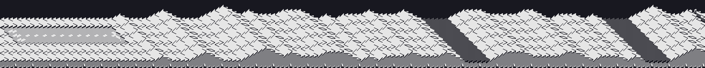

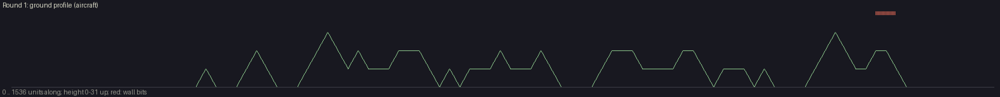 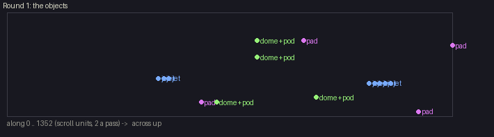

### Round 2

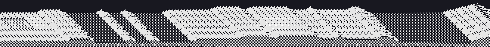

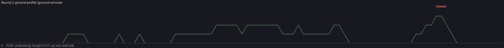 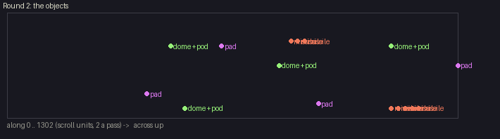

### Round 3

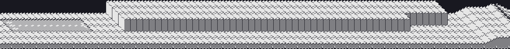

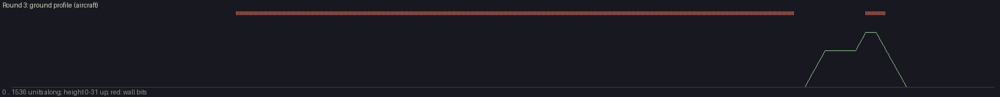 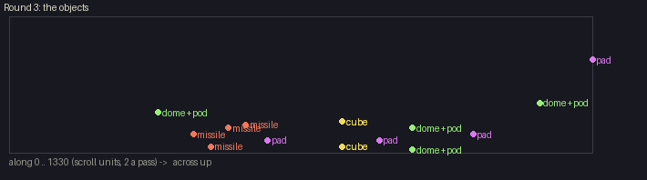

### Round 4

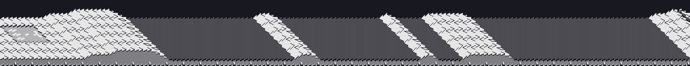

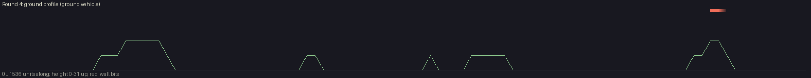 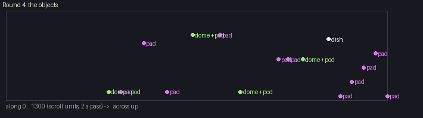

### Round 5

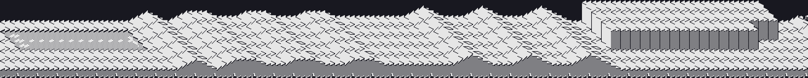

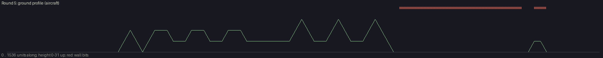 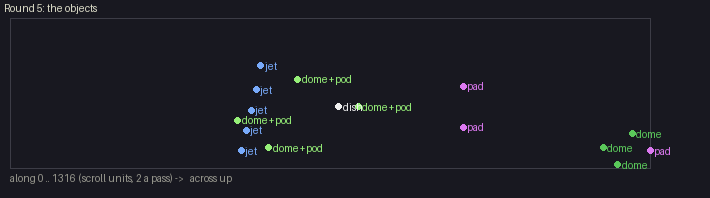

### Round 6

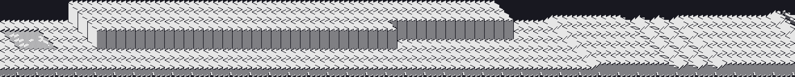

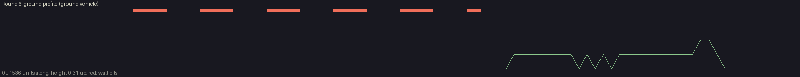 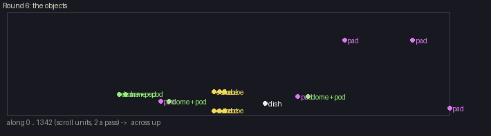

### Round 7

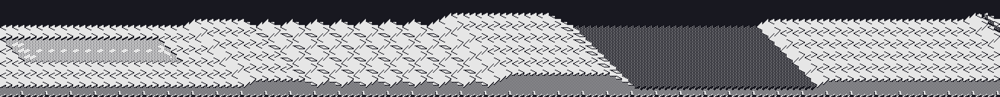

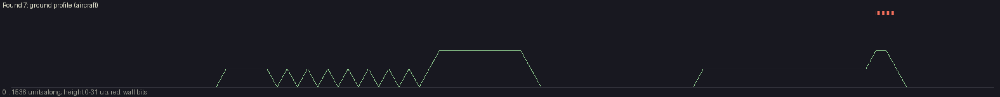 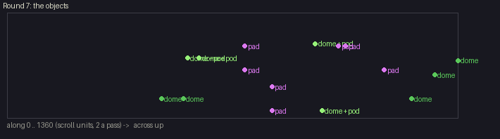

### Round 8

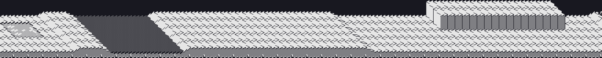

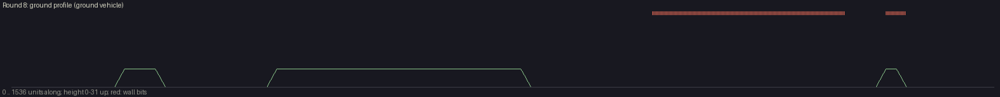 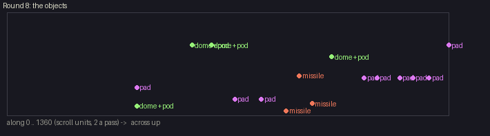

### Round 9

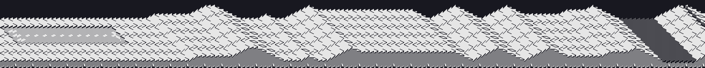

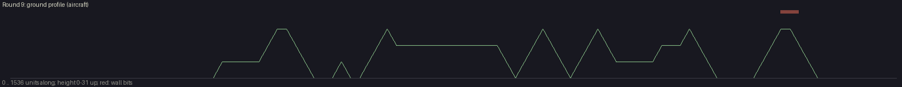 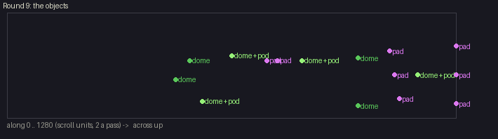

### Round 10

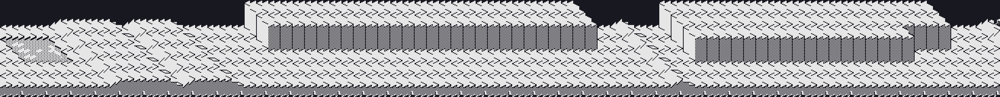

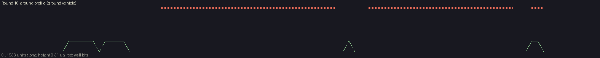 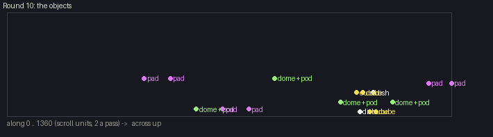

## Title tune

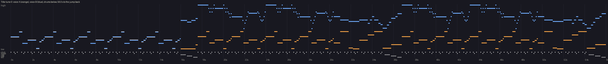

## Explosion

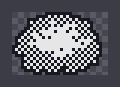
