# MASK III: walkthrough

How the reverse was done, step by step, and which unreal-ng call answered each question. Terms:
[docs/README.md](docs/README.md). Recipes: `../recipes/`.

Every recording is named with its load (ROM speed or the fast LD-BYTES trap) beside every frame number.

## 0. The medium

The release check ([README, Other releases and copies](README.md#other-releases-and-copies)):

1. `tools/fetch_copies.py` greps the collection index (`index/zx-image-locations.tsv`) for the title and copies every
   hit unchanged into `work/candidates/<source>/`, checking its SHA-256 (55 copies: ZXDB, TOSEC, zxart, VTRD, the RZX
   archive, the AY rip, the POKE file; `work/stage1/fetch-copies.txt`).
2. `tools/media_compare.py` compares the data blocks of every tape with the ZXDB TZX and with the IBSA dump
   (`work/stage1/copy-compare.txt`). Two builds come out: build A (Gremlin's own tape, the Space Ace compilation,
   the 128K crack, most TR-DOS conversions) and build B (IBSA and Erbe, the 48K TAP), whose code is shifted from
   offset 3042 and whose 128K block differs in 101 bytes.
3. The original is the ZXDB TZX of build A, a Ramsoft dump of the Gremlin tape: `orig/MASKIII-VENOMStrikesBack.tzx.zip`,
   copied unchanged. ZXDB's POKEs fit build A, and the ZXDB AY rip holds its 128K block byte for byte (at offset
   296).

The tape, block by block, the BASIC and the loader: [doc 3](docs/03-build-and-load.md). No turbo, no protection, no
multiload: five ROM-speed blocks, the last only on a 128K.

A public disassembly of the game exists on GitHub (Bedazzle/Mask-3-Venom); it was not opened or used. The ZXDB RZX
run (`work/candidates/zxdb/mask3.rzx`, 37 200 frames) is another player's; it is used to reach the rooms (6.0) and is
a witness only where said.

## 1. One recording from power-on

`c1` (`tools/capture.py --media A --model 128K --inputs tests/inputs/c1.txt --record-load`): power-on on the 128K,
the 128 menu's Tape Loader, the original tape at ROM speed (the fast LD-BYTES trap and turbo tape off), 22 300 frames
(17 500 for the load, then the 4800 frames of `c1.txt`), `session.ttd` 13.9 MB.

| Frame (c1, ROM-speed load) | What | Call |
| --- | --- | --- |
| 53 | the ROM's `$5B00` | `kit/rs.py stages` |
| 1094 T 37 200 | the loader at `$FF00`, then its copy at `$5E00` | `stages` |
| 15 019 T 60 034 | the game's entry `$9100` | `stages`; `tools/ttd_dump.py` the memory there |
| 15 021 | the `JR` at `$FFFF`, the handler `$9226` entered through it | `stages` |
| 17 750 | the menu (screen `docs/img/play/c1-17750-menu.png`) | the capture's screens |
| 18 400 | room 0, Matt in the teleport pod (`docs/img/play/c1-18400-start-pod.png`) | the screens |

The memory at the entry equals the tape blocks: `$6000-$FDFF` = block 6 byte for byte, RAM 4 `$C000-$CF9F` = block 7,
`$FFFE` = 0, ROM 1 paged ([doc 2, 2.1](docs/02-architecture.md#21-the-machine-budget-and-the-images)).

### Interrupts and timing

The entry `$9100` (`DI`) copies the parked zone set's first part (2.1), sets `R` = `$FF`, `SP` = `$FFF0`, `I` = `$FE`,
fills `$FE00-$FF00` with `$FF`, writes `$18` (`JR`) at `$FFFF` and `JP $9226` at `$FFF4`, and sets `IM 2`. An
interrupt with `$FF` on the bus reads its vector at `$FEFF-$FF00`, `$FF` `$FF` (the table runs to `$FF00`, so any bus value gives the same), and jumps to `$FFFF`; there `$18` (`JR`) takes its offset from `$0000`, the ROM's `DI` = `$F3`, and lands at `$FFF4`: `JP $9226`. (`$0000` is `$F3` in both 128K ROMs and the 48K ROM, so the trick does not depend on the ROM paged.)

`kit/rs.py interrupts --work work/stage1/c1`: IM 2 `$FFFF` → `$9226`, 7279 entries in the 22 300 frames (one a frame
from frame 15 021), 30 032 T an entry, 13.8 % of the CPU over the whole recording (the load included). The handler
`$9226`:

1. pushes every register, `INC ($9224)` (a frame counter), sets the border from `$9225`;
2. in the menu (`$970E` not 0) calls `$9899`, in play `$BB4C` (the keys);
3. on a 128K (`$FFFE` = 0): pages RAM 4 (`$7FFD` = `$14`), calls `$C000` if `$9222` asks for a tune, `$C00A` for
   `$9223`, then `$946F`, `$9421` and `$C003` (the AY player, every frame), and pages RAM 0 back (`$10`);
   on a 48K: `$949F` and `$94C8`, the beeper;
4. calls `$AF82` when `$970D` is 0, and returns with `EI`.

Callees in c1: `$9421`, `$946F`, `$C003` x7279; `$BB4C` x4031; `$AF82` x3955; `$9899` x3248; `$C000` x2; `$C00A` x1.
In the RZX segments the beeper path runs instead: the RZX's memory has `$FFFE` = 1 (its player used a 48K or a
machine the test missed), and `rs.py interrupts --work work/stage1/rec/rzx-16000` gives 3999 entries in 4000 frames,
2600 T an entry, 3.7 % of the CPU, callees `$949F`, `$94C8`, `$AF82`, `$BB4C` each x3999. In play the AY player
costs about 212 T a frame (`c1-play`, [doc 4, 4.3](docs/04-game-loop.md)); the whole-recording average of 30 032 T an
entry is the menu's MenuInterrupt (64 914 T an entry). The beeper path costs 2600 T an interrupt.

`DI` / `EI`: `DI` at the entry and around `$A198` (the zone swap, `$A19D`-`$A1EA` with `EI`), at `$915B` (the new-game
set-up, `EI` at `$9161`), `$9A15`, `$9B18`, `$9EA9`; `EI` at `$CBFC` (the game start). `HALT` only in the menu
(`$9780`, `$9852`), the screen wipe `$A049` and the message pauses `$BB1E-$BB34`.

The main loop `$CC03-$CC59` runs free beside the interrupt (no `HALT`): twelve calls, then `INC ($AF0C)`, the BCD
count `$CC5C`, `JP $CC03` ([doc 2, 2.6](docs/02-architecture.md#26-the-frame-and-the-main-loop)). Frames per pass,
measured:

| Window | Passes | Frames a pass |
| --- | ---: | ---: |
| the RZX, 63 windows of 500 frames in play (`$AF0C` every 500 frames of `work/stage1/rzx/dump`) | median 181 | 2.8 (2.0 to 4.6) |
| `rec/rzx-16000`, 4000 frames, all in step with the RZX (the count of `$CC03` in its L1) | 1600 | 2.5 |
| `rec/rzx-28000`, 4000 frames (a game over and a new game in it) | 736 | 5.4 |
| `rec/menu`, 9565 frames (menu, then 6000 frames standing in the pod) | 2488 | 3.8 |

The heaviest code in play: the room buffer's scan loop `$A1FE-$A200` (`OR (HL)`, `DEC HL`, `JP Z`; 7.6 % of all
T-states in `rec/rzx-16000`, 928 000 runs), then the beeper's wait `$94FC-$94FD` (2.0 %), the object draw `$A5CA-$A637`
and `$A735-$A75E`. The heaviest frames are those of a room change: `$A89D` draws the room into the buffer (4 x 4
characters for each of 40 blocks) and the next pass copies all of it; a per-frame trace of one change is for stage 2.

## 2. Static pass over the medium

`tools/tzxblocks.py list`, the BASIC, the loader: [doc 3](docs/03-build-and-load.md). `work/stage1/dis.skool` is a
plain `sna2skool` listing of block 6 at `$6000`, the reading copy for stage 1.

## 3. The stages and the packers

No packer. The stages: power-on, the BASIC, the loader at `$FF00` → `$5E00`, the game at `$9100` (doc 3, 3.4).

## 4. The medium from source

Stage 2.

## 5. Tool gaps found and fixed in unreal-ng

| Gap | Fix | unreal-ng commit |
| --- | --- | --- |

## 6. The game

### 6.0 The recordings

Every recording keeps its `session.ttd` (reopen with `kit/rs.py open --work DIR --ttd DIR/session.ttd --model 128K`)
and its `l1.json` in its folder: stage 1's under `work/stage1/`, stage 2's and the integration's under
`work/stage2/rec/`. The writers made no captures of their own: their `work/docs/mx*` folders hold windows and traces
cut from these recordings.

| Recording | Made with | Frames | What it reached |
| --- | --- | ---: | --- |
| `c1` | `tools/capture.py --work work/stage1/c1 --media A --model 128K --inputs tests/inputs/c1.txt --record-load`: power-on, the original at ROM speed | 22 300 | the load, the menu, K DEFINE KEYS, 4 KEYBOARD, start, room 0: Matt walks, jumps, fires, takes the BACKLASH mask, the mask keys 1-4 |
| `rec/menu` | `tools/capture.py --work work/stage1/rec/menu --snapshot work/stage1/probe/128K/loaded.szx --inputs tests/inputs/menu.txt` (the snapshot: the original loaded with the LD-BYTES trap on the 128K, the menu up) | 9565 | 1 KEMPSTON, 2 INTERFACE 2, 3 CURSOR (the chosen icon lit), K DEFINE KEYS ("PRESS FIRE", "PRESS UP", ...), P ENTER PASSWORD (16 places, "MASK" typed, ENTER: back to the menu), 4, start; 6000 frames with no key: Matt stays in the pod and nothing reaches him |
| `rec/rzx-00000` .. `rec/rzx-32000` | `tools/rzx_segment.sh FROM FROM+4000`: `kit/rzx_dump.py` writes the RZX's state at frame FROM (`snap-FROM.z80`), `tools/rzx_script.py` its keys for frames FROM..FROM+3999 (`tests/inputs/rzx-FROM.txt`), `capture.py --snapshot` replays them, `kit/rzx_match.py` compares the screens with the RZX's | 4000 each | the RZX's rooms from its own state at each start (below) |
| `rec/rzx-36000` | the same, frames 36 000-37 199 (the RZX's end) | 1200 | the RZX's last room 15, the ending and the menu |
| `stage2/rec/play2` | `tools/capture.py --work work/stage2/rec/play2 --snapshot work/stage1/probe/128K/loaded.szx --model 128K --inputs tests/inputs/s2play.txt` | 7370 | Kempston play, the four passwords typed, the four door lamps lit, BREAK back to the start, the ending by POKE (said in the script) |
| `stage2/rec/c48` | `tools/capture.py --work work/stage2/rec/c48 --media A --model 48K --inputs tests/inputs/c48.txt --record-load` | 2175 | the 48K path: the music load skipped, the beeper in the interrupt; not a read build (the ROM RAM test reads the image as data) |
| `stage2/rec/door` | `tools/capture.py --work work/stage2/rec/door --snapshot work/stage1/probe/128K/loaded.szx --model 128K --inputs tests/inputs/door.txt` | 1975 | PasswordFlags POKEd to `$FF` (said in the script), door 1 (x `$68`) with down: the warp and room 3 at frame 981 |
| `stage2/rec/cheat` | `tools/capture.py --work work/stage2/rec/cheat --snapshot work/stage1/probe/128K/loaded.szx --model 128K --inputs tests/inputs/cheat.txt --port-base 37780` | 2114 | JUDGE DREDD typed at ENTER PASSWORD: CheatOn `$BB77` = `$FF`; LAVA SHOT POKEd into slot 0 (said in the script) and fired from frame 1404, its charges still 99 at frame 2100 |
| `stage2/rec/masks` | the same with `tests/inputs/masks.txt` | 2078 | STREAMER, ULTRA FLASH, MIRAGE and PENETRATOR POKEd into the four slots (said in the script) and fired; PENETRATOR released inside the hill: Explosion `$BB78` at frames 1249-1250 |
| `stage2/rec/door3` | the same with `tests/inputs/door3.txt` | 3009 | PasswordFlags, RoomScreen and Matt's x POKEd (said): door 3 with down, room 7 and LIFTER 99 in slot 0 (WarpBonus `$BA21`, frame 969); then EnemyKind `$BFB0` POKEd to 10: SpawnKind10 at frame 1478, kinds 18 and 19 to frame 1968; later Matt dies and a new game starts |
| `stage2/rec/kind6` | the same with `tests/inputs/kind6.txt` | 2275 | EnemyKind `$BFB0` POKEd to 6 in room 0 (said): SpawnKind6 frames 675-1891, kind 16 |

The segments stay in step with the RZX (screens within 1500 bytes) for 500 to 4000 frames, then drift: the RZX's
player used the Interface 2 stick and the game's frame (a free main loop beside the interrupt, 2.8 frames a pass) does
not land the same keys on the same pass after a few hundred frames. Each segment still starts on the RZX's own state,
so together they reach every room; after the drift the play is the RZX's keys on a slightly different game, and in
some segments Matt dies and a new game starts.

| Segment | In step to | Rooms (from `$950A` in the RZX dump) | Also reached |
| --- | ---: | --- | --- |
| `rzx-00000` | 4000 | 0, the pod, 10 | the teleport effect |
| `rzx-04000` | 1500 | 10, 1 | |
| `rzx-08000` | 1000 | 2 | energy out, MISSION TERMINATED, the menu with the new HISCORE, a new game |
| `rzx-12000` | 3000 | 11, 4, 12 | the caverns, the lava guns, the pod effect |
| `rzx-16000` | 4000 | 12, 5 | |
| `rzx-20000` | 2000 | 6, 3 | |
| `rzx-24000` | 1500 | 3, 13 | |
| `rzx-28000` | 500 | 8, 7 | the moon, MISSION TERMINATED, a new game |
| `rzx-32000` | 1000 | 14, 9 | the menu with HISCORE 00019090 |
| `rzx-36000` | 1000 | 15 | the ending: "YOU HAVE FOUND SCOTT......" at frame 250 (RZX 36 250), then the menu |

The ending is reached in `rec/rzx-36000`: room 15's last screen (`$A89D` jumps to `$ADF6` there) and "YOU HAVE FOUND
SCOTT......", with 31 004 points, then the menu (its HISCORE shows 00000000). Stage 2 and the integration reached the
passwords and doors 1 and 3, the Kempston control in play, the 48K beeper path, the cheat, and six of the ten masks in
use (BACKLASH, LIFTER, LAVA SHOT, STREAMER, ULTRA FLASH, MIRAGE, PENETRATOR's wall death). Not reached yet: doors 0
and 2, the Cursor control in play, HEALER and JACKRABBIT in use, the cheat's safe floor, enemy kinds 9 and 11.

### 6.1 The screens

Every screenshot in `docs/img/play` (512 x 384, `kit/screen_shot.py` or the capture's screens), by recording and frame.

The load and the menu:

- `c1` frame 3000, the loading screen complete: 
- `c1` frame 17 750, the menu after the load: 
- `c1` frame 17 850, DEFINE KEYS: 
- `rec/menu` frame 750, 3 CURSOR chosen (its icon lit): 
- `rec/menu` frame 1250, K DEFINE KEYS asking for fire: 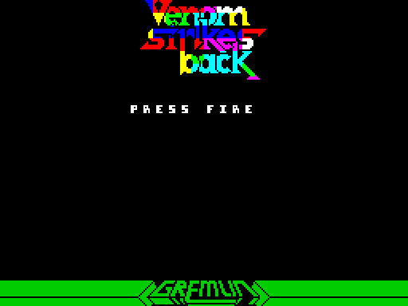
- `rec/menu` frame 2750, P ENTER PASSWORD with "MASK" typed: 
- `play2` frame 500, MAYHEM typed at ENTER PASSWORD: 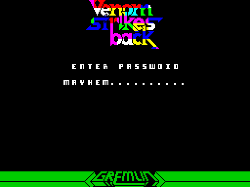
- `play2` frame 2500, PETALS OF DOOM typed: 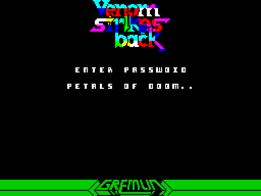

Play:

- `c1` frame 18 400, room 0 at the start, Matt in the pod: 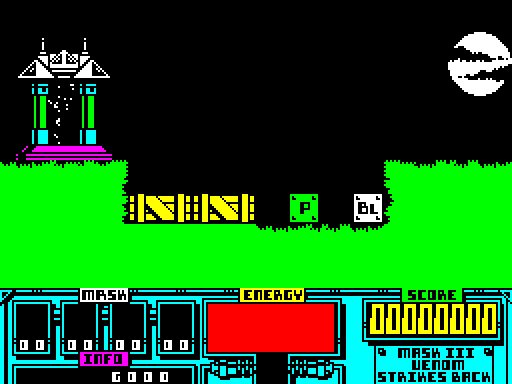
- `c1` frame 18 600, PENETRATOR and BACKLASH lying in room 0: 
- `c1` frame 19 300, BACKLASH taken: 
- `rec/rzx-00000` frame 500 (RZX 500), room 0, Matt at a pod: 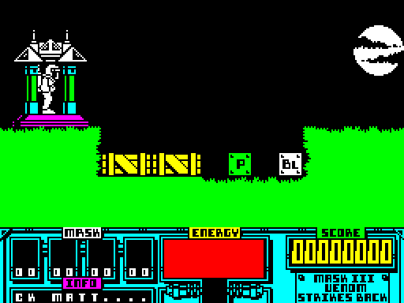
- `rec/rzx-00000` frame 1500, the first enemies and a turret, room 0: 
- `rec/rzx-00000` frame 3000, room 10, the base: 
- `rec/rzx-08000` frame 1250, room 2, the surface: 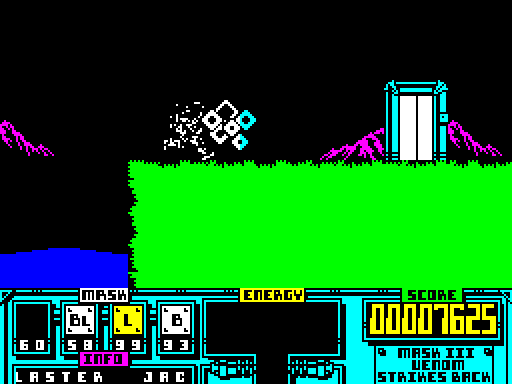
- `rec/rzx-12000` frame 250 (RZX 12 250), the caverns: 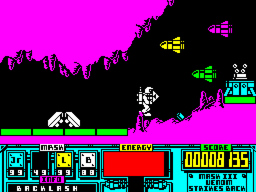
- `rec/rzx-12000` frame 750, the caverns' lava and guns: 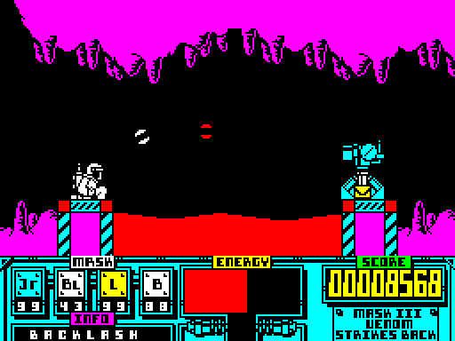
- `rec/rzx-12000` frame 1750, a pod in the caverns: 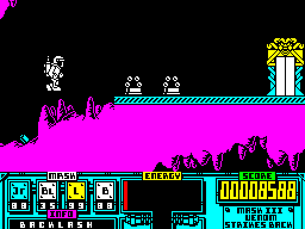
- `rec/rzx-12000` frame 2750, the base, Matt in a booth: 
- `rec/rzx-28000` frame 250, the moon: 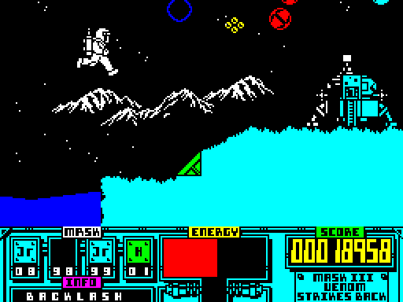
- `door` frame 750, the four password doors, room 0 screen 5: 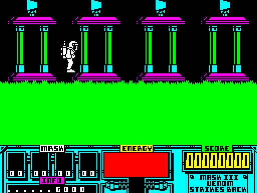
- `play2` frame 4750, the four door lamps lit: 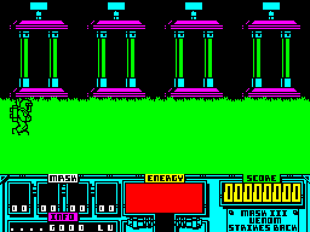
- `door3` frame 1000, room 7 after door 3, LIFTER in slot 0: 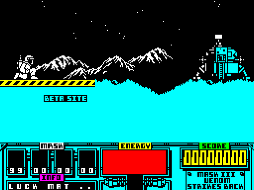
- `door3` frame 1750, SpawnKind10's group (kinds 18 and 19) on the moon: 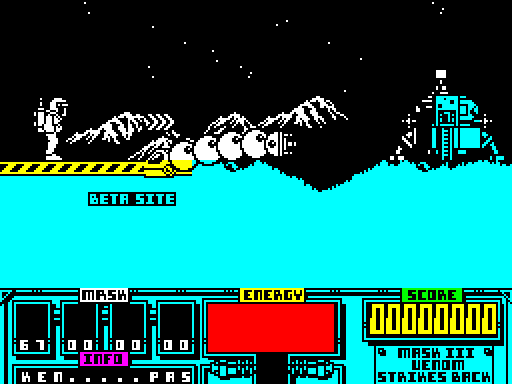
- `kind6` frame 1000, SpawnKind6's object of kind 16 in room 0: 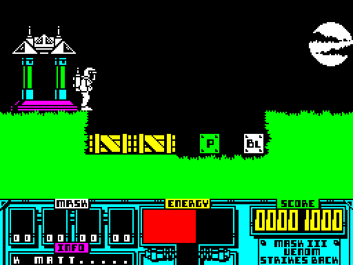
- `cheat` frame 1750, a LAVA SHOT in flight, the slot still at 99: 
- `masks` frame 1000, ULTRA FLASH in the slot in use, fire held: 
- `masks` frame 1249, PENETRATOR held inside the hill, before the release: 

The end of a game:

- `rec/rzx-28000` frame 750, MISSION TERMINATED: 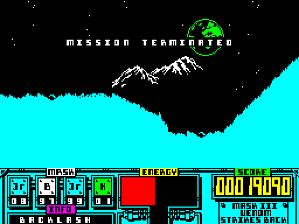
- `rec/rzx-28000` frame 3250, the menu with HISCORE 00019090: 
- `play2` frame 6500, WELL DONE: 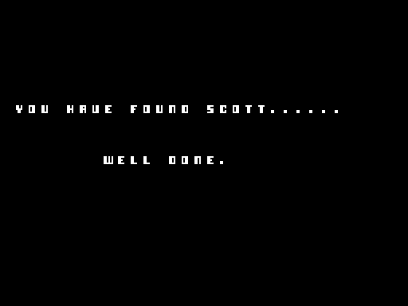
- `rec/rzx-36000` frame 250 (RZX 36 250), the ending: 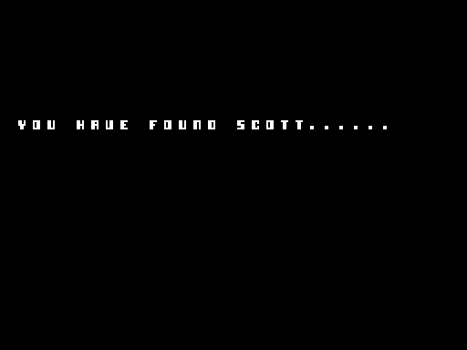

### 6.2 The animations

Every GIF the documents link, with the recording and the frames it was cut from (`frame:T` for a window inside a
frame). `c1` and `rec/...` are under `work/stage1/`, `stage2/rec/...` under `work/`.

| File (`docs/img/`) | Document | Recording | Frames |
| --- | --- | --- | --- |
| `load/load-c1.gif` | doc 3 | `c1` | 1000-15 100, every 200th |
| `routines/Interrupt.gif` | doc 4 | `c1` | 19 001 |
| `routines/MainLoop.gif` | doc 4 | `c1` | 19 000-19 003 |
| `routines/DrawRoom-heaviest.gif` | doc 4 | `rec/rzx-04000` | 463-471 |
| `play/room-change-10-1.gif` | doc 4 | `rec/rzx-04000` | 452-482 |
| `routines/AskKey.gif` | doc 5 | `c1` | 17929:69000-17930:3000 |
| `routines/ReadControls.gif` | doc 5 | `c1` | 18669:38400-18669:39420 |
| `play/keys.gif` | doc 5 | `c1` | 18 540-19 270 |
| `play/mask-keys.gif` | doc 5, doc 8 | `rec/rzx-12000` | 1255-1480 |
| `play/password.gif` | doc 5 | `stage2/rec/play2` | 196-560 |
| `routines/DrawRoom-room0.gif` | doc 6 | `c1` | 18351:39000-18357:41000 |
| `routines/DrawObjects.gif` | doc 6 | `c1` | 18669:61700-18671:42000 |
| `routines/Dissolve.gif` | doc 6 | `c1` | 18357:70400-18358:3600 |
| `routines/AnimateZone.gif` | doc 6 | `rec/rzx-12000` | 750:11400-750:15700 |
| `routines/DrawRoom-decode.gif` | doc 7 | `rec/rzx-00000` | 2311:0-2313:0 |
| `play/pod.gif` | doc 7, doc 10 | `rec/rzx-00000` | 2290-2330 |
| `routines/Teleport.gif` | doc 7 | `rec/rzx-00000` | 2309:0-2314:0 |
| `routines/Spawn.gif` | doc 7 | `rec/rzx-00000` | 977:0-979:0 |
| `routines/KindFaller.gif` | doc 7 | `rec/rzx-00000` | 975:0-1000:0 |
| `play/kill.gif` | doc 7, doc 10 | `rec/rzx-00000` | 978-1010 |
| `routines/KindTurret.gif` | doc 7 | `rec/rzx-12000` | 1255:0-1290:0 |
| `routines/KindWalker.gif` | doc 7 | `rec/rzx-12000` | 2125:0-2160:0 |
| `routines/DrawScore.gif` | doc 8 | `c1` | 18669:49000-18669:57700 |
| `play/hud-update.gif` | doc 8 | `rec/rzx-12000` | 222-320 |
| `play/game-over.gif` | doc 8, doc 9, doc 10 | `rec/rzx-28000` | 330-1060 |
| `play/ending.gif` | doc 8, doc 10 | `stage2/rec/play2` | 6080-6640 |
| `routines/StartEffects.gif` | doc 9 | `c1` | 19 325:0-19 328:0 |
| `routines/BeeperTick.gif` | doc 9 | `rec/rzx-00000` | 995:0-997:0 |
| `routines/MattStep-jump.gif` | doc 10 | `rec/rzx-00000` | 858:0-889:0 |
| `play/jump.gif` | doc 10 | `rec/rzx-00000` | 852-894 |
| `play/energy-out.gif` | doc 10 | `rec/rzx-32000` | 640-800 |
| `routines/Penetrator.gif` | doc 10 | `rec/rzx-00000` | 2515:0-2565:0 |
| `play/penetrator.gif` | doc 10 | `rec/rzx-00000` | 2505-2615 |
| `routines/MattLongJump.gif` | doc 10 | `rec/rzx-12000` | 1297:0-1330:0 |
| `play/jackrabbit.gif` | doc 10 | `rec/rzx-12000` | 1288-1432 |
| `routines/FireMask-lifter.gif` | doc 10 | `rec/rzx-12000` | 2098:0-2120:0 |
| `play/lifter.gif` | doc 10 | `rec/rzx-12000` | 2084-2222 |
| `routines/Death.gif` | doc 10 | `rec/rzx-04000` | 1556:0-1640:0 |
| `play/death.gif` | doc 10 | `rec/rzx-04000` | 1520-1700 |
| `routines/PasswordWarp.gif` | doc 10 | `stage2/rec/door` | 843:0-900:0 |
| `play/door-warp.gif` | doc 10 | `stage2/rec/door` | 700-1000 |
| `routines/Ending.gif` | doc 10 | `rec/rzx-36000` | 0:0-40:0 |

### 6.3 The images and the state

[Doc 2, 2.1 and 2.4](docs/02-architecture.md#21-the-machine-budget-and-the-images): the image as loaded is the code at
the entry byte for byte; in play only the zone sets, the buffers, the IM 2 table and variables change. The state
variables were found by sampling the RZX's memory every 500 frames (`work/stage1/rzx/dump/mem.bin`) and reading the
code that writes them.

### 6.4 The first map and the sprites

[Doc 2, 2.5](docs/02-architecture.md#25-the-rooms-as-data-the-first-map): the room table at `$953B`, the maps at
`$7600`, the blocks at `$8500`, the zone sets swapped by `$A198`; `tools/roommap.py` draws all 16 rooms from these
bytes; `tools/spritesheet.py` the sprites at `$CD60`.

## 7. Review
