# 1. Game design

What this covers: the game as a player meets it.

- the premise and the goal;
- the controls, in short (doc 5 has the detail);
- every screen: the loading screen, the menu, DEFINE KEYS, ENTER PASSWORD, play in each of the four zones, MISSION
  TERMINATED, the high score and the ending;
- the play panel;
- the world: 16 rooms of six screens in four zones, and the way through;
- the rules as the game plays them: energy, the masks and their charges, the pods, the doors and the passwords, the
  score, the high score;
- the enemies, with their pictures and numbers;
- the key moments, with the frames they were taken at.

The recordings it rests on ([WALKTHROUGH 6.0](../WALKTHROUGH.md#60-the-recordings)):

- `c1`: power-on on the 128K, the original tape at ROM speed, the menu, DEFINE KEYS, play in room 0;
- the RZX segments `rec/rzx-00000` .. `rec/rzx-36000`: another player's complete run (ZXDB), replayed from the RZX's
  own state every 4000 frames; together they reach every room and the ending. Each segment stays in step with the
  RZX only 500-4000 frames ([WALKTHROUGH 6.0](../WALKTHROUGH.md#60-the-recordings)), then plays the RZX's keys on a
  drifted game: the deaths, MISSION TERMINATED, the new games and the menus with HISCORE 00019090 in `rzx-08000`,
  `rzx-28000` and `rzx-32000` are the replay's, not the original player's. Hiscore `$9D16` is written only by GameOver
  (`$BAF3-$BAFC`), and each segment starts again from the RZX's own state, where the player had not died: so
  `rzx-36000`'s menu shows 00000000;
- stage 2's `play2` (the four passwords typed, the doors lit, the end by POKEs) and `door` (a password door taken,
  the flags set by a POKE in the menu, said in its script).

Frame numbers are those of each recording as it was made. A screenshot of frame N shows the screen at the end of
that frame.

## 1.1 The premise and the goal

MASK III: VENOM Strikes Back is a flip-screen platform shooter by Gremlin Graphics (1988), from the M.A.S.K. toys and
cartoon. The player is Matt Trakker, the leader of M.A.S.K. VENOM has kidnapped his son Scott. Matt has to find him.

The game is one long run through 16 rooms. A room is six screens wide. Walking off the screen's edge shows the next
screen of the room; the pod at the room's end sends Matt to another room. Rooms belong to four zones, each with its
own character set and colours.

The goal is room 15's last screen. Reaching it ends the game with "YOU HAVE FOUND SCOTT......" and "WELL DONE."
There is no second level, no lives and no continue: one death ends the game.

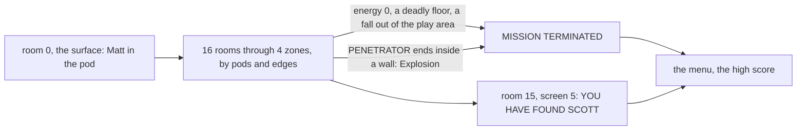

The witness is `rec/rzx-36000` frame 250: the ending screen with 31 004 points (1.8).

## 1.2 The controls

The menu offers four control methods: 1 Kempston, 2 Interface 2, 3 Cursor, 4 the keyboard. K redefines the five
keyboard keys, P asks for a password. Fire starts the game. GameEntry picks the Kempston by itself when a Kempston
interface answers (KempstonTest `$9F62`).

| Action | Kempston, Interface 2, Cursor, keyboard |
| --- | --- |
| walk | left, right |
| jump | up; with JACKRABBIT in use, a long jump |
| take a mask, enter a pod or a door | down |
| use the mask in the slot | fire |
| choose a slot | keys 1-4 |
| abort the game | BREAK (CAPS SHIFT and SPACE): back to the menu |

The keyboard keys as loaded are SPACE (fire), P, L, Q, W (KeysUser `$A08B`). The Interface 2 keys are 0 9 8 6 7, the
Cursor keys 0 7 6 5 8. The ZXDB instructions name an H pause and a Q abort; the code has neither (stage 2). The
details, ports and the menu's code are in [doc 5](05-controls.md).

## 1.3 The screens

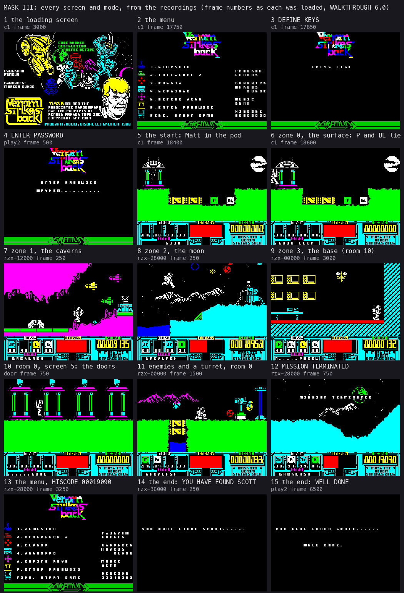

*`tools/fig_screens.py` from the screenshots in `docs/img/play/`; each panel names its recording and frame.*

| # | Screen | Recording, frame | What it shows |
| ---: | --- | --- | --- |
| 1 | the loading screen | `c1` 3000 | Matt, the M.A.S.K. vehicles and VENOM, loaded as block 5 |
| 2 | the menu | `c1` 17 750 | the logo, the four control icons, K, P, the high score |
| 3 | DEFINE KEYS | `c1` 17 850 | "PRESS FIRE", then UP, DOWN, LEFT, RIGHT, each a key not taken yet |
| 4 | ENTER PASSWORD | `play2` 500 | 16 places; MAYHEM typed |
| 5 | the start | `c1` 18 400 | room 0, screen 0, Matt in the pod |
| 6 | zone 0, the surface | `c1` 18 600 | PENETRATOR and BACKLASH lying beside the bridge |
| 7 | zone 1, the caverns | `rec/rzx-12000` 250 | magenta rock, the lava |
| 8 | zone 2, the moon | `rec/rzx-28000` 250 | the moon's surface, its deadly floor |
| 9 | zone 3, the base | `rec/rzx-00000` 3000 | room 10, VENOM's base |
| 10 | the doors | `door` 750 | room 0, screen 5: the four password doors |
| 11 | enemies and a turret | `rec/rzx-00000` 1500 | room 0 |
| 12 | MISSION TERMINATED | `rec/rzx-28000` 750 | printed a letter at a time |
| 13 | the high score | `rec/rzx-28000` 3250 | the menu with HISCORE 00019090 |
| 14 | the ending | `rec/rzx-36000` 250 | "YOU HAVE FOUND SCOTT......" |
| 15 | the ending | `play2` 6500 | "WELL DONE." |

The play screen has two parts. The play window is character rows 0-17, redrawn from the room. The panel is rows
18-23 (1.4).

## 1.4 The play panel

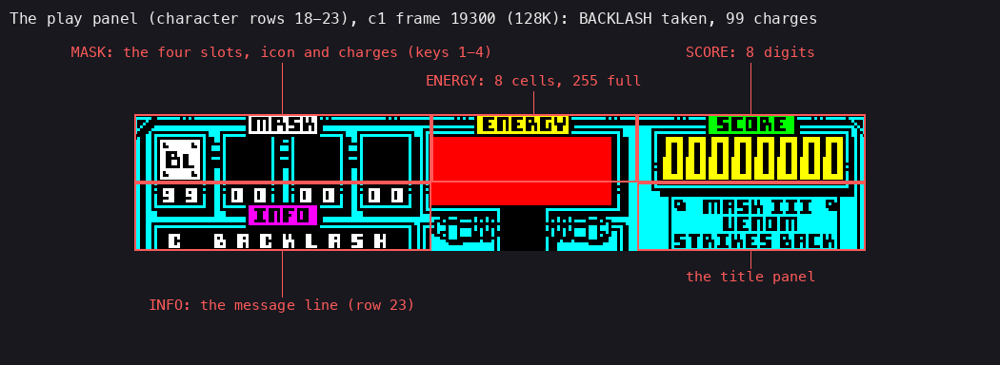

*`tools/fig_screens.py`: rows 18-23 of `c1` frame 19 300, three times the size; BACKLASH was just taken.*

| Part | Where | What it shows | Drawn by |
| --- | --- | --- | --- |
| MASK | left, rows 18-21: the label on 18, the icons on 19-20, the charges on 21 | the four slots: each a mask icon and its charges; the slot in use blinks | DrawAllSlots `$AFFA`, DrawCurrentSlot `$AF53` |
| ENERGY | middle | 8 cells; 255 is full, each cell 32 units, partial cells drawn | DrawEnergyBar `$AEA8` |
| SCORE | right | 8 BCD digits | DrawScore `$AE60` |
| INFO | left: the label on row 22, the line on row 23 | the message line: a mask's name, a password, "CODE BROKEN" | Scroller `$AF82`, in the interrupt |
| the title | right, rows 21-23 | MASK III | the panel picture PlayPanel `$F600` |

The menu draws the panel from PlayPanel `$F600` at every start (`$981C`). At the first start that is the picture
loaded from tape; NewGame's BuildTables then writes its tables over `$F600`, so every later menu first copies the
panel back from the screen (SaveHud `$9CA0`, while HudSaved `$9710` is 0). In play the game only updates the numbers
and icons ([doc 8](08-hud-and-text.md)).

## 1.5 The world

The world is 16 rooms. Each room is a strip of six screens, 48 blocks across and 5 down; a block is 4 x 4
characters. The room table at `$953B` gives each room its zone, its exits and one enemy kind for each screen
([doc 2](02-architecture.md#25-the-rooms-as-data-the-first-map)).

| Zone | Name in these documents | Rooms | What it looks like | Its hazard |
| ---: | --- | --- | --- | --- |
| 0 | the surface | 0-3 | green hills, water, crates, the moon in the sky | the deadly floor (character `$EA`) |
| 1 | the caverns | 4-6 | magenta rock and lava | the deadly floor `$EA`; LavaDrain: 2 energy a head bump in a jump |
| 2 | the moon | 7-9 | the lunar surface | the deadly floor `$EA`; MoonFloor: characters `$FE` and up kill; MoonMasks empties every PENETRATOR slot |
| 3 | the base | 10-15 | VENOM's base, cyan | the deadly floor (character `$ED`) |

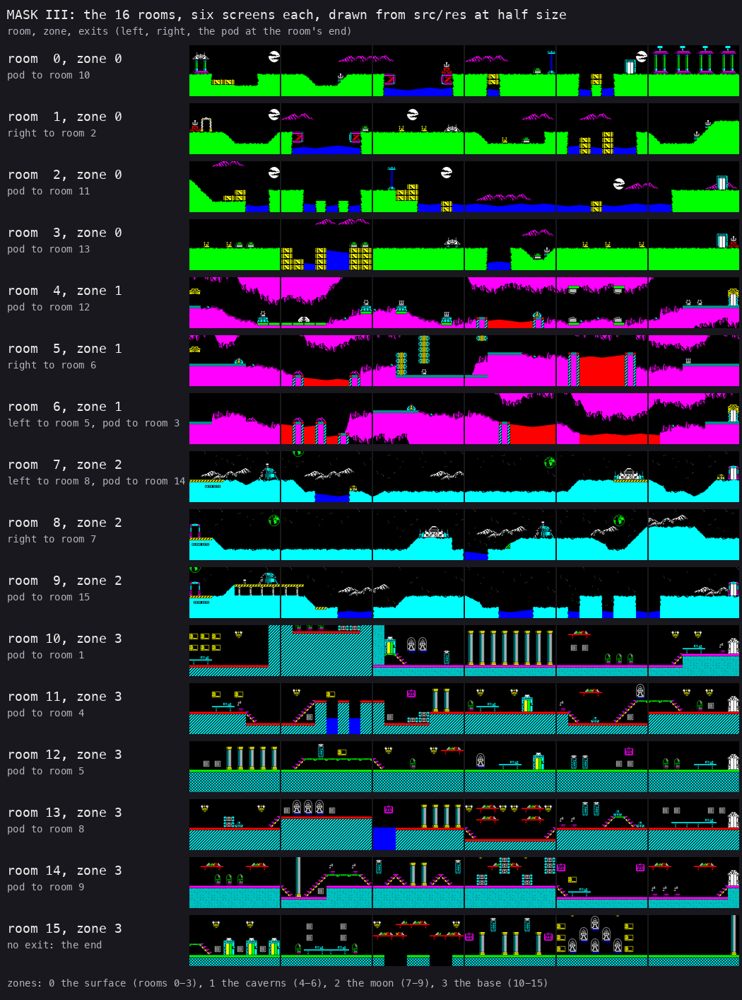

*`tools/fig_world.py`: every room drawn from `src/res` (the maps, the blocks, the room table and the zone's character
set), as a new game has them.*

Each zone in full, with the masks lying in its rooms (numbered red boxes) and the enemy kind of each screen:

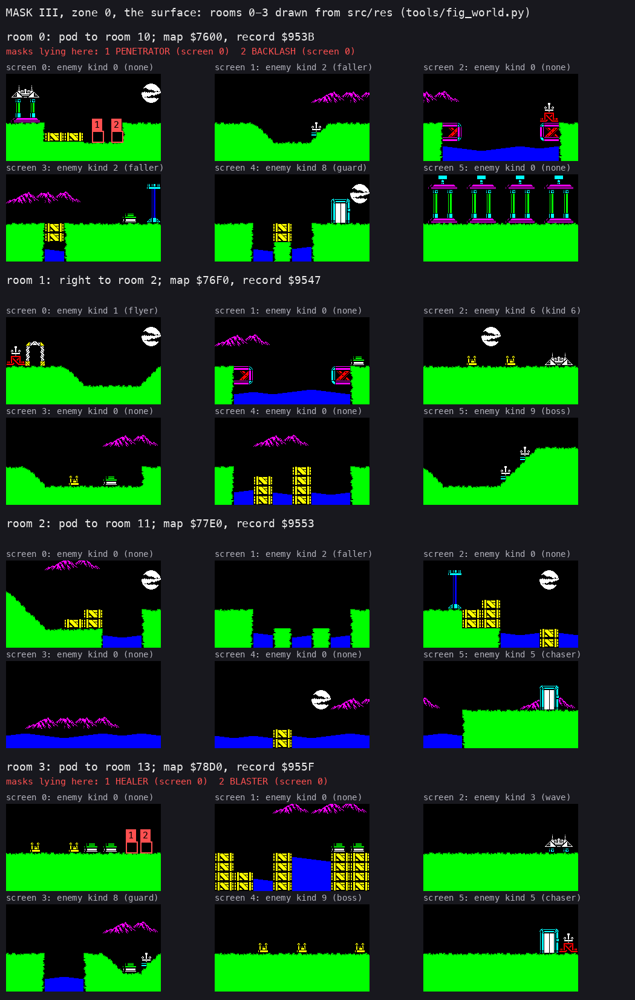

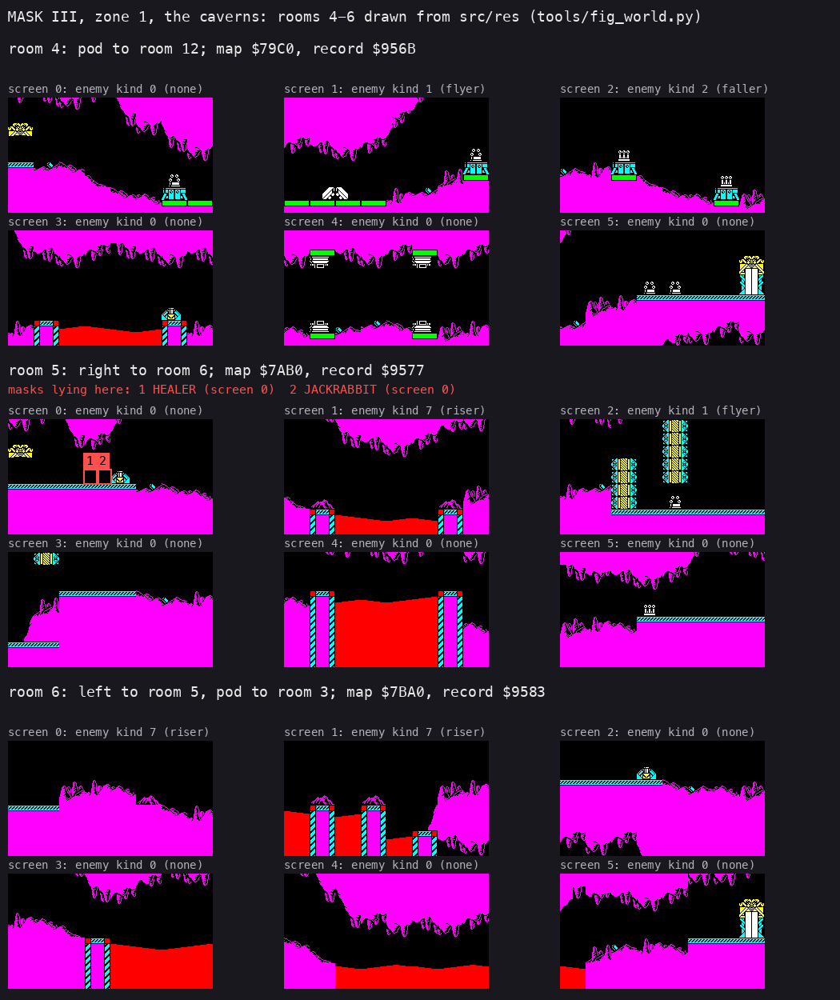

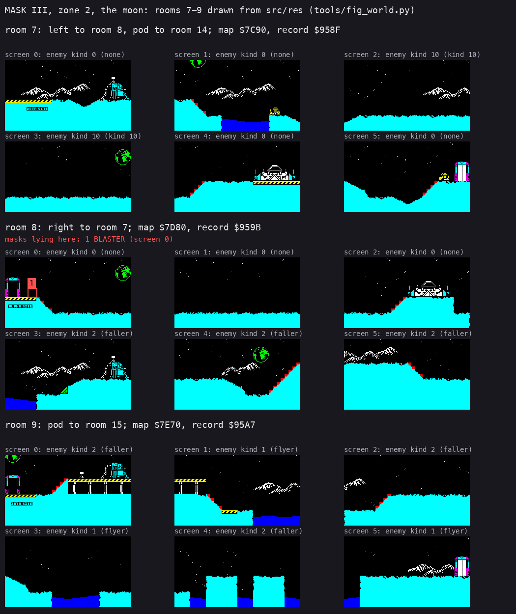

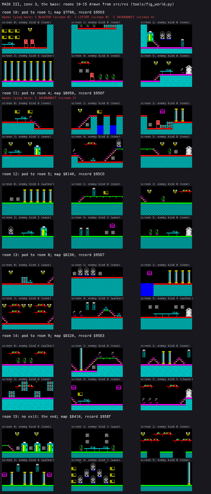

*`tools/fig_world.py`, the same sources. The screen shows character rows 2-19 of the 20 the map has.*

### The way through

Most rooms have one exit: the pod at the room's end. Rooms 1, 5 and 8 have no pod; they open to the right, into
rooms 2, 6 and 7. Room 15 has no exit at all.
So the way through is one fixed order of rooms:

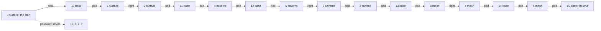

The RZX run takes exactly this order (`$950A` in its memory every 500 frames, WALKTHROUGH 6.0). A base room comes
between the other rooms, except at the three right exits: 1 -> 2, 5 -> 6 and 8 -> 7 (`src/res/tables/rooms.csv`).

The four password doors in room 0, screen 5, are short cuts: door 0 goes to room 11, door 1 to room 3, doors 2 and 3
to room 7 (WarpRooms `$BA1D` = `0B 03 07 07`). Door 3 also gives LIFTER and raises BACKLASH (1.6).

### Against the published maps

The ZXDB entry lists maps, but no map file is in the case's collection (`work/candidates/zxdb`). The rooms here are
drawn from the game's own bytes; WALKTHROUGH 6.4 checked the drawing against the recordings' screens (room 10,
screen 5 at RZX frame 4000).

The point: the world is a single path through 16 rooms. The passwords skip parts of it.

## 1.6 The rules

### Energy, and no lives

Matt has one energy value, Energy `$AEA6`: 255 when a game starts, and the game ends at 0. There are no lives.

| What takes energy | How much | Where |
| --- | ---: | --- |
| touching an enemy | the enemy's damage (1.7): 3 to 255 | Damage `$C2CA` |
| a block item (block `$1B`) touched | 25 (read from the code: no recording takes one) | TakeBlockItem `$B33D` |
| the head bumps a ceiling in a jump, zone 1 only | 2 | LavaDrain `$BA93`, from MattJumpRise `$B83E` and JackrabbitJump `$B91C` / `$B925` |
| a deadly floor | all: Matt dies at once | DeadlyFloor `$B2F9`, MoonFloor `$B32C` |
| a fall out of the play area (y + `$30` at least `$A0`) | all: DeathFlag (read from the code: no recording falls out) | MattStep `$B403-$B40E` |
| PENETRATOR ending inside a wall | all: Explosion, then GameOver | EndPenetrator `$BDD1` |

HEALER is the only way back: 2 energy a charge. Energy never refills between rooms.

While PENETRATOR is held, enemies cannot touch Matt (TouchesMatt returns at once). A chaser costs charges instead:
each pass it runs while PENETRATOR is on, KindChaser sets PenetratorCost `$BE0D` to `$10` (`$C686-$C68E`), and the
next PENETRATOR step takes `$10` BCD more, 10 or 11 charges instead of 0 or 1 (read from the code).

LavaDrain is a ceiling, not a floor: MattJumpRise and JackrabbitJump call it when the character above Matt's head is
solid, and it takes 2 only when the live zone is 1.

```z80
LavaDrain:                ; $BA93
  PUSH AF
  LD A,(ZoneSlots)        ; the live zone
  DEC A
  JR NZ,l_BAA5            ; not the caverns: nothing
  LD A,(Energy)
  SUB $02
  JR NC,l_BAA2
  XOR A                   ; not below 0
l_BAA2:
  LD (Energy),A
l_BAA5:
  POP AF
  RET
```

```z80
Damage:                   ; $C2CA, IX = the enemy
  LD A,(Energy)
  SUB (IX+$1E)            ; the template's damage, copied at the spawn
  LD (Energy),A
  RET NC
  XOR A                   ; not below 0
  LD (Energy),A
  RET
```

An enemy that touches Matt also dies: TouchesMatt leads to Damage, then AwardScore and Explode. So a collision
costs energy and still gives the enemy's score.

At 0 energy the main loop sets Matt's state 9; MattNoEnergy waits 50 passes and calls GameOver. A deadly floor sets
DeathFlag; Death sinks Matt through the floor in 32 steps and calls GameOver ([doc 4, 4.1](04-game-loop.md#41-the-program-as-a-state-machine)).

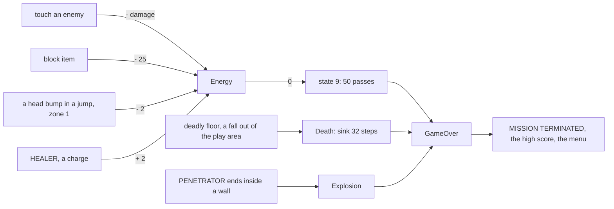

Worked example: a chaser (damage 255) kills a full Matt in one touch. A faller (damage 10) takes 26 touches:
255 = 25 x 10 + 5, so the 26th touch reaches 0.

### The masks

The masks are M.A.S.K.'s weapons and tools. Matt has four slots (MaskSlots `$AF2B`). A slot holds a mask kind,
its charges (BCD, 99 when taken) and its level.

| Kind | Mask | Use (fire) | Charges a use | Lying in |
| ---: | --- | --- | --- | --- |
| 1 | PENETRATOR | held: Matt dissolves and walks through walls; enemies cannot touch him | 1 every second pass | room 0 |
| 2 | ULTRA FLASH | nothing | | no room |
| 3 | MIRAGE | nothing | | no room |
| 4 | HEALER | held: + 2 energy | 1 | rooms 3, 5 |
| 5 | JACKRABBIT | a shot; up makes a long jump | 1 | rooms 5, 10, 11 |
| 6 | LIFTER | a shot that lifts | 8 | room 10; door 3 |
| 7 | BLASTER | a shot | 1 | rooms 3, 8, 10 |
| 8 | BACKLASH | a shot | 1 | room 0 |
| 9 | LAVA SHOT | a shot | 1 | no room |
| 10 | STREAMER | a shot | 1 | no room |

The shot's power is the slot's level, from MaskLevels `$AF3B`: 0 0 0 0 0 1 1 3 2 6 1 for kinds 0-10. A charge goes
when the mask is used; at none the slot becomes EMPTY again (UseCharge `$B210`).

Taking a mask: Matt stands on its icon and presses down. CheckPickups `$B126` puts it in the slot in use when that
slot is EMPTY; otherwise in the first EMPTY slot; with no EMPTY slot, it replaces the mask in use.

```z80
  LD IX,(CurrentSlot)
  LD A,(IX+$01)           ; the kind in the slot in use
  AND A
  CALL Z,ShowNameKeep     ; EMPTY: show the name, keep Z
  CALL NZ,FindEmptySlot   ; else the first EMPTY slot
  LD (IX+$01),C           ; the kind
  LD (IX+$02),$99         ; 99 charges, BCD
  LD B,$00
  LD HL,MaskLevels
  ADD HL,BC
  LD A,(HL)
  LD (IX+$03),A           ; its level
  CALL DrawAllSlots
```

```text
take(mask):
    slot = the slot in use
    if slot is not EMPTY: slot = the first EMPTY slot (or stays the slot in use)
    slot.kind = mask; slot.charges = 99; slot.level = MaskLevels[mask]
    mark the mask taken (bit 7 of its PickupTable record)
```

Worked example: `c1` frame 18 600 shows PENETRATOR and BACKLASH lying in room 0. By frame 19 300 Matt has taken
BACKLASH: the panel's slot shows its icon and 99, the message line says BACKLASH (the figure in 1.4).

Four masks are named in MaskNames but lie in no room: ULTRA FLASH, MIRAGE, LAVA SHOT and STREAMER. ULTRA FLASH and
MIRAGE do nothing when fired (a `RET` at `$BE39` and `$BE3A`). No play can hold them; the `masks` and `cheat`
recordings give them by a POKE: STREAMER and LAVA SHOT fire their shots, ULTRA FLASH and MIRAGE run their `RET`s
(25 times each, frame 1000 below shows ULTRA FLASH held).

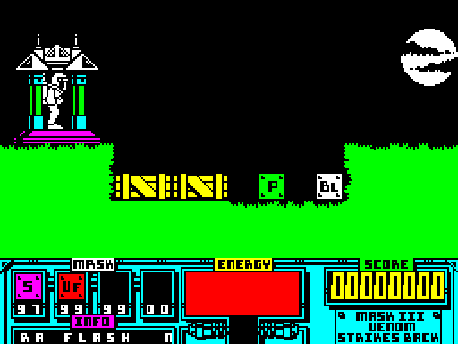

### The pods

A pod is the booth at the end of a room (screen 5), and room 0's start. Matt stands on it (characters `$14` / `$15`)
and presses down (`$B473-$B48A`): Teleport `$B6B3` sets the room from byte 2 of the room table and Matt's place from
byte 5, and jumps to DrawRoom. There is no dissolve on the way: the dissolve-in (PodStart `$BA68`, states 11-12) is
the arrival at a new game only (NewGame `$918F` sets state 11). The ride is the heaviest moment of the game: up to ten
frames with the screen frozen and redrawn from the bottom
([doc 4, 4.5](04-game-loop.md#45-the-heaviest-frame-the-room-change)).

```z80
Teleport:                 ; $B6B3
  LD IX,(RoomRecord)
  LD A,(IX+$02)           ; the pod's room
  CP $FF
  RET Z                   ; no pod here
  LD (RoomNumber),A
  LD A,(IX+$05)           ; the arrival byte
  LD L,A
  AND $1F
  ADD A,A
  ADD A,A
  ADD A,$40
  LD (Objects+$0003),A    ; x = (b AND $1F) x 4 + $40
  LD A,L
  AND $E0
  RRCA
  RRCA
  LD (RoomScreen),A       ; RoomScreen = 8 x the screen
  JP DrawRoom
```

Worked example: room 10's pod. Its record's byte 2 is 1 and byte 5 is 4: Matt arrives in room 1, screen 0, at
x = 4 x 4 + `$40` = `$50`. `rec/rzx-04000` draws room 1 at frames 463-471 with no dissolve (the animation in doc 4,
4.5).

### The doors and the passwords

Four rooms show a message when Matt arrives (RoomMessage `$AD28`): rooms 3, 7, 10 and 11 say CODE BROKEN and a
password. The passwords are MAYHEM, TRANSMOGRIFY, VALKYR and PETALS OF DOOM. Typed at the menu's ENTER PASSWORD,
each sets a flag; PETALS OF DOOM counts only when the other three are already set.

At the next game PasswordPods `$ACBC` lights one lamp in room 0, screen 5 for each flag. Matt stands at a lit door
and presses down: he dissolves and arrives in the door's room (1.5).

| Password | Shown in room | Flag | Door | Leads to |
| --- | ---: | --- | ---: | ---: |
| MAYHEM | 11 | `$9F6D` | 0 | 11 |
| TRANSMOGRIFY | 3 | `$9F6E` | 1 | 3 |
| VALKYR | 7 | `$9F6F` | 2 | 7 |
| PETALS OF DOOM | 10 | `$9F70`, set only when the other three are | 3 | 7, and WarpBonus |

RoomMessage `$AD28` builds each message from Passwords `$A009` + 0, 7, `$14`, `$1B` and shows it in room 11, 3, 7 or
10; the menu sets the flags in the same order (`$9FBA-$9FF2`). The door Matt stands at picks flag n (`$B4AE-$B4BB`),
and the warp's end takes room WarpRooms[n].

Door 3's bonus, WarpBonus `$BA21`, does more than give LIFTER. FindLifterSlot `$BA3E` walks the slots from slot 0 and
stops at the first EMPTY or PENETRATOR slot (else slot 0); every BACKLASH slot it passes on the way gets level 3. The
chosen slot becomes LIFTER with 99 charges at level 1, so a PENETRATOR in it is lost.

```text
WarpBonus:
    if slot 0 is EMPTY: show the name LIFTER
    for slot in 0..3:
        if slot.kind == BACKLASH: slot.level = 3
        if slot.kind in (EMPTY, PENETRATOR): stop here
    if none stopped: slot = slot 0
    slot.kind = LIFTER; slot.charges = 99; slot.level = 1
```

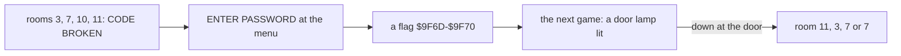

The witness is `play2`: the four passwords typed at frames 500-2500, the four lamps lit at frames 4750-5250. And
`door`: the flags set by a POKE, Matt takes door 1 (x `$68`) and room 3 is drawn (frame 981). And `door3`: the same
POKE, door 3 (x `$A0` up): room 7, the moon, with a LIFTER of 99 charges in slot 0 (WarpBonus `$BA21` at frame 969).

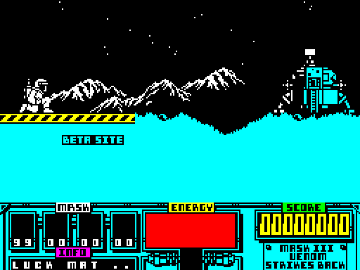

### The score and the high score

The score is 8 BCD digits, Score `$AE41`. Only killed enemies score; each kind has its points (1.7). AddScore adds a
BCD word to the last four digits and carries up.

```z80
AwardScore:               ; IX = the enemy
  LD D,(IX+$15)           ; hundreds and thousands
  LD E,(IX+$14)           ; units and tens
  JP AddScore
AddScore:
  PUSH HL
  LD HL,Score+$0003
  LD A,E
  ADD A,(HL)
  DAA
  LD (HL),A
  DEC HL
  LD A,D
  ADC A,(HL)
  DAA
  LD (HL),A
  ...                     ; the carry into the two upper bytes
```

Worked example: a flyer's template holds `00 02`. AddScore adds `$00` to the units and tens and `$02` to the
hundreds and thousands: 200 points.

After MISSION TERMINATED, GameOver compares the score with Hiscore `$9D16` byte by byte from the top. When the score
is equal or greater, it is copied. The menu shows the high score.

The ending does not update the high score: Ending `$ADF6` jumps to GameStart without the comparison. `rec/rzx-36000`
finishes the game with 31 004 points, and its menu shows HISCORE 00000000 (the segment starts from the RZX's own state,
where no GameOver had run). The witness of the comparison is `rec/rzx-28000`: MISSION TERMINATED at frame 750,
HISCORE 00019090 at frame 3250. That death is the replay's, after the segment drifted from the RZX at frame 500, not
the original player's.

### The cheat

Typing JUDGE DREDD at ENTER PASSWORD sets CheatOn `$BB77` (CheatCheck `$BB4C`, in every interrupt of play). With it
on, the masks keep their charges and the deadly floors do not kill. [Doc 3, 3.7](03-build-and-load.md#37-the-pokes-and-the-cheat)
has the code and the POKEs.

The point: the game is a single run with one energy bar. Masks are found, not bought, and their charges run out;
the passwords are rewards for reaching rooms, used in the next game.

## 1.7 The enemies

Each screen has one enemy kind (room table bytes 6-11). Spawn `$BF2B` fills an empty object slot with that kind,
from the kind's template at EnemyTemplates `$BE3B`. Kinds 5, 6, 8, 9 and 10 try every pass; the others only when
`Random AND $2E` is 0 (about 1 pass in 16); while a chaser lives (ChaserState `$C0D6` not 0) nothing spawns. The turrets are not in the table: each block `$12` of
a screen becomes a turret.

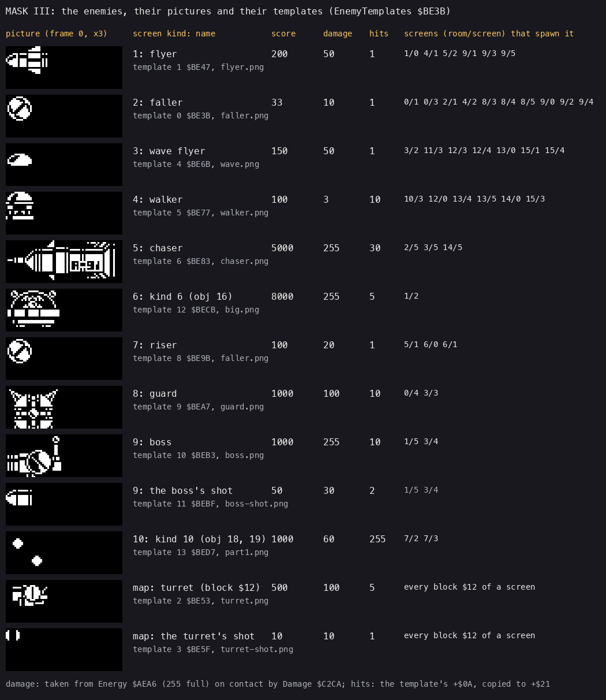

*`tools/fig_enemies.py`: frame 0 of each picture from `src/res/sprites`, the template's numbers read from
`build/game.bin`, the screens from `src/res/tables/rooms.csv`.*

| Screen kind | Name | Score | Damage | Hits to kill |
| ---: | --- | ---: | ---: | ---: |
| 1 | flyer | 200 | 50 | 1 |
| 2 | faller | 33 | 10 | 1 |
| 3 | wave flyer | 150 | 50 | 1 |
| 4 | walker | 100 | 3 | 10 |
| 5 | chaser | 5000 | 255 | 30 |
| 6 | kind 6 | 8000 | 255 | 5 |
| 7 | riser | 100 | 20 | 1 |
| 8 | guard | 1000 | 100 | 10 |
| 9 | boss, and its shot | 1000; 50 | 255; 30 | 10; 2 |
| 10 | kind 10, three objects | 1000, 200, 500 | 60, 40, 60 | 255 |
| map | turret, and its shot | 500; 10 | 100; 10 | 5; 1 |

The names are this case's, from the pictures. A hit count of 255 means the object is not meant to be shot down.

Kind 6 spawns only on room 1, screen 2, and kind 10 only on room 7, screens 2-3. No play recording ran either
spawner (SpawnKind6 `$C0F7`, SpawnKind10 `$C1F3`): the RZX player crossed those screens before they spawned, or took the
pod. Two POKE recordings run them (EnemyKind `$BFB0` written, said in their scripts): `kind6` (object kind 16, frames
675-1891) and `door3` (the group of kinds 18 and 19, the serpent of rings, frames 1478-1968).

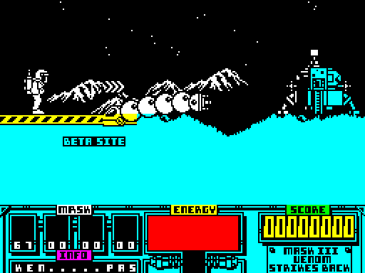

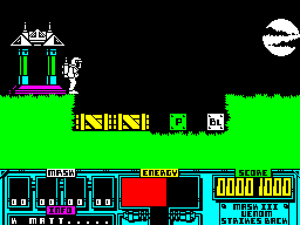 Template 7 (500 points, a picture of its own) is used by no spawner: KindSixteen loads it at `$C8EB` for the kind-11
objects it makes. [Doc 7](07-objects.md) and
[doc 10](10-gameplay-logic.md) have the movers.

A shot's power is its mask's level. Each pass the shot overlaps an enemy, RunObjects `$C284` takes one from the
enemy's hits and one from the shot's power; the shot is gone at 0. LIFTER's shot is the exception: it lifts and
does not count hits.

Worked example: a chaser takes 30 hits. BACKLASH's shot has power 2, so at least 15 shots, each one charge of 99.
LAVA SHOT (power 6) would need 5, but it lies in no room.

## 1.8 The key moments

| Moment | Recording, frame | Screenshot |
| --- | --- | --- |
| the loading screen complete | `c1` 3000 | 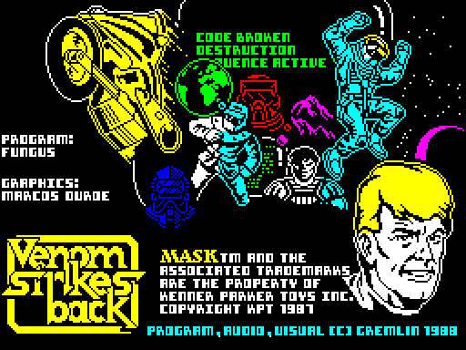 |
| DEFINE KEYS | `c1` 17 850 | 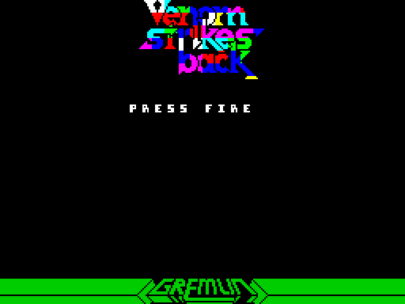 |
| MAYHEM typed at ENTER PASSWORD | `play2` 500 | 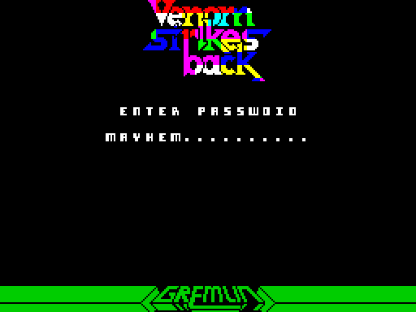 |
| Matt in the pod at the start | `c1` 18 400 | 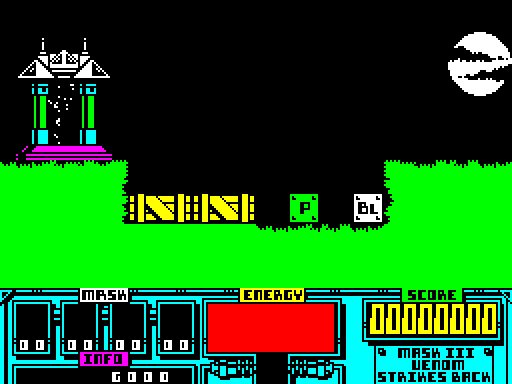 |
| BACKLASH taken | `c1` 19 300 | 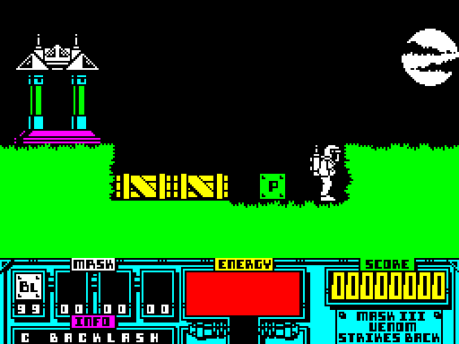 |
| PENETRATOR and BACKLASH lying in room 0 | `c1` 18 600 | 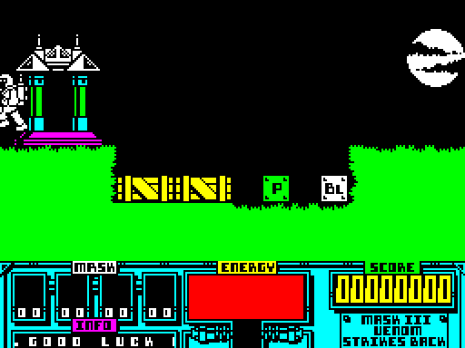 |
| the first enemies and a turret, room 0 | `rec/rzx-00000` 1500 | 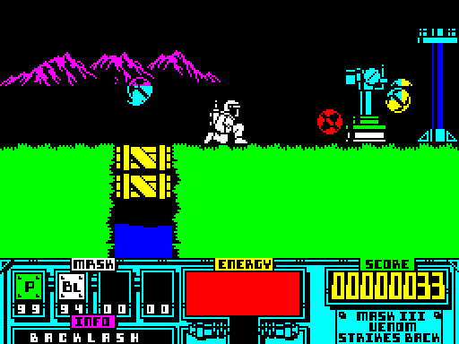 |
| room 10, the base | `rec/rzx-00000` 3000 | 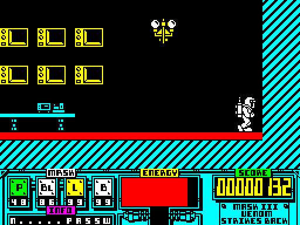 |
| the four password doors, room 0 screen 5 | `door` 750 | 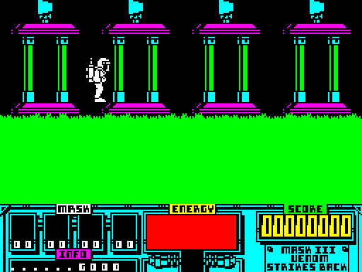 |
| room 2, the surface | `rec/rzx-08000` 1250 | 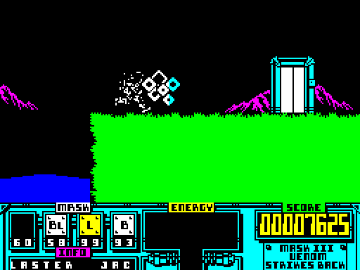 |
| PETALS OF DOOM typed | `play2` 2500 | 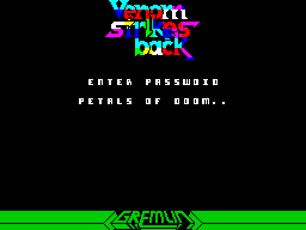 |
| the four door lamps lit | `play2` 4750 | 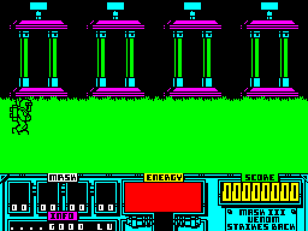 |
| MISSION TERMINATED | `rec/rzx-28000` 750 | 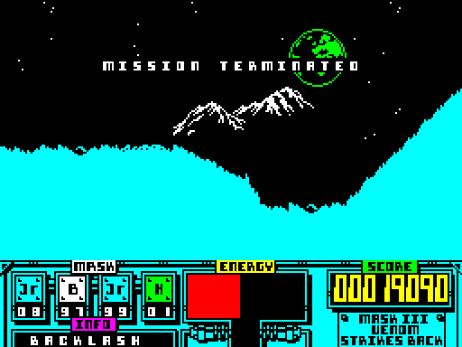 |
| YOU HAVE FOUND SCOTT | `rec/rzx-36000` 250 | 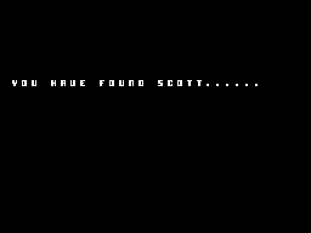 |
| WELL DONE | `play2` 6500 | 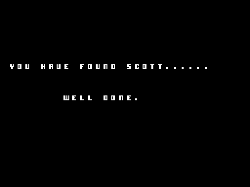 |
| the menu with HISCORE 00019090 | `rec/rzx-28000` 3250 | 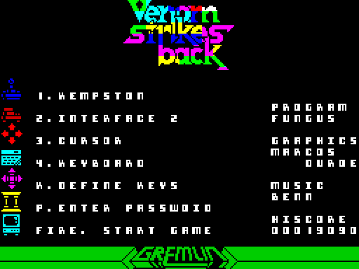 |

The pod ride from room 10 to room 1, frame by frame, is the animation in
[doc 4, 4.5](04-game-loop.md#45-the-heaviest-frame-the-room-change).

## 1.9 Known only from the code

- ULTRA FLASH, MIRAGE, LAVA SHOT and STREAMER lie in no room; ULTRA FLASH and MIRAGE do nothing when fired.
- MaskEffect `$B239` would flash the border for ULTRA FLASH and give HEALER 1 energy a charge; no instruction calls it.
- Door 3's LIFTER (WarpBonus `$BA21`), the enemy kinds 6 and 10 (KindSixteen `$C89B`, KindEighteen `$C980`) and
  Explosion `$BB78` ran only in the POKE recordings `door3`, `kind6` and `masks`, not in play; template 7 only through
  KindSixteen.
- A block item, a fall out of the play area and PENETRATOR's extra cost near a chaser: no recording shows them.
