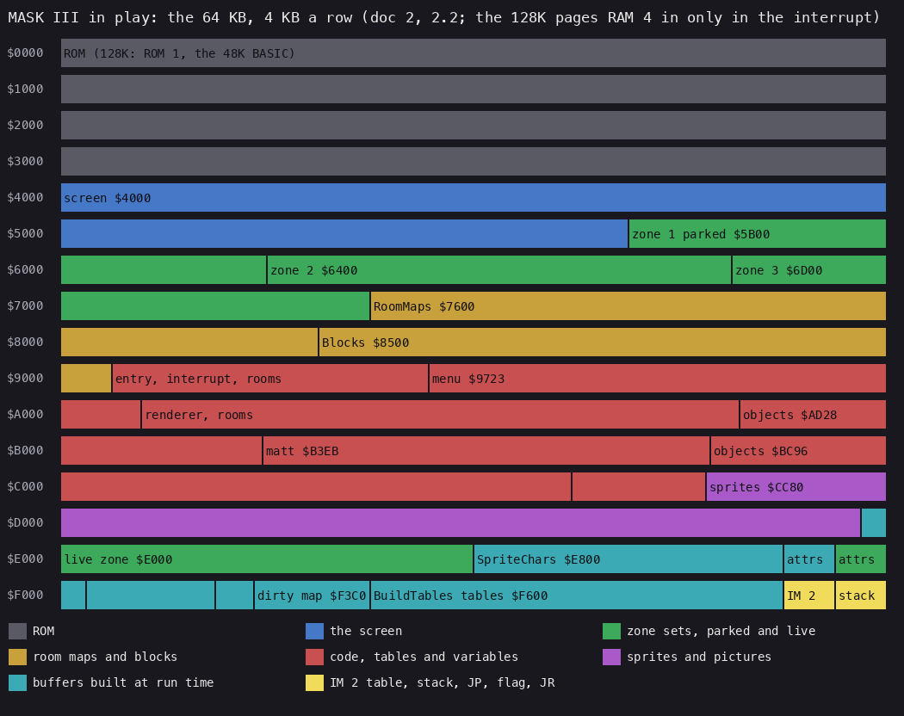
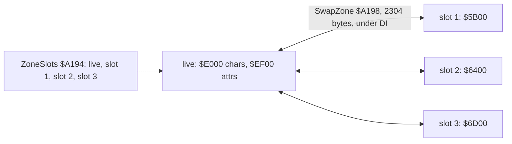
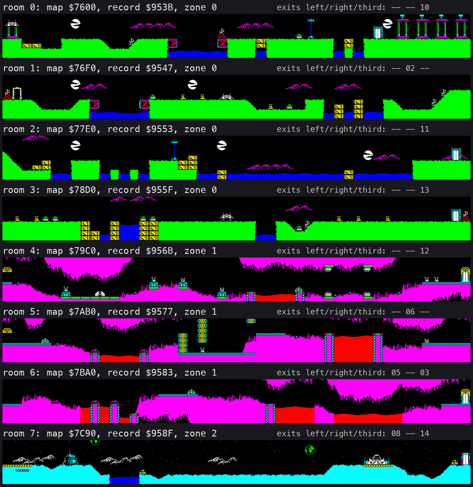
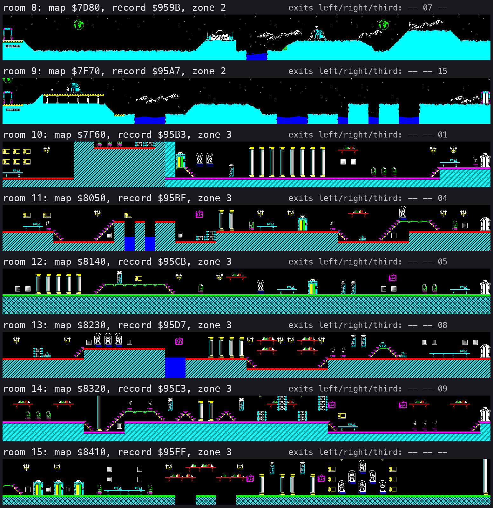
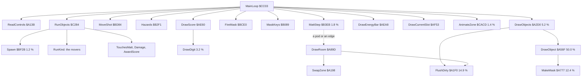
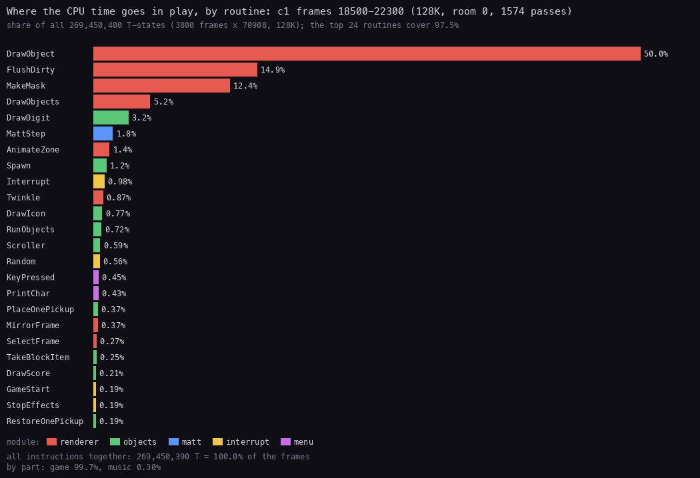
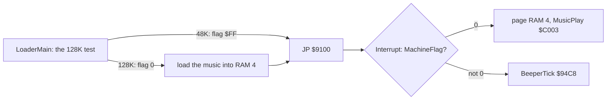

# 2. Architecture

What this covers:

- the machine budget and the images;
- the memory map as stage 2 named it: the parked zone sets, the maps, the code, RAM 4, the buffers;
- the heatmap;
- the state variables;
- the rooms as data;
- the frame, the main loop and the module map;
- the frame budget, by module and by routine;
- the stack;
- 48K against 128K;
- the leftovers and the code no recording ran.

The recordings it rests on ([WALKTHROUGH 6.0](../WALKTHROUGH.md#60-the-recordings)):

| Recording | Used for |
| --- | --- |
| `c1` | power-on, the original tape at ROM speed on the 128K, the menu, play in room 0 |
| `c1-play`, `c1-menu` | L1 windows of `c1` built for this document (frames 18 500-22 300 and 15 100-17 790, `work/docs/mxA/`) |
| `rec/menu` | from a snapshot after a fast load: the control options, the password, 6000 frames standing in the pod |
| `rec/rzx-00000` .. `rec/rzx-36000` | ten segments of the ZXDB RZX run, each from the RZX's own state |
| stage 2's `c48`, `play2`, `door` | the 48K model; the passwords; a password door |
| `work/stage1/all-l1.json` | the L1 builds of twelve recordings merged (69 065 frames, `kit/merge_l1.py`): the heatmap |

## 2.1 The machine budget and the images

A 48K or 128K Spectrum. The tape loads the code `$6000-$FDFF` (40 448 bytes) and, on a 128K only, 4000 bytes of AY
music and player into RAM 4 at `$C000` ([doc 3](03-build-and-load.md)). The game runs with RAM 0 at `$C000`. It
pages RAM 4 in only inside the interrupt, to call the player (`OUT ($7FFD)` `$14`, then `$10`). There is no second
screen: the game draws into `$4000`, and the 128K's extra RAM holds nothing but the music.

Three images (`work/stage1/images/`, `work/mkgame/`):

| Image | What it is | How it differs from the one before |
| --- | --- | --- |
| as loaded | TZX blocks 5 and 6 (screen `$4000`, code `$6000-$FDFF`) | |
| at the entry | the memory at c1 frame 15 019 T 60 034, the first instruction of `$9100` | `$6000-$FDFF` the same byte for byte; the BASIC, the loader's copy at `$5E00`, the system area and `$FF00-$FFFF` differ |
| in play | the RZX dump's memory at frame 4000 (room 10) | the parked zone sets, the live zone and the buffers `$E000-$FDFF`, the IM 2 table, some 40 short spans of variables in `$9500-$CA3C`; no code changed |

So the code is neither unpacked nor moved. The entry copies 1280 bytes `$F000` → `$5B00` and 256 bytes `$EE00` →
`$6300`. That completes the first parked zone set where the loader stood, and frees `$EE00-$FDFF` for buffers. After
`IM 2` it clears attribute 0 of the four zone sets (`$EF00`, `$6300`, `$6C00`, `$7500`, `$9141-$914B`), runs
KempstonTest and jumps to GameStart.

The point: the program is one 40 KB block that runs where it loads. All the cleverness is in how it reuses the space
the loader and the zone sets leave.

## 2.2 The memory map

Stage 2 named every byte in `src/game/game.ann` (363 entries in 10 modules; the AY player in RAM 4 is an eleventh,
`src/music/music.ann`). The map as it stands in play:



*`tools/fig_memmap.py`: the ranges of the table below.*

| Range | Bytes | What | Module |
| --- | ---: | --- | --- |
| `$4000-$5AFF` | 6912 | the screen: the play window rows 0-17, the panel rows 18-23 | none: block 5, not in the image |
| `$5B00-$63FF` | 2304 | zone 1 (the caverns) parked: 256 characters, 256 attributes at `$6300` | zones |
| `$6400-$6CFF` | 2304 | zone 2 (the moon) parked | zones |
| `$6D00-$75FF` | 2304 | zone 3 (the base) parked | zones |
| `$7600-$84FF` | 3840 | RoomMaps: 16 rooms of 240 bytes, 48 blocks across, 5 down | rooms |
| `$8500-$90FF` | 3072 | Blocks: 192 blocks of 4 x 4 character codes | rooms |
| `$9100-$9225` | 294 | GameEntry, NewGame, the frame counter, the tune requests | entry |
| `$9226-$9509` | 740 | the interrupt, the random generator, the sound effects | interrupt |
| `$950A-$9722` | 537 | the room, the pick-ups, the room table, the font | rooms |
| `$9723-$A193` | 2673 | the menu, the controls, DEFINE KEYS, the password | menu |
| `$A194-$A899` | 1798 | SwapZone, FlushDirty, the sprite drawing | renderer |
| `$A89A-$AD27` | 1166 | DrawRoom and its set-up routines | rooms |
| `$AD28-$B3EA` | 1731 | the score, energy, slots, messages, pick-ups, hazards | objects |
| `$B3EB-$BC95` | 2219 | Matt: walking, jumping, pods, dying; GameOver | matt |
| `$BC96-$C9E9` | 3412 | the mask's use, the templates, the spawners, the movers | objects |
| `$C9EA-$CBF8` | 527 | the zone's animation, the lift | renderer |
| `$CBF9-$CC7F` | 135 | GameStart, MainLoop, PassBcd | interrupt |
| `$CC80-$DF7F` | 4864 | the pictures: control icons, Matt, enemies, digits, mask icons | sprites |
| `$DF80-$DFFF` | 128 | DissolveBuffer | buffers |
| `$E000-$E7FF` | 2048 | ZoneChars: the live zone's characters (zone 0 as loaded) | buffers |
| `$E800-$EDFF` | 1536 | SpriteChars: the sprites drawn as characters | buffers |
| `$EE00-$EEFF` | 256 | the sprite characters' attributes (zone 1's attributes as loaded) | buffers |
| `$EF00-$EFFF` | 256 | ZoneAttrs: the live zone's attributes, bit 7 solid | buffers |
| `$F000-$F07F` | 128 | the masks | buffers |
| `$F080-$F2FF` | 640 | the character map: 32 x 20 characters of the live zone (rows 2-19 shown) | buffers |
| `$F300-$F3BF` | 192 | MirrorFrame's mirrored picture | buffers |
| `$F3C0-$F5FF` | 576 | the dirty map, FlushDirty's scan from `$F5FF` down | buffers |
| `$F600-$FDFF` | 2048 | BuildTables: the bit-reverse table `$F600`, the dilate table `$F700`, the shift tables `$F800-$FDFF` (the play panel as loaded) | buffers |
| `$FE00-$FF00` | 257 | the IM 2 table, all `$FF` | none: written by GameEntry |
| `$FF01-$FFEF` | 239 | the stack, from `SP` = `$FFF0` down (52 bytes used at most, 2.8) | none |
| `$FFF0-$FFF3` | 4 | unused: above the stack top | none |
| `$FFF4-$FFF6` | 3 | ImJump: `JP $9226` | none: written by GameEntry |
| `$FFF7-$FFFD` | 7 | unused: the loader block's bytes, never read or written (doc 3, 3.3) | none |
| `$FFFE` | 1 | MachineFlag: 0 on a 128K | none: written by the loader |
| `$FFFF` | 1 | ImJr: `$18`, the `JR` | none: written by GameEntry |
| RAM 4 `$C000-$CF9F` | 4000 | the AY player and the three tunes (128K only) | music |

Stage 1 called `$5B00-$75FF` "three parked zone sets" with the order unknown, and `$F000-$FDFF` "the room buffer".
Stage 2 found the order (zones 1, 2, 3, with zone 0 live as loaded) and the four uses of `$F000-$FDFF`.

### The zone sets: one live, three parked

The four zones' character sets do not all fit at the address the renderer reads. ZoneChars `$E000` and ZoneAttrs
`$EF00` hold the live one. The other three wait at `$5B00`, `$6400` and `$6D00`, `$900` bytes apart. ZoneSlots
`$A194` says which zone sits where. SwapZone `$A198` exchanges the live set with a parked one byte for byte, so
nothing is lost and no fifth buffer is needed.



The first rooms of the way through (1.5 of doc 1), as SwapZone leaves ZoneSlots:

```text
as loaded:      ZoneSlots = 0, 1, 2, 3     ; zone 0 live
enter room 10:  SwapZone(3): 0 <-> 3       ; ZoneSlots = 3, 1, 2, 0  (the first swap of a game)
enter room 1:   SwapZone(0): 3 <-> 0       ; ZoneSlots = 0, 1, 2, 3
enter room 11:  SwapZone(3): 0 <-> 3       ; ZoneSlots = 3, 1, 2, 0
enter room 4:   SwapZone(1): 3 <-> 1       ; ZoneSlots = 1, 3, 2, 0
enter room 12:  SwapZone(3): 1 <-> 3       ; ZoneSlots = 3, 1, 2, 0
```

Worked example: zone 1's set is split by the loader. The loader runs at `$5E00`, inside slot 1. So the tape puts
characters 160-255 at `$6000` (above the loader) and characters 0-159 and the attributes at `$F000` and `$EE00`.
GameEntry copies them down once the loader is done: 1280 bytes to `$5B00`, 256 to `$6300`. The swap's cost and the
asm are in [doc 4, 4.5](04-game-loop.md#45-the-heaviest-frame-the-room-change).

The witness is the RZX dump: the bytes at `$5B00` change when the run enters the caverns, and `rec/rzx-04000` traces
the swap at frames 463-466.

The point: four 2.3 KB sets in the space of four, with no copy buffer, at the price of 2.4 frames with interrupts
off on each zone change.

## 2.3 The heatmap


*`kit/heatmap.py` over `work/stage1/all-l1.json`, the twelve stage-1 recordings merged.*

Executed: `$9100-$CC5B` only (and the loader's `$5E00` and `$FF00` in c1). Read: the room maps and blocks, the
pictures, the live zone, and the character and dirty maps most of all. Written: the parked zone sets (on a zone
change), the buffers `$DF80-$FDFF`, variable bands in the code area, and the screen. Nothing writes the room maps
except two block changes (a taken block item becomes `$47`, TakeBlockItem `$B33D`; a destroyed turret becomes `$2B`,
`$C4DD`), which NewGame undoes.

## 2.4 The state variables

| Variable | Address | What it holds |
| --- | --- | --- |
| RoomNumber | `$950A` | 0-15 |
| RoomRecord | `$950B` | the room's record, `$953B + 12 x room` |
| RoomScreen | `$950D` | 8 x the screen (0-`$28`): the map column of the screen's left edge |
| PickupTable | `$950E` | the 11 masks lying in rooms, bit 7 of byte 0 set when taken |
| Objects | `$A43F` | Matt (state in byte 0, x `$A442`, y `$A443`), his shot, six enemies, 38 bytes each |
| Score | `$AE41` | 8 BCD digits |
| Energy | `$AEA6` | 255 full, 0 the end |
| PassCounter | `$AF0C` | the passes, binary |
| MaskSlots | `$AF2B` | 4 slots of 4 bytes: the HUD column of the icon (`$61`, `$64`, `$67`, `$6A`), kind, BCD charges, level |
| ZoneSlots | `$A194` | the live zone, then the zones in the three parked slots |
| Hiscore | `$9D16` | 4 BCD bytes |
| PasswordFlags | `$9F6D-$9F70` | the four passwords typed |
| FrameCounter | `$9224` | counted by the interrupt; never read |
| BorderColour | `$9225` | the border the interrupt sets |
| TuneRequest, StopRequest | `$9222`, `$9223` | for the interrupt's AY path |
| NotInPlay, MenuFlag | `$970D`, `$970E` | the interrupt's mode |
| CheatOn | `$BB77` | JUDGE DREDD typed |
| PassBcd | `$CC5C` | the passes, BCD |
| MachineFlag | `$FFFE` | 0 on a 128K |

## 2.5 The rooms as data: the first map

The room table at `$953B` has 16 records of 12 bytes:

| Byte | What |
| ---: | --- |
| 0, 1 | the room past the left and the right edge (`$FF`: a wall) |
| 2 | the room the pod at the end leads to (Teleport `$B6B3`) |
| 3 | an exit read only by ExitByte3 `$B6D8`, which never runs; `$FF` in every room |
| 4 | the zone: 0 the surface, 1 the caverns, 2 the moon, 3 the base |
| 5 | the arrival place after a pod: x = (b & `$1F`) x 4 + `$40`, screen = (b & `$E0`) / 32 |
| 6-11 | one enemy kind for each of the six screens |

A room is 48 x 5 blocks, six screens side by side; a block is 4 x 4 characters of the room's zone. DrawRoom expands
the screen's 8 x 5 blocks into the character map `$F080`. `tools/roommap.py` draws every room from these bytes alone.

```text
DrawRoom (the map part):
    record = $953B + 12 * RoomNumber
    map    = $7600 + 240 * RoomNumber + RoomScreen
    for row in 0..4:
        for col in 0..7:
            block = map[row * 48 + col]
            copy Blocks[$8500 + 16 * block] (4 x 4 codes) into the character map
    SwapZone(record[4])
```

Worked example: room 10, screen 4. The record is `$953B + 12 x 10` = `$95B3`; its byte 4 is 3, the base. The map
starts at `$7600 + 240 x 10` = `$7F60`, and RoomScreen = `$20`, so the screen's first block is at `$7F80`.





*Stage 1's `tools/roommap.py` drawings; doc 1's [world figures](01-game-design.md#15-the-world) add the masks and
the enemy kinds.*

The way through, by the table's exits (the RZX takes it):

```mermaid
flowchart LR
  R0["0 surface"] -->|pod| R10["10 base"] -->|pod| R1["1 surface"] -->|right| R2["2 surface"] -->|pod| R11["11 base"] -->|pod| R4["4 caverns"] -->|pod| R12["12 base"] -->|pod| R5["5 caverns"]
  R5 -->|right| R6["6 caverns"] -->|left| R5
  R6 -->|pod| R3["3 surface"] -->|pod| R13["13 base"] -->|pod| R8["8 moon"] -->|right| R7["7 moon"] -->|left| R8
  R7 -->|pod| R14["14 base"] -->|pod| R9["9 moon"] -->|pod| R15["15 base: the end"]
```



The sprites, drawn from `$CD60-$DF7F` by `tools/spritesheet.py`: Matt's run, the score digits at `$D3A0`, the ten
mask icons, shots, explosions and the enemies.


## 2.6 The frame and the main loop

The main loop `$CC03-$CC59` does not wait for the frame. It calls twelve routines one after another, counts the pass
in `$AF0C` and `$CC5C`, and jumps back. The interrupt runs once a frame beside it. A pass takes 2.4 to 5.4 frames in
the recordings ([doc 4, 4.4](04-game-loop.md#44-the-main-loop-and-the-order-of-a-pass)).

### The module map

| Module | Source | Entries | What it does | Share of play (c1) |
| --- | --- | ---: | --- | ---: |
| zones | `zones.asm` | 6 | the parked character sets | data |
| rooms | `rooms.asm` | 49 | maps, blocks, the room table, DrawRoom | 0.19 % |
| entry | `entry.asm` | 8 | GameEntry, NewGame | |
| interrupt | `interrupt.asm` | 19 | the handler, effects, GameStart, MainLoop | 2.1 % |
| menu | `menu.asm` | 49 | the menu, the controls, the password | 1.1 % |
| renderer | `renderer.asm` | 32 | SwapZone, FlushDirty, the sprites as characters | 85.5 % |
| objects | `objects.asm` | 125 | the score, energy, masks, enemies | 8.4 % |
| matt | `matt.asm` | 40 | Matt's states, death, GameOver | 2.4 % |
| sprites | `sprites.asm` | 24 | the pictures | data |
| buffers | `buffers.asm` | 11 | the live zone, the work areas | data |
| music (RAM 4) | `src/music` | | the AY player and tunes | 0.30 % |

The menu's 1.1 % in play is ReadControls and KeyPressed, which live in the menu module.

The call graph of one pass, from the main loop down (the T shares are of c1 play):



## 2.7 The frame budget


*`kit/fig_budget.py work/docs/mxA/c1-play/l1.json docs/img/arch/budget-modules.png --ann src/game/game.ann --ann
src/music/music.ann,page=4,label=music --by module`, with `rzx-16000` and `c1-menu` as the other two states.*



*`kit/fig_budget.py work/docs/mxA/c1-play/l1.json docs/img/arch/budget-routines.png --ann src/game/game.ann --ann
src/music/music.ann,page=4,label=music --by routine --top 24`.*

| Module | c1 play (128K) | `rec/rzx-16000` (the beeper path) | c1 menu |
| --- | ---: | ---: | ---: |
| renderer | 85.5 % | 84.1 % | |
| objects | 8.4 % | 8.2 % | |
| matt | 2.4 % | | |
| interrupt | 2.1 % | 3.6 % | 1.5 % |
| menu | 1.1 % | | 85.5 % |
| music | 0.30 % | 0 | 6.0 % |
| `HALT` | 0 | 0 | 6.9 % |

Worked example: c1 play is 3800 frames of 70 908 T, 269 450 400 T. DrawObject takes 50.0 % of it, 134.7 M T, in
1574 passes: about 85 600 T a pass, 1.2 frames. That one routine is half of every pass.

Three findings:

- the sprites drawn as characters (DrawObject, MakeMask, DrawObjects) are 67.6 % of play; FlushDirty, which copies
  the dirty cells to the screen, 14.9 %;
- DrawDigit is 3.2 %: the score is redrawn every pass, changed or not;
- the game logic (objects and Matt) is about 11 %; the game would run at one pass a frame if it drew less.

The point: MASK III is bound by its renderer. A pass is long because every sprite is rebuilt as fresh characters
every pass ([doc 6](06-rendering.md)).

## 2.8 The stack

`SP` = `$FFF0` at GameEntry `$9100`, at GameStart `$CBF9` and in NewGame `$915B`. The lowest byte a push wrote
(`kit/merge_l1.py --stack FE00-FFF3`) is `$FFBC` in `rec/menu` and `$FFC0` in the RZX segments: 52 bytes deep at
most. The interrupt alone pushes 22 bytes (the return address and ten register pairs). The stack never comes near
the IM 2 table at `$FF00`. (c1's `$FF1E` is the 128K ROM's own stack before the BASIC's `CLEAR 24570`.)

Two places reset the stack instead of unwinding it: GameStart (`LD SP,$FFF0`, so BREAK can jump there from the
interrupt) and NewGame (it pops its return address, resets `SP` under `DI` and pushes it back).

## 2.9 48K and 128K

One code block serves both machines. MachineFlag `$FFFE` decides, and four places read it: the interrupt, PlayEffect,
GameOver and the menu.

| | 128K (`MachineFlag` = 0) | 48K (`MachineFlag` = `$FF`) |
| --- | --- | --- |
| the load | the music block into RAM 4 | the music block skipped |
| the interrupt | pages RAM 4, the AY player, the effects on the AY | StopBeeper, BeeperTick |
| the tunes | menu, game over, game start | none |
| the effects | PlayEffect queues them for the AY | PlayEffect starts the beeper |
| the menu's logo raster (MenuInterrupt, `$98BB`) | a delay loop of `BC` = `$01CC` | `BC` = `$01AF`, for the 48K's other frame and line timing (read from the code, not measured against the beam) |
| the handler's cost in play | 1711 T an interrupt, 2.4 % (`c1-play`) | 2429 T, 3.5 % (`c48`, frames 17 100-18 675, play only); 2600 T on the beeper path of the 128K model (`rec/rzx-16000`) |



The RZX segments run the beeper path on the 128K model: the RZX's memory has `$FFFE` = 1, a value this loader never
writes (LoaderMain writes `$FF` at `$5E12` and 0 at `$5E3E`, nothing else). The RZX was made from another load of the
game, on a 48K (its state is a 48K `.z80`; unreal-ng's `POST /rzx/play` switches to the 48K for it), and the segments
replayed it on the 128K model, the main cause of their drift
([WALKTHROUGH 6.0](../WALKTHROUGH.md#60-the-recordings)); any non-zero value takes the beeper path. Stage 2's `c48` runs the 48K model itself.

## 2.10 The leftovers and the code no recording ran

The image holds bytes that the game overwrites before it reads them, and routines that nothing calls.

| Where | What | Why it is there |
| --- | --- | --- |
| `$6300-$63FF` | Zone1AttrsLeftover: an older copy of zone 1's attributes | GameEntry copies `$EE00` over it; 255 of 256 bytes equal |
| `$E800-$EDFF` | 1536 bytes of leftovers in SpriteChars | DrawObject writes every sprite character before it is read |
| `$F500-$F5FF` | 256 bytes | cleared as the dirty map |
| `$F600-$FBFF` | PlayPanel: the panel's characters | the menu draws it at every start; BuildTables writes its tables over it, so each later menu copies the panel back from the screen first (SaveHud `$9CA0`) |
| `$FC00-$FC63`, `$FD24-$FDFF` | leftovers around the panel's attributes | BuildTables' shift tables |
| `$CC5D` | PassBcdSpare: 35 bytes | after the main loop |
| `$FFB6-$FFF3` | the loader block's tail: a stack's contents | the block was saved from memory with the game running (doc 3) |

Code known only from the code: no recording ran it.

| Routine | What it would do |
| --- | --- |
| MaskEffect `$B239` | ULTRA FLASH flashes the border, HEALER 1 energy a charge; nothing calls it |
| HangLoop `$9208` | `DI`, the border flashing forever; the kind-0 slot of ObjectJumps |
| BorderFlash (after HangLoop) | flash the border BC times |
| BeeperOff `$94C3` | clear the beeper count |
| ExitByte3 `$B6D8` | leave by the room table's byte 3, which is `$FF` everywhere |
| KindEleven `$C6F2` | the mover of objects of kind 11 |
| MattJumpRet `$B84F`, KindThirteenRet `$C789` | a `RET` no branch reaches |

The point: the leftovers show how the tape image was made. The panel, zone 1's set and the loader's tail were
captured from a working memory, not assembled into place.

Run only in the integration's POKE recordings (`work/stage2/rec/`, each script says its POKEs): Explosion `$BB78`
(`masks`, frame 1249), KindSixteen `$C89B` and SpawnKind6 `$C0F7` (`kind6`, EnemyKind `$BFB0` = 6), KindEighteen
`$C980` and SpawnKind10 `$C1F3` (`door3`, EnemyKind = 10), the door-3 bonus WarpBonus `$BA21` (`door3`, frame 969).
