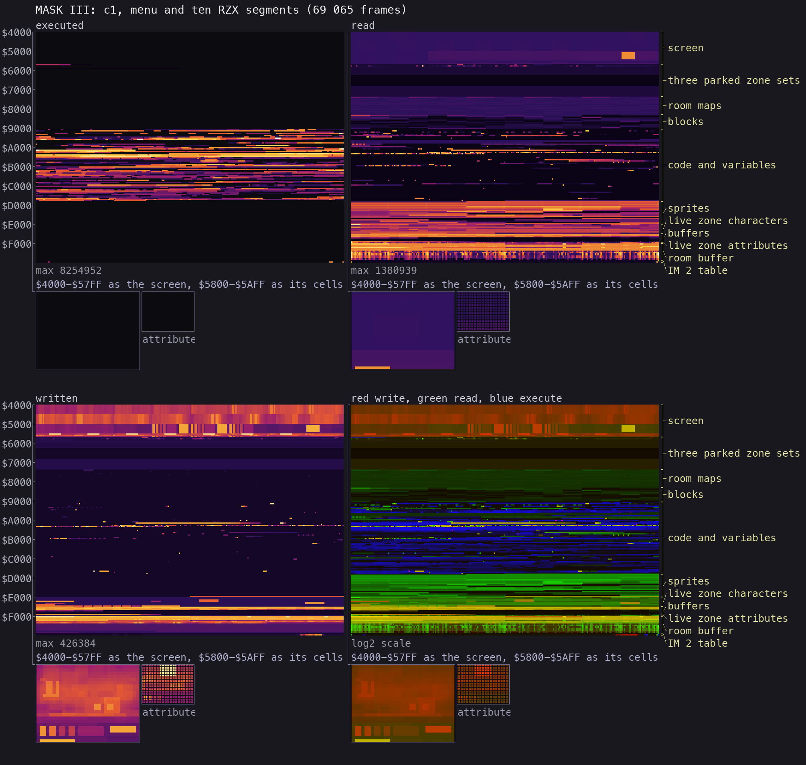
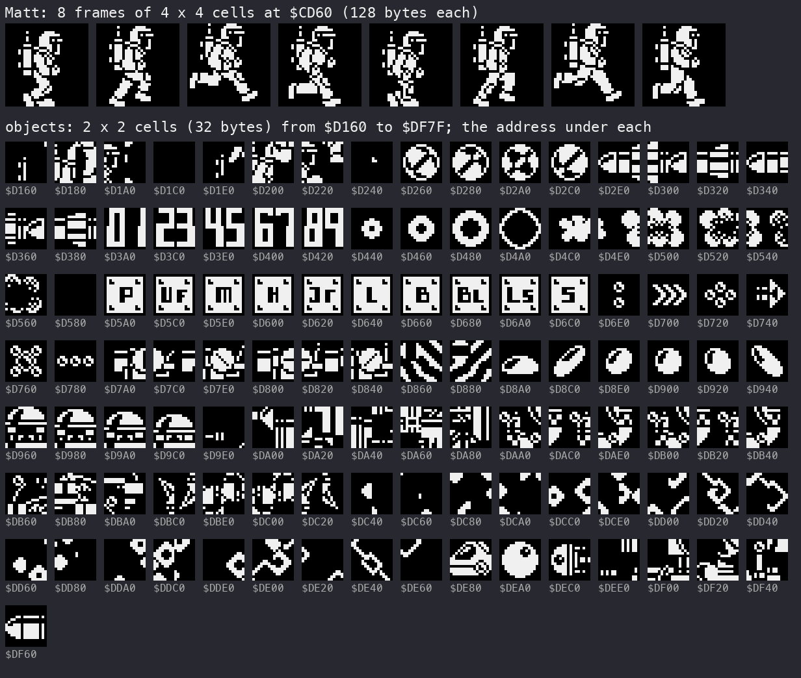

```mermaid
flowchart LR
  R0["0 surface"] -->|pod| R10["10 base"] -->|pod| R1["1 surface"] -->|right| R2["2 surface"] -->|pod| R11["11 base"] -->|pod| R4["4 caverns"] -->|pod| R12["12 base"] -->|pod| R5["5 caverns"]
  R5 -->|right| R6["6 caverns"] -->|left| R5
  R6 -->|pod| R3["3 surface"] -->|pod| R13["13 base"] -->|pod| R8["8 moon"] -->|right| R7["7 moon"] -->|left| R8
  R7 -->|pod| R14["14 base"] -->|pod| R9["9 moon"] -->|pod| R15["15 base: the end"]
```

# 2. Architecture

What this covers (stage 1, a first pass; stage 2 names every byte):

- the machine budget and the images;
- the memory map and the heatmap;
- the state variables;
- the rooms as data: the first map;
- the frame and the main loop;
- the stack.

The recordings it rests on ([WALKTHROUGH 6.0](../WALKTHROUGH.md#60-the-recordings)):

| Recording | Used for |
| --- | --- |
| `c1` | power-on, the original tape at ROM speed on the 128K, the menu, define keys, play in room 0 |
| `rec/menu` | from a snapshot after a fast load: the control options, define keys, the password, 6000 frames in play with no key |
| `rec/rzx-00000` .. `rec/rzx-36000` | ten segments of the ZXDB RZX run, each from the RZX's own state, replayed by its keys |
| `work/stage1/all-l1.json` | the L1 builds of all twelve recordings merged (69 065 frames, `kit/merge_l1.py`): the heatmap and the map below |

## 2.1 The machine budget and the images

A 48K or 128K Spectrum. The tape loads the code `$6000-$FDFF` (40 448 bytes) and, on a 128K only, 4000 bytes of AY
music and player into RAM 4 at `$C000` ([doc 3](03-build-and-load.md)). The game runs with RAM 0 at `$C000` and pages
RAM 4 in only inside the interrupt, to call the player (`OUT ($7FFD)` `$14`, then `$10`; WALKTHROUGH 1). There is
no second screen: the game draws into `$4000`.

Three images (`work/stage1/images/`, `work/mkgame/`):

| Image | What it is | How it differs from the one before |
| --- | --- | --- |
| as loaded | `tools/image.py`: TZX blocks 5 and 6 (screen `$4000`, code `$6000-$FDFF`) | |
| at the entry | `tools/ttd_dump.py` at c1 frame 15 019 T 60 034, the first instruction of `$9100` | `$6000-$FDFF` the same byte for byte; only the BASIC, the loader's copy at `$5E00-$5E78`, the system area and the stack `$5B00-$5FFF`, and `$FF00-$FFFF` (the loader at `$FF00`) differ |
| in play | the RZX dump's memory at frame 4000 (room 10) | `$5B00-$5FFF` and `$6D08-$75FF` (the parked zone sets, 2.2), `$E008-$EAEC`, `$EF00-$FDFF` (the live zone and the room buffer), `$FE00-$FFFE` (the IM 2 table), and some 40 short spans of variables in `$9500-$CA3C`; no code changed |

So the code is not unpacked or moved; the entry `$9100` copies 1280 bytes `$F000` → `$5B00` and 256 bytes `$EE00` →
`$6300`, completing the first parked zone set where the loader stood, and frees `$EF00-$FDFF` for buffers.

## 2.2 The memory map

From the heatmap (2.3), the room code (`$A89D`, `$A198`) and the RZX memory dump.

| Range | Bytes | What | Witness |
| --- | ---: | --- | --- |
| `$4000-$5AFF` | 6912 | the screen: the play window rows 0-17, the HUD below | the screens |
| `$5B00-$75FF` | 6912 | three parked zone sets of `$900` bytes at `$5B00`, `$6400`, `$6D00` (each 256 characters and 256 attributes) | `$A198`: the swap with `$E000` and `$EF00`; the entry zeroes the first attribute of all four sets (`$EF00`, `$6300`, `$6C00`, `$7500`, at `$9141-$914B`) |
| `$7600-$84FF` | 3840 | the room maps: 16 rooms of 240 bytes, 48 blocks across and 5 down | `$A8F6-$A908`: `$7600 + 240 * room` |
| `$8500-$90FF` | 3072 | the blocks: 16 bytes each, 4 x 4 characters (192 blocks) | `$A91D-$A927`: `$8500 + 16 * block` |
| `$9100-$CC5B` | 15 196 | the code, with tables and variables between the routines (`$9100` the entry and the IM 2 set-up, `$9226` the handler, `$953B` the room table, `$CBF9` the game start) | executed in the heatmap |
| `$CC5C-$CD5F` | 260 | the pass counter `$CC5C` and data | `$CC51-$CC58` |
| `$CD60-$DF7F` | 4640 | the sprites: Matt's 8 frames of 4 x 4 characters at `$CD60`, then 2 x 2-character objects (2.5) | `$A37E-$A38E`, `$AA35` |
| `$DF80-$DF9F` | 32 | one object frame copied through a random mask (the teleport) | `$A3A5-$A3C3` |
| `$E000-$E7FF` | 2048 | the live zone's 256 characters | `$A1B7` |
| `$E800-$EEFF` | 1792 | buffers and tables (`$E800` read by `$BBAA`, `$EE00` by `$A2DC`) | the heatmap: written |
| `$EF00-$EFFF` | 256 | the live zone's attributes | `$A1CB` |
| `$F000-$FDFF` | 3584 | the room buffer: the characters of the screen being drawn at `$F080` (32 x 20), and the area `$A1F0` scans down from `$F600` | `$A8DF`, `$A1F0-$A200` |
| `$FE00-$FF00` | 257 | the IM 2 table, all `$FF` | the entry `$9100` |
| `$FF01-$FFF0` | 240 | the stack, from `SP` = `$FFF0` | 2.6 |
| `$FFF4-$FFF6` | 3 | `JP $9226` | WALKTHROUGH 1 |
| `$FFFE` | 1 | the machine flag the loader leaves: 0 on a 128K | doc 3 |
| `$FFFF` | 1 | `$18`, the `JR` the interrupt jumps to | WALKTHROUGH 1 |

## 2.3 The heatmap

Executed: `$9100-$CC5B` only (and the loader's `$5E00` and `$FF00` in c1). Read: the room maps and blocks, the sprites
and the live zone, and the room buffer most of all. Written: the parked zone sets (on a zone change), the room buffer
`$EF00-$FDFF`, a few variable bands in the code area, and the screen.

## 2.4 The state variables

Found by comparing the RZX dump's memory every 500 frames (`work/stage1/rzx/dump`) with the screens, and checked in
the code.

| Variable | Address | Witness |
| --- | --- | --- |
| room | `$950A` (0-15) | 16 values over the RZX, in the order the screens show; written by `$B67C`, `$B6AA`, `$B6BD` (the exits) |
| room record | `$950B` (word) = `$953B + 12 * room` | `$A8E3-$A8F3` |
| screen in the room | `$950D` = 8 * screen (0-`$28`) | `$B659-$B6B1`: -8 at the left edge, +8 at the right, the next room at 0 or `$28` |
| Matt's x, y | `$A442`, `$A443` | they vary with Matt on the screens; `$B629-$B634` turns them into a buffer address |
| score | `$AE41-$AE44`, 8 BCD digits | the RZX: `00 03 04 04` at frame 35 000 with the HUD's 00030404 |
| masks | `$AF2B`, 4 slots of 4 bytes (graphic, kind = icon + 1, a BCD counter, a level) | the HUD's four slots and counters |
| zone slots | `$A194`: the live zone, then the zones parked in the three slots | `$A198` |
| frame counter | `$9224` | `LD HL,$9224`, `INC (HL)` at `$9234`, in the handler |
| border | `$9225` | the handler |
| tune requests | `$9222` (start a tune, `$C000`), `$9223` (`$C00A`) | the handler, 128K path |
| menu or play | `$970E` (`$FF` in the menu) | `$977B`; the handler calls `$9899` in the menu, `$BB4C` in play |
| passes | `$AF0C` (binary), `$CC5C` (BCD) | the main loop's tail `$CC4D-$CC58` |
| machine | `$FFFE` | the loader |

Energy is not found yet (stage 2).

## 2.5 The rooms as data: the first map

The room table at `$953B` (16 records of 12 bytes): bytes 0 and 1 the rooms past the left and the right edge
(`$FF`: a wall), byte 2 the room the teleport pod at the room's end leads to (`$B6B3`), byte 4 the zone (0 the green
surface, 1 the magenta caverns, 2 the moon, 3 the cyan base), byte 5 and 6-11 not read yet (`$A98B-$A99B` takes one
byte of 6-11 per screen). Each room is 48 x 5 blocks, six screens side by side; a block is 4 x 4 characters of the
room's zone. `tools/roommap.py` draws every room from these bytes alone, with the characters and attributes of the
zone that is live in the RZX's memory when it is in that room; the drawing matches the game's screens (RZX frame 4000,
room 10, screen 5), which show the lower 18 of the 20 character rows.

The way through (the RZX takes it): room 0, the pod to 10, the pod to 1, right to 2, the pod to 11, 4, 12, 5, right
to 6, the pod to 3, 13, 8, right to 7, the pod to 14, 9 and 15, the last room (no exits; `$A89D` jumps to `$ADF6` on
its last screen, `$950D` = `$28`).

The sprites, drawn from `$CD60-$DF7F` by `tools/spritesheet.py` (cells down the columns first): Matt's run, the score
digits at `$D3A0`, the ten mask icons at `$D5A0-$D6C0` (P, VE, M, H, JR, L, B, BL, LS, S), shots, explosions,
enemies and parts of the scenery.

## 2.6 The frame and the main loop

The main loop `$CC03-$CC59` does not wait for the frame: it calls the game's routines one after another (`$A13B`,
`$B3EB`, `$BD84`, `$B2F1`, `$C284`, `$BCE0`, `$B089`, `$AE60`, `$AEA8`, `$AF53`, `$CACD`, `$A2D0`), counts the pass in
`$AF0C` and `$CC5C`, and jumps back. The interrupt (IM 2, `$9226`) runs once a frame beside it: the keys (`$BB4C`),
`$AF82`, and the music (WALKTHROUGH 1). A pass takes 2.8 frames in the median 500-frame window of the RZX (2.0 to 4.6
in play; `$AF0C` read every 500 frames), and 2.5 to 5.4 frames per recording (passes = the count of `$CC03` in its
L1). The heaviest work is the room buffer's scan `$A1F0-$A200` (7.6 % of all T-states in `rec/rzx-16000`).

## 2.7 The stack

`SP` = `$FFF0` at `$9100` and at `$CBF9`. The lowest byte a push wrote (`kit/merge_l1.py --stack FE00-FFF3`): `$FFBC`
in `rec/menu`, `$FFC0` in the RZX segments: 52 bytes deep at most, far above the IM 2 table. (c1's `$FF1E` is the
128K ROM's own stack before the BASIC's `CLEAR 24570`.)
