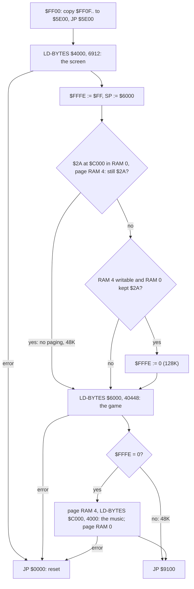
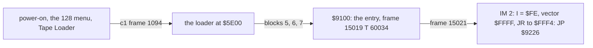

# 3. Build and load

What this covers: the medium block by block, the BASIC, the loader and its 128K test, the stages from power-on to
the game. The recordings it rests on: `c1` (power-on, the original TZX at ROM speed on the 128K, loaded through the
128 menu's Tape Loader; [WALKTHROUGH 1](../WALKTHROUGH.md#1-one-recording-from-power-on)).

<!-- Figures this document needs (GUIDE.md 4.2), remove each line when it is in: -->
<!-- - the medium as a picture (blocks, times) -->
<!-- - the load as a memory animation (`kit/memanim.py`) -->
<!-- - the build (mermaid) -->

## 3.1 The tape block by block

`orig/MASKIII-VENOMStrikesBack.tzx.zip`'s `Mask III.tzx`, listed by `python3 tools/tzxblocks.py list` (the times at
ROM speed from each block's bits and pilot, the pauses as the TZX gives them). Every block is a standard ROM block
(pilot 2168, sync 667 / 735, bits 855 / 1710 T): there is no turbo, no packer and no cipher, so there is no unpack to
animate. The loader is Gremlin's own 256 bytes, but it reads every block with the ROM's LD-BYTES (`CALL $0556`).

| Block | Kind | Name | Length (data) | Loads at | ROM-speed time | Pause after | What it is |
| --- | --- | --- | --- | --- | --- | --- | --- |
| 0 | text | | | | | | "Created with Ramsoft MakeTZX" |
| 1 | header, Program | "MASK3" | 36 | | 5.08 s | 1.015 s | autostart `LINE 0` |
| 2 | data | | 36 | PROG | 2.20 s | 6.073 s | the BASIC (3.2) |
| 3 | header, Bytes | "loader" | 256 | `$FF00` | 5.09 s | 1.010 s | |
| 4 | data | | 256 | `$FF00-$FFFF` | 3.36 s | 7.425 s | the loader, run at `$5E00` (3.3) |
| 5 | data, headerless | | 6912 | `$4000-$5AFF` | 37.04 s | 8.282 s | the loading screen |
| 6 | data, headerless | | 40 448 | `$6000-$FDFF` | 218.85 s | 9.149 s | the game: code, data, graphics, maps |
| 7 | data, headerless | | 4000 | `$C000-$CF9F` of RAM 4 | 23.24 s | 9.117 s | the 128K music (Ben Daglish's AY player and three tunes); loaded only on a 128K |

The data blocks take 294.9 s at ROM speed (14 744 frames), 336.9 s with the TZX's pauses (16 847 frames). On a 48K
the loader stops after block 6 and the tape's last block is never read.

In `c1` (the 128K, ROM speed, the fast LD-BYTES trap off) the loader's block arrives at frame 1094 and runs at `$5E00`
at T 37 200 of that frame; the game's first instruction `$9100` runs at frame 15 019, T 60 034, entered from the
loader's `JP $9100` at `$5E76` (`python3 ../../kit/rs.py stages --work work/stage1/c1`). The memory at that moment
(`python3 tools/ttd_dump.py --work work/stage1/c1 --frame 15019 --t 60034 --out work/stage1/images/entry`) holds
blocks 5 and 6 byte for byte at `$4000` and `$6000`, block 7 byte for byte at `$C000` of RAM 4, and `$FFFE` = 0 (the
128K flag, 3.3).

## 3.2 The BASIC

One line, its numbers stored in the ROM's five-byte form:

```
10 CLEAR 24570: LOAD "" CODE : RANDOMIZE USR 65280
```

`CLEAR 24570` (`$5FFA`) puts RAMTOP just under the game's `$6000`; `LOAD "" CODE` takes the "loader" header and its
256 bytes at `$FF00`; `USR 65280` runs them.

## 3.3 The loader

The loader runs at `$FF00` only long enough to copy itself down: `LDIR` of 512 bytes from `$FF0F` to `$5E00` (the
copy runs on past `$FFFF` into the ROM; the code ends at `$5E78`), then `JP $5E00`. From `$5E00` it:

1. loads the screen: LD-BYTES, `IX` = `$4000`, `DE` = 6912, flag `$FF`; on an error (`NC`) `JP $0000`, a reset;
2. sets the flag `$FFFE` = `$FF` (48K) and `SP` = `$6000`;
3. tests for 128K paging: with RAM 0 at `$C000` (`OUT ($7FFD),$10`) it writes `$2A` at `$C000`, pages RAM 4
   (`$14`) and reads `$C000`. A 48K, where the port does nothing, reads `$2A` back and stops here. Otherwise it checks
   that the byte is RAM (writes 0, `DEC (HL)`, `OR (HL)`, `INC A`: `$FF` + 1 = 0), pages RAM 0 again and checks that
   the `$2A` is still there; then it is a 128K and the flag `$FFFE` = 0;
4. loads the code: `IX` = `$6000`, `DE` = 40 448;
5. on a 48K (`$FFFE` not 0) `JP $9100`; on a 128K it pages RAM 4 (`$14`), loads 4000 bytes at `$C000`, pages RAM 0
   back (`$10`) and jumps to `$9100` (`$5E76`).



The point: the game learns the machine from one byte, `$FFFE`, which the loader leaves for it; the interrupt handler
reads it every frame to choose the AY player in RAM 4 or the beeper ([WALKTHROUGH 1](../WALKTHROUGH.md#1-one-recording-from-power-on)).

## 3.4 The stages from power-on to the game



`kit/rs.py stages --work work/stage1/c1` lists six arrivals: the ROM's `$5B00` (frame 53), the loader at `$FF00` and
its copy at `$5E00` (frame 1094), the game at `$9100` (frame 15 019), and two the game makes itself at frame 15 021:
the `JR` byte written at `$FFFF` by `$9131` and the handler `$9226` entered through it.
