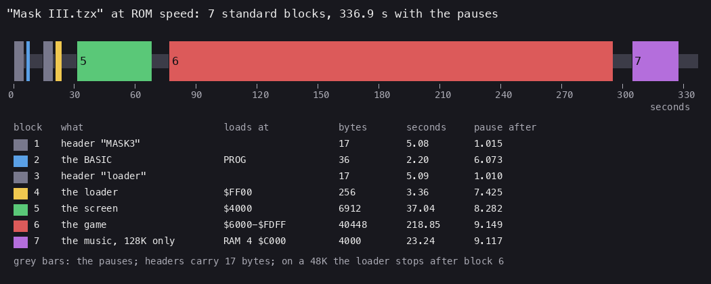
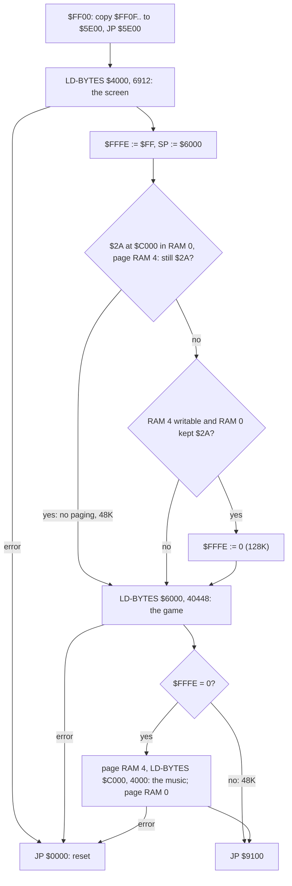
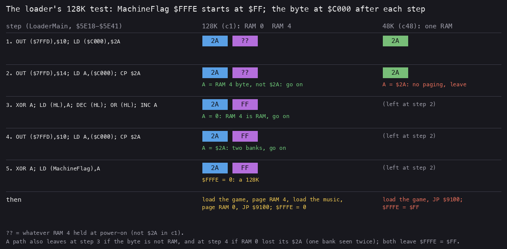
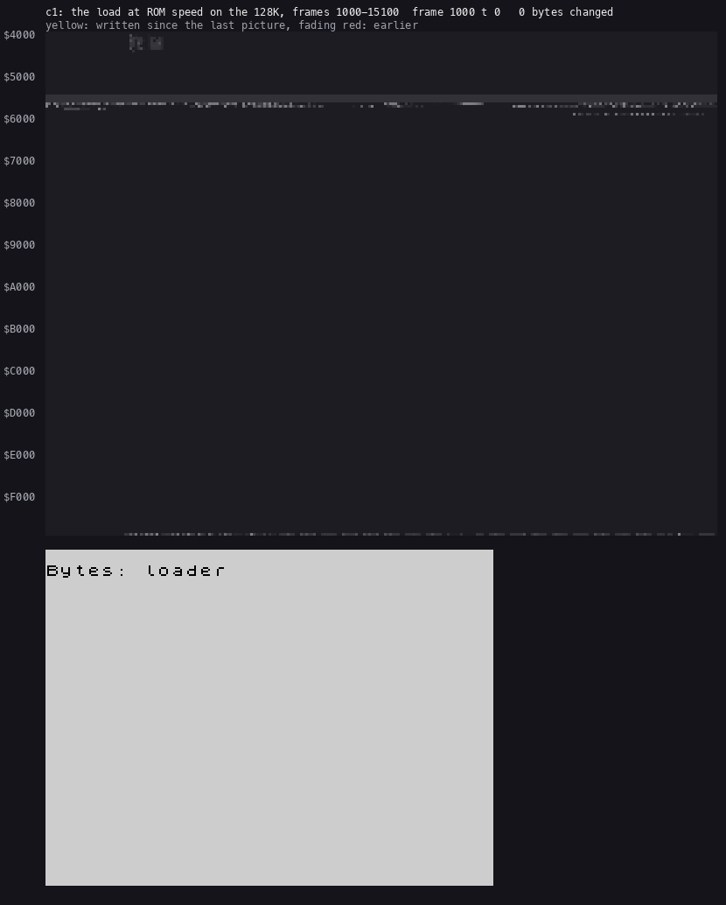
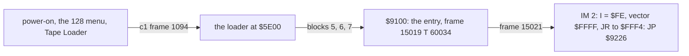
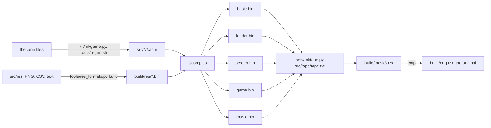
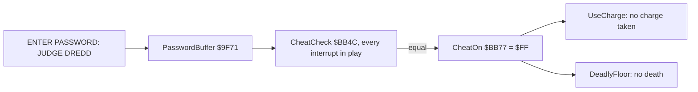

# 3. Build and load

What this covers:

- the tape block by block, as a picture;
- the BASIC;
- Gremlin's loader, its 128K test, and the leftover in its block;
- the load as a memory animation, and the stages from power-on to the game;
- the build from source;
- the releases: build A against build B, and the hacks (the standard Spectrum releases only);
- the POKEs and the JUDGE DREDD cheat.

There is no packer and no cipher: every block is a standard ROM block read by the ROM's LD-BYTES.

The recordings it rests on: `c1` (power-on, the original TZX at ROM speed on the 128K, loaded through the 128 menu's
Tape Loader; [WALKTHROUGH 1](../WALKTHROUGH.md#1-one-recording-from-power-on)) and stage 2's `c48` (the same tape on
the 48K model).

## 3.1 The tape block by block

`orig/MASKIII-VENOMStrikesBack.tzx.zip`'s `Mask III.tzx`, listed by `python3 tools/tzxblocks.py list` (the times at
ROM speed from each block's bits and pilot, the pauses as the TZX gives them). Every block is a standard ROM block
(pilot 2168, sync 667 / 735, bits 855 / 1710 T): no turbo, no packer, no cipher, so there is no unpack to animate.
The loader is Gremlin's own 256 bytes, but it reads every block with the ROM's LD-BYTES (`CALL $0556`).



*`tools/fig_tape.py`: the blocks on a time line, with the pauses in grey.*

| Block | Kind | Name | Length (data) | Loads at | ROM-speed time | Pause after | What it is |
| --- | --- | --- | --- | --- | --- | --- | --- |
| 0 | text | | | | | | "Created with Ramsoft MakeTZX" |
| 1 | header, Program | "MASK3" | 36 | | 5.08 s | 1.015 s | autostart `LINE 0` |
| 2 | data | | 36 | PROG | 2.20 s | 6.073 s | the BASIC (3.2) |
| 3 | header, Bytes | "loader" | 256 | `$FF00` | 5.09 s | 1.010 s | |
| 4 | data | | 256 | `$FF00-$FFFF` | 3.36 s | 7.425 s | the loader, run at `$5E00` (3.3) |
| 5 | data, headerless | | 6912 | `$4000-$5AFF` | 37.04 s | 8.282 s | the loading screen |
| 6 | data, headerless | | 40 448 | `$6000-$FDFF` | 218.85 s | 9.149 s | the game: code, data, graphics, maps |
| 7 | data, headerless | | 4000 | `$C000-$CF9F` of RAM 4 | 23.24 s | 9.117 s | the 128K music (the AY player and three tunes); loaded only on a 128K |

The blocks take 294.9 s at ROM speed (14 744 frames), 336.9 s with the TZX's pauses (16 847 frames). On a 48K the
loader stops after block 6 and the tape's last block is never read.

In `c1` the loader's block arrives at frame 1094 and runs at `$5E00` at T 37 200 of that frame. The game's first
instruction `$9100` runs at frame 15 019, T 60 034, entered from the loader's `JP $9100` at `$5E76`
(`python3 ../../kit/rs.py stages --work work/stage1/c1`). The memory at that moment (`python3 tools/ttd_dump.py
--work work/stage1/c1 --frame 15019 --t 60034 --out work/stage1/images/entry`) holds blocks 5 and 6 byte for byte at
`$4000` and `$6000`, block 7 byte for byte at `$C000` of RAM 4, and `$FFFE` = 0 (the 128K flag, 3.3).

## 3.2 The BASIC

One line, its numbers stored in the ROM's five-byte form:

```basic
10 CLEAR 24570: LOAD "" CODE : RANDOMIZE USR 65280
```

`CLEAR 24570` (`$5FFA`) puts RAMTOP just under the game's `$6000`. `LOAD "" CODE` takes the "loader" header and its
256 bytes at `$FF00`. `USR 65280` runs them. The header's `LINE 0` is below the first line, so the program runs from
line 10 at once.

The bytes (`build/basic.lst`): `00 0A` the line number, `20 00` the line's length (32), then the three statements.
Each number is its digits, the marker `$0E` and five bytes: 24570 is `0E 00 00 FA 5F 00`.

## 3.3 The loader

The loader is 256 bytes at `$FF00`. It runs there only long enough to copy itself down to `$5E00`, into the gap
`CLEAR 24570` left between the BASIC and the game. It cannot stay at `$FF00`: the 128K pages the top 16 K, and the
music block loads there.

```z80
LoaderStart:              ; $FF00, from USR 65280
  DI
  LD HL,$FF0F
  LD DE,LoaderMain        ; $5E00
  LD BC,512
  LDIR                    ; the copy runs on past $FFFF into the ROM
  JP LoaderMain
```

The copy is 512 bytes from a 256-byte block. The last 271 bytes it copies come from the ROM at `$0000-$010E` and land
at `$5EF1-$5FFF`. They are never run; the code ends at `$5E78`.

From `$5E00` the loader does five steps:

1. it loads the screen: LD-BYTES, `IX` = `$4000`, `DE` = 6912, flag `$FF`; on an error (`NC`) `JP $0000`, a reset;
2. it sets MachineFlag `$FFFE` = `$FF` (a 48K until proved otherwise) and `SP` = `$6000`;
3. it tests for 128K paging (below);
4. it loads the game: `IX` = `$6000`, `DE` = 40 448;
5. on a 48K it jumps to `$9100`; on a 128K it pages RAM 4 (`$14`), loads 4000 bytes at `$C000`, pages RAM 0 back
   (`$10`) and jumps to `$9100` (`$5E76`).

### The 128K test

```z80
  LD BC,$7FFD
  LD HL,PagedRam          ; $C000
  LD A,$10
  OUT (C),A               ; RAM 0 at $C000
  LD (HL),$2A
  LD A,$14
  OUT (C),A               ; RAM 4 at $C000
  LD A,(HL)
  CP $2A
  JR Z,LoadGame           ; the same byte: no paging, a 48K
NotMirrored:              ; $5E2D
  XOR A
  LD (HL),A               ; 0
  DEC (HL)                ; $FF
  OR (HL)                 ; A = $FF if the byte is RAM
  INC A                   ; 0
  JR NZ,LoadGame          ; not RAM
Ram4Ok:
  LD A,$10
  OUT (C),A               ; RAM 0 again
  LD A,(HL)
  CP $2A
  JR NZ,LoadGame          ; RAM 0 lost its $2A: one bank seen twice
  XOR A
  LD (MachineFlag),A      ; $FFFE = 0: a 128K
LoadGame:                 ; $5E41
```

```text
MachineFlag = $FF
page RAM 0; [$C000] = $2A
page RAM 4
if [$C000] == $2A: 48K                      ; the port did nothing
[$C000] = 0; [$C000] -= 1
if [$C000] != $FF: 48K                      ; not RAM
page RAM 0
if [$C000] != $2A: 48K                      ; the two pages are one
MachineFlag = 0
```

Worked example, the 128K of `c1`. RAM 0's `$C000` gets `$2A`. With RAM 4 paged, `$C000` reads RAM 4's byte, which
is not `$2A`. RAM 4 takes 0, then `$FF`; `OR (HL)` gives `$FF` and `INC A` 0. RAM 0 paged back still holds `$2A`.
So `$FFFE` = 0, and at the game's entry RAM 4 holds block 7 byte for byte.

On a 48K (`c48`) the port `$7FFD` does nothing. The read gives the `$2A` back and the test stops at once, `$FFFE`
left `$FF`. The `$2A` lands in plain RAM, which the game's load overwrites.





*`tools/fig_paging.py`: the steps of LoaderMain `$5E18-$5E41` (`build/loader.lst`) with the byte at `$C000` in each
bank after each step; the 128K path is that of `c1`, the 48K path that of `c48`.*

The point: the game learns the machine from one byte, `$FFFE`, which the loader leaves for it. The interrupt
handler reads it every frame to choose the AY player in RAM 4 or the beeper
([doc 4, 4.3](04-game-loop.md#43-the-interrupt-handler)).

### The block's tail: a saved stack

The copied code ends at block offset `$87`. The rest of the block is no code the loader runs: zeros to `$FFB5`, then
74 bytes that read like the top of a stack.

| Address | Bytes | What they are |
| --- | --- | --- |
| `$FF88-$FFB5` | zeros | padding |
| `$FFB6-$FFF3` | `54 00 9E 92 2F AF 33 AF` ... | StackLeftover: words that fall in the game's code (`$929E`, `$9244`, `$9247` inside the interrupt handler, `$AF33`, `$87D0`) |
| `$FFF4-$FFF6` | `C3 26 92` | `JP $9226`, as GameEntry writes it |
| `$FFF7-$FFFD` | `5A A5 80 E2 88 E2 3C` | nothing: no instruction of the loader or the game reads or writes them, and the stack (from `$FFF0` down) never reaches them; whatever the saved memory held there |
| `$FFFE` | `00` | MachineFlag of a 128K |
| `$FFFF` | `18` | the `JR` of the IM 2 trick |

Worked example: `$9244` and `$9247` are return addresses inside Interrupt `$9226`, after its `CALL Z,CheatCheck`
and `CALL NZ,MenuInterrupt`. The `JP $9226` and the `$18` are the IM 2 trick's bytes
([doc 4, 4.2](04-game-loop.md#42-the-im-2-vector-trick)). The 0 at `$FFFE` is the flag of a 128K.

So the block was saved from the memory of a 128K with the game running: `$FF00-$FFFF` was saved whole, the
loader's code at its start and the live game's stack and IM 2 bytes at its end. None of these bytes is read as it came off the tape:
LoaderMain writes `$FFFE` first, and GameEntry writes `$FFF4-$FFF6` and `$FFFF` again.

## 3.4 The stages from power-on to the game



*`load-c1.gif`: the memory `$4000-$FFFF` every 200 frames of the load, with the screen. The loader arrives at the
top of memory, then the screen fills (block 5), then the game's block from `$6000` up (block 6); block 7 goes to
RAM 4, outside this view. `kit/memanim.py --work work/docs/mxA/c1 --from 1000 --to 15100 --step 14181600
--from-address 4000 --to-address FFFF --screen --cell 3`.*



`kit/rs.py stages --work work/stage1/c1` lists six arrivals: the ROM's `$5B00` (frame 53), the loader at `$FF00` and
its copy at `$5E00` (frame 1094), the game at `$9100` (frame 15 019), and two the game makes itself at frame 15 021:
the `JR` byte written at `$FFFF` by `$9131` and the handler `$9226` entered through it.

| Frame (c1) | What |
| ---: | --- |
| 1094 | the loader runs at `$5E00` |
| 3000 | the loading screen complete |
| 15 019 | GameEntry `$9100` |
| 15 021 | the first interrupt through the `JR` |
| 15 100 | the menu is on screen (the last picture of `load-c1.gif`; the menu screenshot is of frame 17 750) |

## 3.5 The build

The case rebuilds the tape bit for bit from its sources. `tools/build.sh` assembles five sources with sjasmplus and
writes the TZX:



| Input | Block | What it holds |
| --- | ---: | --- |
| `src/tape/basic.asm` | 2 | the BASIC "MASK3" (block 1 its header) |
| `src/loader/loader.asm` | 4 | the loader at `$FF00` that runs at `$5E00` (block 3 its header) |
| `src/screen/screen.asm` | 5 | the loading screen |
| `src/game/game.asm` | 6 | the game `$6000-$FDFF`, 11 source files |
| `src/music/music.asm` | 7 | the AY music for RAM 4 at `$C000` |
| `src/tape/tape.txt` | all | the block list, the headers and the pauses |

The result: "build: identical to orig/MASKIII-VENOMStrikesBack.tzx.zip's "Mask III.tzx"" (stage 2 notes). The
resources are editable: `python3 tools/res_formats.py check` encodes all 67 sources back to their bytes exactly.

## 3.6 The releases and the hacks

Stage 1 fetched 55 copies listed by the collection index and compared them block by block (`README.md`, Other
releases). Only the standard Spectrum releases count here. There are two builds of the game:

| | Build A (this case) | Build B |
| --- | --- | --- |
| Releases | Gremlin's original; the Space Ace compilation (1989); the 128K crack "Venom SB"; the hacked loaders | IBSA and Erbe "Serie Leyenda" (Spain); the 48K TAP |
| BASIC | "MASK3", `CLEAR 24570: LOAD ""CODE: RANDOMIZE USR 65280` | "VENOM", with `VAL` strings and `9999 SAVE "VENOM" LINE SIN PI: LOAD "MASTER"` |
| The code block | md5 `2281f690...` | 13 991 bytes differ from offset 3042 (`$6BE2`): the code after it is shifted by 1 to 17 bytes |
| The 128K block | md5 `a110a2b0...` | 101 bytes differ from offset 3083 |
| ZXDB's POKEs | fit | do not fit (3.7) |

Build B is a reassembly, not a moved copy. The shift against build A varies along the block: 0 up to `$6BE2`, 1 byte
at `$A000`, 17 at `$B220` (`$B231` in build B), 15 at `$C315` (`$C324`, with changed bytes around it). Matched with
`work/docs/mxA/buildB-code.bin`, the Erbe TZX's block 6. The first difference at `$6BE2` is inside zone 2's parked character set.

The hacks keep build A's code byte for byte. They change the loader or the BASIC:

| Copy | What it is | What it keeps |
| --- | --- | --- |
| ZXDB `MASK3128.TAP`, TOSEC "(128K)[cr].tap" | the 128K crack "Venom SB" | the code and the 128K block (build A); another loader and BASIC |
| zxart "[h]", "[h Bill Gilbert]", "[h Andrzej Staszewski]", "Andrey Anoshkin" | hacked loaders | the screen and the code; "[h]" and Anoshkin also the 128K block |

The +3 disks, TR-DOS conversions and translations are outside this case (not standard tape releases).

## 3.7 The POKEs and the cheat

### The POKEs

ZXDB's `.pok` file (`work/candidates/zxdb/`) and the 48K TAP's `POKES/MASK3.POK` list eleven POKEs. Their
"original" bytes fit build A at every address and build B at none.

| Name | POKE | Address | Was | Becomes | What it does |
| --- | --- | --- | --- | --- | --- |
| Immunity | 52254,175 | `$CC1E` | `AND A` after `LD A,(DeathFlag)` | `XOR A` | `JP NZ,Death` is never taken: the deadly floor never kills |
| No enemies | 49941,201 | `$C315` | RunKind: `LD A,(IX+$00)` | `RET` | no enemy moves or collides |
| Infinite ammo | 45600,0 | `$B220` | `SUB C` in UseCharge | `NOP` | the charges never go down |
| Waterproof | 45803,201 | `$B2EB` | `JR NC` in RestoreOnePickup | `RET` | see below |
| Lives (1) | 46045,58 | `$B3DD` | `LD (Energy),A` in TakeBlockItem | `LD A,(Energy)` | a block item costs nothing while the energy is 25 or more; below 25 it sets the energy to 0 (see below) |
| Lives (2) | 47778,179 | `$BAA2` | `LD (Energy),A` in LavaDrain | `OR E`, then `AND (HL)`, `XOR (HL)` | a head bump in zone 1 costs nothing |
| Lives (3) | 49872,208 | `$C2D0` | `LD (Energy),A` in Damage | `RET NC` | an enemy's touch costs nothing |
| Lives (4) | 45589,201 | `$B215` | `RET NZ` in UseCharge | `RET` | the charges never go down |
| Immunity, crashes (1) | 42849,0 | `$A761` | `DEC (IX+$08)` in DrawShifted | `NOP`, `DEC (HL)`, `EX AF,AF'` | |
| Immunity, crashes (2) | 42831,0 | `$A74F` | `SBC HL,BC` | `NOP`, `LD B,D` | |
| Immunity, crashes (3) | 44914,0 | `$AF72` | the high byte of `CALL $AF74` in PrintBcd | `CALL $0074`, into the ROM | |

Worked example, Immunity:

```z80
  LD A,(DeathFlag)        ; $CC1B
  AND A                   ; $CC1E: A7; the POKE writes AF, XOR A
  JP NZ,Death             ; with XOR A, Z is always set: never taken
```

Three findings come out of the table, known only from the code:

- "Waterproof" does not do what its name says. `$B2EB` is inside RestoreOnePickup, which puts the background back
  under a mask's icon. The POKE makes it return after the first row of the 2 x 2 icon, so half of the background is
  not put back. The deadly floor check is DeadlyFloor `$B2F9` (45817), which the POKE does not touch.
- "Waterproof" also breaks the second icon. RestorePickups `$B2C5` calls RestoreOnePickup for icon 0 and falls into
  it for icon 1 with the same `DE`, the pointer into PickupSaves `$A253`. Cut short, the first call leaves `DE` two
  bytes behind, so icon 1's top row gets icon 0's saved bottom row (read from the code).
- "Lives (1)" protects only a full enough bar. `LD A,(Energy)` leaves the flags of the `SUB $19` before it, so with
  less than 25 the carry is still set, `RET NC` falls through, and `XOR A`, `LD (Energy),A` set the energy to 0:

```z80
  LD A,(Energy)           ; $B3D8
  SUB $19                 ; carry when Energy < 25
  LD A,(Energy)           ; $B3DD, the POKE: was LD (Energy),A; the flags stay
  RET NC                  ; 25 or more: nothing taken
  XOR A
  LD (Energy),A           ; $B3E2: below 25, the energy becomes 0
```
- "Lives (4)" is a second infinite-ammo POKE: UseCharge returns before it takes a charge, as with the cheat.
- The three "crashes" POKEs break the sprite drawing and the menu's HISCORE print (PrintBcd `$AF6B`, whose only
  caller is `$9D35` in the menu; the score in play is drawn by DrawScore `$AE60`); the third calls into the ROM.

The game has no lives, so the "Lives" POKEs keep the energy instead.

### JUDGE DREDD

CheatCheck `$BB4C` runs in every interrupt of play. It compares PasswordBuffer, the 16 key codes typed at ENTER
PASSWORD, with CheatCode `$BB6B`. Equal sets CheatOn `$BB77` to `$FF`.

```z80
CheatCheck:               ; $BB4C
  PUSH AF
  LD BC,$BA77
  INC B                   ; BC = $BB77, CheatOn
  XOR A
  LD (BC),A               ; off, unless it matches below
  LD DE,CheatCode         ; $BB6B
  LD HL,ZoneChars+$0406   ; $E406
  ADD HL,DE               ; $E406 + $BB6B = $9F71: PasswordBuffer
l_BB5A:
  LD A,(DE)
  CP (HL)
  JR NZ,l_BB69
  AND A
  JR Z,l_BB66             ; the 0 at the end: all equal
  INC DE
  INC HL
  JP l_BB5A
l_BB66:
  LD A,$FF
  LD (BC),A               ; CheatOn = $FF
l_BB69:
  POP AF
  RET
CheatCode:
  DEFB $63,$53,$12,$14,$22,$70,$12,$23
  DEFB $22,$12,$12,$00    ; J U D G E space D R E D D
```

The routine hides its two addresses. CheatOn is built as `$BA77` + `$100`. PasswordBuffer is the sum `$E406` +
`$BB6B`, which overflows 16 bits to `$9F71`. Neither address appears as an operand, so a search of the code for
`$BB77` or `$9F71` misses it.

Worked example: the key codes of "JUDGE DREDD" are `$63 $53 $12 $14 $22 $70 $12 $23 $22 $12 $12`: D is `$12` four
times, E is `$22` twice, the space is `$70`.

With CheatOn set, two routines return at once:

| Routine | Its first test | Effect |
| --- | --- | --- |
| UseCharge `$B210` | `LD A,(CheatOn)`, `AND A`, `RET NZ` at `$B211-$B215` | the masks keep their charges |
| DeadlyFloor `$B2F9` | the same at `$B2F9-$B2FD` | the deadly floors and the moon's floor do not kill |

Energy is not protected: enemies, block items and the head bumps in zone 1 still drain it.



The witness: CheatCheck runs in every play interrupt of every recording (L1 46 478 entries in c1, cheat, door, door3, kind6, masks, play2 and ten `rzx-` segments). Its effect is in the
stage 2 notes: the CheatOn tests in UseCharge and DeadlyFloor. The `cheat` recording types JUDGE DREDD: CheatOn is
`$FF` in play and a LAVA SHOT fired six times keeps its 99 charges ([doc 10](10-gameplay-logic.md)); the safe floor
is known from the code.

The point: Gremlin hid the cheat from a code search, not from a player. The password screen accepts it like any
other password.
