# 4. Game loop

What this covers:

- the program as a state machine, from the loader to the main loop and back;
- the IM 2 vector trick: the `$FF` table, the `JR` at `$FFFF`, the `JP $9226`;
- the interrupt handler and what it costs on the 128K and on the 48K;
- the free-running main loop `$CC03-$CC59` and the order of a pass;
- the heaviest frame: a room change, SwapZone under `DI`, DrawRoom;
- every delay, pause and timer.

The recordings it rests on ([WALKTHROUGH 6.0](../WALKTHROUGH.md#60-the-recordings)):

- `c1`: power-on on the 128K, the original tape at ROM speed, the menu, then play in room 0;
- `rec/rzx-04000` and `rec/rzx-16000`: two segments of the ZXDB RZX run, replayed from the RZX's own state; they run
  the beeper path (the RZX's memory has `$FFFE` = 1);
- `rec/rzx-28000`: a segment with a death and a new game;
- stage 2's `c48`: the tape on the 48K model.

Three short windows were built for this document from those recordings, in `work/docs/mxA/`:

| Window | From | Frames | What it gives |
| --- | --- | --- | --- |
| `c1-play` | `c1` | 18 500-22 300 | the L1 of 3800 frames of play in room 0 |
| `c1-menu` | `c1` | 15 100-17 790 | the L1 of the menu |
| `c1/traces/19000_0-19005_0.uatr` | `c1` | 19 000-19 004 | a full trace: one pass and its interrupts |
| `r04/traces/460_0-474_0.uatr` | `rec/rzx-04000` | 460-473 | a full trace: the pod from room 10 to room 1 |

The commands are in [`work/docs/mxA-NOTES.md`](../work/docs/mxA-NOTES.md).

## 4.1 The program as a state machine

MASK III has one main loop and no frame lock. The loader hands over to GameEntry `$9100` once. GameEntry builds the
IM 2 table and falls into GameStart `$CBF9`. GameStart is the hub: every way out of a game comes back to it.

GameStart resets the stack, enables interrupts, runs the menu, then sets up a new game. Then it falls through into
MainLoop `$CC03`. The main loop never returns. It leaves in one of four ways:

1. Matt dies: `JP NZ,Death` at `$CC1F`, then GameOver `$BACC`, then `JP GameStart`;
2. the energy reaches 0: the main loop sets Matt's state 9, MattNoEnergy `$B9B8` waits, then GameOver;
3. Matt reaches room 15's last screen: DrawRoom `$A89D` jumps to Ending `$ADF6`, which ends in `JP GameStart`;
4. the player presses BREAK (CAPS SHIFT and SPACE): the interrupt handler itself jumps to GameStart.

The last way is unusual. The jump happens inside the interrupt, with the main loop's registers still on the stack.
GameStart's first instruction, `LD SP,$FFF0`, throws them away. The handler's `EI` is never reached, so GameStart
has its own `EI` at `$CBFC`.

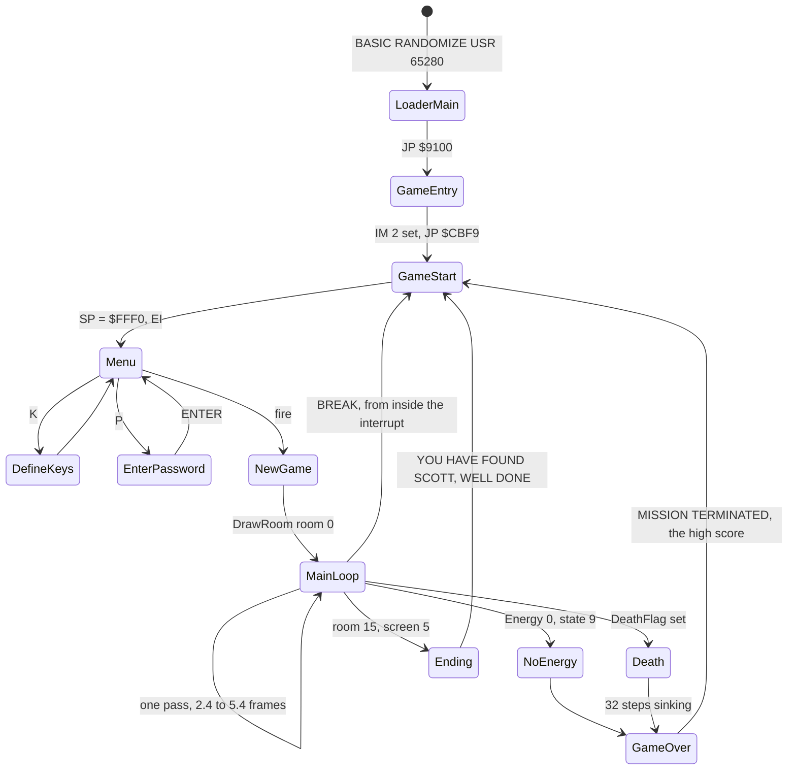

Pseudocode of the hub (`src/game/interrupt.asm`):

```text
GameStart:
    SP = $FFF0
    enable interrupts
    Menu()            ; returns when fire is pressed
    NewGame()         ; room 0, energy 255, empty masks, score 0, DrawRoom
MainLoop:
    one pass (4.3)
    jump MainLoop
```

The witness is c1. The loader arrives at frame 1094 T 37 200. GameEntry runs at frame 15 019 T 60 034. The first
interrupt goes through the `JR` at frame 15 021. The menu is on screen by frame 17 750, and the first game starts at
about frame 18 300 (WALKTHROUGH 1). In `rec/rzx-28000` Matt dies, MISSION TERMINATED is printed and a new game
starts, all inside one 4000-frame segment.

The point: there is no game-state variable to dispatch on. The state is where the program counter is. A game ends
by jumping back to the top with a fresh stack.

## 4.2 The IM 2 vector trick

The game runs in interrupt mode 2. In IM 2 the CPU builds a vector address from `I` (the high byte) and the byte on
the data bus (the low byte). On a Spectrum nothing drives the bus during the acknowledge, so the byte is usually
`$FF`, but not always. The usual answer is a table of 257 equal bytes. MASK III uses that table and adds a trick to
reach a handler that does not sit at an address of the form `$XYXY`.

GameEntry `$9100` does the set-up, under `DI` (`src/game/entry.asm`):

```z80
GameEntry:
  DI
  ...                     ; copy zone 1's parked set down (doc 2, 2.2)
  LD A,$FF
  LD R,A                  ; the random generator reads R
  LD SP,StackTop          ; $FFF0
  LD A,$FE
  LD I,A
  LD HL,ImTable           ; $FE00
  LD DE,ImTable+1
  LD BC,$0100
  LD (HL),$FF
  LDIR                    ; $FE00-$FF00 all $FF: 257 bytes
  LD A,$18
  LD (ImJr),A             ; $FFFF = $18, JR
  LD A,$C3
  LD (ImJump),A           ; $FFF4 = JP
  LD HL,Interrupt
  LD (ImJump+1),HL        ;        $9226
  IM 2
```

The vector table is `$FE00-$FF00`, all `$FF`. Any bus byte `b` makes the CPU read the word at `$FE00 + b`. That word
is `$FFFF` for every `b`. So every interrupt jumps to `$FFFF`.

`$FFFF` holds one byte, `$18`, the opcode of `JR`. The CPU reads its offset from the next address. The address wraps
to `$0000`, which is ROM. `$0000` holds `$F3` (`DI`) in the 48K ROM and in both 128K ROMs. As a signed offset `$F3`
is -13. So the `JR` lands at `$FFF4`, where GameEntry put `JP $9226`.

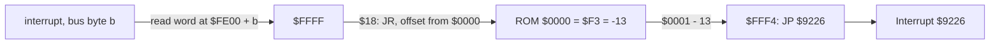

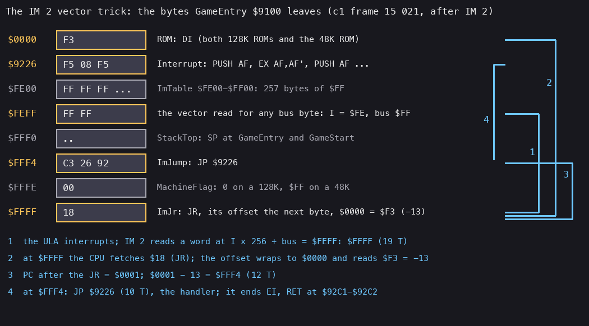

*`tools/fig_im2.py`: the bytes as GameEntry leaves them (they equal c1's memory at frame 15 021) and the path of one
interrupt.*

Worked example, the first interrupt of the game (c1 frame 15 021):

| Step | Address | Byte read | Result | T |
| --- | --- | --- | --- | ---: |
| acknowledge, vector | `$FEFF`, `$FF00` | `$FF`, `$FF` | PC = `$FFFF` | 19 |
| `JR` opcode | `$FFFF` | `$18` | | |
| `JR` offset | `$0000` (ROM) | `$F3` = -13 | PC = `$0001` - 13 = `$FFF4` | 12 |
| `JP` | `$FFF4-$FFF6` | `C3 26 92` | PC = `$9226` | 10 |

So an interrupt costs 41 T before the handler's first instruction.

The witness is `kit/rs.py interrupts`: in c1 it reports "IM 2 `$FFFF` → `$9226`", one entry a frame from frame
15 021. The L1 of `c48` reads `$FEFF-$FF00` as a two-byte read in the handler's profile.

The point: the table costs 257 bytes and the trick 4 more. The handler can live anywhere. The `JR` costs 12 T an
interrupt. The trick depends on one ROM byte, which every Spectrum ROM of the time shares.

The loader leaves the same bytes behind. Its block, loaded at `$FF00`, ends with `C3 26 92` at `$FFF4`, 0 at `$FFFE`
and `$18` at `$FFFF` ([doc 3, 3.3](03-build-and-load.md#33-the-loader)). The block was saved from a running
game.

## 4.3 The interrupt handler

Interrupt `$9226` runs once a frame. It saves every register, both sets and `IX`, `IY`. Then it does five jobs:

1. it counts FrameCounter `$9224` and sets the border from BorderColour `$9225`;
2. in play it calls CheatCheck `$BB4C`; in the menu it calls MenuInterrupt instead (MenuFlag `$970E`);
3. on a 128K it pages RAM 4 in and runs the AY player; on a 48K it runs the beeper;
4. in play it scrolls the message line (Scroller `$AF82`);
5. in play it reads BREAK and jumps to GameStart if it is held.

Pseudocode:

```text
Interrupt:
    push every register
    FrameCounter += 1
    border = BorderColour
    if MenuFlag == 0: CheatCheck()            ; JUDGE DREDD
    else:             MenuInterrupt()         ; the logo raster, the menu keys
    if MachineFlag == 0:                      ; 128K
        page RAM 4 ($7FFD = $14)
        if TuneRequest: MusicStart(TuneRequest - 1); TuneRequest = 0
        if StopRequest: MusicStop();          StopRequest = 0
        StopEffects(); StartEffects(); MusicPlay()
        if NotInPlay and MusicTune != $FF: MusicStart(0)   ; the menu tune loops
        page RAM 0 ($7FFD = $10)
    else:                                     ; 48K
        StopBeeper(); BeeperTick()
    if not NotInPlay:
        Scroller()
        if CAPS SHIFT and SPACE are held: jump GameStart
    pop every register
    EI, RET
```

The core of the asm (`src/game/interrupt.asm`):

```z80
Interrupt:                ; $9226
  PUSH AF
  ...                     ; every register, IX, IY
  LD HL,FrameCounter
  INC (HL)
  LD A,(BorderColour)
  OUT ($FE),A
  LD A,(MenuFlag)
  AND A
  CALL Z,CheatCheck
  CALL NZ,MenuInterrupt
  LD A,(MachineFlag)
  AND A
  JR NZ,l_9291            ; 48K: the beeper
  LD BC,$7FFD
  LD A,$14
  OUT (C),A               ; RAM 4 at $C000
  ...
  CALL MusicPlay          ; $C003 in RAM 4
  ...
  LD BC,$7FFD
  LD A,$10
  OUT (C),A               ; RAM 0 back
  JR l_9297
l_9291:
  CALL StopBeeper
  CALL BeeperTick
l_9297:
  LD A,(NotInPlay)
  AND A
  CALL Z,Scroller
  LD A,(NotInPlay)
  AND A
  JR NZ,l_92B3
  LD A,$7F
  IN A,($FE)              ; SPACE row
  LD L,A
  LD A,$FE
  IN A,($FE)              ; CAPS SHIFT row
  OR L
  BIT 0,A
  JP Z,GameStart          ; BREAK: leave from inside the interrupt
l_92B3:
  POP IY
  ...
  EI
  RET                     ; $92C2
```

The BREAK test reads two half-rows and ORs them. Bit 0 is 0 only when both CAPS SHIFT and SPACE are down.

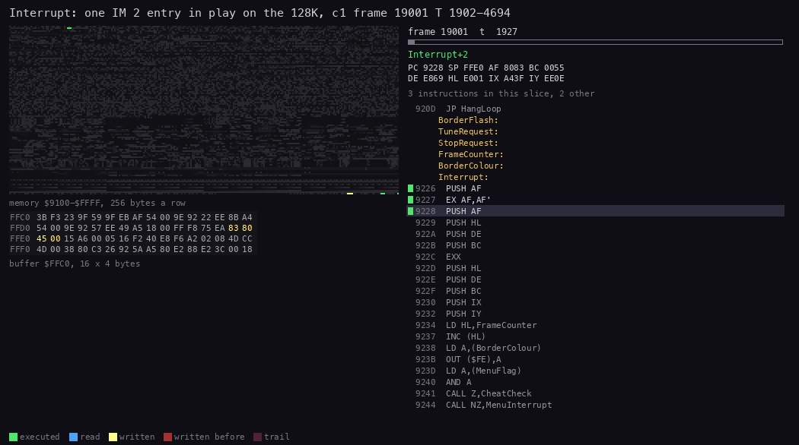

*`Interrupt.gif`: c1 frame 19 001, T 1880-4700, one entry from 1902 to its `RET` at 4694 (2792 T). The view is the
top of memory `$FFC0-$FFFF`: the registers pushed below `$FFF0`, the `JP` at `$FFF4`, the flag and the `JR`.
`kit/routine_anim.py --work work/docs/mxA/c1 --window 19001:1880-19001:4700 --listing build/game.lst
--page 4=build/music.lst --page-name '4=the AY player (RAM 4)' --view buffer:FFC0:16x4:hex --range 9100-FFFF
--pc 9226-9509,AF82-AFF9,BB4C-BB77,4:C000-CF9F --pictures 60`.*

### What the handler costs

`kit/rs.py interrupts` counts the entries and their T in a window. The windows of this document:

| Window | Path | Entries | T an entry | Share of the CPU |
| --- | --- | ---: | ---: | ---: |
| `c1-play`, frames 18 500-22 300, room 0 | 128K, the AY player | 3800 in 3800 frames | 1711 | 2.4 % |
| `rec/rzx-16000`, 4000 frames, rooms 12 and 5 | the beeper (the RZX's flag) | 3999 | 2600 | 3.7 % |
| `c1-menu`, frames 15 100-17 790 | 128K, MenuInterrupt | 2690 | 64 914 | 91.5 % |

The same numbers come from the L1s alone. `work/docs/mxA/intcost.py` adds the T of the handler, its play callees and
RAM 4:

| L1 | T an entry | Of which the AY player in RAM 4 |
| --- | ---: | ---: |
| `c1-play` | 1686 | 212 |
| `rec/rzx-16000` | 2578 | 0 |
| `c48` (2175 frames on the 48K model, menu and play) | 1425 | 0 |

The difference from 1711 is the 41 T of the acknowledge, the `JR` and the `JP`, and a few T of the
`CALL NZ` not taken.

Worked example: the c1 play window has 3800 frames of 70 908 T. The handler takes 3800 x 1711 = 6 501 800 T.
That is 6 501 800 / 269 450 400 = 2.4 % of the CPU.

Three findings come out of these tables.

- In play the AY player is nearly idle: 212 T a frame. The game tune stops after the start; only the effects play.
  The menu tune costs more: the music module is 6.0 % of the menu window's CPU, about 4250 T a frame.
- The beeper path costs more than the AY path: BeeperTick toggles port `$FE` itself while an effect sounds.
- The menu's interrupt is nearly a whole frame, 64 914 T of 70 908. MenuInterrupt draws the logo's colour raster
  and reads the menu keys. The menu's own loop gets the rest and waits on `HALT`.

The whole-recording average of c1 (30 032 T an interrupt, WALKTHROUGH 1) is not the AY player's cost: it mixes the
menu's interrupts into the average; the play window measures 212 T.

The point: in play the interrupt takes 2.4 % to 3.7 % of the CPU. The main loop gets the rest.

## 4.4 The main loop and the order of a pass

MainLoop `$CC03-$CC59` does not wait for the frame. There is no `HALT` in it and no read of FrameCounter. It calls
its routines one after another, counts the pass and jumps back. The interrupt cuts into it wherever it happens to be.

```z80
MainLoop:                 ; $CC03
  CALL ReadControls       ; $A13B: keys, Kempston, Interface 2, Cursor
  CALL MattStep           ; $B3EB: Matt by his state
  CALL MoveShot           ; $BD84: Matt's shot
  CALL Hazards            ; $B2F1: the deadly floor, the lava
  CALL RunObjects         ; $C284: spawn, move, collide the enemies
  CALL FireMask           ; $BCE0: the mask in use
  CALL MaskKeys           ; $B089: keys 1-4
  CALL DrawScore          ; $AE60
  LD A,(DeathFlag)
  AND A
  JP NZ,Death             ; $CC1F
  LD A,(Energy)
  AND A
  JR NZ,l_CC41
  LD A,(Objects)          ; Matt's state
  CP $09
  JR Z,l_CC41
  LD A,$09                ; energy out: state 9
  LD (Objects),A
  LD A,$32
  LD (Objects+$0010),A
  LD A,$01
  LD (DissolveCount),A
  LD (Dying),A
l_CC41:
  CALL DrawEnergyBar      ; $AEA8
  CALL DrawCurrentSlot    ; $AF53
  CALL AnimateZone        ; $CACD
  CALL DrawObjects        ; $A2D0: the sprites, then FlushDirty
  LD HL,PassCounter
  INC (HL)                ; $AF0C, binary
  LD HL,PassBcd
  LD A,(HL)
  ADD A,$01
  DAA
  LD (HL),A               ; $CC5C, BCD
  JP MainLoop
```

Pseudocode:

```text
forever:
    read the controls
    move Matt, his shot; apply the hazards
    run the enemies; fire the mask; read keys 1-4
    draw the score
    if DeathFlag: Death()                        ; does not return
    if Energy == 0 and Matt's state != 9: Matt's state = 9 (no energy)
    draw the energy bar, the current slot
    animate the zone's characters
    draw every object, then flush the dirty cells to the screen
    PassCounter += 1; PassBcd += 1 (BCD)
```

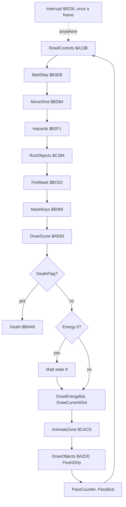

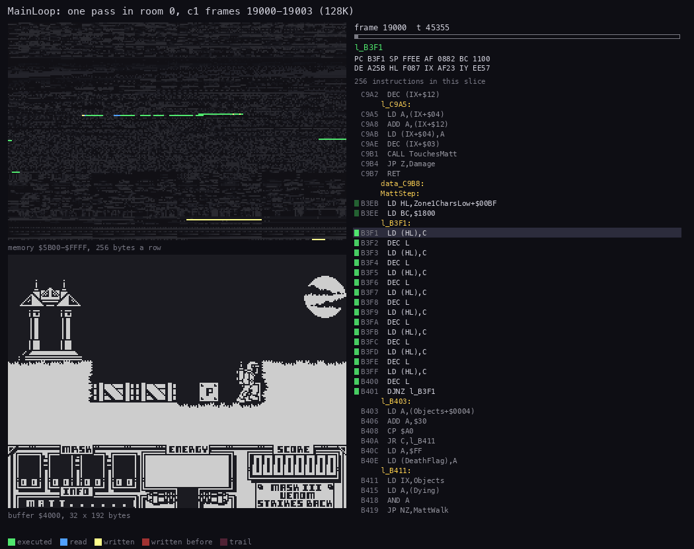

*`MainLoop.gif`: one pass in room 0, c1 frames 19 000-19 003 (128K), from 19000:43421 to 19003:4760. The view is the
screen as the pass writes it. `kit/routine_anim.py --work work/docs/mxA/c1 --window 19000:43421-19003:4760
--listing build/game.lst --page 4=build/music.lst --page-name '4=the AY player (RAM 4)'
--view buffer:4000:32x192:screen --range 5B00-FFFF --pc 9100-CC5B --pictures 90`.*

### One pass against the beam

The pass in the trace starts at 19000:43421 and the next one at 19003:4760. That is 174 063 T, 2.45 frames.

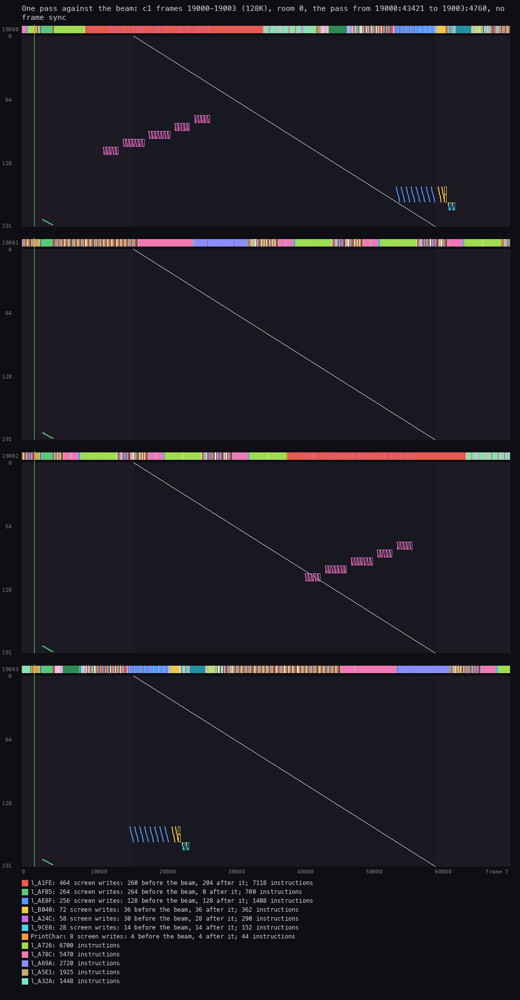

*`beam-pass-c1.png`: each strip is one frame; the colour bar at its top is the routine running at each T; the marks
below are the screen writes, at their line and T; the diagonal is the beam. `kit/beam_timeline.py --work
work/docs/mxA/c1 --window 19000:0-19005:0 --listing build/game.lst --page 4=build/music.lst --page-name '4=the AY
player (RAM 4)' --machine 128k --frames 19000-19003`.*

Read against the beam, the pass goes like this:

| Frame | T | What the figure shows |
| --- | --- | --- |
| every frame | 1846 | the interrupt (the green line); Scroller writes the message line, rows 184-191 (`l_AFB5`), at T 2500-4000 |
| 19 000 | 0-34 000 | the previous pass's FlushDirty (`l_A1FE`, `l_A24C`): Matt's cells, lines 70-120 |
| 19 000 | 43 421 | this pass starts: the controls, Matt, the enemies |
| 19 000 | 53 000-62 000 | DrawScore's digits (`l_AE8F`, lines 148-160) and the slot's icon (`l_B040`) |
| 19 001 | the whole frame | DrawObjects: DrawShifted (`l_A726`), MakeMask (`l_A78C`), DrawObject (`l_A69A`); no screen write |
| 19 002 | 0-37 000 | DrawObjects goes on |
| 19 002 | 37 000-65 000 | FlushDirty copies the dirty cells, from the bottom of the window up |
| 19 003 | 4760 | the next pass starts |

Three things follow from it.

- About two thirds of the pass draws the sprites into characters (DrawObjects); none of it touches the screen.
  The screen is written in two bursts: the panel (score, slot) early, and the play window at the end.
- The flush runs with no regard to the beam. In frame 19 000, 260 of FlushDirty's 464 writes land above the beam
  and 204 below. A cell may be shown half old and half new for one frame.
- The panel's digits are written every pass even when the score did not change.

### Frames a pass

PassCounter `$AF0C` counts the passes; the count of `$CC03` in an L1 gives the same number.

| Recording | Frames | Passes | Frames a pass | What is on screen |
| --- | ---: | ---: | ---: | --- |
| `c1-play` | 3800 | 1574 | 2.41 | room 0, few enemies |
| `rec/rzx-16000` | 4000 | 1600 | 2.50 | rooms 12 and 5 |
| `rec/rzx-04000` | 4000 | 1050 | 3.81 | rooms 10 and 1, a pod, a room change |
| `rec/rzx-28000` | 4000 | 736 | 5.43 | the moon, a death, MISSION TERMINATED, the menu, a new game |

Worked example: in `c1-play`, 3800 frames / 1574 passes = 2.41 frames a pass. At 50 frames a second that is
20.7 passes a second. Matt moves once a pass, so the game runs slower when more is drawn.

### Where the T go

`kit/fig_budget.py` sums the T of each module and routine of the `.ann` over an L1.

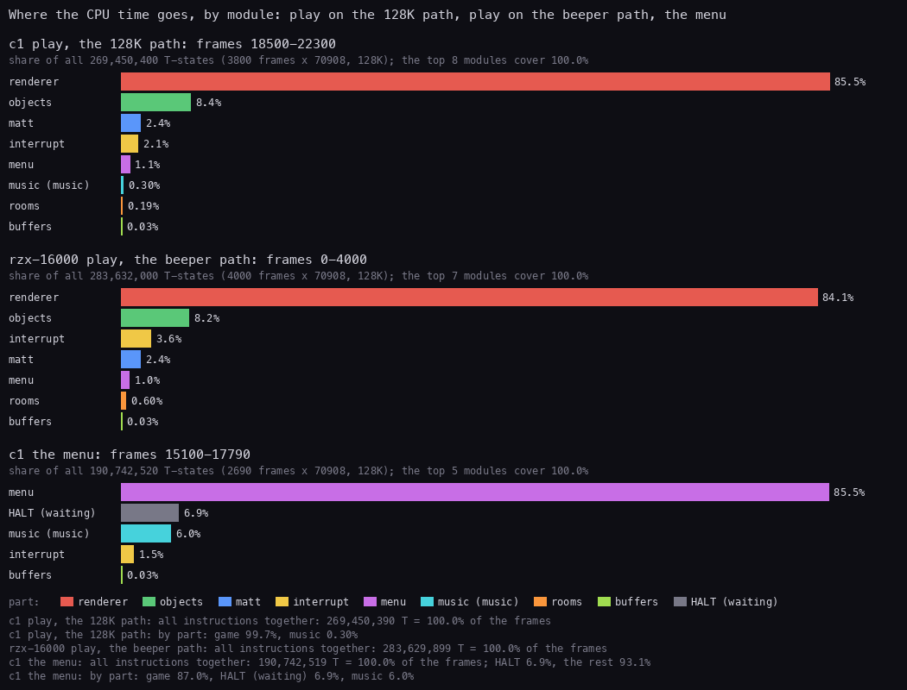

*`budget-modules.png`: `kit/fig_budget.py work/docs/mxA/c1-play/l1.json docs/img/arch/budget-modules.png --ann
src/game/game.ann --ann src/music/music.ann,page=4,label=music --by module --label 'c1 play, the 128K path' --state
'rzx-16000 play, the beeper path=work/stage1/rec/rzx-16000/l1.json' --state 'c1 the menu=work/docs/mxA/c1-menu/l1.json'`.*

In play the renderer takes 85.5 % of the CPU on the 128K and 84.1 % on the beeper path. The objects take about 8 %,
the interrupt 2.1 % to 3.6 %. The breakdown by routine is in [doc 2, 2.7](02-architecture.md#27-the-frame-budget).

The point: the pass length is set by the drawing. The game logic is about a tenth of a pass.

## 4.5 The heaviest frame: the room change

The longest pass in the recordings is a pod ride. In `rec/rzx-04000` Matt takes the pod from room 10 (zone 3, the
base) to room 1 (zone 0, the surface). The new room has another zone, so its character set has to be swapped in.

Measured in the trace `r04/traces/460_0-474_0.uatr` (`work/docs/mxA/passes.py` and `segments.py`):

| Step | Starts (frame:T) | T | Frames |
| --- | --- | ---: | ---: |
| the pass | 463:24 595 | 746 618 | 10.53 |
| Teleport `$B6B3` | 463:29 384 | | |
| DrawRoom `$A89D` | 463:29 548 | 584 482 | 8.24 |
| the map expansion: 8 x 5 blocks into the character map | 463:29 702 | 19 949 | 0.28 |
| SwapZone `$A198`, `DI` at 463:49 673 to `EI` at 466:4220 | 463:49 651 | 167 307 | 2.36 |
| the copy after the swap | | 12 127 | 0.17 |
| FlushDirty `$A1F0`: every cell of the window | 466:16 361 | about 260 674 | 3.68 |
| AnimatedCharList `$AB6B` | 469:66 882 | 75 067 | 1.06 |
| FindLift `$AA75` | 471:2672 | 28 005 | 0.39 |
| PlaceTurrets, FindSpawnPoints, FindBlockItems, FindFloorRow, PlacePickupsInScreen, RoomMessage | 471:30 694 | about 21 000 | 0.30 |
| DrawRoom returns; MoveShot | 471:46 766 | | |
| the next pass | 473:62 133 | | |

Stage 2 measured DrawRoom at 350-446 k T with per-frame L1 windows ([stage 2 notes](../work/stage2/NOTES.md)). The
trace gives 584 482 T for this room change, because SwapZone and the whole-window flush both run in it.

### SwapZone under DI

SwapZone `$A198` makes zone A live. If A is already live it returns at once (28 T). Otherwise it finds the slot
where A is parked and swaps it byte for byte with the live set: 2048 bytes of characters at `$E000`, then 256 bytes
of attributes at `$EF00`. It swaps rather than copies, so the old zone ends up parked where the new one was. The
whole swap runs under `DI` (`src/game/renderer.asm`):

```z80
SwapZone:                 ; $A198, A = the zone
  LD HL,ZoneSlots
  CP (HL)
  RET Z                   ; already live
  DI
  ...                     ; B = the slot holding zone A
  LD HL,ParkedZone1       ; $5B00
  LD DE,$0900
  ...                     ; HL = $5B00 + $900 x (slot - 1)
  LD DE,ZoneChars         ; $E000
  LD BC,$0800
l_A1BD:
  LD A,(HL)               ;  7
  EX AF,AF'               ;  4
  LD A,(DE)               ;  7
  LD (HL),A               ;  7
  EX AF,AF'               ;  4
  LD (DE),A               ;  7
  INC HL                  ;  6
  INC DE                  ;  6
  DEC BC                  ;  6
  LD A,B                  ;  4
  OR C                    ;  4
  JP NZ,l_A1BD            ; 10: 72 T a byte
  LD DE,ZoneAttrs         ; $EF00, then 256 more bytes
  ...
  EI                      ; $A1EA
```

```text
SwapZone(A):
    if ZoneSlots[0] == A: return
    disable interrupts
    slot = the index of A in ZoneSlots[1..3]
    parked = $5B00 + $900 * (slot - 1)
    swap 2048 bytes parked <-> $E000
    swap 256 bytes parked + $800 <-> $EF00
    ZoneSlots[0], ZoneSlots[slot] = A, the old zone
    the turret's stem character for the zone
    enable interrupts
```

Worked example: 2048 + 256 = 2304 bytes at 72 T a byte is 165 888 T. The trace measures 167 307 T from the `DI` at
463:49 673 to the `EI` at 466:4220; the slot search and the set-up are the rest. That is 2.36 frames with interrupts
off.

The witness is `kit/rs.py interrupts` over the r04 window: frames 464, 465 and 466 have no interrupt entry. The ULA
holds its interrupt request for only about 32 T (36 T on the 128K); a request that finds interrupts disabled is lost. So the frame counter, the
music and the BREAK test all skip three frames.

### FlushDirty: the room appears bottom-up

DrawRoom marks every cell of the play window dirty. FlushDirty `$A1F0` scans the dirty map `$F3C0-$F5FF` from
`$F5FF` down and copies each marked cell to the screen ([doc 6](06-rendering.md)). So the new room appears on screen
from the bottom up, over 3.7 frames, and the old room's top stays visible until about frame 470.

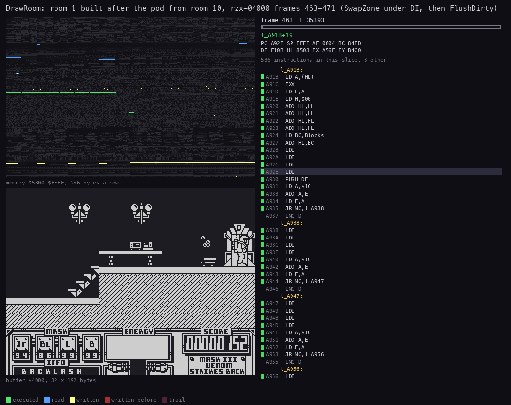

*`DrawRoom-heaviest.gif`: `rec/rzx-04000` frames 463-471, from DrawRoom's start at 463:29548 to its return at
471:46766. The view is the screen. `kit/routine_anim.py --work work/docs/mxA/r04 --window 463:29548-471:46766
--listing build/game.lst --view buffer:4000:32x192:screen --range 5B00-FFFF --pc
A89D-A9BD,A198-A1EB,A1F0-A252,AB6B-ABB4,AA75-AAA0,AC42-ACBB,ACEA-AD27,AD28-AD7B,A9BE-AA71,AC80-AC9B --pictures 100`.*

The screen as a player sees it, one picture a frame:

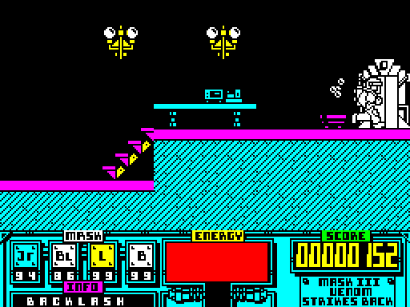

*`room-change-10-1.gif`: `rec/rzx-04000` frames 452-482, one frame a picture. Room 10 stays still through 465 while
the zone is swapped; from 466 room 1 grows from the bottom; by 471 it is whole. `kit/screen_anim.py --work
work/docs/mxA/r04 --from 452 --to 482 --step 1 --scale 2`.*

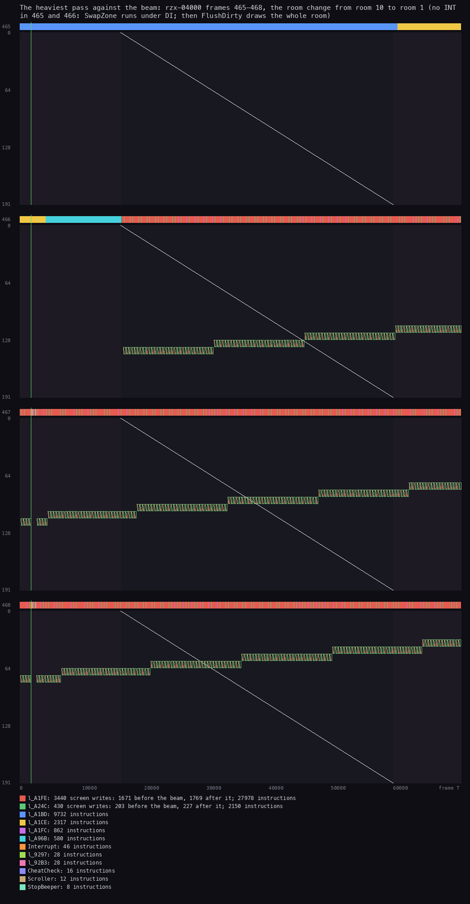

*`beam-roomchange.png`: frames 465-468. In 465 the CPU is still in SwapZone and writes nothing to the screen. From
466 FlushDirty's stores (`l_A1FE`, `l_A24C`) climb up the window: 3870 screen writes in these four frames. `kit/beam_timeline.py --work work/docs/mxA/r04 --window 460:0-474:0
--listing build/game.lst --machine 128k --frames 465-468`.*

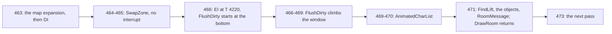

The point: a room change in another zone freezes the screen for about three frames, loses three interrupts, and
builds the new room upward over four more. The same-zone change skips the swap (28 T) and costs only the flush.

## 4.6 Every delay, pause and timer

The game has no frame lock, but some places wait on `HALT`. All are outside the main loop.

| Where | Waits | How long | Witness |
| --- | --- | --- | --- |
| Menu `$9780` (DrawMenu's loop) | one `HALT` a menu step | a frame a step | c1 frames 17 750-18 300 |
| MenuWipe `$9852` | one `HALT` a diagonal, E from `$F8` to `$3D` | 70 frames | c1, play2, `rzx-` |
| ScreenWipe `$A049` | one `HALT` a line pair | 88 frames | c1, door, play2 |
| SlowPrint `$BB13`: before the text, a character, after it | 70, 4 a character, 100 `HALT`s | see the example | play2, `rzx-` x8 |
| Explosion `$BB78` | 150 `HALT`s | 3 s | not executed in any recording |

Worked example: GameOver prints MISSION TERMINATED (18 characters) with SlowPrint. That is 70 + 18 x 4 + 100 =
242 `HALT`s, 4.84 s at 50 frames a second.

```z80
SlowPrint:
  ...
  LD B,$46                ; 70
l_BB1E:
  HALT
  DJNZ l_BB1E
l_BB21:
  LD A,(HL)
  CALL PrintChar
  CALL PrintSpace
  LD B,$04                ; 4 a character
l_BB2A:
  HALT
  DJNZ l_BB2A
  BIT 7,(HL)              ; the last character has bit 7 set
  INC HL
  JR Z,l_BB21
  LD B,$64                ; 100
l_BB34:
  HALT
  DJNZ l_BB34
  RET
```

The `DI` places: GameEntry `$9100`, SwapZone `$A19D-$A1EA`, NewGame `$915B` (to reset the stack under the return
address, `EI` at `$9161`), and three in the menu at `$9A15`, `$9B18`, `$9EA9`.

The timers in play count passes, not frames:

| Counter | Address | Counted by | Read by |
| --- | --- | --- | --- |
| FrameCounter | `$9224` | the interrupt, once a frame | no instruction of the source reads it |
| PassCounter | `$AF0C` | the main loop, binary | the slot icon's blink, the jump's timing (MattStep), DrawAllSlots saves it |
| PassBcd | `$CC5C` | the main loop, BCD | bit 0: PENETRATOR's charge every second pass, the turret's bob |
| Death's sink | `B` = `$20` in Death `$BAA8` | its own loop: AnimateZone and DrawObjects, Matt 1 line lower each step | 32 steps |
| the energy-out wait | Matt's `+$10` = `$32` | MattNoEnergy `$B9B8`, one `DEC` a pass | 50 passes |

So a player on a busy screen loses energy to PENETRATOR more slowly in seconds: it costs a charge every second
pass, and a pass is 2.4 to 5.4 frames.

## 4.7 Known only from the code

- Explosion `$BB78`: 200 dots flying out of Matt with 150 `HALT`s. Only EndPenetrator calls it, when Matt is inside a
  wall as PENETRATOR ends; no play recording did that, only `masks` (PENETRATOR given by a POKE, released inside the
  hill at frame 1249, Explosion L1 1).
- HangLoop `$9208`: `DI` and a border flash forever, the kind-0 slot of ObjectJumps; no object of kind 0 runs.
- FrameCounter `$9224` is counted every frame and never read.
