# 5. Controls

What this covers:

- the four control methods (Kempston, Interface 2, Cursor, keyboard) and the ports each one reads;
- the key codes and KeyPressed `$A090`, which writes its own `RES` and `BIT` instructions;
- the menu: 1-4, K (DEFINE KEYS), P (ENTER PASSWORD), fire;
- DEFINE KEYS and its duplicate check;
- ReadControls `$A13B`: one byte of five bits a pass, right before left and down before up;
- the path from that byte into Matt;
- the mask keys 1-4, BREAK, the password entry and the cheat;
- H and Q, which the instructions name and the code does not have;
- what an emulator must decode for the game to see its input.

The recordings it rests on ([WALKTHROUGH 6.0](../WALKTHROUGH.md#60-the-recordings)):

| Recording | Load | Used for |
| --- | --- | --- |
| `c1` | power-on on the 128K, the original tape at ROM speed, `tests/inputs/c1.txt` | the menu, DEFINE KEYS (SPACE P L Z X), KEYBOARD, play in room 0, H pressed twice; TTD frame = script frame + 17 500 |
| `rec/play2` (stage 2) | `work/stage1/probe/128K/loaded.szx` (the menu up), `tests/inputs/s2play.txt` | the four passwords, CURSOR, H and Q held, BREAK, KEMPSTON |
| `rec/rzx-12000` | the ZXDB RZX, frames 12 000-15 999, from the RZX's own state, `tests/inputs/rzx-12000.txt` | the mask keys 1 and 2 in play (Interface 2 keys) |
| `menu` (stage 1) | the menu recording of stage 1 | the menu screenshots |

Conventions:

- **A frame** is 1/50 s of the 128K, 70 908 T. "18669:38424" is frame 18669, T 38424 of that frame, as an access
  trace places an instruction.
- A value read with `time_travel memory_at` is the memory at T 0 of the frame named.
- **A key code** is row x 16 + bit (5.2). Row r is the half-row the ULA reads at the port whose high byte is `$FF`
  with bit r clear; bit b is bit b of what that port returns.
- **A pass** is one turn of MainLoop `$CC03` ([doc 4](04-game-loop.md#44-the-main-loop-and-the-order-of-a-pass)).
  In `c1` a pass takes 2 to 2.7 frames.

## 5.1 The devices and the ports

The game knows four control methods. ControlMethod `$A13A` says which one is in use: 0 Kempston, 1 Interface 2,
2 Cursor, 3 keyboard. The tape loads it as 1.

Three of the four methods are keys. They differ only in the five key codes the menu copies into KeysNow `$A150`. The
order is always fire, up, down, left, right:

| Method | Table | Codes | Keys |
| --- | --- | --- | --- |
| Interface 2 | KeysIf2 `$A081` | `40 41 42 44 43` | 0 9 8 6 7 |
| Cursor | KeysCursor `$A086` | `40 43 44 34 42` | 0 7 6 5 8 |
| keyboard | KeysUser `$A08B` | `70 50 61 20 21` as loaded | SPACE P L Q W |
| Kempston | none | `IN A,($1F)` | bits 0-4 as they come |

The fourth method, Kempston, reads no keys at all. ReadControls takes port `$1F` as it is, bits 0-4.

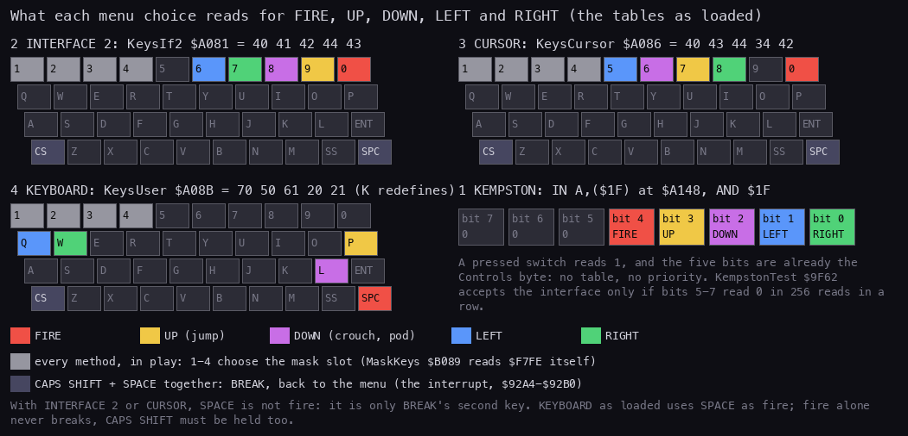

*Figure 5.1: what each method reads for fire, up, down, left and right, drawn from the tables of `build/game.bin`
(KeysIf2 `$A081`, KeysCursor `$A086`, KeysUser `$A08B` as loaded) and the Kempston bits. Command:
`python3 tools/fig_controls.py keys --out docs/img/controls/keys.png`.*

How to read:

- Each keyboard shows one method. The coloured keys are the five that method reads, labelled with their move.
- The Kempston box shows the five bits of port `$1F` ReadControls keeps, and the three bits KempstonTest wants at 0.
- The keys every method shares are marked too: 1-4 (the mask slots, 5.7) and CAPS SHIFT + SPACE (BREAK, 5.8).

Witness:

- KeysIf2 and KeysCursor are constants of the image.
- `c1` changed KeysUser with DEFINE KEYS: after it, `$A08B` holds `70 50 61 01 02`, which is SPACE P L Z X (5.4).
- `play2` chose CURSOR with 3 at frame 2730 and KEMPSTON with 1 at frame 4045.

Worked example: Interface 2 fire is key 0. Key 0 sits on half-row 4 (port `$EFFE`: 0 9 8 7 6) at bit 0, so its code
is 4 x 16 + 0 = `$40`, the first byte of KeysIf2. A Kempston stick pushed right with fire held reads `$11` at port
`$1F`, and ReadControls stores `$11` as it is: bit 0 right, bit 4 fire.

The point: three methods share one input path. The menu copies a five-code set into KeysNow, and ReadControls reads
KeysNow every pass. "Interface 2" here means the keys 6-0 (Sinclair joystick 1); "Cursor" means 5-8 and 0 (the Cursor,
Protek and AGF interfaces).

## 5.2 Key codes and KeyPressed

All the key code in MASK III works on one number a key: row x 16 + bit. Row 0 is the half-row CAPS SHIFT-V (port
`$FEFE`); row 7 is SPACE-B (port `$7FFE`). Bit 0 is the key nearest the edge of the keyboard: CAPS SHIFT, A, Q, 1, 0,
P, ENTER, SPACE.

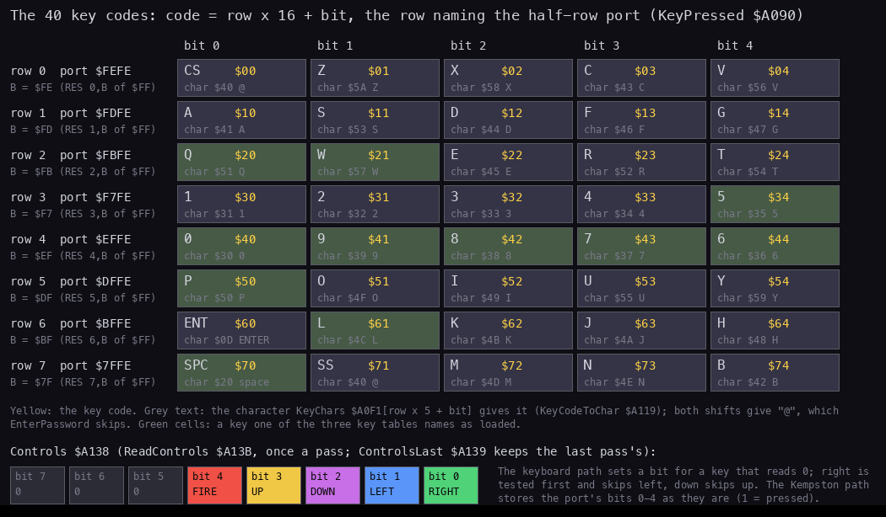

*Figure 5.2: the 40 key codes with their ports and the character KeyChars `$A0F1` gives each; the Controls byte below.
Drawn from `build/game.bin`. Command: `python3 tools/fig_controls.py codes --out docs/img/controls/keycodes.png`.*

How to read:

- Each key shows its code in hex and the character WaitKey turns it into. Both shift keys give `@` (`$40`), which the
  password entry skips; ENTER gives `$0D`.
- The port column is the value KeyPressed puts in B before `IN C,(C)`.
- The bottom row is Controls `$A138`: the five bits ReadControls writes.

KeyPressed `$A090` tests one key. It does not look the port up in a table. It builds two instructions from the code
and writes them into its own body:

- `RES r,B` at `$A0A9`: the second byte is `(code RRCA) AND $38 OR $80`, which is `$80` + 8 x row. B starts as `$FF`,
  so after the `RES` B holds the port's high byte with the row's bit clear.
- `BIT b,C` at `$A0AE`: the second byte is `(code RLCA RLCA RLCA) AND $38 OR $41`, which is `$41` + 8 x bit.

```text
KeyPressed(code):                      # returns Z when the key is down, NZ when it is up
    [$A0AA] = $80 + 8 * (code >> 4)    # RES row,B
    [$A0AF] = $41 + 8 * (code & 7)     # BIT bit,C
    BC = $FFFE
    RES row,B                          # B = the half-row's port
    C = IN (BC)
    BIT bit,C                          # Z when the bit is 0: pressed
```

```text
A090  C5                  KeyPressed: PUSH BC
A091  F5                              PUSH AF
A092  47                              LD B,A
A093  0F                              RRCA
A094  E6 38                           AND $38
A096  F6 80                           OR $80
A098  32 AA A0                        LD (KeyPressed+$001A),A   ; the operand of RES 0,B below
A09B  78                              LD A,B
A09C  07                              RLCA
A09D  07                              RLCA
A09E  07                              RLCA
A09F  E6 38                           AND $38
A0A1  F6 41                           OR $41
A0A3  32 AF A0                        LD (KeyPressed+$001F),A   ; the operand of BIT 0,C below
A0A6  01 FE FF                        LD BC,$FFFE
A0A9  CB 80                           RES 0,B                   ; written: RES row,B
A0AB  ED 48                           IN C,(C)
A0AD  F1                              POP AF
A0AE  CB 41                           BIT 0,C                   ; written: BIT bit,C
A0B0  C1                              POP BC
A0B1  C9                              RET
```

Worked example: the fire key of `c1`'s user set, SPACE, code `$70`.

1. `$70 RRCA` = `$38`; `AND $38` = `$38`; `OR $80` = `$B8`. `CB B8` is `RES 7,B`.
2. `$70 RLCA x 3` = `$83`; `AND $38` = 0; `OR $41` = `$41`. `CB 41` is `BIT 0,C`.
3. B = `$FF` with bit 7 clear = `$7F`. `IN C,(C)` reads port `$7FFE`, the half-row SPACE, SYMBOL SHIFT, M, N, B.
4. `BIT 0,C` tests SPACE.

Witness: in `c1` at 18669:39294 the trace shows BC = `$7FFE` before the `IN` and `$7FBF` after it: bit 0 is 1, SPACE
is up. For the right key (X, `$02`) at 18669:38643 the port is `$FEFE` and C comes back `$BB`: bit 2 is 0, X is down.

The point: the game stores keys as codes, not as characters. The menu, DEFINE KEYS, the passwords and the cheat all
use the same codes. The written `RES`/`BIT` pair costs about 210 T a key and needs no table of ports.

### ScanKeyboard, ReadKeyCode and WaitKey

The menu and the text entries need "which key is down", not "is this key down". Three routines answer it:

- ScanKeyboard `$A0B2` reads the half-rows from `$7FFE` down to `$FEFE` (B rotated right after each). It returns Z at
  the first half-row with a key down, B and C still holding the port and the bits.
- ReadKeyCode `$A0C9` turns that into a code. It counts the 1 bits below the first 0 in C (the bit), then the 1 bits
  below the 0 in B, 16 each (the row).
- WaitKey `$A0E5` waits for every key to be up, then for a key. It returns the code in A' and the character
  (KeyCodeToChar `$A119`: KeyChars `$A0F1` + 5 x row + bit) in A.

```text
ScanKeyboard:                       ReadKeyCode:
    B = $7F                             if not ScanKeyboard(): return NZ
    repeat:                             A = 0
        C = IN ($FE + 256 * B)          while C & 1: A += 1; C >>= 1      # the bit
        if C & $1F != $1F: return Z     while B & 1: A += 16; B >>= 1     # the row
        B = B rotated right             return Z, A
    until the 0 bit leaves B
    return NZ                       WaitKey:
                                        while ReadKeyCode() is Z: pass    # wait for no key
                                        while ReadKeyCode() is NZ: pass   # wait for a key
                                        A' = code; A = KeyChars[5 * row + bit]
```

Worked example: P is down. ScanKeyboard tries `$7FFE` (nothing), `$BFFE` (nothing), then `$DFFE`: C = `$BE`, bit 0 is
0. ReadKeyCode counts no 1 bits in C (bit 0), then 5 in B = `$DF` (row 5): code `$50`. KeyChars `$A0F1` + 25 holds
`$50`, the character P.

Witness: `c1` DEFINE KEYS: WaitKey found P at 17930:1068 (`$A0EF`, the jump to KeyCodeToChar), and KeysNow + 1 then
held `$50`.

The point: a key on a higher row wins when two are down, because the scan starts at row 7. Two keys on one row give the
lower bit.

## 5.3 The menu

Menu `$9723` draws the screen; MenuLoop `$9775` reads it. Each turn of MenuLoop is one `HALT` and one key code:

| Key | Code | What MenuLoop does |
| --- | --- | --- |
| 1 | `$30` | KempstonTest `$9F62`; when it answers, ControlMethod = 0 |
| 2 | `$31` | KeysIf2 to KeysNow, ControlMethod = 1 |
| 3 | `$32` | KeysCursor to KeysNow, ControlMethod = 2 |
| 4 | `$33` | KeysUser to KeysNow, ControlMethod = 3 |
| K | `$62` | DefineKeys `$9E3B`, ClearMenuArea `$9E10`, ControlMethod = 3, KeysNow to KeysUser, redraw |
| P | `$50` | KeyPressed, then `JP EnterPassword` `$9F82` |
| fire | Controls bit 4 | the game starts |

When the method changed, DrawMenu `$9D1A` runs again and lights the new icon. The fire test goes through
ReadControls, so "fire" is whatever the chosen method calls fire: 0 for Interface 2 and Cursor, the user's key for
the keyboard, the button for Kempston.

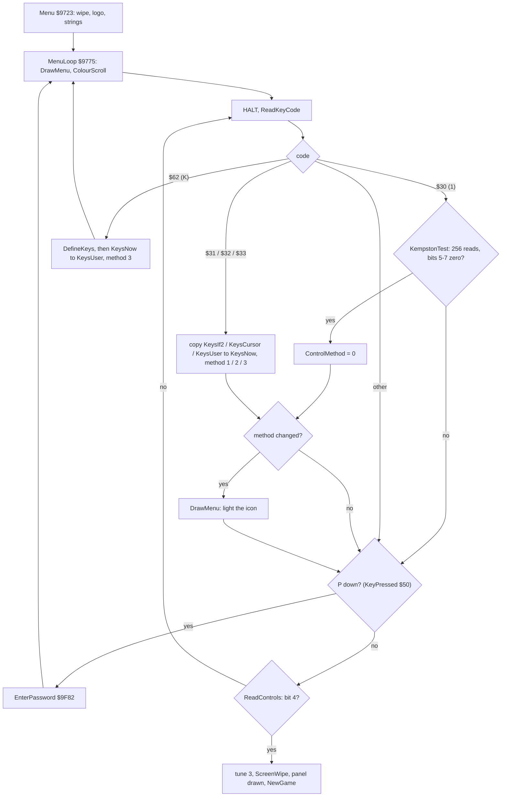

```text
9780  76                      l_9780: HALT
9781  3A 3A A1                        LD A,(ControlMethod)
9784  F5                              PUSH AF                     ; the method before the key
9785  CD C9 A0                        CALL ReadKeyCode
9788  FE 30                           CP $30                      ; 1
978A  20 0B                           JR NZ,l_9797
978C  CD 62 9F                        CALL KempstonTest
978F  20 06                           JR NZ,l_9797                ; no interface: 1 is ignored
9791  AF                              XOR A
9792  32 3A A1                        LD (ControlMethod),A
; ... 2, 3, 4 and K the same way
97F7  6F                      l_97F7: LD L,A
97F8  F1                              POP AF
97F9  BD                              CP L
97FA  C4 1A 9D                        CALL NZ,DrawMenu            ; light the new icon
9800  3E 50                   l_9800: LD A,$50                    ; P
9802  CD 90 A0                        CALL KeyPressed
9805  CA 82 9F                        JP Z,EnterPassword
9808  CD 3B A1                        CALL ReadControls
980B  CB 67                           BIT 4,A                     ; fire
980D  CA 80 97                        JP Z,l_9780
```

KempstonTest reads port `$1F` 256 times and gives up at the first read with any of bits 5-7 set. A Kempston interface
drives bits 5-7 low; with nothing on the port the Spectrum reads `$FF`. So key 1 does nothing on a machine without the
interface.

```text
9F62  06 00                 KempstonTest: LD B,$00
9F64  DB 1F                       l_9F64: IN A,($1F)
9F66  E6 E0                               AND $E0
9F68  C0                                  RET NZ                  ; a high bit: no interface
9F69  10 F9                               DJNZ l_9F64
9F6B  AF                                  XOR A                   ; 256 clean reads: Z
9F6C  C9                                  RET
```

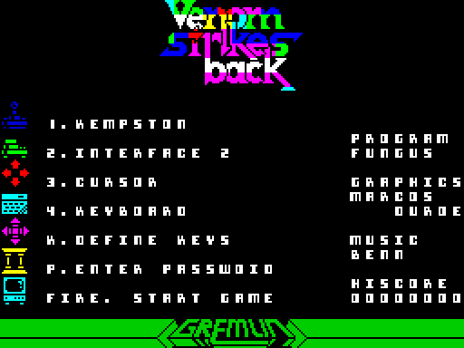

*Figure 5.3: the menu in `c1` at frame 17 750, before any key.*

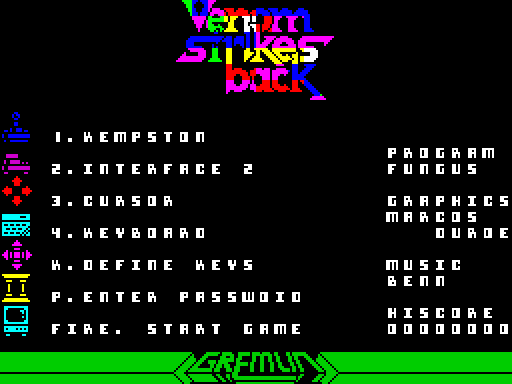

*Figure 5.4: the stage 1 `menu` recording at frame 750, after 3: the Cursor icon lit.*

Witness: in `c1`, ControlMethod was already 0 at frame 17 700, before any key. GameEntry runs KempstonTest itself, and
the emulator's Kempston port answers 0. In `play2`, 3 at frame 2730 made the method 2, and 1 at frame 4045 made it 0.

Worked example: 3 is pressed. ReadKeyCode returns `$32`; MenuLoop copies KeysCursor `40 43 44 34 42` into KeysNow
and sets ControlMethod to 2. The method was not 2 before, so DrawMenu runs again and lights the Cursor icon. From
now on fire is key 0 (`$40`), and the next turn's ReadControls tests it.

The point: the menu has no cursor and no confirm. A key acts on the `HALT` after it is pressed. P and fire are tested
on every turn, after the code compare. Key 1 on a machine with no Kempston interface is silently ignored.

### One key read a frame

MenuLoop does one `HALT` a turn, and the menu's interrupt (MenuInterrupt `$9899`) takes most of the frame. It recolours
the logo line by line in time with the beam, draws the border bars and runs the colour scroll
([doc 8](08-hud-and-text.md#87-the-menu-screen)). In `c1` the interrupt ran from about T 1890 to T 66 500 of a frame:
about 64 600 of the 70 908 T. The main code gets the rest.

So a key in the menu is read once a frame, and printing is slow: DrawMenu took 17 frames in `c1` (18136:66749 to
18153:68957), and ClearMenuArea 11.

The point: the menu reads the keyboard at 50 Hz because the interrupt leaves the main code only a few thousand T a
frame. In play the reading rate is the pass rate instead (5.6).

## 5.4 DEFINE KEYS

K runs DefineKeys `$9E3B`:

1. KeysNow is zeroed. The zeros only serve the duplicate check below.
2. ClearMenuArea, then "Press" at row 8, column 10.
3. Five calls of AskKey `$9E7B`. Each prints the next prompt (FIRE, UP, DOWN, LEFT, RIGHT, DefinePrompts `$9E90`)
   and waits for a key whose code is not yet in KeysNow.
4. MenuLoop then copies KeysNow to KeysUser and sets ControlMethod 3.

```text
DefineKeys:
    KeysNow[0..4] = 0
    ClearMenuArea; PrintString("Press", row 8, column 10)
    for i in 0..4:
        PrintString(prompt i, row 8, column 16)
        repeat:
            code = WaitKey()               # waits for release, then a key
        until code not in KeysNow[0..4]    # the five slots, filled or 0
        KeysNow[i] = code
```

```text
9E7B  CD BF 9C                    AskKey: CALL PrintString        ; FIRE, UP, DOWN, LEFT, RIGHT in turn
9E7E  E5                                  PUSH HL                 ; the next prompt
9E7F  CD E5 A0                    l_9E7F: CALL WaitKey
9E82  08                                  EX AF,AF'               ; A = the code
9E83  21 50 A1                            LD HL,KeysNow
9E86  06 05                               LD B,$05
9E88  BE                          l_9E88: CP (HL)
9E89  28 F4                               JR Z,l_9E7F             ; already taken: wait again
9E8B  23                                  INC HL
9E8C  10 FA                               DJNZ l_9E88
9E8E  E1                                  POP HL
9E8F  C9                                  RET
```

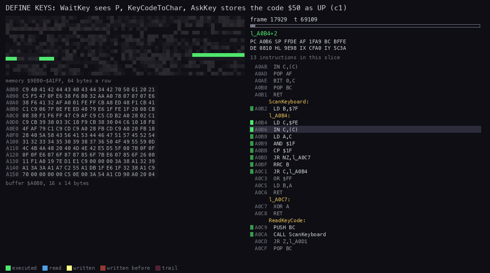

*Animation 5.1: AskKey taking P for UP: WaitKey's scans, the duplicate check against KeysNow, the store. 45 pictures,
615 instructions. Recording `c1`, window 17929:69000-17930:3000. Command: `python3 ../../kit/routine_anim.py --work
work/docs/mxB/c1 --window 17929:69000-17930:3000 --listing build/game.lst --view buffer:A080:16x14:hex --range
9E00-A1FF --pc A0B2-A137,9E7B-9E8F,9E3B-9E7A --pictures 45 --title "..." --out docs/img/routines/AskKey.gif`.*

How to read: the view is the memory from `$A080` as hex, with KeysIf2, KeysCursor, KeysUser, Controls and KeysNow
`$A150-$A154` in one picture. The code pane follows ScanKeyboard's port reads, ReadKeyCode's two counting loops and
the five compares of AskKey. KeysNow + 1 receives `$50`.

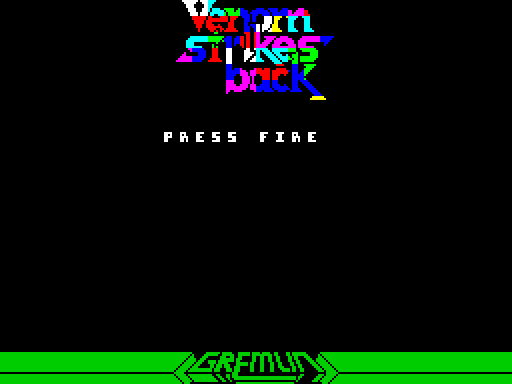

*Figure 5.5: `c1` at frame 17 850: DEFINE KEYS asking for the keys.*

Witness: `c1` typed SPACE P L Z X at frames 17 865, 17 930, 17 995, 18 060 and 18 125. After it, KeysUser `$A08B`
holds `70 50 61 01 02`.

Worked example: after SPACE (`$70`) for FIRE, KeysNow is `70 00 00 00 00`. SPACE again for UP finds `$70` in slot 0,
and AskKey waits again. P gives `$50`, which is not in the list, and is stored: `70 50 00 00 00`.

The point: the duplicate check stops one key doing two moves. A key held from the previous prompt is not taken twice
either, because WaitKey first waits for every key to be up. Code 0 is CAPS SHIFT, and the unfilled slots hold 0, so
CAPS SHIFT can never be defined (5.12).

## 5.5 ReadControls: five bits a pass

ReadControls `$A13B` runs at the top of every pass. It saves the last Controls in ControlsLast `$A139` and builds a new
byte in Controls `$A138`:

| Bit | Move |
| --- | --- |
| 0 | right |
| 1 | left |
| 2 | down |
| 3 | up |
| 4 | fire |

The Kempston path stores port `$1F` `AND $1F` as it is: the Kempston bit order (right, left, down, up, fire) is the
game's order. The key path asks KeyPressed five times, in a fixed order with two short cuts:

- right is tested first, and right down skips the left test: right wins over left;
- down is tested next, and down down skips the up test: down wins over up;
- fire is tested last, always.

```text
ReadControls:
    ControlsLast = Controls
    if ControlMethod == 0:
        Controls = IN($1F) & $1F                  # Kempston, as it comes: both bits of an axis may be set
        return
    C = 0
    if KeyPressed(KeysNow[4]): C |= 1             # right
    elif KeyPressed(KeysNow[3]): C |= 2           # left
    if KeyPressed(KeysNow[2]): C |= 4             # down
    elif KeyPressed(KeysNow[1]): C |= 8           # up
    if KeyPressed(KeysNow[0]): C |= 16            # fire
    Controls = C
```

```text
A13B  3A 38 A1          ReadControls: LD A,(Controls)
A13E  32 39 A1                        LD (ControlsLast),A
A141  3A 3A A1                        LD A,(ControlMethod)
A144  A7                              AND A
A145  C2 55 A1                        JP NZ,l_A155
A148  DB 1F                           IN A,($1F)                ; Kempston: the port as it is
A14A  E6 1F                           AND $1F
A14C  32 38 A1                        LD (Controls),A
A14F  C9                              RET
A150  40 41 42 44 43         KeysNow: DEFB $40,$41,$42,$44,$43  ; fire, up, down, left, right
A155  C5                      l_A155: PUSH BC
A156  0E 00                           LD C,$00
A158  3A 54 A1                        LD A,(KeysNow+$0004)      ; right
A15B  CD 90 A0                        CALL KeyPressed
A15E  20 04                           JR NZ,l_A164
A160  CB C1                           SET 0,C
A162  18 0A                           JR l_A16E                 ; right down: left is not read
A164  3A 53 A1                l_A164: LD A,(KeysNow+$0003)      ; left
A167  CD 90 A0                        CALL KeyPressed
A16A  20 02                           JR NZ,l_A16E
A16C  CB C9                           SET 1,C
A16E  3A 52 A1                l_A16E: LD A,(KeysNow+$0002)      ; down
A171  CD 90 A0                        CALL KeyPressed
A174  20 04                           JR NZ,l_A17A
A176  CB D1                           SET 2,C
A178  18 0A                           JR l_A184                 ; down down: up is not read
A17A  3A 51 A1                l_A17A: LD A,(KeysNow+$0001)      ; up
A17D  CD 90 A0                        CALL KeyPressed
A180  20 02                           JR NZ,l_A184
A182  CB D9                           SET 3,C
A184  3A 50 A1                l_A184: LD A,(KeysNow)            ; fire
A187  CD 90 A0                        CALL KeyPressed
A18A  20 02                           JR NZ,l_A18E
A18C  CB E1                           SET 4,C
A18E  79                      l_A18E: LD A,C
A18F  32 38 A1                        LD (Controls),A
A192  C1                              POP BC
A193  C9                              RET
```

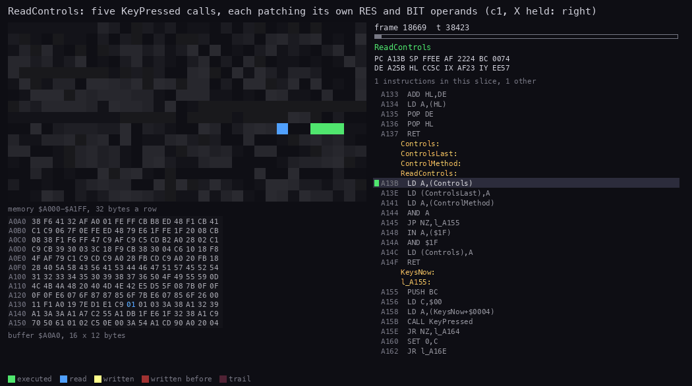

*Animation 5.2: ReadControls with X (right) held: four KeyPressed calls (right, down, up, fire), left skipped. 44
pictures, 112 instructions. Recording `c1`, window 18669:38400-18669:39420. Command: `python3
../../kit/routine_anim.py --work work/docs/mxB/c1 --window 18669:38400-18669:39420 --listing build/game.lst --view
buffer:A0A0:16x12:hex --range A000-A1FF --pc A13B-A193,A090-A0B1 --pictures 45 --title "..." --out
docs/img/routines/ReadControls.gif`.*

How to read:

- The view is `$A0A0-$A15F` as hex. Watch `$A0AA` and `$A0AF`, KeyPressed's operands, change at every call, and
  Controls `$A138` take its new value at the end.
- The code pane shows the `RES` and `BIT` with their written operands.

Witness: the trace of `c1` at frame 18669, with KEYBOARD defined as SPACE P L Z X:

| Call | T | Code | Port (BC before `IN`) | C after `IN` | Result |
| --- | --- | --- | --- | --- | --- |
| right | 38643 | `$02` X | `$FEFE` | `$BB` | bit 2 = 0: down, left skipped |
| down | 38869 | `$61` L | `$BFFE` | `$BF` | up |
| up | 39082 | `$50` P | `$DFFE` | `$BF` | up |
| fire | 39294 | `$70` SPACE | `$7FFE` | `$BF` | up |

Controls became `$01`. ReadControls ran from 18669:38424 to 39386: 962 T for four key tests.

Worked example: X and Z held together with the user set SPACE P L Z X. Right (X, `$02`) is down, so bit 0 is set and
left (Z) is never tested: Controls = `$01`, Matt walks right. A Kempston stick pushed both ways would give `$03`.

The point: with keys, "right and left together" is right and "down and up together" is down. With a Kempston stick
both bits of an axis can reach Controls. MattWalk then tests down, up, left and right in that order and acts on the
first ([doc 10](10-gameplay-logic.md)), so on a Kempston "left and right" walks left and "up and down" is down. Fire
is always read, so fire combines with any move.

## 5.6 From Controls to Matt

Controls is read by four parts of a pass ([doc 4](04-game-loop.md#44-the-main-loop-and-the-order-of-a-pass)):

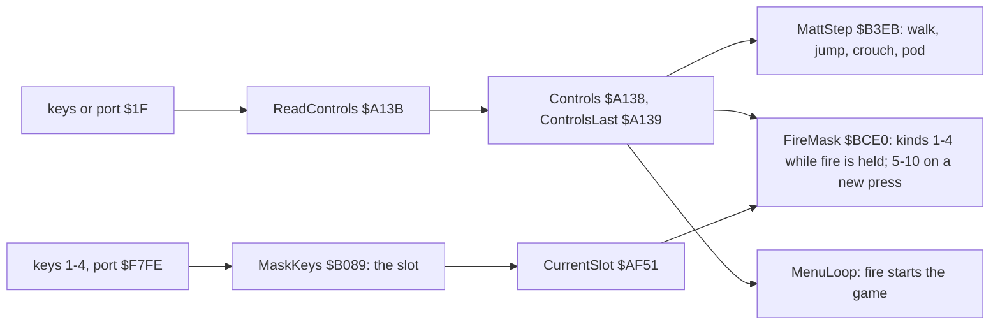

MattWalk `$B460`, the walk state (1) of MattStep, takes the direction bits once a pass, in this order:

1. down: a pod (characters `$14`/`$15` under Matt) teleports; in room 0, screen 5 the password doors; else a crouch,
   state 4, y + 8, which takes the pick-up under Matt;
2. up: JACKRABBIT's long jump when that mask is in use; else a jump, state 5 with +`$11` = `$F7`;
3. left: facing `$80`, walk step +`$12` = `$FE`, x - 2 units after the wall checks;
4. right: facing 0, walk step 2, x + 2 units;
5. no direction: state 8, standing.

FireMask `$BCE0` uses both bytes. Kinds 1-4 act while fire is held (Controls bit 4). Kinds 5-10 fire on a new press:
bit 4 set in Controls and clear in ControlsLast. So holding fire shoots once.

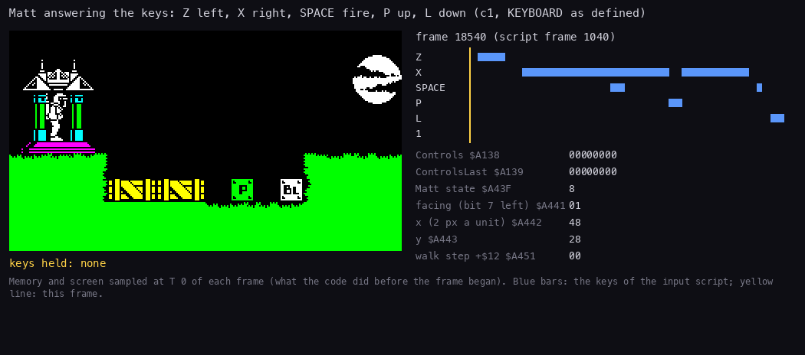

*Animation 5.3: Matt answering Z (left), X (right), SPACE (fire), P (up) and L (down) in room 0, every third frame.
Recording `c1`, frames 18 540-19 270, KEYBOARD as defined (SPACE P L Z X). Command:
`python3 tools/fig_controls.py play --work work/docs/mxB/c1 --from 18540 --to 19270 --step 3 --keys tests/inputs/c1.txt --offset 17500 --crop 0,0,256,144 --var 'Controls=A138:1:bits' --var 'ControlsLast=A139:1:bits' --var 'Matt state=A43F:1:dec' --var 'facing (bit 7 left)=A441:1' --var 'x (2 px a unit)=A442:1' --var 'y=A443:1' --var 'walk step +$12=A451:1' --title '...' --delay 60 --out docs/img/play/keys.gif`.*

How to read:

- Left: the play area. Right, top: the keys of the input script as bars, the yellow line at the frame shown.
- Right, below: the bytes at T 0 of the frame: Controls and ControlsLast as bits (bit 4 fire ... bit 0 right),
  Matt's state, facing, x, y and the walk step.

Witness, from the same frames:

- Z held from 18 560: x goes `$48` to `$3A` over 18 562-18 578, facing `$80`.
- X held from 18 660: x goes `$3C` to `$54`. At 18 696 Matt walks off an edge: state 3, then state 6 with y + 1 to
  + 6 a pass: a fall. He lands at y `$40`, then `$50`; from 18 776 he stands blocked at x `$94`.
- SPACE (fire) and P made no shot: every mask slot was EMPTY at that time.
- L at 19 222: state 4, y + 8, the crouch.
- A pass took 2 to 2.7 frames, so Controls changes at most every second frame.

Worked example: at 2.4 frames a pass, ReadControls runs every 48 ms. A tap of SPACE held for 2 frames (40 ms) that
starts just after one call ends before the next one and is never seen.

The point: there is no buffering. A key pressed and released between two ReadControls calls is lost. At 2-2.7 frames a
pass, a tap shorter than about 50 ms can vanish. Fire for kinds 5-10 needs a release between shots: ControlsLast makes
the edge.

## 5.7 The mask keys 1-4

MaskKeys `$B089` runs every pass, after FireMask. It uses neither ReadControls nor KeysNow: it reads the half-row 1-5
itself with `IN A,($FE)`, A = `$F7`. So keys 1-4 choose the slot with every control method, Kempston included.

1. Nothing while Dying `$BAA7` is set.
2. `IN A,($FE)` with A = `$F7`, then `AND $0F`: keys 1-4 (key 5 is not read).
3. No key: return. Else EndPenetrator `$BDD1` first; then the lowest key down picks the slot: key n gives MaskSlots
   `$AF2B` + 4 x (n - 1).
4. An EMPTY slot (kind 0) is ignored.
5. PassCounter `$AF0C` = 6; DrawCurrentSlot redraws the old slot lit; CurrentSlot `$AF51` = the new slot; ShowMaskName
   scrolls its name ([doc 8](08-hud-and-text.md#84-the-mask-slots-and-the-blink)).

```text
MaskKeys:
    if Dying: return
    keys = IN($F7FE) & $0F                  # bit 0 = 1, bit 1 = 2, bit 2 = 3, bit 3 = 4; 0 = down
    if keys == $0F: return
    EndPenetrator()                          # before the slot is checked
    n = 1 + the number of 1 bits below the first 0
    slot = MaskSlots + 4 * (n - 1)
    if slot.kind == 0: return               # EMPTY
    PassCounter = 6
    DrawCurrentSlot()                        # the old slot, drawn lit
    CurrentSlot = slot
    ShowMaskName(slot.kind)
```

```text
B089  3A A7 BA                MaskKeys: LD A,(Dying)
B08C  A7                                AND A
B08D  C0                                RET NZ
B08E  3E F7                             LD A,$F7
B090  DB FE                             IN A,($FE)              ; port $F7FE: 1 2 3 4 5
B092  E6 0F                             AND $0F
B094  FE 0F                             CP $0F
B096  C8                                RET Z
B097  F5                                PUSH AF
B098  CD D1 BD                          CALL EndPenetrator
B09B  F1                                POP AF
B09C  4F                                LD C,A
B09D  06 00                             LD B,$00
B09F  04                        l_B09F: INC B
B0A0  CB 39                             SRL C
B0A2  38 FB                             JR C,l_B09F             ; B = the key's number
B0A4  21 00 00                          LD HL,$0000
B0A7  11 04 00                          LD DE,$0004
B0AA  18 01                             JR l_B0AD
B0AC  19                        l_B0AC: ADD HL,DE
B0AD  10 FD                     l_B0AD: DJNZ l_B0AC             ; HL = 4 x (n - 1)
B0AF  DD 21 2B AF                       LD IX,MaskSlots
B0B3  EB                                EX DE,HL
B0B4  DD 19                             ADD IX,DE
B0B6  DD 7E 01                          LD A,(IX+$01)           ; the kind
B0B9  A7                                AND A
B0BA  C8                                RET Z                   ; EMPTY: no change
B0BB  3E 06                             LD A,$06
B0BD  32 0C AF                          LD (PassCounter),A
```

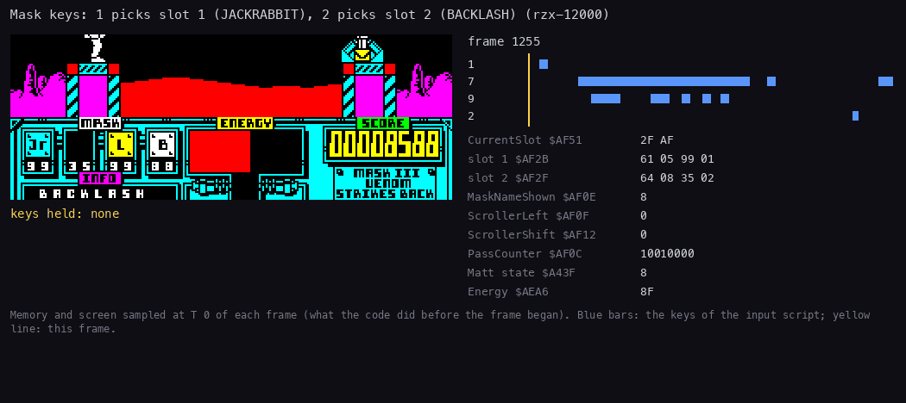

*Animation 5.4: 1 picks slot 1 (JACKRABBIT) at frame 1262, 2 picks slot 2 (BACKLASH) at 1456; the message line
scrolls each name. Every third frame of `rec/rzx-12000`, frames 1255-1480. Command: `python3 tools/fig_controls.py play
--work work/docs/mxB/r12 --from 1255 --to 1480 --step 3 --keys tests/inputs/rzx-12000.txt --offset 0 --crop
0,96,256,192 --var 'CurrentSlot=AF51:2:hex' --var 'slot 1=AF2B:4:hex' --var 'slot 2=AF2F:4:hex' --var
'MaskNameShown=AF0E:1:dec' --var 'ScrollerLeft=AF0F:1:dec' --var 'ScrollerShift=AF12:1:dec' --var
'PassCounter=AF0C:1:bits' --var 'Matt state=A43F:1:dec' --var 'Energy=AEA6:1' --title '...' --delay 70 --out
docs/img/play/mask-keys.gif`.*

How to read:

- The crop is the lower half of the screen: the bottom of the play area and the panel.
- CurrentSlot is shown low byte first: `2B AF` is `$AF2B`, slot 1. A slot is four bytes: the screen column of its
  icon, the kind, the charges in BCD, the level.
- Watch the selected icon blink (PassCounter bit 3) and ScrollerLeft count the name's characters down.

Witness (`rzx-12000`, memory at T 0):

- frame 1260: CurrentSlot `$AF2F` (slot 2, BACKLASH, kind 8). Key 1 is held from 1262.
- frame 1270: CurrentSlot `$AF2B` (slot 1: `61 05 99 01`, JACKRABBIT, 99 charges); ScrollerLeft 11, the name starting.
- frames 1300-1430: Matt in state 7, JACKRABBIT's jump (up, 9, held).
- frame 1460: CurrentSlot `$AF2F` again after 2 at 1456.

Worked example: keys 1 and 3 held together. `IN` gives `xxxx1010` (bits 0 and 2 low), `AND $0F` leaves `$0A`. The
first `SRL C` shifts out bit 0, which is 0: no carry, B stays 1. Key 1 wins, the slot is `$AF2B` + 0. The lowest key
always wins.

The point: the slot keys bypass the control method and are read on every pass. Two consequences:

- pressing the key of an EMPTY slot still ends a running PENETRATOR, because EndPenetrator is called before the kind
  is checked;
- holding a slot key sets PassCounter to 6 every pass, so the icon stays lit and does not blink while the key is down.

## 5.8 BREAK

BREAK is in the interrupt, not in the main loop. On every interrupt in play (NotInPlay `$970D` = 0), Interrupt `$9226`
reads two half-rows after the scroller:

```text
92A4  3E 7F                             LD A,$7F
92A6  DB FE                             IN A,($FE)              ; SPACE is bit 0
92A8  6F                                LD L,A
92A9  3E FE                             LD A,$FE
92AB  DB FE                             IN A,($FE)              ; CAPS SHIFT is bit 0
92AD  B5                                OR L
92AE  CB 47                             BIT 0,A
92B0  CA F9 CB                          JP Z,GameStart          ; both down
```

The `OR` of the two reads has bit 0 clear only when both keys are down. Then the interrupt jumps straight to GameStart
`$CBF9`, which resets the stack (SP = `$FFF0`) and runs the menu. The interrupted code, its registers and its return
address are abandoned.

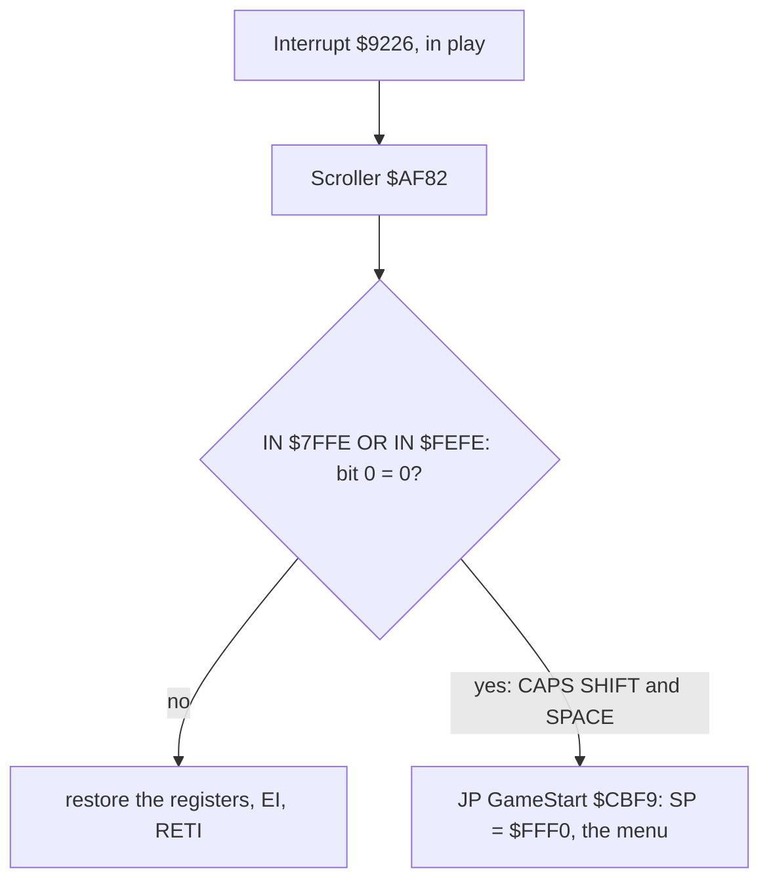

Witness: `play2` pressed CAPS SHIFT + SPACE at frame 3635, in a Cursor game; the menu was up again when 1 (KEMPSTON)
was pressed at frame 4045. It did the same at frame 5250, after the Kempston game.

Worked example: CAPS SHIFT alone. `$7FFE` reads `$BF` (bit 0 = 1, SPACE up) and `$FEFE` reads `$BE`; the `OR` is
`$BF`, bit 0 = 1: no BREAK. With SPACE down too, `$7FFE` reads `$BE`, the `OR` is `$BE`, bit 0 = 0: JP GameStart.

The point: BREAK works at any moment of a pass, even in the middle of DrawObjects. That is safe because Menu redraws
everything, NewGame resets every piece of the world, and GameStart sets a fresh stack.

## 5.9 The password entry and the cheat

P in the menu jumps to EnterPassword `$9F82`:

1. ClearMenuArea, "ENTER PASSWOID" at row 8, column 9, sixteen dots at row 10, column 8.
2. Up to 16 keys from WaitKey into PasswordBuffer `$9F71`, as key codes. A shift key (`@`, `$40`) is skipped; ENTER
   (`$0D`) ends the entry early. PrintChar echoes each key over a dot.
3. A 0 after the last code.
4. StringMatch `$A033` against each of the four passwords at Passwords `$A009` (MAYHEM `$A009`, TRANSMOGRIFY `$A010`,
   VALKYR `$A01D`, PETALS OF DOOM `$A024`; key codes, 0-terminated). The first three set their flag at PasswordFlags
   `$9F6D-$9F6F`. The fourth sets `$9F70` to the `AND` of the three: it counts only when the other three are already
   in.
5. ClearMenuArea and back to MenuLoop.

There is no delete key and no cursor. A wrong key can only be fixed by typing the whole password again.

```text
EnterPassword:
    ClearMenuArea; PrintString("ENTER PASSWOID", 8, 9); PrintString("................", 10, 8)
    p = PasswordBuffer; n = 0
    loop:
        char, code = WaitKey()
        if char == '@': continue             # CAPS SHIFT or SYMBOL SHIFT
        if char == ENTER: break
        PrintChar(char)                      # over the next dot
        [p] = code; p += 1; n += 1
        if n == 16: break
    [p] = 0
    if StringMatch(MAYHEM):         flags[0] = $FF
    if StringMatch(TRANSMOGRIFY):   flags[1] = $FF
    if StringMatch(VALKYR):         flags[2] = $FF
    if StringMatch(PETALS OF DOOM): flags[3] = flags[0] & flags[1] & flags[2]
    ClearMenuArea; goto MenuLoop
```

```text
9FA0  CD E5 A0                    l_9FA0: CALL WaitKey
9FA3  FE 40                               CP $40                  ; a shift: skipped
9FA5  28 F9                               JR Z,l_9FA0
9FA7  FE 0D                               CP $0D                  ; ENTER: done
9FA9  28 0B                               JR Z,l_9FB6
9FAB  CD D9 9C                            CALL PrintChar          ; echo the character
9FAE  08                                  EX AF,AF'
9FAF  77                                  LD (HL),A               ; keep the code
9FB0  23                                  INC HL
9FB1  0C                                  INC C
9FB2  CB 61                               BIT 4,C                 ; 16 keys
9FB4  28 EA                               JR Z,l_9FA0
9FB6  36 00                       l_9FB6: LD (HL),$00
; ... three compares as below
9FE1  21 24 A0                    l_9FE1: LD HL,Passwords+$001B   ; PETALS OF DOOM
9FE4  CD 33 A0                            CALL StringMatch
9FE7  20 0A                               JR NZ,l_9FF3
9FE9  21 6D 9F                            LD HL,PasswordFlags
9FEC  7E                                  LD A,(HL)
9FED  23                                  INC HL
9FEE  A6                                  AND (HL)
9FEF  23                                  INC HL
9FF0  A6                                  AND (HL)
9FF1  23                                  INC HL
9FF2  77                                  LD (HL),A               ; all three or nothing
A033  11 71 9F               StringMatch: LD DE,PasswordBuffer
A036  1A                          l_A036: LD A,(DE)
A037  BE                                  CP (HL)
A038  C0                                  RET NZ
A039  7E                                  LD A,(HL)
A03A  A7                                  AND A
A03B  C8                                  RET Z                   ; both ended together: Z
A03C  13                                  INC DE
A03D  23                                  INC HL
A03E  18 F6                               JR l_A036
```

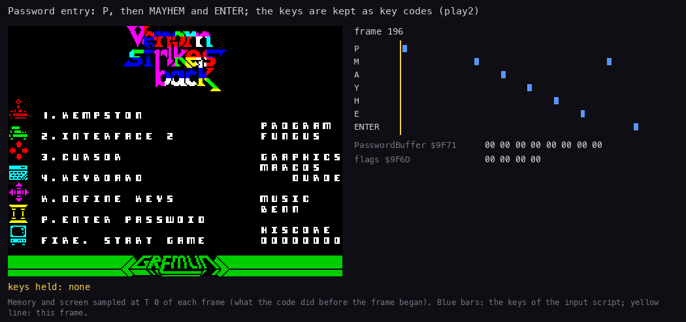

*Animation 5.5: P, then MAYHEM and ENTER: the letters echo over the dots, PasswordBuffer fills with key codes, the first
flag goes to `$FF` on ENTER. Every second frame of `rec/play2`, frames 196-560. Command: `python3 tools/fig_controls.py
play --work work/docs/mxB/p2 --from 196 --to 560 --step 2 --keys tests/inputs/s2play.txt --offset 0 --crop
0,0,256,192 --var 'PasswordBuffer=9F71:8:hex' --var 'flags=9F6D:4:hex' --title '...' --delay 60 --out
docs/img/play/password.gif`.*

How to read: the bars on the right are the script's keys; under them PasswordBuffer's first 8 bytes and the four
flags. The codes are not ASCII: M is `$72` (row 7, bit 2), A `$10`, Y `$54`, H `$64`, E `$22`.

Worked example, from the animation: after MAYHEM and ENTER (frame 505), PasswordBuffer holds `72 10 54 64 22 72 00`
and PasswordFlags `FF 00 00 00`.

Witness: the buffer at T 0 of `play2` frames, with the flags `$9F6D-$9F70`:

| Frame | After | Flags | Buffer `$9F71` |
| --- | --- | --- | --- |
| 520 | MAYHEM | `FF 00 00 00` | `72 10 54 64 22 72 00` |
| 1240 | TRANSMOGRIFY | `FF FF 00 00` | `24 23 10 73 11 72 51 14 23 52 13 54 00` |
| 1750 | VALKYR | `FF FF FF 00` | `04 10 61 62 54 23 00 14 23 52 13 54` |
| 2540 | PETALS OF DOOM | `FF FF FF FF` | `50 22 24 10 61 11 70 51 13 70 12 51 51 72 00` |

At 1750 the buffer still holds the tail of TRANSMOGRIFY after VALKYR's 0: the entry never clears the buffer. The
compares stop at the 0, so the tail does no harm.

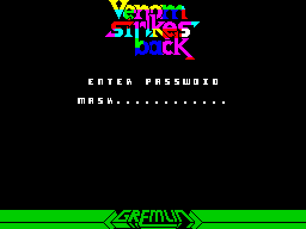

*Figure 5.6: the stage 1 `menu` recording at frame 2750: the password entry with its sixteen dots.*

The flags open the four doors of room 0, screen 5 (PasswordPods `$ACBC` and MattWalk `$B48D`,
[doc 10](10-gameplay-logic.md)).

### The cheat: JUDGE DREDD

The cheat is not checked in the menu. CheatCheck `$BB4C` runs on every interrupt in play. It compares PasswordBuffer,
which still holds the last password typed, with CheatCode `$BB6B`: JUDGE DREDD in key codes. Both addresses are
hidden:

- `LD BC,$BA77`, then `INC B`: BC = `$BB77`, CheatOn. It is cleared first, every interrupt.
- `LD HL,$E406`, then `ADD HL,DE` with DE = `$BB6B`: the sum `$19F71` loses its carry and gives `$9F71`,
  PasswordBuffer.

```text
BB4C  F5                    CheatCheck: PUSH AF
BB4D  01 77 BA                          LD BC,$BA77
BB50  04                                INC B                   ; BC = $BB77, CheatOn
BB51  AF                                XOR A
BB52  02                                LD (BC),A               ; off, unless the compare passes
BB53  11 6B BB                          LD DE,CheatCode
BB56  21 06 E4                          LD HL,ZoneChars+$0406   ; $E406
BB59  19                                ADD HL,DE               ; $E406 + $BB6B = $9F71
BB5A  1A                        l_BB5A: LD A,(DE)
BB5B  BE                                CP (HL)
BB5C  20 0B                             JR NZ,l_BB69
BB5E  A7                                AND A
BB5F  28 05                             JR Z,l_BB66
BB61  13                                INC DE
BB62  23                                INC HL
BB63  C3 5A BB                          JP l_BB5A
BB66  3E FF                     l_BB66: LD A,$FF
BB68  02                                LD (BC),A               ; CheatOn = $FF
BB69  F1                        l_BB69: POP AF
BB6A  C9                                RET
BB6B  63 53 12 14 22 70 12 23 22 12 12 00   ; CheatCode: J U D G E space D R E D D, 0
```

CheatOn is read by UseCharge `$B210` (the masks keep their charges) and DeadlyFloor `$B2F9` (the deadly floors do not
kill) ([doc 10](10-gameplay-logic.md)).

Worked example: J is on row 6 (`$BFFE`: ENTER L K J H), bit 3: `$63`. U is on row 5 (`$DFFE`: P O I U Y), bit 3:
`$53`. The whole string `63 53 12 14 22 70 12 23 22 12 12` reads J U D G E SPACE D R E D D.

The point: the four passwords and the cheat share one buffer. Typing any other password after JUDGE DREDD turns the
cheat off at the next interrupt in play, since CheatOn is cleared and recomputed 50 times a second. The hidden
operands keep `$BB77` and `$9F71` out of a search for the plain addresses.

## 5.10 H and Q: named, not there

The ZXDB instructions give H for a pause and Q to abort the game. The code reads the keyboard and the joystick at
these places only:

| `IN` at | Routine | Reads |
| --- | --- | --- |
| `$92A6`, `$92AB` | Interrupt | SPACE, CAPS SHIFT (BREAK) |
| `$9F64` | KempstonTest | port `$1F` |
| `$A0AB` | KeyPressed | one key by code |
| `$A0B6` | ScanKeyboard | the half-rows in turn (menu, DEFINE KEYS, passwords) |
| `$A148` | ReadControls | port `$1F` |
| `$B090` | MaskKeys | 1-4 |

In play only KeyPressed (for the five keys of KeysNow), MaskKeys and the BREAK test run. No code tests the code of H
(`$64`) or of Q (`$20`), and nothing waits for a key in play.

Witness:

- `c1` pressed H at frames 20 300 and 20 405. PassCounter `$AF0C` kept counting through both: the main loop did not
  stop.
- `play2` held H for 50 frames from 3375 and Q for 50 frames from 3445 in a Cursor game. Matt kept running right
  (8 held before and after), the game went on, and the menu came back only with BREAK at 3635.

Worked example: H is on half-row 6 (`$BFFE`: ENTER L K J H), bit 4: code `$64`. Neither KeysIf2, KeysCursor nor the
loaded KeysUser holds `$64`, and no other `IN` in play reads row 6 for itself, so holding H changes nothing.

The point: an emulator need not map H or Q for this release. Q has a role only by accident: `$20` is LEFT in KeysUser
as loaded (`70 50 61 20 21`), so with KEYBOARD chosen and the keys not redefined, Q walks left.

## 5.11 What an emulator must decode

| Device | Ports the game reads | What must answer |
| --- | --- | --- |
| keyboard | `$xxFE` with one bit of the high byte low, `$FEFE` ... `$7FFE` (KeyPressed, BREAK, MaskKeys, and ScanKeyboard row by row) | bits 0-4 of the half-row, 0 = down; the game never reads two rows at once |
| Kempston | `$1F`, with A as the high byte (0 in ReadControls, whatever A holds in KempstonTest) | bits 0-4 right, left, down, up, fire, 1 = pressed; bits 5-7 must read 0 |
| Interface 2 | none: keys 6 7 8 9 0 | the Interface 2 joystick mapped to 6 left, 7 right, 8 down, 9 up, 0 fire |
| Cursor | none: keys 5 6 7 8 0 | 5 left, 6 down, 7 up, 8 right, 0 fire |

Points to get right:

- KempstonTest wants bits 5-7 clear in 256 reads in a row. An emulator whose Kempston port reads `$FF` when idle, or
  returns the floating bus, makes key 1 do nothing. The ULA is not involved: `$1F` has A0 = 1.
- With a Kempston interface present, GameEntry already sets ControlMethod 0 before the menu (`c1`: 0 at frame 17 700).
  A player who expects Interface 2 must press 2.
- The keyboard is read one half-row at a time, so partial-address decoding (several high bits low) is never
  exercised by this game.
- ReadControls runs once a pass (2-5 frames). A front end that injects a key for exactly one frame may miss it in
  play; the menu reads once a frame.

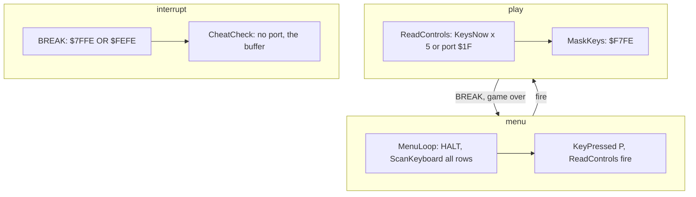

Worked example: an emulator whose idle Kempston port reads `$FF`. KempstonTest's first read has bits 5-7 set, it
returns NZ, and key 1 leaves ControlMethod as it was. If ControlMethod were 0 all the same, ReadControls would store
`$FF` AND `$1F` = `$1F`: right, left, down, up and fire at once, every pass.

The point: the keyboard's half-rows and a clean Kempston port are all the game reads. No other hardware is needed for
its input.

## 5.12 Known only from the code

- KeyPressed writes its own `RES r,B` and `BIT b,C` (5.2). The cost and the results are measured; the design reason
  (no port table) is an inference.
- MaskKeys calls EndPenetrator before it checks that the chosen slot is not EMPTY. No recording pressed the key of an
  empty slot while PENETRATOR was running.
- With a Kempston stick, "left and right" walks left and "up and down" crouches (MattWalk's order). No recording drove
  a Kempston stick with both bits of an axis.
- CheatCheck's hidden operands (`$BA77` + `INC B`, `$E406` + `$BB6B`). The cheat's effect is in stage 2's notes
  (`work/stage2/NOTES.md`); the `cheat` recording types JUDGE DREDD and shows it working ([doc 10](10-gameplay-logic.md)).
- DefineKeys zeroes KeysNow, and code 0 is CAPS SHIFT. So CAPS SHIFT can never be defined: AskKey finds `$00` in the
  unfilled slots and waits for another key.
