# 6. Rendering

What this covers:

- the renderer's buffers at `$E000-$FDFF` and the character map that stands between the game and the screen;
- DrawRoom `$A89D`: a room screen from 40 map bytes, through the 4 x 4 blocks, into 576 characters;
- the four zone character sets and SwapZone `$A198`;
- FlushDirty `$A1F0` and the dirty marks: the only code that copies the play window to the screen;
- the sprite frames and SelectFrame `$A349`;
- DrawObjects `$A2D0` and DrawObject `$A56F`: sprites drawn into fresh characters, never onto the screen;
- the mask, the mirror and the shift tables (MakeMask `$A777`, MirrorFrame `$A7F3`, BuildTables `$A860`,
  DrawShifted `$A6FE`);
- the pick-up icons, the Dissolve effect and the animated characters;
- who writes which screen byte in one pass, and the order against the beam;
- what only the code shows.

The recordings it rests on ([WALKTHROUGH 6.0](../WALKTHROUGH.md#60-the-recordings)):

| Recording | Load | Used for |
| --- | --- | --- |
| `c1` | power-on on the 128K, the original tape at ROM speed, `tests/inputs/c1.txt` | the new game (DrawRoom, Dissolve), one main loop pass traced instruction by instruction (frames 18 669-18 672) |
| `rec/rzx-04000` | the ZXDB RZX, frames 4000-7999, from the RZX's own state | the zone swap of a pod ride (room 10 to room 1) |
| `rec/rzx-12000` | the ZXDB RZX, frames 12 000-15 999 | AnimateZone in the caverns (zone 1) |
| `build/game.bin` | the game image as loaded | the figures drawn from data: the map, the blocks, the zones, the frames, the tables |

Conventions:

- **A frame** is 1/50 s of the 128K, 70 908 T. "18669:61779" is frame 18 669, T 61 779 of that frame, as an access
  trace places an instruction.
- **A cell** is one character position of the play window: 32 columns by 18 rows, screen rows 0-17.
- **A pass** is one turn of MainLoop `$CC03` ([doc 4](04-game-loop.md#44-the-main-loop-and-the-order-of-a-pass)).
- **An x unit** is 2 pixels. Object x and y are in the game's own coordinates (6.6).

## 6.1 The screen and the buffers

MASK III never draws a sprite on the screen. Every picture goes through one level of indirection:

1. the **character map** `$F080` says which character each cell shows: 32 x 20 codes, of which rows 2-19 are the
   18 shown rows;
2. two **character sets** hold the pixels: the live zone set at `$E000` (256 characters) and the sprite characters at
   `$E800`, which DrawObject rebuilds every pass;
3. the **dirty marks** `$F3C0` say which cells changed;
4. FlushDirty copies only the marked cells to the screen, with their attributes.

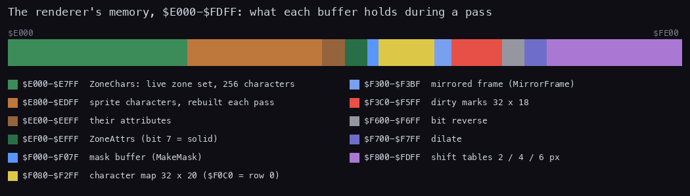

*Figure 6.1: the buffers at `$E000-$FDFF`, to scale. Drawn from the addresses the renderer uses. Command:
`python3 tools/fig_render.py memory --out docs/img/render/buffers.png`.*

| Address | Size | What | Written by | Read by |
| --- | ---: | --- | --- | --- |
| `$E000-$E7FF` | 2048 | ZoneChars: the live zone's 256 characters | SwapZone, AnimateZone | FlushDirty, DrawObject |
| `$E800-$EDFF` | 1536 | the sprite characters, numbered from 0 | PlacePickup, DrawObject, DrawShifted | FlushDirty |
| `$EE00-$EEFF` | 256 | the sprite characters' attributes | PlacePickup, DrawObject | FlushDirty, DrawObject |
| `$EF00-$EFFF` | 256 | ZoneAttrs: the zone characters' attributes, bit 7 the solid flag | SwapZone | FlushDirty, IsSolid `$B993` |
| `$F000-$F07F` | 128 | the mask of the object being drawn | MakeMask | DrawShifted |
| `$F080-$F2FF` | 640 | the character map, 32 x 20; screen row 0 is `$F0C0` | DrawRoom, DrawObject, the pick-ups | FlushDirty, the game logic |
| `$F300-$F3BF` | 192 | the mirrored frame | MirrorFrame | MakeMask, DrawShifted |
| `$F3C0-$F5FF` | 576 | the dirty marks, 32 x 18, one per shown cell | DrawRoom, DrawObject, the pick-ups, AnimateZone | FlushDirty |
| `$F600-$FDFF` before BuildTables | 1536 + 192 | PlayPanel `$F600` and PanelAttrs `$FC64`: the play panel, the tape's until the first game, then the one SaveHud `$9CA0` keeps at each Menu | the tape, SaveHud | Menu (the panel at the game start, [doc 8](08-hud-and-text.md#81-the-play-panel)) |
| `$F600-$F6FF` | 256 | bit reverse | BuildTables | MirrorFrame |
| `$F700-$F7FF` | 256 | dilate: b OR b << 1 OR b >> 1 | BuildTables | MakeMask |
| `$F800-$FDFF` | 1536 | the shift tables, 2, 4 and 6 pixels | BuildTables | DrawShifted |

The map, the dirty marks and the screen share one layout: a cell at screen row r, column c sits at offset
32 x r + c from `$F0C0`, `$F3C0` and the attribute file `$5800`. The dirty mark of a map byte is `$300` above it.
That is why FlushDirty goes from one to the other with three `DEC H` and one add.

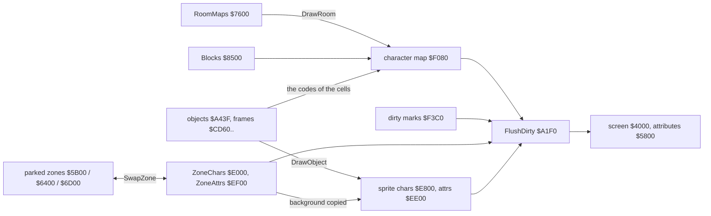

Worked example: the cell at screen row 9, column 5 has offset 32 x 9 + 5 = `$125`. Its map byte is `$F1E5`, its
dirty mark `$F4E5`, its attribute `$5925`, and its first pixel line `$4825` (third 1, character row 1, column 5).

Witness: the c1 pass traced at 18669:38407-18672:12707 writes the play window only from FlushDirty's stores,
which the trace credits to two labels: `l_A1FE` (the line copies at `$A223-$A23F`) and `l_A24C` (the attribute) (6.11).

The point: the play window is a character display. A sprite is a handful of characters made for this pass, and the
screen only ever receives whole cells.

## 6.2 The room from its map

A room is 5 rows of 48 blocks: six screens of 8 x 5 blocks side by side. Room n's map is at RoomMaps `$7600` +
240 x n. RoomScreen `$950D` holds 8 x screen, so it is the byte offset of the screen inside a map row. A block is
4 x 4 character codes, 16 bytes at Blocks `$8500` + 16 x block.

DrawRoom `$A89D` first checks for the end: room 15 with RoomScreen `$28` (screen 5) jumps to Ending `$ADF6`
([doc 8](08-hud-and-text.md#89-the-ending)). It then resets the room's objects and writes 8 x 5 blocks into the
map, from `$F080`:

```text
DrawRoom:
    if RoomNumber == 15 and RoomScreen == $28: goto Ending
    FirstSpriteChar = 0
    if RoomNumber != MapPointer+2: ChaserState = 0      # a new room; MapPointer+2 = RoomNumber
    ShotOff()                                    # $BD7F: Matt's shot ends
    clear the enemy records' state and +$1F: all six, or the last five while ChaserState is set
                                                 # the chaser in slot 2 survives a screen change
    src = $7600 + 240 * RoomNumber + RoomScreen
    dst = $F080                                  # map row 0 (hidden)
    for by in 0..4:
        for bx in 0..7:
            blk = $8500 + 16 * src[bx]
            copy blk[0..3] to dst, blk[4..7] to dst + 32, blk[8..11] to dst + 64, blk[12..15] to dst + 96
            dst += 4
        dst += 96                                # three more character rows
        src += 48                                # the next block row of the room
    SwapZone(RoomTable[RoomNumber].zone)         # record + 4
    fill the dirty marks $F3C0-$F5FF with 1
    FlushDirty()                                 # the whole window
    EnemyKind = record[6 + screen]
    MoonMasks, AnimatedCharList, FindLift, PlaceTurrets, FindSpawnPoints, FindBlockItems, FindFloorRow,
    PlacePickupsInScreen
    EffectStops+1 = $FF
    RoomMessage
```

The inner block copy is unrolled: four `LDI` a character row, `$1C` added to step to the next row of a 32-wide map
(4 + 28 = 32).

```text
A91B  7E                  l_A91B: LD A,(HL)               ; the block number from the room map
A91C  D9                          EXX
A91D  6F                          LD L,A
A91E  26 00                       LD H,$00
A920  29                          ADD HL,HL
A921  29                          ADD HL,HL
A922  29                          ADD HL,HL
A923  29                          ADD HL,HL               ; x 16
A924  01 00 85                    LD BC,Blocks
A927  09                          ADD HL,BC
A928  ED A0                       LDI                     ; character row 0 of the block
A92A  ED A0                       LDI
A92C  ED A0                       LDI
A92E  ED A0                       LDI
A930  D5                          PUSH DE                 ; the next block's place in the map
A931  3E 1C                       LD A,$1C
A933  83                          ADD A,E
A934  5F                          LD E,A
A935  30 01                       JR NC,l_A938
A937  14                          INC D
A938  ED A0               l_A938: LDI                     ; row 1
...                                                       ; rows 2 and 3 the same
A95E  D1                          POP DE
A95F  D9                          EXX
A960  23                          INC HL
A961  10 B8                       DJNZ l_A91B             ; 8 blocks a row
A963  D9                          EXX
A964  3E 60                       LD A,$60                ; 3 character rows down
...
A96C  19                          ADD HL,DE               ; + $28: 8 + 40 = 48, the next block row
A96D  0D                          DEC C
A96E  C2 19 A9                    JP NZ,l_A919            ; 5 block rows
A971  DD 2A 0B 95                 LD IX,(RoomRecord)
A975  DD 7E 04                    LD A,(IX+$04)           ; the room's zone
A978  CD 98 A1                    CALL SwapZone
A97B  21 C0 F3                    LD HL,$F3C0             ; every dirty mark = 1
A97E  11 C1 F3                    LD DE,$F3C1
A981  01 3F 02                    LD BC,$023F
A984  36 01                       LD (HL),$01
A986  ED B0                       LDIR
A988  CD F0 A1                    CALL FlushDirty
```

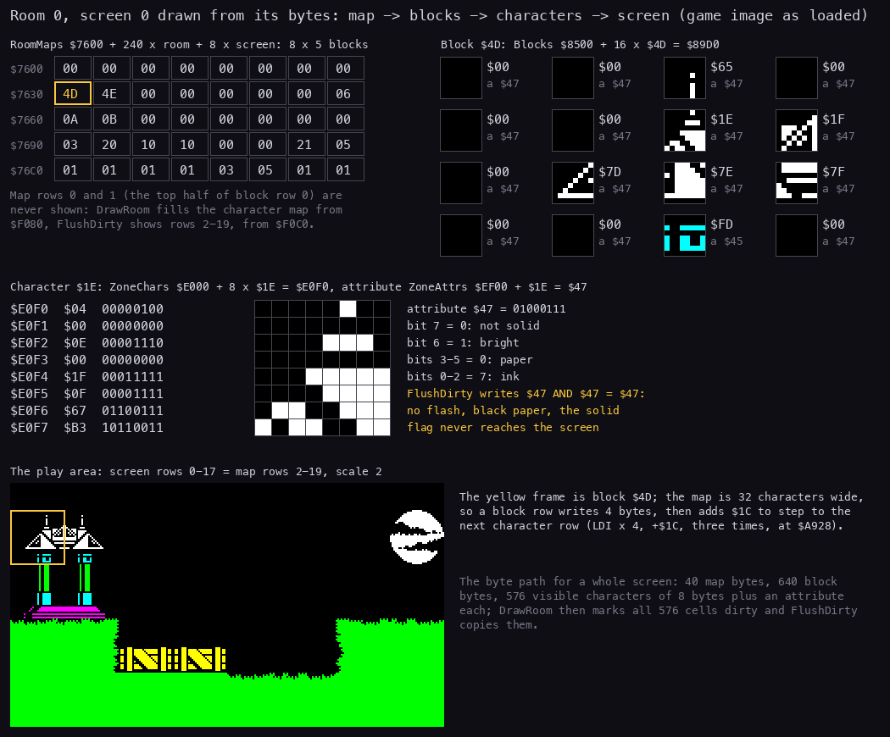

*Figure 6.2: room 0, screen 0 from the game image: the 40 map bytes, block `$4D` worked to its 16 codes, character
`$1E` worked to its 8 bytes and attribute, and the play area the result. Command:
`python3 tools/fig_render.py room --out docs/img/render/room-bytes.png`.*

How to read: top left, the map bytes of the screen at their addresses; the yellow byte is the block worked on the
right. Middle, the character's 8 bytes in hex and binary with its attribute decoded. Bottom, the 18 shown rows at
scale 2, with the block framed. Map rows 0 and 1 are the top half of block row 0: they are written and never shown.

Worked example: 5 x 8 = 40 map bytes become 40 x 16 = 640 map codes; 576 of them are shown, each 8 bytes of pixels
plus an attribute. For room 0 screen 0 the source is `$7600` + 0 + 0; block row 1 starts at `$7630`.

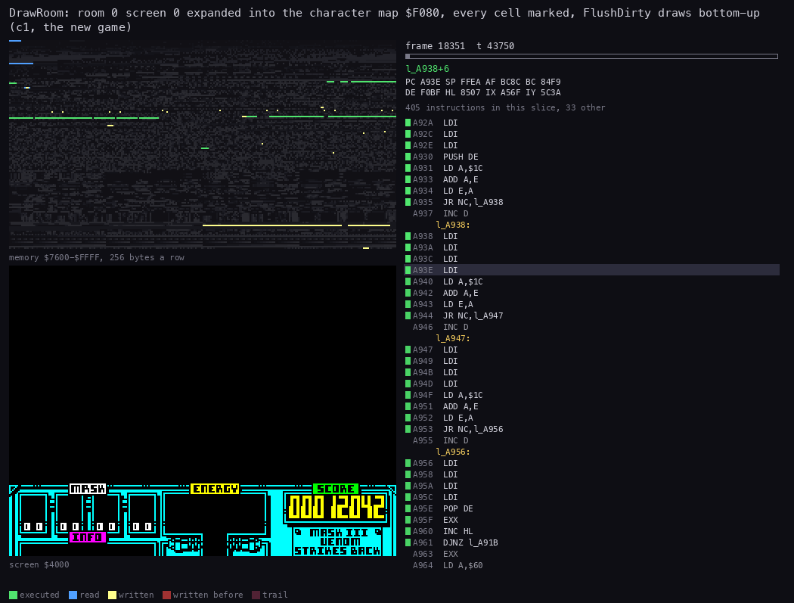

*Animation 6.1: DrawRoom building room 0, screen 0 for the new game: the map expansion, the dirty fill, and
FlushDirty drawing the window from the bottom up. 90 pictures, 4750 T each, 61 291 instructions. Recording `c1`,
window 18351:39000-18357:41000. Command: `python3 ../../kit/routine_anim.py --trace
work/docs/mxB/c1/traces/18351_39000-18357_41000.uatr --listing build/game.lst --view screen --range 7600-FFFF --pc
A89D-A9BD,A1F0-A252,A198-A1EB --pictures 90 --title "..." --out docs/img/routines/DrawRoom-room0.gif`.*

How to read: the left pane is the screen; the right pane is the code with the running instruction; the bar under it
is the window, frame by frame. The map expansion is over in the first pictures; the rest is FlushDirty, which fills
the window from row 17 upward. The zone does not change here (zone 0 is already live), so SwapZone returns at once.

Witness: the room 1 change in `rec/rzx-04000` measures the map expansion at 19 949 T and the whole DrawRoom at
584 482 T with a zone swap ([doc 4, 4.5](04-game-loop.md#45-the-heaviest-frame-the-room-change)).

The point: a room is 40 bytes a screen. The cost of a room change is not the expansion (0.28 frame) but the copy of
576 cells to the screen (6.4) and, between zones, the swap (6.3).

## 6.3 The zone sets

Each room belongs to one of four zones: 0 the surface, 1 the caverns, 2 the moon, 3 the base. Each zone has its
own 256 characters and 256 attributes. Only the live one is at `$E000`/`$EF00`; the others are parked in
`$5B00-$75FF` ([doc 2](02-architecture.md#the-zone-sets-one-live-three-parked)). A room record names its zone in
byte 4, and DrawRoom calls SwapZone with it.

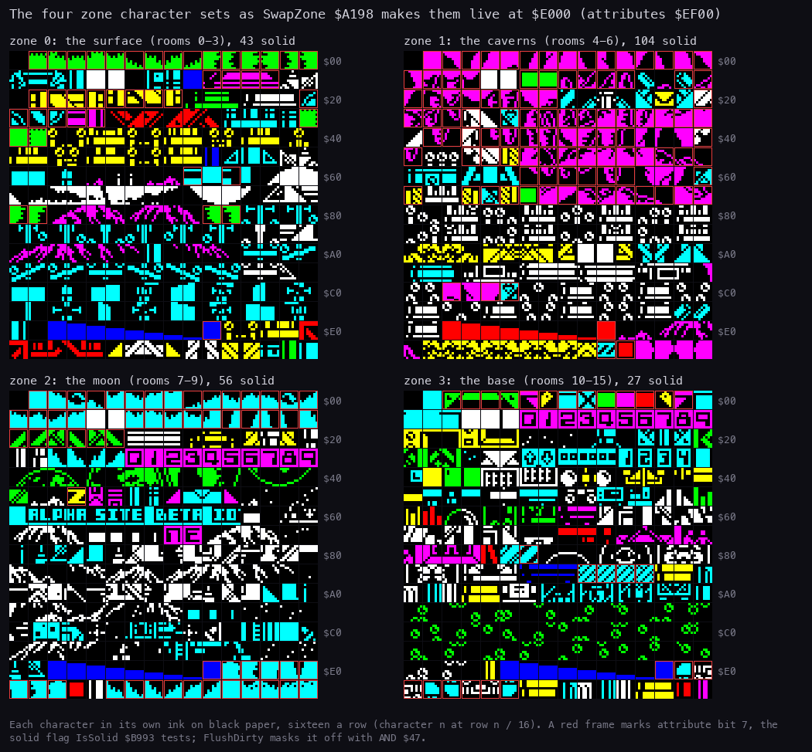

*Figure 6.3: the four zones' characters as they are when live at `$E000`, each in its own ink, with the solid ones
(attribute bit 7) framed in red. Drawn from the game image: zone 0 from `$E000`, the parked ones from their slots.
Command: `python3 tools/fig_render.py zones --out docs/img/render/zones.png`.*

How to read: sixteen characters a row, character n at row n / 16, column n AND 15. A red frame is a character Matt
stands on and cannot walk through.

Three things about the attributes follow from the figure and the code:

- bit 7 (FLASH on a real Spectrum) is the solid flag. IsSolid `$B993` tests it;
- FlushDirty masks every attribute with `AND $47` (6.4), so the flag never reaches the screen and paper is always
  black. Paper is 0 in all zones anyway, except 5 characters of zone 2;
- characters `$EA-$FF` are the foreground: DrawObject never puts a sprite over them (6.6).

SwapZone exchanges 2304 bytes under `DI`: the 2048 pattern bytes at 72 T each and the 256 attribute bytes at 56 T
each, 2048 x 72 + 256 x 56 = 161 792 T for the loops. The routine, its timing and the lost interrupts are in
[doc 4, 4.5](04-game-loop.md#swapzone-under-di). After the swap it sets TurretStem from TurretStems `$A1EC` + zone:
the character a turret's stem uses in that zone.

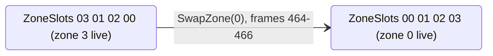

Worked example: before the pod ride, ZoneSlots `$A194` is `03 01 02 00`: zone 3 live, zone 0 parked in slot 3 at
`$6D00`. SwapZone(0) finds 0 at slot 3, swaps `$6D00-$75FF` with `$E000-$E7FF` and `$EF00-$EFFF`, writes 3 into slot
3 and 0 into slot 0: `00 01 02 03`.

Witness: `rec/rzx-04000`, `time_travel memory_at` `$A194`: `03 01 02 00` up to frame 466, `00 01 02 03` from frame
467. The room goes from 10 (screen `$28`) to 1 (screen 0) at frame 464.

The point: the swap keeps four character sets in the space of four without a spare buffer. A room change within a
zone costs no swap at all.

## 6.4 FlushDirty and the dirty marks

FlushDirty `$A1F0` is the only path from the buffers to the play window. It scans the dirty marks from `$F5FF` down
to `$F3C0`, with a `$FF` sentinel at `$F3BF` to stop it. For each marked cell it:

1. decrements the mark and writes it back;
2. takes the code from the map, `$300` below the mark;
3. picks the character set by the mark: mark 1 is a zone character at `$E000`, mark 2 a sprite character at
   `$E800`;
4. copies the 8 bytes to the screen and the attribute (from `$EF00` or `$EE00`) `AND $47` to `$5800`.

The marks therefore mean:

| Mark | Set by | The cell shows | Written back |
| --- | --- | --- | --- |
| 0 | | unchanged | |
| 1 | DrawRoom (every cell), AnimateZone, FlushDirty itself | the zone character in the map | 0 |
| 2 | DrawObject, the pick-ups | a sprite character | 1 |

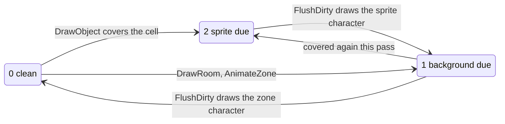

This is the whole erase strategy. DrawObjects puts the old codes back into the map after the flush (6.6), but the
mark stays at 1. On the next pass, if no object covers the cell again, FlushDirty draws the restored zone character:
the sprite is erased one pass late, with no separate erase code.

```text
FlushDirty:
    [$F3BF] = $FF                             # sentinel just below the marks
    p = $F600
    loop:
        do p -= 1 while [p] == 0              # 23 T a clean cell
        if [p] has bit 7: return              # the sentinel
        m = [p] - 1; [p] = m
        code = [p - $300]                     # the map
        src = $E000 + $800 * m + 8 * code     # m = 0: zone, m = 1: sprite
        off = p - $F3C0
        screen = $4000 + $800 * (off >> 8) + (off & $FF)
        copy 8 lines src -> screen, screen + $100, ...
        attr = ($EE00 if m else $EF00)[code]
        [$5800 + off] = attr AND $47
```

```text
A1F0  3E FF           FlushDirty: LD A,$FF
A1F2  32 BF F3                    LD ($F3BF),A            ; the sentinel
A1F5  21 00 F6                    LD HL,$F600
A1F8  DD 21 FC A1                 LD IX,l_A1FC            ; JP (IX) is the loop
A1FC  AF                  l_A1FC: XOR A
A1FD  2B                          DEC HL
A1FE  B6                  l_A1FE: OR (HL)
A1FF  2B                          DEC HL
A200  CA FE A1                    JP Z,l_A1FE             ; skip clean cells
A203  F8                          RET M                   ; $FF: done
A204  3D                          DEC A
A205  23                          INC HL
A206  77                          LD (HL),A               ; 2 -> 1, 1 -> 0
A207  E5                          PUSH HL
A208  25                          DEC H
A209  25                          DEC H
A20A  25                          DEC H                   ; the map byte
A20B  5E                          LD E,(HL)               ; the code
A20C  C6 FC                       ADD A,$FC               ; $FC zone, $FD sprite
A20E  57                          LD D,A
A20F  01 40 FF                    LD BC,$FF40
A212  09                          ADD HL,BC               ; HL = $F000 + offset
A213  4B                          LD C,E
A214  44                          LD B,H
A215  7C                          LD A,H
A216  E6 03                       AND $03                 ; the third
A218  87                          ADD A,A
A219  87                          ADD A,A
A21A  87                          ADD A,A
A21B  C6 40                       ADD A,$40
A21D  67                          LD H,A                  ; HL = the screen address
A21E  EB                          EX DE,HL
A21F  29                          ADD HL,HL
A220  29                          ADD HL,HL
A221  29                          ADD HL,HL               ; $FCxx x 8 = $E000 + 8 x code
A222  7E                          LD A,(HL)
A223  12                          LD (DE),A               ; line 0
A224  14                          INC D
A225  2C                          INC L
...                                                       ; lines 1-7 the same, unrolled
A240  78                          LD A,B
A241  D6 98                       SUB $98                 ; $F0-$F2 -> $58-$5A
A243  57                          LD D,A
A244  06 EF                       LD B,$EF
A246  CB 5C                       BIT 3,H                 ; $E8xx and up: a sprite character
A248  28 02                       JR Z,l_A24C
A24A  06 EE                       LD B,$EE
A24C  0A                  l_A24C: LD A,(BC)
A24D  E6 47                       AND $47                 ; ink and BRIGHT only
A24F  12                          LD (DE),A
A250  E1                          POP HL
A251  DD E9                       JP (IX)
```

Worked example, the cost:

- a clean cell is one turn of `l_A1FE`: 7 + 6 + 10 = 23 T. An idle window costs 576 x 23 = 13 248 T;
- a marked cell costs 445 T in the zone's characters and 447 T in the sprite characters (the `BIT 3,H` branch): the
  scan step, the address arithmetic, 8 unrolled line copies with their `INC D` / `INC L` (168 T) and the attribute;
- a whole window, as after DrawRoom, is 576 x 445 = 256 320 T. Doc 4 measures about 260 674 T for the room 1
  change: the difference is the sentinel and the call.

Worked example, the address: Matt's cell at screen row 5, column 0 has the mark `$F460`. Three `DEC H` give the map
byte `$F160`; plus `$FF40` gives `$F0A0`; H AND 3 = 0, so the screen address is `$40A0`, and `$F0` - `$98` = `$58`
gives the attribute `$58A0`.

Witness: in the c1 pass, `l_A1FE` writes 232 screen bytes and `l_A24C` 29 attributes (6.11); the room change in
`rec/rzx-04000` draws the window from the bottom up (`room-change-10-1.gif` in
[doc 4](04-game-loop.md#flushdirty-the-room-appears-bottom-up)).

The point: the dirty marks are a two-step queue that erases sprites for free. The price is that a cell shows one
pass late, and the flush ignores the beam (6.11).

## 6.5 The sprite frames and SelectFrame

A frame is stored by columns: w columns of 8 x h lines, one byte a line. Matt's frames are 4 x 4 characters,
128 bytes: 4 columns of 32 lines. Object field +5 is w, +6 is h, and +`$0C`/`$0D` point at the frame.

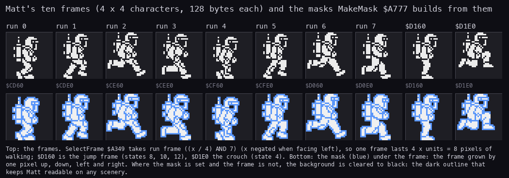

*Figure 6.4: Matt's ten frames from the game image (MattRun `$CD60`, eight frames; MattJump `$D160`; MattCrouch
`$D1E0`) with the mask MakeMask builds from each. Command: `python3 tools/fig_render.py frames --out
docs/img/render/matt-frames.png`.*

How to read: the top row is the frames as stored, the bottom row the same frames over their masks (blue). The mask
is one pixel larger on every side. Where the mask is set and the frame is not, the background is cleared to black:
the outline that keeps Matt readable over any scenery.

SelectFrame `$A349` sets the frame pointer before each object is drawn. Mode +`$19` 0 keeps the pointer; mode 1 is
Matt; the other modes go to FrameByMode `$A3E2` ([doc 7](07-objects.md)).

```text
SelectFrame(IX):
    if mode == 0: return
    if mode != 1: goto FrameByMode
    if state in (8, 10, 12): frame = $D160          # jumping
    elif state == 4: frame = $D1E0                  # crouching
    elif state == 7: frame = $CDE0                  # run frame 1
    else:
        x = IX.x; if facing left: x = -x
        frame = $CD60 + 128 * ((x >> 2) AND 7)
    repeat DissolveCount times: Dissolve()          # 6.9
```

```text
A373  DD 7E 03                    LD A,(IX+$03)           ; x
A376  DD CB 02 7E                 BIT 7,(IX+$02)          ; facing left?
A37A  28 02                       JR Z,l_A37E
A37C  ED 44                       NEG
A37E  CB 3F               l_A37E: SRL A
A380  CB 3F                       SRL A
A382  E6 07                       AND $07                 ; (x / 4) AND 7
A384  67                          LD H,A
A385  2E 00                       LD L,$00
A387  CB 3C                       SRL H
A389  CB 1D                       RR L                    ; x 128
A38B  11 60 CD                    LD DE,MattRun
A38E  19                          ADD HL,DE
A38F  DD 75 0C            l_A38F: LD (IX+$0C),L
A392  DD 74 0D                    LD (IX+$0D),H
```

Worked example: in the c1 pass Matt has x = `$42`, facing right. (`$42` / 4) AND 7 = `$10` AND 7 = 0: run frame 0,
`$CD60`. The trace shows HL = `$CD60` when DrawObject starts at 18669:63684.

Witness: the frame changes every 4 x units, 8 pixels of walking; the run cycle of 8 frames repeats every 64 pixels.
Facing left negates x, so the cycle runs backwards and the feet still match the direction.

The point: one stored set of frames, facing right. The left-facing pictures are made at draw time (6.7).

## 6.6 DrawObjects and DrawObject

DrawObjects `$A2D0` runs once a pass, after the game logic:

```text
DrawObjects:
    PlacePickups()                                 # 6.8: sprite characters 0-7, saves from $A253
    NextSpriteChar = FirstSpriteChar
    for each of the 8 records at $A43F, step $26:
        if (state AND $BF) != 0:
            SelectFrame(); DrawObject()
    FlushDirty()                                   # 6.4
    for each record from $A549 back to $A43F:      # the reverse order
        if (state AND $BF) != 0:
            put the saved codes back into the map   # (w+1) x (h+1), by columns
    RestorePickups()
```

DrawObject `$A56F` turns one object into fresh characters. It works out the top left cell from the object's
position, then walks (w + 1) columns of (h + 1) cells, one more than the frame each way for the shift:

```text
DrawObject(IX):
    row  = (y + $30) AND $F8                        # field +$25: 8 x the map row
    col  = (x - $40) >> 2   (signed)                # field +$13 holds x - $40, before the shift
    cell = $F000 + 4 * row + col
    B    = NextSpriteChar                           # field +$0B
    save = PickupSavePtr                            # field +$0E/$0F
    for each column, each row:
        bg = the cell's code; set = $EE00 if its mark is 2 else $EF00
        a  = set[bg]; if a == 0: a = colour (+$20)
        $EE00[B] = a                                # the sprite character's attribute
        *save++ = bg
        if bg >= $EA or col < 0 or row >= $C0:      # foreground, off the left, below the window
            B++ ; skip                              # the character number is used anyway
        else:
            map[cell] = B; mark = 2
            copy the 8 bytes of bg ($E000 or $E800 + 8 x bg) to $E800 + 8 x B
            B++
    NextSpriteChar = B; PickupSavePtr = save
    if facing left: MirrorFrame()                   # 6.7
    MakeMask()
    if x AND 3 == 0: DrawAligned($E800 + 8 x first B + (y AND 7))
    else:           DrawShifted(...)                # 2, 4 or 6 pixels
```

The heart of it, one cell:

```text
A5CA  F5                  l_A5CA: PUSH AF
A5CB  D5                          PUSH DE
A5CC  16 EF                       LD D,$EF                ; the zone attributes
A5CE  5E                          LD E,(HL)               ; the cell's code
A5CF  7C                          LD A,H
A5D0  24                          INC H
A5D1  24                          INC H
A5D2  24                          INC H                   ; its dirty mark
A5D3  CB 4E                       BIT 1,(HL)              ; mark 2: another sprite is there
A5D5  28 02                       JR Z,l_A5D9
A5D7  16 EE                       LD D,$EE
A5D9  67                  l_A5D9: LD H,A
A5DA  1A                          LD A,(DE)               ; the background's attribute
A5DB  A7                          AND A
A5DC  20 03                       JR NZ,l_A5E1
A5DE  DD 7E 20                    LD A,(IX+$20)           ; or the object's colour
A5E1  FD 77 00            l_A5E1: LD (IY+$00),A           ; $EE00 + B
A5E4  FD 23                       INC IY
A5E6  D1                          POP DE
A5E7  7E                          LD A,(HL)
A5E8  12                          LD (DE),A               ; save the old code
A5E9  FE EA                       CP $EA
A5EB  D2 55 A6                    JP NC,l_A655            ; foreground: skip
A5EE  DD CB 13 7E                 BIT 7,(IX+$13)
A5F2  20 61                       JR NZ,l_A655            ; column < 0: skip
A5F4  08                          EX AF,AF'
A5F5  DD 7E 24                    LD A,(IX+$24)
A5F8  FE C0                       CP $C0
A5FA  30 59                       JR NC,l_A655            ; below the window: skip
A5FC  08                          EX AF,AF'
A5FD  70                          LD (HL),B               ; the map gets sprite character B
A5FE  13                          INC DE
A5FF  04                          INC B
A600  24                          INC H
A601  24                          INC H
A602  24                          INC H
A603  4E                          LD C,(HL)
A604  36 02                       LD (HL),$02             ; mark 2
A606  CB 49                       BIT 1,C
A608  D9                          EXX
A609  6F                          LD L,A
A60A  26 FC                       LD H,$FC                ; zone character ...
A60C  28 02                       JR Z,l_A610
A60E  26 FD                       LD H,$FD                ; ... or the sprite character already there
A610  29                  l_A610: ADD HL,HL
A611  29                          ADD HL,HL
A612  29                          ADD HL,HL
A613  ED A0                       LDI                     ; 8 x LDI: the background into $E800 + 8 x B
...
A623  D9                          EXX
```

Because the background is copied from what the cell shows (a zone character, or a sprite character an earlier object
made this pass), overlapping objects stack correctly: the later one is drawn over a copy of the earlier one.

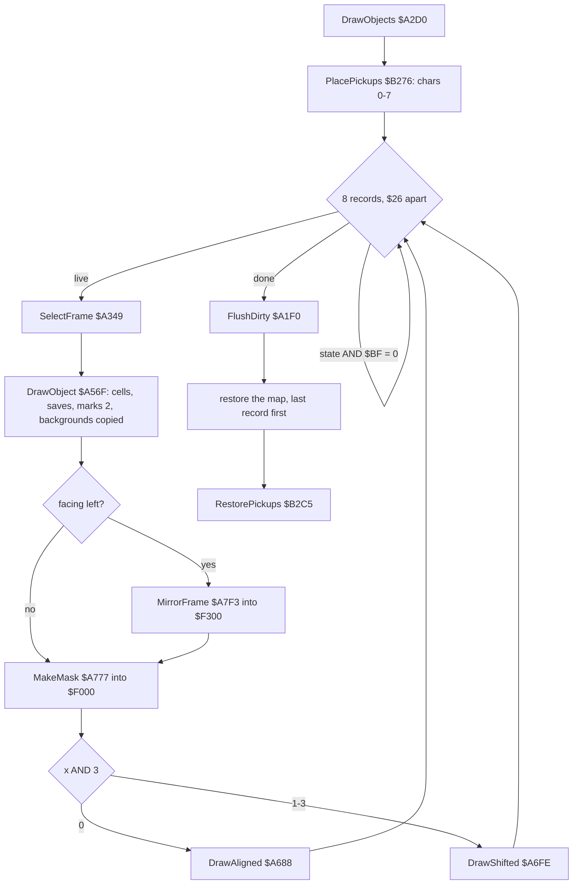

Worked example, Matt in the c1 pass (registers from the trace `18669_61700-18671_42000.uatr`):

| Step | Value |
| --- | --- |
| x, y | `$42`, `$28` |
| row = (`$28` + `$30`) AND `$F8` | `$58`, map row 11 - 4 = 7, screen row 5 |
| col = (`$42` - `$40`) >> 2 | 0 |
| cell = `$F000` + 4 x `$58` + 0 | `$F160` |
| first sprite character | 8 (the two pick-ups took 0-7) |
| w, h | 4, 4: 5 x 5 = 25 cells, characters 8-32 |
| the character data | `$E800` + 8 x 8 = `$E840`, + (y AND 7) = 0 |
| x AND 3 | 2: DrawShifted, 4 pixels, tables `$FA00`/`$FB00` |

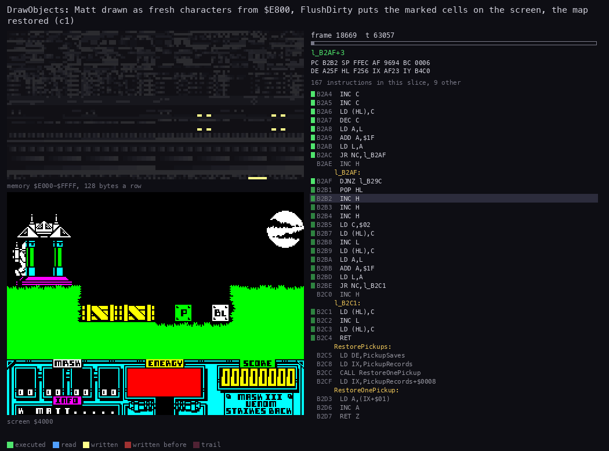

*Animation 6.2: DrawObjects in the c1 pass: the pick-ups, Matt's 25 cells and his frame shifted into them, then
the six empty records. 90 pictures, 1357 T each, 17 806 instructions. Recording `c1`, window
18669:61700-18671:42000. Command: `python3 ../../kit/routine_anim.py --work work/docs/mxB/c1 --window
18669:61700-18671:42000 --listing build/game.lst --view screen --range E000-FFFF --pc A2D0-A85F,B276-B2F0 --pictures 90
--title "..." --out docs/img/routines/DrawObjects.gif`.*

How to read: the screen does not change during the animation: DrawObjects writes only to `$E000-$FFFF`, which the
memory strip under the code shows lighting up. The window ends inside the last DrawShifted, before the flush.

Where the T go, measured over the same window (`work/docs/mxB/tcost.py`, 122 112 T):

| Part | T | Share |
| --- | ---: | ---: |
| the DrawShifted loop `l_A726` | about 47 600 | 39 % |
| the MakeMask loop `l_A78C` | about 20 300 | 16.6 % |
| Matt, from 18669:63665 (MakeMask at 18670:11226, DrawShifted at 18670:19396) | about 48 100 | |
| each of the records 2-7 | about 12 300 | |

Witness: records 2-7 (`$A48B`, `$A4B1`, ... `$A549`) all hold state `$80`, x 1, y 0, w = h = 2, mode 0 and a frame
pointer of `$0000`. Their cell is `$F0B0`, column -16: every cell is skipped. Yet each still takes 9 character
numbers (33-41, 42-50, ...), runs MakeMask and DrawShifted over the ROM bytes at `$0000`, and costs about 12 300 T:
about 74 000 T a pass, 40 % of the pass, for nothing on screen (6.12).

The point: a sprite is drawn by building private characters from the background, so the screen is never read and
never needs an erase. The cost is all in memory: in the c1 pass DrawObjects and its flush take 163 652 of 187 024 T.

## 6.7 The mask, the mirror and the shift

Three tables made once by BuildTables `$A860` serve the drawing.

```text
BuildTables:
    for b in 0..255: $F700[b] = b | b << 1 | b >> 1          # dilate (8 bits)
    for b in 0..255, k in 0..2:
        $F800 + $200 k [b] = b >> 2(k+1)                     # the left part
        $F900 + $200 k [b] = (b << (8 - 2(k+1))) AND $FF     # the bits pushed out, the right part
    for b in 0..255: $F600[b] = b with its 8 bits reversed
```

**MirrorFrame** `$A7F3` copies the frame column by column, last column first, through the bit-reverse table into
`$F300`, and points the object at the copy. It patches the low byte of its own `LD BC,$FFxx` at `$A853` with
-(8 x h), so two `ADD HL,BC` step back one column.

**MakeMask** `$A777` makes the mask in `$F000`: for each column, each line, the OR of the frame's lines above, at and
below, through the dilate table. The result is the frame grown by a pixel in all four directions, but only within a
byte: the left and right growth stops at each byte edge (6.12).

```text
A79E  2D                          DEC L
A79F  7E                          LD A,(HL)               ; line - 1
A7A0  2C                          INC L
A7A1  B6                          OR (HL)                 ; line
A7A2  2C                          INC L
A7A3  B6                          OR (HL)                 ; line + 1
A7A4  4F                          LD C,A
A7A5  0A                          LD A,(BC)               ; B = $F7: dilate
A7A6  12                          LD (DE),A               ; into $F000
A7A7  1C                          INC E
```

**DrawShifted** `$A6FE` puts the frame into the sprite characters at a 2, 4 or 6 pixel offset. D = `$F6` + 2 x
(x AND 3) picks the table pair: `$F8`/`$F9` for 2 pixels, `$FA`/`$FB` for 4, `$FC`/`$FD` for 6. Each frame byte f
and mask byte m become two character bytes, the left in this column and the right in the next:

```text
for each frame column c, each line l:
    left  = chars[c][l]     AND NOT table[D][m]     OR table[D][f]
    right = chars[c + 1][l] AND NOT table[D + 1][m] OR table[D + 1][f]
```

The characters of one column are consecutive (B counts down a column first), so the next column is (h + 1) x 8 bytes
on. The loop goes down one column pair, then back, two bytes at a time:

```text
A726  08                  l_A726: EX AF,AF'
A727  0A                          LD A,(BC)               ; frame byte
A728  0C                          INC C
A729  6F                          LD L,A                  ; H = the table page
A72A  1A                          LD A,(DE)               ; mask byte, $F000
A72B  1C                          INC E
A72C  D9                          EXX
A72D  5F                          LD E,A                  ; D' = the same table page
A72E  1A                          LD A,(DE)               ; the mask, shifted
A72F  2F                          CPL
A730  A6                          AND (HL)                ; the background in the sprite character
A731  D9                          EXX
A732  B6                          OR (HL)                 ; the frame, shifted
A733  D9                          EXX
A734  77                          LD (HL),A
A735  09                          ADD HL,BC               ; + (h+1) x 8: the next column
A736  14                          INC D                   ; the right part's page
A737  1A                          LD A,(DE)
A738  2F                          CPL
A739  A6                          AND (HL)
A73A  D9                          EXX
A73B  24                          INC H
A73C  B6                          OR (HL)
A73D  D9                          EXX
A73E  77                          LD (HL),A
A73F  23                          INC HL
```

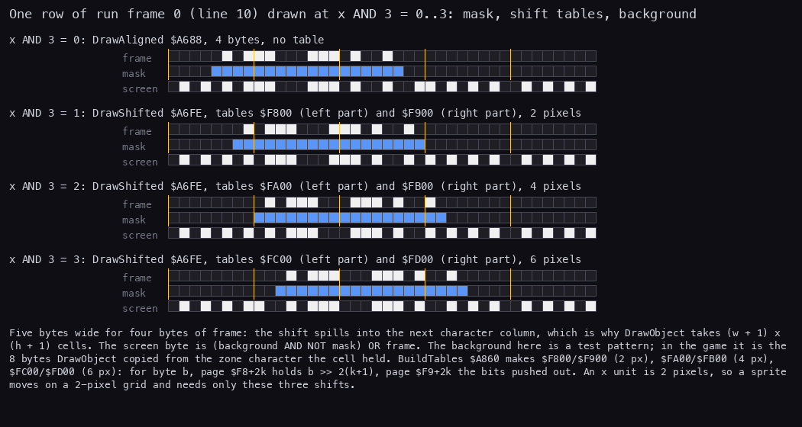

*Figure 6.5: line 10 of run frame 0 at x AND 3 = 0, 1, 2, 3: the frame, the mask and the result over a test
background, four bytes of frame spread over five. Drawn from the game image and the tables BuildTables makes.
Command: `python3 tools/fig_render.py shift --out docs/img/render/shift-mask.png`.*

How to read: each band is one shift. The yellow lines are the character edges. The result row is
(background AND NOT mask) OR frame.

Worked example: Matt at x = `$42` uses D = `$F6` + 2 x 2 = `$FA`. For a frame byte `$3C`, `$FA3C` = `$3C` >> 4 =
`$03` goes into this column and `$FB3C` = (`$3C` << 4) AND `$FF` = `$C0` into the next.

Witness: the c1 pass enters DrawShifted at 18670:19396 with A = 2 (registers before `$A685`: AF = `$0210`), and
spends 39 % of DrawObjects in `l_A726`.

The point: x moves on a 2-pixel grid, so three precomputed shifts cover every position and no bit is shifted at run
time. The 1.5 KB of tables buy the speed.

## 6.8 The pick-up icons

A mask lying in the room is drawn as a 2 x 2 sprite that never moves. PlacePickupsInScreen `$A9BE`, called by
DrawRoom, finds up to two pick-ups of the screen and fills the records at `$AF1B` and `$AF23`. PlacePickup `$A9DA`:

- works out the map address: `$F0C0` + 32 x row + column - 4 x RoomScreen (RoomScreen is 8 x the screen, so this
  is 32 x the screen) and keeps it in record +3/+4;
- takes 4 sprite characters from FirstSpriteChar `$A2CE` and adds 4 to it;
- copies the 32-byte icon MaskIcons `$D580` + 32 x kind into `$E800` + 8 x char;
- writes MaskColours `$AF46`[kind] OR `$40` into their 4 attributes at `$EE00`.

Each pass, PlaceOnePickup `$B28B` saves the 4 map codes at PickupSaves `$A253`, writes the 4 character codes into the
map (column by column) and marks the cells 2. RestoreOnePickup puts the codes back after the flush.

```text
B297  DD 4E 07                    LD C,(IX+$07)           ; the first character
B29A  06 02                       LD B,$02
B29C  7E                  l_B29C: LD A,(HL)
B29D  12                          LD (DE),A               ; save the code
B29E  13                          INC DE
B29F  71                          LD (HL),C               ; left: C, C + 1 below
B2A0  2C                          INC L
B2A1  7E                          LD A,(HL)
B2A2  12                          LD (DE),A
B2A3  13                          INC DE
B2A4  0C                          INC C
B2A5  0C                          INC C
B2A6  71                          LD (HL),C               ; right: C + 2, C + 3 below
B2A7  0D                          DEC C
...
B2B5  0E 02                       LD C,$02
B2B7  71                          LD (HL),C               ; the four marks = 2
```

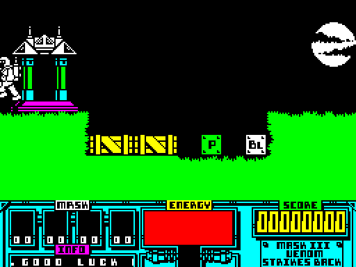

*Figure 6.6: `c1` at frame 18 600: the two pick-ups of room 0 screen 0, drawn from sprite characters 0-7.*

Worked example: the pick-ups take characters 0-3 and 4-7; FirstSpriteChar is then 8, and Matt's characters start at
8 (6.6). Their saves fill `$A253-$A25A`; PickupSavePtr `$A2CB` then points at `$A25B` for DrawObject.

Witness: in the c1 pass DrawObject starts with B = 8 (AF = `$0860` before `$A5A3`).

The point: a pick-up re-marks its cells every pass, so an object walking over it is redrawn over the icon, not over
the floor.

## 6.9 Dissolve

Dissolve `$A3A5` makes a frame break up. It copies the object's 128-byte frame to DissolveBuffer `$DF80` through a
random mask and points the object at the copy. SelectFrame calls it DissolveCount `$A2CF` times, so each extra call
thins the picture again.

```text
Dissolve(IX):
    src = IX.frame; IX.frame = $DF80
    R = Random(); C = Random()
    for 128 bytes:
        C = C + R                           # R, the refresh register, moves on every instruction
        $DF80[i] = src[i] AND C
```

```text
A3B4  06 20                       LD B,$20                ; 32 x 4 bytes
A3B6  CD C6 92                    CALL Random
A3B9  ED 4F                       LD R,A
A3BB  CD C6 92                    CALL Random
A3BE  4F                          LD C,A
A3BF  ED 5F               l_A3BF: LD A,R
A3C1  81                          ADD A,C
A3C2  4F                          LD C,A
A3C3  A6                          AND (HL)                ; the frame byte
A3C4  2C                          INC L
A3C5  12                          LD (DE),A               ; into $DF80
A3C6  1C                          INC E
...                                                       ; three more, unrolled
A3DF  10 DE                       DJNZ l_A3BF
```

Who sets DissolveCount:

- 1: the death when the energy runs out (MainLoop at `$CC3B`) and the start of a password-door warp (StartWarp at
  `$B9CF`);
- up by one every 16 passes: PasswordWarp (`$B9E2`), so the warp goes 1 -> 2 -> 3 -> 4 while Matt fades out (doc 10.15);
- 4: a pod's materialisation (PodStart at `$BA74`); MattPodDissolve lowers it by one every 16 passes (`$BA85`), 4 -> 3
  -> 2 -> 1, and clears it at the end (`$BA8F`);
- 2: PENETRATOR held (Penetrator at `$BE20`, every pass): Matt is drawn thinned while he walks through walls;
  EndPenetrator clears it only while it is 2 (`$BE09`);
- 0: the new game (`$91F0`), the end of the warp (`$BA11`) and Death (`$BAB3`).

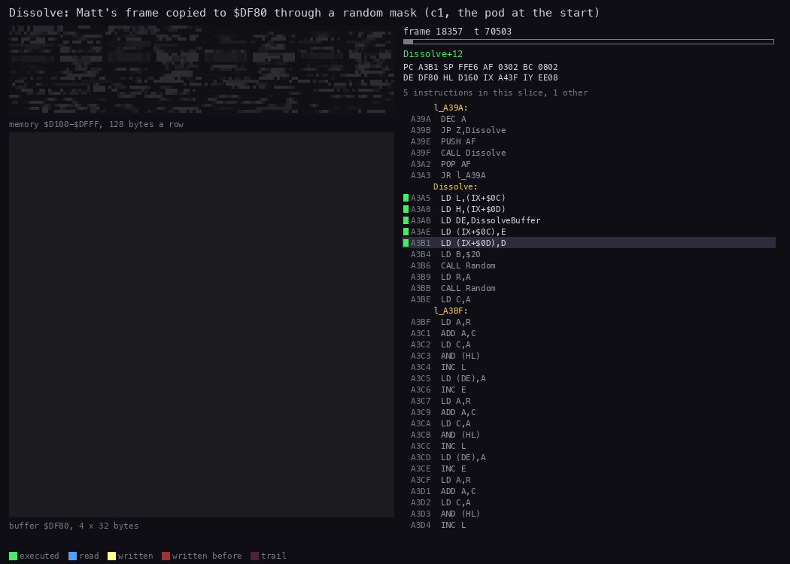

*Animation 6.3: Dissolve on Matt's frame as the new game starts in the pod. 40 pictures, 103 T each, 519
instructions. Recording `c1`, window 18357:70400-18358:3600. Command: `python3 ../../kit/routine_anim.py --work
work/docs/mxB/c1 --window 18357:70400-18358:3600 --listing build/game.lst --view buffer:DF80:4x32:columns --range
D100-DFFF --pc A3A5-A3E1,92C6-92DF --pictures 40 --title "..." --out docs/img/routines/Dissolve.gif`.*

How to read: the view is `$DF80` as 4 columns of 32 lines, the layout of a frame. The copy fills it column by
column. The frame boundary falls inside the window: the interrupt cuts in at 18358:0 and its instructions show in the
code pane.

Worked example: with C stepping by R each byte, the AND keeps on average half of the frame's pixels. With
PENETRATOR, DissolveCount is 2: the second call works on the copy in `$DF80` (the first call pointed the object
there), so about a quarter of Matt's pixels remain, in a new pattern every pass.

Witness: the trace runs Random `$92C6` twice and then 32 turns of `l_A3BF`; the 128 writes go to `$DF80-$DFFF`.

The point: an effect with no frames of its own. The refresh register gives a different pattern on every call.

## 6.10 Animated characters and the lift

AnimateZone `$CACD` runs once a pass and changes the zone's characters themselves, not the map. Every cell that
shows an animated character changes with it.

1. MarkAnimated `$CAAD` walks the list AnimatedCells `$AAA1` (built by AnimatedCharList `$AB6B` at the room change)
   and writes 1 into the dirty mark of each listed cell;
2. AnimateLift `$CA3D` moves the lift: the only part that writes the map. It writes the lift's codes (`$69`/`$6A`
   or `$6B`/`$6C`, one above the other) at LiftPlace `$AA72`, clears the cell it left and marks the cells 1;
3. three counters step: `$CABD` 0-7, `$CABE` 5 down to 0, `$CABF` 0-11;
4. the zone's frame characters are copied over the live ones;
5. Twinkle `$C9EA` sets one line in each of 8 characters: it walks 8 characters from `$E710` (characters `$E2-$E9`),
   or from `$E728` in zone 3 (`$E5-$EC`), HL + 8 a step, and writes `$FF` or 0 into the line that its step in
   TwinkleSteps `$CA35` names.

The copies of step 4. The counters are `$CABD` (c0, 0-7), `$CABE` (c1, 5-0) and `$CABF` (c2, 0-11); a source moves by
the counter times the size given.

| Zone | Copies (frame -> live, bytes) |
| --- | --- |
| 0 | `$E600` + 32 x c0 -> `$E300` (32); `$E210` + 32 x c1 -> `$E758` (32); `$E460` + 16 x c0 -> `$E4E0` (16) and `$E560` + 16 x c0 -> `$E5E0` (16) |
| 1 | `$E400` + 32 x c0 -> `$E288` (16) and `$E500` + 32 x c0 -> `$E388` (16); `$E630` + 32 x c1 -> `$E600` (16) and `$E730` + 32 x c1 -> `$E700` (16); `$E788` + 16 x (the byte at `$CAC0` + c1) -> `$E508` (16), only when AnimLast `$CB41` is set, or when c1 is 5 and Random AND 7 is 0 (AnimLast then keeps c1) |
| 2 | `$E3A0` + 8 x (the byte at `$CAC7` + c1) -> `$E360` (8) |
| 3 | `$E580` + 32 x c2 -> `$E700` (32) |

```text
CAAD  21 A1 AA      MarkAnimated: LD HL,AnimatedCells
CAB0  3E 01                       LD A,$01                ; mark 1: redraw from the map
CAB2  5E                  l_CAB2: LD E,(HL)
CAB3  23                          INC HL
CAB4  56                          LD D,(HL)               ; the dirty mark's address
CAB5  23                          INC HL
CAB6  CB 7A                       BIT 7,D                 ; the end of the list
CAB8  C8                          RET Z
CAB9  12                          LD (DE),A
CABA  C3 B2 CA                    JP l_CAB2
```

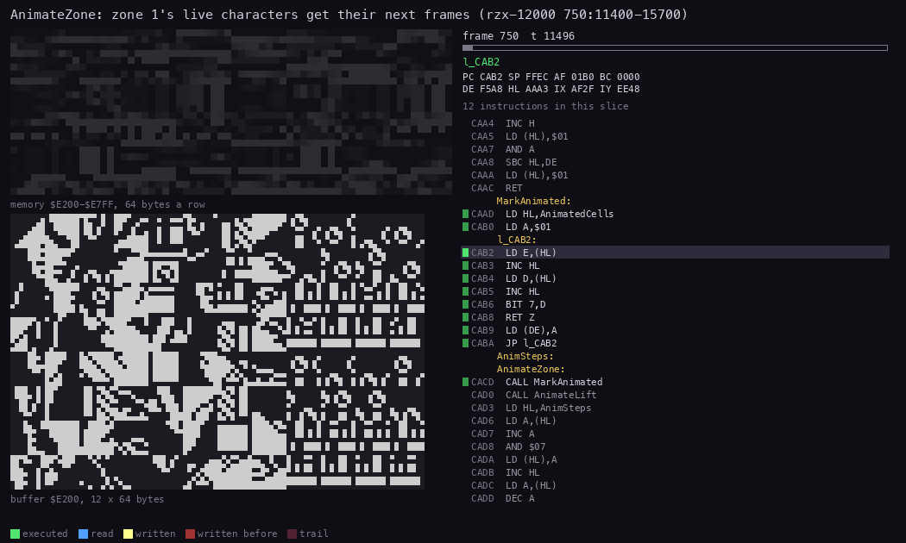

*Animation 6.4: AnimateZone in the caverns (zone 1): the marks, the lift, the frame copies into `$E200-$E7FF`. 45
pictures, 445 instructions. Recording `rec/rzx-12000`, window 750:11400-750:15700. Command: `python3
../../kit/routine_anim.py --work work/docs/mxB/r12 --window 750:11400-750:15700 --listing build/game.lst --view
buffer:E200:12x64:columns --range E200-E7FF --pc CACD-CC02,C9EA-CA34,CA3D-CAAC,CAAD-CABC --pictures 45 --title "..."
--out docs/img/routines/AnimateZone.gif`.*

How to read: the view is `$E200-$E7FF` as character columns of 64 lines; the copied characters change in place.

Worked example: in zone 1, a cell showing character `$51` (`$E288` = `$E000` + 8 x `$51`) changes whenever
`$E400` is copied over it. The map still holds `$51`; only the pixels moved. The mark of 1 makes FlushDirty draw the
cell again this pass.

Witness: AnimateZone's own code (`$CACD-$CC02`) stores only with `LDIR` into the zone characters, into its counters
and AnimLast `$CB41`; the animation shows the copies landing in `$E200-$E7FF`. The map changes only where
AnimateLift moves the lift.

The point: animation by redefining characters. One copy animates every cell that shows the character, and the
marks list keeps the flush to those cells.

## 6.11 Code against the screen and the beam

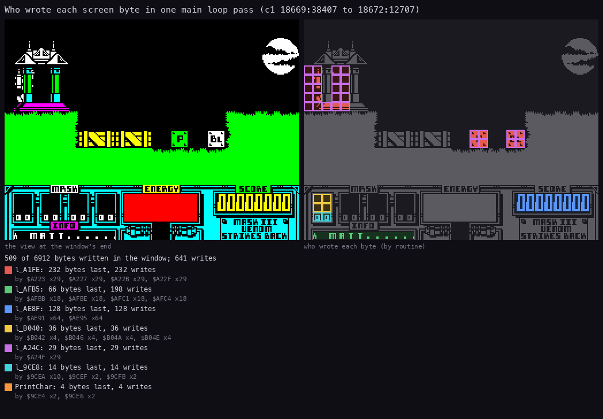

*Figure 6.7: every screen byte written in one main loop pass of `c1`, coloured by the routine that wrote it. Command:
`python3 ../../kit/writers_map.py --trace work/docs/mxB/c1/traces/18669_38407-18672_12707.uatr --listing
build/game.lst --view screen --title "..." --width 1050 --out docs/img/render/writers-pass.png`.*

How to read: the screen at scale, each written byte in its writer's colour; the legend gives the labels.

| Writer | Bytes | What |
| --- | ---: | --- |
| `l_A1FE` | 232 | FlushDirty: the pixels of Matt's cells and the cells he left |
| `l_AE8F` | 128 | DrawScore: 8 digits, every pass ([doc 8](08-hud-and-text.md#83-the-score-and-the-energy-bar)) |
| `l_AFB5` | 66 (198 writes) | the Scroller, in the interrupt, three times in the pass |
| `l_B040` | 36 | DrawIcon: the current slot's icon |
| `l_A24C` | 29 | FlushDirty: the attributes |
| `l_9CE8`, PrintChar | 14 + 4 | the slot's charges |

509 bytes in all. The order in the pass (18669:38407 to 18672:12707, 187 024 T, 26 505 instructions):

| T from the start | Frame:T | Routine |
| ---: | --- | --- |
| 17 | 18669:38424 | ReadControls |
| 1006 | 18669:39413 | MattStep |
| 5747 | 18669:44154 | RunObjects |
| 10 427 | 18669:48834 | FireMask |
| 10 632 | 18669:49039 | DrawScore |
| 16 547 | 18669:54954 | DrawEnergyBar |
| 16 628 | 18669:55035 | DrawCurrentSlot |
| 19 292 | 18669:57699 | AnimateZone |
| 23 372 | 18669:61779 | DrawObjects |
| 150 023 | 18671:46614 | FlushDirty |

The interrupts fall at 18670:0, 18671:0 and 18672:0; the Scroller writes about 2800 T after each.

Worked example: FlushDirty's 232 pixel bytes are 29 cells of 8 lines, and its 29 attribute writes agree: this pass
copied 29 cells, about 29 x 445 = 12 905 T of copying for a window of 576 cells. DrawScore, by contrast, rewrites
128 bytes that did not change.

Against the beam (the figure in [doc 4](04-game-loop.md#one-pass-against-the-beam), `img/loop/beam-pass-c1.png`):
the panel is written early in the pass, then for nearly two frames nothing reaches the screen, then FlushDirty writes
the window from the bottom up with no regard to the beam. The tearing is per cell: a cell is copied in one go, 8 lines
within 168 T. The beam spends about 1800 T inside a cell's 8 lines, so a cell is shown half old and half new only
when the copy lands in that span; most of the tearing falls between cells.

The point: the screen sees the play window once a pass, in one burst at the end. Everything before it is
invisible work.

## 6.12 Known only from the code

- **Six placeholder objects.** In room 0, screen 0 EnemyKind is 0, and Spawn's kind 0 is a `RET`
  ([doc 7, 7.8](07-objects.md#78-the-spawner)), so the slots keep the placeholder `$80`. Records 2-7 hold state
  `$80` (live), a position off the left edge and a null frame pointer. Each is "drawn": 9 character numbers, MakeMask and DrawShifted over the ROM bytes at `$0000`, about
  12 300 T. No cell is shown, so no recording shows them; only the trace's timing does. That is 40 % of a pass in
  room 0.
- **The hidden map rows.** MattStep clears `$F000-$F0BF` each pass (`LD HL,$F0BF`, 192 bytes): the mask buffer and
  map rows 0-1. DrawRoom writes those rows and nothing shows them.
- **The mask has gaps at byte edges.** The dilate table grows a byte left and right within itself only, so a frame
  pixel at bit 0 or bit 7 gets no outline across the byte edge.
- **The foreground.** Codes `$EA-$FF` are never covered by a sprite; the object passes behind them. The figures in
  6.3 do not mark them: the rule is in DrawObject, not in the data.
- **Attributes cut to ink and BRIGHT.** `AND $47` throws away the solid flag, FLASH and the paper. The 5 zone 2
  characters with a non-zero paper are drawn on black in the game.
- **One pass late.** A cell a sprite leaves is redrawn on the next pass (mark 1), not on this one.
