# 7. Objects

What this covers:

- the game variables: where the rules keep their state;
- the world as data: 16 rooms of six screens, the room table, the map of blocks, the blocks of characters;
- a room decoded byte by byte, from its map row to the characters on the screen;
- the exits: the screen edges, the room edges, the pods and their arrival byte;
- the things the map holds: the pick-ups, the turrets, the block items, the spawn points, the lift;
- the object table: eight records of 38 bytes, every field;
- the 20 enemy templates;
- the spawner, which reads the screen's enemy kind;
- RunObjects, the shot test and the touch test;
- every object kind and its state machine.

The rules these objects play (energy, scoring, the masks) are in [doc 10](10-gameplay-logic.md); the drawing of the
objects is in [doc 6](06-rendering.md).

The recordings it rests on ([WALKTHROUGH 6.0](../WALKTHROUGH.md#60-the-recordings)):

- `c1`: power-on on the 128K, the original tape, the menu, then play in room 0;
- `rec/rzx-00000` to `rec/rzx-36000`: the ZXDB RZX run in ten segments of 4000 frames (the last 1200), each replayed
  from the RZX's own state. They show rooms 0, 10, 1, 2, 4, 12, 5, 6, 3, 8, 14 and 15;
- stage 2's `door`: a new game with PasswordFlags POKEd to `$FF` in the menu (said in its script); Matt walks through a room-0 door;
- stage 2's `play2`: a second play from power-on on the 128K.

Each was opened on an own instance, after `. work/env.sh`:
`python3 $RS open --work work/docs/mxC/<name> --ttd <its session.ttd> --model 128K --port-base 37790`. The objects `$A43F-$A56E` and the variables were sampled at every TTD frame
by `work/docs/mxC/sample.py` into `work/docs/mxC/<name>/vars.jsonl` (`work/docs/mxC/sample_all.sh` for all of them).
`work/docs/mxC/events.py` prints the changes. A sample of frame N is the memory at the start of frame N.

Positions: an object's x counts 2 pixels from `$40` at the screen's left edge (`$40` + 128 = `$C0` at the right). Its y
counts pixels from the top of the play area. Widths are in characters, heights in characters.

## 7.1 The game variables

The rules keep their state in fixed bytes spread over the code. These are the ones the objects and the rules read:

| Variable | Address | What it holds |
| --- | --- | --- |
| RoomNumber | `$950A` | 0-15 |
| RoomRecord | `$950B` | the room's record, `$953B` + 12 x room |
| RoomScreen | `$950D` | 8 x the screen (0-`$28`): the map column of the screen's left edge |
| PickupTable | `$950E` | 11 masks lying in rooms, 4 bytes each; bit 7 of the room byte set when taken |
| MapPointer | `$A89A` | the map address of the screen's first block, and the room drawn last |
| Objects | `$A43F` | Matt, his shot `$A465`, six enemies `$A48B`: 38 bytes each (7.6) |
| ChaserState | `$C0D6` | the chaser: on, then its timer word |
| EnemyKind | `$BFB0` | the screen's enemy kind, from the room table |
| FloorRow | `$AC7F` | 8 x the number of free character rows down column 0 of the shown map, to the first solid character (a pixel y) |
| SpawnPoints | `$AC9C` | two map places of block `$61` (the risers) |
| BlockItems | `$ACDA` | up to three block-`$1B` items (four entries, the last always empty): x, y, map address |
| PickupRecords | `$AF1B` | the screen's two pick-ups: y, x (`$FF` once taken), kind, map address, PickupTable address, first sprite character |
| Score | `$AE41` | 8 BCD digits |
| Energy | `$AEA6` | 255 full, 0 the end |
| MaskSlots | `$AF2B` | 4 slots of 4 bytes: HUD column (the low byte of the icon's screen address), kind, BCD charges, level |
| CurrentSlot | `$AF51` | the address of the slot in use |
| PassCounter, PassBcd | `$AF0C`, `$CC5C` | the passes of the main loop, binary and BCD |
| PenetratorOn | `$B3EA` | `$FF` while the PENETRATOR is held |
| PenetratorCost | `$BE0D` | extra charges of the next PENETRATOR step (the chaser sets `$10`) |
| DissolveCount | `$A2CF` | Matt's dissolve: 1 (energy out), 1 -> 4 through a password-door warp, 2 with PENETRATOR, 4 -> 1 as he appears from a pod |
| DeathFlag, Dying | `$B2F8`, `$BAA7` | die this pass; Matt is dying (no fire, no damage) |
| ZoneSlots | `$A194` | the live zone (0-3), then the parked ones |
| Controls | `$A138` | bits 0 right, 1 left, 2 down, 3 up, 4 fire |
| CheatOn | `$BB77` | JUDGE DREDD typed |
| PasswordFlags | `$9F6D-$9F70` | the four passwords typed |

```text
one pass of MainLoop reads and writes them in this order:
    Controls <- ReadControls
    Objects[0] (Matt), RoomNumber, RoomScreen <- MattStep (the edges and the pods redraw the room)
    Objects[1] <- MoveShot
    DeathFlag, Energy, the map <- Hazards
    Objects[2..7], Energy, Score, ChaserState <- RunObjects
    MaskSlots, Objects[1] <- FireMask, MaskKeys
    if DeathFlag: Death;  if Energy == 0: Matt state 9 (the energy is out)
```

```asm
MainLoop:
  CALL ReadControls
  CALL MattStep
  CALL MoveShot
  CALL Hazards
  CALL RunObjects
  CALL FireMask
  CALL MaskKeys
  CALL DrawScore
  LD A,(DeathFlag)
  AND A
  JP NZ,Death
  LD A,(Energy)
  AND A
  JR NZ,l_CC41
```

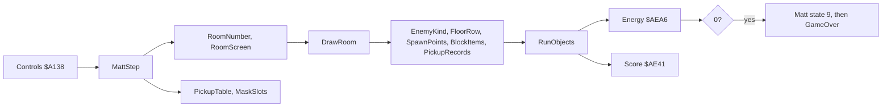

Worked example: the variables at `rzx-00000` frame 990, from the sample:

- RoomNumber `00`, RoomRecord `$953B`, RoomScreen `$08`: room 0, screen 1.
- EnemyKind `02`: the room table's byte 7 for room 0 (screen 1): fallers.
- Energy `$FF`, Score `00000000`.
- MaskSlots `61 01 99 00 | 64 08 98 02 | 67 00 00 00 | 6A 00 00 00`: PENETRATOR with 99 charges, BACKLASH with 98 at
  level 2, two EMPTY slots. CurrentSlot `$AF2F`: the BACKLASH.
- Controls `$11`: right and fire. PassCounter `$51`.

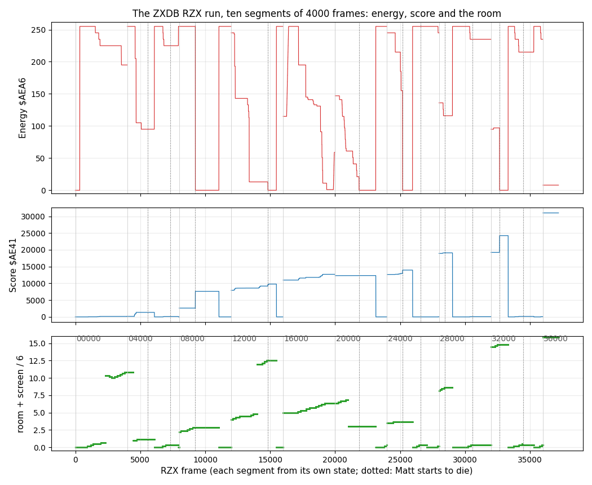

How to read it: top, Energy `$AEA6` at every frame of each segment (one colour a segment), the deaths dotted. Middle,
the Score `$AE41`. Bottom, RoomNumber `$950A`. Each segment is clipped at 4000 frames. Recording `rec/rzx-00000` to
`rec/rzx-36000`, all frames, from `work/docs/mxC/*/vars.jsonl`. Made by `python3 tools/fig_objects.py run
docs/img/gameplay/run.png`.

**The point**: the game has no central state block. Each routine keeps its variables next to its code, so the
addresses alone tell which module owns a byte.

Witness: the addresses from `src/game/game.ann` and `build/game.lst`; the values from the `rzx-00000` sample of frame
990 (`work/docs/mxC/rzx-00000/vars.jsonl`).

## 7.2 The world: rooms, screens and the room table

The world is 16 rooms. A room is a strip of six screens side by side, 48 blocks across and 5 down. Each room belongs
to one of four zones, and the zone picks the character set the blocks are drawn with:

| Zone | Rooms | What |
| ---: | --- | --- |
| 0 | 0, 1, 2, 3 | the surface (room 0 is the base with the password doors) |
| 1 | 4, 5, 6 | the caverns |
| 2 | 7, 8, 9 | the moon (slow jumps and falls, [doc 10](10-gameplay-logic.md)) |
| 3 | 10-15 | the VENOM base, the pod rooms |

The room table RoomTable `$953B` has 16 records of 12 bytes (`src/res/tables/rooms.csv`):

| Byte | What | Read by |
| ---: | --- | --- |
| 0 | the room past the left edge (`$FF`: a wall) | LeftEdge `$B659` |
| 1 | the room past the right edge (`$FF`: a wall) | RightEdge `$B686` |
| 2 | the room the pod leads to (`$FF`: none) | Teleport `$B6B3` |
| 3 | another exit, `$FF` in every room | ExitByte3 `$B6D8`, never run |
| 4 | the zone | DrawRoom, SwapZone |
| 5 | where Matt arrives in the pod's room: x = (b AND `$1F`) x 4 + `$40`, screen = b >> 5 | Teleport |
| 6-11 | the enemy kind of each of the six screens | DrawRoom into EnemyKind |

```text
DrawRoom:
    if RoomNumber == 15 and RoomScreen == $28: Ending        # the last screen of the last room
    RoomRecord = RoomTable + 12 * RoomNumber
    map = Room0Map + 240 * RoomNumber + RoomScreen
    expand 8 x 5 blocks (7.3); SwapZone(RoomRecord[4])
    EnemyKind = RoomRecord[6 + RoomScreen / 8]
    MoonMasks; AnimatedCharList; FindLift; PlaceTurrets; FindSpawnPoints; FindBlockItems; FindFloorRow
    PlacePickupsInScreen; EffectStops[B] = $FF; RoomMessage
```

```asm
  LD HL,(RoomRecord)
  LD DE,$0006
  ADD HL,DE
  LD A,(RoomScreen)
  RRCA
  RRCA
  RRCA                  ; screen = RoomScreen / 8
  LD E,A
  ADD HL,DE
  LD A,(HL)
  LD (EnemyKind),A      ; bytes 6-11: one kind a screen
```

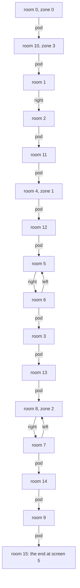

Worked example: room 0's record at `$953B` is `FF FF 0A FF 00 44 00 02 00 02 08 00`. Bytes 0 and 1 are `$FF`: walls at
both ends. Byte 2 is `$0A`: the pod leads to room 10. Byte 4 is 0: the surface. Byte 5 is `$44`: in room 10, x =
(`$44` AND `$1F`) x 4 + `$40` = `$50`, screen = `$44` >> 5 = 2. Bytes 6-11 give the enemy kinds of the six screens: none,
fallers, none, fallers, guards, none. In `rzx-00000` Matt pressed down on the pod after frame 2300 and stood in room `$0A` at
screen `$10` (screen 2), x `$50`, at frame 2312.

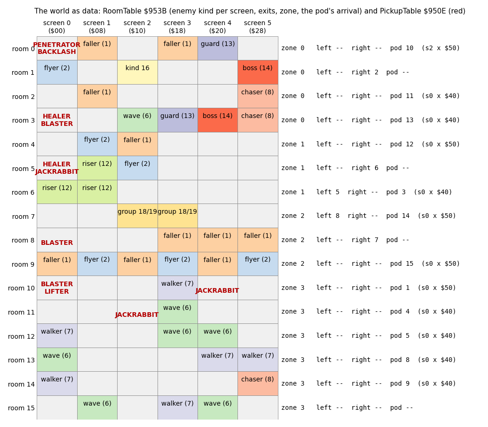

How to read it: one row a room, one cell a screen. The cell's label is the screen's enemy kind (RoomTable bytes 6-11);
red marks the pick-ups of PickupTable `$950E`. Each row's left column gives the zone, the edge exits and the pod's room
and arrival. Recording: none, the bytes of the build. Made by `python3 tools/fig_objects.py world
docs/img/objects/world.png`.

**The point**: the whole world is 16 x 12 bytes of table plus 16 x 240 bytes of map. The enemy kind is chosen per
screen, not per place: a screen spawns one kind only.

Witness: RoomTable read by DrawRoom (L1 87, `c1`, `cheat`, `door`, `door3`, `kind6`, `masks`, `play2`, `rzx-` x9), LeftEdge (L1 38),
RightEdge (L1 64) and Teleport (L1 4, `rzx-00000`, `rzx-04000`, `rzx-12000`, `rzx-20000`); the `rzx-00000` samples of frames 2300-2312.

## 7.3 The map and the blocks: a room decoded

The room maps at Room0Map `$7600` hold the 16 maps, 240 bytes each, row by row: 5 rows of 48 block numbers. A screen shows 8 block
columns, starting at column RoomScreen. A block is 4 x 4 characters, 16 character codes at Blocks `$8500` + 16 x
block, row by row. There are 192 blocks (`$8500-$90FF`).

A character code means a glyph of the live zone: 8 bytes at `$E000` + 8 x code and an attribute at `$EF00` + code.
Bit 7 of the attribute makes the character solid: IsSolid `$B993` returns it in the carry. The same block number
draws a different picture in each zone.

DrawRoom expands the screen into the character map `$F080`: 32 characters by 20 rows, the play area. The loop copies
four codes per block row with `LDI` and steps the target 28 bytes to the next character row.

```text
map = $7600 + 240 * room + RoomScreen
target = $F080
for row in 0..4:                          # block rows
    for col in 0..7:                      # block columns
        block = map[row * 48 + col]
        for r in 0..3: copy Blocks[16 * block + 4 r .. + 3] to target + 32 r + 4 col
    target += 128                         # 4 character rows
solid(code) = $EF00[code] bit 7
```

```asm
l_A919:
  LD B,$08              ; 8 blocks a row
l_A91B:
  LD A,(HL)             ; the block number
  EXX
  LD L,A
  LD H,$00
  ADD HL,HL
  ADD HL,HL
  ADD HL,HL
  ADD HL,HL             ; 16 x block
  LD BC,Blocks
  ADD HL,BC
  LDI
  LDI
  LDI
  LDI                   ; the block's first row of 4 codes
  ...
  EXX
  INC HL
  DJNZ l_A91B
  ...
  ADD HL,DE             ; DE = 40: the map's next row
  DEC C
  JP NZ,l_A919
```

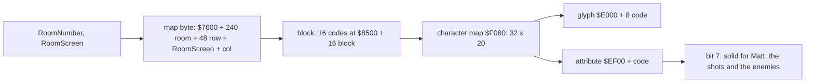

Worked example: room 0, screen 0. The map starts at `$7600`; the five rows of screen 0 are:

| Row | Address | Blocks |
| ---: | --- | --- |
| 0 | `$7600` | `00 00 00 00 00 00 00 00` |
| 1 | `$7630` | `4D 4E 00 00 00 00 00 06` |
| 2 | `$7660` | `0A 0B 00 00 00 00 00 00` |
| 3 | `$7690` | `03 20 10 10 00 00 21 05` |
| 4 | `$76C0` | `01 01 01 01 03 05 01 01` |

Row 1, column 7 is block `$06`. Its codes at `$8500` + 16 x 6 = `$8560` are `6D 6E 6F 70 | 71 72 73 74 | 75 76 77 78
| 79 7A 7B 7C`: sixteen different characters, a picture of the moon in the sky. Block 0 is 16 spaces. Row 4 is the
ground: blocks 1, 3 and 5, whose characters have bit 7 set in the attributes, so Matt stands on them.

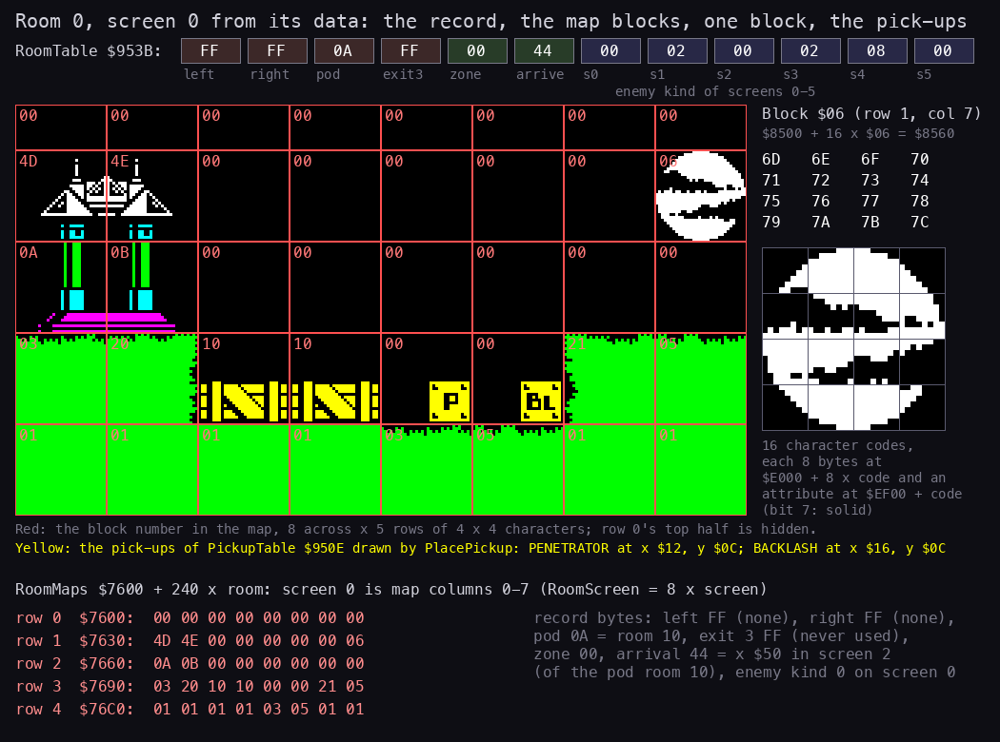

How to read it: top, room 0's record. Left, the screen drawn from the data at 3x, with the block grid and each block's
number in red; the top half of block row 0 (character rows 0-1) lies above the play window and is never shown. Right, block `$06` taken apart: its 16 codes and its
picture. Yellow, the two pick-ups of the screen. Bottom, the map bytes of the five rows. Recording: none, the bytes of
the build. Made by `python3 tools/fig_objects.py room-decode docs/img/objects/room-decode.png`.

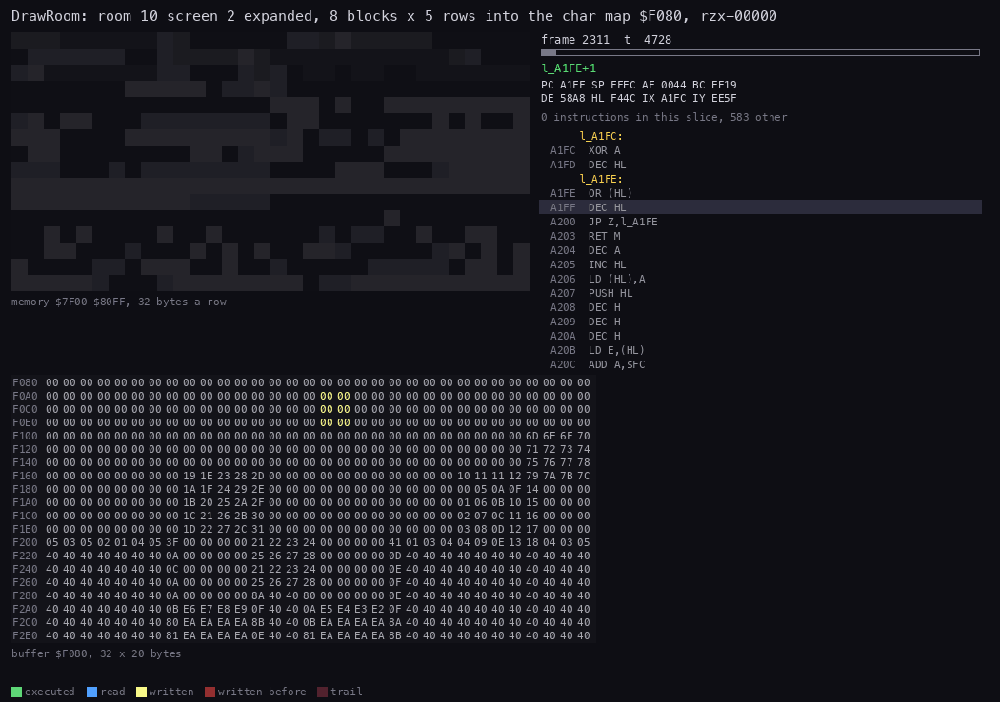

How to read it: the character map `$F080` (32 x 20) as hex, filling block by block, and on the right the code. The
memory shown is room 10's map `$7F60-$804F`. Recording `rzx-00000`, the pod's arrival in room 10: the decode loop from
2311:18941 to 2311:38022, 90 pictures. Made from the kept trace of frames 2309-2314: `python3 tools/trace_cut.py
work/docs/mxC/rzx-00000/traces/2309_0-2314_0.uatr --from 2311:18900 --to 2311:38030 --out
work/docs/fixB/decode-2311.uatr`, then `python3 ../../kit/routine_anim.py --trace work/docs/fixB/decode-2311.uatr
--listing build/game.lst --pc A919-A96F --view buffer:F080:32x20:hex --range 7F60-804F --title '...' --out
docs/img/routines/DrawRoom-decode.gif`.

**The point**: two lookups make a screen: map byte to block, block to 16 characters. One bit in the attribute table
makes the walls, so the collision map costs nothing beyond the picture.

Witness: DrawRoom L1 87 (`c1`, `cheat`, `door`, `door3`, `kind6`, `masks`, `play2`, `rzx-` x9); IsSolid read by MattStep, HitsWall and MoveShot; the
`rzx-00000` trace of frames 2311-2313; `tools/roommap.py` draws every room from the same bytes.

## 7.4 The exits: edges, screens and pods

Matt leaves a screen in three ways:

- **The screen's edge.** At x `$3B` (left) or `$B6` (right) MattWalk calls LeftEdge or RightEdge. Inside the room
  they move RoomScreen by 8 and put Matt at the other side (x `$B2` or `$3E`).
- **The room's edge.** On screen 0 going left, or screen 5 going right, the new room is the record's byte 0 or 1.
  `$FF` makes a wall. The new room starts at its last screen (left) or its first (right).
- **A pod.** Pressing down on a pod character (`$14` or `$15`) calls Teleport. The new room is byte 2. Matt arrives at
  the place of byte 5 of the room he left, at once: no dissolve, no sound, Matt keeps his state.

Each way ends in DrawRoom, which sets everything up for the new screen. DrawRoom keeps the chaser's slot while the room
stays the same; a new room clears ChaserState.

```text
LeftEdge:  if RoomScreen: RoomScreen -= 8                  else: r = record[0]; if r == $FF: stay; room = r; RoomScreen = $28
           x = $B2; DrawRoom
RightEdge: if RoomScreen != $28: RoomScreen += 8           else: r = record[1]; if r == $FF: stay; room = r; RoomScreen = 0
           x = $3E; DrawRoom
Teleport:  r = record[2]; if r == $FF: stay
           b = record[5]; room = r; x = (b & $1F) * 4 + $40; RoomScreen = (b & $E0) >> 2; DrawRoom
```

```asm
Teleport:
  LD IX,(RoomRecord)    ; the room Matt leaves
  LD A,(IX+$02)
  CP $FF
  RET Z
  LD (RoomNumber),A
  LD A,(IX+$05)         ; its arrival byte
  LD L,A
  AND $1F
  ADD A,A
  ADD A,A
  ADD A,$40
  LD (Objects+$0003),A  ; Matt's x
  LD A,L
  AND $E0
  RRCA
  RRCA
  LD (RoomScreen),A     ; 8 x screen
  JP DrawRoom
```

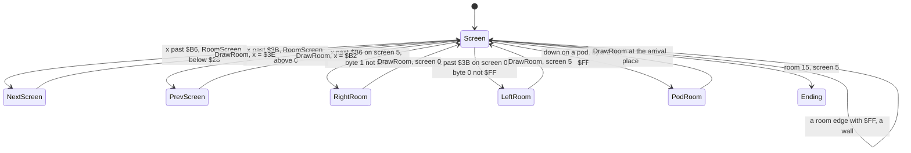

Worked example: the pod of room 0 in `rzx-00000`. Matt walked into the pod booth in room 0 and stood still (state 8
from frame 2300). He pressed down, and at frame 2312 the sample shows room `$0A`, RoomScreen `$10`, x `$50`, y `$30`:
the same booth picture, now in the base. Down was still held, so he crouched (state 4) at frame 2321. ZoneSlots changed to 3 at frame 2314 and EnemyKind to 0 at frame 2318: SwapZone and the room set-up ran over
the next frames. The arrival byte is room 0's `$44`, read before the room changed.

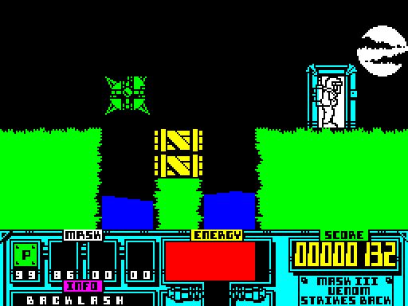

How to read it: the screen at every changed frame. Matt stands in the booth on the surface; one frame later the base
of room 10 is drawn around him, in the booth of its screen 2. Recording `rzx-00000`, TTD frames 2290-2330. Made by `python3 ../../kit/screen_anim.py --work
work/docs/mxC/rzx-00000 --from 2290 --to 2330 --step 1 --delay 60 --hold 800 docs/img/play/pod.gif`.

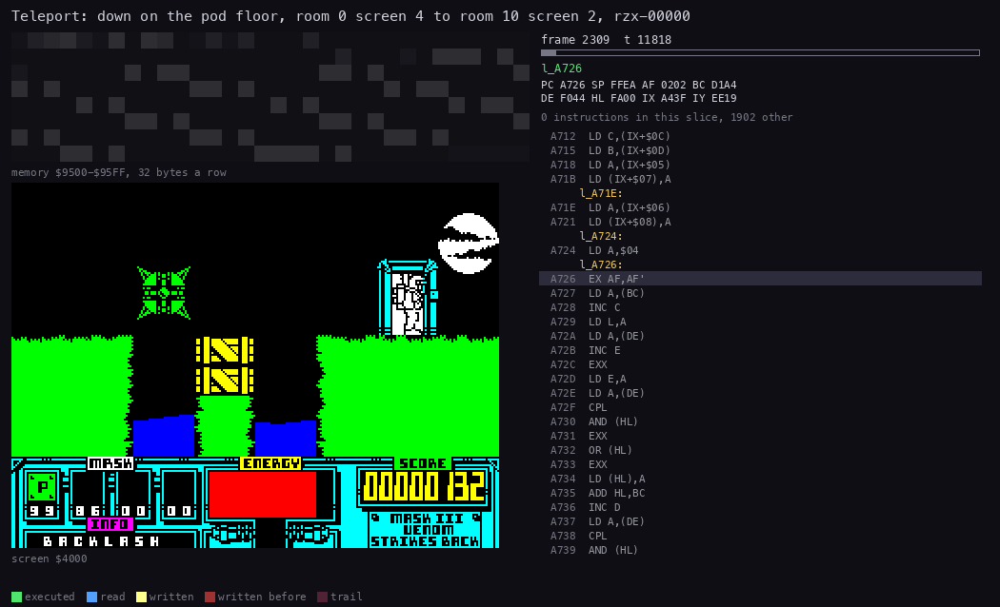

How to read it: the screen, and on the right the code as it runs: MattWalk sees the pod, Teleport reads the record,
DrawRoom expands the new screen. Recording `rzx-00000`, from MattWalk at 2311:16958 to the end of the block decode
(2311:38100), 90 pictures of 235 T: SwapZone and the flush that follow run in the next frames and are left out. Made
from the kept trace of frames 2309-2314: `python3 tools/trace_cut.py work/docs/mxC/rzx-00000/traces/2309_0-2314_0.uatr
--from 2311:16950 --to 2311:38100 --out work/docs/fixB/teleport-2311.uatr`, then `python3 ../../kit/routine_anim.py
--trace work/docs/fixB/teleport-2311.uatr --listing build/game.lst --pc B460-B4BF,B6B3-B6D7,A89D-A9BD --view screen
--title '...' --out docs/img/routines/Teleport.gif`.

**The point**: a pod is one byte of exit and one byte of place. The arrival byte belongs to the room Matt leaves, so each
room can drop Matt anywhere in the next one.

Witness: LeftEdge L1 38 (`c1`, `rzx-00000`, `rzx-32000`); RightEdge L1 64; Teleport L1 4; ExitByte3 never runs (byte 3
is `$FF` in every room); the `rzx-00000` samples of frames 2296-2318.

## 7.5 What the map holds: pick-ups, turrets, items and spawn points

DrawRoom searches the new screen for special blocks and characters. Each search fills a small table:

| Search | Looks for | Fills | Used by |
| --- | --- | --- | --- |
| PlacePickupsInScreen `$A9BE` | PickupTable records of this room whose x lies in the screen | PickupRecords `$AF1B` (two) | CheckPickups |
| PlaceTurrets `$AC42` | block `$12` | objects 2 and 4 as turrets (kind 4), the next slot reserved (`$40`) | KindTurret |
| FindSpawnPoints `$ACA0` | block `$61` | SpawnPoints `$AC9C` (two) | SpawnRiser |
| FindBlockItems `$ACEA` | block `$1B` | BlockItems `$ACDA` (at most three) | TakeBlockItem |
| FindFloorRow `$AC80` | the first solid character row | FloorRow `$AC7F` | SpawnWalker, KindWave |
| FindLift `$AA75` | character `$34`, zone 0 only | LiftPlace `$AA72` | AnimateLift |

PickupTable `$950E` holds the 11 masks of the world, 4 bytes each: room, kind, x (in characters across the whole room,
0-`$BF`), y (in characters). A taken mask gets bit 7 in its room byte, so the search never matches it again. NewGame
clears the bits. PlacePickup draws the mask's icon into four free sprite characters and colours them.

The map itself is state. A killed turret writes block `$2B` over its block `$12`; a touched item writes block `$47`
over its block `$1B`. NewGame puts the maps back.

```text
PlacePickupsInScreen:
    for rec in PickupTable until $FF:
        if rec.room == RoomNumber and 0 <= rec.x - 4 * RoomScreen < 32:      # bit 7 set never matches
            PickupRecords[i] = (rec.y, rec.x, rec.kind, char address, &rec, first sprite char); draw the icon
CheckPickups (state 4 with down held, for both records):
    if the record is unused (rec.x != $FF) and 0 <= Matt's cell - rec.x < 4:     # no y test
        rec.x = $FF
        rec.room |= $80; slot = CurrentSlot if it is EMPTY else FindEmptySlot()
        slot = (kind, 99 charges, MaskLevels[kind])          # FindEmptySlot falls back to CurrentSlot
PlaceTurrets:
    for each block $12 in the screen (two at most): object = turret at that place, the next slot = $40
```

```asm
CheckPickups:
  LD A,(IX+$01)
  INC A
  RET Z                 ; no pick-up in this record
  LD A,(Objects+$0003)
  SUB $36
  SRL A
  SRL A                 ; Matt's character column
  LD L,A
  LD A,(RoomScreen)
  ADD A,A
  ADD A,A
  ADD A,L               ; across the whole room
  LD L,A
  SUB (IX+$01)
  CP $04
  RET NC                ; not under Matt
  LD (IX+$01),$FF
  LD C,(IX+$02)         ; the kind
  LD L,(IX+$05)
  LD H,(IX+$06)
  SET 7,(HL)            ; taken, in PickupTable
```

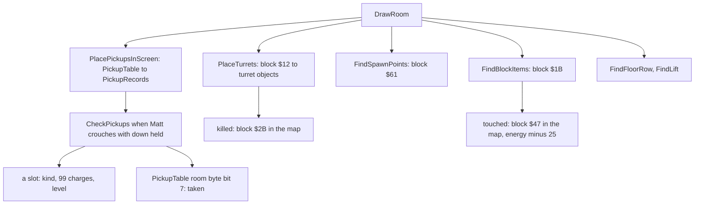

Worked example: room 0's PickupTable records are `00 01 12 0C` and `00 08 16 0C`: a PENETRATOR (kind 1) at x `$12`, y
`$0C`, and a BACKLASH (kind 8) at x `$16`, y `$0C`. Both x values are below `$20`, so both lie in screen 0. In `rzx-00000`
Matt walked over them; at frame 990 the slots held the PENETRATOR (99 charges) and the BACKLASH (98 charges, level 2:
MaskLevels gives 2 for kind 8). A screen holds two pick-ups at most: PickupRecords has two places.

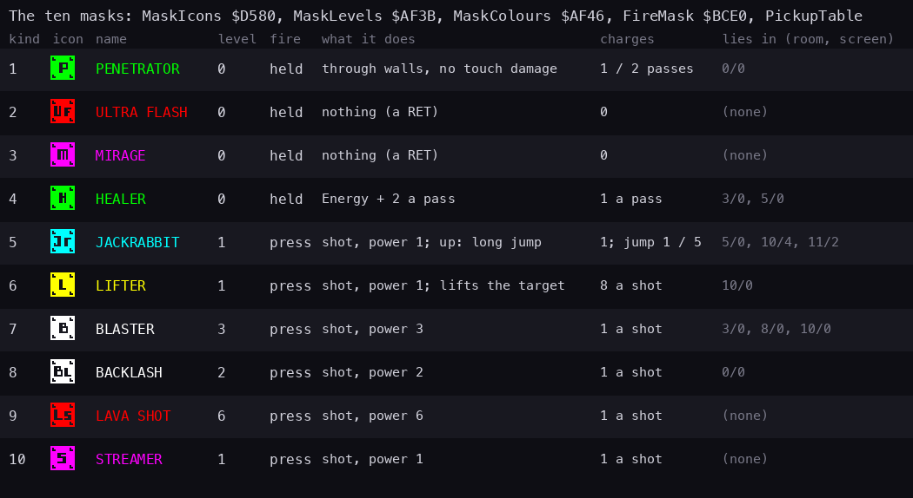

How to read it: one row a mask kind (1-10): its icon, the rooms and screens where PickupTable puts it, its level
(MaskLevels `$AF3B`), its charge cost and its action. ULTRA FLASH, MIRAGE, LAVA SHOT and STREAMER lie nowhere.
Recording: none, the bytes of the build. Made by `python3 tools/fig_objects.py masks docs/img/objects/masks.png`.

**The point**: the map is both the picture and the level's state. Turrets, items and pick-ups are found again each time a
screen is drawn, and their removal is a byte written into the map or a bit in the pick-up table.

Witness: PlacePickupsInScreen and the searches L1 86 (`c1`, `cheat`, `door`, `door3`, `kind6`, `masks`, `play2`,
`rzx-` x9); CheckPickups L1 2508;
FindEmptySlot L1 5 (`rzx-00000`, `rzx-16000`); the slots in the `rzx-00000` samples.

## 7.6 The object table and the record

Objects `$A43F` holds eight records of 38 (`$26`) bytes: Matt, his shot (MattShot `$A465`) and six enemies (Enemies
`$A48B`). The same layout serves all eight; each routine uses the fields it needs.

| Field | What |
| --- | --- |
| +`$00` | the kind (bits 0-5; Matt: his state 1-12); bit 7 placed; bit 6 only in the `$40` reservation, which drawing and the shot test skip (`AND $BF`); `$80` an empty placeholder |
| +`$02` | the direction (bit 7: left) |
| +`$03`, +`$04` | x (2 pixels from `$40`), y (pixels) |
| +`$05`, +`$06` | width and height in characters |
| +`$07`-+`$0F` | the drawing: row count, buffer, first character, frame, save address ([doc 6](06-rendering.md)) |
| +`$10` | a timer |
| +`$11`, +`$12` | two variables of the kind (the turret: its map address) |
| +`$13` | drawing and Matt's edge flags |
| +`$14`, +`$15` | the score for a kill, BCD |
| +`$16`, +`$17` | the picture |
| +`$18` | the animation step |
| +`$19` | the mode (the frame size) |
| +`$1A` | the animation mask |
| +`$1B`, +`$1C` | dx, dy |
| +`$1D` | no wall test |
| +`$1E` | the damage of a touch |
| +`$1F` | spawned once a screen |
| +`$20` | the colour |
| +`$21` | hits left (an enemy); power (the shot) |
| +`$22` | hit by a shot this pass (`$FF` from a LIFTER) |
| +`$23` | the slot number |
| +`$24`, +`$25` | drawing rows |

```text
record(i) = $A43F + 38 i          # 0 Matt, 1 the shot, 2-7 the enemies
SetupObject(IX, template HL):     # 12 bytes into the record
    +14, +15 = score;  +16, +17 = picture;  +1E = damage;  +18 = animation;  +1A = mask
    +05, +06 = width, height;  +19 = mode;  +21 = hits;  +20 = colour (bit 7: random 1-7) OR $40
    +1D, +02, +1B, +1C = 0                         # the counter, the direction, dx and dy
```

```asm
SetupObject:
  LD A,(HL)
  LD (IX+$14),A         ; score lo
  INC HL
  LD A,(HL)
  LD (IX+$15),A         ; score hi
  INC HL
  LD A,(HL)
  LD (IX+$16),A         ; picture lo
  INC HL
  LD A,(HL)
  LD (IX+$17),A         ; picture hi
  INC HL
  LD A,(HL)
  LD (IX+$1E),A         ; damage
  ...
```

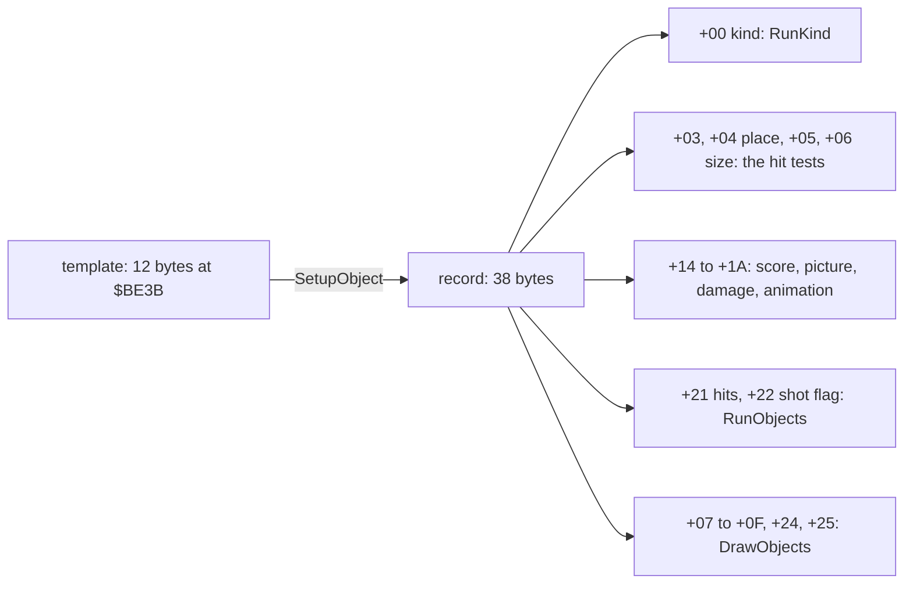

Worked example: object 3 at `rzx-00000` frame 990 (`$A4B1`):

`01 00 C6 92 48 02 02 00 00 F4 F1 2B 00 F3 7E A2 00 00 00 5E 33 00 60 D2 1A 04 03 00 04 00 0A 00 41 01 00 02 90 78`

- +0 = 1: a faller. x `$92`, y `$48`, 2 x 2 characters.
- +`$14`/+`$15` = `33 00`: 33 points. +`$16`/+`$17` = `$D260`: SpriteFaller.
- +`$1B`/+`$1C` = 0, 4: it falls 4 pixels a pass (SpawnFaller: dy = (x AND 3) + 2, here `$92` AND 3 = 2, so 4;
  dx = (Random AND 3) - 1, drawn again when it is 2: -1, 0 or +1; here 0).
- +`$1E` = `$0A`: a touch costs 10 energy. +`$21` = 1: one hit kills it.
- +`$20` = `$41`: bright blue, picked at random (the template's colour is `$FF`).

At frame 996 the same record reads `03 00 00 92 4C ...` with the picture `$D440`: BACKLASH's shot hit it at frame 995,
and Explode turned it into kind 3.

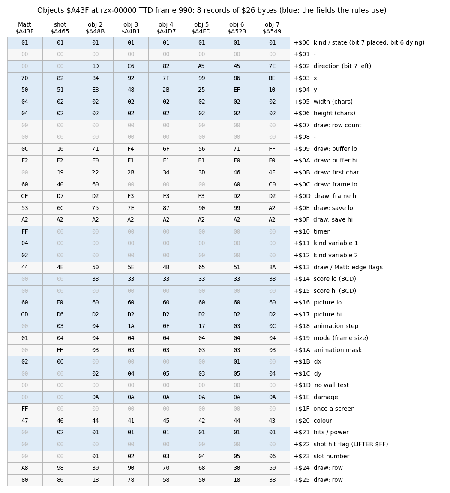

How to read it: one column a record (Matt, the shot, objects 2-7), one row a field, the bytes in hex. Blue marks the
fields the rules use; the names are on the right. Recording `rzx-00000`, TTD frame 990, from
`work/docs/mxC/rzx-00000/vars.jsonl`. Made by `python3 tools/fig_objects.py record docs/img/objects/record.png`.

**The point**: one record format serves the hero, his shot and every enemy. A kill or a transformation is a write to
byte 0 and a template copy; the drawing code never knows what an object is.

Witness: SetupObject L1 634 (`door`, `door3`, `kind6`, `rzx-` x9); the records in every sample (`work/docs/mxC/*/vars.jsonl`).

## 7.7 The enemy templates

EnemyTemplates `$BE3B` holds 20 templates of 12 bytes (`src/res/tables/enemies.csv`): the score (BCD), the picture,
the damage, the animation, the animation mask, the width, the height, the mode, the hits and the colour (bit 7: random
1-7). Spawners and transformations copy one with SetupObject.

| # | Address | Used for | Score | Damage | Hits | Size |
| ---: | --- | --- | ---: | ---: | ---: | --- |
| 0 | `$BE3B` | faller (kind 1) | 33 | 10 | 1 | 2 x 2 |
| 1 | `$BE47` | flyer (kind 2) | 200 | 50 | 1 | 3 x 2 |
| 2 | `$BE53` | turret (kind 4) | 500 | 100 | 5 | 3 x 2 |
| 3 | `$BE5F` | turret shot (kind 5) | 10 | 10 | 1 | 1 x 1 |
| 4 | `$BE6B` | wave flyer (kind 6) | 150 | 50 | 1 | 2 x 2 |
| 5 | `$BE77` | walker (kind 7) | 100 | 3 | 10 | 2 x 2 |
| 6 | `$BE83` | chaser (kind 8) | 5000 | 255 | 30 | 8 x 3 |
| 7 | `$BE8F` | kind 16's shot (kind 11) | 500 | 50 | 1 | 2 x 3 |
| 8 | `$BE9B` | riser (kind 12) | 100 | 20 | 1 | 2 x 2 |
| 9 | `$BEA7` | guard (kind 13) | 1000 | 100 | 10 | 4 x 4 |
| 10 | `$BEB3` | boss (kind 14) | 1000 | 255 | 10 | 4 x 4 |
| 11 | `$BEBF` | boss shot (kind 15) | 50 | 30 | 2 | 2 x 2 |
| 12 | `$BECB` | kind 16 | 8000 | 255 | 5 | 4 x 3 |
| 13 | `$BED7` | kind 18 | 1000 | 60 | 255 | 2 x 2 |
| 14 | `$BEE3` | kind 19 | 200 | 40 | 255 | 2 x 2 |
| 15 | `$BEEF` | kind 19, the last | 500 | 60 | 255 | 2 x 2 |
| 16 | `$BEFB` | explosion | 0 | | | 2 x 2 |
| 17 | `$BF07` | big explosion | 0 | | | 3 x 2 |
| 18, 19 | `$BF13`, `$BF1F` | debris: the guard's parts, the sparkle, the wave's burst | 0 | | | 3 x 3 |

```text
template(n) = $BE3B + 12 n
fields: score lo, score hi, picture lo, picture hi, damage, animation, mask, width, height, mode, hits, colour
Explode(IX, HL = template 16 or 17 or 18 or 19): +10 = 4; kind = 3; SetupObject; PlayEffect(11 + Random AND 3)
```

```asm
Explode:
  LD (IX+$10),$04       ; 4 passes
  LD (IX+$00),$03       ; kind 3: an explosion
  CALL SetupObject      ; HL = the explosion's template
  CALL Random
  AND $03
  ADD A,$0B
  JP PlayEffect         ; effect 11-14
```

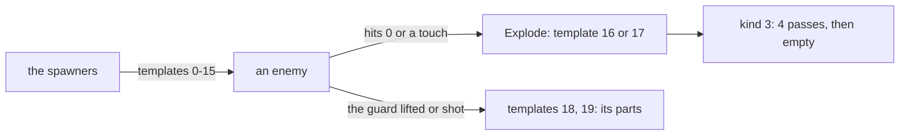

Worked example: template 0 at `$BE3B` is `33 00 60 D2 0A 00 03 02 02 04 01 FF`: 33 points, picture `$D260`, damage 10,
animation 0, mask 3, 2 x 2 characters, mode 4, one hit, a random colour. The faller at frame 990 (7.6) carries exactly
these values in its fields. Template 16 at `$BEFB` is `00 00 40 D4 00 00 03 02 02 04 00 FF`: the explosion, no score, no
damage, picture `$D440`: the faller's record at frame 996 shows `$D440`.

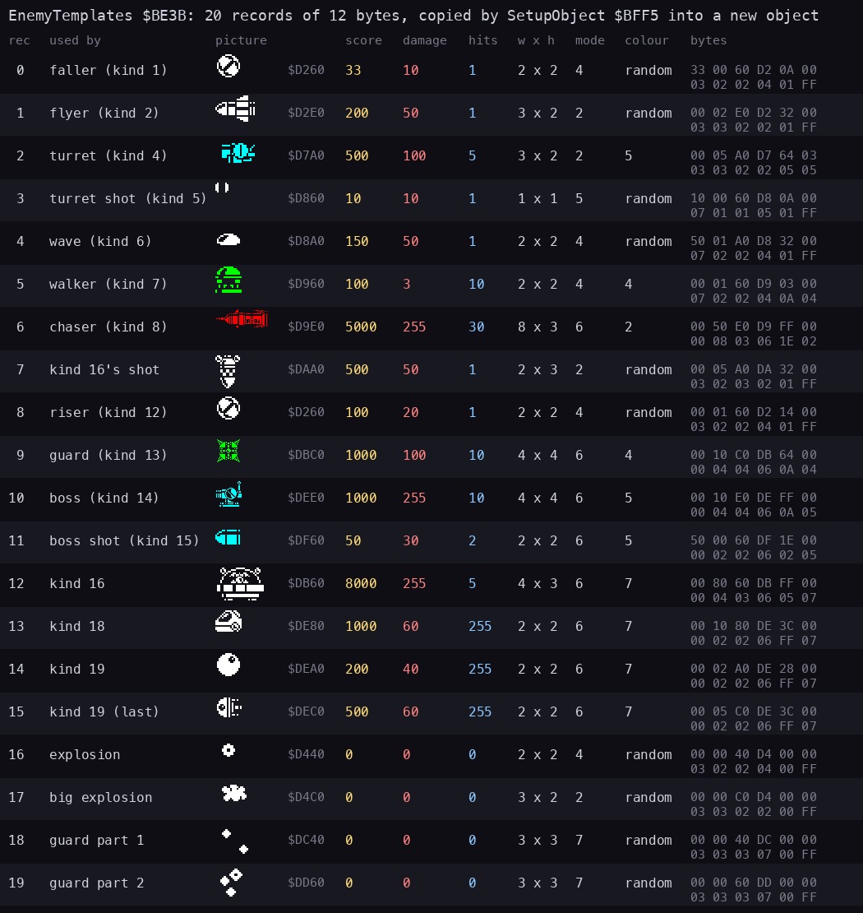

How to read it: one row a template: its number, its use, its picture drawn from the sprite data, then the twelve bytes
decoded. Recording: none, the bytes of the build. Made by `python3 tools/fig_objects.py templates
docs/img/objects/templates.png`.

**The point**: the rules of each enemy (how much it is worth, how much it hurts, how many hits it takes) are data in
one table, apart from its movement in the code.

Witness: SetupObject L1 634; the template bytes from `src/res/tables/enemies.csv`; the faller record at frames 990 and
996 of `rzx-00000`. The annotation puts `@res enemies.bin` on PenetratorCost `$BE0D` (1 byte) instead of the table at
`$BE3B` (`work/docs/mxC-src-changes.md`).

## 7.8 The spawner

RunObjects calls Spawn `$BF2B` for each of the six enemy slots, every pass. A slot that holds anything (kind AND `$7F`
not 0) is left alone. For an empty slot Spawn reads EnemyKind, the screen's kind from the room table:

- kinds 1-4 and 7 spawn only when Random AND `$2E` is 0 (one pass in 16 per empty slot); kinds 5, 6, 8, 9 and 10 try
  every pass;
- while the chaser is on (ChaserState), nothing spawns;
- otherwise Spawn jumps through SpawnJumps `$BFB1`: kind 0 is a `RET`, kinds 1-10 each have a spawner.

| Enemy kind | Spawner | Object | How |
| ---: | --- | --- | --- |
| 1 | SpawnFlyer `$BFD2` | 2, flyer | only while Matt's x is below `$91`; from the right edge, a random height |
| 2 | SpawnFaller `$C04B` | 1, faller | from above the screen at a random column |
| 3 | SpawnWave `$C07E` | 6, wave flyer | Random AND `$44` = 0 and Matt's x below `$91` |
| 4 | SpawnWalker `$C0A6` | 7, walker | once per slot per screen (+`$1F`) |
| 5 | SpawnChaser `$C0D9` | 8, chaser | ChaserState on, timer `$300` |
| 6 | SpawnKind6 `$C0F7` | 16 | once per screen, effect 10 |
| 7 | SpawnRiser `$C116` | 12, riser | from a SpawnPoints place |
| 8 | SpawnGuard `$C167` | 13, guard | |
| 9 | SpawnBoss `$C19E` | 14, boss | |
| 10 | SpawnKind10 `$C1F3` | 18 and 19, a group | |

When nothing spawns, SpawnNothing marks the slot with the placeholder `$80` (2 x 2 at x 1, y 0) unless object 2 is the
chaser. ReviveObjects `$BF7F`, at the end of RunObjects, puts object 2 back when all six slots hold 0 (a `$40` or `$80` counts
as taken): state `$80`, 4 x 5 characters at x 1, y 0, mode 6.

```text
Spawn(IX):
    if IX.kind & $7F: return
    k = EnemyKind
    if k not in (5, 6, 8, 9, 10) and Random() & $2E: SpawnNothing(); return
    if ChaserState: SpawnNothing(); return
    jump SpawnJumps[3 k]                   # 0: RET
SpawnNothing(IX): unless object 2 is the chaser: IX = placeholder $80
```

```asm
Spawn:
  LD A,(IX+$00)
  AND $7F
  RET NZ                ; the slot is busy
  LD A,(EnemyKind)
  CP $05
  JR Z,l_BF4F
  ...
  CALL Random
  AND $2E
  JR NZ,SpawnNothing    ; one pass in 16
l_BF4F:
  LD A,(ChaserState)
  AND A
  JP NZ,SpawnNothing
  LD A,(EnemyKind)
  LD L,A
  ADD A,A
  ADD A,L               ; 3 x kind
  LD L,A
  LD H,$00
  LD DE,SpawnJumps
  ADD HL,DE
  JP (HL)
```

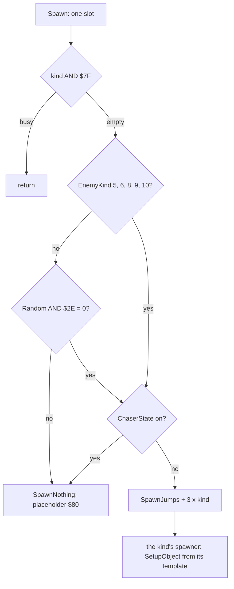

Worked example: `rzx-00000`, room 0, screen 1 (EnemyKind 2, fallers). At frame 977 three fallers fell in slots 3-5.
At frame 978 slot 2, empty before, held a new faller: `01 00 1D 84 E2 ...`, x `$84`, y `$E2` (above the screen, bit 7
set), the faller template's values in +`$14`-+`$21`. It fell into view over the next passes.

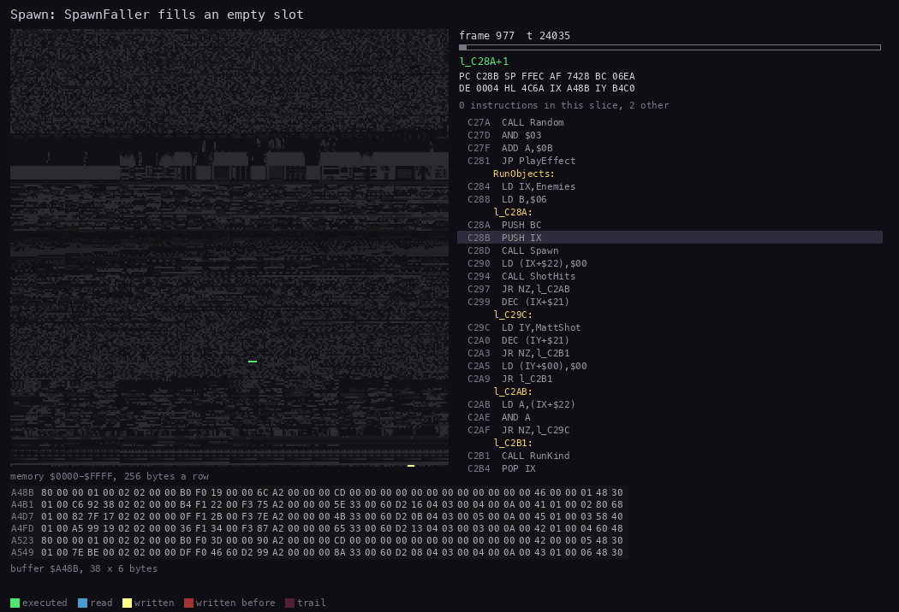

How to read it: the six enemy records `$A48B` (38 x 6 bytes) as hex, and on the right the code. Spawn finds the empty
slot, SpawnFaller places it and SetupObject copies the template. Recording `rzx-00000`, the Spawn call of frame 977
that makes the faller (977:24042 to the return of SetupObject), 60 pictures. Made from the kept trace of frames 977-979:
`python3 tools/trace_cut.py work/docs/mxC/rzx-00000/traces/977_0-979_0.uatr --from 977:24000 --to 977:25500 --out
work/docs/fixB/spawn-977.uatr`, then `python3 ../../kit/routine_anim.py --trace work/docs/fixB/spawn-977.uatr
--listing build/game.lst --pc BF2B-C26E,92C6-92DF --view buffer:A48B:38x6:hex --pictures 60 --title '...' --out
docs/img/routines/Spawn.gif`.

**The point**: the spawner is a lottery per empty slot per pass, ruled by one byte per screen. Kill an enemy and its
slot refills a few passes later; the screens are endless sources, not fixed sets.

Witness: Spawn runs six times in every pass of RunObjects (L1 91 061, `c1`, `cheat`, `door`, `door3`, `kind6`, `masks`, `play2`, `rzx-` x9);
SetupObject L1 634; the
samples of `rzx-00000` frames 977-979. Enemy kinds 6 and 10 (room 1 screen 2, room 7 screens 2-3) were never reached
in play; `kind6` and `door3` POKE EnemyKind `$BFB0` to run them (SpawnKind6 L1 1919, SpawnKind10 L1 1).

## 7.9 RunObjects: the shot test and the touch test

RunObjects `$C284` runs the six enemy slots in order. For each it calls Spawn, clears +`$22` and asks ShotHits whether
Matt's shot overlaps it:

- **ShotHits `$BC96`**: Matt's shot is out, the object is not empty, not an explosion (3) and not being lifted (10).
  The shot's point (x + 6, y + 12) must lie inside the object's box widened by 4 and 8: 0 to width x 4 + 4 across, 0 to
  height x 8 + 8 down. On a hit it copies the shot's +`$22` into the object (`$FF` from a LIFTER, else 0).
- On a hit without the LIFTER flag the object loses a hit (+`$21` - 1) and the shot loses a power; at power 0 the shot
  dies. A LIFTER hit costs the shot a power but not the object a hit.
- Then RunKind jumps to the kind's routine through ObjectJumps `$C326` (kind AND `$3F`, 3 bytes each).

Each kind's routine then checks, in this order: hits 0 (AwardScore, Explode); the LIFTER flag (ObjectShot: score, then
lifted away); its own move; a wall (HitsWall); a touch of Matt (TouchesMatt, then Damage).

- **TouchesMatt `$C2D9`**: never while the PENETRATOR is on. dx = Matt's x - the object's x must be from -10 to width x
  4 - 5; dy = Matt's y - the object's y from -28 to height x 8 - 1.
- **Damage `$C2CA`**: Energy - the object's +`$1E`, not below 0.
- **AwardScore `$C2C1`**: Score + the object's +`$14`/+`$15` (BCD).

```text
RunObjects:
    for IX in Enemies[0..5]:
        Spawn(IX); IX.shotflag = 0
        if ShotHits(IX):                         # copies the shot's LIFTER flag
            if not IX.shotflag: IX.hits -= 1
            shot.power -= 1; if shot.power == 0: shot off
        RunKind(IX)                              # ObjectJumps[IX.kind & $3F]
    ReviveObjects()
a kind's routine:
    if IX.hits == 0: AwardScore; Explode; return
    if IX.shotflag: ObjectShot (score, kind 10: lifted); return
    move; if HitsWall or off screen: Explode (no score)
    if TouchesMatt: Damage; AwardScore; Explode          # the faller, the flyer, the wave, the riser
```

```asm
l_C28A:
  PUSH BC
  PUSH IX
  CALL Spawn
  LD (IX+$22),$00
  CALL ShotHits
  JR NZ,l_C2AB          ; no hit
  DEC (IX+$21)          ; a hit
l_C29C:
  LD IY,MattShot
  DEC (IY+$21)          ; the shot's power
  JR NZ,l_C2B1
  LD (IY+$00),$00       ; spent
  JR l_C2B1
l_C2AB:
  LD A,(IX+$22)
  AND A
  JR NZ,l_C29C
l_C2B1:
  CALL RunKind
```

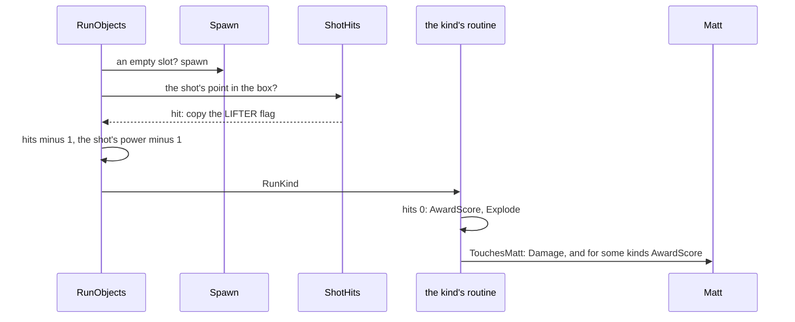

Worked example: the BACKLASH shot in `rzx-00000`. At frame 990 the shot (`$A465`) was at x `$82`, y `$51`, dx 6, power
2. The faller of slot 3 was at x `$92`, y `$48`. The shot moves 6 a pass; at frame 995 its point (x + 6) passed the
faller's left edge, ShotHits returned a hit, the faller's +`$21` went from 1 to 0 and the shot's power from 2 to 1. The
faller's own routine then saw hits 0, added 33 points and exploded. The shot flew on with its last power.

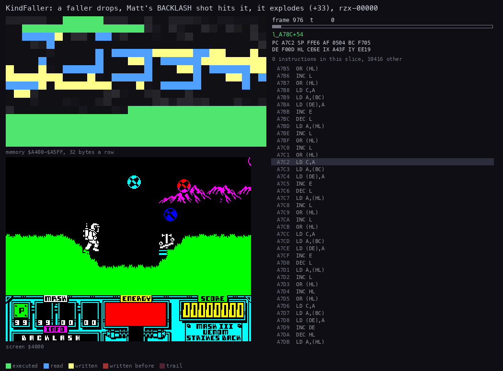

How to read it: the screen, the memory `$A400-$A5FF` (the objects) and the code: RunObjects, ShotHits, KindFaller,
AwardScore, Explode. Recording `rzx-00000`, the pass of frame 995 in which the shot hits the faller (KindFaller from
995:20298, Explode at 995:21813), 40 pictures. Made from the kept trace of frames 975-1000: `python3 tools/trace_cut.py
work/docs/mxC/rzx-00000/traces/975_0-1000_0.uatr --from 995:20200 --to 995:22600 --out
work/docs/fixB/faller-995.uatr`, then `python3 ../../kit/routine_anim.py --trace work/docs/fixB/faller-995.uatr
--listing build/game.lst --pc C284-C374,C375-C3A5,BC96-BCDF,C26F-C283,C2C1-C2C9,AE45-AE5F,BFF5-C04A,93DC-941A,92C6-92DF
--view screen --range A400-A5FF --pictures 40 --title '...' --out docs/img/routines/KindFaller.gif`.

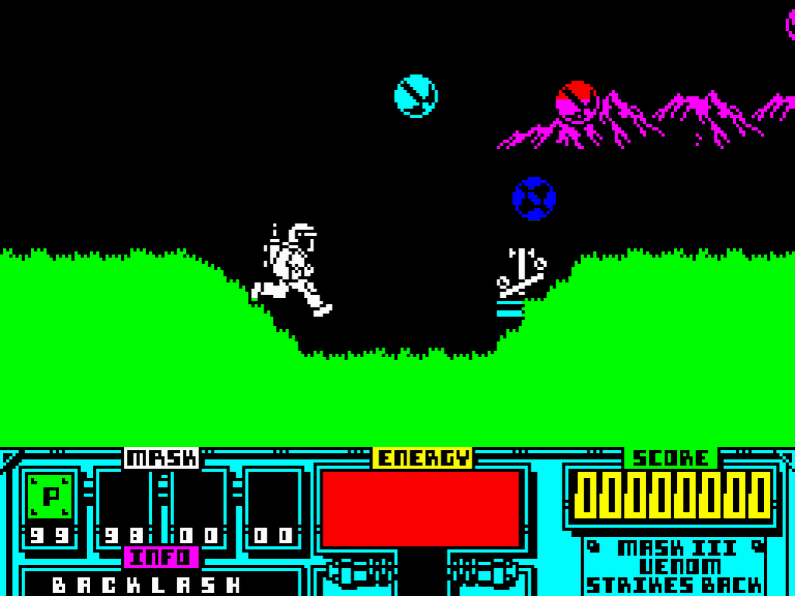

How to read it: the screen at every frame: the shot leaves Matt, the faller bursts. Recording `rzx-00000`, TTD frames
978-1010. Made by `python3 ../../kit/screen_anim.py --work work/docs/mxC/rzx-00000 --from 978 --to 1010 --step 1
--delay 60 --hold 800 docs/img/play/kill.gif`.

**The point**: the shot test runs in the object loop, not in the shot's code, so one shot with power 2 or 3 can pass
through several enemies in one flight. A touch both hurts Matt and pays him the enemy's score.

Witness: RunObjects L1 15 178; ShotHits in every pass; TouchesMatt L1 12 174 (`door`, `door3`, `kind6`, `rzx-` x9); Damage L1 133;
AwardScore L1 84 (`kind6`, `rzx-` x9); the `rzx-00000` samples of frames 990-996.

## 7.10 The kinds one by one

ObjectJumps `$C326` gives 20 kinds:

| Kind | Routine | What it does | Seen |
| ---: | --- | --- | --- |
| 0 | HangLoop `$9208` | an empty slot never reaches it (RunKind returns at 0) | |
| 1 | KindFaller `$C375` | falls 2 to 5 a pass (dy = (x AND 3) + 2) and drifts left, straight or right, 1 a pass (dx = (Random AND 3) - 1, never 2); a wall or the floor bursts it | `rzx-00000` 977 |
| 2 | KindFlyer `$C3A6` | flies left 2 a pass, homes on Matt's height plus an offset; gone at x `$28` | `rzx-` |
| 3 | KindExplosion `$C3F1` | 4 passes, then empty | every kill |
| 4 | KindTurret `$C457` | bobs from the start (animation 3), up and down 16 passes each; fires kind 5 when Random AND `$53` = 0 into slot+1 (`$40`) or a free slot+2, then rises again for 6 passes; killed or touched: block `$2B`, its stem cleared, no score (7.11) | `rzx-12000` 1255 |
| 5 | KindTurretShot `$C521` | flies left 2 a pass, 10 damage; its slot goes back to `$40` while the turret lives; harmless once the turret is dead, and always harmless in slot+2 (7.11) | `rzx-12000` |
| 6 | KindWave `$C562` | flies left 2 a pass along WaveHeights `$C5B5`; effect 6 at each swoop | `rzx-12000` 2747 |
| 7 | KindWalker `$C5D9` | walks between x `$40` and `$B4`, turns at random; each touch costs 3 energy, the fifth kills it | `rzx-12000` 2125 |
| 8 | KindChaser `$C64E` | sweeps the room right to left for `$300` passes, follows Matt's height; a touch kills (255) | `rzx-08000` 1034, `rzx-32000` 473 |
| 9 | KindNine `$C6B7` | a `RET` | never |
| 10 | KindTen `$C6D4` | lifted: rises 8 a pass (ObjectShot zeroed its dx), then becomes +`$11` (0, or `$40` for a turret shot) | `rzx-12000` 2118 |
| 11 | KindEleven `$C6F2` | kind 16's shot | never |
| 12 | KindTwelve `$C73F` | the riser, from a block `$61` | `rzx-16000` 1142 |
| 13 | KindThirteen `$C78A` | the guard: bobs (GuardBob `$C7F4`), ten LIFTER hits lift it, ten shots break it into parts | `rzx-00000` 1960, `rzx-24000` |
| 14 | KindFourteen `$C81B` | the boss (always slot 1): fires kind 15 into slot 0 when Random AND `$25` = 0 and slot 0 holds no shot | `rzx-24000` 479 |
| 15 | KindFifteen `$C860` | the boss's shot | `rzx-24000` 507 |
| 16 | KindSixteen `$C89B` | flies left 2 a pass with no stop, effect 10 as it passes x `$DC`; fires kind 11 when Random AND `$92` = 0 | `kind6` (a POKE) |
| 17 | KindSeventeen `$C922` (set up by ObjectGone `$C8FD`) | 25 passes of random small explosions where the object was | after the chaser, the boss |
| 18 | KindEighteen `$C980` | the head of SpawnKind10's group: bobs (8 passes down, 8 up) and moves left 1 a pass; shots never kill it, a LIFTER hit lifts it; a touch costs energy and it stays | `door3` (a POKE), 1478-1968 |
| 19 | `l_C9B8` | the group's body: each takes the y the object before it had last pass, a chain one pass behind the head; moves left 1 a pass; the tail past x `$38` ends the whole group | `door3` (a POKE), 1478-1968 |

The faller, the flyer, the wave and the riser burst when they touch Matt: Damage, then AwardScore, then Explode. A
touch is a kill that costs energy. The chaser and the boss touch with damage 255 (Matt dies) and become kind 17.

The group of kinds 18 and 19 (SpawnKind10 `$C1F3`, room 7 screens 2-3, run only with the `door3` POKE) is a chain of
six objects: the head (kind 18, slot 0, x `$C0`, y `$50`) and five body parts (kind 19, slots 1-5, 6 pixels apart;
the last one, the tail, has +`$1B` = `$FF`). Only the head moves on its own; each body part copies the y the object
before it had a pass earlier, so the head's wave runs down the body.

```text
KindEighteen(IX):                     # the head, $C980
    if IX.lifted (+$22): ObjectShot; IX.dx (+$1B) = -1; return     # no hits test: shots never kill it
    IX.oldy (+$1C) = y
    IX.count (+$11) += 1
    IX.v (+$12) += 1 if IX.count & 8 else -1                         # 8 passes up, 8 down
    y += IX.v; x -= 1
    if TouchesMatt: Damage                                           # the head stays
Kind19(IX):                           # a body part, l_C9B8
    IX.oldy = y
    y = (IX - $26).oldy                                              # IX-$0A: the record before, its +$1C
    x -= 1
    if TouchesMatt: Damage
    if IX.tail (+$1B) != 0 and x < $38: all six slots = $80          # the whole group leaves at once
```

```text
C9B8  DD 7E 04            l_C9B8: LD A,(IX+$04)           ; y
C9BB  DD 77 1C                    LD (IX+$1C),A           ; kept for the next part
C9BE  DD 7E F6                    LD A,(IX-$0A)           ; the record before: its +$1C
C9C1  DD 77 04                    LD (IX+$04),A
C9C4  DD 35 03                    DEC (IX+$03)            ; x - 1
C9C7  CD D9 C2                    CALL TouchesMatt
C9CA  CC CA C2                    CALL Z,Damage
C9CD  DD 7E 1B                    LD A,(IX+$1B)           ; the tail?
C9D0  A7                          AND A
C9D1  C8                          RET Z
C9D2  DD 7E 03                    LD A,(IX+$03)
C9D5  FE 38                       CP $38
C9D7  D0                          RET NC
C9D8  DD 21 8B A4                 LD IX,Enemies           ; all six slots: the placeholder $80
```

Worked example: `door3` frame 1500 (`work/stage2/rec/door3/snapshots/001500`, Enemies `$A48B`). The head (slot 0) is at
x `$B7`, y `$41`, its +`$1C` (last pass's y) `$40`. The body's y are `$40`, `$40`, `$41`, `$43`, `$46` and their
+`$1C` `$40`, `$41`, `$43`, `$46`, `$4A`: each part's y is the +`$1C` of the part before it, so the tail at x `$D5`
shows the head's height five passes ago. At frame 1750 the group is at x `$63`-`$81`, the wave reversed (head y
`$4D`, tail y `$40`).

```text
KindTurret(IX):
    if IX.hits == 0: map[IX.mapaddr] = $2B; Explode; clear the stem; AwardScore; return   # Explode zeroed the score
    if IX.anim != 3: every second pass IX.anim += 1; return          # rising again after a shot: 6 passes
    IX.dy += 1; y += 1 if IX.dy & $10 else -1                         # bobbing (template 2 starts at anim 3)
    redraw its stem (TurretStem) under it
    if Random() & $53 == 0:
        if slot+1 == $40: shot = slot+1
        elif slot+2 AND $3F == 0: shot = slot+2                       # empty or the placeholder $80
        else: return                                                  # no room: no shot, no touch test
        IX.anim = 0                                                   # the turret's own animation
        shot.kind = 5; shot.x = x; shot.y = y + 4; SetupObject(template 3); return
    if TouchesMatt: Damage(100); as killed
KindWalker(IX):
    if IX.hits == 0 or IX.touches == 5: empty; AwardScore; Explode
    animate; if TouchesMatt: Damage(3); IX.touches += 1
    x += dx; outside $40-$B4: gone (left) or turn (right)
    IX.timer -= 1; at 0: dx = -dx; IX.timer = Random & $0F (+6 going left)
```

```asm
KindWalker:
  ...
l_C5FD:
  CALL TouchesMatt
  JR NZ,l_C61C          ; no touch
  CALL Damage           ; 3 energy
  INC (IX+$11)
  LD A,(IX+$11)
  CP $05
  JR NZ,l_C61C
l_C60F:
  LD (IX+$00),$00
  CALL AwardScore       ; 100 points
  LD HL,EnemyTemplates+$00CC
  JP Explode
```

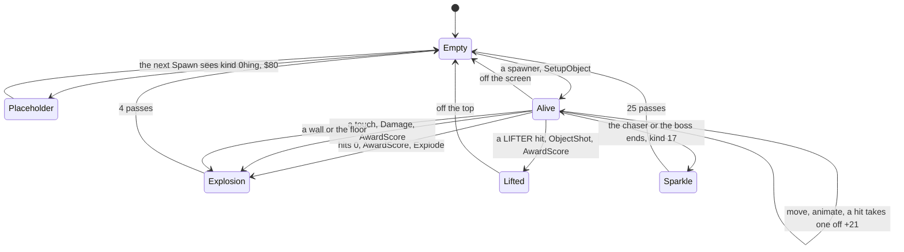

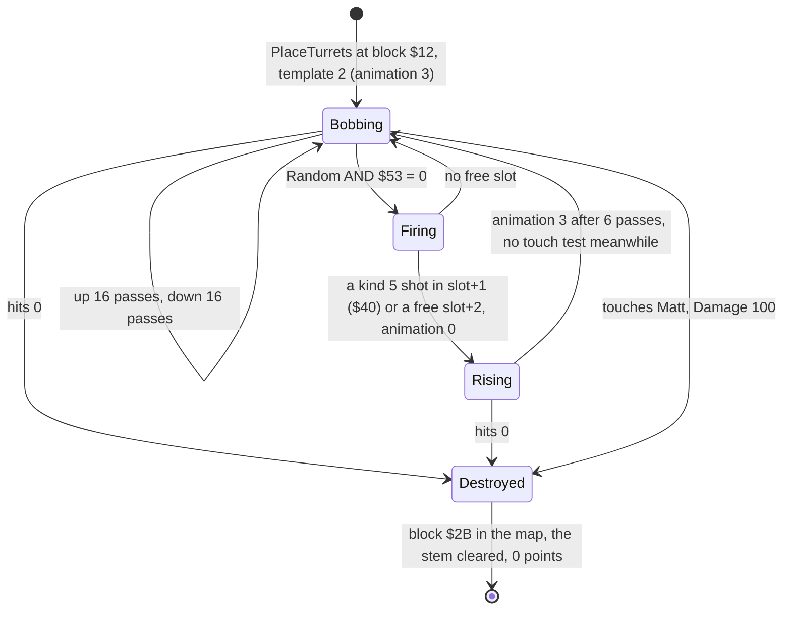

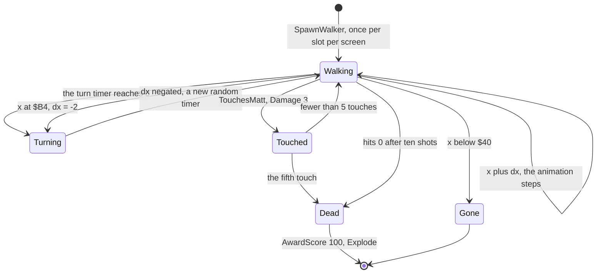

Worked example: the turret of `rzx-12000`, room 4, screen 3. The turret bobs over its stem from frame 1255 and fires
kind 5 shots into the two slots after it (the samples show `04 40 05`: the turret, the reserved slot, a shot): at frames 1325 and 1359 a shot hit Matt and Energy fell by 10 each time (133,
123, 113). At frame 1387 Matt touched the turret: Energy fell from 113 to 13 (the turret's damage 100) and the turret
exploded. The score stayed at 8588: the template says 500, but Explode had already overwritten the record's score.
Its block `$12` became `$2B` in room 4's map, so it stays dead when Matt comes back. The walkers of room 12 (from frame 2125) walk, turn and hurt by
3 a touch; six of them could be out at once, one per slot.

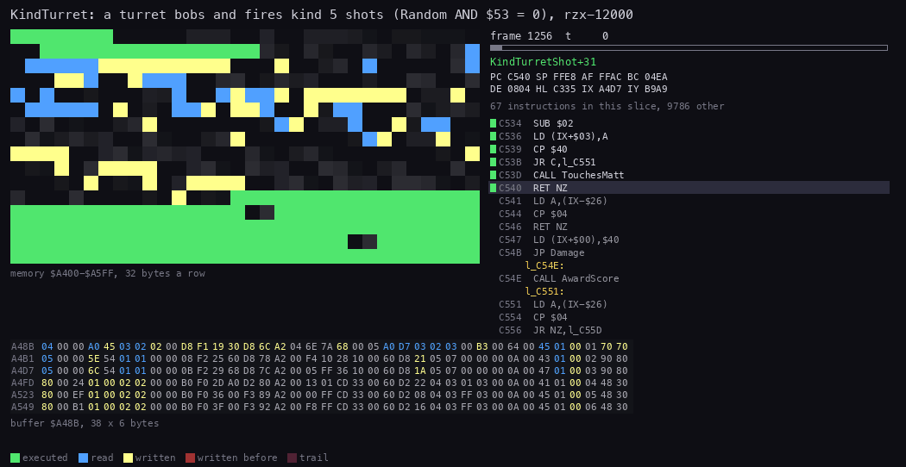

How to read it: the six enemy records `$A48B` as hex and the code of KindTurret, in the pass of `rzx-12000` where the
turret bobs and fires: KindTurret from 1272:60709, the shot set up in the reserved slot from 1272:61411 (kind 5, its
own animation back to 0), then SetupObject; 60 pictures. Made from the kept trace of frames 1255-1290: `python3
tools/trace_cut.py work/docs/mxC/rzx-12000/traces/1255_0-1290_0.uatr --from 1272:60650 --to 1272:62100 --out
work/docs/fixB/turret-1272.uatr`, then `python3 ../../kit/routine_anim.py --trace work/docs/fixB/turret-1272.uatr
--listing build/game.lst --pc C457-C560,BFF5-C04A,92C6-92DF --view buffer:A48B:38x6:hex --pictures 60 --title '...' --out
docs/img/routines/KindTurret.gif`.

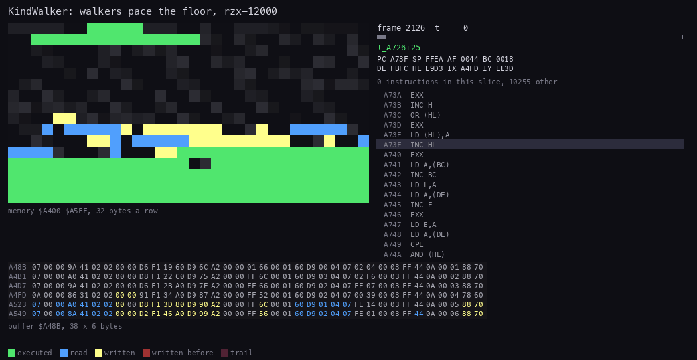

How to read it: the screen and the code of KindWalker: the walk, the touch test, the random turn. Recording
`rzx-12000`, the pass of frame 2126 that runs five walkers (KindWalker from 2126:22438; the last one turns at
2126:26940), 60 pictures. Made from the kept trace of frames 2125-2160: `python3 tools/trace_cut.py
work/docs/mxC/rzx-12000/traces/2125_0-2160_0.uatr --from 2126:22400 --to 2126:27300 --out
work/docs/fixB/walker-2126.uatr`, then `python3 ../../kit/routine_anim.py --trace work/docs/fixB/walker-2126.uatr
--listing build/game.lst --pc C5D9-C64D,C36B-C374,C2D9-C314,92C6-92DF --view screen --pictures 60 --title '...' --out
docs/img/routines/KindWalker.gif`.

**The point**: each kind is a short routine over the same record. The touch rules differ by kind: most enemies die when
they touch Matt, the walker dies at its fifth touch, the turret explodes at its touch (Damage, then `$C4D7`), the chaser and the boss kill him. The
order of two calls decides the pay: the turret explodes before it scores, so it never pays.

Witness: RunKind L1 91 060 (`c1`, `cheat`, `door`, `door3`, `kind6`, `masks`, `play2`, `rzx-` x9); ObjectCell L1 1891 (`door`, `rzx-` x7); the kinds seen
in the samples (`python3 work/docs/mxC/events.py <rec>/vars.jsonl --objects`). Kinds 9 and 11 never ran:
known only from the code; 16, 18 and 19 ran only after the EnemyKind POKEs (KindSixteen L1 488 in `kind6`,
KindEighteen L1 167 in `door3`).

## 7.11 Notes, quirks and what is known only from the code

- **The `$40` reservation.** PlaceTurrets marks the slot after each turret as kind `$40`: bit 6 set, kind 0. Spawn sees
  it as busy (`$40` AND `$7F` is not 0), RunKind as empty, and DrawObjects and ShotHits skip it (`$40` AND `$BF` is 0).
  The turret fires into that slot; when it is taken (a shot still flying), into slot+2 if that holds 0 or `$80`
  (`$C4AD`). A shot in slot+1 gives the `$40` back when it ends (`$C547`, `$C558`); a shot in slot+2 leaves 0.
- **The placeholder `$80`** fills a slot when the lottery fails. It sits at x 1, y 0, out of reach. ShotHits does not
  skip it (`$80` AND `$BF` is not 0), but no shot gets there.
- **Bit 6 is only the reservation.** It is written only as `$40` (PlaceTurrets `$AC71`, KindTurretShot `$C547` and
  `$C558`, the boss's shot KindFifteen `$C879`); the `AND $BF` in DrawObjects (`$A2EB`, `$A30B`) and ShotHits (`$BC9F`) make that slot
  skipped, neither drawn nor hit. Nothing marks a dying object.
- **PlaceTurrets' dead `SUB $02`** (`$AC55`): it subtracts 2 from the turret's y and throws the result away (`LD A,C`
  follows), so the turret's y is the block's row.
- **ExitByte3** `$B6D8` would leave by RoomTable byte 3; the byte is `$FF` in every room and the routine never runs.
- **The pod block.** The rooms module's header says CheckPickups turns a used pod block `$12` into `$2B`. Block `$12` is
  the turret's block, and KindTurret writes the `$2B` (`work/docs/mxC-src-changes.md`).
- **NewGame makes turrets.** NewGame puts the dead turrets back by turning every `$2B` of every map into `$12`. The
  maps also hold `$2B` of their own, in room 5 screen 0 and room 6 screen 2. After the first new game those become
  turrets too: `rzx-16000` meets a turret in room 6 screen 2 at frame 3194, where the native map has none. The same
  pass turns the used block items `$47` back into `$1B`.
- **The touch pays.** A faller, flyer, wave or riser that touches Matt gives its score; so does the chaser (5000) and
  the boss (1000) whose touch kills: in `rzx-32000` at frame 657 the score went from 19 239 to 24 239 as Matt died.
- **Rooms never visited** by any recording: 9, 11 and 13; room 7 only in `door3` (a POKE recording, screen 0); room 1 beyond screen 1. Their maps are drawn from the data
  only (`tools/roommap.py`).
- **A turret never scores.** KindTurret calls Explode, which copies the explosion template (score 0) into the record,
  and only then AwardScore. The six turret kills of the recordings (`rzx-00000` 1788, `rzx-04000` 1080, `rzx-12000`
  1387, `rzx-16000` 3669, `rzx-20000` 1732, `rzx-24000` 346) left the score unchanged. Every other kind scores first.
- **A turret shot is harmless once its turret is dead, and always in slot+2.** KindTurretShot does its Damage only
  when the slot before it still holds a turret (kind 4, `$C541`). For a shot in slot+2 the slot before it is slot+1,
  the first shot or its `$40`, never kind 4: that shot can never hurt Matt, and it ends as 0, not `$40`.
- **Kinds never run**: 9 and 11; 16, 18 and 19 (enemy kinds 6 and 10) only after a POKE (`kind6`, `door3`).
