# 8. HUD and text

What this covers:

- the play panel, screen rows 18-23, and what the game writes into it each pass;
- the 5-line font, PrintChar `$9CD9` and PrintString `$9CBF`;
- the score and the energy bar;
- the four mask slots and the blink of the current one;
- the message line: the Scroller `$AF82` in the interrupt, the mask names and the room messages;
- every string of the game, with its address;
- the menu screen, game over with the high score, and the ending.

The recordings it rests on ([WALKTHROUGH 6.0](../WALKTHROUGH.md#60-the-recordings)):

| Recording | Load | Used for |
| --- | --- | --- |
| `c1` | power-on on the 128K, the original tape at ROM speed, `tests/inputs/c1.txt` | the menu, one main loop pass traced (frames 18 669-18 672) |
| `rec/rzx-12000` | the ZXDB RZX, frames 12 000-15 999, from the RZX's own state | the score and the energy changing, the mask keys |
| `rec/rzx-28000` | the ZXDB RZX, frames 28 000-31 999 | a death on the moon, MISSION TERMINATED, the high score, the menu |
| `rec/play2` (stage 2) | `work/stage1/probe/128K/loaded.szx`, `tests/inputs/s2play.txt` | the passwords and the ending |
| `build/game.bin` | the game image as loaded | the panel, the font, the icons |

Conventions:

- **Row r, column c** is a character cell of the screen, rows 0-23, columns 0-31. `ScreenAddr` `$999E` takes D = row,
  E = column.
- **A frame** is 1/50 s of the 128K, 70 908 T; "18669:49039" is frame 18 669, T 49 039.
- **A pass** is one turn of MainLoop `$CC03`; in `c1` a pass takes 2 to 2.7 frames.
- Numbers on the panel are BCD: one decimal digit a nibble.

## 8.1 The play panel

The bottom six rows of the screen are the panel. The play window above it is drawn by FlushDirty
([doc 6](06-rendering.md#64-flushdirty-and-the-dirty-marks)); the panel is drawn by its own code, straight to the
screen.

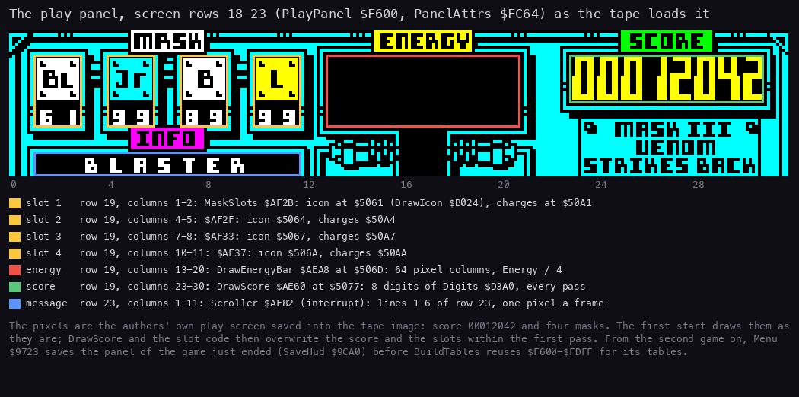

*Figure 8.1: the panel as the tape loads it (PlayPanel `$F600`, PanelAttrs `$FC64`), with the places the game writes
each pass framed. Command: `python3 tools/fig_hud.py panel --out docs/img/hud/panel.png`.*

How to read: the top strip is rows 18-23 at scale 4; the column numbers are under it. Each frame is one live
field; the list below gives its row, columns, routine and screen address.

| Field | Row, columns | Screen address | Routine | When |
| --- | --- | --- | --- | --- |
| the four mask slots | 19-21, 1-2, 4-5, 7-8, 10-11 | `$5061`, `$5064`, `$5067`, `$506A` | DrawCurrentSlot `$AF53`, DrawAllSlots `$AFFA` | the current slot every pass |
| the energy bar | 19-21, 13-20 | `$506D` | DrawEnergyBar `$AEA8` | when Energy / 4 changes |
| the score | 19-20, 23-30 | `$5077` | DrawScore `$AE60` | every pass |
| the message line | 23, 1-11 | `$51E1-$51EB` | Scroller `$AF82` | every interrupt |

Menu `$9723` puts the panel on the screen when fire starts a game: DrawGraphic of PlayPanel at row 18, the 192
attributes from PanelAttrs to `$5A40`, then 10 spaces at row 23, columns 1-10 to clear the message line (its 11th column keeps the panel picture until the
scroller shifts it out).

The picture of figure 8.1 is the authors' own play screen (score 00012042). It is on the screen only at the first
game's start, from the menu's DrawGraphic to the first pass: NewGame's DrawAllSlots (`$91C3`) redraws the slots,
the first pass's DrawScore the score and its DrawEnergyBar the bar (EnergyShown `$AEA7` is 0 as loaded, `$AEB2-$AEB4`).

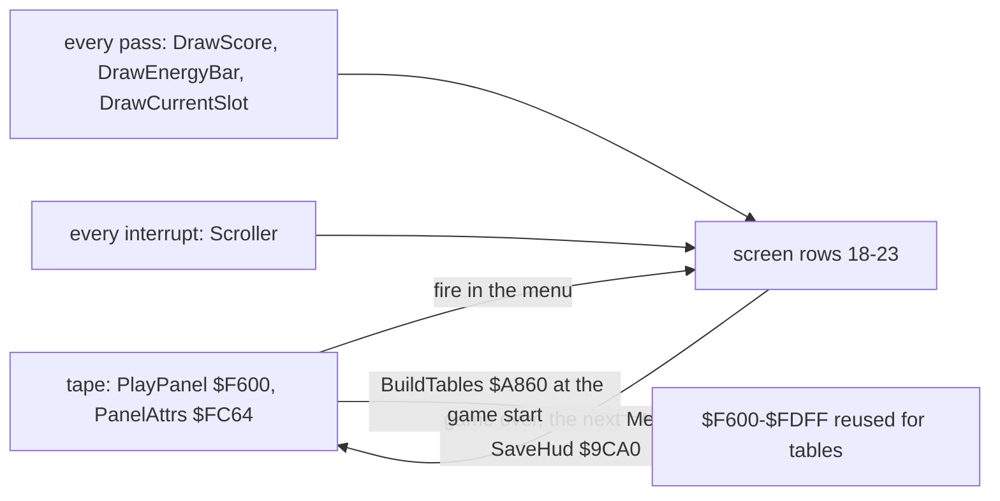

Worked example: the score's address `$5077` is third 2 (`$50`), character row 3 of the third (L = `$77`, `$77` >> 5
= 3), column `$17` = 23: screen row 16 + 3 = 19, column 23.

Witness: in the c1 pass, the panel writes are DrawScore 128 bytes (`l_AE8F`), DrawIcon 36 (`l_B040`), the charges 18
(`l_9CE8` and PrintChar) and the Scroller 66 (`l_AFB5`); all at rows 19-23 ([doc 6, 6.11](06-rendering.md#611-code-against-the-screen-and-the-beam)).

The point: the panel is a picture with four live fields. The rest of it is never touched in play.

## 8.2 The font and the print routines

The font Font `$95FB` holds 39 glyphs of 5 lines, 5 bytes each: A-Z, 0-9 (at `$967D`), the full stop (`$96AF`),
the colon (`$96B4`) and the space. CharGlyph `$96BE` finds a character's glyph. It folds lower case to upper case
and returns NZ for any other character.

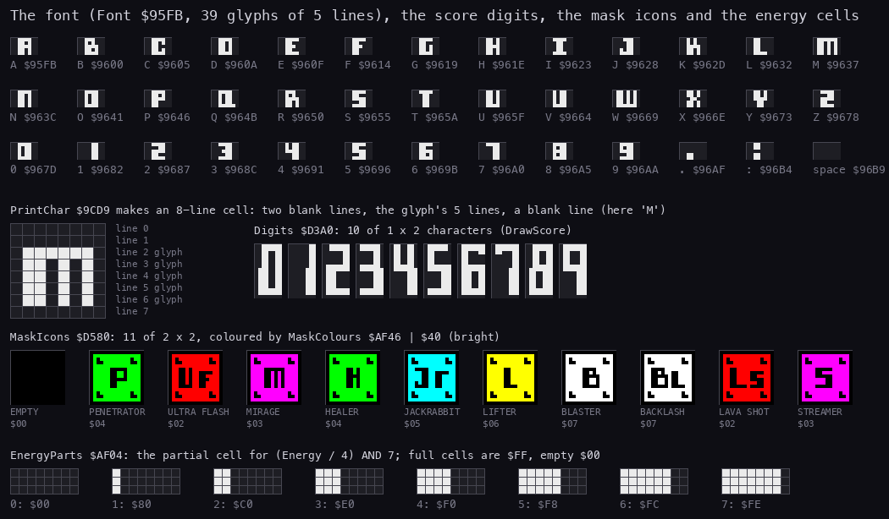

*Figure 8.2: the 39 glyphs with their addresses, the 8-line cell PrintChar makes of one, the score digits Digits
`$D3A0`, the 11 mask icons MaskIcons `$D580` in their colours, and the energy bar's partial cells. Drawn from the game
image. Command: `python3 tools/fig_hud.py font --out docs/img/hud/font.png`.*

How to read: each glyph at scale 4, its character and address under it. The large cell is PrintChar's output for M,
lines 0-7. The icons are drawn in MaskColours `$AF46` OR `$40`: EMPTY is black, and its 32 bytes are all zero.

PrintChar `$9CD9` writes one character at the screen address in DE: two blank lines, the 5 glyph lines, one blank
line, and the attribute `$47` (bright white on black). It then advances E by one. A character with no glyph prints
nothing and does not advance.

```text
PrintChar(A, DE):
    glyph = CharGlyph(A); if none: return          # no advance
    line 0 = 0; line 1 = 0
    lines 2-6 = glyph[0..4]
    line 7 = 0
    attribute of the cell = $47
    E += 1
```

```text
9CD9  C5               PrintChar: PUSH BC
9CDA  E5                          PUSH HL
9CDB  CD BE 96                    CALL CharGlyph
9CDE  20 1E                       JR NZ,l_9CFE            ; no glyph: nothing, no advance
9CE0  4A                          LD C,D
9CE1  06 05                       LD B,$05
9CE3  AF                          XOR A
9CE4  12                          LD (DE),A               ; line 0
9CE5  14                          INC D
9CE6  12                          LD (DE),A               ; line 1
9CE7  14                          INC D
9CE8  7E                  l_9CE8: LD A,(HL)
9CE9  23                          INC HL
9CEA  12                          LD (DE),A               ; lines 2-6: the glyph
9CEB  14                          INC D
9CEC  10 FA                       DJNZ l_9CE8
9CEE  AF                          XOR A
9CEF  12                          LD (DE),A               ; line 7
9CF0  51                          LD D,C
9CF1  6B                          LD L,E
9CF2  7A                          LD A,D
9CF3  0F                          RRCA
9CF4  0F                          RRCA
9CF5  0F                          RRCA
9CF6  E6 03                       AND $03
9CF8  F6 58                       OR $58
9CFA  67                          LD H,A                  ; the attribute address
9CFB  36 47                       LD (HL),$47
9CFD  1C                          INC E
9CFE  E1                  l_9CFE: POP HL
9CFF  C1                          POP BC
9D00  C9                          RET
```

PrintString `$9CBF` prints a string at row D, column E. A string ends at the first byte with bit 7 set, which is
printed too (CharGlyph drops the bit). It returns HL just past the string, so strings can follow each other.

Worked example: "M" is glyph 12, at `$95FB` + 5 x 12 = `$9637`. PrintChar at `$50E1` (row 23, column 1) writes
`$50E1`, `$51E1` blank, the glyph into `$52E1-$56E1`, `$57E1` blank, `$47` into `$5AE1`, and leaves E = `$E2`.

Witness: `l_9CE8` is one of the writers of the c1 pass: the current slot's charges, 2 digits of 5 lines (doc 6,
6.11).

The point: a 5-line font in an 8-line cell. The text sits on lines 2-6, the same lines the Scroller uses for its
glyphs (8.5).

## 8.3 The score and the energy bar

**The score** is 4 BCD bytes at Score `$AE41`, 8 digits. AddScore `$AE45` adds DE (BCD) to the low two bytes with
`DAA` and carries into the top two. DrawScore `$AE60` draws all 8 digits every pass, from Digits `$D3A0`: 10 glyphs of
1 x 2 characters, 16 bytes each.

```text
DrawScore:
    L = $77                                # row 19, column 23
    for each of the 4 bytes of Score:
        DrawDigit(byte >> 4); DrawDigit(byte AND 15)

DrawDigit(d):
    src = $D3A0 + 16 * d
    for half in (row 19, row 20):
        8 lines from src to $50xx + 32 * half
    column += 1
```

```text
AE78  D9               DrawDigit: EXX
AE79  E6 0F                       AND $0F
AE7B  87                          ADD A,A
AE7C  87                          ADD A,A
AE7D  87                          ADD A,A
AE7E  87                          ADD A,A                 ; x 16
AE7F  11 A0 D3                    LD DE,Digits
AE82  83                          ADD A,E
AE83  5F                          LD E,A
AE84  30 01                       JR NC,l_AE87
AE86  14                          INC D
AE87  4D                  l_AE87: LD C,L
AE88  3E 02                       LD A,$02                ; two character rows
AE8A  08                  l_AE8A: EX AF,AF'
AE8B  26 50                       LD H,$50
AE8D  06 04                       LD B,$04
AE8F  1A                  l_AE8F: LD A,(DE)
AE90  13                          INC DE
AE91  77                          LD (HL),A
AE92  24                          INC H
AE93  1A                          LD A,(DE)
AE94  13                          INC DE
AE95  77                          LD (HL),A
AE96  24                          INC H
AE97  10 F6                       DJNZ l_AE8F             ; 8 lines
AE99  79                          LD A,C
AE9A  C6 20                       ADD A,$20               ; the row below
AE9C  6F                          LD L,A
AE9D  08                          EX AF,AF'
AE9E  3D                          DEC A
AE9F  C2 8A AE                    JP NZ,l_AE8A
AEA2  69                          LD L,C
AEA3  2C                          INC L                   ; the next column
AEA4  D9                          EXX
AEA5  C9                          RET
```

**The energy bar** shows Energy `$AEA6` / 4: 0-63 pixel columns in 8 cells, columns 13-20, rows 19-21. DrawEnergyBar
`$AEA8` keeps the value it drew in EnergyShown `$AEA7` and returns at once when it has not changed. Otherwise it draws
(Energy / 4) / 8 full cells (`$FF`), one partial cell from EnergyParts `$AF04`, and empty cells (`$00`) up to column
21. FillCell `$AEE5` fills one column of 3 cells, 24 lines, with one byte.

| (Energy / 4) AND 7 | 0 | 1 | 2 | 3 | 4 | 5 | 6 | 7 |
| --- | --- | --- | --- | --- | --- | --- | --- | --- |
| EnergyParts | `$00` | `$80` | `$C0` | `$E0` | `$F0` | `$F8` | `$FC` | `$FE` |

```text
AEA8  3A A6 AE     DrawEnergyBar: LD A,(Energy)
AEAB  CB 3F                       SRL A
AEAD  CB 3F                       SRL A                   ; / 4
AEAF  21 A7 AE                    LD HL,EnergyShown
AEB2  BE                          CP (HL)
AEB3  77                          LD (HL),A
AEB4  C8                          RET Z                   ; unchanged: nothing to draw
AEB5  5F                          LD E,A
AEB6  21 6D 50                    LD HL,$506D             ; row 19, column 13
AEB9  CB 3F                       SRL A
AEBB  CB 3F                       SRL A
AEBD  CB 3F                       SRL A                   ; full cells
AEBF  28 08                       JR Z,l_AEC9
AEC1  47                          LD B,A
AEC2  0E FF                       LD C,$FF
AEC4  CD E5 AE            l_AEC4: CALL FillCell
AEC7  10 FB                       DJNZ l_AEC4
AEC9  7B                  l_AEC9: LD A,E
AECA  E6 07                       AND $07                 ; the partial cell
...
AED7  CD E5 AE                    CALL FillCell
AEDA  0E 00                       LD C,$00
AEDC  7D                  l_AEDC: LD A,L
AEDD  FE 75                       CP $75                  ; up to column 21
AEDF  C8                          RET Z
AEE0  CD E5 AE                    CALL FillCell
AEE3  18 F7                       JR l_AEDC
```

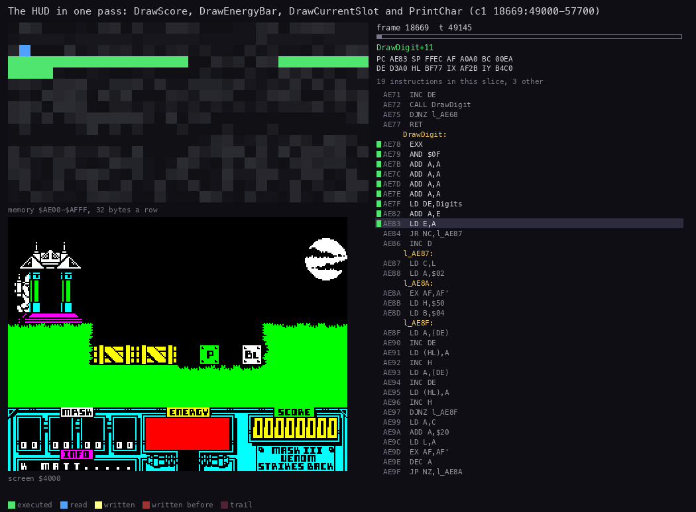

*Animation 8.1: the panel part of the c1 pass: DrawScore's 8 digits, DrawEnergyBar returning at once, DrawCurrentSlot
and PrintBcd. 60 pictures, 1287 instructions. Recording `c1`, window 18669:49000-18669:57700. Command: `python3
../../kit/routine_anim.py --work work/docs/mxB/c1 --window 18669:49000-18669:57700 --listing build/game.lst --view
screen --range AE00-AFFF --pc AE60-AEA5,AEA8-AF03,AF53-AF81,B024-B088,9CD9-9D19,96BE-96FA --pictures 60 --title "..."
--out docs/img/routines/DrawScore.gif`.*

How to read: the left pane is the screen; the digits are rewritten in place with the same values, so the picture
does not change. The code pane shows DrawDigit's loop 8 times, then 4 instructions of DrawEnergyBar.

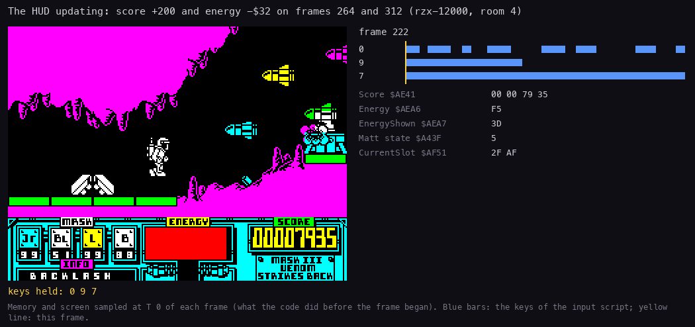

*Animation 8.2: score and energy changing in room 4: +200 at frames 231, 264 and 312, the energy bar shrinking at 264
and 312. Every frame of `rec/rzx-12000`, frames 222-320. Command: `python3 tools/fig_controls.py play --work
work/docs/mxB/r12 --from 222 --to 320 --step 1 --keys tests/inputs/rzx-12000.txt --offset 0 --crop 0,0,256,192
--scale 2 --var 'Score=AE41:4:hex' --var 'Energy=AEA6:1' --var 'EnergyShown=AEA7:1' --var 'Matt state=A43F:1:dec'
--var 'CurrentSlot=AF51:2:hex' --title '...' --delay 80 --out docs/img/play/hud-update.gif`.*

How to read: left, the screen; right, the bytes at T 0 of each frame. Score is the 4 BCD bytes; EnergyShown follows
Energy / 4 one pass later.

Worked example, from the same frames:

| Frame | Score | Energy | Energy / 4 | Full cells | Partial | Pixels |
| --- | --- | --- | ---: | ---: | --- | ---: |
| 227 | 00 00 79 35 | `$F5` | 61 | 7 | 5: `$F8` | 61 |
| 231 | 00 00 81 35 | `$F3` | 60 | 7 | 4: `$F0` | 60 |
| 264 | 00 00 83 35 | `$C1` | 48 | 6 | 0: `$00` | 48 |
| 312 | 00 00 85 35 | `$8F` | 35 | 4 | 3: `$E0` | 35 |

A +200 in AddScore's terms is DE = `$0200`: `$35` + `$00` stays `$35`; `$79` + `$02` gives `$7B`, and `DAA` makes
it `$81`.

Witness: in the c1 pass, DrawScore runs from 18669:49039 to 18669:54954, 5915 T, and writes 128 bytes; DrawEnergyBar
returns after 81 T because Energy / 4 did not change.

The point: the score is redrawn every pass (about 3 % of a pass) although it rarely changes; the energy bar, which
costs more to draw, is redrawn only on a change.

## 8.4 The mask slots and the blink

MaskSlots `$AF2B` holds four slots of 4 bytes: the screen column byte, the kind, the charges (BCD) and the level.
As loaded all four are empty: `61 00 00 00`, `64 00 00 00`, `67 00 00 00`, `6A 00 00 00`. The first byte is the low
byte of the icon's screen address in `$50xx`: `$61` is row 19, column 1. CurrentSlot `$AF51` points at the slot in
use.

DrawCurrentSlot `$AF53` runs every pass and draws only the current slot:

1. DrawIcon `$B024`: the kind's 2 x 2 icon from MaskIcons `$D580` + 32 x kind, and the 4 attributes
   MaskColours `$AF46`[kind] OR `$40` at `$5A00` + column;
2. PrintBcd `$AF6B`: the charges, two digits, at the icon's address + `$40` (row 21).

DrawIcon tests PassCounter `$AF0C` bit 3. When it is set it draws icon 0, EMPTY, whose 32 bytes are zero: the slot
goes blank for 8 passes, then shows for 8. That is the blink of the current slot. The attributes are always the
real kind's.

```text
DrawCurrentSlot:
    s = CurrentSlot
    DrawIcon(s.kind, $5000 + s.column)
    PrintBcd(s.charges, $5000 + s.column + $40)

DrawIcon(kind, at):
    pic = 0 if PassCounter bit 3 else kind        # the blink
    copy MaskIcons[pic], 2 x 2 characters, to at
    attributes of the 2 x 2 cells = MaskColours[kind] | $40
```

```text
B024  F5                DrawIcon: PUSH AF                 ; A = the kind
B025  E5                          PUSH HL
B026  EB                          EX DE,HL
B027  26 00                       LD H,$00
B029  6F                          LD L,A
B02A  3A 0C AF                    LD A,(PassCounter)
B02D  CB 5F                       BIT 3,A
B02F  28 01                       JR Z,l_B032
B031  6C                          LD L,H                  ; bit 3 set: icon 0, blank
B032  29                  l_B032: ADD HL,HL
...                                                       ; x 32 + MaskIcons, 2 x 2 characters
B06F  E1                          POP HL
B070  F1                          POP AF                  ; the real kind again
B071  26 5A                       LD H,$5A
B073  C6 46                       ADD A,$46
B075  5F                          LD E,A
B076  3E 00                       LD A,$00
B078  C6 AF                       ADD A,$AF               ; DE = MaskColours + kind
B07A  57                          LD D,A
B07B  1A                          LD A,(DE)
B07C  F6 40                       OR $40                  ; BRIGHT
B07E  77                          LD (HL),A
```

PrintBcd prints a nibble as `$30` + n, and `$37` + n above 9: it would print A-F, but BCD never has them.
DrawAllSlots `$AFFA` draws all four slots with PassCounter held at 0, so none is blank. The new game (`$91C3`), the
pick-ups (CheckPickups `$B126`), MoonMasks `$ADD2` and `$BA21` call it.

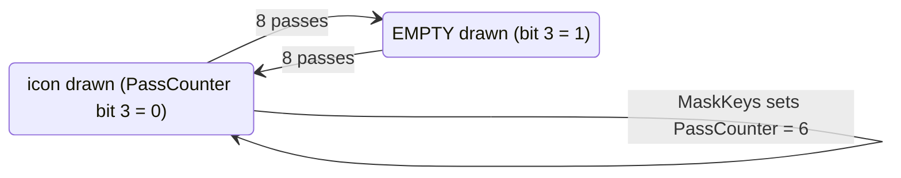

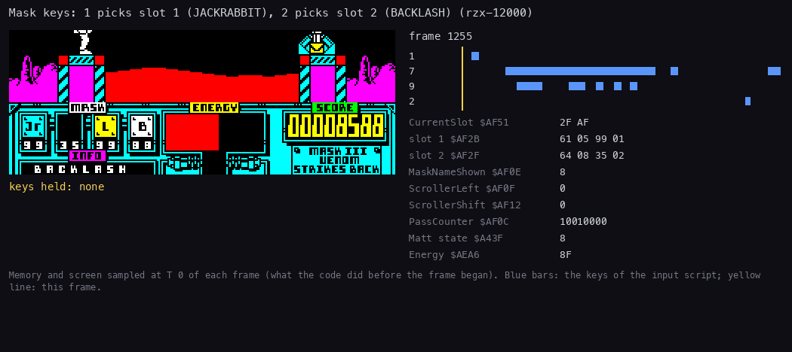

*Animation 8.3 (from [doc 5](05-controls.md#57-the-mask-keys-1-4)): 1 picks slot 1 (JACKRABBIT) at frame 1262, 2
picks slot 2 (BACKLASH) at 1456; the current slot blinks and the message line scrolls each name. Every third frame of
`rec/rzx-12000`, frames 1255-1480. Command: `python3 tools/fig_controls.py play --work work/docs/mxB/r12 --from 1255
--to 1480 --step 3 --keys tests/inputs/rzx-12000.txt --offset 0 --crop 0,96,256,192 --var 'CurrentSlot=AF51:2:hex'
--var 'slot 1=AF2B:4:hex' --var 'slot 2=AF2F:4:hex' --var 'MaskNameShown=AF0E:1:dec' --var 'ScrollerLeft=AF0F:1:dec'
--var 'ScrollerShift=AF12:1:dec' --var 'PassCounter=AF0C:1:bits' --var 'Matt state=A43F:1:dec' --var
'Energy=AEA6:1' --title '...' --delay 70 --out docs/img/play/mask-keys.gif`.*

How to read: the bottom half of the screen; PassCounter is shown as bits, and the current slot's icon disappears
while bit 3 is 1.

Worked example: at 2.41 frames a pass ([doc 4](04-game-loop.md#frames-a-pass)), 16 passes are about 39 frames: the
icon is on for about 0.4 s and off for 0.4 s. MaskKeys sets PassCounter to 6, so a newly chosen slot shows for 2
passes before its first blank.

Witness: in the c1 pass DrawCurrentSlot runs from 18669:55035 to 18669:57699 (2664 T) and writes 36 icon bytes
(`l_B040`) and the two charge digits.

The point: one slot redrawn a pass, and the blink costs nothing: it is the same draw with icon 0.

## 8.5 The scroller

The message line is row 23, columns 1-11, lines 1-6 of the cell. The Scroller `$AF82` runs in every interrupt
([doc 4](04-game-loop.md#43-the-interrupt-handler)). Each call shifts the 6 lines left by one pixel across the 11
bytes (`RL (HL)` from column 11 down to column 1) and shifts in one bit from a 6-byte glyph buffer at `$AF14`: line 0
blank, lines 1-5 the glyph. Every 8 shifts ScrollerNextChar `$AFE0` loads the next character's glyph into `$AF15`.

| Byte | Name | Meaning |
| --- | --- | --- |
| `$AF0F` | ScrollerLeft | characters left in the text |
| `$AF10/$AF11` | ScrollerPtr | the next character |
| `$AF12` | ScrollerShift | pixels left of the current character, 8 down to 1; 0 = stopped |
| `$AF14-$AF19` | the glyph buffer | shifted out bit by bit |
| `$B0FB-$B0FE` | MessageState | a looping message: start, length, flag |

```text
Scroller:                                      # every interrupt
    if ScrollerLeft == 0:
        if MessageState.loop: ScrollerPtr, ScrollerLeft = MessageState.start, .length; again
        else: ScrollerShift = 0; return
    ScrollerShift -= 1
    if ScrollerShift == 0: ScrollerShift = ScrollerNextChar()     # 8
    for line in 1..6:
        carry = glyph[line - 1] << 1
        RL the 11 bytes of row 23, line, from column 11 to column 1
```

```text
AFAC  21 14 AF                    LD HL,$AF14             ; the glyph buffer
AFAF  D9                          EXX
AFB0  06 06                       LD B,$06                ; 6 lines
AFB2  21 EB 51                    LD HL,$51EB             ; row 23, column 11, line 1
AFB5  5D                  l_AFB5: LD E,L
AFB6  D9                          EXX
AFB7  CB 26                       SLA (HL)                ; the next pixel of the glyph
AFB9  23                          INC HL
AFBA  D9                          EXX
AFBB  CB 16                       RL (HL)                 ; column 11
AFBD  2D                          DEC L
AFBE  CB 16                       RL (HL)                 ; column 10
...                                                       ; down to column 1
AFDB  6B                          LD L,E
AFDC  24                          INC H                   ; the next line
AFDD  10 D6                       DJNZ l_AFB5
AFDF  C9                          RET
```

Two callers feed it:

- ShowMaskName `$B0CE` (MaskKeys runs into it; also `$B191`, `$B233`, `$BA63`): 12 characters from the name at
  MaskNames `$B197` + 11 x kind, so the twelfth is the first character of the next name. It returns at once if the
  same name is shown (MaskNameShown `$AF0E`);
- ShowMessage `$B0FF` (RoomMessage): a bit-7-terminated message, counted, stored in MessageState with the loop flag,
  so it repeats until a mask name replaces it.

Worked example: one pixel an interrupt is 50 pixels a second; a character is 8 interrupts, 0.16 s. A mask name, 12
characters, takes 96 frames to pass through, 1.9 s. The 11-byte window holds 11 characters, so a name is wholly in
view for one moment only.

Witness: in the c1 pass the Scroller wrote 66 bytes three times (198 writes, `l_AFB5`), at about T 2814 after each
interrupt (18670:0, 18671:0, 18672:0). In `mask-keys.gif`, ScrollerLeft counts 12 down after each key.

The point: the message line moves at the interrupt's steady 50 Hz while the play window runs at 20 passes a second.
It is the only smooth motion on the screen.

## 8.6 The messages and the passwords

RoomMessage `$AD28`, the last step of DrawRoom, shows a message on the first screen of five rooms. For a password
room it first builds the text: BuildMessage `$ADBF` turns the password's key codes into characters (KeyCodeToChar
`$A119`) after "PASSWORD IS ", and sets bit 7 on the last one.

| Room, screen 0 | Message |
| --- | --- |
| 0 | GOOD LUCK MATT...... |
| 11 | ...CODE BROKEN.....PASSWORD IS MAYHEM |
| 3 | ...CODE BROKEN.....PASSWORD IS TRANSMOGRIFY |
| 7 | ...CODE BROKEN.....PASSWORD IS VALKYR |
| 10 | ...CODE BROKEN.....PASSWORD IS PETALS OF DOOM |

```text
RoomMessage:
    if RoomScreen != 0: return
    if RoomNumber == 0: ShowMessage("GOOD LUCK MATT......")
    for (password, room) in (MAYHEM, 11), (TRANSMOGRIFY, 3), (VALKYR, 7), (PETALS OF DOOM, 10):
        BuildMessage(password into $ADAF)
        if RoomNumber == room: ShowMessage("...CODE BROKEN.....PASSWORD IS " + password)
```

Every string of the game (`src/res/texts/`):

| Address | Name | Strings |
| --- | --- | --- |
| `$9D6C` | MenuStrings | 15 menu strings, each with its column and row: PROGRAM FUNGUS, GRAPHICS MARCOS DUROE, MUSIC BENN, HISCORE, 1.KEMPSTON, 2.INTERFACE 2, 3.CURSOR, 4.KEYBOARD, K.DEFINE KEYS, P.ENTER PASSWOID, FIRE. START GAME |
| `$AD7C` | Messages | GOOD LUCK MATT......; ...CODE BROKEN.....PASSWORD IS and a 16-byte buffer (`$ADAF`) |
| `$AE1D` | EndTexts | YOU HAVE FOUND SCOTT......; WELL DONE. |
| `$B197` | MaskNames | EMPTY, PENETRATOR, ULTRA FLASH, MIRAGE, HEALER, JACKRABBIT, LIFTER, BLASTER, BACKLASH, LAVA SHOT, STREAMER (11 characters each, centred) |
| `$A009` | Passwords | MAYHEM, TRANSMOGRIFY, VALKYR, PETALS OF DOOM, as key codes (row x 16 + bit) |
| `$BB01` | GameOverText | MISSION TERMINATED |

The menu says "PASSWOID": the bytes have it so. The DEFINE KEYS prompts and the password prompt are in
[doc 5](05-controls.md#54-define-keys).

Worked example: the room 11 message is 19 + 12 + 6 = 37 characters. At 8 frames a character it takes 296 frames,
about 6 s, to scroll through once, then it starts again.

Witness: stage 2's `play2` shows the passwords at work: `play2-000500-password-mayhem.png` and
`play2-002500-password-petals.png`.

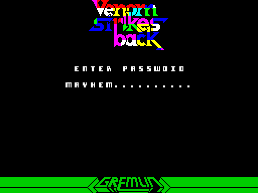

*Figure 8.3: `rec/play2` at frame 500: the menu after MAYHEM was typed.*

The point: the passwords are stored once, as key codes, and serve both the menu's check
([doc 5](05-controls.md#59-the-password-entry-and-the-cheat)) and the message, so the two cannot disagree.

## 8.7 The menu screen

Menu `$9723` builds the menu screen:

1. NotInPlay `$970D` = `$FF`;
2. if HudSaved `$9710` is 0, SaveHud `$9CA0` copies the panel from the screen to PlayPanel `$F600` and its
   attributes to PanelAttrs `$FC64`; then HudSaved = 0;
3. MenuWipe `$984D`: the attributes wiped diagonally, one step a frame;
4. ClearScreen, the logo MenuLogo `$99F0` at row 0, column 11, the badge, a full pixel line across row 23 (`$52E0`),
   the banner;
5. MenuLoop: DrawMenu `$9D1A` prints the 15 strings and lights the chosen control; each frame `HALT` and one key.

The menu's interrupt, MenuInterrupt `$9899`, recolours the logo line by line (LogoRaster `$9951`), scrolls colours
and copies 7 rows of 10 attributes from `$F0C0` to the logo. It takes 64 914 T of a 70 908 T frame, 91.5 %
([doc 4](04-game-loop.md#what-the-handler-costs)).

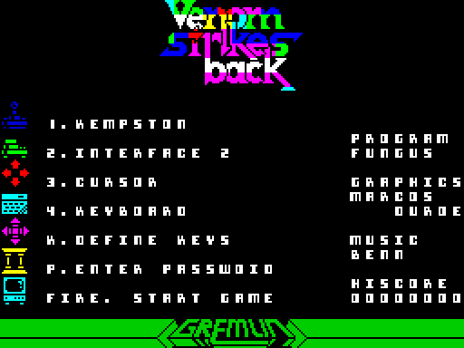

*Figure 8.4: `c1` at frame 17 750: the menu. The credits at the right, the options at the left, the high score under
HISCORE.*

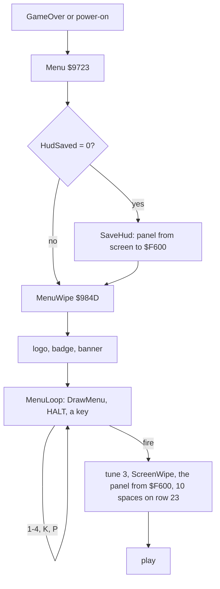

```text
981C  21 00 F6                    LD HL,PlayPanel
981F  11 00 12                    LD DE,$1200             ; row 18, column 0
9822  01 06 20                    LD BC,$2006             ; 32 x 6 characters
9825  CD B8 99                    CALL DrawGraphic
9828  21 64 FC                    LD HL,PanelAttrs
982B  11 40 5A                    LD DE,$5A40
982E  01 C0 00                    LD BC,$00C0
9831  ED B0                       LDIR                    ; the panel's 192 attributes
9833  11 E1 50                    LD DE,$50E1             ; row 23, column 1
9836  06 0A                       LD B,$0A
9838  3E 20               l_9838: LD A,$20
983A  CD D9 9C                    CALL PrintChar          ; 10 spaces: the message line cleared
983D  10 F9                       DJNZ l_9838
```

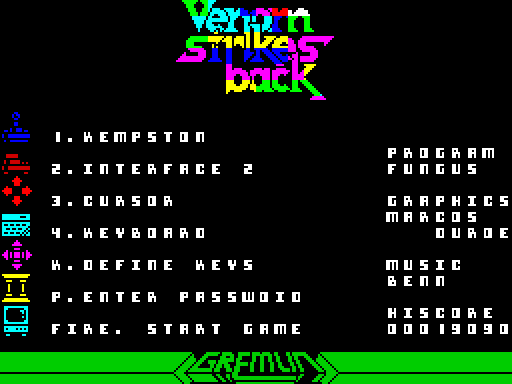

*Figure 8.5: `rec/rzx-28000` at frame 3250: the menu after the game that ended on the moon, HISCORE 00019090.*

Worked example: HudSaved is loaded as `$FF`, so the first Menu skips SaveHud and the panel at `$F600` is the tape's.
The first game's start runs BuildTables, which writes its tables over `$F600-$FDFF`. At game over the next Menu finds
HudSaved = 0 and saves the panel from the screen first: so from the second game on, the panel that is put up is the
last game's, with its last score and slots, until DrawScore and the slot code overwrite them.

Witness: `c1` shows the menu from frame 17 750; the menu's 15 strings and the high score are in the screenshots.

The point: the menu is cheap code with an expensive interrupt. The panel's double use of `$F600` is why SaveHud
exists.

## 8.8 Game over and the high score

There are no lives. GameOver `$BACC` runs when Matt dies (doc 10): tune 2, MISSION TERMINATED printed slowly at row 4,
column 7, then the high score check, then GameStart, which goes to the menu.

SlowPrint `$BB13` waits 70 frames, prints the text one character every 4 frames with a flashing white cursor
(PrintSpace `$BB38`: a space with attribute `$C7`) after it, and waits 100 frames at the end.

```text
GameOver:
    TuneRequest = 2
    SlowPrint("MISSION TERMINATED", row 4, column 7)
    if Score >= Hiscore (4 BCD bytes, top first): Hiscore = Score
    goto GameStart                                  # the menu
```

```text
BAE0  21 16 9D                    LD HL,Hiscore
BAE3  11 41 AE                    LD DE,Score
BAE6  06 04                       LD B,$04
BAE8  1A                  l_BAE8: LD A,(DE)
BAE9  BE                          CP (HL)
BAEA  DA F9 CB                    JP C,GameStart          ; lower: keep the high score
BAED  20 04                       JR NZ,l_BAF3            ; higher: copy
BAEF  23                          INC HL
BAF0  13                          INC DE
BAF1  10 F5                       DJNZ l_BAE8             ; equal so far: the next byte
BAF3  21 41 AE            l_BAF3: LD HL,Score
BAF6  11 16 9D                    LD DE,Hiscore
BAF9  01 04 00                    LD BC,$0004
BAFC  ED B0                       LDIR
BAFE  C3 F9 CB                    JP GameStart
```

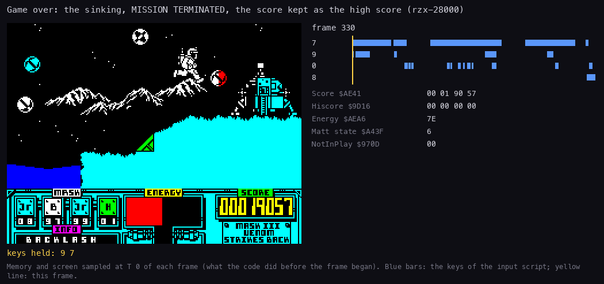

*Animation 8.4: Matt sinks on the moon, MISSION TERMINATED is printed, the score becomes the high score, the menu
wipe and the menu, a new game. Every fifth frame of `rec/rzx-28000`, frames 330-1060. Command: `python3
tools/fig_controls.py play --work work/docs/mxB/r28 --from 330 --to 1060 --step 5 --keys tests/inputs/rzx-28000.txt
--offset 0 --crop 0,0,256,192 --var 'Score=AE41:4:hex' --var 'Hiscore=9D16:4:hex' --var 'Energy=AEA6:1' --var
'Matt state=A43F:1:dec' --var 'NotInPlay=970D:1' --title '...' --delay 70 --out docs/img/play/game-over.gif`.*

How to read: left, the screen; right, Score, Hiscore, Energy, Matt's state and NotInPlay at T 0 of each frame.

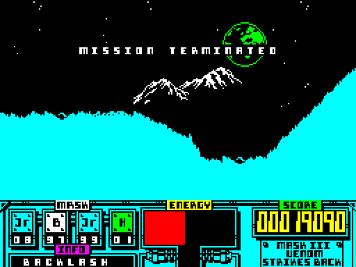

*Figure 8.6: `rec/rzx-28000` at frame 750: MISSION TERMINATED over the moon.*

Worked example: SlowPrint of the 18 characters takes 70 + 18 x 4 + 100 = 242 frames, 4.8 s. In the recording the text
appears from about frame 630, and Hiscore is `00 01 90 90` by frame 775: the score of that game.

Witness: in `game-over.gif` Energy stays `$74` through the death: this death is not the energy running out but the
moon's sinking (doc 10). Hiscore changes once, at the check.

The point: the high score is 4 BCD bytes compared top byte first; equal scores copy too. It lives at Hiscore `$9D16`
and survives until power-off.

## 8.9 The ending

DrawRoom sends room 15, screen 5 (RoomScreen `$28`) to Ending `$ADF6` instead of drawing it. Ending clears the whole
screen and attributes (`$4000-$5AFF`), SlowPrints "YOU HAVE FOUND SCOTT......" at row 8, column 1 and "WELL DONE." at
row 12, column 8, and goes to GameStart. There is no high score check on this path.

```text
Ending:
    clear $4000-$5AFF
    SlowPrint("YOU HAVE FOUND SCOTT......", row 8, column 1)
    PrintChar(" ")                                  # the cursor removed
    SlowPrint("WELL DONE.", row 12, column 8)
    goto GameStart
```

```text
ADF6  21 00 40            Ending: LD HL,$4000
ADF9  11 01 40                    LD DE,$4001
ADFC  01 FF 1A                    LD BC,$1AFF
ADFF  36 00                       LD (HL),$00
AE01  ED B0                       LDIR                    ; the whole screen black
AE03  11 01 08                    LD DE,$0801             ; row 8, column 1
AE06  21 1D AE                    LD HL,EndTexts
AE09  CD 13 BB                    CALL SlowPrint
AE0C  3E 20                       LD A,$20
AE0E  CD D9 9C                    CALL PrintChar
AE11  11 08 0C                    LD DE,$0C08             ; row 12, column 8
AE14  21 37 AE                    LD HL,EndTexts+$001A
AE17  CD 13 BB                    CALL SlowPrint
AE1A  C3 F9 CB                    JP GameStart
```

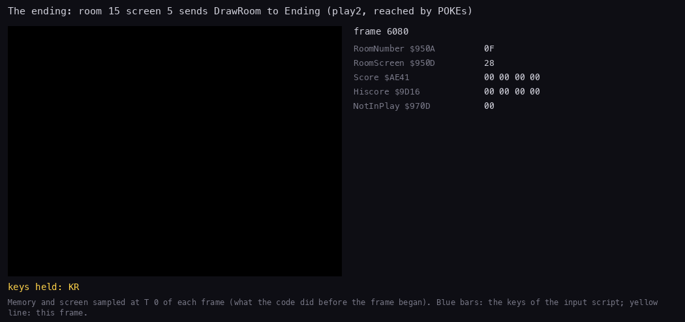

*Animation 8.5: the ending in `rec/play2`: Matt reaches room 15 screen 5, the screen clears, the two lines are typed.
Every fourth frame, frames 6080-6640. Command: `python3 tools/fig_controls.py play --work work/docs/mxB/p2 --from 6080
--to 6640 --step 4 --keys tests/inputs/s2play.txt --offset 0 --crop 0,0,256,192 --var 'RoomNumber=950A:1' --var
'RoomScreen=950D:1' --var 'Score=AE41:4:hex' --var 'Hiscore=9D16:4:hex' --var 'NotInPlay=970D:1' --title '...'
--delay 70 --out docs/img/play/ending.gif`.*

How to read: left, the screen; right, RoomNumber and RoomScreen (40 = `$28`), Score and Hiscore. Hiscore does not
change.

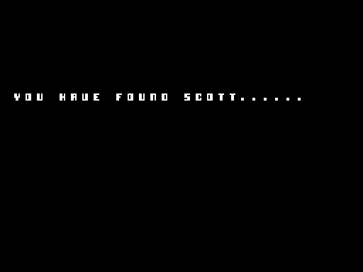

*Figure 8.7: `rec/rzx-36000` at frame 250: the RZX run's ending.*

Worked example: the two SlowPrints take (70 + 26 x 4 + 100) + (70 + 10 x 4 + 100) = 274 + 210 = 484 frames, 9.7 s,
before the menu.

Witness: in `ending.gif` RoomNumber is 15 and RoomScreen 40 when the screen clears, and Hiscore stays as it was.

The point: the ending is two lines of text. Because it skips the high score check, a winning score never becomes the
high score (8.10).

## 8.10 Known only from the code

- **The panel's second life.** From the second game on, the panel put up at the start is the one SaveHud copied from
  the screen at the end of the last game, because BuildTables reuses `$F600-$FDFF` (8.7).
- **The blink is a blank icon.** DrawIcon draws icon 0 (32 zero bytes) on PassCounter bit 3; the attributes stay
  (8.4).
- **The ending keeps no high score.** Ending goes to GameStart without the check GameOver makes (8.9).
- **PrintBcd prints hexadecimal.** It handles nibbles above 9 as A-F, which BCD never produces.
- **A character without a glyph** prints nothing and does not move the cursor: such bytes vanish from a string.
- **The menu's colours live in the map.** MenuInterrupt copies attributes from `$F0C0`, the first shown row of the
  character map, which the menu reuses as a colour buffer.
