# 9. Sound

What this covers:

- the two sound paths of the interrupt: the AY on a 128K, the beeper on a 48K, and what each costs;
- the effect record, 14 bytes, read in full by the AY path and in part by the beeper;
- how an effect reaches its AY channel (PlayEffect, StartEffects, EffectStart);
- the AY player in RAM 4: its entry points, the order lists and patterns, the envelope;
- the three tunes, decoded and rendered, and when each plays;
- the 18 effects one by one, decoded and rendered;
- the beeper engine and its quirks;
- 48K against 128K;
- the bugs, and what is known only from the code.

The recordings it rests on ([WALKTHROUGH 6.0](../WALKTHROUGH.md#60-the-recordings)):

- `c1`: power-on on the 128K, the original tape, the menu, then play in room 0. It runs the AY path. It was opened on
  an own instance, after `. work/env.sh`:
  `python3 $RS open --work work/docs/mxC/c1 --ttd work/stage1/c1/session.ttd --model 128K --port-base 37790`. The game state was sampled at every TTD frame 18 000-22 300 by
  `work/docs/mxC/sample.py` into `work/docs/mxC/c1/vars.jsonl`. One window was traced: TTD frames 19 325-19 328, the
  first BACKLASH shot.
- `rec/rzx-00000` to `rec/rzx-36000`: the ZXDB RZX run in ten segments, each replayed from the RZX's own state. The RZX
  was made on a 48K: its memory has MachineFlag `$FFFE` = 1, so these segments run the beeper path even on the 128K
  model. Each was sampled at every frame the same way (`work/docs/mxC/sample_all.sh`). In `rzx-00000` frames 995-997
  were traced: an explosion on the beeper.
- stage 2's `c48`: the tape on the 48K model. BeeperState `$94AB` was sampled at every frame 0-2175 by
  `work/docs/mxC/sample48.py` into `work/docs/mxC/c48/beeper.jsonl`. No effect plays in it (it holds the load, not
  play), so the beeper's witness is the RZX run.
- `tools/fig_sound.py`: the game's own sound code run in SkoolKit's Z80 simulator from the case's build
  (`build/game.bin` at `$6000`, `build/music.bin` at `$C000`), one frame at a time as the interrupt runs it. It writes
  the audio, the charts and the numbers of this document. The audio is written to files, never played.

A sample of frame N is the memory at the start of frame N. A trace shows an instruction in the frame in which it ran.

## 9.1 The two sound paths and their cost

Interrupt `$9226` runs once a frame (IM 2, [doc 4](04-game-loop.md)). After the frame counter and the border it reads
MachineFlag `$FFFE`. The loader leaves 0 there on a 128K and `$FF` on a 48K ([doc 3](03-build-and-load.md)). The flag
picks one of two paths:

- **128K**: page RAM 4 in (`OUT ($7FFD)` with `$14`), start a waiting tune, stop a waiting tune, stop the effects that
  were asked to stop, start a waiting effect, run one frame of the AY player (MusicPlay `$C003`), restart tune 1 in
  the menu, page RAM 0 back (`$10`).
- **48K**: StopBeeper `$949F` and BeeperTick `$94C8`, which plays one burst of the current effect on port `$FE`.

The two paths never meet. A 128K never touches the beeper. A 48K never reads RAM 4: it has none, and the loader skips
the music block on a 48K.

```text
Interrupt:                                   # once a frame, every register saved
    FrameCounter += 1; OUT ($FE), BorderColour
    if MenuFlag == 0: CheatCheck()  else: MenuInterrupt()
    if MachineFlag == 0:                     # 128K
        OUT ($7FFD), $14                     # RAM 4 at $C000
        if TuneRequest: MusicStart(TuneRequest - 1); TuneRequest = 0
        if StopRequest: MusicStop();          StopRequest = 0
        StopEffects(); StartEffects(); MusicPlay()
        if NotInPlay and MusicTune != $FF: MusicStart(0)     # the menu tune again
        OUT ($7FFD), $10                     # RAM 0 back
    else:                                    # 48K
        StopBeeper(); BeeperTick()
    if not NotInPlay: Scroller(); if CAPS SHIFT + SPACE: GameStart
```

```asm
  LD A,(MachineFlag)
  AND A
  JR NZ,l_9291          ; 48K
  LD BC,$7FFD
  LD A,$14
  OUT (C),A             ; RAM 4 in
  LD A,(TuneRequest)
  AND A
  JR Z,l_9262
  DEC A
  CALL MusicStart
  ...
l_926F:
  CALL StopEffects
  CALL StartEffects
  CALL MusicPlay
  ...
l_9288:
  LD BC,$7FFD
  LD A,$10
  OUT (C),A             ; RAM 0 back
  JR l_9297
l_9291:
  CALL StopBeeper
  CALL BeeperTick
```

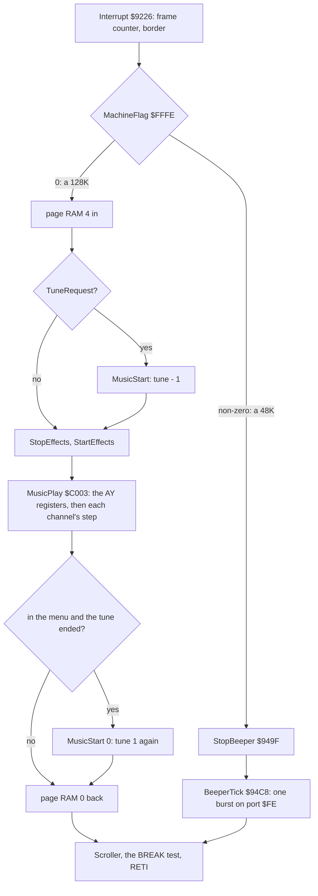

Worked example: the two paths in the recordings. In `c1` (128K) the interrupt calls StartEffects `$9421`, StopEffects
`$946F` and MusicPlay `$C003` 7279 times in the window of WALKTHROUGH 1, once an interrupt. In `rzx-00000` the byte at
`$FFFE` reads `$01` at every sampled frame, and BeeperState `$94AB` counts down. At TTD frame 990 it holds `$12` with
the record pointer `$930A`: effect 3, the BACKLASH shot, 18 of its 30 bursts left. At frame 996 it holds `$05` with
the pointer `$9388`: effect 12, an explosion, 5 bursts.

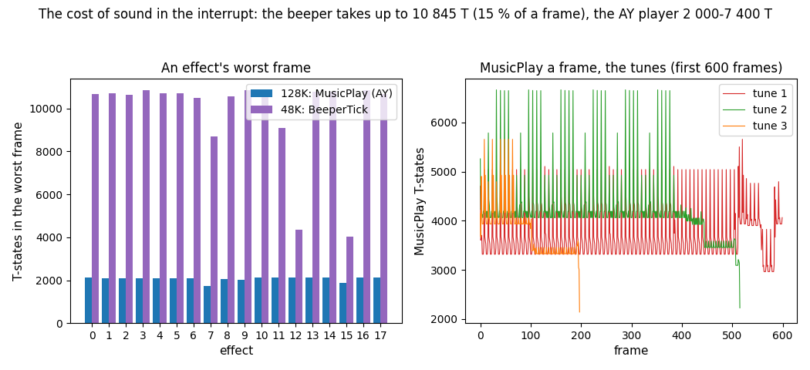

How to read it: left, the T-states of the worst frame of each of the 18 effects. Blue is MusicPlay on the AY path with
only that effect sounding, violet is BeeperTick on the beeper path. Right, MusicPlay's T-states at each of the first
600 frames of the three tunes. Recording: none, the simulator runs the build's code. Made by `python3
tools/fig_sound.py fig-cost docs/img/sound/cost.png`, after `python3 tools/fig_sound.py effects docs/audio` and
`python3 tools/fig_sound.py tunes docs/audio`.

| Path | Routine | T-states a frame | Share of a frame |
| --- | --- | ---: | ---: |
| 128K, a tune | MusicPlay `$C003` | 2141-7394 (median 3934-4192) | 3-10 % of 70 908 T |
| 128K, effects only (in play) | MusicPlay `$C003` | 1740-2144 at an effect's worst frame | about 3 % |
| 48K, an effect | BeeperTick `$94C8` | up to 10 845 | up to 15.5 % of 69 888 T |
| 48K, silence | BeeperTick `$94C8` | a few dozen (BeeperState 0 returns at once) | 0 |

**The point**: one flag at `$FFFE` splits all sound in two. The beeper path costs up to five times the AY path,
because the CPU itself must make every edge of the wave.

Witness: Interrupt L1 63 268 (`c1`, `cheat`, `door`, `door3`, `kind6`, `masks`, `play2`, `rzx-` x10); StartEffects and StopEffects L1 26 094 (`c1`,
`door`, `play2`, never in an `rzx-` segment); StopBeeper and BeeperTick L1 37 174 (the ten `rzx-` segments only)
(`src/game/interrupt.asm`); `$FFFE` = `$01` in the `rzx-00000` samples.

## 9.2 The effect record, byte by byte

EffectTable `$92E0` holds 18 records of 14 bytes (`src/res/tables/effects.csv`). The first ten bytes have the layout of
the AY player's instruments: a volume envelope, a pitch sweep and the flags. The last four start the effect: the
channel, the length and the start period. The 48K reads only four bytes: the sweep word, the length and the period.

Volumes are kept in eighths: the AY register gets the value shifted right three times, so `$7F` is volume 15.

| Byte | Name | AY path | Beeper path |
| --- | --- | --- | --- |
| +0 | attack | added to the volume each frame until it reaches the peak; with flag bit 2, the R13 envelope shape | |
| +1 | decay | added (signed) each frame after the peak, down to the sustain level | |
| +2 | sustain | the sustain level | |
| +3 | release | added (signed) each frame once the hold runs out, down to 0 | |
| +4 | peak | the top volume; with flag bit 2, the R11 envelope period | |
| +5 | sweep delay | frames before the pitch sweep starts (`$FF`: never) | |
| +6 | sweep turn | 0: one way for ever; bit 7: one run, then stop; else back and forth, the first run half as long | |
| +7, +8 | sweep word | added to the period offset each step | added to the pitch word each frame |
| +9 | flags | bit 0 tone, bit 1 noise, bit 2 the AY's own envelope | |
| +A | slot | 1 channel A, 2 channel B, else channel C | |
| +B | length | the hold in frames (`$FF`: until stopped) | the burst count (`$FF`: until stopped) |
| +C, +D | period | the AY tone period at the start | the pitch word at the start |

With the noise flag the channel also sets the noise generator: R6 gets the tone period's low byte rotated right three
times, so the noise follows the pitch (WriteRegisters `$C422`).

```text
record(n) = EffectTable + 14 * n                 # PlayEffect: ((2n + n) * 2 + n) * 2
volume:  attack (+0 a frame) to peak (+4); decay (+1 a frame) to sustain (+2);
         hold while the length counter (+B) runs; release (+3 a frame) to 0; the channel goes off
pitch:   after +5 frames: offset += sweep (+7/+8) each frame; +6 turns it back or stops it
R13:     flags bit 2: R13 = +0, R11 = +4, R12 = 0, volume register 16 (the envelope); off when the hold runs out
48K:     BeeperState = +B; pitch = +C/+D; every frame pitch += +7/+8
```

```asm
PlayEffect:
  ...
  LD L,A
  LD E,A
  LD H,$00
  LD D,H
  ADD HL,HL             ; 2n
  ADD HL,DE             ; 3n
  ADD HL,HL             ; 6n
  ADD HL,DE             ; 7n
  ADD HL,HL             ; 14n
  LD DE,EffectTable
  ADD HL,DE
```

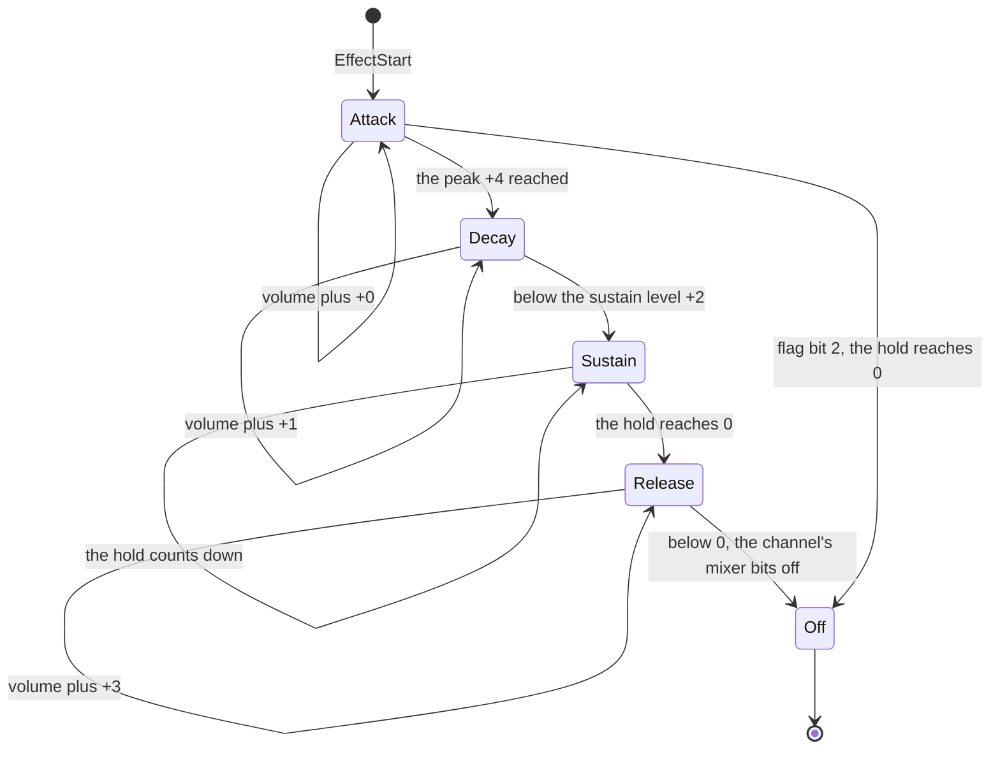

Worked example: effect 3, the BACKLASH shot, at `$930A`: `7F FD 01 FF 7F 02 00 03 00 03 01 1E 44 00`.

- Attack `$7F` reaches the peak `$7F` (volume 15) in the first frame.
- Decay `$FD` takes 3 eighths a frame, so the volume falls to the sustain level 1 in 42 frames.
- The hold of `$1E` = 30 frames has run out by then, so release `$FF` takes the last eighth and the channel goes off.
  The simulator counts 47 frames to silence.
- The sweep starts after 2 frames and adds 3 to the period a frame, one way: the tone falls.
- Flags `$03`: tone and noise. Slot 1: channel A.
- The start period `$0044` = 68 is a 1630 Hz tone on the 128K's 1.7734 MHz AY.
- On a 48K the same record gives 30 bursts at pitch `$44`, the period rising by 3 a frame (the tone falling).

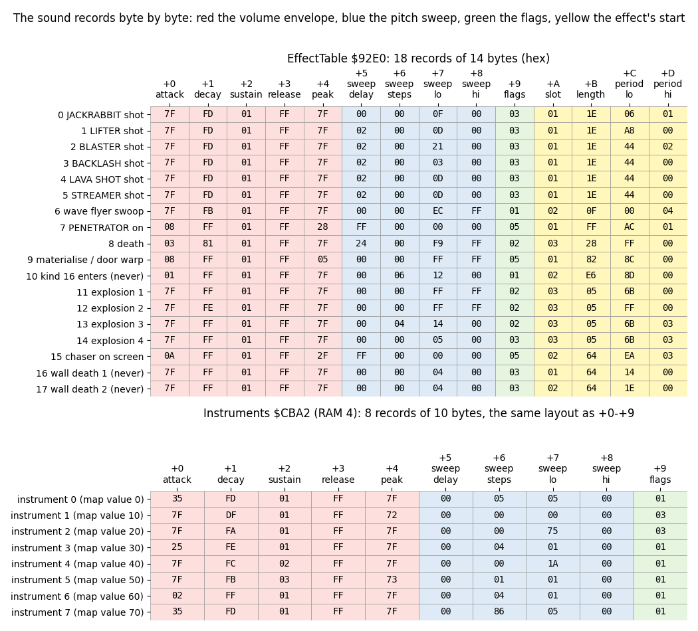

How to read it: one row a record, the bytes in hex. Red is the volume envelope (+0 to +4), blue the pitch sweep (+5 to
+8), green the flags (+9), yellow the bytes that start the effect (+A to +D). Below, the eight instruments of the
player at `$CBA2` (RAM 4), whose ten bytes mean the same. Recording: none, the bytes of the build. Made by `python3
tools/fig_sound.py fig-records docs/img/sound/records.png`.

**The point**: an effect is an instrument plus a channel, a length and a start pitch. The player that plays the tunes
plays the effects too, and the 48K borrows three of the bytes for a much simpler sound.

Witness: EffectTable `$92E0` read by PlayEffect `$93DC` (L1 638, `c1`, `cheat`, `door`, `door3`, `kind6`, `masks`, `play2`, `rzx-` x9), by StartEffects
(+B to +D) and by EffectStart `$C36A` (+0 to +9, L1 5258 in `c1`, `cheat`, `door3`, `kind6`, `masks`, `rec/menu`, `play2`); the envelope steps in Envelope
`$C4D5` and the sweep in NoiseStep (`src/music/music-module.asm`).

## 9.3 PlayEffect, StartEffects and EffectStart: an effect onto its channel

The main loop calls PlayEffect `$93DC` with A = the effect's number. On a 128K it does not touch the AY. It stores the
record's address in one of three slots, EffectSlots `$941B`, chosen by the record's +A byte. A later effect for the
same channel overwrites the slot.

At the next interrupt StartEffects `$9421` takes the first waiting slot (A, then B, then C), clears it and jumps to
EffectStart `$C36A` in RAM 4. IX is the channel's block and IY the record. EffectStart copies the envelope and the
sweep into the block and clears the channel's mixer bits for tone and noise as the flags ask. With flag bit 2 it starts
the AY's hardware envelope. Only one slot starts a frame: StartEffects returns after the first.

StopEffects `$946F` runs just before. EffectStops `$946C` holds three flags. A set flag zeroes the channel block's +6,
the hold, so the envelope goes to its release (or off, for an R13 effect). The game sets them in four places:

- EndPenetrator: channel A, the PENETRATOR's endless sound;
- the chaser: channel B, when it leaves the screen or dies;
- DrawRoom: channel B, at every room drawn;
- GameOver: channel A gets MachineFlag, so 0 on a 128K.

```text
PlayEffect(n):                                # main loop, any time
    rec = EffectTable + 14 n
    if MachineFlag: BeeperStart(rec); return  # 48K, 9.7
    EffectSlots[rec.slot] = rec                # 1 A, 2 B, else C
StopEffects():                                 # interrupt, 128K
    for ch in A, B: if EffectStops[ch]: block[ch].hold = 0; EffectStops[ch] = 0; BeeperState = 0
    if not EffectStops[C]: block[C].hold = 0; EffectStops[C] = 0; BeeperState = 0   # inverted, see 9.9
                                               # BeeperState = 0 is harmless on the 128K
StartEffects():
    for ch in A, B, C:
        if EffectSlots[ch]:
            rec = EffectSlots[ch]; EffectSlots[ch] = 0
            EffectStart(IX = block[ch], IY = rec, C = rec.length, HL = rec.period)
            return                             # one a frame
```

```asm
StartEffects:
  LD HL,(EffectSlots)
  LD A,H
  OR L
  JR Z,l_9441           ; slot A empty: try B
  PUSH HL
  POP IY                ; IY = the record
  LD IX,EffectChannelA
  LD HL,$0000
  LD (EffectSlots),HL   ; the slot is free again
l_9435:
  LD C,(IY+$0B)         ; the length
  LD L,(IY+$0C)
  LD H,(IY+$0D)         ; the period
  JP EffectStart
```

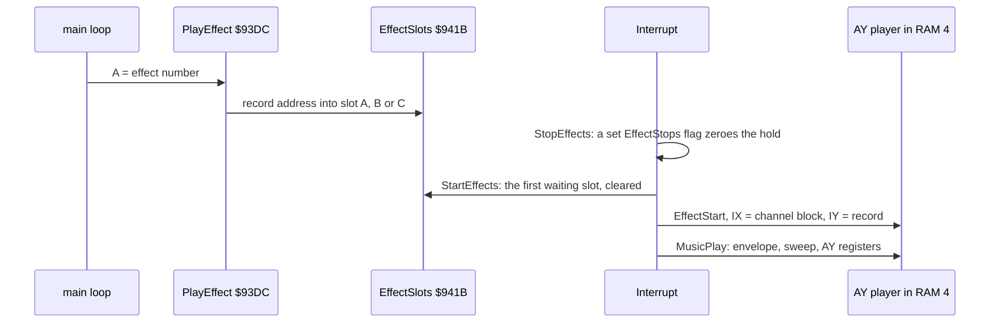

Worked example: `c1`, the first BACKLASH shot. Matt fired at TTD frame 19 326: the slot's charges went from `$99` to
`$98`. FireMask called PlayEffect with A = 8 - 5 = 3 (BACKLASH is mask kind 8). The trace of frames 19 325-19 328 shows
StartEffects at the next interrupt with IY = `$930A` (the record of effect 3) and IX = `$C334` (EffectChannelA). It
clears the slot and jumps to EffectStart.

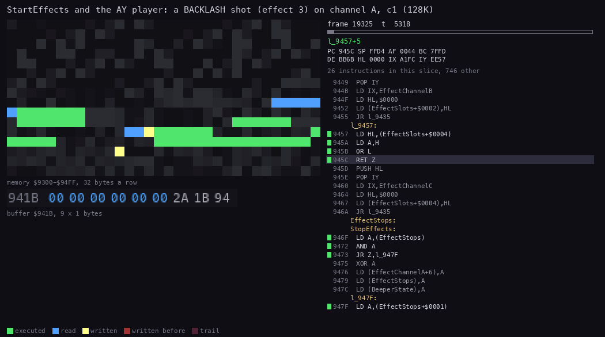

How to read it: the bytes of EffectSlots `$941B-$9423` as hex, and on the right the code as it runs:
StopEffects, StartEffects, EffectStart and the player in RAM 4. Recording `c1`: PlayEffect filled the slot in the
main loop at 19 325:34920; the GIF is the next interrupt, 19 326:2300-5600 (StartEffects at 2496, EffectStart at
2659), 60 pictures. Made from the kept trace of frames 19 325-19 328: `python3 tools/trace_cut.py
work/docs/mxC/c1/traces/19325_0-19328_0.uatr --from 19326:2300 --to 19326:5600 --out
work/docs/fixB/starteffects-19326.uatr`, then `python3 ../../kit/routine_anim.py --trace
work/docs/fixB/starteffects-19326.uatr --listing build/game.lst --page 4=build/music.lst --pc 93DC-949E,4:C000-CFFF
--view buffer:941B:9x1:hex --pictures 60 --title '...' --out docs/img/routines/StartEffects.gif`.

**The point**: the main loop never waits for the AY. It drops an address in a slot and the interrupt starts the sound on
its next frame, so an effect starts at most 20 ms late.

Witness: PlayEffect L1 638; StartEffects L1 26 094; EffectStart L1 5258; the `c1` samples of frames 19 322-19 330 and
the trace of 19 325-19 328.

## 9.4 The AY player in RAM 4

The player is 4000 bytes at `$C000` of RAM 4 (`src/music/music-module.asm`). The source names it Ben Daglish's player;
the menu credits MUSIC BENN. Its entry points:

| Address | Name | What |
| --- | --- | --- |
| `$C000` | MusicStart | JP MusicInit `$C092`: start tune A + 1 |
| `$C003` | MusicPlay | JP MusicFrame `$C11A`: one frame |
| `$C006` | MusicTune | `$FF` while a tune plays, 0 or 1 when it ended |
| `$C007` | EffectByNumber | JP `$C013`, never called |
| `$C00A` | MusicStop | JP Silence `$C3F1` |
| `$C36A` | EffectStart | an effect or an instrument onto a channel |

A tune is three order lists, one a channel. Songs `$CAA8` holds 3 tunes x 3 words. An order list plays patterns:

- a byte below `$80` plays that pattern;
- `$80-$BF` repeats the next pattern (n AND `$1F`) times;
- `$C0-$C7` sets an entry of the channel's instrument map;
- `$FE` t transposes by t semitones;
- `$FF` ends the channel.

A pattern is events up to `$FF`:

- a note: an index below `$7E`, then its length in frames;
- a rest: `$7F` and a length;
- an instrument: `$80-$87`, through the channel's map to one of the eight at `$CBA2`;
- a vibrato or arpeggio form: `$88-$BF`;
- a command: `$C0-$FE`.

`tools/tunes.py` holds the format; `src/res/music/tunes.txt` is the three tunes as text.

Each frame MusicFrame first writes the AY registers from the three channel blocks (WriteRegisters `$C422`): one
envelope step a channel, then the mixer R7, the periods R0-R5, the noise R6 and the volumes R8-R10. Then each channel's
step (ChannelStep `$C162`) counts its note down. At a note's end it reads the next event. A new note starts its
instrument through the same EffectStart that starts an effect. So a note is an effect with the instrument's envelope,
and an effect is heard until its channel's next note replaces it.

When all three channels have read their `$FF`, MusicTune becomes 0, or 1 while an effect still sounds.

```text
MusicInit(tune):
    Silence(); the A, B, C order pointers = Songs[tune]; transposes 0; maps 0, 10, 20 ... 70; MusicTune = $FF
MusicFrame():
    WriteRegisters()                         # an envelope step a channel, then R0-R10 out
    if MusicTune == 0: return
    if every channel ended: MusicTune = 1 if an effect still sounds else 0; return
    for ch in A, B, C: ChannelStep(ch)
ChannelStep(ch):
    Vibrato(ch)
    note_left -= 1
    if note_left: return
    read the order list and the pattern:
        $FE t: transpose = t;  $FF: the channel ends
        $80-$BF: a repeat count;  $C0-$C7: an instrument map entry
        a note: period = Periods[index + transpose + 12]; EffectStart(instrument); note_left = length
        $7F: a rest of the given length
```

```asm
MusicFrame:
  CALL WriteRegisters
  LD A,(MusicTune)
  AND A
  RET Z                 ; no tune
  LD A,(PlayerState+$0037)
  LD HL,PlayerState+$004C
  OR (HL)
  LD HL,PlayerState+$0061
  OR (HL)               ; any channel still playing?
  LD (MusicTune),A
  JR NZ,l_C144
  ...
l_C144:
  LD IY,PlayerState+$002A
  LD IX,EffectChannelA
  CALL ChannelStep
  LD IY,PlayerState+$003F
  LD IX,EffectChannelB
  CALL ChannelStep
  LD IY,PlayerState+$0054
  LD IX,EffectChannelC  ; and on into ChannelStep
```

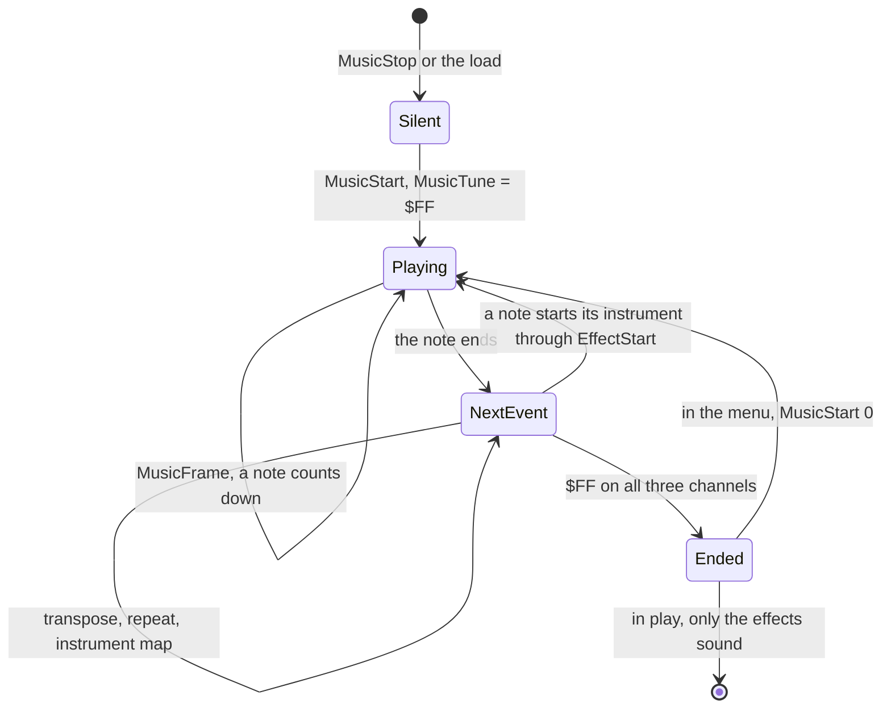

Worked example: tune 3, the game start, from `tunes.txt`. Its order lists are at `$CB99`, `$CB9C` and `$CBA0`:

- A: `p06 p25 $FF`. Pattern 6 is a rest of 2 frames, then pattern 25.
- B: `$FE $FB p26 $FF`. Pattern 26 transposed by `$FB` = -5 semitones.
- C: `p25 $FF`.

Pattern 25 is `$84 E-4:8 E-4:16 C#4:16 C#4:8 A-3:8 A-3:8 F#3:128 r:4 $FF`: instrument 4, six short notes and a long F#3
of 128 frames. Channels A and C play the same pattern 2 frames apart, a cheap chorus. Pattern 26 on channel B is
`E-2:8 E-2:8 E-3:8 ...`, heard 5 semitones lower as B-1, B-1, B-2. The tune lasts 197 frames (3.94 s). The simulator
measured MusicPlay at 2141-5658 T a frame.

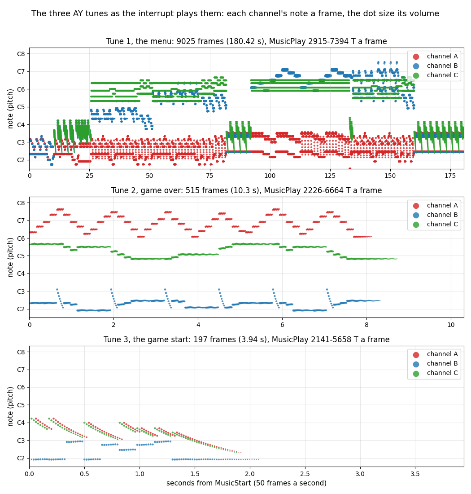

How to read it: one panel a tune, time across in seconds, the note of each channel at every frame (red A, blue B,
green C), the dot size its volume. Recording: none, the tunes run frame by frame through MusicStart and MusicPlay in
the simulator. Made by `python3 tools/fig_sound.py fig-tunes docs/img/sound/tunes.png`, after `python3
tools/fig_sound.py tunes docs/audio`.

**The point**: a small player with one engine. Notes and effects are the same thing to it, so an effect sounds like a
note of the music, and the game needs no second sound driver on the 128K.

Witness: MusicPlay L1 33 684 (`c1`, `cheat`, `door3`, `kind6`, `masks`, `rec/menu`, `play2`); ChannelStep L1 49 266; Envelope L1 57 483; MusicStart L1 18;
`tunes.txt` assembles back to the bytes of `$C670-$CBA1`.

## 9.5 The three tunes and when each plays

| Tune | What | Started by | Length | Audio |
| --- | --- | --- | ---: | --- |
| 1 | the menu | the interrupt itself, while NotInPlay `$970D` is set and MusicTune is not `$FF` | 9025 frames, 180.4 s, then again | [tune-1.mp3](audio/tune-1.mp3) |
| 2 | game over | GameOver `$BACC`: TuneRequest `$9222` = 2 | 515 frames, 10.3 s | [tune-2.mp3](audio/tune-2.mp3) |
| 3 | the game start | MenuLoop on fire (`$9812`): TuneRequest = 3 | 197 frames, 3.9 s | [tune-3.mp3](audio/tune-3.mp3) |

The renders are MP3 at `lame -V 4`. They come from the AY registers the simulator wrote each frame: AY clock
1 773 400 Hz, 44 100 samples a second, the AY's volume table and noise generator.

```text
menu:        NotInPlay = 1; every frame: if MusicTune != $FF: MusicStart(0)   # tune 1, looped
fire:        TuneRequest = 3                                                   # tune 3 plays once over the start
game over:   EffectStops[A] = MachineFlag; TuneRequest = 2; MISSION TERMINATED; GameStart, the menu
ending:      no tune: the texts, then GameStart
```

```asm
GameOver:
  LD A,(MachineFlag)
  LD (EffectStops),A    ; 0 on a 128K: nothing stopped
  LD A,$02
  LD (TuneRequest),A    ; tune 2 at the next interrupt
  LD DE,$0407
  LD HL,GameOverText
  CALL SlowPrint
```

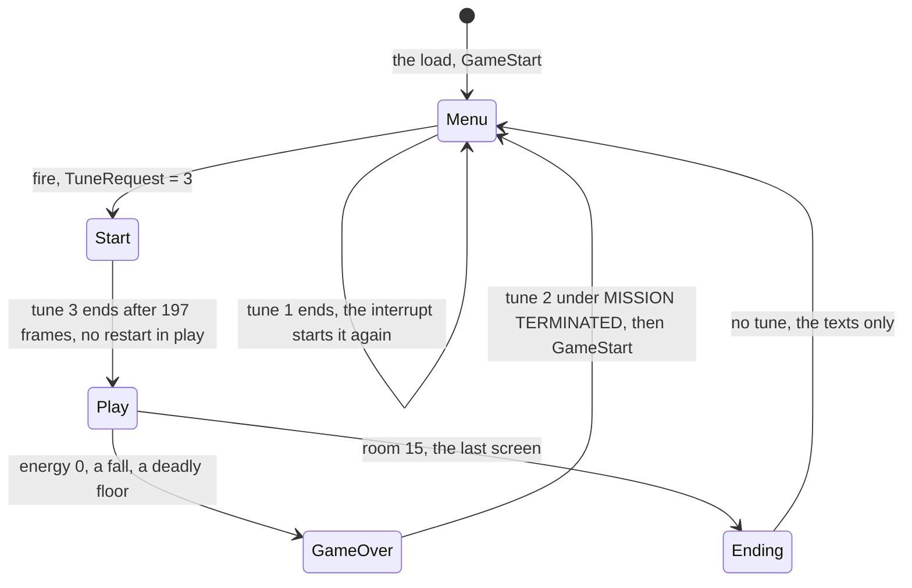

Worked example: `rzx-04000`. Matt stepped on a deadly floor in room 1 at TTD frame 1561
([10.12](10-gameplay-logic.md#1012-death-game-over-and-the-new-game)). Death sank him and GameOver printed MISSION TERMINATED from about frame 1640. The menu was back by about frame 1880.
This is a 48K run, so no tune sounded there: TuneRequest is set, but only the 128K path reads it. In `c1` (128K) the
menu played tune 1 from the load to the start. MusicStart ran twice (tune 1, then tune 3 at the start) and MusicStop
once: the load value `$FF` of StopRequest at the first interrupt (9.9).

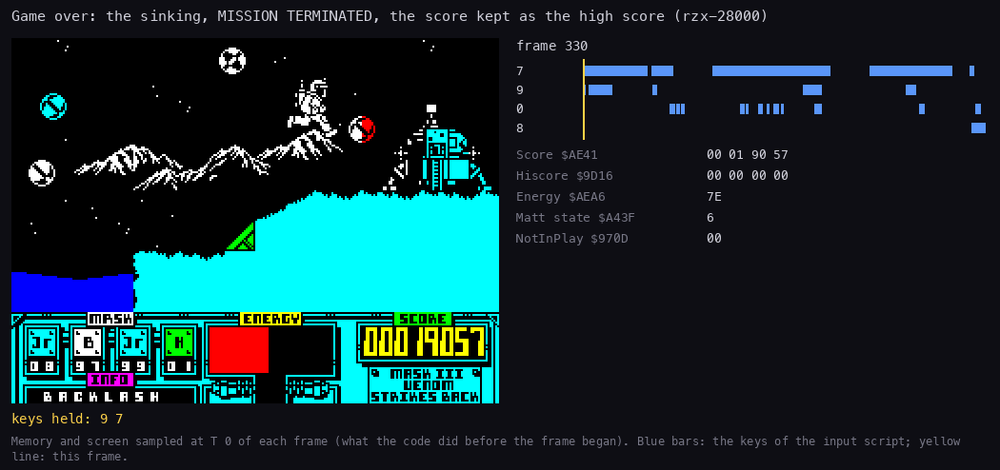

How to read it: left, the screen every fifth frame; right, Score, Hiscore, Energy, Matt's state and NotInPlay. The
same course as in `rzx-04000`, on the moon: Matt sinks, MISSION TERMINATED appears a letter at a time (SlowPrint,
[doc 8](08-hud-and-text.md)), then the menu. The game is 48K here too, so the course is silent. Recording `rzx-28000`,
TTD frames 330-1060 (the GIF of doc 8). Made by `python3 tools/fig_controls.py play --work work/docs/mxB/r28 --from 330
--to 1060 --step 5 --keys tests/inputs/rzx-28000.txt --offset 0 --crop 0,0,256,192 --var 'Score=AE41:4:hex' --var
'Hiscore=9D16:4:hex' --var 'Energy=AEA6:1' --var 'Matt state=A43F:1:dec' --var 'NotInPlay=970D:1' --title '...'
--delay 70 --out docs/img/play/game-over.gif`.

**The point**: music frames the play but never sounds inside it. The tune 1 loop is not in the player. It is a few
instructions of the interrupt that restart the tune whenever it ends in the menu.

Witness: TuneRequest is written only at `$9812` (3) and `$BAD4` (2) (`grep TuneRequest src/game/*.asm`); the restart at
`$927A-$9285`; the lengths from the simulator (`work/docs/mxC/sound/tunes-summary.json`); `c1`'s callee counts
(`$C000` x2, `$C00A` x1, WALKTHROUGH 1).

## 9.6 The effects one by one

| # | Effect | Played by | Channel | AY | Beeper | Audio | Seen in |
| ---: | --- | --- | --- | ---: | ---: | --- | --- |
| 0 | JACKRABBIT shot | FireMask `$BD21` (kind - 5) | A | 47 frames | 30 bursts | [AY](audio/fx-00-ay.wav), [beeper](audio/fx-00-beeper.wav) | `rzx-08000` 1227, `rzx-16000` 1154 |
| 1 | LIFTER shot | FireMask | A | 47 | 30 | [AY](audio/fx-01-ay.wav), [beeper](audio/fx-01-beeper.wav) | `rzx-12000` 2100 |
| 2 | BLASTER shot | FireMask | A | 47 | 30 | [AY](audio/fx-02-ay.wav), [beeper](audio/fx-02-beeper.wav) | `rzx-08000` 1115, `rzx-24000` 252 |
| 3 | BACKLASH shot | FireMask | A | 47 | 30 | [AY](audio/fx-03-ay.wav), [beeper](audio/fx-03-beeper.wav) | `c1` 19 326, `rzx-00000` 990 |
| 4 | LAVA SHOT shot | FireMask | A | 47 | 30 | [AY](audio/fx-04-ay.wav), [beeper](audio/fx-04-beeper.wav) | in play never (no LAVA SHOT lies anywhere); `cheat` (a POKE) fires it |
| 5 | STREAMER shot | FireMask | A | 47 | 30 | [AY](audio/fx-05-ay.wav), [beeper](audio/fx-05-beeper.wav) | in play never (no STREAMER lies anywhere); `masks` (a POKE) fires it |
| 6 | the wave flyer's swoop | KindWave `$C562`, once a swoop | B | 30 | 15 | [AY](audio/fx-06-ay.wav), [beeper](audio/fx-06-beeper.wav) | `rzx-12000` 2747 |
| 7 | PENETRATOR on | Penetrator `$BE0E` | A, R13 | until stopped | until stopped | [AY](audio/fx-07-ay.mp3), [beeper](audio/fx-07-beeper.mp3) | `rzx-00000` 2517 |
| 8 | death | Death `$BAA8` | C | 47 | 40 | [AY](audio/fx-08-ay.wav), [beeper](audio/fx-08-beeper.wav) | `rzx-04000` 1561 |
| 9 | Matt materialises, the door warp | PodStart `$BA68` (a new game), StartWarp `$B9C5` | A, R13 | 130 | 130 | [AY](audio/fx-09-ay.wav), [beeper](audio/fx-09-beeper.wav) | every new game; `door` 845 |
| 10 | kind 16 enters | SpawnKind6 `$C0F7`, KindSixteen | B | 257 | 230 | [AY](audio/fx-10-ay.mp3), [beeper](audio/fx-10-beeper.wav) | in play never; `kind6` (an EnemyKind POKE) spawns kind 16 |
| 11-14 | an explosion | Explode `$C26F`: 11 + Random AND 3; KindEleven's burst: 11 | C | 131, 68, 131, 131 | 5 | [11](audio/fx-11-ay.wav), [12](audio/fx-12-ay.wav), [13](audio/fx-13-ay.wav), [14](audio/fx-14-ay.wav); beeper [11](audio/fx-11-beeper.wav), [12](audio/fx-12-beeper.wav), [13](audio/fx-13-beeper.wav), [14](audio/fx-14-beeper.wav) | every kill; `rzx-00000` 996 |
| 15 | the chaser in view | KindChaser `$C64E`, each pass | B, R13 | 100 | 100 | [AY](audio/fx-15-ay.wav), [beeper](audio/fx-15-beeper.wav) | `rzx-08000` from 1034, `rzx-32000` from 473 |
| 16, 17 | Matt explodes in a wall | Explosion `$BB78` | A and B | 131 | 100 | [16](audio/fx-16-ay.wav), [17](audio/fx-17-ay.wav); beeper [16](audio/fx-16-beeper.wav), [17](audio/fx-17-beeper.wav) | in play never; `masks` (PENETRATOR by a POKE, released in a wall at frame 1249) |

"AY" is the frames until the channel is silent. "Beeper" is the bursts (frames) BeeperTick plays. "Until stopped" is
capped at 400 frames in the renders.

```text
effect n at frame 0: StartEffects -> EffectStart(channel = +A)
each frame:          the volume steps through attack, decay, hold, release (9.2)
                     the period sweeps after +5 frames
                     tone, noise and R13 by +9
silent:              the volume reaches 0, or the hold of an R13 effect runs out, or a note takes the channel
```

```asm
l_BD1E:                 ; FireMask, kinds 5-10: a shot on a new press
  LD A,(IX+$01)         ; the mask's kind
  SUB $05
  CALL PlayEffect       ; effect 0-5
```

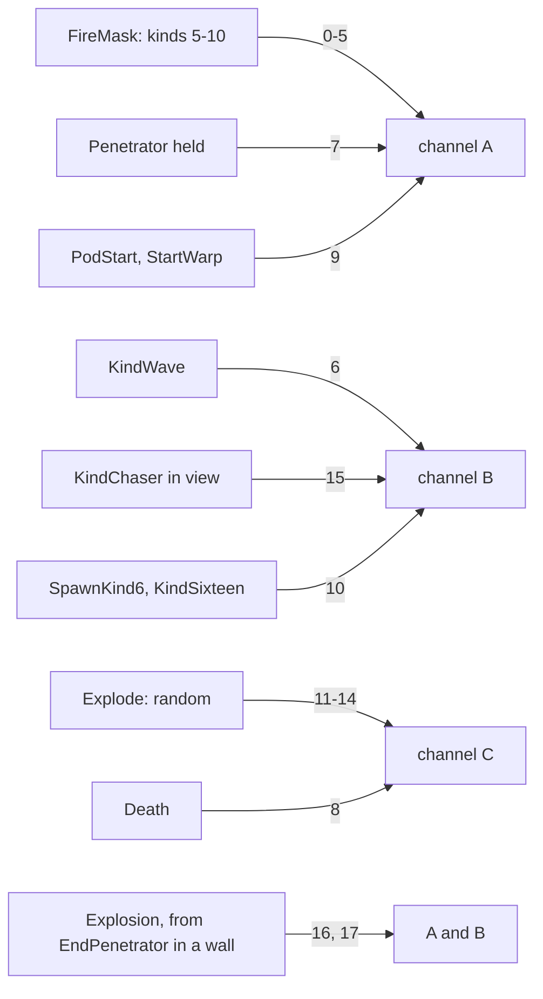

Worked example: a kill in `rzx-00000`. At TTD frame 990 BeeperState held the BACKLASH shot (effect 3, 18 bursts left).
At 995 the shot hit a faller and Explode picked effect 12 (11 + Random AND 3 = 1). At frame 996 BeeperState held `$05`
and the record pointer `$9388` = `$92E0` + 14 x 12. The explosion replaced the shot's sound at once, because the beeper
has one voice. On a 128K the shot (channel A) and the explosion (channel C) would sound together.

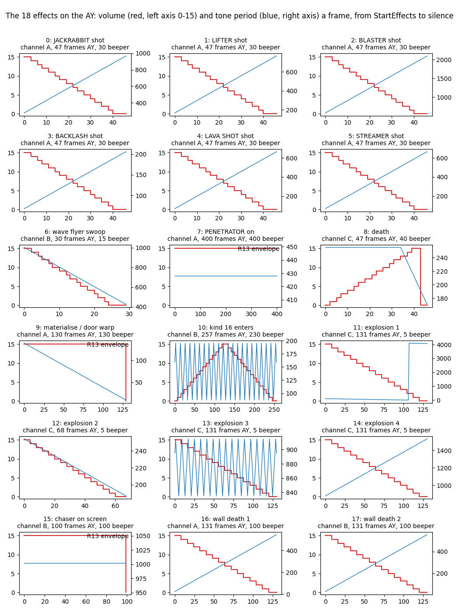

How to read it: one panel an effect. Red is the channel's volume (0-15, left axis), blue the tone period (right axis),
frame by frame from StartEffects until the channel is silent. "R13 envelope" marks the effects that hand the volume to
the AY's own envelope; their volume reads 15. Recording: none, the simulator runs the player. Made by `python3
tools/fig_sound.py fig-effects docs/img/sound/effects.png`, after `python3 tools/fig_sound.py effects docs/audio`.

**The point**: the six shots share one envelope and differ only in pitch and sweep, so each mask is known by ear. The
long sounds (PENETRATOR, the chaser) use the AY's hardware envelope and need stopping; the game stops them through
EffectStops.

Witness: the callers by `grep PlayEffect src/game/*.asm`; BeeperState in `rzx-00000` at frames 990 and 996 (9.1); the
"Seen in" frames from the samples of [doc 10](10-gameplay-logic.md). Effects 4, 5, 10, 16 and 17: no play recording
reached their causes; the POKE recordings do (`cheat` fires LAVA SHOT, `masks` STREAMER and the Explosion, `kind6`
spawns kind 16), but their sound is known only from the code and the simulator.

## 9.7 The beeper on a 48K: BeeperStart and BeeperTick

On a 48K PlayEffect calls BeeperStart (entered at `$94AF`). It stores the record's address, the length (+B) in
BeeperState `$94AB` and the period (+C/+D) in the pitch word `$94AC`. There is one voice: a new effect replaces the
old one.

Each frame BeeperTick `$94C8` plays one burst:

1. If BeeperState is 0, return. If it is not `$FF`, count it down.
2. Add the sweep word (+7/+8) to the pitch word.
3. The burst has ((-L) >> 5) + 1 pulses, L being the pitch word's low byte: a high pitch makes more pulses.
4. Each pulse sets bits 3 and 4 of port `$FE` (MIC and EAR), waits L x 16 T, and clears them.

The low half of each pulse does not wait. The loop at `$9505` is `JR NZ,$9505` with no `DEC` before it. The flags
still say zero from the high half's last `DEC H`, so the jump falls through at once. The pulse is high for L x 16 T and
low for about 55 T. The ear hears a train of short gaps, not a square wave.

```text
BeeperStart(rec):   BeeperRecord = rec; BeeperState = rec.length; pitch = rec.period
BeeperTick():                                    # each 48K interrupt
    if BeeperState == 0: return
    if BeeperState != $FF: BeeperState -= 1
    pitch += rec.sweep
    L = pitch & $FF
    repeat (((-L) AND $FF) >> 5) + 1 times:          # 8 bits: L = 0 gives 1 pulse
        OUT ($FE), BorderColour | $18;  wait L x 16 T
        OUT ($FE), BorderColour;        no wait (the bug)
```

```asm
BeeperTick:
  ...
  XOR A
  SUB L
  SRL A
  SRL A
  SRL A
  SRL A
  SRL A
  INC A
  LD B,A                ; pulses
l_94F4:
  LD A,(BorderColour)
  OR $18
  OUT ($FE),A           ; high
  LD H,L
l_94FC:
  DEC H
  JR NZ,l_94FC          ; L x 16 T
  LD A,(BorderColour)
  OUT ($FE),A           ; low
  LD H,L
l_9505:
  JR NZ,l_9505          ; Z from DEC H: falls through, no wait
  DJNZ l_94F4
  RET
```

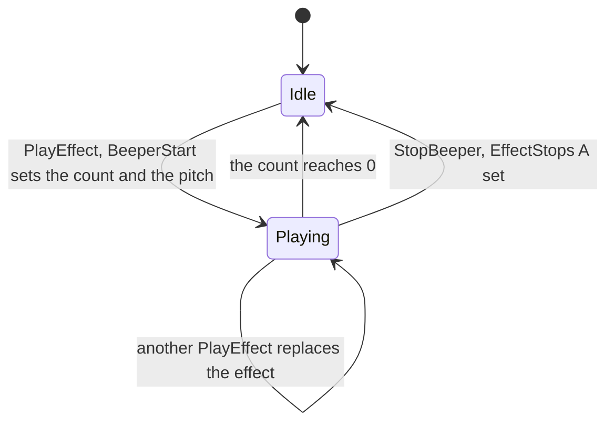

BeeperStart also rewrites its own first byte. The routine is entered at `$94AF`, whose bytes `DD 22 AE 94` are
`LD ($94AE),IX`. The store writes the record's address over `$94AE-$94AF`, its own first byte included. After the
first effect the byte at `$94AF` is the high byte of a record (`$92` or `$93`). The next call runs it as a one-byte
instruction (`SUB D` or `SUB E`), then the `22 AE 94` that follows as `LD ($94AE),HL`, HL still holding the record.
The store still happens. The trick works only because every record lies at `$92xx-$93xx`.

Worked example: effect 9 (Matt materialising at a new game) on the beeper. The record is `08 FF 01 FF 05 00 00 FF FF 05 01 82 8C 00`: length
`$82` = 130 bursts, pitch `$008C`, sweep `$FFFF` (-1 a frame). In the first frame the pitch becomes `$8B` = 139, so the
burst has (117 >> 5) + 1 = 4 pulses, each high about 139 x 16 T and low 55 T. The pitch falls one step a frame: the
pulses get shorter, their number grows, and the buzz rises over the 130 frames.

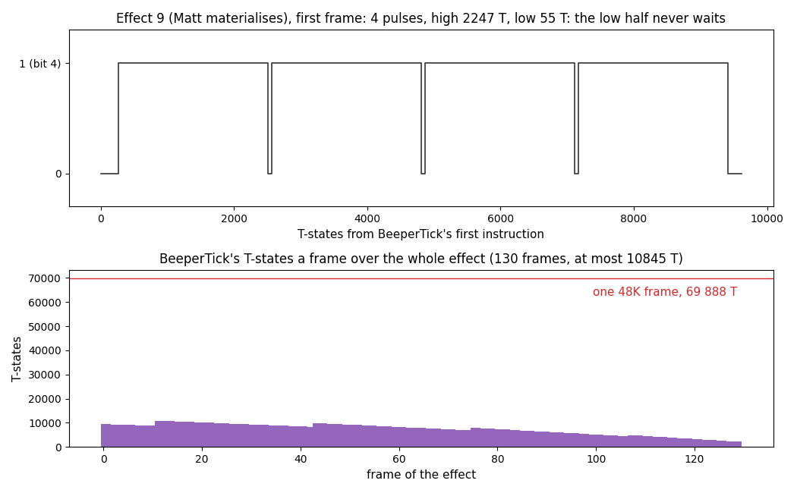

How to read it: top, port `$FE` bit 4 against the T-states of one BeeperTick: four long highs, four short lows. Bottom,
BeeperTick's T-states in each of the effect's 130 frames, against the 69 888 T of a 48K frame. Recording: none, the
simulator runs BeeperTick from the build. Made by `python3 tools/fig_sound.py fig-beeper docs/img/sound/beeper.png`.

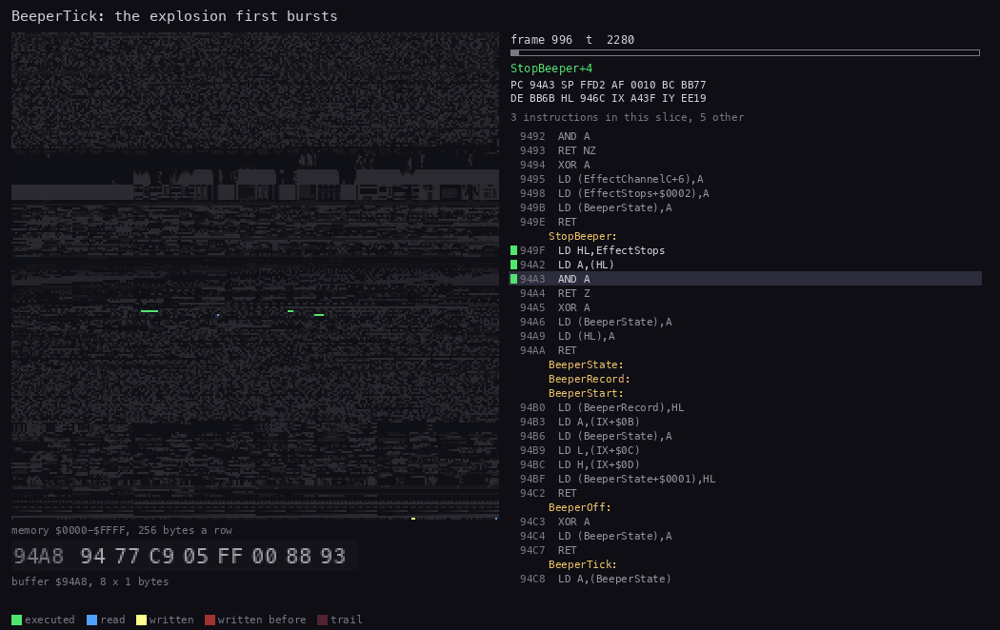

How to read it: the bytes `$94A8-$94AF` (BeeperState, the pitch word, the record pointer) as hex, and the code.
PlayEffect stored the explosion's record `$9388` in the main loop at 995:22948; the GIF is the next interrupt's
StopBeeper and BeeperTick, 996:2200-6700, its first bursts, 60 pictures. Made from the kept trace of frames 995-997:
`python3 tools/trace_cut.py work/docs/mxC/rzx-00000/traces/995_0-997_0.uatr --from 996:2200 --to 996:6700 --out
work/docs/fixB/beeper-996.uatr`, then `python3 ../../kit/routine_anim.py --trace work/docs/fixB/beeper-996.uatr
--listing build/game.lst --pc 93DC-941A,949F-950A --view buffer:94A8:8x1:hex --pictures 60 --title '...' --out
docs/img/routines/BeeperTick.gif`.

**The point**: the 48K gets every effect from the same table by reading only the pitch, the sweep and the length. It
pays with up to 15 % of a frame in the interrupt, and the sound is a train of clicks.

Witness: BeeperStart L1 541 and BeeperTick L1 37 174 (`rzx-` only); BeeperState in `rzx-00000` (9.1, 9.6); the
self-modifying store from the bytes at `$94AB-$94B3` (`src/game/interrupt.asm`).

## 9.8 48K against 128K

| | 128K | 48K |
| --- | --- | --- |
| loaded | the game, then 4000 bytes into RAM 4 | the game only, the music block skipped |
| music | three tunes: menu, game start, game over | none |
| effects | 18, on three AY channels, up to three at once | 18, one at a time on the beeper |
| what the record gives | all 14 bytes: envelope, sweep, noise, channel | the sweep, the length, the period |
| the sound | tone and noise with volume envelopes | clicks at a rising or falling rate, one volume |
| interrupt cost | 1740-2144 T in play, up to 7394 T with a tune | up to 10 845 T during an effect |
| stopping | EffectStops zeroes the channel's hold | StopBeeper zeroes BeeperState (flag A only) |
| GameOver | EffectStops A = 0: nothing stopped, tune 2 starts | EffectStops A = MachineFlag: the beeper stops |
| seen in | `c1`, `door`, `play2` | the ten `rzx-` segments |

```text
the same call in the game:      PlayEffect(n)
128K:  a slot -> StartEffects -> EffectStart -> MusicPlay each frame -> the AY
48K:   BeeperStart            -> BeeperTick each frame             -> port $FE
```

```asm
  LD A,(MachineFlag)    ; PlayEffect: the only test
  AND A
  JR NZ,l_9416          ; 48K: CALL BeeperRecord+1 (BeeperStart)
```

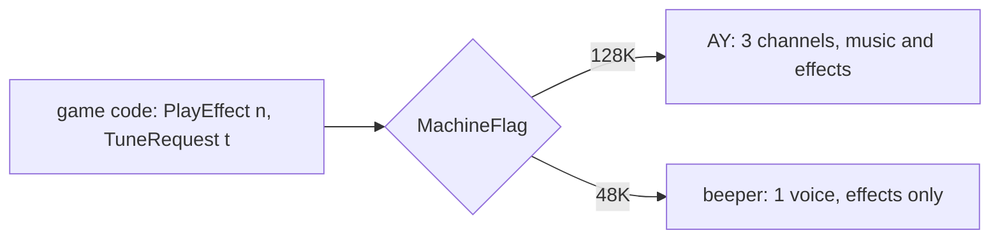

Worked example: the same kill on both. In `rzx-00000` (48K) at frame 996 the explosion cut the shot's sound off at once
(9.6). In `c1` (128K) the BACKLASH shot plays on channel A and an explosion takes channel C, so both sound. The WAV
pairs of 9.6 let one hear the difference, for example [effect 3 on the AY](audio/fx-03-ay.wav) and
[on the beeper](audio/fx-03-beeper.wav).


How to read it: as in 9.7. Put next to effect 9's panel of the effects chart (9.6): the AY holds a hardware envelope
for 130 frames, the beeper makes four clicks a frame. Recording: none. Made by `python3 tools/fig_sound.py fig-beeper
docs/img/sound/beeper.png`.

**The point**: the game is written once for both machines. One byte read in the interrupt and in PlayEffect decides
whether the same call becomes an AY voice or a beeper burst.

Witness: 9.1 (the flag and the paths), 9.7 (the beeper), [doc 3](03-build-and-load.md) (the music block skipped on a
48K).

## 9.9 Notes, quirks and what is known only from the code

- **StopEffects tests channel C the wrong way round.** For A and B it zeroes the hold when the flag is set. For C the
  test is `RET NZ` (`$9491`): it zeroes channel C's hold every interrupt while the flag is clear, and does nothing when
  it is set. Channel C carries the death and the explosions. The simulator ran every tune and every effect with the
  test fixed (`python3 tools/fig_sound.py chanc`). No effect changes. Tune 2 differs in 72 frames' registers and tune 3
  in 97, but the audible part (the channels with a volume above 0) of no frame changes. The bug is inaudible, by the case's
  simulator (no emulator capture compares the two): the envelopes of channel C end by themselves.
- **BeeperTick's low half never waits** (9.7): the `JR NZ` at `$9505` has no `DEC` before it.
- **BeeperStart overwrites its own first byte** (9.7) and works because all the records lie in `$92xx-$93xx`.
- **StopRequest `$9223`** is never written by the game. Its loaded value `$FF` makes the first 128K interrupt call
  MusicStop once (`c1`: `$C00A` x1); the interrupt then clears it.
- **Only tunes 2 and 3 are ever requested.** Tune 1 is started by the interrupt's own loop in the menu.
- **GameOver stops nothing on a 128K**: it writes MachineFlag (0) to EffectStops A. A PENETRATOR sound would end only
  through EndPenetrator.
- **A note always takes its channel.** ChannelStep skips a note while the channel's flags have bit 7 set, a priority
  for effects. No record and no instrument has bit 7, and only EffectStart, Silence and the envelope's end write that
  byte, so the test never holds. In the menu and at the start an effect on a busy channel is cut by the next note.
- **Never run**: EffectByNumber `$C007` (JP `$C013`) and BeeperOff `$94C3`.
- **Effects no play recording played**: 4 and 5 (no LAVA SHOT or STREAMER lies
  anywhere), 10 (kind 16, not spawned in play), 16 and 17 (Matt's death inside a wall); only the POKE recordings
  `cheat`, `masks` and `kind6` reach their causes. Their sound is known only from the simulator.
- **Not cross-checked**: the AY renders come from the simulator, not from AY register captures of a recording. The
  simulator runs the game's own code from the build, so the register values are the game's. The analogue part (the
  volume table, the mixing) is a standard AY model.
