# 10. Gameplay logic

What this covers:

- one pass of the rules, in the order MainLoop calls them;
- Matt's twelve states: the walk, the steps, the crouch, the jump, the fall, the long jump, standing, the end of
  energy, the door warp and the materialisation;
- the room exits and the pods, from Matt's side;
- energy and every source of damage;
- the ten masks: the slots, the charges, the pick-ups, the keys and what each mask does;
- every enemy kind and hazard, as rules;
- the collisions and the score;
- the four passwords and the door warp;
- the cheat, game over, the new game and the ending;
- the bugs and oddities, the notable features and what no recording reached.

The objects these rules move (the record, the templates, the spawner, each kind's code) are in
[doc 7](07-objects.md); the controls are in [doc 5](05-controls.md); the effects and tunes are in
[doc 9](09-sound.md).

The recordings it rests on ([WALKTHROUGH 6.0](../WALKTHROUGH.md#60-the-recordings)):

- `c1`: power-on on the 128K, the original tape loaded as a user does, the menu, then play in room 0;
- `rec/rzx-00000` to `rec/rzx-36000`: the ZXDB RZX run in ten segments of 4000 frames (the last 1200). Each is
  replayed from the RZX's own state, on the 48K path. They show rooms 0, 10, 1, 2, 4, 12, 5, 6, 3, 8, 14 and 15;
- stage 2's `door`: a new game with PasswordFlags POKEd to `$FF` in the menu (said in its script); Matt walks onto a
  room-0 door;
- stage 2's `play2`: a play from power-on on the 128K; the four passwords typed, the end reached with POKEs (said in
  its script).

Each was opened on an own instance, after `. work/env.sh`:
`python3 $RS open --work work/docs/mxC/<name> --ttd <its session.ttd> --model 128K --port-base 37790`. Matt's record `$A43F-$A464`, the shot, the objects and the rule variables
were sampled at every TTD frame by `work/docs/mxC/sample.py` into `work/docs/mxC/<name>/vars.jsonl`.
`work/docs/mxC/events.py` and `work/docs/mxC/rng.py` print them. A sample of frame N is the memory at T 0 of frame N:
what the code did before the frame began.

Positions: Matt's x counts 2 pixels from `$40` at the screen's left edge (`$40` + 128 = `$C0` at the right). His y
counts pixels from the top of the play area, at his head. A pass is one round of MainLoop; it takes 1.5 to 5.4 frames
([doc 4](04-game-loop.md)), so the rules count passes, never frames.

## 10.1 One pass of the rules

MainLoop `$CC03` is the whole game in play. It runs the rules in a fixed order, then the drawing. The rules read the
controls once at the top and act on them through the pass.

```text
MainLoop:
    ReadControls                 # Controls $A138: bit 0 right, 1 left, 2 down, 3 up, 4 fire
    MattStep                     # Matt's state routine (10.2)
    MoveShot                     # Matt's shot: x + dx; gone off $38-$C3 or in a wall
    Hazards                      # DeadlyFloor, MoonFloor, TakeBlockItem (10.6)
    RunObjects                   # the enemies, the shot test, the touch test (doc 7)
    FireMask                     # the mask in use (10.7)
    MaskKeys                     # keys 1-4 choose a slot
    DrawScore
    if DeathFlag:  goto Death    # 10.12
    if Energy == 0 and state != 9:
        state = 9; counter = $32; DissolveCount = 1; Dying = 1
    DrawEnergyBar, DrawCurrentSlot, AnimateZone, DrawObjects
    PassCounter += 1; PassBcd += 1 (BCD)
```

```asm
MainLoop:
  CALL ReadControls
  CALL MattStep
  CALL MoveShot
  CALL Hazards
  CALL RunObjects
  CALL FireMask
  CALL MaskKeys
  CALL DrawScore
  LD A,(DeathFlag)
  AND A
  JP NZ,Death
  LD A,(Energy)
  AND A
  JR NZ,l_CC41
  LD A,(Objects)
  CP $09
  JR Z,l_CC41
  LD A,$09
  LD (Objects),A
```

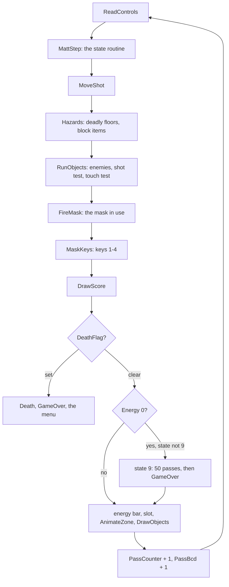

Two ways lead out of play. DeathFlag sends the pass to Death at once. An energy of 0 sets state 9, which waits 50
passes before GameOver. The order matters in three places:

- Hazards runs after MattStep, so a deadly floor is tested where Matt has just moved;
- RunObjects runs before FireMask, so a new shot is tested against the enemies only from the next pass;
- the death tests come after DrawScore, so the score of the killing touch is drawn before Matt dies.

Worked example: `rzx-32000`, frame 657. The chaser touched Matt during RunObjects: Damage took 255 from his 97
energy (0, not below) and AwardScore added 5000. The sample of frame 657 shows Energy 0, the score 24 239 (it was
19 239), state 9, the counter at 50, Dying 1 and DissolveCount 1. MainLoop had set all four in the same pass.

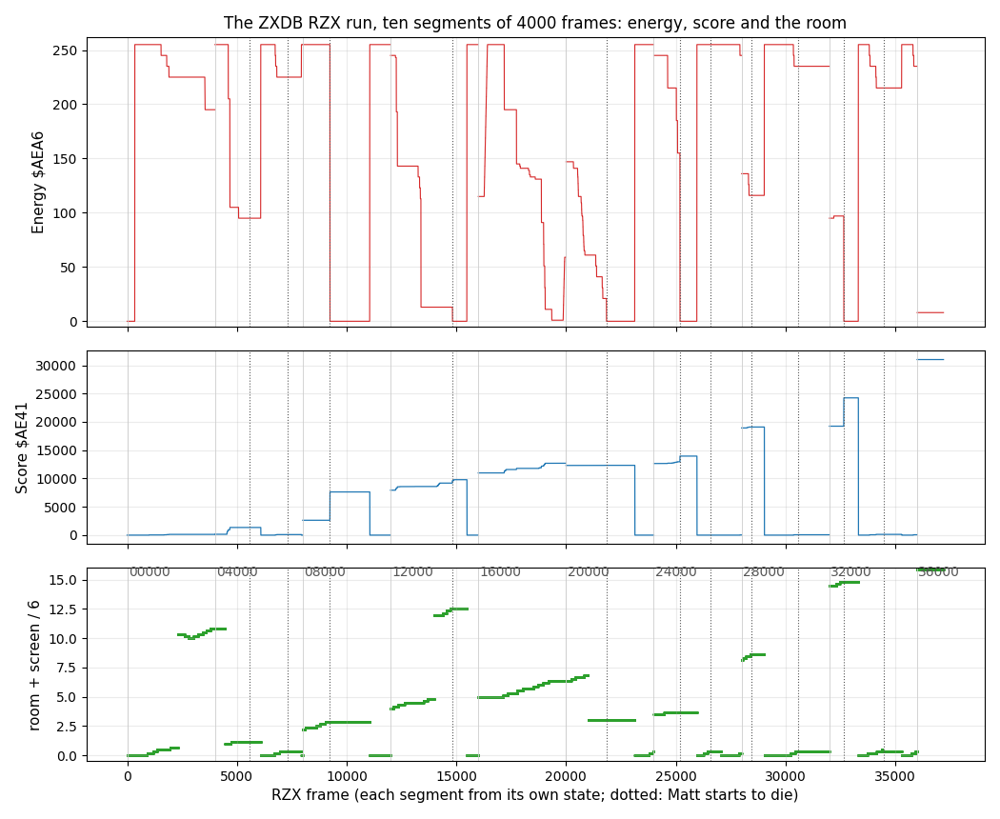

How to read it: top, the energy; middle, the score; bottom, the room plus the screen in sixths. The dotted lines mark
each start of a death. Each segment starts from the RZX's own state, so the curves jump at the grey lines. Recording
`rzx-00000` to `rzx-36000`, all frames, from `work/docs/mxC/*/vars.jsonl`. Made by `python3 tools/fig_objects.py run
docs/img/gameplay/run.png`.

**The point**: the game is one loop of rules with no timer of its own. Everything that waits (the dissolve, the
end of energy, the long jump's charge) counts passes, so it runs slower when the screen is busy.

Witness: MainLoop and its callees in every play recording (`c1`, `door`, `play2`, `rzx-` x9); the `rzx-32000` samples of
frames 643-657.

## 10.2 Matt's states

Matt is object 0, the record at `$A43F`. Its byte +0 is his state. MattStep `$B3EB` runs once a pass. It first clears
the dirty map `$F000-$F0BF` and tests the fall out of the play area. It sets the facing from left and right, except in
states 5 and 6. State 1 is the walk, in MattStep itself; states 2-12 go through StateJumps `$B73A`, three bytes a state.

| State | Routine | What Matt does | Leaves to |
| ---: | --- | --- | --- |
| 1 | MattWalk `$B460` | walks, turns, starts the others | 2-8, 10 |
| 2 | MattStepUp `$B75B` | steps up: x + dx, y - 4, two passes | 1 |
| 3 | MattStepDown `$B775` | steps down: x + dx, y + 4, two passes | 1 |
| 4 | MattCrouchState `$B79E` | crouches; down held takes a pick-up | 1 |
| 5 | MattJumpRise `$B7B5` | the jump: v from -9 up to 0 | 6, 1 |
| 6 | MattFall `$B841` | the fall: v up to 8 | 1, 7 |
| 7 | MattLongJump `$B8E7` | the JACKRABBIT long jump | 1 |
| 8 | MattStand `$B99B` | stands still; any key hands the pass to state 1 | 1, 6, 7 |
| 9 | MattNoEnergy `$B9B8` | out of energy: 50 passes | GameOver |
| 10 | PasswordWarp `$B9D8` | the door warp: 50 passes of dissolve | 8 |
| 11 | PodStart `$BA68` | effect 9, sets the dissolve | 12 |
| 12 | MattPodDissolve `$BA7B` | materialises: 50 passes | 8 |

State 5 (MattJumpRise) is the rising jump and state 6 (MattFall) the fall; MattStepUp and MattStepDown are the
steps of states 2 and 3.

```text
MattStep:
    clear the dirty map $F000-$F0BF
    if y + $30 >= $A0: DeathFlag = $FF          # fell out of the play area
    if Dying: goto MattWalk                     # the death keeps Matt still
    if state not 5 and not 6:
        dx = 0; if left: facing = $80, dx = -2; if right: facing = 0, dx = +2
    MattCell                                    # MattPlace: his cells in the character map
    edge = $80 if x < $41, $9D if x >= $B2, else 0
    if state == 1: MattWalk else JP StateJumps + 3 (state - 2)
```

```asm
l_B72D:
  SUB $02
  LD L,A
  ADD A,A
  ADD A,L                 ; 3 (state - 2)
  LD L,A
  LD H,$00
  LD DE,StateJumps
  ADD HL,DE
  JP (HL)
```

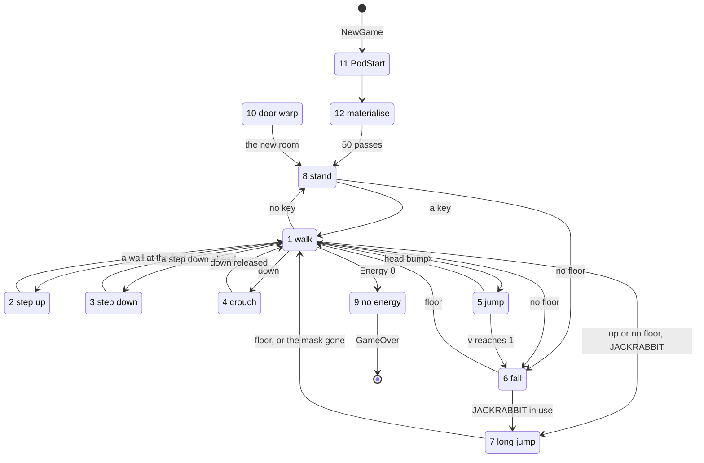

Any state goes to 9 when the energy reaches 0 (MainLoop, 10.1). The pod (down held in the booth, 10.5) leaves from
state 1 straight to the next room, in the same state. State 8 sets state 1 and runs the walk in the same pass when any
direction key is held, so down in state 8 reaches the pod too.

Worked example: the jump of `rzx-00000`. Matt stood (state 8) at x `$84`, y `$50` until frame 850. Right was pressed:
state 1 at frame 851, x + 2 a pass. Up was pressed: state 5 at frame 859, then state 6 at frame 881, then state 1 at
frame 888 on a ledge at y `$30`.

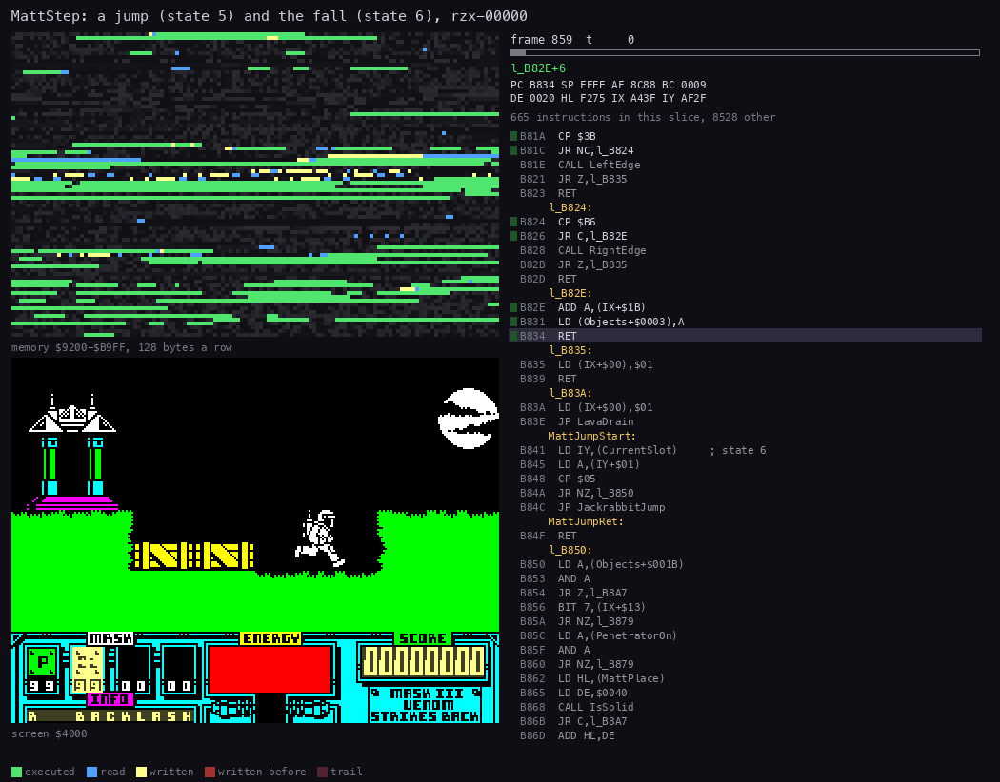

How to read it: the screen, the memory `$9200-$B9FF` lit by age, and the code of MattStep and the state routines as
they run. Recording `rzx-00000`, TTD frames 858:0-889:0, 31 pictures. Made by `python3 ../../kit/routine_anim.py
--work work/docs/mxC/rzx-00000 --window 858:0-889:0 --listing build/game.lst --pc B3EB-BA92 --view screen --range
9200-B9FF --pictures 31 --delay 200 --title '...' --out docs/img/routines/MattStep-jump.gif`.

**The point**: Matt is a state machine of twelve states, one routine each, and only state 1 reads all the controls.
In the air, standing or dissolving, he does not turn.

Witness: MattStep L1 13 095 (`c1`, `door`, `play2`, `rzx-` x9); the states seen in the samples: 1-9 and 11-12 in the
`rzx-` segments, 10 in `door` (frames 845-980).

## 10.3 Walking, steps, the crouch and the screen edges

State 1 tries the controls in a fixed order. The first that applies wins; the rest wait for the next pass.

```text
MattWalk (state 1):
    if down:
        if a booth character $14 or $15 is at MattPlace+2 or the next cell: Teleport  # a pod, 10.5
        if room 0, screen 5, the cell below the feet is $1C,
           and PasswordFlags[(x - $40) >> 5 AND 3]: StartWarp                    # a door, 10.15
    if FloorCheck == 0: JACKRABBIT ? long jump : fall (state 6, v = 1)
    if the floor cell ahead is empty and the one below it solid: state 3 (step down), 2 passes
    if no direction key: state 8
    if down: y + 8, state 4
    if up:
        if JACKRABBIT in use: long jump (state 7)
        unless at an edge: a solid head cell (or the two above it with PENETRATOR) stops the jump
        v = -9 ($F7), state 5
    if left:  unless at an edge: walls at the head, body and feet (PENETRATOR: only the feet) stop him;
              a wall at the feet only: state 2 (step up)
              x < $3B: LeftEdge, else x - 2
    if right: the same to the right, x >= $B6: RightEdge, else x + 2
```

```asm
l_B58C:
  LD HL,(MattPlace)
  CALL IsSolid            ; the head
  RET C
  LD DE,$0020
  ADD HL,DE
  CALL IsSolid            ; the body
  RET C
  ADD HL,DE
  CALL IsSolid            ; the legs
  RET C
l_B5A0:
  ADD HL,DE
  CALL IsSolid            ; the feet: a step
  JP C,l_B647             ; state 2
l_B5A7:
  LD A,(Objects+$0003)
  CP $3B
  JP C,LeftEdge
  SUB $02
  LD (Objects+$0003),A
  RET
```

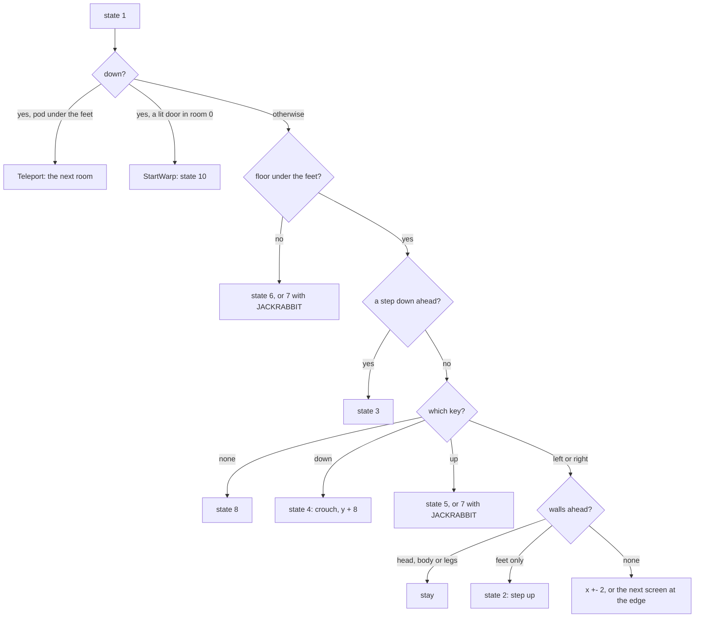

IsSolid `$B993` reads the character's attribute in ZoneAttrs `$EF00`; bit 7 is solid. A step is one character (8
pixels): state 2 lifts Matt by 4 pixels a pass for two passes, state 3 lowers him the same. The crouch lowers his
y by 8 so his sprite fits a lower picture; releasing down puts the 8 back.

At the screen edges (x below `$41` or from `$B2`) the wall tests are skipped: byte +`$13` of the record holds the
edge. Below `$3B` LeftEdge takes him to the screen on the left, at `$B6` and above RightEdge to the right
([doc 7, 7.4](07-objects.md#74-the-exits-edges-screens-and-pods)).

Worked example: the PENETRATOR walk of `rzx-00000` (10.8) climbs stairs through walls. From frame 2529 to 2551 the
states alternate 2 and 1: x `$6C`, y `$4C` (state 2) at 2529; x `$6A`, y `$48` (state 1) at 2532; then `$68`/`$44`,
`$66`/`$40`, `$64`/`$3C` and so on to y `$30`. Each state 2 rose 8 pixels over its two passes.

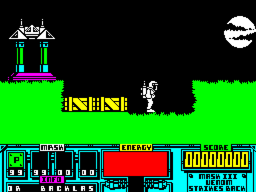

How to read it: the screen at every changed frame. Matt walks right, jumps and lands one ledge higher, then walks on.
Recording `rzx-00000`, TTD frames 852-894. Made by `python3 ../../kit/screen_anim.py --work work/docs/mxC/rzx-00000
--from 852 --to 894 --step 1 --delay 60 --hold 800 docs/img/play/jump.gif`.

**The point**: Matt climbs stairs by himself: a wall one character high is a step, not a wall. Only a wall at his
head, body or legs stops him.

Witness: MattWalk in every pass of state 1 (`c1`, `door`, `play2`, `rzx-` x9); LeftEdge L1 38, RightEdge L1 63; the
`rzx-00000` samples of frames 2529-2551; state 4 at `rzx-00000` 2321.

## 10.4 The jump and the fall

The jump (state 5) starts with v = -9. Each pass v grows by one and y grows by v. When v reaches 1 the jump becomes the
fall (state 6) with v = 1. The fall adds v to y and grows v up to 8. It ends when FloorCheck finds a solid character
under either foot; y is then rounded down to the character row (AND `$F8`).

On the moon (zone 2) both steps are slowed: the rising v skips its step when PassCounter AND 3 is 0 (3 passes in 4),
and the falling v steps only then (1 pass in 4). Matt rises higher and falls slower.

```text
MattJumpRise (state 5, the jump):
    unless (moon and PassCounter AND 3 == 0):
        v += 1
        if v == 1: state 6, v = 1; return
    if a solid cell at the head (MattPlace+2, +3): state 1; LavaDrain; return     # head bump
    y += v
    if dx: move x by dx unless a wall (head, body, feet) or an edge stops it

MattFall (state 6, the fall):
    if JACKRABBIT in use: state 7 (long jump)
    if dx: move x by dx unless a wall stops it (the edges change the screen)
    if FloorCheck != 0: state 1; y = y AND $F8; return                           # landed
    y += v
    if v != 8 and (not moon or PassCounter AND 3 == 0): v += 1
```

```asm
MattJumpRise:
  LD A,(ZoneSlots)        ; state 5
  CP $02
  JR NZ,l_B7C3
  LD A,(PassCounter)
  AND $03
  JR Z,l_B7D5             ; the moon: no step this pass
l_B7C3:
  LD A,(Objects+$0011)
  INC A
  LD (Objects+$0011),A
  CP $01
  JR NZ,l_B7D5
  LD (IX+$00),$01
  JP l_B6FA               ; state 6, v = 1
l_B7D5:
  LD HL,(MattPlace+$0002)
  CALL IsSolid
  JP C,l_B83A             ; head bump: state 1, LavaDrain
```

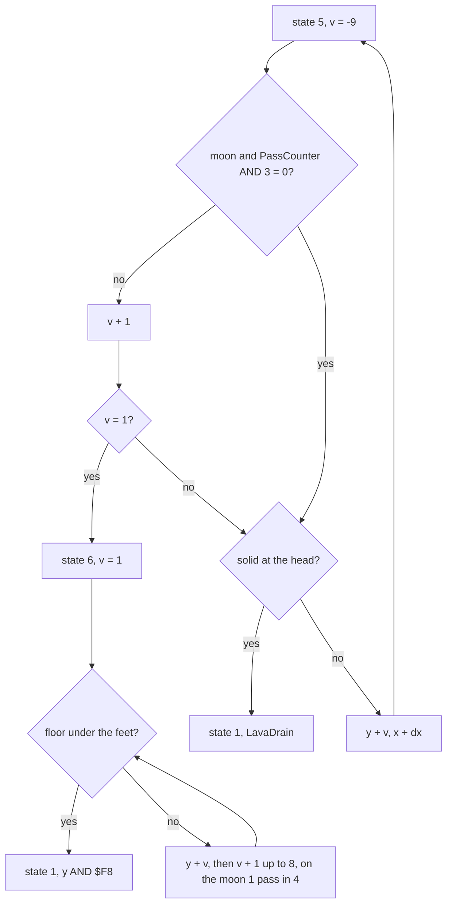

The standing jump on earth rises 36 pixels in 9 passes: -8, -7, ..., -1, 0. The fall gives back 1, 2, 3, ... pixels a
pass. A head bump ends the jump at once in state 1; the next pass finds no floor and starts the fall.

Worked example: `rzx-00000`, frames 859-888 (the samples, at T 0 of each frame):

| Frame | State | x | y | v |
| ---: | ---: | --- | --- | ---: |
| 858 | 1 | `$8A` | `$50` | |
| 859 | 5 | `$8C` | `$48` | -8 |
| 861 | 5 | `$8E` | `$41` | -7 |
| 864 | 5 | `$90` | `$3B` | -6 |
| 866 | 5 | `$92` | `$36` | -5 |
| 869 | 5 | `$94` | `$32` | -4 |
| 871 | 5 | `$96` | `$2F` | -3 |
| 874 | 5 | `$98` | `$2D` | -2 |
| 876 | 5 | `$9A` | `$2C` | -1 |
| 879 | 5 | `$9C` | `$2C` | 0 |
| 881 | 6 | `$9E` | `$2D` | 2 |
| 884 | 6 | `$A0` | `$2F` | 3 |
| 886 | 6 | `$A2` | `$32` | 4 |
| 888 | 1 | `$A4` | `$30` | |

The peak was y `$2C`, 36 pixels above `$50`. The fall found the ledge at y `$32`, and the landing rounded it to `$30`.
x grew by 2 a pass all the way (dx = +2 kept from the walk). On the moon the same jump rose 42 pixels: `rzx-28000`
frames 289-328, y `$40` to `$16`.

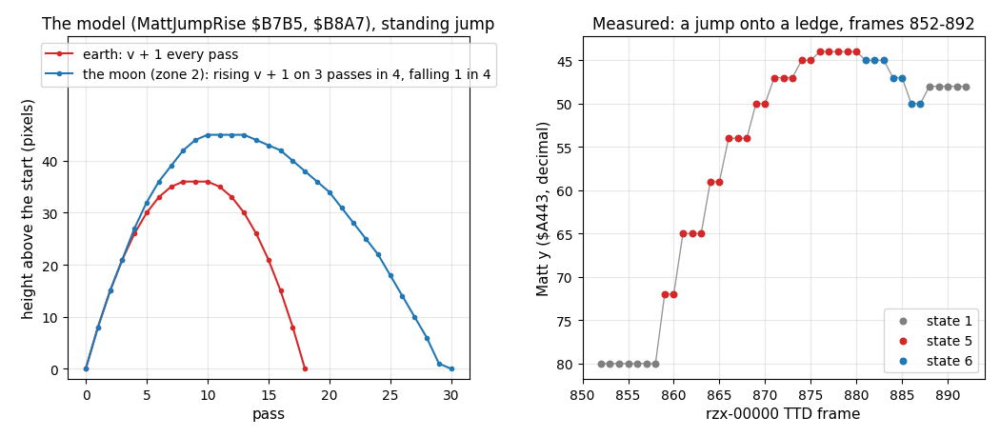

How to read it: left, the height per pass from the code's rules: red on earth, blue on the moon. Right, Matt's y in
the samples of `rzx-00000`, coloured by state (grey 1, red 5, blue 6). Recording `rzx-00000`, frames 852-892; the
model has no recording. Made by `python3 tools/fig_objects.py jump docs/img/gameplay/jump.png`.

**The point**: the jump is a fixed arc of nine rising passes, steered only by the facing at the take-off. The moon
changes two counters and nothing else.

Witness: MattJumpRise and MattFall in every jump (`c1`, `door`, `play2`, `rzx-` x9); JumpEdges L1 685; FloorCheck L1
9905; the samples above; `rzx-28000` frames 289-328 for the moon.

## 10.5 Pods, room exits and the materialisation

A pod is a booth in the map, drawn with the characters `$14` and `$15`. Down held with one of them at Matt's place
(MattPlace+2 or the next cell) runs Teleport `$B6B3`: the next room comes from the room record, the arrival place from its byte. The exits by the screen
edges are LeftEdge and RightEdge. Both are in [doc 7, 7.4](07-objects.md#74-the-exits-edges-screens-and-pods); this
section is the player's side.

The pod is instant. Matt keeps his state, x and y, and the new room is drawn around him in the same pass. There is no
dissolve and no sound.

The materialisation belongs to a new game. NewGame puts Matt at x `$48`, y `$28` in room 0 with state 11. PodStart
(state 11) plays effect 9, sets the counter +`$10` to 50 and DissolveCount to 4, and goes to state 12.
MattPodDissolve (state 12) lowers DissolveCount by one each time the counter's low four bits reach 0. At the end Matt
stands (state 8), whole.

```text
PodStart (state 11):
    PlayEffect 9; counter = $32; DissolveCount = 4; state = 12
MattPodDissolve (state 12):
    if counter AND $0F == 0: DissolveCount -= 1      # at 48, 32, 16: 4 -> 3 -> 2 -> 1
    counter -= 1
    if counter == 0: state = 8; DissolveCount = 0
```

```asm
PodStart:
  LD A,$09
  CALL PlayEffect
  LD A,$32
  LD (IX+$10),A
  LD A,$04
  LD (DissolveCount),A
  INC (IX+$00)            ; state 12
  RET
MattPodDissolve:
  LD A,(IX+$10)           ; state 12
  AND $0F
  JR NZ,l_BA86
  LD HL,DissolveCount
  DEC (HL)
l_BA86:
  DEC (IX+$10)
  RET NZ
  LD (IX+$00),$08
  XOR A
  LD (DissolveCount),A
  RET
```

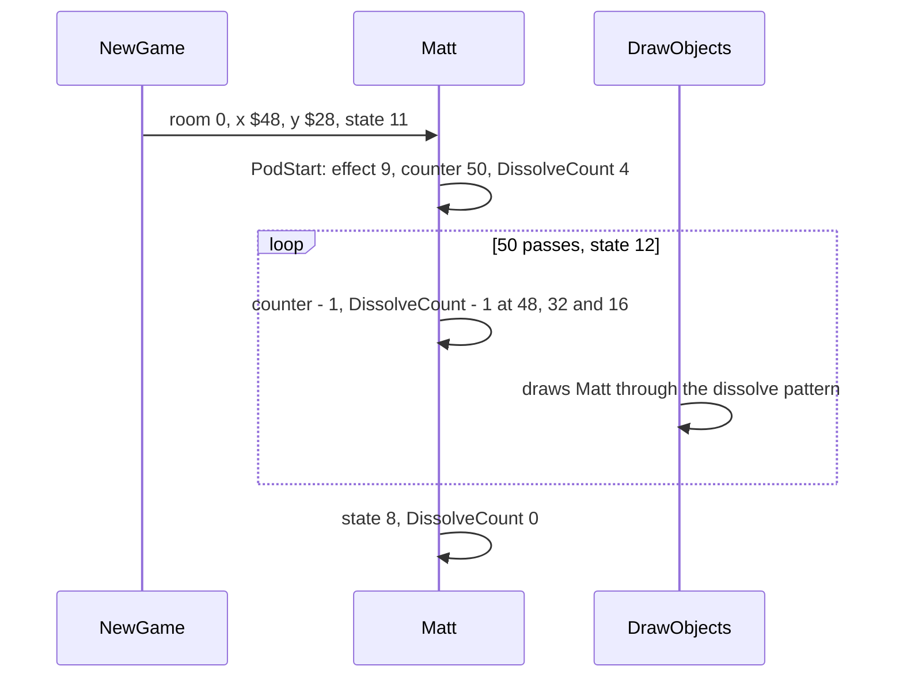

Worked example: the new game of `rzx-04000`. At frame 2085 Matt is at x `$48`, y `$28`, state 11, energy 255, room
0. State 12 begins at frame 2095 with the counter at 50 and DissolveCount 4. DissolveCount is 3 from frame 2105
(counter 47), 2 from 2154 (31) and 1 from 2199 (15). The pod of `rzx-00000` (frames 2296-2321) shows the other
journey: Matt stood in the room-0 booth; one pass later the base of room 10 surrounded him, still standing.

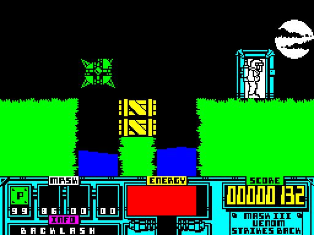

How to read it: the screen at every changed frame. Matt stands in the booth on the surface; one frame later the base
of room 10 is drawn around him. Recording `rzx-00000`, TTD frames 2290-2330. Made by `python3
../../kit/screen_anim.py --work work/docs/mxC/rzx-00000 --from 2290 --to 2330 --step 1 --delay 60 --hold 800
docs/img/play/pod.gif`.

**The point**: a pod costs nothing and takes one pass. The slow dissolve the player sees at the start belongs to the
new game alone (and to the door warp, 10.15).

Witness: Teleport L1 4 (`rzx-00000`, `rzx-04000`, `rzx-12000`, `rzx-20000`); PodStart L1 16 (`c1`, `door`, `play2`,
`rzx-` x8); the `rzx-04000` samples of frames 2085-2240 and the `rzx-00000` samples of frames 2296-2321.

## 10.6 Energy and every source of damage

Energy `$AEA6` is one byte, 255 at the start. The bar shows it ([doc 8](08-hud-and-text.md)). Nothing refills it
except the HEALER (10.11). It falls in five ways; two more hazards kill outright through DeathFlag `$B2F8`.

| Source | Routine | Loss | When |
| --- | --- | --- | --- |
| an enemy's touch | Damage `$C2CA` from the kind's routine | the template's damage (3 to 255) | the boxes overlap, PENETRATOR off |
| a turret shot | KindTurretShot `$C521` | 10 | its turret still alive |
| a head bump in zone 1 | LavaDrain `$BA93` | 2 | the jump or the long jump hits a ceiling |
| a block item | TakeBlockItem `$B33D` | 25 | Matt meets a `$1B` item, PENETRATOR off |
| the chaser's own touch | KindChaser `$C64E` | 255 | always kills |
| a deadly floor | DeadlyFloor `$B2F9` | DeathFlag | character `$EA` (`$ED` in zone 3) under a foot, no cheat |
| the moon floor | MoonFloor `$B32C` | DeathFlag | zone 2, character `$FE` or `$FF` under the left foot |
| out of the play area | MattStep | DeathFlag | y + `$30` at least `$A0` |

Every loss stops at 0 (SUB, then 0 on a borrow). An energy of 0 starts state 9 (10.1): Matt stands still for 50
passes while the HUD keeps running, then GameOver. DeathFlag skips the wait: Death runs at once (10.12).

```text
Damage(IX):       Energy = max(0, Energy - IX.damage)           # +$1E of the object
LavaDrain:        if zone == 1: Energy = max(0, Energy - 2)
TakeBlockItem:    unless PENETRATOR on:
                      for each of the 4 BlockItems: if Matt overlaps it:
                          clear its 2 x 2 cells; map byte = $47; an explosion object rises from it
                          Energy = max(0, Energy - $19)
DeadlyFloor:      unless CheatOn:
                      if zone 2: MoonFloor (cell under the left foot >= $FE: DeathFlag)
                      floor = $ED in zone 3 else $EA
                      if either cell under the feet == floor: DeathFlag = $FF
```

```asm
DeadlyFloor:
  LD A,(CheatOn)
  AND A
  RET NZ
  LD A,(ZoneSlots)
  CP $02
  CALL Z,MoonFloor
  LD C,$EA
  LD A,(ZoneSlots)
  CP $03
  JR NZ,l_B311
  LD C,$ED
l_B311:
  LD HL,(MattPlace+$0002)
  LD DE,$0081
  ADD HL,DE
  LD A,(HL)
  CP C
  JR NZ,l_B321
  LD A,$FF
  LD (DeathFlag),A
```

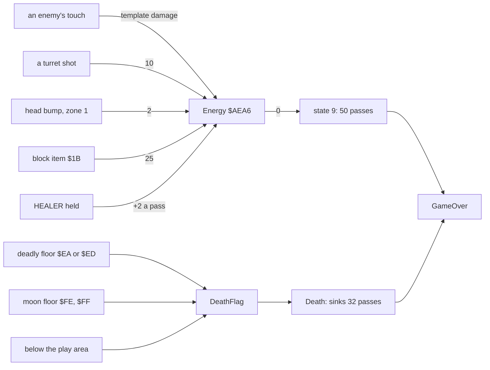

The deaths of the run, from the samples:

| Recording, frame | Room, screen | Cause | Energy before | Score on the way |
| --- | --- | --- | ---: | --- |
| `rzx-04000` 1561 | 1, 1 | a deadly floor, after a fall | 95 | |
| `rzx-04000` 3303 | 0, 2 | a deadly floor, after a fall | 225 | |
| `rzx-08000` 1240 | 2, 5 | the chaser's touch | 255 | + 5000 |
| `rzx-12000` 2823 | 12, 3 | a wave flyer's touch | 13 | + 150 |
| `rzx-20000` 1842 | 3, 0 | a turret's touch | 21 | none (the turret) |
| `rzx-24000` 1190 | 3, 4 | the boss's touch, in a jump | 155 | + 1000 |
| `rzx-24000` 2579 | 0, 2 | a deadly floor, after a fall | 255 | |
| `rzx-28000` 450 | 8, 4 | the moon floor | 116 | |
| `rzx-28000` 2585 | 0, 2 | a deadly floor, after a fall | 235 | |
| `rzx-32000` 657 | 14, 5 | the chaser's touch | 97 | + 5000 |
| `rzx-32000` 2486 | 0, 2 | a deadly floor, after a fall | 215 | |

Room 0's screen 2 holds a deadly floor below a drop; the RZX player fell onto it four times. The chaser killed from
full energy: its 255 empties any bar.

Worked example: LavaDrain. In `rzx-20000` Matt held up in the JACKRABBIT long jump under the ceiling of room 6,
screen 4 (zone 1). From frame 526 to 555 his y stayed `$46` and the energy fell 141, 139, 137, ... 123: 2 a pass,
the head bump of state 7 each time. In `rzx-12000` at frame 227 one jump hit the ceiling of room 4: state 5 became 1
and the energy went from 245 to 243.

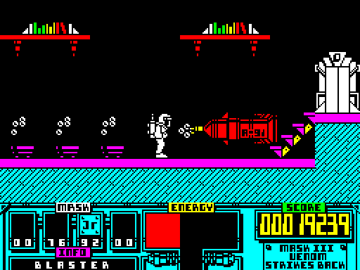

How to read it: the screen every second frame. The chaser sweeps in, its touch empties the bar, Matt stands for 50
passes, MISSION TERMINATED follows. Recording `rzx-32000`, TTD frames 640-800. Made by `python3
../../kit/screen_anim.py --work work/docs/mxC/rzx-32000 --from 640 --to 800 --step 2 --delay 60 --hold 800
docs/img/play/energy-out.gif`.

**The point**: energy is a single budget for every hurt, and the HEALER is its only refill. The deadly floors and the
moon floor ignore it: they kill at any energy.

Witness: Damage L1 74 (`door`, `rzx-` x9); LavaDrain L1 51 (`rzx-12000`, `rzx-16000`, `rzx-20000`); DeadlyFloor and
TakeBlockItem L1 12 990 each (every pass); MoonFloor L1 162 (`rzx-28000`); the samples of the frames in the table.
TakeBlockItem never found an item: no loss of 25 in any recording.

## 10.7 The masks: slots, charges, pick-ups and keys

Matt carries four masks, in MaskSlots `$AF2B`: four records of four bytes. CurrentSlot `$AF51` points at the one in
use; the HUD draws all four and scrolls the name of the current one ([doc 8](08-hud-and-text.md)).

```text
slot: +0 the HUD place, +1 the kind (0 EMPTY, 1-10), +2 the charges (BCD 00-99), +3 the level (the shot's power)
MaskLevels $AF3B (by kind): 0 0 0 0 0 1 1 3 2 6 1
```

| Kind | Mask | How | What it does | Cost |
| ---: | --- | --- | --- | --- |
| 1 | PENETRATOR | fire held | walks through walls; no enemy can touch him | 1 charge each second pass |
| 2 | ULTRA FLASH | fire held | nothing: a `RET` | none |
| 3 | MIRAGE | fire held | nothing: a `RET` | none |
| 4 | HEALER | fire held | Energy + 2 a pass | 1 a pass |
| 5 | JACKRABBIT | fire pressed; up | a shot of power 1; the long jump | 1 a shot; 1 each 5 passes of jump (15 on the moon) |
| 6 | LIFTER | fire pressed | a shot of power 1 that lifts what it hits | 8 a shot |
| 7 | BLASTER | fire pressed | a shot of power 3 | 1 |
| 8 | BACKLASH | fire pressed | a shot of power 2 | 1 |
| 9 | LAVA SHOT | fire pressed | a shot of power 6 | 1 |
| 10 | STREAMER | fire pressed | a shot of power 1 | 1 |

The level is the slot's +3, set from MaskLevels when the mask is taken. The door warp can raise BACKLASH to 3 (10.15).

Only six kinds lie in the map. PickupTable `$950E` holds eleven pick-ups: PENETRATOR and BACKLASH in room 0, HEALER
and BLASTER in room 3, HEALER and JACKRABBIT in room 5, BLASTER in room 8, BLASTER, LIFTER and JACKRABBIT in room 10,
JACKRABBIT in room 11. ULTRA FLASH, MIRAGE, LAVA SHOT and STREAMER are named, drawn and coded, but no record places
them and no other routine hands them out: the player can never hold them.

A mask is taken from the map by crouching on it. State 4 with down held calls CheckPickupsDown, which tries the two
pick-ups of the screen (PickupRecords `$AF1B`). CheckPickups takes a pick-up within 4 x-cells of Matt's place:

```text
CheckPickups(record):
    if record.kind == $FF: return                    # taken already
    cell = (x - $36) / 4 + 4 RoomScreen
    if cell - record.cell >= 4: return
    record.kind = $FF; set bit 7 of its PickupTable byte (taken)
    slot = CurrentSlot
    if slot.kind == 0: ShowMaskName(kind)           # the current slot, if empty
    else: slot = FindEmptySlot()                     # the first EMPTY slot, else the current one
    slot.kind = kind; slot.charges = $99; slot.level = MaskLevels[kind]
    DrawAllSlots
```

```asm
CheckPickups:
  LD A,(IX+$01)
  INC A
  RET Z                   ; taken
  ...
  LD IX,(CurrentSlot)
  LD A,(IX+$01)
  AND A
  CALL Z,ShowNameKeep     ; the current slot is EMPTY: show the name
  CALL NZ,FindEmptySlot   ; else the first EMPTY slot, or the current
  LD (IX+$01),C
  LD (IX+$02),$99
```

UseCharge `$B210` takes the charges, in BCD. At 0 the slot becomes EMPTY and the name EMPTY scrolls. With the cheat it
returns at once (10.16).

```text
UseCharge(n):
    if CheatOn: return
    slot.charges = slot.charges - n (BCD)
    if the result is 0 or below: slot.charges = 0; slot.kind = 0; ShowMaskName(0)
```

Keys 1-4 (half-row `$F7FE`) choose a slot. MaskKeys `$B089` first ends the PENETRATOR (EndPenetrator), then picks the
slot of the lowest key held. An EMPTY slot is not chosen. The name of the new mask scrolls.

MoonMasks `$ADD2` runs in every DrawRoom: in zone 2 (the moon) every PENETRATOR slot becomes EMPTY with no charges.

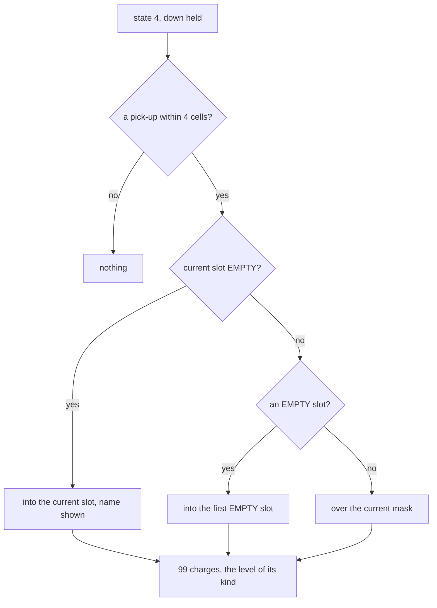

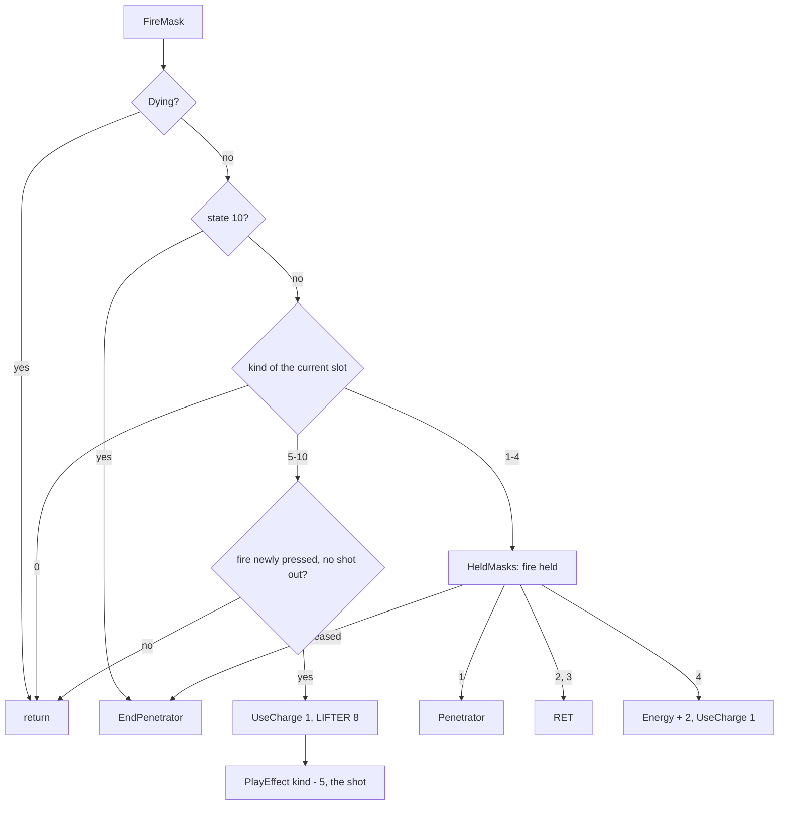

Worked example: a full hand. In `rzx-16000` at frame 49 all four slots held a mask. Matt crouched on a HEALER while
the current slot was a BLASTER. FindEmptySlot found no EMPTY slot and returned the current one: the BLASTER was
replaced by the HEALER with 99 charges. The new game of `rzx-04000` (frame 2085) shows the other side: the four
slots `61 05 94 01`, `64 08 75 02`, `67 06 99 01`, `6A 07 99 03` became `61 00 00 01`, `64 00 00 02`, `67 00 00 01`,
`6A 00 00 03`. The kinds and charges were cleared; the levels stayed.

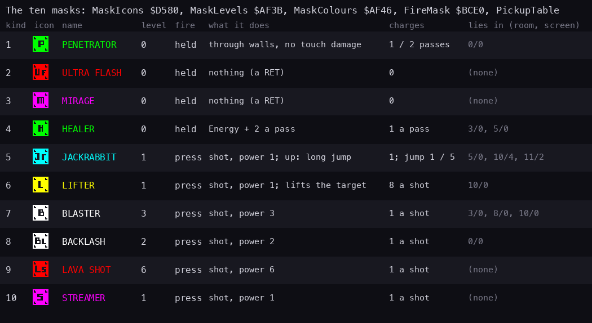

How to read it: one row a mask: its icon from the sprite data, its kind, how it is used, its level (the shot's
power), its cost and the rooms whose PickupTable holds it. Recording: none, the bytes of the build. Made by `python3
tools/fig_objects.py masks docs/img/objects/masks.png`.

**The point**: a mask is a slot with a kind, a BCD stock of 99 and a level. Four kinds are held, six are fired; two of
the held ones do nothing at all.

Witness: CheckPickupsDown L1 1230, CheckPickups L1 2460, FindEmptySlot L1 5 (`rzx-00000`, `rzx-16000`), UseCharge L1
593, MaskKeys and FireMask L1 12 988 (every pass), MoonMasks L1 79; the slot bytes of the `rzx-04000` samples of
frames 2080 and 2085.

## 10.8 PENETRATOR: through the walls

The PENETRATOR is held. On the first pass with fire held, Penetrator `$BE0E` sets PenetratorOn `$B3EA` and plays
effect 7. Every pass it sets DissolveCount to 2 (Matt is drawn half dissolved) and takes (PassBcd AND 1) +
PenetratorCost charges: one every second pass. PenetratorCost `$BE0D` is 0, except while the chaser is in the room:
KindChaser sets it to 16 for the next pass.

While PenetratorOn is set:

- the walk tests only the feet for a wall, so a step still climbs, but no wall stops Matt;
- the jump and the fall skip their wall tests;
- TouchesMatt answers "no touch" for every object: no enemy can hurt him;
- TakeBlockItem ignores the block items.

Releasing fire, choosing a slot with keys 1-4, or a slot emptied by UseCharge, ends it in EndPenetrator `$BDD1`. If
any of Matt's six cells is solid at that moment, he dies inside the wall: Dying is set, Explosion `$BB78` throws 200
dots (effects 16 and 17), and GameOver follows at once.

```text
Penetrator (kind 1, fire held):
    if not PenetratorOn: PenetratorOn = $FF; PlayEffect 7
    DissolveCount = 2
    n = (PassBcd AND 1) + PenetratorCost; PenetratorCost = 0
    UseCharge(n); if the slot is now EMPTY: EndPenetrator
EndPenetrator:
    if not PenetratorOn: return
    PenetratorOn = 0; EffectStops = $FF
    for the 3 rows of Matt, 2 cells each: if solid: Dying = $FF; Explosion; GameOver
    if DissolveCount == 2: DissolveCount = 0
```

```asm
Penetrator:
  LD A,(PenetratorOn)     ; kind 1 held
  AND A
  JR NZ,l_BE1E
  LD A,$FF
  LD (PenetratorOn),A
  LD A,$07
  CALL PlayEffect
l_BE1E:
  LD A,$02
  LD (DissolveCount),A
  LD HL,PenetratorCost
  LD A,(PassBcd)
  AND $01
  ADD A,(HL)
  LD (HL),$00
  CALL UseCharge
```

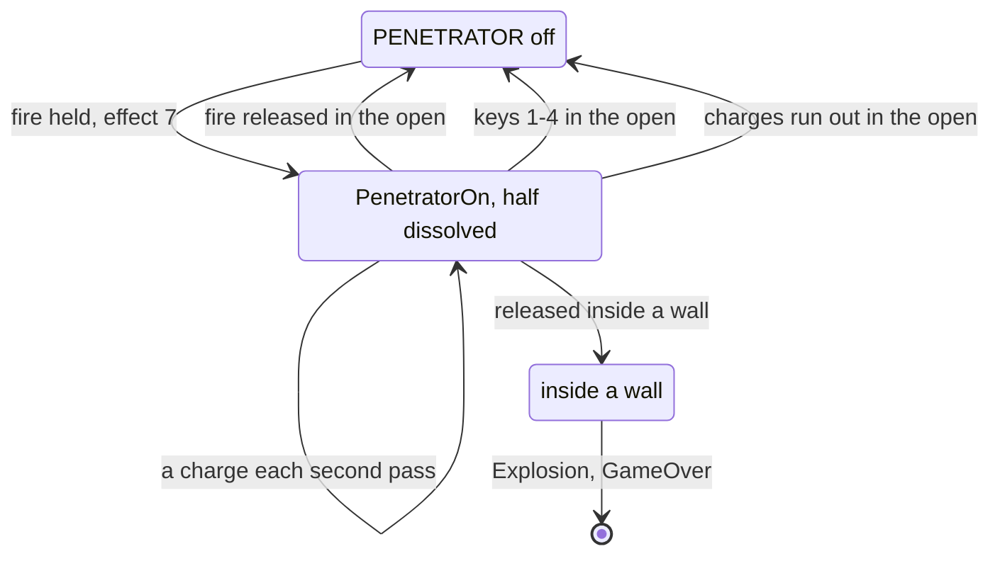

Worked example: `rzx-00000`, room 10, screen 2. At frame 2517 PenetratorOn is `$FF`, DissolveCount 2 and the
PENETRATOR slot `61 01 98 00` has 98 charges. Matt walks left and up the stairs through the walls of the base: x
`$6E` to `$3C` by frame 2604, then the next screen at x `$AE` (frame 2622). The charges fall one each second pass:
98 at 2517, 97 at 2523, 96 at 2530, ..., 82 at 2622.

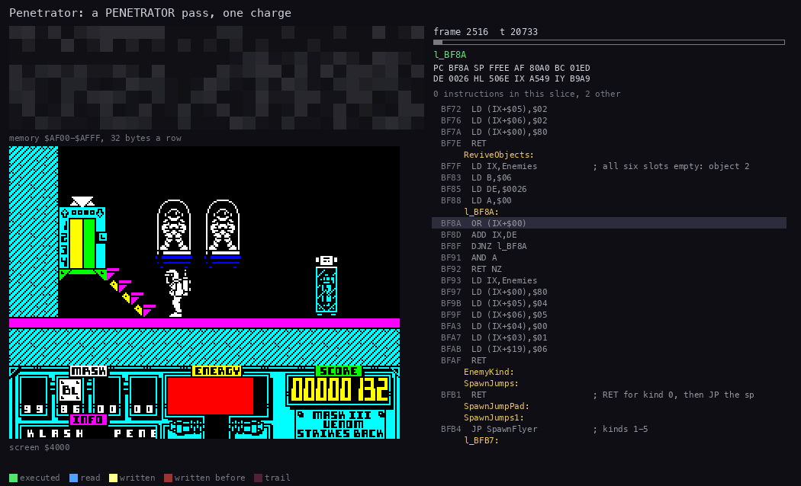

How to read it: the screen, the memory `$AF00-$AFFF` (the slots), and the code of FireMask, HeldMasks, Penetrator and
MattStep as it runs. Recording `rzx-00000`, TTD frames 2515:0-2565:0, 50 pictures. Made by `python3
../../kit/routine_anim.py --work work/docs/mxC/rzx-00000 --window 2515:0-2565:0 --listing build/game.lst --pc
BCE0-BE3A,B3EB-BA92 --view screen --range AF00-AFFF --pictures 50 --delay 160 --title '...' --out
docs/img/routines/Penetrator.gif`.

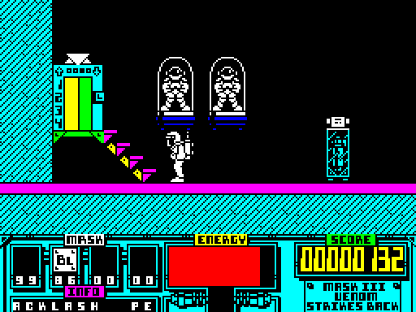

How to read it: the screen every second frame. Matt, drawn through the dissolve pattern, climbs through the walls of
room 10 to the left. Recording `rzx-00000`, TTD frames 2505-2615. Made by `python3 ../../kit/screen_anim.py --work
work/docs/mxC/rzx-00000 --from 2505 --to 2615 --step 2 --delay 60 --hold 800 docs/img/play/penetrator.gif`.

**The point**: the PENETRATOR is a ghost mode: no walls, no touches, no block items. Its price is the risk at the
end: let go inside a wall and the mission ends.

Witness: EndPenetrator L1 1021 (`c1`, `door`, `rzx-` x8; most calls return at once); Penetrator in `rzx-00000`
frames 2517-2622; Explosion runs only in `masks` (PENETRATOR given by a POKE, fire released inside the hill at frame
1249: Explosion L1 1, then GameOver).

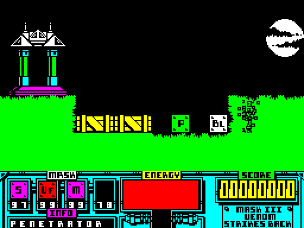

## 10.9 JACKRABBIT: the long jump

The JACKRABBIT is a shooting mask (power 1, effect 0) with a second use: while it is the current mask, up starts the
long jump (state 7) instead of the jump, and any fall becomes the long jump too.

```text
JackrabbitJump: state = 7; counter v = 4
MattLongJump (state 7):
    if the current mask is not JACKRABBIT: state 1; return
    v += 1; if v == 5: v = 0; UseCharge(1, or $15 on the moon)         # a charge each 5 passes
    if up:
        if a solid cell at the head: LavaDrain (zone 1: Energy - 2)
        else if y >= 5: y -= 4
    else:
        if FloorCheck: state 1; return
        y += 2, or 4 with down held
    unless at an edge: a wall at the head, body, legs or feet stops x
    x += facing dx (the screen edges change the screen in the facing's direction)
```

```asm
MattLongJump:
  LD IY,(CurrentSlot)     ; state 7, a charge a step
  LD A,(IY+$01)
  CP $05
  JR NZ,l_B94F            ; no longer JACKRABBIT: state 1
  INC (IX+$11)
  LD A,(IX+$11)
  CP $05
  JR NZ,l_B90F
  LD (IX+$11),$00
  LD C,$01
  LD A,(ZoneSlots)
  CP $02
  JR NZ,l_B90B
  LD C,$15                ; the moon: 15 charges
l_B90B:
  LD A,C
  CALL UseCharge
```

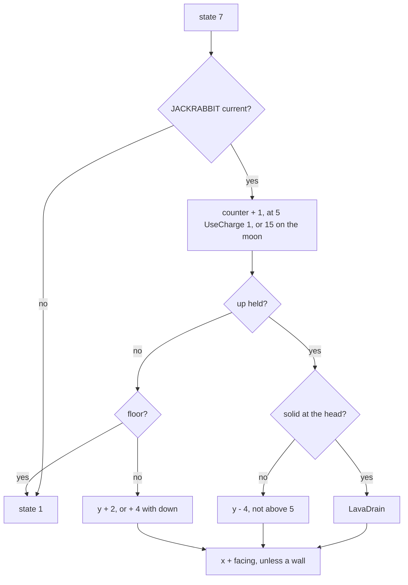

The long jump is a flight: Matt rises 4 a pass with up, sinks 2 without, and keeps moving in his facing. Each fifth
pass costs a charge. On the moon the cost is `$15`, 15 in BCD: a full mask lasts 33 passes of flight there.

Worked example: `rzx-12000`, room 4, frames 1297-1425. The JACKRABBIT slot had 98 charges at 1297 and 88 at 1425: ten
charges, fifty passes of flight. Matt's y went up and down between `$50` and `$40` as the player tapped up. At frame
1387 a turret's touch and its shots hit him in the air.

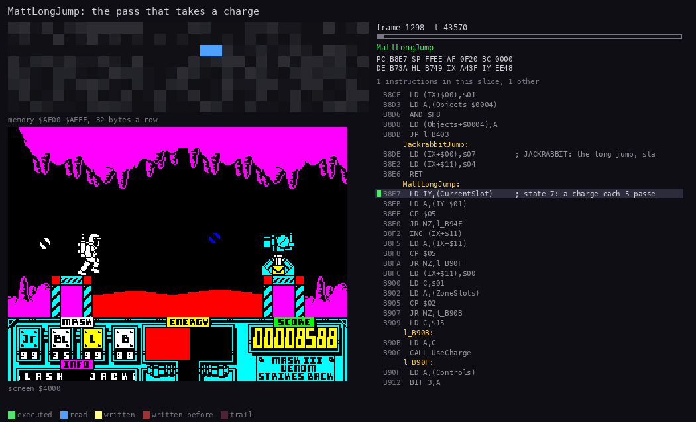

How to read it: the screen, the memory `$AF00-$AFFF` (the slots), and the code of MattLongJump and UseCharge as it
runs. Recording `rzx-12000`, TTD frames 1297:0-1330:0, 33 pictures. Made by `python3 ../../kit/routine_anim.py --work
work/docs/mxC/rzx-12000 --window 1297:0-1330:0 --listing build/game.lst --pc B8DE-B992,B210-B237 --view screen
--range AF00-AFFF --pictures 33 --delay 200 --title '...' --out docs/img/routines/MattLongJump.gif`.

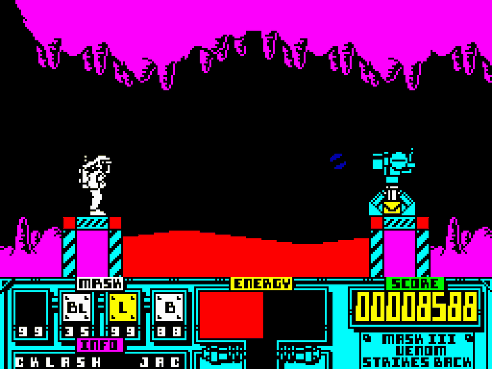

How to read it: the screen every second frame. Matt flies across room 4 in hops. Recording `rzx-12000`, TTD frames
1288-1432. Made by `python3 ../../kit/screen_anim.py --work work/docs/mxC/rzx-12000 --from 1288 --to 1432 --step 2
--delay 60 --hold 800 docs/img/play/jackrabbit.gif`.

**The point**: the JACKRABBIT turns the jump into free flight paid by the pass. Only its current-ness matters: switch
masks in the air and Matt drops into state 1 at once.

Witness: JackrabbitJump and MattLongJump in `rzx-12000` (frames 1297-1425), `rzx-16000` (2288-2370) and `rzx-20000`
(336-555); LavaDrain in state 7 at `rzx-20000` 526-555. The moon's cost of 15 is known only from the code: no long
jump on the moon in any recording.

## 10.10 LIFTER and the shooting masks

Kinds 5-10 fire a shot. FireMask fires on a new press of fire (the bit was clear in ControlsLast), only when no shot
is out. It takes the charge first: 1, or 8 for the LIFTER. A failed charge (the stock too low) fires nothing.

The shot is object 1, MattShot `$A465`. It starts at y + 5, at x + 6 with dx +6 to the right, or x + 2 with dx -6 to
the left. Its power (+`$21`) is the slot's level; its picture is the mask's (kind - 5). The LIFTER's shot also sets
+`$22` to `$FF`. MoveShot ends the shot outside x `$38-$C3` or in a wall.

The shot test is in RunObjects ([doc 7, 7.9](07-objects.md#79-runobjects-the-shot-test-and-the-touch-test)): each hit
takes one from the object's hits and one from the shot's power. A LIFTER hit does not wound. ObjectShot turns the
object into kind 10: its dx is zeroed and it rises 8 a pass until it leaves the screen. A lifted object scores its
template's points.

```text
FireMask, kinds 5-10:
    if not (fire and not fire last pass) or the shot is out: return
    if UseCharge(LIFTER ? 8 : 1) fails: return
    PlayEffect(kind - 5)
    shot.y = y + 5
    if facing left: shot.x = x + 2, dx = -6 else: shot.x = x + 6, dx = +6
    shot.kind = 1; shot.picture = kind - 5; shot.power = slot.level
    shot.lift = (kind == LIFTER) ? $FF : 0
```

```asm
l_BD1E:
  LD A,(IX+$01)
  SUB $05
  CALL PlayEffect         ; effects 0-5
  LD IY,MattShot
  LD A,(Objects+$0004)
  ADD A,$05
  LD (MattShot+$0004),A
  LD A,(Objects+$0002)
  ADD A,A                 ; facing bit 7 into carry
  LD A,(Objects+$0003)
  JR C,l_BD45
  LD E,$06
  LD (IY+$02),$00
  ADD A,$04
  JR l_BD4B
l_BD45:
  LD E,$FA
  LD (IY+$02),$FF
l_BD4B:
  ADD A,$02
  LD (MattShot+$0003),A
```

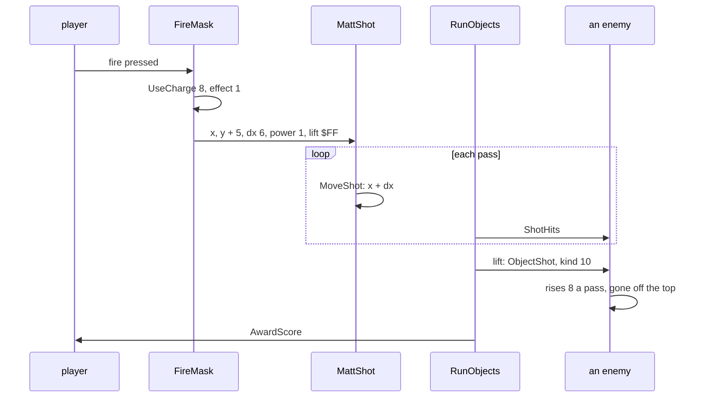

Worked example: `rzx-12000`, room 12, frames 2090-2225. The LIFTER slot fell 99, 91, 83, 75, 67, 59, 51: six shots,
8 charges each. Five walkers were lifted, each + 100 to the score: 8590 to 9090. A walker takes 10 hits from a
weapon, but one LIFTER hit lifts it.

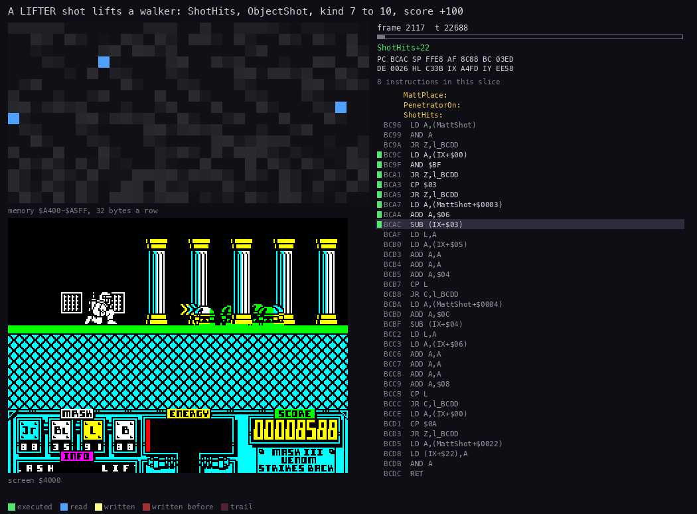

How to read it: the screen, the memory `$A400-$A5FF` (the objects) and the code of FireMask, KindTen and ShotHits as
it runs. Recording `rzx-12000`, TTD frames 2098:0-2120:0, 33 pictures. Made by `python3 ../../kit/routine_anim.py
--work work/docs/mxC/rzx-12000 --window 2098:0-2120:0 --listing build/game.lst --pc BCE0-BDD0,C6B8-C6F1,BC96-BCDF
--view screen --range A400-A5FF --pictures 33 --delay 200 --title '...' --out docs/img/routines/FireMask-lifter.gif`.

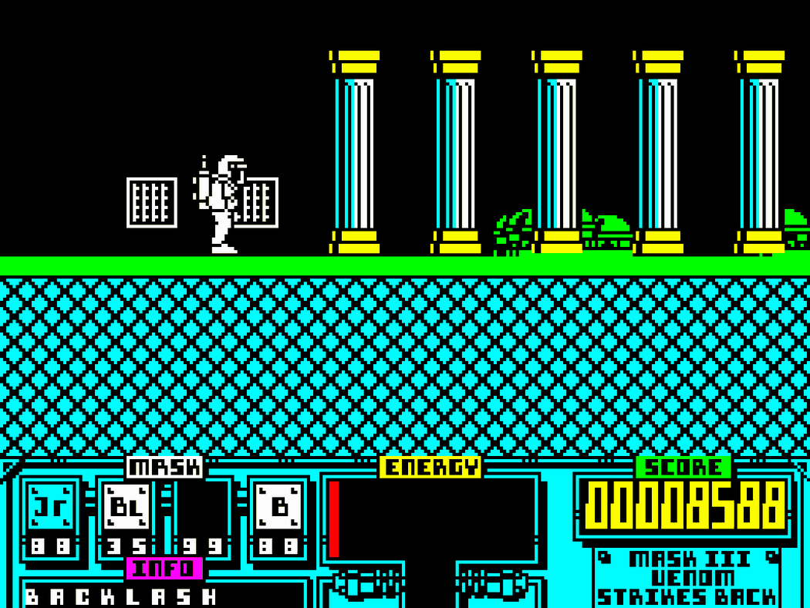

How to read it: the screen every second frame. Matt fires; each walker hit floats up out of the room. Recording
`rzx-12000`, TTD frames 2084-2222. Made by `python3 ../../kit/screen_anim.py --work work/docs/mxC/rzx-12000 --from
2084 --to 2222 --step 2 --delay 60 --hold 800 docs/img/play/lifter.gif`.

**The point**: one shot on screen at a time, power from the slot's level. The LIFTER costs eight times more and
removes anything in one hit.

Witness: FireMask L1 12 988; ShotOff L1 79; MoveShot L1 12 990; the LIFTER slot and the score in the `rzx-12000`
samples of frames 2090-2225; `work/docs/mxC/jrshot.py` counts the shots per mask kind in every recording.

## 10.11 HEALER, ULTRA FLASH and MIRAGE

HeldMasks `$BDA4` serves kinds 1-4 while fire is held. Kind 1 is the PENETRATOR (10.8). Kinds 2 and 3 jump to a
`RET`: ULTRA FLASH and MIRAGE do nothing and cost nothing. Kind 4, the HEALER, adds 2 to the energy a pass (not above
255) and takes one charge. A full energy (255) stops it: no charge is taken then.

A routine for these masks exists and is never called: MaskEffect `$B239` would flash the border for ULTRA FLASH and
give 1 energy a charge for the HEALER. No instruction jumps or calls there.

```text
HeldMasks (kinds 1-4):
    if fire not held: EndPenetrator; return
    kind 1: Penetrator; kind 2: RET; kind 3: RET
    kind 4: if Energy == 255: return
            Energy = min(255, Energy + 2); UseCharge(1)
```

```asm
HeldMasks:
  LD A,(Controls)         ; kinds 1-4
  BIT 4,A
  JR Z,EndPenetrator
  LD A,(IX+$01)
  CP $01
  JP Z,Penetrator
  CP $02
  JP Z,UltraFlash
  CP $03
  JP Z,Mirage
  LD A,(Energy)
  CP $FF
  RET Z
  ADD A,$02
  JR NC,l_BDC9
  LD A,$FF
l_BDC9:
  LD (Energy),A
  LD A,$01
  JP UseCharge
```

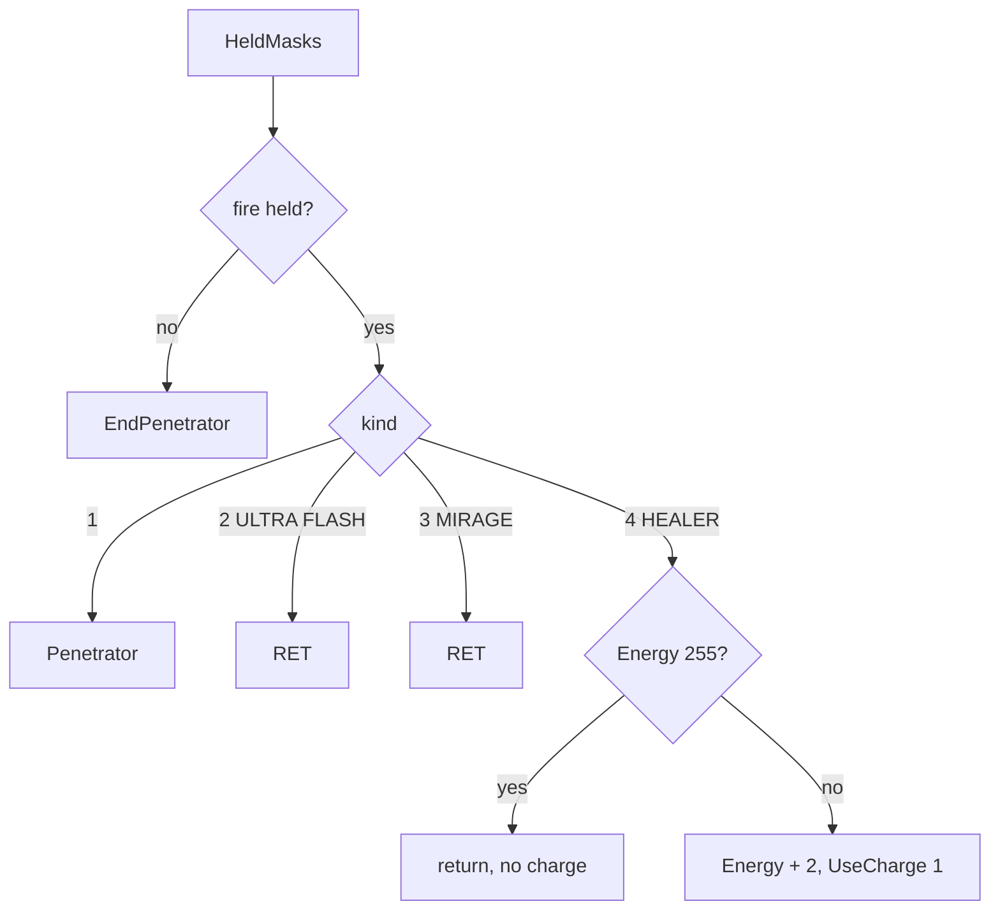

Worked example: `rzx-16000`, room 5, frames 255-430. Matt stood and held fire with the HEALER in slot 3. The energy
went 115, 117, 119, ... 253, 255; the charges 99, 98, 97, ... 30. From frame 418 the energy is full and the charges
stop at 29-30.

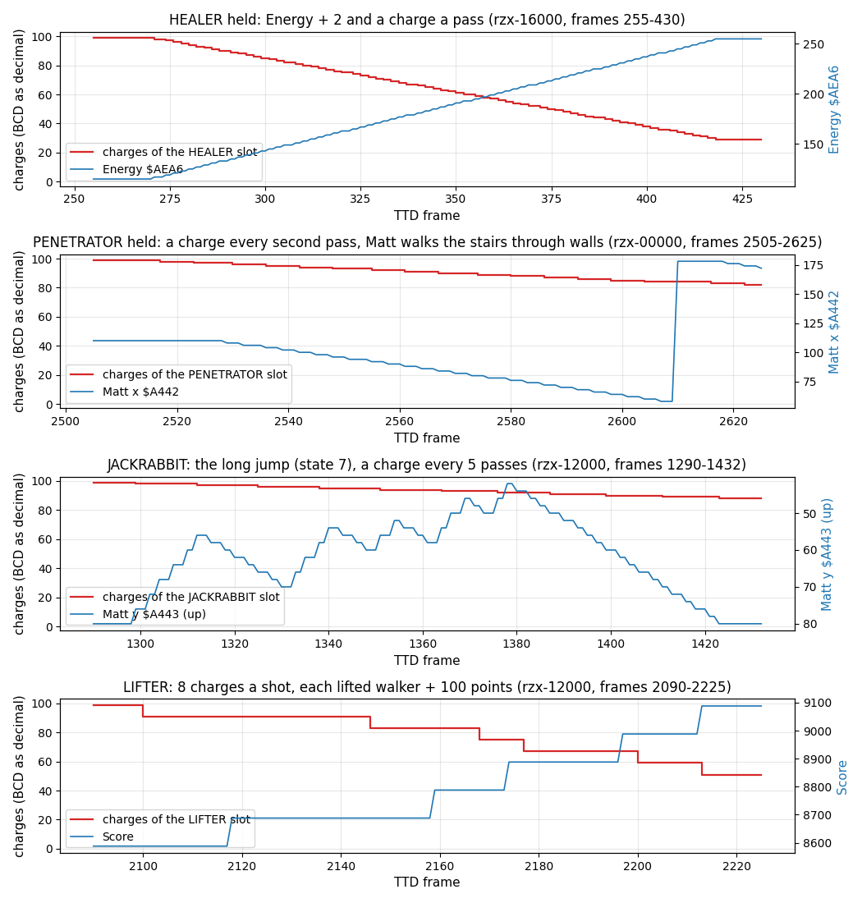

How to read it: four panels, each a mask in use: red, the charges of its slot; blue, the value it changes (the energy
for the HEALER, Matt's x for the PENETRATOR, his y for the JACKRABBIT, the score for the LIFTER). Recordings
`rzx-16000` frames 255-430, `rzx-00000` frames 2505-2625, `rzx-12000` frames 1290-1432 and 2090-2225, from
`work/docs/mxC/*/vars.jsonl`. Made by `python3 tools/fig_objects.py charges docs/img/gameplay/charges.png`.

**The point**: the HEALER turns charges into energy at 2 a charge, and stops paying when the bar is full. ULTRA
FLASH and MIRAGE are named, drawn and placed in the map, and do nothing.

Witness: HeldMasks in `rzx-16000` frames 271-418; the ULTRA FLASH and MIRAGE `RET`s at `$BE39` and `$BE3A`; MaskEffect
`$B239` has no caller (known only from the code). No play holds an ULTRA FLASH or a MIRAGE (no PickupTable record
places them); `masks` gives both by a POKE and holds fire: `$BE39` and `$BE3A` run 25 times each and nothing happens.

## 10.12 Death, game over and the new game

Death `$BAA8` runs when DeathFlag is set. It plays effect 8, sets Dying, clears DissolveCount and sinks Matt: 32 rounds
of y + 1, AnimateZone and DrawObjects, with no HALT. Two FlushDirty calls show the last picture. Then it falls into
GameOver.

GameOver `$BACC` serves all three ends (Death, state 9, EndPenetrator):

- EffectStops = MachineFlag: on the 128K the AY effects stop;
- TuneRequest = 2: the game-over tune on the 128K ([doc 9](09-sound.md));
- SlowPrint MISSION TERMINATED at row 4, column 7: 70 HALTs, then 4 HALTs a character, then 100 HALTs;
- the score against Hiscore `$9D16`, four BCD bytes from the top: a higher score is copied;
- GameStart: the menu, then NewGame.

NewGame `$915B` builds a fresh game but keeps some things:

- room 0, screen 0; Energy 255; Matt at x `$48`, y `$28`, facing right, state 11 (10.5);
- every PickupTable record loses its taken bit: the masks are back in the map;
- the four slots lose their kind and charges; their levels stay;
- every `$2B` in the maps becomes `$12` (the dead turrets come back) and every `$47` becomes `$1B` (the used block
  items come back);
- ChaserState, DeathFlag, DissolveCount, Dying, PenetratorOn and the score are cleared;
- PasswordFlags are kept: the passwords stay typed until the power goes.

```text
Death:
    PlayEffect 8; Dying = $FF; DissolveCount = 0
    repeat 32: y += 1; AnimateZone; DrawObjects
    FlushDirty x 2
GameOver:
    EffectStops = MachineFlag; TuneRequest = 2
    SlowPrint "MISSION TERMINATED" at $0407
    if Score > Hiscore (BCD, from the top byte): Hiscore = Score
    GameStart
```

```asm
GameOver:
  LD A,(MachineFlag)
  LD (EffectStops),A
  LD A,$02
  LD (TuneRequest),A
  LD DE,$0407
  LD HL,GameOverText
  CALL SlowPrint
  LD HL,Hiscore
  LD DE,Score
  LD B,$04
l_BAE8:
  LD A,(DE)
  CP (HL)
  JP C,GameStart          ; lower: keep the high score
  JR NZ,l_BAF3
  INC HL
  INC DE
  DJNZ l_BAE8
l_BAF3:
  LD HL,Score
  LD DE,Hiscore
  LD BC,$0004
  LDIR
  JP GameStart
```

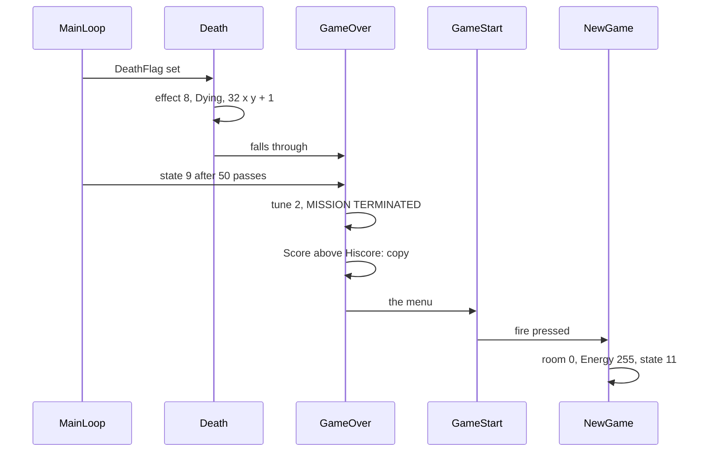

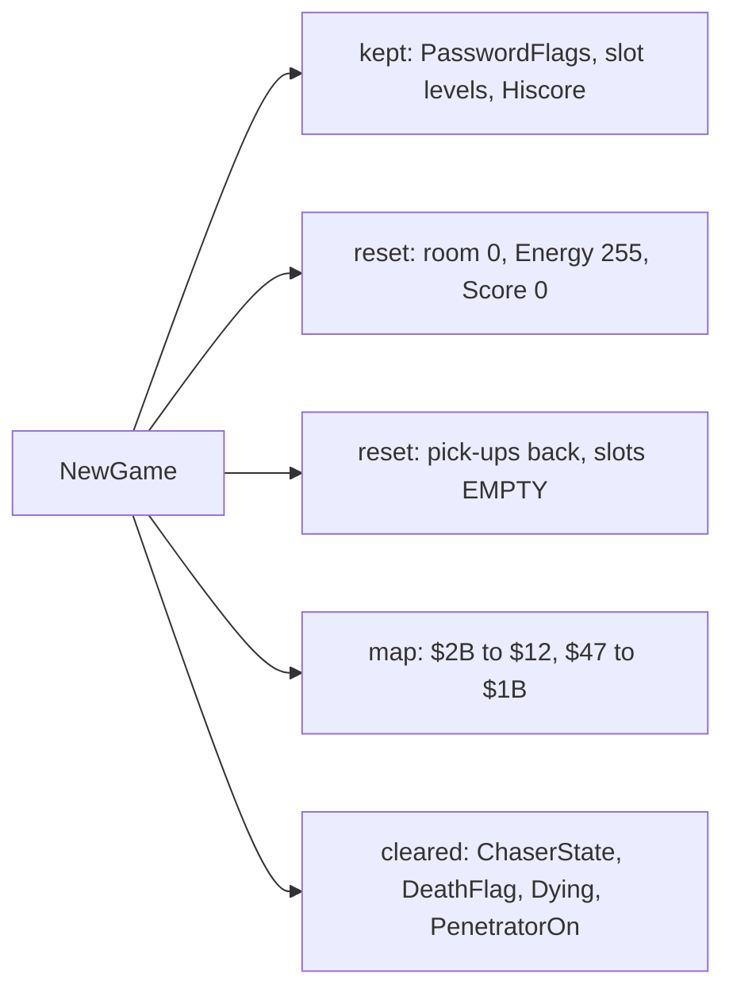

Worked example: `rzx-04000`. Matt fell (state 6, v 8) from y `$47` at frame 1550 to `$64` at 1559, landed at
frame 1561 (state 1, y `$60`) on a deadly floor of room 1, screen 1, and Death began: y `$61` at 1561, `$62` at 1563,
one pixel each two frames, `$79` at 1611 and `$80` at the end. MISSION TERMINATED followed from about frame 1640. The
new game began at frame 2085 (10.5); the score 1352 was cleared by frame 2090.

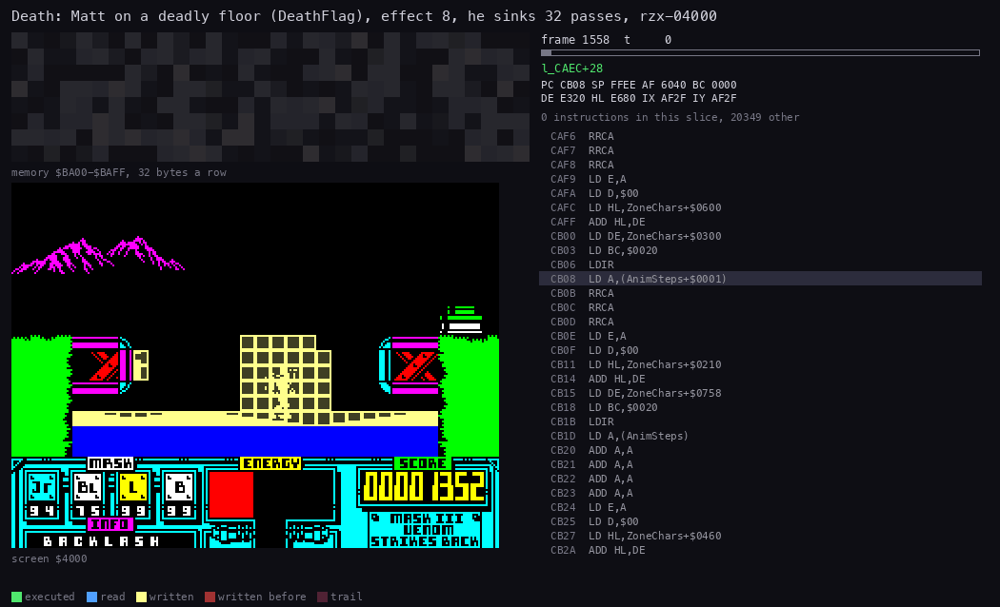

How to read it: the screen, the memory `$BA00-$BAFF` and the code of Death, GameOver and SlowPrint as it runs. Recording `rzx-04000`, TTD frames 1556:0-1640:0, 42 pictures. Made by
`python3 ../../kit/routine_anim.py --work work/docs/mxC/rzx-04000 --window 1556:0-1640:0 --listing build/game.lst --pc
BAA8-BB4B,B2F1-B2F8 --view screen --range BA00-BAFF --pictures 42 --delay 180 --title '...' --out
docs/img/routines/Death.gif` (re-drawn from the kept trace `work/docs/mxC/rzx-04000/traces/1556_0-1640_0.uatr` with
`--trace` in place of `--work` and `--window`).

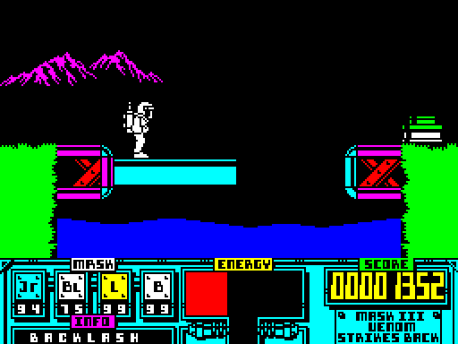

How to read it: the screen every second frame. Matt lands on the floor and sinks into it. Recording `rzx-04000`, TTD
frames 1520-1700. Made by `python3 ../../kit/screen_anim.py --work work/docs/mxC/rzx-04000 --from 1520 --to 1700
--step 2 --delay 60 --hold 800 docs/img/play/death.gif`.

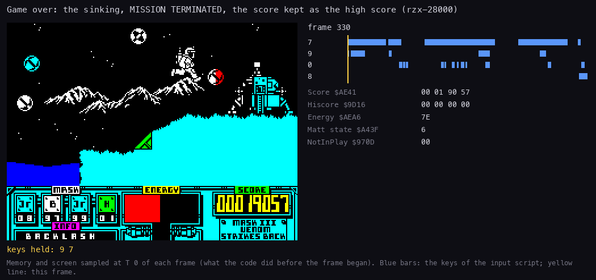

How to read it: left, the screen every fifth frame; right, Score, Hiscore, Energy, Matt's state and NotInPlay.
Matt sinks on the moon, MISSION TERMINATED is typed, the score becomes the high score, then the menu. Recording
`rzx-28000`, TTD frames 330-1060 (the GIF of doc 8). Made by `python3 tools/fig_controls.py play --work
work/docs/mxB/r28 --from 330 --to 1060 --step 5 --keys tests/inputs/rzx-28000.txt --offset 0 --crop 0,0,256,192 --var
'Score=AE41:4:hex' --var 'Hiscore=9D16:4:hex' --var 'Energy=AEA6:1' --var 'Matt state=A43F:1:dec' --var
'NotInPlay=970D:1' --title '...' --delay 70 --out docs/img/play/game-over.gif`.

**The point**: every end goes through GameOver, the only place the high score is kept. A new game restores the map
(turrets and items return) and keeps the passwords.

Witness: Death L1 6 (`rzx-04000`, `rzx-24000`, `rzx-28000`, `rzx-32000`); SlowPrint L1 14; NewGame L1 16 (`c1`,
`door`, `play2`, `rzx-` x8); the `rzx-04000` samples of frames 1550-1611 and 2080-2090.

## 10.13 Enemies and hazards, as rules

Doc 7 gives each kind's code ([7.10](07-objects.md#710-the-kinds-one-by-one)). Here is what each means for Matt: how
it hurts, how it dies and what it pays. The numbers are the templates' (EnemyTemplates `$BE3B`).

| Enemy | Kind | Hurts by | Damage | Hits to kill | Pays | Notes |
| --- | ---: | --- | ---: | ---: | ---: | --- |
| faller | 1 | touch | 10 | 1 | 33 | bursts on the touch too |
| flyer | 2 | touch | 50 | 1 | 200 | homes on Matt's height |
| turret | 4 | touch, its shot | 100 | 5 | 0 | the score is lost (10.18) |
| turret shot | 5 | touch | 10 | 1 | 10 | harmless once its turret dies |
| wave flyer | 6 | touch | 50 | 1 | 150 | effect 6 at each swoop |
| walker | 7 | touch, again and again | 3 | 10 | 100 | the fifth touch kills it |
| chaser | 8 | touch | 255 | 30 | 5000 | sweeps the room for `$300` passes |
| riser | 12 | touch | 20 | 1 | 100 | from a block `$61` |
| guard | 13 | touch | 100 | 10 | 1000 | ten LIFTER hits lift it |
| boss | 14 | touch, its shot | 255 | 10 | 1000 | fires kind 15 |
| boss shot | 15 | touch | 30 | 2 | 50 | |
| kind 16 | 16 | touch, its shot (kind 11) | 255 | 5 | 8000 | spawned only by a POKE (`kind6`) |
| kinds 18, 19 | 18, 19 | touch | 40-60 | 255 | 200-1000 | spawned only by a POKE (`door3`) |

The hazards of the map:

- the deadly floors: character `$EA` in zones 0 and 1, `$ED` in zone 3, under either foot; the moon floor, `$FE` and
  `$FF` in zone 2, under the left foot;
- the ceilings of zone 1 (the caverns): 2 energy a head bump;
- the block items `$1B`: 25 energy, the block blown away;
- the bottom of the play area: a fall below y `$70` (y + `$30` at least `$A0`).

```text
for each enemy, in its kind's routine:
    if its hits reached 0: AwardScore; Explode           # the turret: Explode first, so 0 points
    if TouchesMatt (never with PENETRATOR on):
        Damage; and for the bursting kinds: AwardScore; Explode
Hazards, every pass: DeadlyFloor (and MoonFloor), TakeBlockItem
```

```asm
KindChaser:
  ...
  CALL TouchesMatt
  RET NZ
  CALL Damage             ; 255: the energy is gone
l_C6AC:
  CALL AwardScore         ; 5000
l_C6AF:
  LD A,$FF
  LD (EffectStops+$0001),A
  JP ObjectGone
```

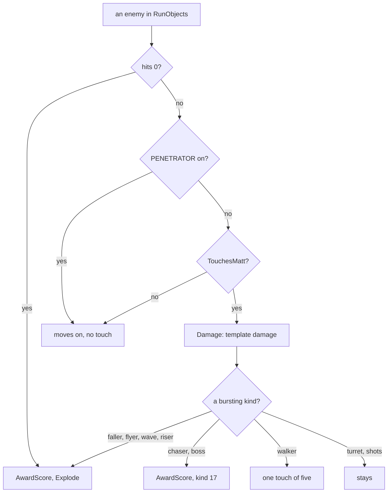

Worked example: the turret's touch in `rzx-20000`. Matt walked right in room 3, screen 0 with 21 energy. At frame 1842 he
touched a turret: Damage took 100, the energy stopped at 0, and state 9 began with the counter at 50. The score stayed
at 12 325: the turret pays nothing, even by touch.

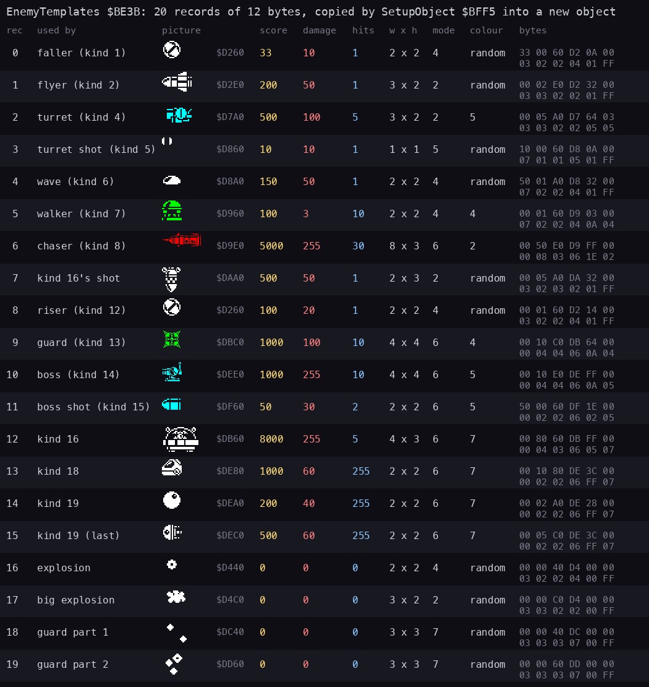

How to read it: one row a template: its number, its use, its picture drawn from the sprite data, then the twelve bytes
decoded. Recording: none, the bytes of the build. Made by `python3 tools/fig_objects.py templates
docs/img/objects/templates.png`.

**The point**: two numbers rule each enemy for the player: its damage and its hits. The chaser and the boss kill on
contact; every other enemy is a matter of the energy left.

Witness: TouchesMatt L1 10 278 (`door`, `rzx-` x9); Damage L1 74; the deaths of 10.6; the `rzx-20000` samples of
frames 1840-1849.

## 10.14 Collisions and the score

Two tests decide every collision; both are in RunObjects ([doc 7, 7.9](07-objects.md#79-runobjects-the-shot-test-and-the-touch-test)).
ShotHits compares the shot's point with the object's box. TouchesMatt compares Matt's box with the object's box:
the object's width x 4 and height x 8, with a margin of 4 on x and 28 on y on the other side. It answers "no touch"
whenever PenetratorOn is set.

The score `$AE41` is eight BCD digits in four bytes. AddScore `$AE45` adds a two-byte BCD value (the template's +0
and +1) with DAA and carries into the top bytes. The score is drawn every pass by DrawScore.

```text
TouchesMatt(IX):
    if PenetratorOn: no
    dx = Matt.x - IX.x;  dy = Matt.y - IX.y
    touch if -10 <= dx < 4 IX.width - 4   and   -28 <= dy < 8 IX.height
AddScore(DE):   Score[3] += E; Score[2] += D + carry; Score[1] += carry; Score[0] += carry   (each with DAA)
```

```asm
AddScore:
  PUSH HL
  LD HL,Score+$0003
  LD A,E
  ADD A,(HL)
  DAA
  LD (HL),A
  DEC HL
  LD A,D
  ADC A,(HL)
  DAA
  LD (HL),A
```

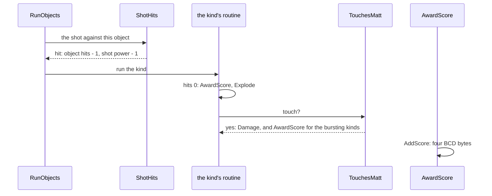

Where the points came from in the run: the faller's 33, the walker's 100 (often lifted), the flyer's 200, the wave's
150, the guard's and the boss's 1000, and the chaser's 5000. The chaser pays even when its touch kills Matt: in
`rzx-08000` (frame 1240) and `rzx-32000` (frame 657) the score rose by 5000 as he died. The run's best was 31 004
points at the end (`rzx-36000`).

Worked example: the BACKLASH shot of `rzx-00000`. At frame 990 the shot (power 2) was 16 pixels left of a faller. At
frame 995 ShotHits found the hit: the faller's hits went from 1 to 0, the shot's power from 2 to 1. The faller's
routine then added 33 points and exploded: the score is 0 in the sample of frame 995 and 33 in that of 996. The shot
flew on.

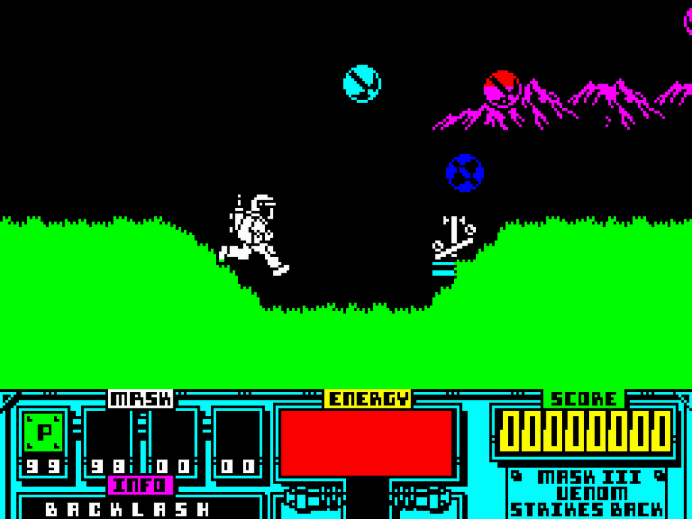

How to read it: the screen at every changed frame: the shot leaves Matt, the faller bursts. Recording `rzx-00000`, TTD
frames 978-1010. Made by `python3 ../../kit/screen_anim.py --work work/docs/mxC/rzx-00000 --from 978 --to 1010 --step 1
--delay 60 --hold 800 docs/img/play/kill.gif`.

**The point**: a kill and a touch pay the same points, so a strong touch is a trade: energy for score. Only the turret
pays nothing either way.

Witness: AwardScore L1 78 (`rzx-` x9); AddScore the same; ShotHits in every pass with a shot; the `rzx-00000`
samples of frames 990-996; the score steps of `rzx-08000` 1240 and `rzx-32000` 657.

## 10.15 The passwords and the door warp

Four rooms show a password on their screen 0 (RoomMessage `$AD28`: CODE BROKEN and the word):

| Flag | Address | Password | Shown in | Door | Leads to |
| ---: | --- | --- | --- | ---: | --- |
| 0 | `$9F6D` | MAYHEM | room 11 | 0 (x `$40-$5F`) | room 11 |
| 1 | `$9F6E` | TRANSMOGRIFY | room 3 | 1 (x `$60-$7F`) | room 3 |
| 2 | `$9F6F` | VALKYR | room 7 | 2 (x `$80-$9F`) | room 7 |
| 3 | `$9F70` | PETALS OF DOOM | room 10 | 3 (x `$A0-$BF`) | room 7, and a LIFTER |

The player types them at ENTER PASSWORD in the menu ([doc 5](05-controls.md)). EnterPassword sets the flag of a
matching word; the fourth is set only when the other three are set already. PasswordPods lights a lamp over each
door of room 0's screen 5 whose flag is set.

A door is used like a pod: down held, with the pillar rim `$1C` under Matt's feet, in room 0, screen 5. The door is
picked by x: (x - `$40`) / 32. StartWarp `$B9C5` sets state 10 with the counter at 50, DissolveCount 1, and plays effect
9. PasswordWarp `$B9D8` (state 10) raises DissolveCount each 16 passes; when the counter runs out it sets the new room
from WarpRooms `$BA1D` (`0B 03 07 07`), screen 0, x `$42`, y + 8, state 8, and draws it.

Door 3 also runs `$BA21`, a bonus:

- each BACKLASH slot before that slot gets level 3 (FindLifterSlot stops at the first EMPTY or PENETRATOR slot);
- a LIFTER with 99 charges and level 1 goes into the first EMPTY or PENETRATOR slot, or slot 0 if none;
- if slot 0 was EMPTY, the name LIFTER scrolls.

```text
in MattWalk, down held, not on a pod:
    if room 0 and screen 5 and the cell below the feet is $1C and PasswordFlags[(x - $40) >> 5 AND 3]:
        StartWarp: state 10; counter = $32; DissolveCount = 1; PlayEffect 9
PasswordWarp (state 10):
    if counter AND $0F == 0: DissolveCount += 1
    counter -= 1; if counter: return
    door = (x - $40) >> 5 AND 3
    RoomNumber = WarpRooms[door]; RoomScreen = 0; x = $42; y += 8; state 8; DissolveCount = 0
    if door == 3: the LIFTER bonus
    DrawRoom
```

```asm
PasswordWarp:
  LD A,(IX+$10)
  AND $0F
  JR NZ,l_B9E3
  LD HL,DissolveCount
  INC (HL)
l_B9E3:
  DEC (IX+$10)
  RET NZ
  LD A,(IX+$03)
  SUB $40
  RLCA
  RLCA
  RLCA
  AND $03                 ; the door
  LD E,A
  LD D,$00
  LD HL,WarpRooms         ; 0B 03 07 07
  ADD HL,DE
  LD A,(HL)
  LD (RoomNumber),A
```

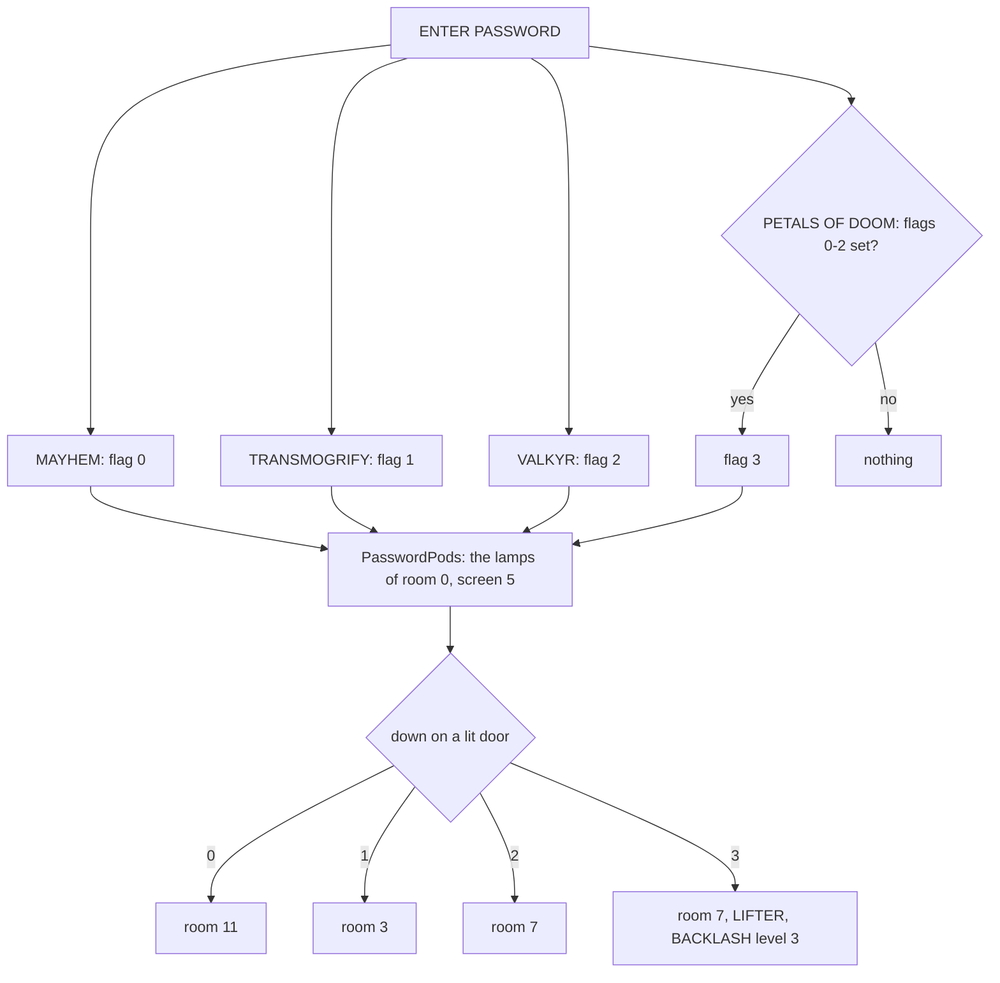

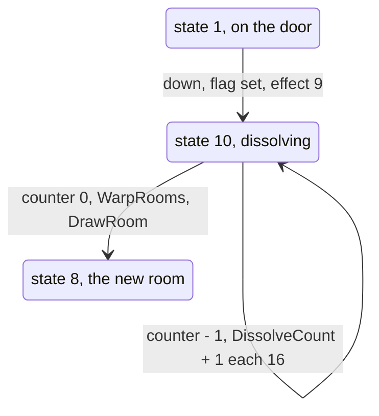

Worked example: the `door` recording. The flags were POKEd to `$FF` in the menu. Matt walked to room 0, screen 5 and
crouched at x `$5C`, `$60` and `$64`: no door there had the rim `$1C` under his feet. At x `$68` (door 1) down started
the warp: state 10 at frame 845, DissolveCount 1, then 2 at frame 852, 3 at 895 and 4 at 939. At frame 981 Matt stood
(state 8) in room 3, screen 0, at x `$42`.

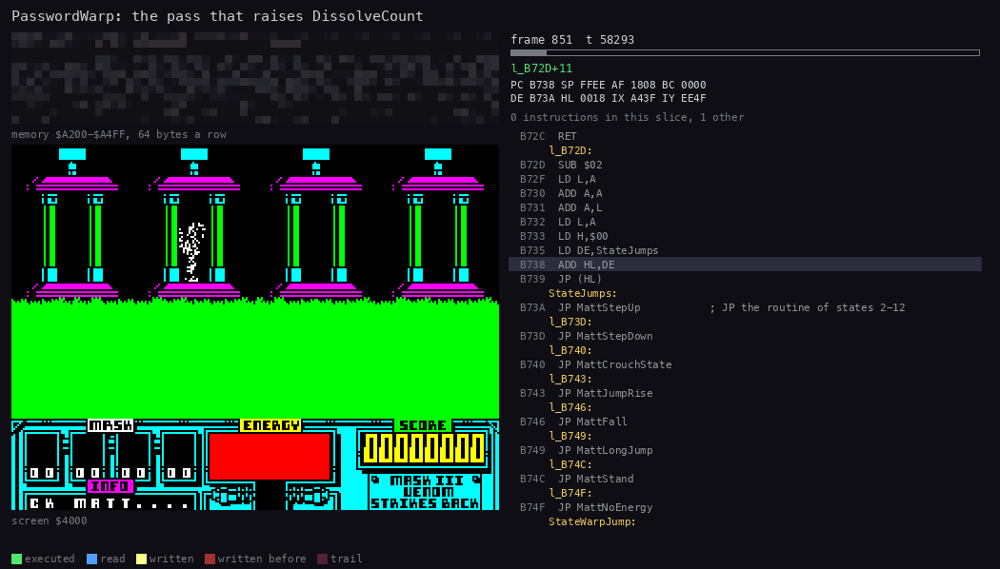

How to read it: the screen, the memory `$9F60-$9F80` (the flags and the password buffer) and the code of StartWarp,
PasswordWarp and its door-3 bonus. Recording `door`, TTD frames 843:0-900:0, 38 pictures. Made by `python3
../../kit/routine_anim.py --work work/docs/mxC/door --window 843:0-900:0 --listing build/game.lst --pc B9C5-BA67
--view screen --range 9F60-9F80 --pictures 38 --delay 180 --title '...' --out docs/img/routines/PasswordWarp.gif`.

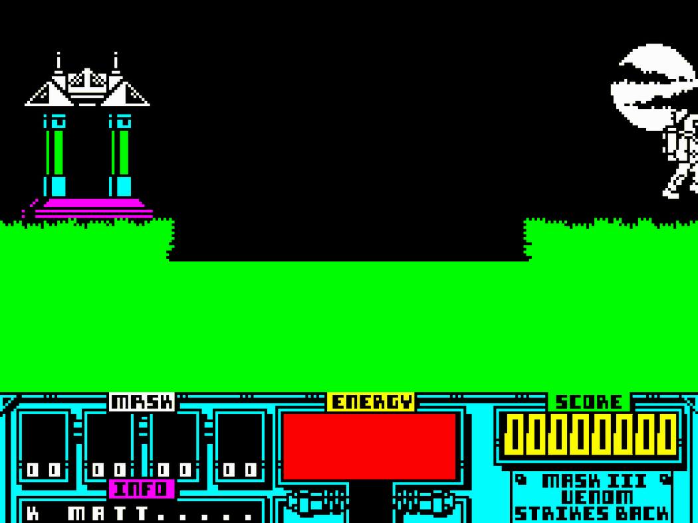

How to read it: the screen every third frame. Matt crouches along the doors, dissolves on door 1 and stands in room 3.
Recording `door`, TTD frames 700-1000. Made by `python3 ../../kit/screen_anim.py --work work/docs/mxC/door --from 700
--to 1000 --step 3 --delay 60 --hold 800 docs/img/play/door-warp.gif`.

**The point**: the passwords are shortcuts, not saves. Each one opens a door from the start room to a later room; the
last one also hands Matt a LIFTER and a stronger BACKLASH.

Witness: StartWarp L1 1 and PasswordWarp L1 50 (`door`); EnterPassword L1 4 (`play2`); PasswordPods L1 16; RoomMessage
L1 79; the `door` samples of frames 845-981 (door 1, room 3). Door 3's bonus: WarpBonus `$BA21`, FindLifterSlot
`$BA3E` and ShowLifterName `$BA60` L1 1 each in `door3` (frame 969, the flags POKEd, x `$A0` up), then room 7 with a
LIFTER in slot 0.

## 10.16 The cheat

CheatCheck `$BB4C` runs in every interrupt in play. It clears CheatOn `$BB77`, then compares PasswordBuffer `$9F71`
with CheatCode `$BB6B`: the key codes of JUDGE DREDD, ended by 0. If all match, CheatOn becomes `$FF`. Typing JUDGE
DREDD at ENTER PASSWORD therefore turns the cheat on for as long as the buffer holds it.

The cheat does two things:

- UseCharge returns at once: no mask ever loses a charge, and none runs out;
- DeadlyFloor returns at once: the deadly floors and the moon floor do not kill.

It does not stop the touches, the energy losses or the fall out of the play area.

```text
CheatCheck (every interrupt in play):
    CheatOn = 0
    for i: if CheatCode[i] != PasswordBuffer[i]: return
           if CheatCode[i] == 0: CheatOn = $FF; return
```

```asm
CheatCheck:
  PUSH AF
  LD BC,$BA77
  INC B                   ; BC = CheatOn $BB77
  XOR A
  LD (BC),A
  LD DE,CheatCode
  LD HL,ZoneChars+$0406
  ADD HL,DE               ; $E406 + $BB6B = $9F71: PasswordBuffer
l_BB5A:
  LD A,(DE)
  CP (HL)
  JR NZ,l_BB69
  AND A
  JR Z,l_BB66
  INC DE
  INC HL
  JP l_BB5A
l_BB66:
  LD A,$FF
  LD (BC),A
l_BB69:
  POP AF
  RET
```

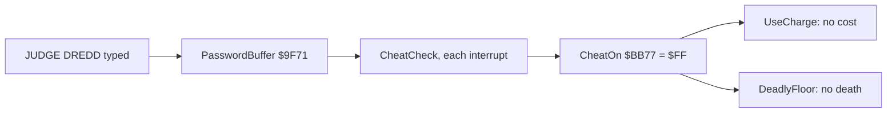

The code hides its two addresses: `LD BC,$BA77` then `INC B` makes `$BB77`, and `$E406` + `$BB6B` overflows to
`$9F71`. A search for the addresses in the code finds neither.

Worked example: the code compares eleven key codes: `63 53 12 14 22 70 12 23 22 12 12`, then the 0. The password
buffer of `play2` after MAYHEM held other codes, and CheatOn stayed 0 in every sample of every recording.


How to read it: the four panels of 10.11. With CheatOn set, each red line would stay flat at 99. Recordings and
command as in 10.11 (`python3 tools/fig_objects.py charges docs/img/gameplay/charges.png`).

**The point**: the cheat is hidden twice, in the password screen and in the address arithmetic. It gives endless
masks and safe floors, but leaves the enemies as deadly as before.

Witness: CheatCheck in every play interrupt (`c1`, `door`, `play2`, `rzx-` x10); CheatOn 0 in every play sample.
`cheat` types JUDGE DREDD at ENTER PASSWORD: CheatOn is `$FF` from the start of play, and a LAVA SHOT given by a POKE
(99 charges) fires six times from frame 1404 with UseCharge L1 6 and the charges still 99 at frame 2100. The safe
floor is known only from the code.

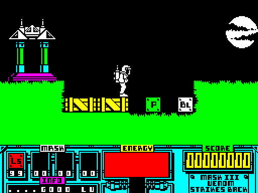

## 10.17 The ending

Scott is in room 15, screen 5. DrawRoom tests the room before it draws anything: room `$0F` with RoomScreen `$28`
jumps to Ending `$ADF6`. Ending clears the whole screen and its attributes, slowly prints YOU HAVE FOUND SCOTT......
at row 8, column 1, a space, then WELL DONE. at row 12, column 8, and jumps to GameStart.

```text
DrawRoom:
    if RoomNumber == $0F and RoomScreen == $28: Ending
Ending:
    clear $4000-$5AFF
    SlowPrint "YOU HAVE FOUND SCOTT......" at $0801
    SlowPrint "WELL DONE." at $0C08
    GameStart                         # the menu; the high score is not updated
```

```asm
Ending:
  LD HL,Screen
  LD DE,Screen+1
  LD BC,$1AFF
  LD (HL),$00
  LDIR
  LD DE,$0801
  LD HL,EndTexts
  CALL SlowPrint
  LD A,$20
  CALL PrintChar
  LD DE,$0C08
  LD HL,EndTexts+$001A
  CALL SlowPrint
  JP GameStart
```

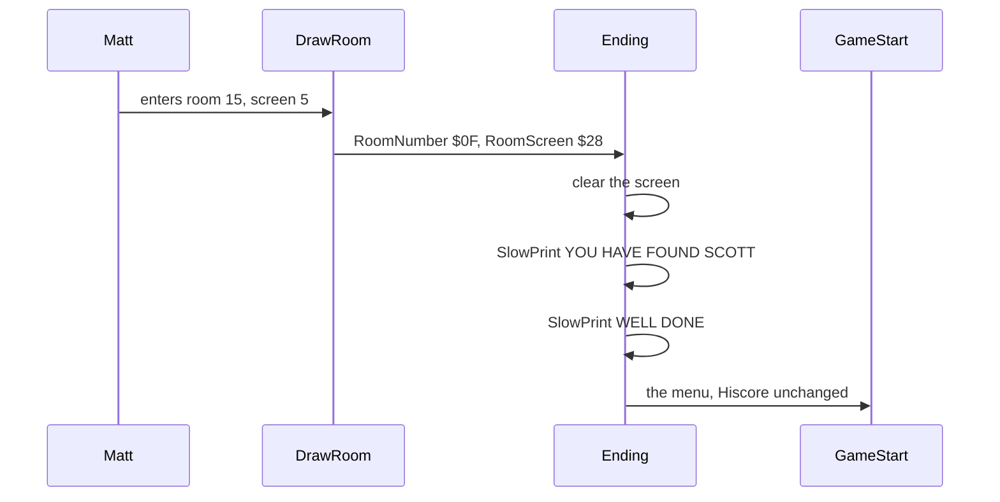

Worked example: `rzx-36000` starts in room 15, screen 5 with 8 energy and 31 004 points. The sample of frame 0 already
has RoomNumber `$0F` and RoomScreen `$28`. YOU HAVE FOUND SCOTT is on the screen at frame 250. The menu that follows
shows HISCORE 0: the run never went through GameOver, so its 31 004 points were never kept.

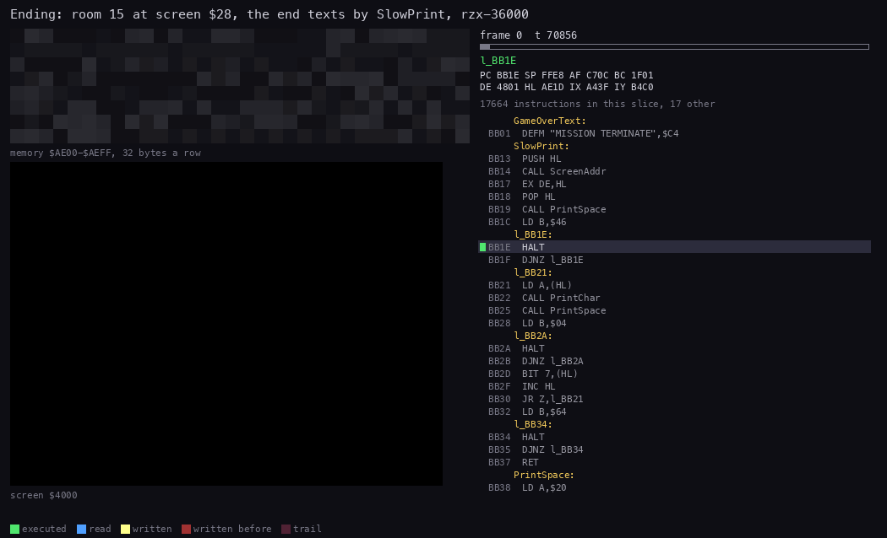

How to read it: the screen, the memory `$AE00-$AE60` (the end texts) and the code of Ending and SlowPrint as it runs.
Recording `rzx-36000`, TTD frames 0:0-40:0, 40 pictures. Made by `python3 ../../kit/routine_anim.py --work
work/docs/mxC/rzx-36000 --window 0:0-40:0 --listing build/game.lst --pc ADF6-AE40,BB13-BB4B --view screen --range
AE00-AE60 --pictures 40 --delay 200 --title '...' --out docs/img/routines/Ending.gif`.

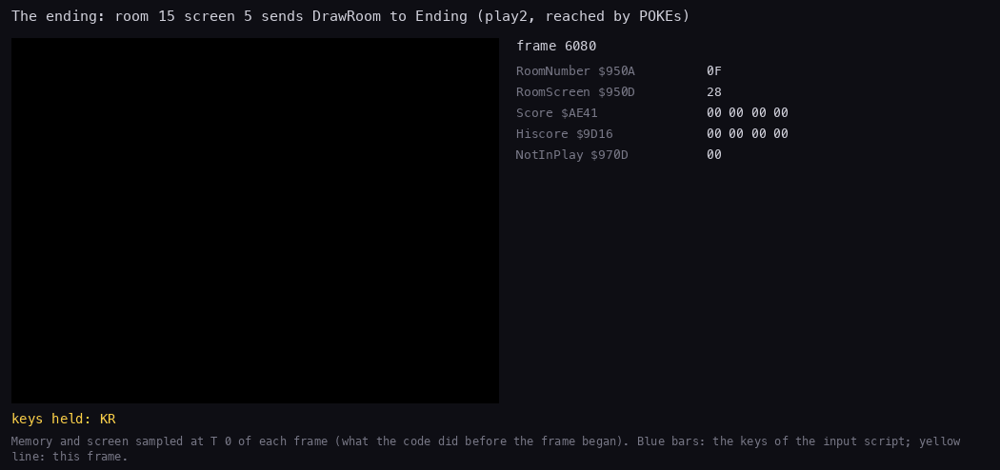

How to read it: left, the screen every fourth frame; right, RoomNumber, RoomScreen, Score, Hiscore and NotInPlay. The
room becomes 15/`$28`, the screen clears and the two lines are typed; Hiscore does not change. Recording `play2`
(the end reached with POKEs), TTD frames 6080-6640 (the GIF of doc 8). Made by `python3 tools/fig_controls.py play
--work work/docs/mxB/p2 --from 6080 --to 6640 --step 4 --keys tests/inputs/s2play.txt --offset 0 --crop 0,0,256,192
--var 'RoomNumber=950A:1' --var 'RoomScreen=950D:1' --var 'Score=AE41:4:hex' --var 'Hiscore=9D16:4:hex' --var
'NotInPlay=970D:1' --title '...' --delay 70 --out docs/img/play/ending.gif`.

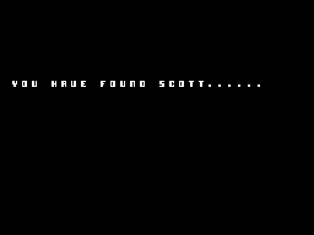

How to read it: the screen at frame 250 of `rzx-36000`: the first line typed, the second to come. Recording
`rzx-36000`, TTD frame 250. Made by the stage 1 screenshots of the recordings ([WALKTHROUGH 6.1](../WALKTHROUGH.md#61-the-screens)).

**The point**: the ending is a place, not a count: reaching one screen wins. It ends the game like a death, but
without the high score.

Witness: Ending L1 1 (`play2`); the `rzx-36000` samples of frames 0-250 and its screen at frame 250.

## 10.18 Bugs and oddities

Each item names the code and the witness. The source changes are in `work/docs/mxC-src-changes.md`.

```mermaid
flowchart TD
    B1["the turret pays 0"] --> S1["Explode before AwardScore"]
    B2["the ending keeps no high score"] --> S2["Ending jumps to GameStart"]
    B3["NewGame makes new turrets"] --> S3["native $2B in rooms 5 and 6"]
    B4["a full hand loses the current mask"] --> S4["FindEmptySlot falls back to the current slot"]
    B5["the dead turret's shot is harmless"] --> S5["KindTurretShot checks the slot before it"]
    B6["MaskEffect never called"] --> S6["ULTRA FLASH and MIRAGE do nothing"]
```

- **The turret never scores.** KindTurret calls Explode, which copies the explosion template (score 0) into the
  record, and then AwardScore. Six turret kills in the run left the score unchanged (doc 7, 7.11).
- **The ending keeps no high score.** Ending jumps to GameStart, not through GameOver. `rzx-36000` ended with 31 004
  points and the menu showed HISCORE 0.
- **NewGame makes new turrets.** It turns every `$2B` of the maps into `$12` to restore the dead turrets. The maps of
  room 5 (screen 0) and room 6 (screen 2) hold `$2B` of their own, so after the first new game they hold turrets.
  `rzx-16000` meets one in room 6, screen 2 at frame 3194.
- **A full hand loses the current mask.** With four masks, CheckPickups writes the new one over the current slot.
  `rzx-16000` frame 49: a BLASTER became a HEALER.
- **The dead turret's shot is harmless.** KindTurretShot does its Damage only when the slot before it is still a
  turret.
- **Two masks do nothing.** ULTRA FLASH and MIRAGE are `RET`s, and MaskEffect `$B239`, which would give them an effect,
  has no caller.
- **Four masks cannot be had.** ULTRA FLASH, MIRAGE, LAVA SHOT (the strongest shot, power 6) and STREAMER are in no
  PickupTable record; nothing else puts them in a slot.
- **The right-hand wall test ignores the head.** In the walk to the right without PENETRATOR (`$B5D5`), the first
  IsSolid has no `RET C`, so a wall at the head row alone does not stop Matt; the walk to the left has it. No recording
  shows a case where it mattered.
- **The block item test has no lower bound on y.** TakeBlockItem tests Matt's y + 20 against the item's y only one
  way, so an item could be taken from far below it. No recording took an item at all.
- **The PENETRATOR's death is out of sight.** EndPenetrator inside a wall kills with Explosion and GameOver, with no
  warning; it is the only death that bypasses Death.
- **The chaser's PENETRATOR tax.** KindChaser sets PenetratorCost to 16 each pass while the PENETRATOR is on: with the
  chaser in the room, a PENETRATOR pass costs 16 or 17 charges.
- **The fall out of the play area is unreachable in the run.** DeathFlag from y + `$30` at least `$A0` never fired;
  every DeathFlag death was a floor.

Worked example: the turret of `rzx-12000`, room 4, screen 3. At frame 1387 Matt, in the long jump, touched it: the
energy went from 113 to 13 (the turret's 100), the turret exploded, and the score stayed at 8 588. A faller killed by
a shot at frame 995 of `rzx-00000` added its 33 at once.

**The point**: the bugs are small and none breaks the game; two of them (the turret's score and the ending's high
score) cost the player points they earned.

Witness: the samples named in each item; KindTurret, Ending, NewGame, CheckPickups and KindTurretShot in the source.

## 10.19 Notable features

```mermaid
flowchart LR
    M["ten masks, four slots"] --> P["PENETRATOR: no walls, no touches"]
    M --> J["JACKRABBIT: paid flight"]
    M --> L["LIFTER: one-hit removal"]
    W["four passwords"] --> D["doors in room 0"]
    D --> B["door 3: a LIFTER and BACKLASH 3"]
    C["JUDGE DREDD"] --> F["endless charges, safe floors"]
    Z["zones"] --> MO["the moon: slow gravity, no PENETRATOR"]
    Z --> LA["zone 1: burning ceilings"]
```

- **A ghost mode.** The PENETRATOR switches off walls, touches and block items at once, for a charge every second
  pass. Ending it inside a wall is the game's only instant, unwarned death.
- **Paid flight.** The JACKRABBIT's long jump flies freely while charges last; it costs fifteen times more on the moon.
- **One-hit lifting.** The LIFTER's shot removes any enemy it reaches, guards included, for eight charges.
- **Gravity per zone.** The moon slows both the rise and the fall by skipping steps of v; the same code serves both.
- **Stairs without code.** A one-character wall at the feet is a step: Matt climbs it in two passes of state 2.
- **Passwords as doors.** The four passwords open doors in the start room; the last one also hands out a LIFTER.
- **A hidden cheat.** JUDGE DREDD typed as a password freezes the charges and makes the floors safe; its addresses are
  computed by overflow.
- **Touches pay.** Most enemies pay their points when they hurt Matt, so a strong touch can be a trade.
- **The ending is a screen.** Walking into room 15, screen 5 wins, with no count of masks or kills.

Worked example: the run of `rzx-00000` to `rzx-36000` shows four of them at work: the PENETRATOR in room 10, the
JACKRABBIT's flight in room 4, the LIFTER in room 12 and the moon's higher jump in room 8.


How to read it: as in 10.11. Recordings `rzx-16000`, `rzx-00000` and `rzx-12000`. Made by `python3
tools/fig_objects.py charges docs/img/gameplay/charges.png`.

**The point**: the masks are the game. Movement, defence, attack and healing all come from one slot system with one
currency, the charges.

Witness: the sections above.

## 10.20 Notes, quirks and what no recording reached

- **Only in the integration's POKE recordings** (`cheat`, `masks`, `door3`, `kind6`, each script says its POKEs):
  the cheat typed (CheatOn `$FF`), the PENETRATOR's death in a wall (Explosion, effects 16 and 17), door 3 and its
  LIFTER bonus (WarpBonus `$BA21`), the masks no room holds, the enemy kinds 6 and 10 (objects 16, 18, 19).
- **Never in any recording:**
  - doors 0 and 2; the cheat's safe floor;
  - a block item taken (no loss of 25 energy);
  - a long jump on the moon;
  - the fall out of the play area as a death;
  - enemy kinds 9 and 11;
  - rooms 7, 9, 11 and 13, and room 1 beyond screen 1.
- **The RZX segments start from the RZX's own states.** Each segment's first frame is a state of the RZX player, not
  the end of the previous segment: the score, the slots and the room jump between them (`run.png`).
- **The passes are slow and uneven.** `c1` runs 2.15 frames a pass, `rzx-00000` 2.95 and `rzx-12000` 1.49 on average;
  every rule here is in passes.
- **The door test needs the rim.** Crouching on a lit door misses unless the rim `$1C` is under Matt's feet: in the
  `door` recording three crouches missed before the fourth hit.
- **The new game keeps the levels, to no effect.** NewGame clears the kinds and charges of the slots but not their
  levels. CheckPickups writes the level from MaskLevels whenever a mask is taken, so a kept level (a BACKLASH raised
  to 3 by door 3) never reaches a new mask.
- **The jump keeps the walk's dx.** The facing and dx are not updated in states 5 and 6, so a jump goes where the walk
  went; a standing jump goes straight up.
- **The source changes** this document asks for (state names, the PasswordWarp comment, Explosion's "never run", the
  rooms header, the templates' `@res`) are in `work/docs/mxC-src-changes.md`.
