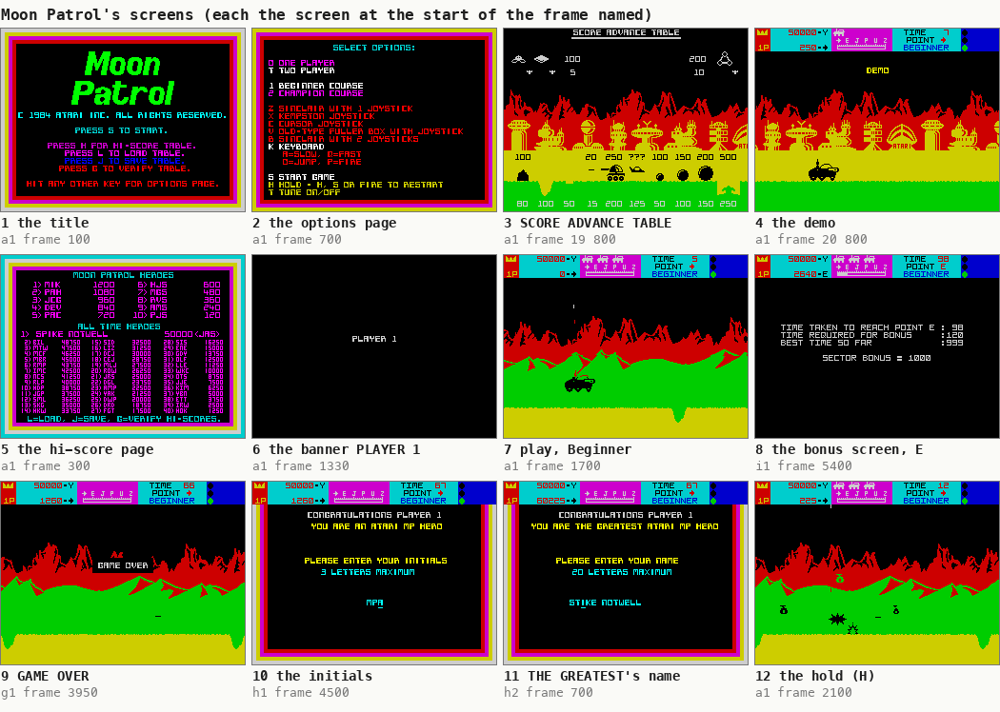
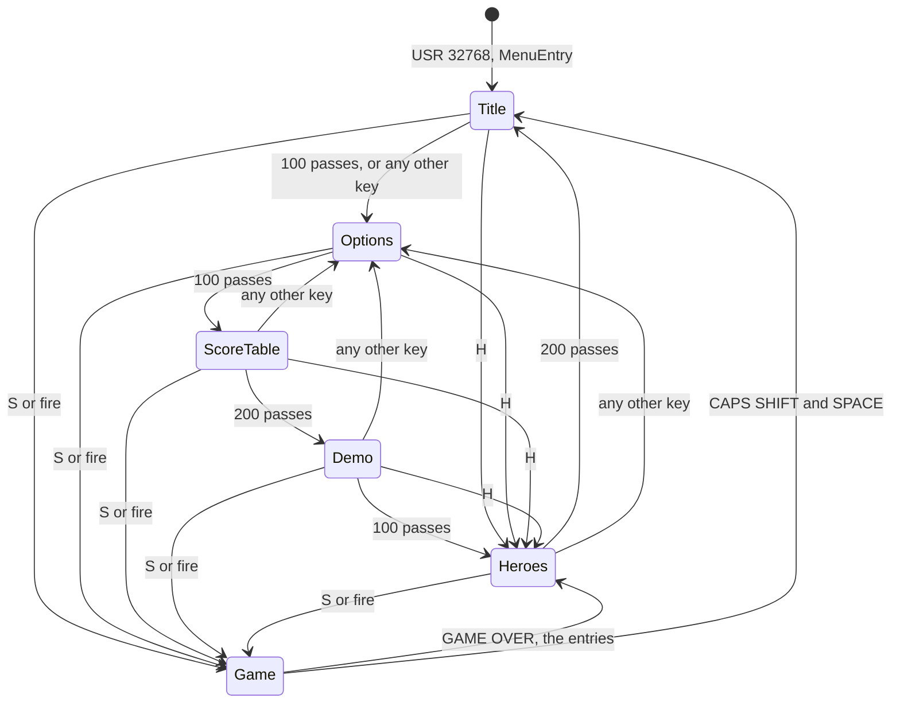
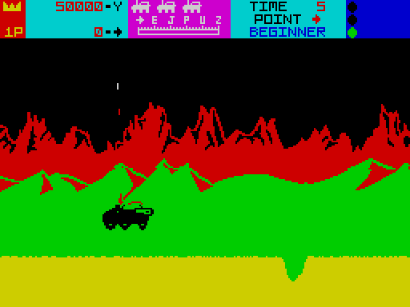
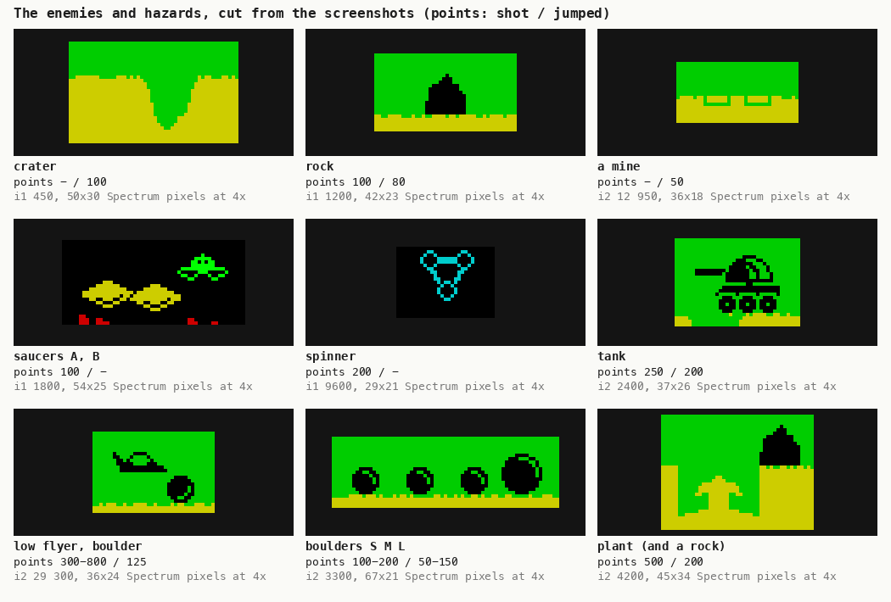
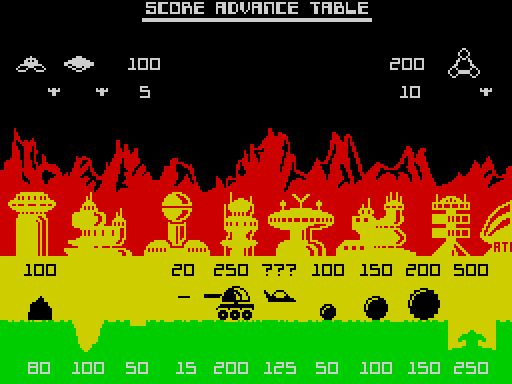
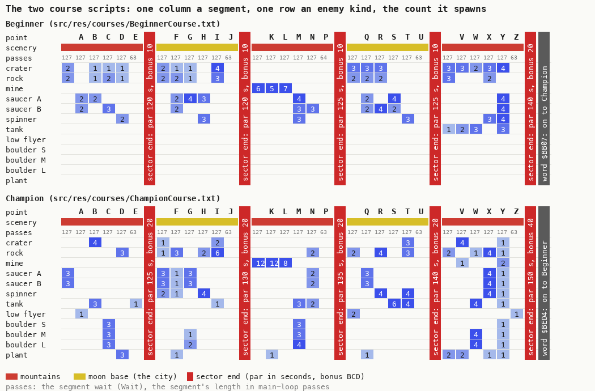
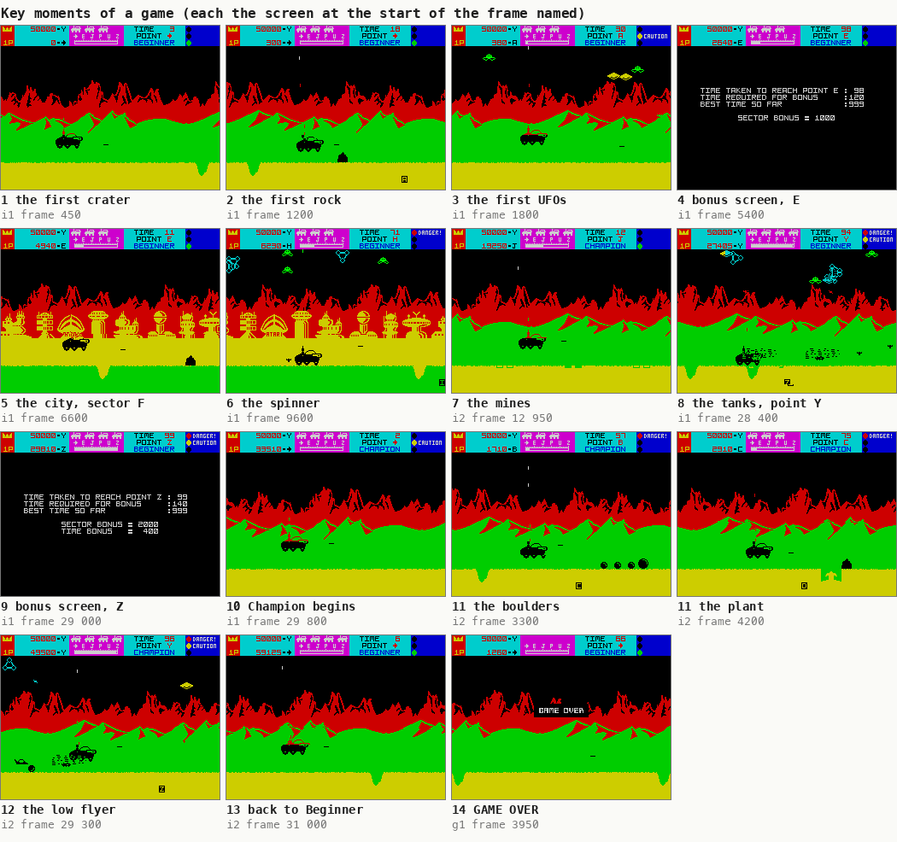
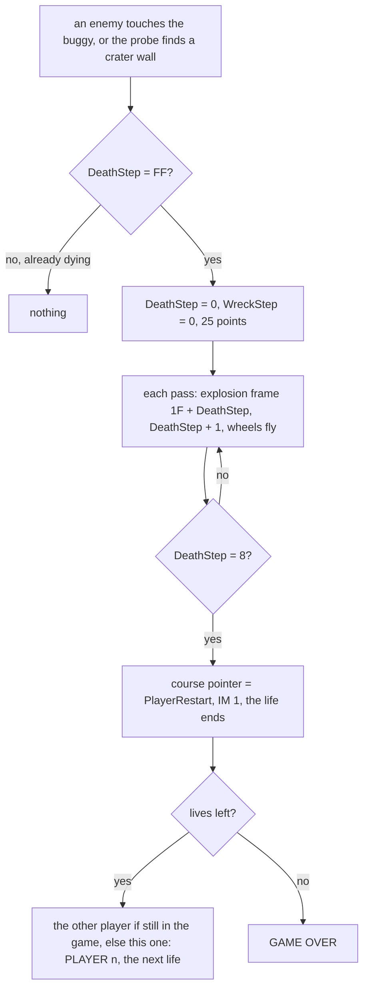
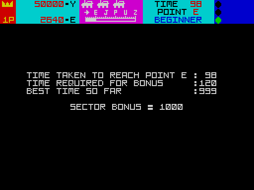

# 1. Game design

What this covers:

- the game in a few lines (1.1);
- its screens, from the title to the hi-score entry, and the attract cycle (1.2);
- the play screen and the HUD (1.3);
- the controls as the player uses them, the hidden keys and the dead ones (1.4);
- the buggy: driving, jumping, shooting (1.5);
- every enemy and hazard: what it looks like, how it moves, what kills it, what it scores (1.6);
- the two courses, their points and sectors, and the full map from the scripts (1.7);
- the key moments of a game, each with its screenshot and frame (1.8);
- a death and the restart (1.9);
- the score, the lives, the extra lives and the sector bonuses, with a bonus screen worked through (1.10);
- the hi-score tables (1.11);
- two players (1.12);
- the difficulty, settled from the code (1.13);
- what no recording reached (1.14).

It describes the game as a player meets it. Every rule names its routine; the rules as code are in
[doc 10](10-gameplay-logic.md), the objects in [doc 7](07-objects.md), the keys and ports in
[doc 5](05-controls.md), the main loop in [doc 4](04-game-loop.md). The names are those of `src/game/game.ann`
([Terms](README.md#terms)).

The recordings it rests on, all on the 48K, each with an input script (WALKTHROUGH 6.0 has the table):

- `c1`: power-on, the load through the fast LD-BYTES trap, then 16 000 frames of seeded random play (`work/c1`);
- `a1`, `g1`, `t1`, `p2`, `h1`: from `work/snaps/entry.z80` (`c1` at the game's entry, frame 256, T 58 497): the
  menus, the hold, the tune key and the abort (`a1`); deaths and GAME OVER (`g1`); the tape keys (`t1`); two players
  (`p2`); a hi-score entry (`h1`);
- `i1`, `i2`: the whole Beginner and the whole Champion course, from the clone `work/snaps/immune.z80` (the kill
  entry BuggyKill `$A7DD` patched to `RET`, so nothing kills the buggy);
- `h2`: THE GREATEST's entry, from the clone `work/snaps/g1-3700-score60000.z80` (`g1` frame 3700, the score set to
  60000).

The clones are exploration only: they reach the code, and every claim below also cites the code. A frame is 1/50 s.
A pass is one turn of the main loop: 6 to 8 frames in play, 7.05 on average over `i1` frames 300-4700
([doc 4](04-game-loop.md)). Every screenshot is the Spectrum screen at the start of the named frame, taken with
`kit/screen_shot.py` (WALKTHROUGH 6.1).

## 1.1 The game

- Moon Patrol is Atarisoft's 1984 port of the Irem arcade game of 1982. It was never released; ZXDB 3266 holds the
  recovered tape. The build dates the assembler left in the image run from `02:45 29/10/84` to `03:40 30/10/84`
  (WALKTHROUGH 0).
- The player drives a moon buggy from left to right. The scenery scrolls past in four bands; the buggy stays near
  the left of the screen.
- He jumps over craters, rocks and mines, and shoots forward at rocks, tanks and boulders and upward at UFOs.
- A course is 25 points, A to Z without O, in five sectors that end at E, J, P, U and Z. Each sector end shows a
  bonus screen ([1.10](#110-score-lives-extra-lives-bonuses)).
- Two courses: Beginner and Champion. After Beginner Z the game goes straight on to Champion A
  (BeginnerToChampion `$BB07`); after Champion Z it goes back to Beginner A (ChampionToBeginner `$BED4`). The game
  never ends while lives last.
- Four lives a player (GameStart `$8F10` stores 4; each life start takes one). One or two players, taking turns.

## 1.2 The screens



How to read the figure:

- **Twelve screens**, each the Spectrum screen at the start of the frame named under it.
- **1-5** are the attract cycle (`a1`): the title (frame 100), the options page (700), the SCORE ADVANCE TABLE
  (19 800), the demo (20 800), the hi-score page (300).
- **6-7**: the "PLAYER 1" banner before a life (`a1` 1330) and play on the Beginner course (`a1` 1700).
- **8**: the bonus screen at sector end E (`i1` 5400).
- **9**: GAME OVER (`g1` 3950).
- **10-11**: the hi-score entries: the initials (`h1` 4500) and THE GREATEST's name (`h2` 700).
- **12**: the hold (`a1` 2100): the play screen frozen.
- **The point**: every page but play is a static picture printed once by the one print routine PrintText `$FFD0`
  ([doc 8](08-hud-and-text.md)); the colours move because CycleScreenColours `$8332` steps every attribute of a
  colour cycle once a pass.

```bash
python3 tools/fig_design.py screens     # the sheet from the existing screenshots of docs/img/play/
```

The screens and their routines:

| Screen | Routine | When it comes | How it ends |
| --- | --- | --- | --- |
| the title | TitlePage `$8004` | the entry, the end of the hi-score page, the abort | 100 passes, then the options page |
| the options page | OptionsPage `$8064` | the title runs out, or any key that is not a command on the title, the score table, the demo or the hi-score page | 100 passes, then the score table |
| SCORE ADVANCE TABLE | ScoreAdvancePage `$8118` | the options page runs out | 200 passes, then the demo |
| the demo | DemoPage `$8180` | the score table runs out | 100 passes of the main loop, then the hi-score page |
| the hi-score page | HeroesPage `$81D0` | the demo runs out, H, GAME OVER after the entries, a good tape load | 200 passes, then the title |
| PLAYER n | GameStartLife `$8F71` | before each life | 100 frames (300 in a two-player game) |
| play | LifePlay `$90CC` | after the banner | the buggy's death |
| the bonus screen | SectorBonus `$A4EE` | each sector end | the bonuses counted, then the next sector |
| GAME OVER | GameAfterLife `$8F9F` | the last life lost | 200 frames |
| the initials | HiScoreEntry `$8B8F` | GAME OVER with a score for a table | ENTER |
| THE GREATEST's name | GreatestEntry `$8E4E` | GAME OVER with a score over THE GREATEST's | ENTER, then the initials |

On every attract page, S (or fire on a chosen joystick) starts the game (MenuCheckStart `$8227`), H shows the
hi-score page (MenuCheckHeroes `$8247`, not on the hi-score page itself) and L, J, G load, save and verify the
hi-score table on tape (MenuCheckTape `$825A`). The attract cycle:



The options page has no "any other key" exit: its keys select. O and T choose one or two players, 1 and 2 the
course, Z X C V B K the controls (OptionsSelect `$8360`); the chosen line of each group turns bright white
(`a1` frames 537-18 573, every key typed). The values are kept at Players `$B257`, Course `$B258` and Controls
`$B259`: 1, 1 and 6 (keyboard) in the loaded image.

The demo is not a recorded game. DemoPage starts a life (LifeStart `$90D3`) and runs 100 passes of the main loop's
call list `$96FA` with the object list off (ObjectsOff `$B238` = `$80`) and the tune off: the buggy drives on its own
over the bare ground (`a1` frame 20 800, "DEMO" flashing). Any key leaves the demo for the options page
(MenuCheckAnyKey `$8321` reads every half-row), so the keys cannot steer it; a joystick's directions would, since
BuggyUpdate reads the chosen control in the demo too (known only from the code). Each demo complements the scenery
flag, so successive demos alternate the mountains and the city.

## 1.3 The play screen



`a1` frame 1700, the first seconds of play. Top to bottom:

- **Rows 0-2, the HUD** (HudDraw `$9136`): the player icon and 1P / 2P labels, the hi-score `50000-Y` (THE
  GREATEST's score and the point he reached), the player's score and the point letter he reached, the lives as
  buggy icons, the course map E J P U Z with the progress dots under it, TIME (seconds), POINT (the last point
  passed), BEGINNER or CHAMPION, and the three warning lamps on the right.
- **Rows 3-7**: the black sky where the UFOs fly.
- **Rows 8-11**: the mountains, or the moon base in the city sectors, scrolling one pixel a pass (ScrollMountains
  `$A846`).
- **Rows 12-15**: the hills, two pixels a pass (ScrollHills `$A89A`).
- **Rows 16-19**: the buggy's band. It scrolls two pixels a pass, but only while the buggy is in the air
  (ScrollNearBand `$A8FD`).
- **Rows 20-23**: the road, four pixels a pass (ScrollRoad `$A932`), with the craters cut into its top line.
- **The bottom right cell** shows the letter of the coming point in inverse (CmdPoint `$9775`) until the point is
  passed.

The HUD's fields:

| Field | Byte | Format | Printed by | At the start |
| --- | --- | --- | --- | --- |
| score | PlayerScore `$B272-$B275` | 8 BCD digits, leading zeros blank | HudPrintScore `$92DA` | 0 |
| point reached (after the score) | PlayerPoint `$B27C` | 1-25 = A-Z without O, bit 5 = Champion | HudPrintPointLetter `$9258` | `@` (none yet) |
| lives in reserve | PlayerLives `$B284` | buggy icons, up to 4 | HudLives `$9263` | 3 |
| TIME | PlayerTime `$B285-$B286` | 4 BCD digits, seconds | HudPrintTime `$922A` | 0 |
| POINT | PlayerPoint | a letter | HudPrintPoint `$9247` | `@` |
| progress bar | PlayerPoint | a dot every 2 pixels | HudProgress `$92AA` | empty |
| lamps | PlayerLights `$B27E` | 0-3 | HudLamps `$927E` | green |
| hi-score | GreatestScore `$88C2` | 8 BCD digits | HudDraw | 50000 |

The lamps warn of what the course brings next ([1.7](#17-two-courses-of-25-points)):

| Lamp value | Lamps | Text | Set before |
| ---: | --- | --- | --- |
| 0 | bottom lamp green | none | the quiet stretch before a sector end |
| 1 | middle lamp yellow | CAUTION | UFO waves |
| 2 | top lamp red | DANGER! | spinner waves, the Champion boulders |
| 3 | top red and middle yellow | DANGER! CAUTION | the low flyer from behind, the busiest points |

The HUD as code is in [doc 8](08-hud-and-text.md); the bands and the scrolling in [doc 6](06-rendering.md).

## 1.4 The controls

Five controls, read by ControlsRead `$AE17` from one of six devices chosen on the options page
([doc 5](05-controls.md)):

| Control | Keyboard | What happens | Code |
| --- | --- | --- | --- |
| fast | Q | the buggy moves right, 2 pixels a pass, up to x `$50`; the game runs faster | BuggyUpdate `$AA0F`, SpeedGovernor `$AF31` |
| slow | A | the buggy moves left, 2 pixels a pass, down to x `$28` (it steps while x is `$29` or more); the game runs slower | the same |
| neither | | the buggy drifts back to the centre, x `$38`, 2 pixels a pass | BuggyUpdate |
| jump | O | a jump; its height and length depend on the buggy's place ([1.5](#15-the-buggy)) | BuggyUpdate |
| fire | P | on each new press: one shot forward and one shot up | FireShots `$ACF1` |

The keys of the game itself:

| Key | Where | What happens | Code |
| --- | --- | --- | --- |
| H | play | the hold: the game stops; H again, S or fire goes on (`a1` frames 2060-2220) | HoldCheck `$AECE` |
| T | play | the tune on or off (`a1` frames 2540 and 2740) | TuneToggleCheck `$AF15` |
| CAPS SHIFT and SPACE | play | the abort: back to the title (`a1` frame 3174) | BuggyUpdate `$AABF` |
| CAPS SHIFT and SPACE | the menus | nothing: the test runs and its result is never used | MenuBreakTest `$8215` |
| 0 | play | nothing: the test runs and its result is never used (`a1` pressed it) | BreakKeyTest `$9737` |

The two dead tests are the remains of a development exit to BASIC. Each is followed in the image by a stub that
nothing calls: `CALL SetIm1`, `RST 8`, report `$14` (L, BREAK into program) at MenuBreakToBasic `$8222` and
CourseBreakToBasic `$9740`. No cheat key and no POKE-like option exist in the code: the hidden keys are the ones
above.

Holding the keys: fire acts once per press (FireShots keeps the last state in PlayerFlags `$B288` bit 1), the jump
starts on the press and then runs its arc to the end with the key up or down, and Q and A act every pass they are
held, on the ground only.

## 1.5 The buggy

The buggy is a 40x23 sprite (sprite 0, DrawSprite40x23 `$B1C8`) drawn at y `$89`; its box for the collisions is
y `$92`, x `$38`, height `$0D`, width `$1D` (BuggyY `$B212`). Its wheels are drawn as part of the sprite in play
and come off as three separate sprites when it dies (WheelsFly `$AB37`, [1.9](#19-a-death-and-the-restart)).

**Driving.** The buggy sits at x `$38` and moves only on the ground. Q pushes it right to x `$50`, A pulls it left
to x `$28`, and with neither it drifts back. Its place sets the pace of the whole game: SpeedGovernor runs twice a
pass and burns a delay chosen by the buggy's x:

| Place | x | Delay a call | Jump arc | Arc length | Rise |
| --- | --- | ---: | --- | ---: | ---: |
| forward | over `$38` | 1 loop | JumpArcForward `$AB16` | 32 passes | 20 pixels |
| centre | `$38` | `$02EE` loops | JumpArcCentre `$AAFD` | 24 passes | 19 pixels |
| back | under `$38` | `$05DC` loops | JumpArcs `$AAF0` | 12 passes | 10 pixels |

A delay loop is 26 T, so the centre costs 2 x 750 x 26 = 39 000 T a pass and the back 78 000 T: about half a frame
and a frame more than the forward place. The road moves 4 pixels a pass in every place; what changes is how many
passes a second the game makes. Forward is fast, back is slow: the arcade's speed control, made from a delay.

**Jumping.** O starts a jump: the jump index JumpStep `$B223` goes from `$FF` to 0, and each pass adds the next byte
of the arc to the buggy's y until the end mark `$80`. The bytes of each arc add up to 0: the buggy lands where it
left. The arc is the one SpeedGovernor chose from x, and x does not change in the air. So a forward jump is long
(32 passes x 4 pixels of road = 128 pixels of ground) and a back jump short (48 pixels). Witness: `c1`'s random
play started 463 jumps (BuggyUpdate `$AA2A`), `i1` ran 3249 jump steps. The arcs as data are in
[doc 10](10-gameplay-logic.md).

**Shooting.** Each new press of fire sends a forward shot along the ground, if the one before has ended, and an
upward shot, if no upward shot is still below line `$6D` (FireShots `$ACF1`). The forward shot flies 6 pixels a pass
for `$80` pixels; up to four upward shots climb 4 pixels a pass to line `$18` (ShotForwardMove `$AD68`, ShotUpMove
`$ADBF`). A shot that hits something ends at once. New presses: `i1` 332, `i2` 367.

## 1.6 The enemies and hazards



How to read the figure:

- **One picture an enemy or hazard**, cut from the screenshot of `docs/img/play/` named under it (`i1`, `i2`, the
  frame), in the game's colours, at 4x (one Spectrum pixel = 4x4).
- **Under each**: its name, its points (shot / jumped), and the size of the cut in Spectrum pixels. The low flyer
  is cut with the small boulder rolling beside it, the plant with a rock.
- **The point**: every hazard on the ground can be jumped and every enemy can be shot; only the craters and the
  mines cannot be shot.

```bash
python3 tools/fig_design.py enemies
```

The game's own SCORE ADVANCE TABLE (ScoreAdvancePage `$8118`, `a1` frame 19 800) names the scores:



The table, checked against the code (the BCD value each handler passes to ScoreAdd `$92D3`):

| Enemy or hazard | Shot | Jumped or passed | Course | Moves | Kills the buggy by | Handler |
| --- | ---: | ---: | --- | --- | --- | --- |
| crater | - | 100 | both | fixed in the road | a fall: the ground probe finds its wall | ObjCrater `$9A92`, BuggyUpdate `$AA9C` |
| rock | 100 | 80 | both | fixed on the road | contact | ObjRock `$99C3` |
| mine | - | 50 | both | fixed, blinking | not shown in any recording ([1.14](#114-what-no-recording-reached)) | ObjMine `$9AEB` |
| UFO saucer (green or yellow) | 100 | - | both | flies across the sky, drops bombs | its bomb | UfoHandler `$9B6B` |
| spinner UFO (cyan) | 200 | - | both | the same, bigger; its bombs make craters | its bomb | UfoHandler |
| saucer bomb | 5 | - | both | falls | contact | UfoBombHandler `$9CE0` |
| spinner bomb | 10 | - | both | falls, leaves a crater where it lands | contact, then the crater | UfoBombHandler |
| tank | 250 | 200 | both | sits on the road and fires | contact | TankHandler `$9EBD` |
| tank shell | 20 | 15 | both | flies left along the road | contact | TankShellHandler `$9F8F` |
| low flyer | 300, 500 or 800 at random (the table prints `???`) | 125 | Champion | comes from behind, low | contact | LowFlyerHandler `$A03B` |
| small boulder | 100 | 50 | Champion | rolls | contact | BoulderHandler `$A196` |
| medium boulder | 150 | 100 | Champion | rolls | contact | BoulderHandler |
| large boulder | 200 | 150 | Champion | rolls | contact | BoulderHandler |
| green plant | 500 | 200 (the table prints 250) | Champion | grows out of the ground | contact | PlantHandler `$A2C6` |

- The low flyer's `???` is a real random choice of three scores (LowFlyerHandler `$A0E9`).
- The plant's jumped score is 200 in the code (`$A3AB` `LD BC,$0200`, executed 4 times in `i2`) and 250 on the
  table: the table is wrong.
- A shot UFO bomb pays 5 under a saucer and 10 under a spinner: one `BC = 5 + (UfoWave AND 5)` (`$9E05`).
- "Jumped" means the buggy passes over the object without touching it: the rock pays when the buggy's x, rounded
  down to 4, equals the rock's x (ObjRock `$9A2F`).

The first sighting of each, in the recordings:

| Enemy | First seen | Screenshot |
| --- | --- | --- |
| crater, rock | `i1` 263 (the start segment) | [crater](img/play/i1-crater.png) 450, [rock](img/play/i1-rock-point-a.png) 1200 |
| saucers A and B | `i1` 1125 (point A) | [ufos](img/play/i1-ufos.png) 1800 |
| spinner | `i1` 3828 (point D) | [spinner](img/play/i1-ufo-spinner.png) 9600 |
| mines | `i1` 11 800 (after sector end J) | [mines](img/play/i2-mines.png) `i2` 12 950 |
| tank and shell | `i1` 23 663 (after sector end U); `i2` 2241 (point B) | [tank](img/play/i2-tank.png) `i2` 2400 |
| low flyer | `i2` 1353 (point A) | [low flyer](img/play/i2-low-flyer.png) `i2` 29 300 |
| boulders | `i2` 3118 (point C) | [boulders](img/play/i2-boulders.png) `i2` 3300 |
| green plant | `i2` 4013 (point D) | [plant](img/play/i2-green-plant.png) `i2` 4200 |

The behaviour of each, as a state machine, is in [doc 7](07-objects.md).

## 1.7 Two courses of 25 points



How to read the figure:

- **One column a segment** of the script, left to right in the order of the course; the letter on top is the point
  the segment announces.
- **One row an enemy kind**; the number in a cell is how many the segment spawns.
- **The coloured band under the letters** is the scenery: mountains or the moon base (the city).
- **A red column** is a sector end, with its par time in seconds and its bonus; the grey column is the course's
  last word, the switch to the other course.
- **The passes row** is each segment's wait.
- **The point**: Beginner brings one new enemy kind a sector (UFOs, the city, mines, more UFOs, tanks); Champion
  mixes all of them from the first points and adds the low flyer, the boulders and the plant.

```bash
python3 tools/fig_design.py coursemap     # from src/res/courses/BeginnerCourse.txt and ChampionCourse.txt
```

The courses are not maps of tiles. Each is a script of commands read by the interpreter CourseRun `$9751`
([doc 4](04-game-loop.md), [doc 10](10-gameplay-logic.md)): the world is a sequence of segments in time, not a
place. The scripts are `src/res/courses/BeginnerCourse.txt` (`$B7E8-$BB06`) and `ChampionCourse.txt`
(`$BB24-$BED3`), 36 segments each:

- **a segment** is a wait (127 passes, 63 or 64 in the last point before a sector end) and a list of spawn
  commands, each with a delay an object;
- **a point segment** announces its point: the letter shows inverse at the bottom right, and after 63 passes the
  point object (ObjPoint `$9978`) marks it passed: the HUD letter, the progress bar, and the restart point;
- **a sector end** is one record: the par time, the bonus, the scenery of the next sector, and the best time so far.

The per-segment tables below are printed by `work/docs/mpA-coursetable.py Beginner|Champion` from the scripts.
"Lamps" is the warning set by the segment ([1.3](#13-the-play-screen)).

The Beginner course:

| Segment | Point | Passes | Lamps | Objects |
| ---: | --- | ---: | --- | --- |
| 1 | (start) | 127 |  | 2 crater, 2 rock |
| 2 | A | 127 | 1 | 2 saucer A, 2 saucer B |
| 3 | B | 127 | 1 | 2 saucer A, 1 crater, 1 rock |
| 4 | C | 127 | 1 | 3 saucer B, 2 rock, 1 crater, UFOs leave |
| 5 | D | 127 | 2 | 2 spinner, 1 rock, 1 crater |
| 6 | E | 63 | 0 | UFOs leave |
| 7 | sector end after E | | | par `$0120`, bonus `$10`, the city next |
| 8 | (after the sector end) | 127 |  | 2 rock, 2 crater |
| 9 | F | 127 | 1 | 1 crater, 2 rock, 2 saucer A, 2 saucer B |
| 10 | G | 127 | 1 | 4 saucer A, 1 rock, 1 crater |
| 11 | H | 127 | 2 | 3 saucer A, 3 spinner, UFOs leave |
| 12 | I | 127 | 0 | 3 rock, 4 crater, UFOs leave |
| 13 | J | 63 |  |  |
| 14 | sector end after J | | | par `$0120`, bonus `$10`, the mountains next |
| 15 | (after the sector end) | 127 |  | 6 mine |
| 16 | K | 127 |  | 5 mine |
| 17 | L | 127 |  | 7 mine |
| 18 | M | 127 | 1 2 | 4 saucer A, 3 saucer B, 3 spinner |
| 19 | N | 127 | 1 | 3 saucer B |
| 20 | P | 64 | 0 | UFOs leave |
| 21 | sector end after P | | | par `$0125`, bonus `$10`, the city next |
| 22 | (after the sector end) | 127 |  | 3 crater, 2 rock |
| 23 | Q | 127 | 1 | 3 crater, 2 rock, 2 saucer A, 2 saucer B |
| 24 | R | 127 | 1 | 4 saucer B, 3 crater, 2 rock |
| 25 | S | 127 | 1 | 4 saucer A, 2 saucer B |
| 26 | T | 127 | 1 2 | 3 spinner |
| 27 | U | 63 | 0 | UFOs leave |
| 28 | sector end after U | | | par `$0125`, bonus `$10`, the mountains next |
| 29 | (after the sector end) | 127 | 2 | 3 crater, 3 rock, 1 tank |
| 30 | V | 127 |  | 3 crater, 2 tank |
| 31 | W | 127 |  | 2 crater, 3 tank |
| 32 | X | 127 | 2 | 3 spinner, 3 crater, 2 rock |
| 33 | Y | 127 | 1 3 | 4 crater, 3 tank, 4 saucer A, 4 saucer B, 4 spinner, UFOs leave |
| 34 | Z | 63 |  | UFOs leave |
| 35 | sector end after Z | | | par `$0140`, bonus `$20`, the mountains next |
| 36 | the course end | | | the word `$BB07`: on to Champion |

The Champion course:

| Segment | Point | Passes | Lamps | Objects |
| ---: | --- | ---: | --- | --- |
| 1 | (start) | 127 | 1 | 3 saucer A, 3 saucer B |
| 2 | A | 127 | 3 | 1 low flyer, UFOs leave |
| 3 | B | 127 | 2 | 4 crater, 3 tank |
| 4 | C | 127 | 2 | 3 boulder S, 3 boulder M, 3 boulder L |
| 5 | D | 127 | 1 | 3 plant, 3 rock |
| 6 | E | 63 | 0 | 1 tank, UFOs leave |
| 7 | sector end after E | | | par `$0125`, bonus `$20`, the city next |
| 8 | (after the sector end) | 127 | 1 2 | 1 rock, 1 crater, 3 saucer A, 3 saucer B, 2 spinner |
| 9 | F | 127 | 2 | 3 rock, 1 saucer A, 1 saucer B, 1 spinner, 1 plant |
| 10 | G | 127 | 1 | 3 saucer A, 3 saucer B, 2 boulder L, 1 boulder M, UFOs leave |
| 11 | H | 127 | 2 | 4 spinner, 2 rock, UFOs leave |
| 12 | I | 127 | 2 | 6 rock, 2 crater, 1 tank |
| 13 | J | 63 | 0 | UFOs leave |
| 14 | sector end after J | | | par `$0130`, bonus `$20`, the mountains next |
| 15 | (after the sector end) | 127 |  | 12 mine |
| 16 | K | 127 |  | 12 mine, 1 plant |
| 17 | L | 127 |  | 8 mine |
| 18 | M | 127 | 2 | 3 boulder S, 3 boulder M, 4 boulder L, 3 tank |
| 19 | N | 127 | 1 | 2 saucer A, 2 saucer B, 2 rock, 2 tank |
| 20 | P | 63 | 0 | UFOs leave |
| 21 | sector end after P | | | par `$0135`, bonus `$20`, the city next |
| 22 | (after the sector end) | 127 | 3 | 2 low flyer, 2 rock |
| 23 | Q | 127 | 1 | 3 saucer A, 3 saucer B, 1 plant |
| 24 | R | 127 | 2 | 4 spinner, 4 rock |
| 25 | S | 127 | 3 | 6 tank |
| 26 | T | 127 | 2 3 | 3 crater, 3 rock, 4 tank, 4 spinner, UFOs leave |
| 27 | U | 63 |  | UFOs leave |
| 28 | sector end after U | | | par `$0140`, bonus `$20`, the mountains next |
| 29 | (after the sector end) | 127 | 1 | 2 plant, 2 rock |
| 30 | V | 127 |  | 4 crater, 1 mine, 2 plant |
| 31 | W | 127 |  | 1 rock, 4 tank, 4 boulder M, 4 boulder L |
| 32 | X | 127 | 2 | 4 saucer A, 4 saucer B, 4 spinner, 4 rock, 1 plant |
| 33 | Y | 127 | 3 | 1 rock, 1 crater, 2 mine, 1 saucer A, 1 saucer B, 1 tank, 1 plant, 1 boulder L, 1 boulder M, 1 boulder S, 1 spinner, UFOs leave |
| 34 | Z | 63 | 3 | 1 low flyer, UFOs leave |
| 35 | sector end after Z | | | par `$0150`, bonus `$40`, the mountains next |
| 36 | the course end | | | the word `$BED4`: back to Beginner |

- **The par times are seconds, in BCD**: `$0120` is 120 seconds, not 1:20. The clock Im2Clock `$7F98` adds 1 to a
  four-digit BCD count every 50 interrupts, with no minutes; the bonus screen of `i1` sector E prints "TIME TAKEN
  98", "TIME REQUIRED 120" and pays a time bonus ([1.10](#110-score-lives-extra-lives-bonuses)). The comment in
  `tools/res_formats.py` that reads `$0120` as 1 min 20 s is wrong (sent to the lead).
- **The scenery** alternates: the first sector of a game is the mountains (GameStart zeroes PlayerScenery `$B27D`),
  each sector end sets the next. Both courses: A-E mountains, F-J the city, K-P mountains, Q-U the city, V-Z
  mountains ([city screenshot](img/play/i1-sector-f-city.png), `i1` frame 6600).
- **The witnesses**: `i1` entered every Beginner point, A at frame 280 to Z at 27 180, with the sector ends at
  4760, 10 540, 16 400, 22 360 and 28 140, and went on to Champion A at 29 680; `i2` did the same for Champion
  (A 460 to Z 28 220) and came back to Beginner A at 30 700 (`work/stage1/NOTES.md`).
- **No published map** of this version is known to the case: the game was never released, and the map above, from
  the scripts in the image, is the only one.

## 1.8 Key moments



How to read the figure:

- **One screen a moment**, at the start of the frame named under it, from `i1` (Beginner) and `i2` (Champion), both
  immune clones, and `g1` (a normal game).
- **The point**: the game's moments are the arrivals of new enemy kinds, the sector ends, and the course switch;
  there is no boss.

```bash
python3 tools/fig_design.py moments
```

| # | Moment | Recording, frame | Screenshot |
| ---: | --- | --- | --- |
| 1 | the start: the first crater | `i1` 450 | [crater](img/play/i1-crater.png) |
| 2 | the first rock, point A ahead | `i1` 1200 | [rock](img/play/i1-rock-point-a.png) |
| 3 | the first UFOs | `i1` 1800 | [ufos](img/play/i1-ufos.png) |
| 4 | the first bonus screen, sector end E | `i1` 5400 | [bonus E](img/play/i1-bonus-e.png) |
| 5 | the city scenery, sector F | `i1` 6600 | [city](img/play/i1-sector-f-city.png) |
| 6 | the spinner UFO | `i1` 9600 | [spinner](img/play/i1-ufo-spinner.png) |
| 7 | the mines | `i2` 12 950 | [mines](img/play/i2-mines.png) |
| 8 | the tanks, point Y | `i1` 28 400 | [tanks](img/play/i1-tanks-point-y.png) |
| 9 | the last Beginner bonus, sector end Z | `i1` 29 000 | [bonus Z](img/play/i1-bonus-z.png) |
| 10 | Champion begins | `i1` 29 800 | [champion](img/play/i1-champion-begins.png) |
| 11 | the boulders and the plant (Champion C, D) | `i2` 3300, 4200 | [boulders](img/play/i2-boulders.png), [plant](img/play/i2-green-plant.png) |
| 12 | the low flyer from behind, Champion Z | `i2` 29 300 | [low flyer](img/play/i2-low-flyer.png) |
| 13 | back to Beginner after Champion Z | `i2` 31 000 | [loop](img/play/i2-loop-to-beginner.png) |
| 14 | GAME OVER | `g1` 3950 | [game over](img/play/g1-game-over.png) |

The game has no power-up and no boss: Moon Patrol's only rewards are points, extra lives and the bonus screens.

## 1.9 A death and the restart

Anything that kills the buggy calls BuggyKill `$A7DD`. It does nothing if the buggy is already dying; else it sets
the death step DeathStep `$B216` to 0, starts the wheels (WreckStep `$B217` = 0) and adds 25 points.

What the player sees, pass by pass:

1. The buggy is replaced by the eight frames of its explosion, sprites `$1F-$26`, one a pass (BuggyUpdate counts
   DeathStep from 0 to 8).
2. The three wheels fly off along WheelPaths, the front one left, the back one right, four steps a pass
   (WheelsFly, four calls a pass).
3. The scenery stops: the scrollers run only while DeathStep is `$FF`.
4. At step 8 the main loop erases the last frame, puts the course pointer back to the restart point and returns:
   the life is over (MainLoopPass `$96BB`).
5. The banner "PLAYER n" for 100 frames, then the next life from the restart point.



**The restart point.** PlayerRestart `$B27F` is set when the main loop starts a life or a sector, and again by each
point object when its point is passed (ObjPoint `$9986`: the start of the segment that announced the point). So a
death sends the player back to the last point passed, with the score, the time and the point letter kept; the
objects of that segment come again.

**Witnesses.** The deaths that counted (outside the immune clones): `c1` 19 (1 rock, 18 craters), `a1` 2 (1 rock,
1 crater), `g1` 4 rocks, `p2` 8 (4 rocks, 4 craters), `h1` 4 rocks, `h2` 1 rock (BuggyKill's entries and its
callers `$99F9` and `$AA9C`). The death path `$96C5` ran once a death in each of them. The 25 points of a death are
known only from the code: no recording compared the score across a death.

## 1.10 Score, lives, extra lives, bonuses

**Lives.** GameStart stores 4 in PlayerLives `$B284`, and each life start takes one (GameStartLife `$8F71`), so the
HUD shows 3 icons in the first life. A game is four lives, plus the extra lives.

**Extra lives.** ScoreAddBcd `$9311` compares the score with PlayerNextLife `$B276-$B279` after each addition. When
the score reaches it, a life is added and the next extra life is 20 000 points on: 10 000, 30 000, 50 000. From
60 000 points on no score is compared (the test is skipped while the second BCD byte is 6 or more), so there is no
fourth extra life. Witness: `i1` 2 extra lives (10 000 and 30 000), `i2` 3.

**The score table.** Every award, with its routine:

| What | Points | Code |
| --- | ---: | --- |
| a rock shot | 100 | ObjRock `$9A24` |
| a rock jumped | 80 | ObjRock `$9A3E` |
| a crater jumped | 100 | ObjCrater `$9AD8` |
| a mine jumped | 50 | ObjMine `$9B36` |
| a saucer shot | 100 | UfoHandler `$9C66` |
| a spinner shot | 200 | UfoHandler `$9C66` |
| a saucer's bomb shot | 5 | UfoBombHandler `$9E05` |
| a spinner's bomb shot | 10 | UfoBombHandler `$9E05` |
| a tank shot | 250 | TankHandler `$9F1B` |
| a tank jumped | 200 | TankHandler `$9F35` |
| a tank shell shot | 20 | TankShellHandler `$9FED` |
| a tank shell jumped | 15 | TankShellHandler `$A003` |
| a low flyer shot | 300, 500 or 800 | LowFlyerHandler `$A0E9` |
| a low flyer passed | 125 | LowFlyerHandler `$A119` |
| a boulder shot (small, medium, large) | 100, 150, 200 | BoulderHandler `$A1EC` |
| a boulder jumped | 50, 100, 150 | BoulderHandler `$A227` |
| the green plant shot | 500 | PlantHandler `$A389` |
| the green plant jumped | 200 | PlantHandler `$A3AB` |
| a death | 25 | BuggyKill `$A7DD` |
| the sector bonus | 1000 a Beginner sector and 2000 at Beginner Z; 2000 a Champion sector and 4000 at Champion Z | SectorBonus `$A4EE` |
| the time bonus | 100 a second under the par time | SectorBonus |

The bonus values are the BCD bytes `$10`, `$20` and `$40` of the scripts, read as hundreds: B = the byte, C = 0 into
ScoreAdd.

**The bonus screen, worked through.** `i1` reached sector end E at frame 5176 with 98 seconds on the clock:



1. The record of the sector end, at `$B87C` in the Beginner script: `01 20` (par 120 s), `10` (bonus 1000), `FF`
   (the city next), `09 99` (the best time, the image's placeholder 999).
2. SectorBonus switches to IM 1 (the game's clock stops), clears the screen and prints the three times: taken 98,
   required 120, best 999.
3. SECTOR BONUS = 1000: ScoreAdd with BC = `$1000`.
4. The time bonus: 120 - 98 = 22 in BCD. TimeBonusLoop runs 22 times; each adds 100 to the shown bonus and to the
   score, beeps a 15-half-cycle blip and waits 4 frames. TIME BONUS = 2200.
5. 98 is below 999, so BestTimeWrite `$A659` writes `$0098` over the record's last word: the script itself keeps
   the best time. The first finish of a sector records it without a word; a later, faster one prints "AWESOME! BEST
   SECTOR TIME SO FAR!!" (known only from the code: no recording finished a sector twice).
6. The time is set to 0, the next sector starts (LifeStart, the main loop).

Over the whole Beginner course `i1` was paid 134 seconds of time bonus (TimeBonusLoop entries), `i2` 172 on
Champion. A sector finished at or over its par prints "SORRY NO TIME BONUS" (NoTimeBonus `$A620`, known only from
the code). Only the low BCD byte of the difference counts, so a lead of 100 seconds or more would lose its hundreds;
no par in the scripts is over 150 s, so it would need a sector done in under 50 s (known only from the code).

## 1.11 The hi-score tables

Two tables, shown on the hi-score page ([screenshot](img/play/a1-heroes-table.png), `a1` frame 300):

- **MOON PATROL HEROES**: ten records of initials and score (HeroesTable `$8866`), MIK 1200 to PJS 120 in the
  image. Not saved to tape.
- **ALL TIME HEROES**: 40 places. Number 1, THE GREATEST, has a 20-letter name, a score, initials and the point he
  reached: SPIKE NOTWELL, 50 000, JAS, point Y in the image (`$88AC-$88C8`). Places 2-40 are records like the
  heroes'. These `$12E` bytes, `$88AC-$89D9`, are the block that L, J and G load, save and verify on tape.

At GAME OVER, HiScoreEntry `$8B8F` asks for the initials when the score beats the 40th all-time score or the 10th
hero; three letters, typed with the ROM's keyboard scan, ENTER to finish ([screenshot](img/play/h1-initials.png),
`h1` frame 4500). A score over THE GREATEST's asks first for a 20-letter name typed over the old one: a shorter name
keeps the old tail (`h2` typed STAGE ONE over SPIKE NOTWELL and got STAGE ONEWELL,
[screenshot](img/play/h2-greatest-name.png)). Equal scores do not enter: the older record stays above. The tables
as code are in [doc 8](08-hud-and-text.md).

The tape warning "You have attempted to load an Atarisoft Robotron hi-score table" (RobotronWarningText `$873B`)
shows that the code is shared with Atarisoft's Robotron: a Robotron table carries the flag byte `$6B`, Moon
Patrol's `$6C` ([doc 3](03-build-and-load.md)).

## 1.12 Two players

T on the options page chooses two players (`p2`). The players take turns, a life each:

- GameStart fills both records, player 2's first, then plays player 1. The current player's record is at
  Player `$B271` (27 bytes: the number, the score, the extra-life score, the course pointer, the point, the
  scenery, the lamps, the restart and segment pointers, the active flag, the lives, the time, the flags); the
  other's waits at `$B28C`. PlayerSwap `$9022` exchanges them through `$B2A7`.
- After each life the turn passes to the other player if he is still in the game (PlayerActive `$B283`), else the
  same player goes on. Each player keeps his own course, point, time and tune flag.
- The HUD shows both scores, 1P on row 1 and 2P on row 2, with the current player's label inverted
  ([screenshot](img/play/p2-two-player-hud.png), `p2` frame 1050).
- The banner holds 300 frames instead of 100, so the players can hand over the controls.
- A player who loses his last life gets "GAME OVER PLAYER n" for 200 frames; the other plays on alone
  ([screenshot](img/play/p2-game-over-player2.png), `p2` 7700). At the end each player gets his own hi-score entry,
  player 1 first.

Witness: `p2` swapped the records 30 times; player 2's banner at frame 1150; GAME OVER PLAYER twice. The second
player's hi-score entry (`$9009-$900F`) is known only from the code: `p2` stopped in the first.

Control 5 (B, Sinclair with 2 joysticks) gives each player his own stick in a two-player game (JoySinclair2
`$AE4F`, [doc 5](05-controls.md)); known only from the code.

## 1.13 The difficulty

There is no difficulty setting and no speed-up with the score or the time. What changes, all from the scripts:

- **The course.** Beginner introduces one thing a sector; Champion starts with the low flyer at point A and mixes
  every kind, with denser waves (12 mines in a segment against 7; six tanks at S).
- **The par times** grow along a course: Beginner 120, 120, 125, 125, 140 s; Champion 125, 130, 135, 140, 150 s.
- **The bonus** doubles on Champion: 2000 a sector, 4000 at Z.
- **The loop.** After Champion Z the game goes back to Beginner with nothing harder: the scripts are the same, only
  the best times written into them have changed.

The pace is the player's own choice: the buggy forward makes every pass shorter ([1.5](#15-the-buggy)), so the
course goes by faster and the time bonus grows.

## 1.14 What no recording reached

Each known only from the code, at the address given:

- How a mine kills: ObjMine `$9AEB` has no kill call and no box test; the immune clones cannot show it, and the
  normal games never reached the mines (Beginner K-L). Whether the crater probe on line 162 sees the mine's pixels
  (drawn at y `$A0`) is for a non-immune run over Beginner K.
- The 25 points of a death (BuggyKill `$A7DD`).
- The hold left with S or fire (`$AEF4`, `$AEF6`): `a1` left it with H.
- No time bonus and the AWESOME text (`$A620`, `$A651`).
- The joysticks in play: every play recording used the keyboard.
- A good tape load and the two tape messages ([doc 3](03-build-and-load.md)).
- The second player's hi-score entry, and the end of THE GREATEST's entry (`$8EC4-$8EE0`, `h2` stopped at the
  initials).
- The cursor keys and DELETE in the entry fields (`$8D5D`, `$8D7C`).
