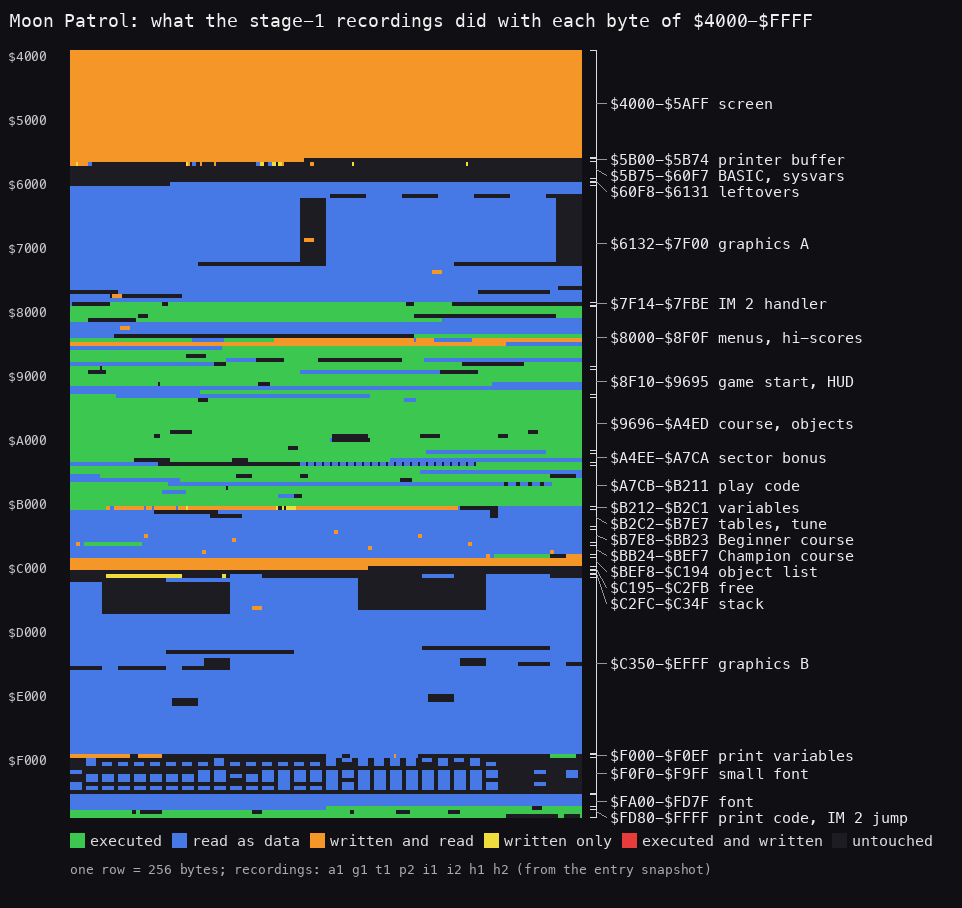
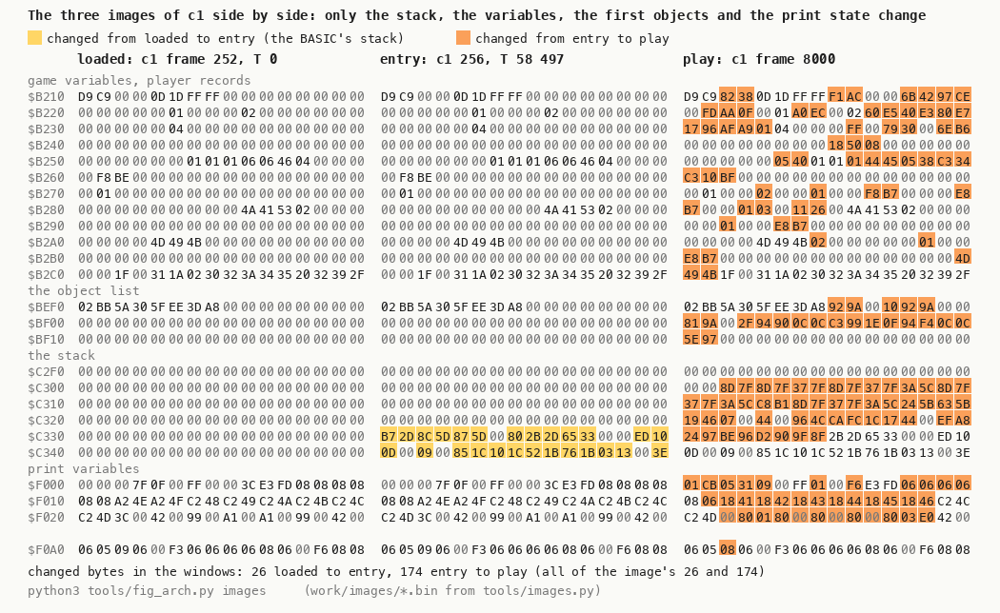
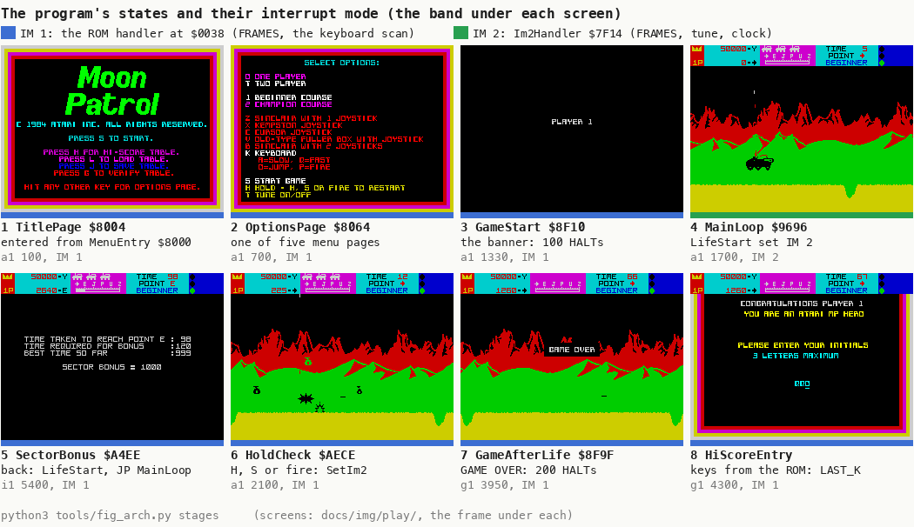
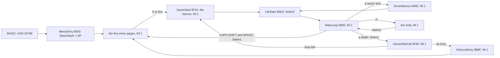
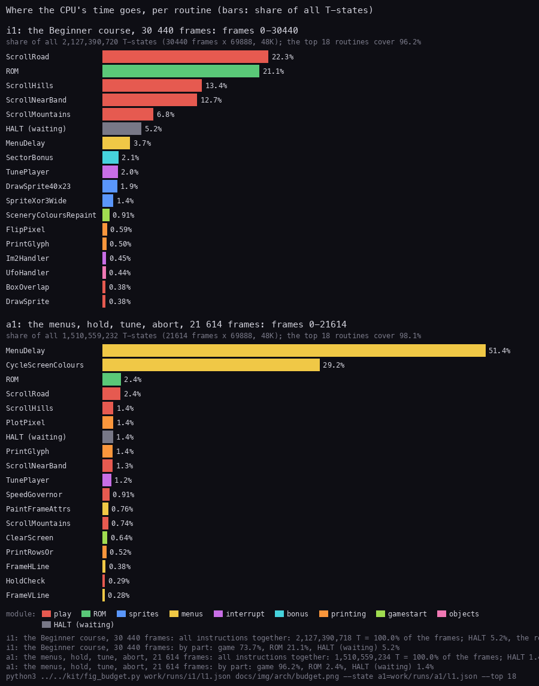
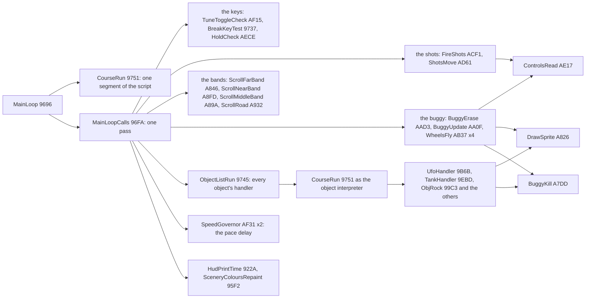
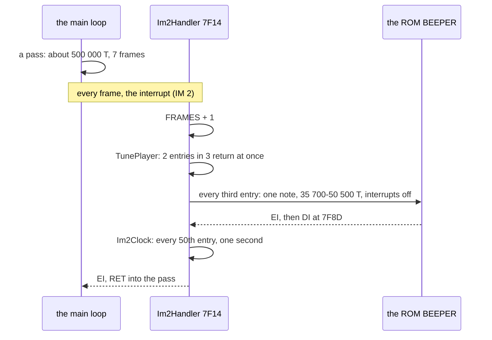

# 2. Architecture

What this covers:

- the machine budget: the 48K, the interrupt, the stack (2.1);
- the memory map, as a table and a figure (2.2);
- the three images, as loaded, at the entry and in play, and what changes between them (2.3);
- the program's states and the two interrupt modes (2.4);
- the modules, and where the CPU's time goes (2.5);
- the main loop's call graph, and the interrupt against the loop (2.6);
- why the game is 48K only (2.7).

The recordings it rests on ([Terms](README.md#terms)), all on the 48K, each with an input script (WALKTHROUGH 6.0
has the table):

- `c1`: power-on, the load through the fast LD-BYTES trap, then 16 000 frames of random play (`work/c1`);
- `a1`, `g1`, `t1`, `p2`, `h1`: the menus, the hold, the tune toggle, the abort, GAME OVER, the tape save and load,
  two players, the hi-score entry (`work/runs/NAME`), from `work/snaps/entry.z80`, a snapshot of `c1` at the game's
  entry (frame 256, T 58 497);
- `i1`, `i2`: the whole Beginner and the whole Champion course, from the clone `work/snaps/immune.z80` (the kill
  entry `$A7DD` patched to `RET`);
- `h2`: the all-time hi-score entry, from the clone `work/snaps/g1-3700-score60000.z80` (`g1` frame 3700 with the
  score set to 60000).

The clones are exploration only: they reach the code, and every claim below is about the code they ran.

## 2.1 The machine budget

- **The 48K, the beeper**: the only `OUT` instructions in the code are to port `$FE` (`$906B`, `$A60A`); the tune
  goes through the ROM's BEEPER `$03B5` (called from the tune player `$7F47` at `$7F8A`, and from the bonus screen at `$A578`, `$A692` and `$A69C`).
- **Interrupts on, IM 2 in play**: SetIm2 `$A7D4` (`DI`, `I` = `$3A`, `IM 2`, `EI`) ends each life start (`$9132`).
  The vector is the word at `$3AFF` in the ROM, `$FFFF`; the byte there is a `JR` back to `$FFF4`, which jumps to the
  handler `$7F14`. The menus, the death, the hold and the bonus screen run in IM 1 (SetIm1 `$A7CB`). The handler counts FRAMES,
  plays the tune and keeps the time; WALKTHROUGH 1 has the witnesses.
- **The stack is the BASIC's**: the game keeps the SP that `USR` gave it (`$C338` at the entry, `c1` frame 256) and
  saves it at `$B25D` (`$8000`); the course switch reloads SP from `$B25F` (`$BB1D`). In play it reaches `$C2FC`,
  60 bytes down, inside the interrupt handler's frame (2.3).
- **The game never returns to BASIC**: the abort (`$AABF`) jumps to `$8004`, and the error handler `$82F3`, hooked
  into ERR_SP, catches the ROM's reports during the tape operations (`t1`).

## 2.2 The memory map



How to read the figure:

- **One row** is 256 bytes, from `$4000` at the top to `$FFFF` at the bottom; each square is one byte.
- **The colour** is what the eight recordings together did with the byte (the union of their L1 builds): green
  executed, blue read as data, orange written and read, yellow written only, dark never touched.
- **The brackets** on the right are the regions of the table below.
- **The point**: the image is compact and static. Code fills `$7F14-$B211` and `$FD80-$FFFF`, graphics, fonts and plot tables
  fill both ends, and play writes only the screen, the printer buffer, the variables at `$B212`, the object list at
  `$BEF8` and the stack. Nothing is built at run time: the image runs as loaded.

```bash
python3 tools/fig_memmap.py --out docs/img/arch/memmap.png work/runs/{a1,g1,t1,p2,i1,i2,h1,h2}/l1.json
python3 work/stage1/regcounts.py      # the byte counts of the table, per region of tools/memmap-regions.txt
```

The byte counts are the union of the same eight L1 builds: X executed (as an opcode or operand), R read only, W
written (with or without reads), - never touched.

| Range | Bytes | What | X | R | W | - | Witness |
| --- | ---: | --- | ---: | ---: | ---: | ---: | --- |
| `$4000-$5AFF` | 6912 | the screen | | | 6912 | | cleared by `$9044` from `$8000` |
| `$5B00-$5B74` | 117 | the printer buffer; 21 bytes of `$9681` copied to `$5B60` at each life start | | | 117 | | `$90D3` |
| `$5B75-$60F7` | 1411 | the system variables and the BASIC; FRAMES `$5C78` counted by the handler | | 8 | 24 | 1379 | `$7F14` |
| `$60F8-$6131` | 58 | leftovers of the build: a copy of the tape header "MOON" at `$611F` | | | | 58 | |
| `$6132-$7F00` | 7631 | graphics A; the rows of 128 bytes at `$6500-$7572` are read in part | | 6902 | 15 | 714 | |
| `$7F01-$7F13` | 19 | the build date `03:35 30/10/84` at `$7F05` | | | | 19 | |
| `$7F14-$7FBE` | 171 | the interrupt handler `$7F14`, the tune player `$7F47`, the clock `$7F98` | 164 | | | 7 | 25 747 entries in `i1` |
| `$7FBF-$7FFF` | 65 | Atari's copyright text | | | | 65 | |
| `$8000-$8F0F` | 3856 | the entry, the title, the options, the score table, the demo, the hi-scores, the tape code | 1974 | 1171 | 357 | 354 | `a1`, `t1`, `h1`, `h2` |
| `$8F10-$9695` | 1926 | the game start `$8F10`, the player swap `$9022`, the life start `$90D3`, the HUD | 1328 | 563 | | 35 | `p2` |
| `$9696-$A4ED` | 3672 | the main loop `$9696`, the course interpreter `$9751`, the object handlers | 3524 | 67 | | 81 | `i1`, `i2` |
| `$A4EE-$A7CA` | 733 | the sector bonus screen `$A4EE`, its texts from `$A6A0` | 408 | 206 | | 119 | `i1`, the sector ends |
| `$A7CB-$B211` | 2631 | the play code: SetIm1, SetIm2, the kill `$A7DD`, the abort `$AABF`, the hold `$AECE`, the tune toggle `$AF15` | 2229 | 358 | | 44 | `a1` |
| `$B212-$B2C1` | 176 | the variables; the player record `$B271` (27 bytes), the other player's `$B28C`, the swap buffer `$B2A7` | | 5 | 168 | 3 | 2.3 |
| `$B2C2-$B7E7` | 1318 | tables, the tune `$B4E6` | | 1243 | | 75 | |
| `$B7E8-$BB23` | 828 | the Beginner course script, ending in the code `$BB07` (on to Champion) | 29 | 789 | 10 | | `i1` frame 29680 |
| `$BB24-$BEF7` | 980 | the Champion course script, ending in the code `$BED4` (back to Beginner) | 28 | 934 | 10 | 8 | `i2` frame 30694 |
| `$BEF8-$C194` | 669 | the object list | | | 669 | | zero in the image |
| `$C195-$C2FB` | 359 | **free**: zero in the image, never touched | | | | 359 | `memory_at`, 2.3 |
| `$C2FC-$C34F` | 84 | the stack: the game's `$C2FC-$C337`, the BASIC's from `$C338` | | | 40 | 44 | 2.3 |
| `$C350-$EFFF` | 11440 | graphics B; the rows of 128 bytes at `$C3D0-$D5AF` are read in part | | 9931 | 5 | 1504 | |
| `$F000-$F0EF` | 240 | the print variables (`$F0A2` set to 8 at `$8000`) | | 41 | 43 | 156 | |
| `$F0F0-$F9FF` | 2320 | a small routine `$F0F0-$F0FC`, then three fonts (FontSmall `$F100`, FontBold `$F400`, FontPlain `$F700`), read in part | 13 | 841 | | 1466 | |
| `$FA00-$FD7F` | 896 | the plot tables: PixelTable `$FA00` (column and mask of each x), ScreenLineTable `$FC00` (address of each pixel line) | | 896 | | | |
| `$FD80-$FFFF` | 640 | the print code (`$FFD0` prints a text), the IM 2 jump `$FFF4`, the vector byte `$FFFF` | 568 | | | 72 | |

Notes on the table:

- The 10 bytes written in each course script are five words, the last word of each sector-end record (Beginner
  `$B884`, `$B925`, `$B9AE`, `$BA51`, `$BB03`; Champion `$BBC7`, `$BC95`, `$BD42`, `$BDF0`, `$BED0`). `$A4EE` loads
  that word into `$B243` and prints it on the bonus screen: it is the best time of the sector, kept in the script.
  The writer is BestTimeWrite `$A659`: on a new best it stores PlayerTime into the two bytes before PlayerCourse,
  the end of the sector-end record just read ([doc 1](01-game-design.md)).
- The L1 write counters see only `$C312-$C337` and `$C34C-$C34D` of the stack; the bytes `$C2FC-$C311`, written while
  the interrupt handler runs, show only in `memory_at` (2.3). The stack row of the table and the figure are therefore short of
  writes, and its bounds come from `memory_at`.
- Never touched besides the above: the tape error texts `$8716-$87AB` (they need a tape with bad data),
  NoTimeBonusText `$A72C-$A772` (printed only on a bonus screen without time bonus), `$B32A-$B349`,
  `$BEF0-$BEF7`. The rest of that region, BonusTune `$A773-$A7CA`, is read on every bonus screen (`i1` 5 times).

## 2.3 The three images

`tools/images.py` keeps three 64 KB images in `work/images/`:

- `loaded-252-0.bin`: `c1` frame 252, T 0, after the ROM loaded the code block;
- `entry-256-58497.bin`: `c1` at the game's first instruction, `$8000`;
- `play-8000-0.bin`: `c1` frame 8000, in play.

```bash
python3 tools/images.py     # the diff ranges are kept in work/stage1/images-diff.txt
```



How to read the figure:

- **Three columns**, the images of `c1` at frame 252 (loaded), at the entry (frame 256, T 58 497) and at frame 8000
  (play); each row is 16 bytes from the address on the left.
- **Only the windows where they differ** are drawn: `$B210-$B2CF`, `$BEF0-$BF1F`, `$C2F0-$C34F`, `$F000-$F02F` and
  `$F0A0-$F0AF`. Everywhere else the three images are equal.
- **Yellow**: a byte changed from loaded to entry (26, all in `$C330-$C34F`). **Orange**: changed from entry to play
  (174). Zero bytes are grey.

```bash
python3 tools/fig_arch.py images   # docs/img/arch/images.png, from work/images/*.bin
```

**The point**: the game builds nothing at start. Between the load and play only state moves: the variables and player
records, the first object records, the stack (the handler's return words `$7F8D` and `$7F37` from `$C302` on) and
the print engine's variables.

What changes inside the image `$60F8-$FFFF`:

- **loaded to entry**: 26 bytes in `$C330-$C34F`, the BASIC's stack (the return of `USR` and the calculator's
  frames). The image held zeros there.
- **entry to play**: 174 bytes in 39 ranges, all of them state:
  - `$B212-$B2C1`: the game's variables and the player records;
  - `$BEF8-$BF11`: the first objects of the object list;
  - `$C302-$C337`: the game's stack, below the entry SP `$C338`;
  - `$F000-$F02D` and `$F0A2`: the print variables.
- No table is built at start: no changed range is longer than 33 bytes.

The stack against `CLEAR 49999`: RAMTOP is `$C34F`, inside the image, so the BASIC's stack and the game's live on the
loaded bytes. The whole of `$BEF8-$C353` is zero in the loaded image (`loaded-252-0.bin`), so the stack overwrites
only zeros: no code or data is lost.

How deep it goes: nothing clears `$C195-$C337`, so the lowest non-zero byte there at the last frame of a recording is
the stack's low mark (`work/stage1/stacklow.py`, `memory_at`):

| Recording | Last frame | Low mark |
| --- | ---: | --- |
| `a1` | 21 614 | `$C300` |
| `g1` | 10 760 | `$C2FE` |
| `t1` | 3490 | `$C31A` |
| `p2` | 24 020 | `$C2FE` |
| `h1` | 7584 | `$C2FE` |
| `i1` | 30 440 | `$C2FC` |
| `i2` | 33 820 | `$C2FC` |
| `h2` | 4200 | `$C2FC` |
| `c1` | 8000 (`play-8000-0.bin`) | `$C302` |

- The stack reaches `$C2FC`, 60 bytes below the entry SP `$C338`. The bytes below `$C312` are the handler's: the
  return addresses `$7F37` (the handler's call of Im2Clock, written over the slot of its call of the tune player) and
  `$7F8D` (the tune player's call of BEEPER) and
  `$5C3A`, the IY it pushes (`i1` frame 10000, `$C2FC-$C311`). The L1 counters miss these writes: they are the
  interrupt's own push of the PC and the ROM's BEEPER's. Interrupts never nest: the note ends long before the next
  interrupt and the `DI` at `$7F8D` closes BEEPER's `EI` at once ([doc 4](04-game-loop.md), 4.3).
- `$C195-$C2FB`, 359 bytes, stay free in all nine recordings.

## 2.4 The states and the two interrupt modes

The program is a handful of states joined by jumps. Each state is a loop that runs until it jumps to the next one.
Doc 4 4.1 draws the full state machine with every trigger. This section shows what each state looks like and which
interrupt mode it runs in.



How to read the figure:

- **One screen a state**, at the start of the frame named under it, from the screenshots of `docs/img/play/`.
- **The band under each screen** is the interrupt mode: blue for IM 1 (the ROM's handler), green for IM 2 (the
  game's handler `$7F14`).
- **Under the band**: the state's routine, how it is entered or left, and the recording and frame.
- **The point**: only play runs in IM 2. The menus, the banner, the bonus screen, the hold, GAME OVER and the
  hi-score entry all run in IM 1. Play is the only state that needs the tune and the clock, and the only one that
  does not need the ROM's keyboard scan.



| State | Routine | Mode | Entered by | Wait inside |
| --- | --- | --- | --- | --- |
| the menu pages | TitlePage `$8004` and the four others | IM 1 | MenuEntry, any page's end, a menu key | MenuDelay `$820D`, 4.8 frames a pass |
| the banner | GameStart `$8F10`, GameStartLife `$8F71` | IM 1 | S or fire on a menu page | Wait100Frames `$903D`: 100 HALTs (300 for two players) |
| play | LifeStart `$90D3`, MainLoop `$9696` | IM 2 | the banner, the bonus screen, the end of the hold | none: no HALT in play |
| the demo | DemoPage `$8180` | IM 2 | the score table's end | none: the main loop's own delays (SpeedGovernor, the near band's delay) |
| the bonus screen | SectorBonus `$A4EE` | IM 1 | a sector-end record in the course script | HALT runs, BEEPER, MenuDelay |
| the hold | HoldCheck `$AECE` | IM 1 | H in play | a polling loop |
| a death, GAME OVER | GameAfterLife `$8F9F` | IM 1 | DeathStep 8 at the end of a pass | 200 HALTs for GAME OVER |
| the hi-score entry | HiScoreEntry `$8B8F` | IM 1 | the last player out with a score in the tables | LAST_K |

- **IM 1 keeps the ROM's work.** The ROM's handler at `$0038` counts FRAMES and scans the keyboard into LAST_K.
  The hi-score entry needs LAST_K ([doc 5](05-controls.md), 5.6). The options page calls KEY_SCAN `$028E` itself
  (`$80C4`) and would work in either mode.
- **IM 2 drops the keyboard scan and adds the tune and the clock** ([doc 4](04-game-loop.md), 4.3). The clock must
  count only play: it stops in every IM 1 state, so neither the bonus screen nor the hold counts against the par.
- **The demo runs in IM 2** because it is play: LifeStart sets the mode. It leaves through MenuCheckAnyKey or its
  100 passes, both with SetIm1.

Witness: SetIm2 `$A7D4` ran 6 times in `i1` (the first life and five sectors) and 5 in `a1`; SetIm1 `$A7CB` ran 6
times in `i1` and 28 in `a1` (`python3 tools/l1sum.py A7CB A7D4`). The IM 2 handler ran 25 747 times in `i1`, the
ROM's IM 1 entry 3004 times (`re_session.py interrupts`, WALKTHROUGH 1).

## 2.5 The modules and where the time goes

The source is cut into modules by `src/game/game.ann` (`@module`). Each module is one file of `src/game/` and one
stretch of the image:

| Module | From | What | CPU in `i1` | CPU in `a1` |
| --- | --- | --- | ---: | ---: |
| leftover | `$60F8` | build leftovers, the "MOON" header copy | | |
| graphicsa | `$6132` | the title logo, the wreck, the explosions and bursts | data | data |
| interrupt | `$7F14` | Im2Handler, TunePlayer, Im2Clock | 2.5 % | 1.2 % |
| menus | `$8000` | the entry, the five pages, the options, the tape code | 3.9 % | 82.3 % |
| hiscores | `$8866` | the hi-score tables, their page, the entry | 0 | 0.0 % |
| gamestart | `$8F10` | the game start, the lives and players, GAME OVER, the life start, the HUD | 1.2 % | 0.9 % |
| course | `$9696` | the main loop, the course interpreter, its commands, the first object handlers | 0.6 % | 0.0 % |
| objects | `$9B6B` | the UFOs, the spinner, their bombs | 0.7 % | 0 |
| enemies | `$9EBD` | the tank and its shell, the low flyer, the boulders, the plant | 0.0 % | 0 |
| bonus | `$A4EE` | the sector bonus screen | 2.1 % | 0 |
| play | `$A7CB` | the modes, the buggy, the shots, the death, the scrollers, the controls, the hold, the tune key | 57.2 % | 7.7 % |
| sprites | `$AFAB` | the block copy and the XOR sprite drawers | 4.0 % | 0.3 % |
| variables, tables, courses | `$B212` | the variables, the sprite table, the tune, the two course scripts | data | data |
| objectlist | `$BEF8` | the object list, the free bytes, the stack | data | |
| graphicsb | `$C350` | the enemies, the buggy, the scenery strips | data | data |
| printvars, printing | `$F000` | the print variables, the three fonts, the plot tables, the print code | 1.5 % | 3.7 % |
| the ROM | `$0000` | BEEPER (the tune), the IM 1 handler, KEY_SCAN, LD-BYTES | 21.1 % | 2.4 % |
| HALT | | waiting for the interrupt | 5.2 % | 1.4 % |



How to read the figure:

- **Two panels**: `i1`, the whole Beginner course (30 440 frames), and `a1`, the menus with a short game (21 614
  frames).
- **One bar a routine**: its share of all the T-states of the recording (frames x 69 888), its own time without
  its callees. The colour is its module; the ROM and HALT have their own bars.
- **The point**:
  - In play, four scrollers take 55 % of the machine. The ROM's 21 % is almost all BEEPER's loop `$03D4`, the tune
    played inside the interrupts.
  - The menus spend 81 % in two routines: MenuDelay, a delay loop, and CycleScreenColours, which steps every
    attribute of the screen through its colour cycle once a pass.
  - The objects, the enemies and the course interpreter, the "game logic", cost under 2 % together in their own
    time (course 0.6, objects 0.7, enemies 0.0); with the sprites they draw, about 7 % of a pass (below).

```bash
python3 ../../kit/fig_budget.py work/runs/i1/l1.json docs/img/arch/budget.png \
    --label "i1: the Beginner course, 30 440 frames" --state "a1: the menus, hold, tune, abort, 21 614 frames=work/runs/a1/l1.json" --top 18
python3 ../../kit/fig_budget.py work/runs/i1/l1.json OUT.png --by module --state a1=work/runs/a1/l1.json   # the table
```

The kit's figure is 900 pixels wide (the kit's own size).

What the budget says about the design:

- **The game is a scroller with a game attached.** 65 % of a pass is moving the three bands and the road. That is
  why the pass is 7 frames long, and why the game has no frame sync: it could not keep 50 or 25 frames a second.
- **The tune is the second cost.** 21 % of `i1` is BEEPER inside the interrupt. The tune stops the CPU for most of
  a frame on every third interrupt, and a rest stops it as long (doc 4, 4.3).
- **The game logic is cheap.** The interpreter and every object handler together run in about 34 000 T a pass, 7 %
  of it, DrawSprite and BoxOverlap included (ObjectListRun inclusive, doc 4, 4.6); their own code is under 2 %.

## 2.6 The main loop's call graph

One pass of the main loop is twenty calls from MainLoopCalls `$96FA` ([doc 4](04-game-loop.md), 4.6). Grouped by
what they serve:





- **One interpreter, two jobs.** CourseRun `$9751` reads the course script once a segment, and ObjectListRun runs
  it again over the object list every pass: the objects are scripts of handler words, like the course
  ([doc 7](07-objects.md), [doc 10](10-gameplay-logic.md)).
- **Two routines are shared by everyone.** DrawSprite `$A826` draws every sprite with XOR, and BuggyKill `$A7DD` is
  the only way to die.
- **The interrupt and the loop share nothing but FRAMES, the tune state and the clock.** The handler saves every
  register, never touches the screen and never reads a key. The loop never waits for it: an interrupt simply makes
  the pass longer, by 369 T or by a whole note.

Witness: the call counts in `i1` are 3601 for MainLoopCalls, 3601 for ScrollFarBand and 3600 for the other scrollers (the recording stops inside the last pass), 14 401 for WheelsFly and 7200
for SpeedGovernor (four and two a pass), and 25 747 for Im2Handler (`work/docs/mpA-budget.py work/runs/i1`).

## 2.7 48K only

- **Only port `$FE` is written.** The two `OUT` instructions write `$FE` (`$906B`, the border; `$A60A`, the time
  bonus blip). Nothing writes `$7FFD` (the 128K's paging) or `$FFFD` / `$BFFD` (the AY).
- **Only the beeper plays.** The tune and the bonus tune go through the ROM's BEEPER `$03B5`, and the blip toggles
  bits 3 and 4 of `$FE` (MIC and speaker, `$A608 XOR $18`) by hand (doc 4, 4.4).
- **The ports read** are `$FE` (the keyboard), `$1F` (Kempston) and `$7F` (Fuller) ([doc 5](05-controls.md)).
- **The ROM is the 48K's.** The game calls BEEPER, KEY_SCAN `$028E`, LD-BYTES `$0556` and SA-BYTES `$04C2`, and its
  interrupt vector relies on the bytes `FF FF` at `$3AFF` and `F3` at `$0000` of the 48K ROM (doc 4, 4.3).
- **On a 128K it would run** in 48K mode or in 128K mode with ROM 1 paged, because all these bytes are the same in
  ROM 1. No recording ran it on a 128K: this is known only from the code.

The point: the game uses nothing the 48K lacks, and leaves the 128K's sound chip unused.
