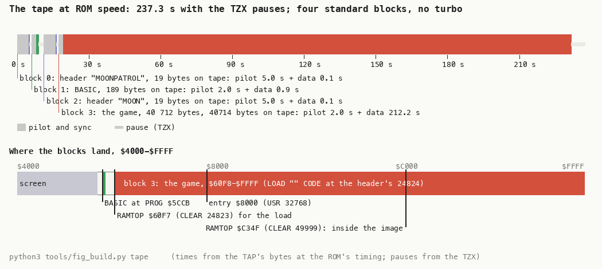
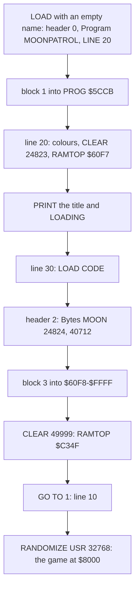
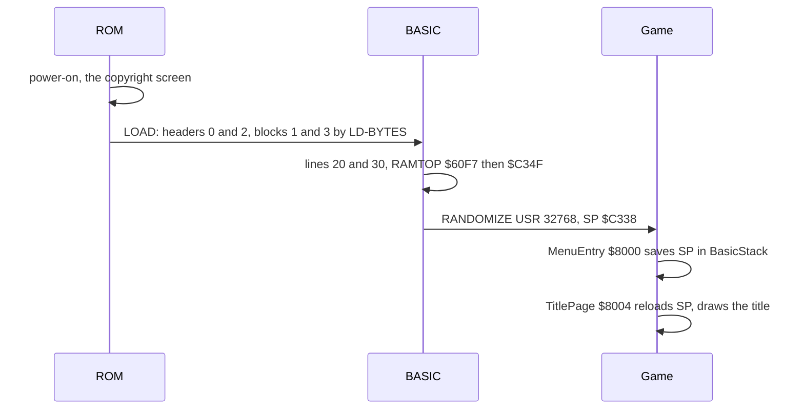
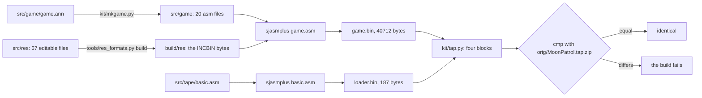
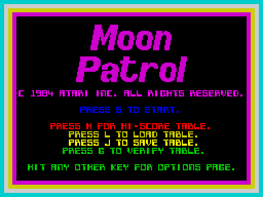
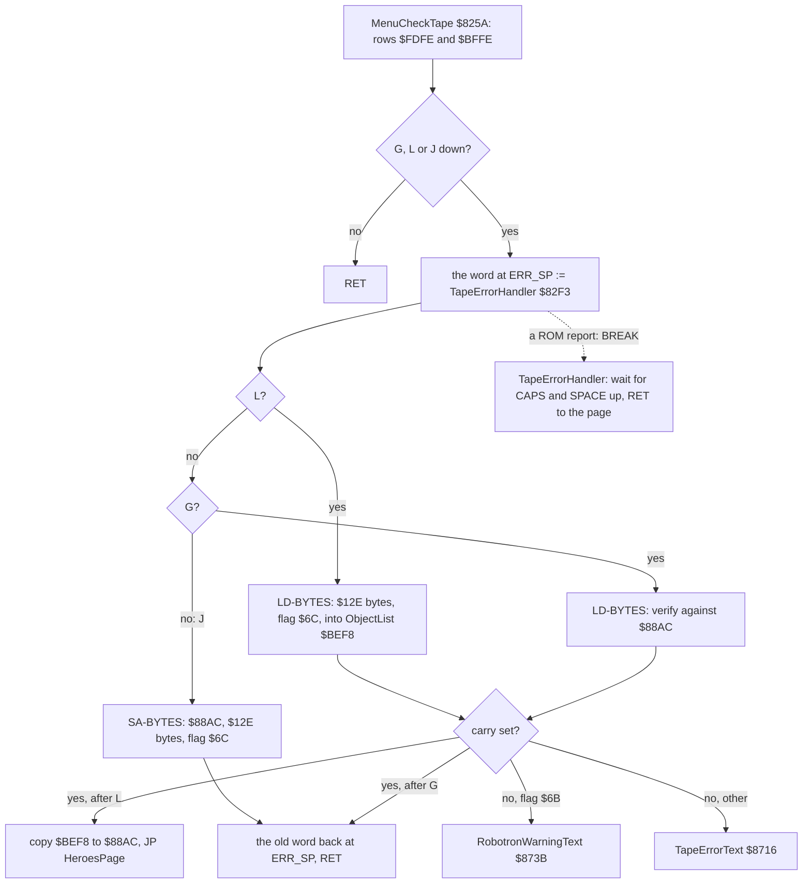

# 3. Build and load

What this covers:

- 3.1: the tape, block by block.
- 3.2: the BASIC loader.
- 3.3: the way from power-on to the game's first instruction.
- 3.4: why nothing unpacks.
- 3.5: the source build, which gives the tape back byte for byte.
- 3.6: the game's own tape code, which saves and loads the hi-score table.

The recordings it rests on:

- `c1`: power-on, the load through the fast LD-BYTES trap, the entry at frame 256 (`work/c1`). Its images are
  `work/images/loaded-252-0.bin` and `entry-256-58497.bin` (doc 02 2.3).
- `t1`: from `work/snaps/entry.z80`, no tape in the deck (`work/runs/t1`, script in `tools/inputs.py`). It presses J
  (save the table), L then SPACE (load, broken), and G then SPACE (verify, broken).

## 3.1 The tape, block by block

The TAP and the TZX in `orig/` (ZXDB 3266) hold the same four standard blocks. The TZX adds only a text block
("Created with Ramsoft MakeTZX") and the pauses. There is no turbo and no protection: the ROM's LD-BYTES loads
everything.

| Block | Kind | Data (+2 on tape) | Loads at | ROM-speed time | Pause after (TZX) |
| ---: | --- | ---: | --- | ---: | ---: |
| 0 | header: Program "MOONPATROL", LINE 20 | 17 | | 5.1 s | 1014 ms |
| 1 | the BASIC loader | 187 | the BASIC area | 2.9 s | 2170 ms |
| 2 | header: Bytes "MOON", start 24824, length 40712 | 17 | | 5.1 s | 1088 ms |
| 3 | the game | 40 712 | `$60F8-$FFFF` | 214.2 s | 5712 ms |

At ROM speed the tape lasts 227.3 s (11 383 frames of the 48K) without the pauses. With the TZX's pauses it lasts
237.3 s (11 864 frames).



*The tape at ROM speed and the memory it fills. The times come from the bytes of `orig/MoonPatrol.tap.zip` at the
ROM's timing; the pauses are the TZX's. Command: `python3 tools/fig_build.py tape`.*

How to read it:

- The top bar is time, from 0 to 237 s.
- Grey is pilot and sync, colour is data, and the thin light band is a pause.
- The four labels under the bar give each block's pilot and data time.
- The bottom bar is memory, `$4000-$FFFF`.
- The red span is block 3, the game, at `$60F8-$FFFF`.
- The black marks are the two RAMTOPs of the BASIC (3.2) and the entry `$8000`.

The point: the whole program is one block. The loader is the ROM's, so the 214 s of block 3 are the whole load.

Worked example, the time of block 3:

1. The ROM saves a data block with a pilot of 3223 pulses of 2168 T.
2. The two sync pulses add 667 + 735 T. Pilot and sync make 6 988 866 T, 2.0 s at 3.5 MHz.
3. The data are 40 714 bytes: the flag, the 40 712 bytes and the checksum.
4. A 0 bit costs 2 x 855 T and a 1 bit 2 x 1710 T. The block's bits give 212.2 s.
5. The total is 214.2 s, the figure in the table.

## 3.2 The BASIC loader

Block 1 holds three lines (`src/tape/basic.asm`; `tools/basic_list.py` lists them). The header's LINE 20 starts the
program at line 20.

| Line | Statements | What it does |
| ---: | --- | --- |
| 10 | `RANDOMIZE USR 32768` | enters the game at `$8000` |
| 20 | `BORDER 0: INK 7: BRIGHT 1: PAPER 0: CLEAR 24823` | black border and paper, bright white ink; RAMTOP `$60F7` |
| 20 | `PRINT AT 10,8;` FLASH 1, `"   MOON PATROL   "`, FLASH 0 | the title at row 10, flashing |
| 20 | `AT 12,13;` INVERSE 1, `"LOADING"`, INVERSE 0, `: INK 0` | LOADING at row 12, inverse; then black ink |
| 30 | `LOAD "" CODE` | the next file, at its header's address `$60F8` |
| 30 | `CLEAR 49999: GO TO 1` | RAMTOP `$C34F`; GO TO 1 runs the first line from 1 on, line 10 |

The strings hold the ROM's colour control codes. FLASH is `$12` and INVERSE is `$14`. Each code is followed by its
parameter byte, 0 or 1. A plain listing shows only their effect: the title flashes and LOADING is inverse.



The start of line 20 in the source, which rebuilds it byte for byte (`src/tape/basic.asm`):

```asm
Line20:
  DB T_BORDER                   ; $E7
  NUM "0", 0                    ; the digits, then $0E and 0 0 0 0 0
  DB ":", T_INK
  NUM "7", 7
  ...
  DB ":", T_CLEAR
  NUM "24823", GameLoad-1       ; $60F8 - 1 = $60F7
```

Worked example, the two RAMTOPs:

- `CLEAR 24823` sets RAMTOP to 24 823 = `$60F7`, one byte below the code's load address `$60F8`. The BASIC's machine
  stack and GO SUB stack now sit under the code, so the load cannot overwrite them.
- `CLEAR 49999` sets RAMTOP to 49 999 = `$C34F`, inside the loaded image. The new stack grows down from `$C34F`, over
  the loaded bytes `$C312-$C34F`. `objectlist.asm` names that area `Stack`.

Witness: in `c1`, the image after the load (frame 252) equals block 3 byte for byte at `$60F8-$FFFF`. The image at
the entry (frame 256, T 58 497) differs from block 3 in 26 bytes, all at `$C330-$C34F`. Those bytes are the stack of
`CLEAR`, `GO TO`, `RANDOMIZE` and `USR`. The comparison is in work/docs/mpA-NOTES.md.

The point: the second CLEAR gives the game its stack, and the game keeps it (doc 02 2.1, `BasicStack` `$B25D`).

## 3.3 From power-on to the game's first instruction



The game's first instruction saves the stack pointer that the USR gave it. Every menu page reloads it, so no page
leaks stack (doc 02 2.4).

```asm
MenuEntry:
8000  ED 73 5D B2  LD (BasicStack),SP
TitlePage:
8004  ED 7B 5D B2  LD SP,(BasicStack)
8008  3E 08        LD A,$08
```

| Moment (`c1`) | Frame | What holds |
| --- | ---: | --- |
| block 3 loaded | 252, T 0 | `$60F8-$FFFF` equals block 3 |
| first instruction, `$8000` | 256, T 58 497 | SP is `$C338`; 26 stack bytes at `$C330-$C34F` changed |
| in play | 8000 | doc 02 2.3 |

The point: between the load and the game run only the BASIC's last statements, four frames in `c1`.

## 3.4 No packer, no protection

The brief asks for an animation of every unpack (`kit/memanim.py`). There is no unpack: the game runs from the bytes
that the ROM loaded.

| Question | Static answer (the bytes) | Recording answer (`c1`) |
| --- | --- | --- |
| A turbo loader? | block 3 is a standard ROM block: flag `$FF`, a 3223-pulse pilot | LD-BYTES `$0556` loads it |
| A packer? | the code at `$8000` is plain Z80, with no copy loop before it | the image at frame 252 equals block 3 |
| A self-modifying start? | `$8000` writes only `BasicStack` | the entry image differs only in the stack |
| Protection? | no checksum of the code, no key test | none ran |

The point: the image in memory is the tape's block 3. So the source build (3.5) can be one `ORG` and a byte-for-byte
compare.

## 3.5 The source build

`tools/build.sh [SJASMPLUS]` builds `build/MoonPatrol.tap` and compares it with the original.



| Input | Files | What it gives |
| --- | ---: | --- |
| `src/res/graphics/` | 30 | indexed PNG sheets: the logo and the sprites |
| `src/res/fonts/` | 3 | PNG sheets of the fonts |
| `src/res/text/` | 31 | the strings of the print code `$FFD0`, UTF-8 text with codes such as `{INK 4}` |
| `src/res/courses/`, `tune/` | 2 + 1 | one record a line |
| `src/game/*.asm` | 20 | the program, written from `game.ann` |
| `src/tape/basic.asm` | 1 | block 1 |

The build steps, as `tools/build.sh` runs them:

```sh
python3 tools/res_formats.py build --out build/res
sjasmplus --nologo --msg=war -Ibuild -Isrc/game --lst=game.lst src/game/game.asm
sjasmplus --nologo --msg=war --lst=basic.lst src/tape/basic.asm
python3 ../../kit/tap.py MoonPatrol.tap basic:MOONPATROL:20:loader.bin code:MOON:24824:game.bin
cmp MoonPatrol.tap orig-MoonPatrol.tap
```

Witness: a run on 2026-11-08 took 5.3 s and printed "build: MoonPatrol.tap identical to orig/MoonPatrol.tap.zip's
Moon Patrol.tap". `build/game.bin` is 40 712 bytes and `build/loader.bin` 187 bytes.

The point: every byte of the tape comes from an editable source. A changed sprite sheet or string builds into the
game, and the compare shows whether anything else moved.

## 3.6 The hi-score tape

Six menu loops call `MenuCheckTape` `$825A`: the title, the options, the score table, the demo, the heroes page and
the tape message. The title and the heroes page name the keys: L loads, J saves, G verifies.



*`t1` frame 300, during the save that J started: the title stays on the screen while the ROM writes the table.
Command: `python3 ../../kit/screen_shot.py --work work/runs/t1 --out-dir docs/img/play t1-title-during-save=300`.*

The tape block is the all-time table at `$88AC-$89D9`, 302 bytes:

- THE GREATEST's course point, name, score and initials;
- the 39 records after THE GREATEST.

Its flag is `$6C`, not the ROM's `$FF`, so a game file cannot load over it. The session's top ten (`HeroesTable`
`$8866`) is not saved.



The key test and the error trap:

```asm
MenuCheckTape:
825A  3E FD        LD A,$FD
825C  DB FE        IN A,($FE)        ; A S D F G
825E  F6 EF        OR $EF            ; keep bit 4: G
8260  5F           LD E,A
8261  3E BF        LD A,$BF
8263  DB FE        IN A,($FE)        ; ENTER L K J H
8265  F6 F5        OR $F5            ; keep bit 1 (L) and bit 3 (J)
8267  A3           AND E
8268  FE FF        CP $FF
826A  C8           RET Z             ; none down
826B  ED 73 63 B2  LD (TapeStack),SP
826F  ED 7B 3D 5C  LD SP,(ERR_SP)
8273  21 F3 82     LD HL,TapeErrorHandler
8276  E3           EX (SP),HL        ; the ROM's error return := the handler
8277  22 65 B2     LD (TapeErrSp),HL ; the old word kept
827A  ED 7B 63 B2  LD SP,(TapeStack)
```

The trap works because the ROM ends every report by loading SP from ERR_SP and returning. With the handler's address
in that word, a BREAK during LD-BYTES lands at `$82F3`, not in the BASIC's error loop. The handler waits until CAPS
SHIFT and SPACE (row `$7EFE`, bit 0) are both up. Then it puts the old word back, reloads `TapeStack` and returns to
the menu loop that called.

When LD-BYTES returns without a report but with carry clear, `L` holds the last byte it read. A flag of `$6B` marks a
hi-score table of Atarisoft's Robotron, and the game says so:

- `RobotronWarningText`: "WARNING-You have attempted to load an Atarisoft Robotron hi-score table. Please try
  again!!!"
- `TapeErrorText`: "Tape error - hit any key."

Worked example, L pressed and nothing else:

1. Row `$FDFE` reads `$FF` (no key); `OR $EF` keeps `$FF`.
2. Row `$BFFE` reads `$FD` (bit 1, L, is low); `OR $F5` keeps `$FD`.
3. `$FF AND $FD` is `$FD`, not `$FF`, so a key is down.
4. `BIT 1,H` is 0: the load path, with carry set (load, not verify) and IX = `$BEF8`.
5. A good block ends with carry set. `TapeKey` bit 4 is 1 (G is up), so the 302 bytes go to `$88AC` and the heroes
   page shows the loaded table.

The load goes to `ObjectList` first, so a broken load leaves the table as it was.

Witness (`t1`, no tape in the deck):

| Address | What | Runs |
| --- | --- | ---: |
| `$826B` | a key down: the trap set | 3 (J, L, G) |
| `$8299` | J: SA-BYTES | 1 |
| `$82A9` | L and G: LD-BYTES | 2 |
| `$82F3` | the handler's wait loop, while SPACE is still down | 65 060 |
| `$82B9`, `$82BB`, `$8309` | LD-BYTES returned; the messages; the copy | 0 |

The analysis flagged `$825A` as "left 2 times without a return". Those are the two BREAKs: the ROM's report moved SP
to ERR_SP, and the handler returned from there. Known only from the code: a good load and its copy, a good verify,
the two messages and the Robotron flag.

Worked example, the time of the save:

1. The block is the flag, the 302 bytes and the checksum: 304 bytes with 662 one-bits.
2. The pilot takes 2.0 s and the data 1.5 s: 3.5 s, about 175 frames.
3. `t1`'s J went down at frame 150, so frame 300 falls inside the save.

The point: the game borrows the ROM for its tape and the BASIC's error mechanism for BREAK. The cost is 199 bytes of
code (`$825A-$8320`).
