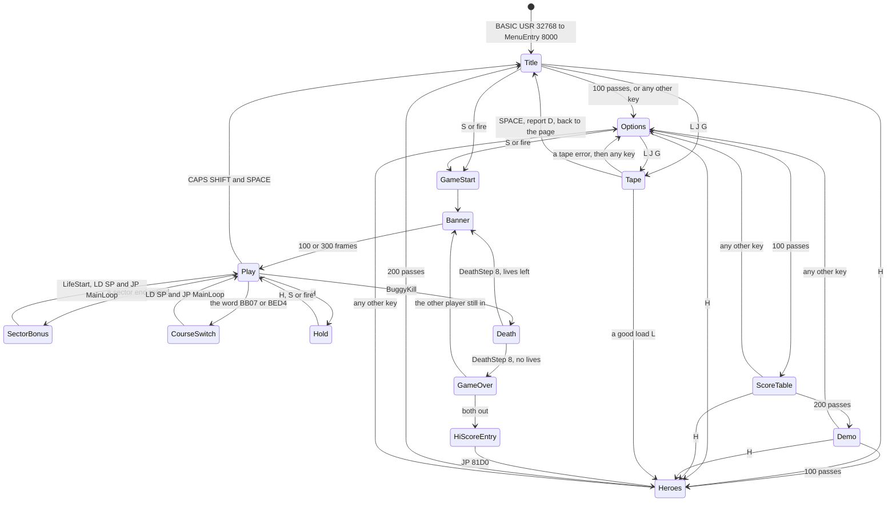
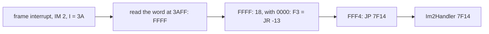
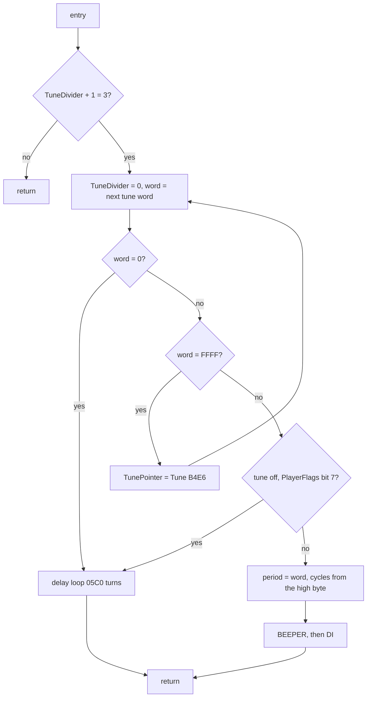
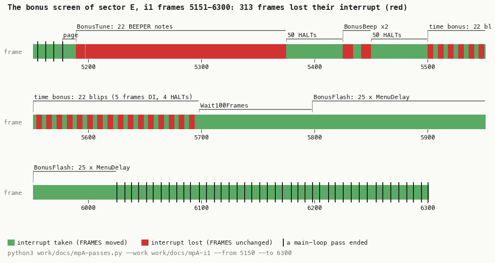
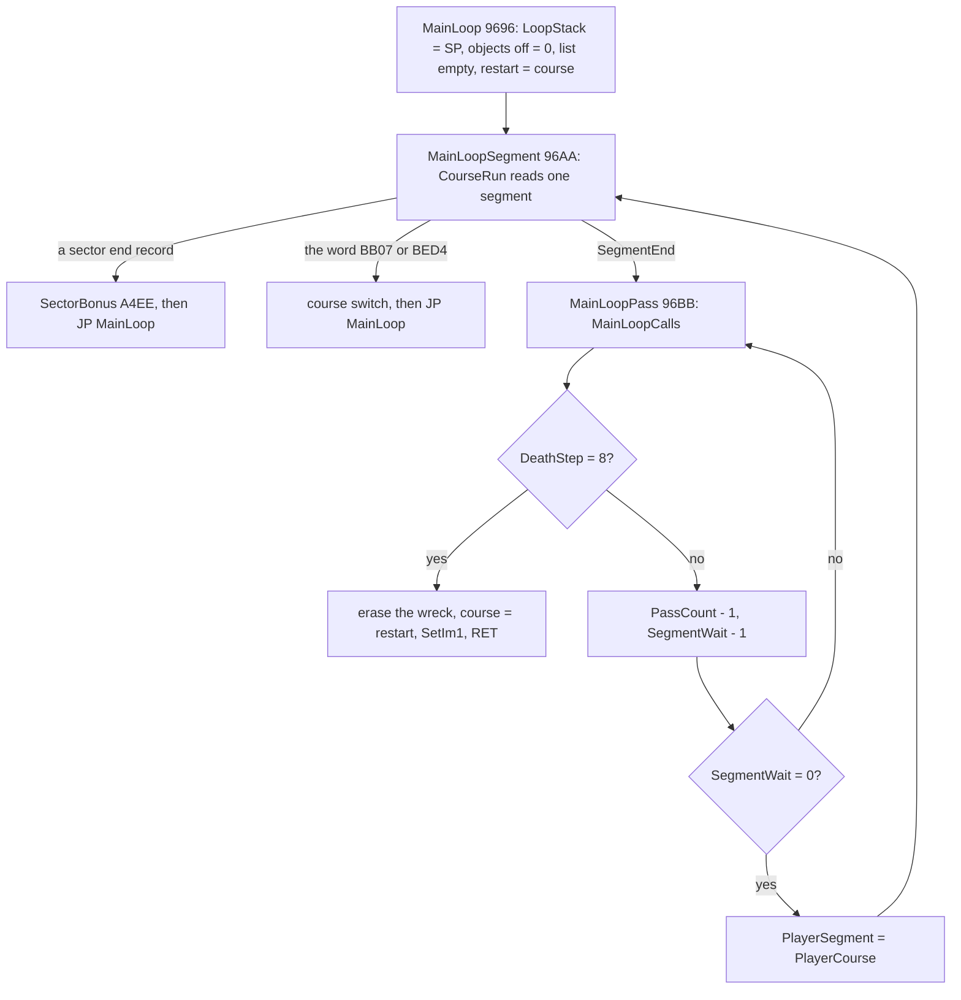
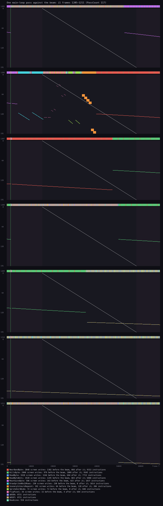
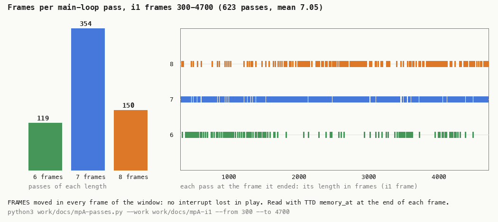

# 4. Game loop

What this covers:

- the state machine of the whole program, every transition with its trigger (4.1);
- how the pages and the main loop leave each other: the two saved stack pointers (4.2);
- the interrupts: IM 1 and IM 2, the vector, the handler line by line, the tune step and the clock (4.3);
- where the code runs with interrupts off, and the frames that lose their interrupt (4.4);
- the main loop: segments, passes, and no frame sync (4.5);
- the order of work inside a pass, its cost, and the beam (4.6);
- the pass lengths, measured (4.7);
- every delay, pause and timer (4.8).

The recordings it rests on, all on the 48K (WALKTHROUGH 6.0 has the table):

- `i1`: the whole Beginner course from the immune clone `work/snaps/immune.z80`, 30 440 frames. Opened again on an
  own instance as `work/docs/mpA-i1` (port base 32600) for the pass lengths (4.7) and the frames without an
  interrupt (4.4), read with TTD `memory_at`;
- `a1`: the menus, the hold, the tune key and the abort, from `work/snaps/entry.z80` (`c1` at the entry, frame 256);
- the L1 builds of `c1` (`work/game`) and of every stage-1 recording, for the counts (`tools/l1sum.py`) and the
  T-states (`work/docs/mpA-budget.py`).

A frame is 1/50 s of the 48K: 69 888 T. A pass is one turn of the main loop's call list MainLoopCalls `$96FA`
([Terms](README.md#terms)). In play a pass is 6 to 8 frames.

## 4.1 The state machine

The program never returns to BASIC and has no frame-driven scheduler: each state is a routine that loops until it
jumps to the next one. The menu pages are loops of 100 or 200 passes; play is the main loop; the waits between them
are `HALT` loops.



To keep the diagram legible, it draws S, fire and the tape keys only from the title and the options page. In the code,
MenuCheckStart and MenuCheckTape run on all five pages, and MenuCheckHeroes on all but the hi-score page (doc 1, 1.2).

Each transition, with its code:

| From | To | Trigger | Code |
| --- | --- | --- | --- |
| BASIC | the title | `RANDOMIZE USR 32768` | MenuEntry `$8000` saves SP at BasicStack `$B25D` |
| a page | the next page | its pass counter runs out | `DJNZ` at the end of each page loop (`$8061`, `$8116`), `DEC BC` in the demo (`$81C8`) |
| a page | the options page | any key (all half-rows) | MenuCheckAnyKey `$8321`: SetIm1, SP = BasicStack, JP OptionsPage |
| a page | the hi-score page | H | MenuCheckHeroes `$8247` |
| a page | the game | S alone, or fire on a joystick | MenuCheckStart `$8227`: SetIm1, SP = BasicStack, JP GameStart `$8F10` |
| a page | the tape | L, J or G | MenuCheckTape `$825A` ([doc 3](03-build-and-load.md)) |
| the game start | the banner | always | GameStart falls into GameStartLife `$8F71` |
| the banner | play | 100 HALTs (300 with two players) | Wait100Frames `$903D`, then LifePlay `$90CC` |
| play | the bonus screen | the interpreter meets a sector end record | CourseRun `$9751` jumps to SectorBonus `$A4EE` |
| the bonus screen | play | the bonuses counted | SectorBonus: LifeStart, `LD SP,(LoopStack)`, `JP MainLoop` (`$A689`) |
| play | the course switch | the interpreter meets the word `$BB07` or `$BED4` | BeginnerToChampion, ChampionToBeginner |
| play | the hold | H, a new press | HoldCheck `$AECE` |
| play | the death | contact, or the crater probe | BuggyKill `$A7DD` |
| the death | the banner or GAME OVER | DeathStep reaches 8 | MainLoopPass `$96BB` returns; GameAfterLife `$8F9F` |
| GAME OVER | the hi-score entry | the last player out | GameAfterLife `$9006` / `$901C` |
| the entry | the hi-score page | ENTER | `JP HeroesPage` (`$900F`, `$901F`) |
| play | the title | CAPS SHIFT and SPACE | BuggyUpdate `$AABF`: SetIm1, JP TitlePage |

## 4.2 Two saved stack pointers

The program moves between states by jumps, not by returns. To keep the stack from growing, it saves two stack
pointers and reloads one of them before each jump:

- **BasicStack `$B25D`**: the SP that BASIC's `USR` gave the game (`$C338` in `c1`), saved once by MenuEntry
  `$8000`. Every menu exit (MenuCheckStart, MenuCheckHeroes, MenuCheckAnyKey, TitlePage itself) reloads it, so each
  page starts on an empty stack.
- **LoopStack `$B25F`**: the SP at the entry of MainLoop `$9696`, saved there each time. The bonus screen and the
  two course switches are reached from inside the course interpreter, three calls deep; they reload LoopStack and
  jump to MainLoop, which drops those frames.

```text
MenuEntry:          BasicStack = SP                     ; once, at USR
any menu exit:      SP = BasicStack; jump to the page or to GameStart
MainLoop:           LoopStack = SP                      ; each life start, each sector, each course switch
SectorBonus end:    SP = LoopStack; jump to MainLoop    ; from CourseRun's JP (IX), 3 calls deep
course switch:      SP = LoopStack; jump to MainLoop
```

```asm
8000  ED 73 5D B2  LD (BasicStack),SP     ; MenuEntry: the BASIC's SP, once
823D  CD CB A7     CALL SetIm1            ; MenuStartGame
8240  ED 7B 5D B2  LD SP,(BasicStack)     ; drop whatever the page pushed
8244  C3 10 8F     JP GameStart
9696  ED 73 5F B2  LD (LoopStack),SP      ; MainLoop: the SP of LifePlay's CALL
A689  ED 7B 5F B2  LD SP,(LoopStack)      ; SectorBonus: back to the loop's own level
A68D  C3 96 96     JP MainLoop
```

The point: a state change never leaks stack. That is why the deepest stack in every recording is the same 60 bytes
under `$C338` (doc 2, 2.3), whatever the player did.

## 4.3 Interrupts

### Two modes

The menus run in IM 1 with the ROM's handler at `$0038`; play runs in IM 2 with the game's own handler. Two small
routines switch:

```asm
A7CB  F3           DI                     ; SetIm1: the menus, the death, the hold, the bonus screen
A7CC  ED 56        IM 1
A7CE  3E 3F        LD A,$3F               ; I back to the ROM's value
A7D0  ED 47        LD I,A
A7D2  FB           EI
A7D3  C9           RET
A7D4  F3           DI                     ; SetIm2: each life start, the end of the hold
A7D5  3E 3A        LD A,$3A               ; I = $3A: the vector is read at $3AFF
A7D7  ED 47        LD I,A
A7D9  ED 5E        IM 2
A7DB  FB           EI
A7DC  C9           RET
```

- SetIm2 is called by LifeStart `$9132`, at the end of every life start (the banner's life, each sector, the demo),
  and by the hold when it ends (`$AF0E`).
- SetIm1 is called by every menu exit (`$823D`, `$8250`, `$8328`, the demo's end `$81CD`), the death (`$96DF`),
  the bonus screen (`$A50E`), the abort (`$AACD`) and the hold (`$AEE0`).
- Witness: SetIm2 `i1` 6 entries (the life start and five sectors), SetIm1 `a1` 28 (`tools/l1sum.py A7CB A7D4`).

The ROM's IM 1 handler keeps the menus' needs: FRAMES, and the keyboard scan that fills LAST_K, which the hi-score
entry reads (EntryFieldEdit `$8D0D`). The game's IM 2 handler drops the keyboard scan and adds the tune and the
clock.

### The vector: a JR across the top of memory

With `I` = `$3A` and the bus floating at `$FF`, the Z80 reads the handler's address from `$3AFF`, in the ROM. The
chain to the handler, with the real bytes (`work/docs/mpA-i1`, `memory_at` frame 5200):

| Address | Bytes | What |
| --- | --- | --- |
| `$3AFF` | `FF FF` | the vector word in the ROM: the handler is at `$FFFF` |
| `$FFFF` | `18` | `JR`, the last byte of the RAM |
| `$0000` | `F3` | the ROM's first byte (`DI`), read as the `JR`'s displacement: -13 |
| `$FFF4` | `C3 14 7F` | Im2Jump: `JP $7F14` |
| `$7F14` | `F3 F5 C5 ...` | Im2Handler |

The `JR` at `$FFFF` ends at `$0001` (the PC wraps), and `$0001` - 13 = `$FFF4`. The authors used the fact that
every 48K ROM has `FF FF` at `$3AFF` and `F3` at `$0000`, so they needed no 257-byte vector table: three bytes at
the top of the RAM do the job. The bytes between, `$FFF7-$FFFE`, hold a leftover text "ROYD3313" (BuildTag).



Witness: `re_session.py interrupts --work work/runs/i1`: 25 747 handler entries from `$FFFF` and 3004 IM 1 entries
at `$0038` in 30 440 frames (WALKTHROUGH 1).

### The handler, line by line

Im2Handler `$7F14` runs once for each interrupt it accepts:

```text
Im2Handler:
    disable interrupts
    push AF, BC, DE, HL, then the alternate BC, DE, HL (and AF again), IX, IY
    FRAMES = FRAMES + 1                      ; the ROM's counter, low word
    if the low word wrapped: FRAMES+2 += 1   ; through IY + $40: needs IY = $5C3A
    TunePlayer()                             ; one tune step
    Im2Clock()                               ; one clock step
    pop everything back
    enable interrupts; return
```

```asm
7F14  F3           DI                     ; nothing may nest: the handler calls BEEPER
7F15  F5           PUSH AF
7F16  C5           PUSH BC
7F17  D5           PUSH DE
7F18  E5           PUSH HL
7F19  D9           EXX
7F1A  F5           PUSH AF                ; AF again: EXX does not swap AF, so AF' is never saved
7F1B  C5           PUSH BC
7F1C  D5           PUSH DE
7F1D  E5           PUSH HL
7F1E  DD E5        PUSH IX
7F20  FD E5        PUSH IY
7F22  D9           EXX
7F23  2A 78 5C     LD HL,(FRAMES)
7F26  23           INC HL
7F27  22 78 5C     LD (FRAMES),HL
7F2A  7C           LD A,H
7F2B  B5           OR L
7F2C  20 03        JR NZ,Im2HandlerSteps
7F2E  FD 34 40     INC (IY+$40)           ; FRAMES+2 = $5C7A with the BASIC's IY
7F31  CD 47 7F     CALL TunePlayer        ; Im2HandlerSteps
7F34  CD 98 7F     CALL Im2Clock
7F37  D9           EXX
...                                       ; ten POPs in the reverse order
7F45  FB           EI
7F46  C9           RET
```

- **Why save everything**: the tune step calls the ROM's BEEPER, which uses every main register and IX; the
  interrupted code may be anywhere in a scroll loop.
- **Why the IY trick works**: the game never changes IY, so it stays the BASIC's `$5C3A`.
- **The cost**: 369 T of its own and 16 170 T with the tune player, on average (`i1`: Im2Handler own 9 499 905 T
  in 25 747 entries; TunePlayer inclusive 416 334 060 T). With 7 entries a pass that is about 115 000 T, 23 % of a
  pass.

### The tune step

TunePlayer `$7F47` does something only every third entry: it counts TuneDivider `$B240` 0, 1, 2 and on the third
entry takes the next word of the tune at TunePointer `$B23E`:

```text
TunePlayer:
    TuneDivider += 1
    if TuneDivider != 3: return
    TuneDivider = 0
  next:
    word = tune[TunePointer]; TunePointer += 2
    if word == 0: rest; return
    if word == $FFFF: TunePointer = Tune ($B4E6); goto next
    if PlayerFlags bit 7 (the tune off): rest; return
    period = word                            ; INC HL for the end test, DEC HL back
    cycles = the smallest n with n x high(period) >= 16
    BEEPER(period, cycles); disable interrupts; return
rest:
    a delay loop of $05C0 turns (about 38 000 T)
```



```asm
7F47  21 40 B2     LD HL,TuneDivider
7F4A  7E           LD A,(HL)
7F4B  3C           INC A
7F4C  77           LD (HL),A
7F4D  FE 03        CP $03
7F4F  C0           RET NZ                 ; two entries in three: nothing
7F50  AF           XOR A
7F51  77           LD (HL),A
7F52  DD 2A 3E B2  LD IX,(TunePointer)    ; TuneNextWord
7F56  DD 6E 00     LD L,(IX+$00)
7F59  DD 23        INC IX
7F5B  DD 66 00     LD H,(IX+$00)
7F5E  DD 23        INC IX
7F60  DD 22 3E B2  LD (TunePointer),IX
7F64  7C           LD A,H
7F65  B5           OR L
7F66  28 27        JR Z,TuneRest          ; 0: a rest in the tune
7F68  23           INC HL
7F69  7C           LD A,H
7F6A  B5           OR L
7F6B  20 08        JR NZ,TuneNote         ; $FFFF + 1 = 0: the end mark
7F6D  21 E6 B4     LD HL,Tune
7F70  22 3E B2     LD (TunePointer),HL
7F73  18 DD        JR TuneNextWord
7F75  3A 88 B2     LD A,(PlayerFlags)     ; TuneNote: HL = word + 1
7F78  E6 80        AND $80
7F7A  20 13        JR NZ,TuneRest         ; the tune off plays a rest
7F7C  2B           DEC HL                 ; HL = the word: BEEPER's period
7F7D  06 10        LD B,$10
7F7F  11 01 00     LD DE,$0001
7F82  7C           LD A,H
7F83  B8           CP B                   ; TuneCycles: DE + 1 until DE x H >= 16
7F84  30 04        JR NC,TuneBeep
7F86  13           INC DE
7F87  84           ADD A,H
7F88  18 F9        JR TuneCycles
7F8A  CD B5 03     CALL BEEPER            ; TuneBeep
7F8D  F3           DI                     ; BEEPER ended with EI: closed again at once
7F8E  C9           RET
7F8F  01 C0 05     LD BC,$05C0            ; TuneRest: a silent note
7F92  0B           DEC BC                 ; TuneRestLoop: 26 T a turn
7F93  78           LD A,B
7F94  B1           OR C
7F95  20 FB        JR NZ,TuneRestLoop
7F97  C9           RET
```

Worked example, the first tune word (`src/res/tune/Tune.txt`, line 1):

| Step | Value |
| --- | --- |
| the word | `$06CE` |
| the period in HL: the word (`INC HL` for the end test, `DEC HL` back) | `$06CE` = 1742 |
| the high byte H | 6 |
| the cycles: DE = 1, 2, 3 with A = 6, 12, 18 | DE = 3 (18 >= 16) |
| the note's length, 8 x DE x (period + 30) T | 8 x 3 x 1772 = 42 528 T, 0.61 frame |
| the pitch, 437 500 / (period + 30) | 437 500 / 1772 = 247 Hz |

The cycle count makes every note about the same length whatever its pitch: a high byte of 2 gives 8 cycles, of 6
gives 3. Over the tune's 15 periods the notes last 35 700 to 50 400 T, always less than a frame. A note starts
about 300 T after the interrupt, so it ends well before the next one, and the window in which BEEPER's closing `EI`
could let an interrupt nest before the `DI` at `$7F8D` is never open (stage 2 settled it: no interrupt in any L1 build interrupted
the handler, the tune player or BEEPER; `work/stage2/NOTES.md`).

**The tune off costs as much as the tune on.** A rest is a delay loop of about 38 000 T, close to a note. So T,
which turns the tune off by turning every note into a rest, does not make the game faster; the authors kept the pace
the same with and without music. The sound itself is [doc 9](09-sound.md)'s.

Witness (`python3 tools/l1sum.py --range 7F47-7F97`): in `i1` a tune step 8580 times in 25 747 entries, 8600 words
read (20 wraps at `$7F6D`), 7793 notes through BEEPER at `$7F8A` and 787 rests. In `a1`, 626 note words but only 341
played: the other 285 were silenced by the tune key ([doc 5](05-controls.md)).

### The clock step

Im2Clock `$7F98` counts the handler's entries in PlayerFrames `$B287`; at 50 it adds one second to the BCD time:

```text
Im2Clock:
    PlayerFrames += 1
    if PlayerFrames != 50: return
    if TuneDivider == 3: PlayerFrames = 49; return     ; never true: TunePlayer keeps it at 0-2
    PlayerFrames = 0; TimeShown = 0                     ; the HUD reprints the time
    PlayerTime (4 BCD digits) += 1
```

```asm
7F98  21 87 B2     LD HL,PlayerFrames
7F9B  7E           LD A,(HL)
7F9C  3C           INC A
7F9D  77           LD (HL),A
7F9E  FE 32        CP $32                 ; 50 entries
7FA0  C0           RET NZ
7FA1  3A 40 B2     LD A,(TuneDivider)     ; never 3 here: the next lines never run
7FA4  FE 03        CP $03
7FA6  20 04        JR NZ,ClockSecond
7FA8  3E 31        LD A,$31
7FAA  77           LD (HL),A
7FAB  C9           RET
7FAC  AF           XOR A                  ; ClockSecond
7FAD  77           LD (HL),A
7FAE  32 39 B2     LD (TimeShown),A
7FB1  21 86 B2     LD HL,PlayerTime+$0001
7FB4  7E           LD A,(HL)
7FB5  3C           INC A
7FB6  27           DAA                    ; the low two digits
7FB7  77           LD (HL),A
7FB8  2B           DEC HL
7FB9  7E           LD A,(HL)
7FBA  CE 00        ADC A,$00
7FBC  27           DAA                    ; the high two digits, with the carry
7FBD  77           LD (HL),A
7FBE  C9           RET
```

- It counts accepted interrupts, not frames: a frame whose interrupt is lost (4.4) does not count. In play no
  interrupt is lost (4.7), so the clock is right: `i1` reached sector end E at frame 5176 after the life start at
  263, 4913 frames = 98.3 s, and the bonus screen printed 98.
- The time is seconds, four BCD digits, with no minutes: `$0120` is 120 s.
- HudPrintTime `$922A`, called once a pass, prints it only when TimeShown is 0, then sets it: the HUD time is printed
  once a second, not once a pass (`i1`: 523 prints at `$9230` in 3613 calls).
- Worked example: PlayerTime `00 99`, the 50th entry: the low byte `$99` + 1 = `$9A`, DAA gives `$00` with carry;
  the high byte `$00` + 0 + carry = `$01`: `01 00`, 100 seconds.
- Witness: a second counted `i1` 511 times, `i2` 570, `c1` 231; `$7FA8` not executed in any recording (game, a1,
  g1, t1, p2, h1, i1, i2, h2).

## 4.4 Interrupts off

Every place the code runs with interrupts disabled, from the executed `DI` / `EI` sites (`tools/irq_sites.py` over
the L1 builds, WALKTHROUGH 1):

| Where | From | To | How long | Why |
| --- | --- | --- | --- | --- |
| the handler | `$7F14` DI | `$7F45` EI | 369 T, plus a note | not re-entrant: it calls BEEPER |
| BEEPER, in the tune | the ROM's DI | its EI, then `$7F8D` DI | the note, 35 700-50 400 T | the ROM's BEEPER times its loop with interrupts off |
| SetIm1, SetIm2 | `$A7CB` / `$A7D4` | `$A7D2` / `$A7DB` | a few T | changing `I` and the mode |
| the bonus tune | BEEPER, 22 notes | | 186 frames in `i1` sector E | the fanfare |
| the bonus beeps | BEEPER, BonusBeep `$A690` | | 2 x 9 frames | the time bonus fanfare |
| the time bonus blip | `$A5E5` DI | `$A610` EI | 5 frames a second of bonus | a blip timed by delay loops |

**The frames that lose their interrupt.** The Spectrum's interrupt lasts 32 T at the start of each frame; a frame
that runs with interrupts off the whole time loses it, and FRAMES does not move. Read with `memory_at` at the end
of every frame of `i1` 5150-6300 (`work/docs/mpA-passes.py`, `work/docs/mpA-i1-bonusE.tsv`), the bonus screen of
sector E:

- frames 5189-5374: 185 frames without an interrupt (one taken at 5197): the 22 notes of BonusTune `$A773`, played
  through BEEPER, which keeps interrupts off;
- 5425-5433 and 5441-5449: the two notes of BonusBeep;
- from 5500, five frames lost in every nine: TimeBonusLoop's blip (5 frames with `DI`) and its 4 `HALT`s, 22 times
  for 22 seconds of bonus;
- 313 frames lost in all in this window; none in the play frames of `i1` 300-4700 (4.7).



How to read the figure:

- **One cell a frame**, `i1` 5151 to 6300, 400 frames a row: green if FRAMES moved in it (the interrupt was taken),
  red if not.
- **A black tick** is a main-loop pass ending; the labels above are the phases of SectorBonus.
- **What it shows**: the long red run is the bonus tune; the two short ones the fanfare; the 22 red-green beats the
  time bonus, one a second of bonus. No pass ends from 5177 to 6025: the bonus screen holds one pass for 848 frames,
  and then the passes come again every 6-7 frames.

```bash
python3 tools/fig_loop.py bonus     # from work/docs/mpA-i1-bonusE.tsv
```

The blip: 15 half-cycles; each waits A x 148 T with A the next byte of the ROM at `$0B16` (RomBlipLengths: `4B 8A 5C 2A 86`
`5C C9 FD 4E 45 2A 80 5C C9 FE`, read with `memory_at`), then a fixed `$77` x 31 T, then flips the speaker
bit. The 15 bytes add up to 1891, so the blip is about 1891 x 148 + 15 x 3700 = 335 000 T: 4.8 frames, which matches
the five frames lost.

So the 0.85 interrupts a frame of `i1` (25 747 IM 2 and 3004 IM 1 entries in 30 440 frames) is the bonus screens,
not play: about 1690 frames lost, five bonus screens of about 300 each with the blips varying with the bonus. The
clock is stopped there anyway (SectorBonus runs in IM 1).

## 4.5 The main loop

MainLoop `$9696` is entered at each life start (LifePlay `$90CC`), after each bonus screen and after each course
switch. It runs one segment of the course script at a time, and a segment is a number of passes:

```text
MainLoop:
    LoopStack = SP
    ObjectsOff = 0
    ObjectWrite = ObjectList ($BEF8)          ; the object list starts empty
    PlayerRestart = PlayerCourse              ; a death comes back here
  next segment:
    run the course script from PlayerCourse   ; CourseRun: the wait, the spawns, up to the segment end
                                              ; (or a jump to the bonus screen or a course switch)
    store PlayerCourse, ObjectWrite
  pass:
    MainLoopCalls()                           ; one pass: 20 calls (4.6)
    if DeathStep == 8:                        ; the death has run its course
        erase the last wreck frame
        DeathStep = WreckStep = $FF
        PlayerCourse = PlayerRestart
        SetIm1(); return                      ; the life is over
    PassCount -= 1                            ; a free-running byte
    SegmentWait -= 1
    if SegmentWait != 0: goto pass
    PlayerSegment = PlayerCourse              ; the segment's start, for ObjPoint's restart
    goto next segment
```



```asm
9696  ED 73 5F B2  LD (LoopStack),SP
969A  AF           XOR A
969B  32 38 B2     LD (ObjectsOff),A
969E  21 F8 BE     LD HL,ObjectList
96A1  22 61 B2     LD (ObjectWrite),HL
96A4  2A 7A B2     LD HL,(PlayerCourse)
96A7  22 7F B2     LD (PlayerRestart),HL
96AA  ED 5B 61 B2  LD DE,(ObjectWrite)    ; MainLoopSegment
96AE  2A 7A B2     LD HL,(PlayerCourse)
96B1  CD 51 97     CALL CourseRun         ; the script: up to SegmentEnd
96B4  ED 53 61 B2  LD (ObjectWrite),DE
96B8  22 7A B2     LD (PlayerCourse),HL
96BB  CD FA 96     CALL MainLoopCalls     ; MainLoopPass
96BE  3A 16 B2     LD A,(DeathStep)
96C1  FE 08        CP $08
96C3  20 1E        JR NZ,MainLoopTimer
...                                       ; the death's end: $96C5-$96E2
96E3  21 3B B2     LD HL,PassCount        ; MainLoopTimer
96E6  35           DEC (HL)
96E7  2A 3C B2     LD HL,(SegmentWait)
96EA  2B           DEC HL
96EB  22 3C B2     LD (SegmentWait),HL
96EE  7C           LD A,H
96EF  B5           OR L
96F0  20 C9        JR NZ,MainLoopPass
96F2  2A 7A B2     LD HL,(PlayerCourse)
96F5  22 81 B2     LD (PlayerSegment),HL
96F8  18 B0        JR MainLoopSegment
```

- **The segment's time is passes, not frames.** SegmentLength `$976C`, the first command of every segment, loads
  SegmentWait `$B23C`; 50 of the 60 segments of the two scripts are 127 passes, the rest 63 or 64. The course's pace in seconds is therefore the pass length
  (4.7), which the buggy's place changes (doc 1, 1.5).
- **The interpreter** CourseRun `$9751` runs a list of handler words: `LD C,(HL)` / `LD B,(HL)` / `PUSH BC` /
  `POP IX`, push its own address as the return, `JP (IX)`. It runs both the course script (here) and the object
  list (ObjectListRun `$9745`, once a pass). The command set and the object records are in
  [doc 7](07-objects.md) and [doc 10](10-gameplay-logic.md).
- **PassCount `$B23B`** is decremented once a pass and read by nothing in the main loop; it is the counter
  `work/docs/mpA-passes.py` uses to see the passes in a recording.
- Witness: MainLoop `i1` 7 entries (the life start, five bonus screens, the course switch), segments read
  (`$96AA`) `i1` 37, `i2` 40; the death path (`$96C5`) `c1` 19, `g1` 4, `p2` 8 (`tools/l1sum.py`).

**No frame sync.** The main loop has no `HALT` and does not read FRAMES. A pass takes as long as its work: the
scrollers, the objects, the delays, and the interrupts that land inside it. The only `HALT`s of the program are in
waits: Wait100Frames `$9040`, the hold (`$AEEC`, `$AF0B`) and the bonus screen (`$A581`, `$A5AF`, `$A613`,
`$A699`).

## 4.6 Inside a pass

MainLoopCalls `$96FA` is a list of twenty calls:

| # | Call | What | T a call (`i1`, own) |
| ---: | --- | --- | ---: |
| 1 | TuneToggleCheck `$AF15` | the T key | 90 |
| 2 | BreakKeyTest `$9737` | the '0' key, result ignored | 44 |
| 3 | FireShots `$ACF1` | fire: new shots | 149 |
| 4 | HudPrintTime `$922A` | the time, once a second | 46 |
| 5 | ScrollMountains `$A846` | the far band, 1 pixel | 40 354 |
| 6 | BuggyErase `$AAD3` | the buggy off (XOR) | 110 |
| 7 | BuggyUpdate `$AA0F` | the controls, the jump, the probe, the buggy on; the abort keys | 485 |
| 8 | WheelsFly `$AB37` | the wheels at a death | 28 |
| 9 | ShotsMove `$AD61` | the shots | 44 |
| 10 | ObjectListRun `$9745` | every object | 59, about 33 500 with its handlers |
| 11 | SceneryColoursRepaint `$95F2` | rows 8-11 and 22-23 recoloured | 5348 |
| 12 | WheelsFly | | 28 |
| 13 | ScrollNearBand `$A8FD` | the buggy's band, or a delay | 74 972 |
| 14 | ScrollHills `$A89A` | the middle band, 2 pixels | 78 923 |
| 15 | WheelsFly | | 28 |
| 16 | SpeedGovernor `$AF31` | the pace delay | 638 |
| 17 | ScrollRoad `$A932` | the road, 4 pixels | 131 611 |
| 18 | HoldCheck `$AECE` | the H key | 82 |
| 19 | WheelsFly | | 28 |
| 20 | SpeedGovernor | | 638 |

The T-states are each routine's own (callees excluded), divided by its entries, from the L1 build of `i1`
(`work/docs/mpA-budget.py work/runs/i1`). `i1`'s script held the buggy forward most of the time, so SpeedGovernor
burned almost nothing there; at the centre it burns 19 500 T a call.

What the order says:

- **The four scrollers are the pass.** Together 325 860 T of the about 500 000 T of a pass: 65 %. The interrupts
  take another 23 %, the objects 7 %.
- **The buggy is erased and redrawn between the far band and the near bands** (calls 6-7), before its own band
  scrolls (13): ScrollNearBand moves the band with the buggy in it, and ScrollAdjustX `$AF79` adds the band's step to
  everything drawn there, so the next erase finds the sprite where the scroll put it.
- **ScrollNearBand costs the same in the air and on the ground.** On the ground it runs a delay of `$0AF5` turns
  (2805 x 26 = 72 930 T) instead of the scroll: a pass keeps its length whether the buggy jumps or not, so a jump
  does not speed the game up.
- **WheelsFly runs four times a pass**: the wheels fly four steps for one of the buggy's explosion frames.
- **SpeedGovernor runs twice**, after the hills and after the road, so the pace delay is split.
- **The keys are read once a pass**: a press shorter than a pass (about 140 ms) can be missed by FireShots, HoldCheck
  and TuneToggleCheck ([doc 5](05-controls.md)).



How to read the figure:

- **One panel a frame**, `i1` frames 1205 to 1211: the seven frames of the pass that took PassCount `$B23B` from 117
  to 116 (`work/docs/mpA-i1-passes.tsv`).
- **Across**: the T-state in the frame, 0 to 69 888; the green tick near the left is the interrupt. **Down**: the
  192 paper lines.
- **The diagonal** is the beam. A dot is a screen write at its time and line, in its routine's colour: left of the
  diagonal it shows in this frame, right of it only in the next.
- **The strip above** each panel is the routine the CPU is in.
- **What it shows**: the call list in its order (4.6). MountainsByte (purple, lines 60-75) ends the frame before; in
  1206 come the buggy (DrawSprite40x23Rows, cyan), the shots, the colours (SceneryColoursRepaint, orange squares),
  then the near band (NearBandByte, red, lines 128-140) runs into 1207; the hills (HillsByte, green, lines 80-130)
  fill the rest of 1207 to the middle of 1209; the road (RoadByte, yellow, lines 145-190) runs to the end of 1211.
- **The band writes are long flat lines**: each band is rewritten row by row over a frame or more, so the beam
  crosses it mid-way. 9068 screen writes in the pass, 3657 of them after the beam: the bands tear, and the game does
  not try to avoid it. Each band is moved by one routine in one sweep, so the tear is a line across a band, never a
  half-drawn sprite: the buggy's 230 writes all land before the beam.
- **The strips of frames 1208-1211** are mostly `$03D6`/`$03D7`: BEEPER's loop, the tune's notes inside the
  interrupts. They push the road's sweep out to the last frame.

```bash
python3 ../../kit/beam_timeline.py --work work/docs/mpA-i1 --window 1205:0-1212:0 --frames 7 \
    --listing build/game.lst --out docs/img/loop/beam-pass.png \
    --title "One main-loop pass against the beam: i1 frames 1205-1211 (PassCount 117)"
```

## 4.7 The pass lengths

Measured on `i1`, frames 300-4700 (the first sector of Beginner, play only), with PassCount `$B23B` and FRAMES read at
the end of every frame (`work/docs/mpA-passes.py --work work/docs/mpA-i1 --from 300 --to 4700`):

| Frames between two passes | Passes |
| ---: | ---: |
| 6 | 119 |
| 7 | 354 |
| 8 | 150 |
| mean | 7.05 |



How to read the figure:

- **Left**: how many passes took 6, 7 and 8 frames. **Right**: each pass as a tick at the frame it ended, on the
  row of its length.
- **What it shows**: the length wanders between 6 and 8 frames without a period, in runs of a few passes. The
  game has no fixed rate: a pass is as long as its work plus the interrupts that land in it.

```bash
python3 tools/fig_loop.py passes    # from work/docs/mpA-i1-passes.tsv
```

- 624 pass ends in 4400 frames; no frame held two pass ends; FRAMES moved in every frame (no interrupt lost in
  play).
- The L1 build agrees: MainLoopCalls inclusive of the interrupts that landed in it, 1 798 292 171 T in 3601 passes,
  is 499 400 T a pass, 7.15 frames (`work/docs/mpA-budget.py`).
- Over the whole of `i1`, bonus screens included, 3601 passes in about 30 175 frames: 8.4 frames a pass
  (WALKTHROUGH 1).
- What varies from pass to pass: the buggy's place (back costs SpeedGovernor 2 x 39 000 T more), the objects on the
  road (ObjectListRun), and how many of the pass's interrupts carried a note (16 540 T) or a rest (38 000 T) or
  nothing (two in three entries return at once).

The point: the game runs at about 7 passes a second, and every speed in it (the road's 4 pixels, a jump's steps, a
segment's 127 passes) is a speed in passes. The arcade's smooth scroll became a 7 Hz step on the Spectrum.

## 4.8 Every delay, pause and timer

| What | Code | Length | In time |
| --- | --- | --- | --- |
| a menu pass's delay | MenuDelay `$820D`, C = 100 | 100 x 3339 T = 333 900 T | 4.8 frames |
| the title, the options page | TitlePage, OptionsPage | 100 passes | about 15 s |
| the score table, the hi-score page | ScoreAdvancePage, HeroesPage | 200 passes | 30.7 s (`h1` hi-score page 4524-6060: 1536 frames) |
| the demo | DemoPage | 100 passes of the main loop, without objects | about 14 s |
| the banner PLAYER n | Wait100Frames `$903D` | 100 `HALT`s; 300 with two players | 2 s; 6 s |
| GAME OVER | GameAfterLife | 200 `HALT`s | 4 s |
| a segment | SegmentLength `$976C` | 127 passes in 50 segments, 63 in 9, 64 in 1 | about 18 s at 7 passes a second |
| a point's delay | CmdPoint `$9775` | 63 passes in 40 points, 62 in 10 | about 9 s |
| an object's delay | every spawn command | its first byte, in passes | |
| the death | BuggyUpdate | 8 passes, the scrollers stopped | |
| the hold, after H | HoldCheck `$AEEA` | the release, then 5 `HALT`s | 0.1 s |
| the hold, leaving with H | HoldCheck `$AF09` | 5 `HALT`s | 0.1 s |
| the bonus tune | SectorBonus `$A569` | 22 BEEPER notes, interrupts off | 3.7 s (`i1` 5189-5374) |
| after the sector bonus | SectorBonus `$A57F` | 50 `HALT`s | 1 s |
| the time-bonus fanfare | BonusBeep `$A690` | a note, 7 `HALT`s, the note | 0.5 s |
| after the fanfare | SectorBonus `$A5AD` | 50 `HALT`s | 1 s |
| a second of time bonus | TimeBonusLoop `$A5B9` | the blip (4.8 frames, interrupts off) and 4 `HALT`s | 0.18 s |
| after the time bonus | Wait100Frames | 100 `HALT`s | 2 s |
| the bonus flash | BonusFlash `$A664` | 25 passes (50 after a best time) of MenuDelay C = `$AF` | 25 x 8.4 frames = 4.2 s |
| the whole bonus screen of sector E | SectorBonus | | 848 frames, 17 s (`i1`, from the pass before to the pass after) |
| a tune step | TunePlayer | every third interrupt | 0.06 s |
| a tune rest | TuneRest `$7F8F` | `$05C0` turns of a 26 T loop | 38 000 T |
| a second of the clock | Im2Clock | 50 interrupts | 1 s |
| the pace delay | SpeedGovernor | 1, `$02EE` or `$05DC` turns of 26 T, twice a pass | 0, 39 000 or 78 000 T a pass |
| the near band on the ground | ScrollNearBand `$A929` | `$0AF5` turns of 26 T | 72 930 T |

The menu pages' durations are passes of MenuDelay plus the page's work: the hi-score page's 7.7 frames a pass is
4.8 of delay and 2.9 of the page's own work. The demo's passes are main-loop passes without objects and
with the tune resting.
